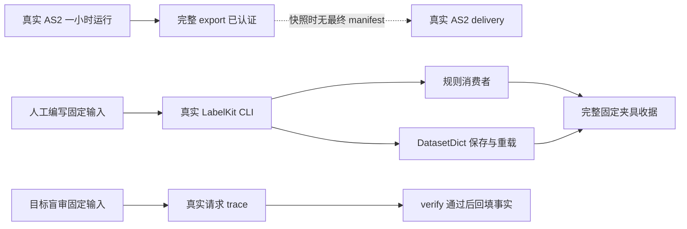

> 历史记录：本文件保存提交 `72f004b0087efa1b6f6d662ac6a143e087e4e21c` 时的过程与判断，不再定义当前系统。
> 当前设计见 [文档入口](../../INDEX.md)；正文中的路径、规则和结果按当时上下文理解。

> 归档基线：2cf230115f4084aef2376e9d77bc976efbed43ea
> 原始路径：`docs/dev/research/delivery-final-audit.md`
> 归档说明：此提交仅定位归档原文快照，不是审查执行证明；原始执行记录与未执行事实按原文保留。

# 足迹与数据交付最终独立审查

> 状态：调研证据（历史依据，不构成当前规范）｜ 日期：2026-09-15 ｜ 结论：原审计的六个实现缺口均已在当前生产路径修复并有行为测试节点；真实 AS2 数据交付在复核快照时尚未完成。

审查日期：2026-09-15。当前复核快照时间为 2026-09-15T16:59:37+08:00。

> 历史审计快照：本文结论只适用于上述时刻，不代表随后完整一天、分支或数据加工的最新结果。
> 最新实现及实际交付边界见 `docs/dev/implementation-status.md`。

本报告覆盖原审计的七个确定缺口（六个实现缺口加一个完整消费者收据缺口），并把实现闭环、固定夹具消费者
证据、真实 AS2 运行和真实 AS2 交付分开陈述。

## 收口结论

原审计中的六个实现缺口均已在当前生产路径中修复，并有针对同一行为边界的测试节点。原来的完整消费者
收据缺口也已有固定人工编写输入的真实 LabelKit、规则消费者和 Hugging Face DatasetDict 留存收据。
该收据明确标记为 `authored_fixture_not_simulation`，不能替代真实 AS2 数据交付。

真实运行目前只完成到“AS2 小时仿真成功并通过完整导出认证”。在复核快照时，
`runs/deepseek-hour-source-enum/delivery` 已产生 action、intent、dreaming 输出和 rules trace，但没有最终
`manifest.json` 或 `failure.json`。这些中间文件不能被称为成功交付。因此，本报告不声称真实 AS2 数据已经交付。

## 原审计缺口的修复复核

| 原审计确定缺口 | 当前生产证据 | 当前行为测试节点 | 复核结论 |
| --- | --- | --- | --- |
| 导出认证不完整 | `delivery.windows.prepare_windows` 首先调用 `footprints.validation.validate_export`；认证覆盖提交与完成状态、窗口、日覆盖、事件和活动字节与行数、共同检查点、来源运行、素材、逐账户账本、活动重建及质量报告重算 | `tests/footprints/test_validation.py::test_production_windows_require_and_accept_complete_authenticated_export`；`::test_incomplete_or_tampered_export_never_reaches_labelkit`；`::test_quality_report_requires_bytes_and_actual_event_recomputation` | 已关闭 |
| 状态可以无事件改变 | `FootprintStore.commit` 拒绝版本改变且事件为空；`_validate_state` 也拒绝同版本隐藏改写，SQLite 事务统一提交状态和事件 | `tests/footprints/test_store.py::test_world_change_without_any_event_cannot_be_committed`；`::test_state_and_events_commit_together_and_reject_same_version_mutation`；`::test_sql_failure_rolls_back_money_and_all_events` | 已关闭 |
| 反事实环境重演只有空声明 | `CounterfactualIntervention` 冻结干预；运行时从共同检查点建立分支；`delivery.replay.replay_windows` 认证父子导出、共同前缀、干预摘要和实际结果，再写入 `environment_replay` | `tests/integration/test_runtime.py::test_counterfactual_branch_freezes_intervention_before_publish`；`tests/life/test_counterfactual.py::test_counterfactual_balance_is_double_entry_versioned_and_one_shot`；`tests/delivery/test_replay.py::test_completed_actual_branch_binds_hypothesis_checkpoint_and_results`；`::test_original_world_cannot_be_mislabeled_as_an_actual_replay`；`::test_actual_branch_rejects_unrelated_parent` | 已关闭；未重演的 dreaming 仍正确保留为 hypothesis |
| 最终清单未覆盖真实消费链 | `delivery.pipeline.deliver` 在全部消费者成功后绑定来源导出和重演导出，并由 `_file_inventory` 对交付目录内每个物理文件记录字节数与 SHA-256；符号链接被拒绝 | `tests/delivery/test_publication.py::test_manifest_inventory_binds_every_gate_and_consumer_file`；`::test_invalid_source_never_creates_delivery_or_runs_model` | 已关闭；固定夹具收据已独立复算，真实 AS2 交付仍待最终清单 |
| 输入窗口缺少前置状态和活动边界 | `delivery.windows._record` 写入 `prerequisite_state`、`activity_boundaries` 和 `boundary_type`；`_activity_boundaries` 保留完成、取消、失败与截断终态 | `tests/delivery/test_windows.py::test_action_history_never_sees_future_answer_and_intent_cutoff_is_explicit`；`::test_midnight_experiment_end_does_not_create_an_extra_training_day`；`tests/life/test_export_integration.py::test_completed_activity_exports_terminal_outcome_and_training_windows` | 已关闭 |
| 语义 verify 可以读取目标事实 | `semantics.complete_annotation` 只补当前输入和来源；`validate_annotation` 拒绝提前出现 `facts`；`pipeline.verify_process` 先检查独立 verdict 和语义约束，通过后才调用 `attach_facts` | `tests/delivery/test_labelkit_process.py::test_real_labelkit_annotate_and_verify_requests_are_target_blind`；`::test_failed_independent_semantic_verdict_blocks_process_output`；`::test_failed_semantic_gate_never_publishes_delivery` | 已关闭；同一模型的独立调用偏差仍由交付清单披露 |
| 没有完整真实消费者留存收据 | 固定人工编写输入已经走过真实 LabelKit CLI、规则消费者、DatasetDict 保存与重载；成功清单覆盖全部六十一个物理文件 | `.work/verification/full-delivery-authored-fixture/success-receipt.json` 及其绑定清单；目标盲审另有独立 trace 收据 | 消费者链证据已关闭；真实 AS2 数据交付证据仍未完成 |

## 当前证据边界



这张图中的两条证据链用途不同。固定夹具链证明当前消费者、发布门和文件认证可以实际运行；AS2 链证明
真实人物运行与完整导出已经跑通。只有 AS2 导出继续产生并通过最终 delivery 清单，才能声称真实 AS2 数据已交付。

## 留存收据复核

### 完整消费者固定夹具

收据位于 `.work/verification/full-delivery-authored-fixture/success-receipt.json`，其 SHA-256 为
`1c993de0055b6a080355c43c076baef3555735d917a949e6dfe4b01db6cfaa0f`。收据明确声明
`kind=authored_fixture_not_simulation`，并记录：

- `committed=true`；
- 五条训练记录，四个规则 fixture，全部规则结果通过；
- DatasetDict 保存后重新加载成功；
- 六十一个交付文件通过验证；
- action、intent、dreaming 和 rules 均有真实 LabelKit 运行墙钟。

绑定清单位于
`.work/verification/full-delivery-authored-fixture/delivery-judge-contract/manifest.json`。清单 SHA-256 为
`269d4ad552e5be0efd3d947e0fc1caec77ad4482e37181fcfcfee789829c0acd`，与收据相同。本次独立复算观察到
六十一个清单文件、六十一个实际文件，集合相等；逐文件字节数与 SHA-256 无失败项。清单内 action、intent、
dreaming、rules 四个任务齐全，训练收据声明来源组隔离和保存后重载均成功，四个规则结果均通过。

同目录下的 `.work/verification/full-delivery-authored-fixture/delivery` 是一次失败尝试并保留 `failure.json`；
它不是成功证据。成功证据只绑定 `delivery-judge-contract` 的不可混淆清单。

### 目标事实盲审固定夹具

收据位于 `.work/verification/labelkit-target-blind/target-blind-receipt.json`，其 SHA-256 为
`6b649462bcccb58317b6cf6866c30166e91b3476de70b835f1fb142c7b5beea6`。绑定 trace 位于
`.work/verification/labelkit-target-blind/out/action.trace.jsonl`，复算 SHA-256 为
`9ab339db74f4eab2d430fc6c49f3e3ab050a1b92c7cc5fd716bf1612d55f7ec2`，与收据一致。

trace 有四个真实 `llm.call`，profile 顺序为 `default, judge, judge, judge`。本次使用冻结 fixture 中的 canary
重新扫描 trace，确认 canary 不存在；收据还记录一条语义成品和 verify 通过后事实回填成功。该证据证明的是
人工编写固定输入的目标盲审路径，不是仿真人物数据。

## 真实 AS2 运行状态

较早的 `runs/deepseek-hour-integrated/status.json` 为失败状态；对应日志记录原生 `finish` 引用了未知记忆，
Society 以 `RuntimeError` 中止。这是失败路径证据，不能作为交付输入。

后续 `runs/deepseek-hour-source-enum/status.json` 为 `completed`。本次直接调用生产
`validate_export(runs/deepseek-hour-source-enum/exports/final)` 成功，得到以下可复核事实：

- 导出清单 SHA-256 为 `0e534f808666cd05ad1383f69e96c3e06b23a833f3bb321bda8f542f0c4e792e`；
- `committed=true` 且 `experiment_completed=true`；
- 运行身份为 `646e5952c7ad498b8a79cd49a2fef02a`；
- 十六条事件、一条活动，声明的一小时时窗落在一个自然日日期内，末事件为 `checkpoint_created`；
- 人物 memory 的 `episodes.jsonl` 有两条记录。

截至复核快照，真实 delivery 目录没有最终 `manifest.json`，也没有 `failure.json`。目录内已生成的 LabelKit
中间输入、输出、trace 和日志均未越过发布边界，不能据此宣布交付成功。

## 只读复核命令与结果

本轮没有运行付费模型、Ray、测试套件或实际突变。使用当前生产认证器和只读文件检查得到：

```text
PYTHONPATH=src .venv/bin/python: validate_export(runs/deepseek-hour-source-enum/exports/final)
result: accepted; events=16; activities=1; committed=true; experiment_completed=true

full authored fixture inventory recomputation
result: declared=61; physical=61; sets_equal=true; descriptor_failures=[]

target-blind trace recomputation
result: receipt_match=true; llm_calls=4; profiles_match=true; canary_absent=true

git rev-parse --verify HEAD
result: fatal: Needed a single revision
```

测试节点均通过源码逐项核对，父任务最近报告相关全门通过；本轮没有把该报告改称为独立重跑结果。

## 剩余限制

真实 AS2 小时数据的最终交付清单尚不存在。交付进程只有在成功发布清单后，才能使用与固定夹具相同的离线
文件集合、大小、摘要、规则结果和 DatasetDict 重载检查形成真实 AS2 交付收据。

当前顶层仓库还没有可解析的 `HEAD`，无法建立固定基准的隔离 worktree；因此 Uncle Bob 计划仍是预声明，
没有产生 killed、survived 或 mutation score。本文未读取凭据。

## 版本表

| 版本 | 日期 | 修订内容 |
| --- | --- | --- |
| 早期版本 | 未记录 | 记录修复前工作区快照，其中“当前缺口”和反例是历史证据，不能用于描述现有源码 |
| 本版 | 2026-09-15 | 逐项重查原来的七个确定缺口（六个实现缺口加一个完整消费者收据缺口），并把实现闭环、固定夹具消费者证据、真实 AS2 运行和真实 AS2 交付分开 |

