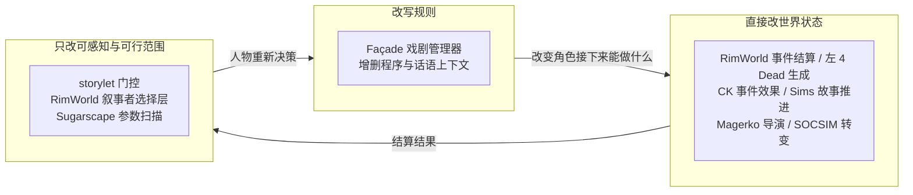

> 归档基线：2cf230115f4084aef2376e9d77bc976efbed43ea
> 原始路径：`docs/dev/research/exogenous-incidents.md`
> 归档说明：此提交仅定位归档原文快照，不是审查执行证明；原始执行记录与未执行事实按原文保留。

# 突发世界事件：非脚本化外生事件的生成机制与可复现随机性

> 状态：调研证据（历史依据，不构成当前规范）｜ 日期：2026-09-21
> 范围：游戏与社会模拟如何生成非脚本化的外生人生事件（事故、疾病、升迁、丧亲、战争、死亡），以及如何让随机性可复现。
> 用途：为突发事件类世界事件的机制设计提供外部依据；本文不含设计条款，不宣告任何功能已实现。
> 核实规则：只采信 2025 年 10 月及以前发布的材料；wiki 转述与开发者原文分开标注；事实、推论与本项目判断分开表达。

## 结论摘要

外部材料给出的最可迁移的一条，是把**事件的选择**与**事件的结算**分开，并让随机性只存在于其中一层。



RimWorld 是最干净的样本：叙事者只挪动概率、永远不能增减一个殖民者，真正改状态的是被选中之后的那条事件。左 4 Dead 恰好相反，它的选择由实时行为强度驱动，这正是它无法从种子重放的原因，而且没有任何来源声称它可以重放。**可复现性优先于响应性时，选择层应当是模拟状态的纯函数，这是本报告的主要结论。**

真正可从记录值复现的机制只有两条，且在不同系统里独立复现：**指数等待时间**（RimWorld 的 MTB、CK 的 MTTH、SOCSIM 的分段指数竞争风险），以及**逐实体独立随机流**（L'Ecuyer 的 RngStreams）。前者是「每期概率对状态求值而非预排日期」，后者保证增删一个实体不扰动其他实体看到的随机数。

另外有一条负面结果值得记录：文献里已经有人尝试把「哪些事件值得被叙述」操作化，结果是**评估不确定**——那套启发式并没有稳定产出更受好评的故事。

## 分类：三种中介方式

材料不属于两类而属于三类，混淆这三者是本主题最容易犯的分析错误。

| 方式 | 代表 | 干预的对象 |
| --- | --- | --- |
| 改写规则 | Façade 戏剧管理器 | 增删人物可执行的程序与话语上下文 |
| 直接改世界状态 | RimWorld 事件结算、左 4 Dead 生成、CK 事件效果、Sims 邻里故事、Magerko 导演、SOCSIM 转变 | 世界事实本身 |
| 只改可感知与可行范围 | storylet 门控、RimWorld 叙事者选择层、Sugarscape 参数扫描 | 可能性与可见性 |

同一系统可以跨两种方式：RimWorld 的叙事者从不触碰状态，但它选中的事件会。**选择层间接、结算层直接**，这个组合是本报告中最有迁移价值的结构。

## 左 4 Dead：AI 导演

**机制。** 导演是叠在战役之上的运行时节奏系统。Booth 幻灯片里的既定目标是「提供稳健的行为表现」「提供称职的人类玩家替身」「促进可重玩性」「生成戏剧性游戏节奏」。节奏由一个四态有限状态机驱动——**Build Up**、**Sustain Peak**、**Peak Fade**、**Relax**——输入是四名幸存者各自的情绪强度估计，取其中最大值。Relax 态维持 30–45 秒的低人口，或直到幸存者走得足够远；如果玩家在低谷期冲刺，导演会标记该位置并强制回到 Build Up。人口从两个导航区集合中抽取：对幸存者潜在可见的全部区域（禁止生成），以及**活动区集合**，即导演可创建或销毁感染者的幸存者周边区域。

Boss 级威胁放置是纸牌机制：事件沿撤离路线以三张牌洗牌——**Tank**、**Witch**、**Blank**——按固定单位间隔加随机偏移发出，约束是两张相同的牌不得相邻。因此 Witch–Blank–Witch 合法，Tank–Tank 不合法。普通感染者小群以 90–180 秒的随机间隔生成，Normal 难度下 20–30 只，Boomer 的呕吐会强制引发一次尸潮并重置计时器；约四分之三的尸群从后方接近。每个区域的漫游者数量在地图开始时按撤离路线长度与期望密度设定。武器箱与物品组由关卡设计师作为候选集合手工放置，导演决定某次运行中哪些真的存在。

**来源核实。** Booth 的幻灯片《The AI Systems of Left 4 Dead》副标题为「Michael Booth, Valve」，幻灯片本身不带日期与会议信息。**会议与日期已核实（2026-09-21）**：据 AAAI 于 2009 年 9 月 16 日发布的新闻稿，该报告在 AIIDE-09（第五届 AAAI 人工智能与交互式数字娱乐会议，Stanford 大学）发表，会期 **2009 年 10 月 14–16 日**——这更正了广泛流传的「10 月 27 日」，新闻稿不支持该日期。**该报告列在 `invited talks`（受邀报告）之中，新闻稿通篇未用 `keynote` 一词**；不得使用「主题演讲」这一表述。幻灯片镜像：`https://steamcdn-a.akamaihd.net/apps/valve/2009/ai_systems_of_l4d_mike_booth.pdf`（文件名用的是小写 L「l4d」，书目中常被误写成「14d」）。旧论文引用的 `valvesoftware.com/publications/2009/...` 路径已失效。

分析该演讲的文章《11 Secrets about Left 4 Dead's AI Director and its Procedural Zombie Population》是 AiGameDev.com 的作品，该站已关闭，流通副本是某大学课程页上的 PDF 镜像。其编号章节可由镜像确认，至少包含 #3「Working from Known Quantities」、#4「Limited Mostly Linear Scope」、#5「Unpredictable by Design」、#8（Boss 人口作为纸牌抽取）、#9「Player Centric Design」、#10「Finite State Machine for Pacing」、#11「Elasticity of the Infected Behavior」。**署名与确切发表日期仍未确认**；该演讲的幻灯片于 2009 年 12 月公开发布并于 12 月 22 日被报道，故文章不早于 2009 年末。AiGameDev.com 的主编是 Alex J. Champandard，因此归名于他属于**很可能的推断，未核实**。那些编号的「秘密」应视为该文对 Booth 幻灯片的转述框架，不是 Valve 自己的措辞。

**可复现性：两个方向都没有来源。** 未找到种子生成器、导演状态序列化或运行确定性重放的任何文档。引擎里存在的是 *Journal* 机制，导演据此为下一张地图写入并执行指令——那是跨地图的标志位状态，不是模拟状态。调试读数（`logic_director_query` 暴露的 anger level、强度变化事件）确认存在内部强度值，但不构成持久化。由于状态机的转移读取实时玩家行为，固定初始种子本身不足以复现一次运行：相同种子加上任何玩家时序差异会立即发散。**这是从已记录机制得出的推论，不是有文档的陈述**，在此明确标为推论。

**一条值得保留的反调。** L4D 联合主创 Chet Faliszek 在 2023 年 11 月的 15 周年访谈（Game Developer，《15 years later, Chet Faliszek dishes on the making of Left 4 Dead》）中称导演「不在乎玩家」、是「一个就那么工作的随机数生成器」，并把「把一个普通随机器包装成先进 AI」称为该作开发中最天才的决定之一。该说法与 Booth 详尽的节奏描述存在张力；材料普遍给出的调和是：这只说明玩家建模的成分很小，并不是对节奏循环的否认——但那是编辑性的调和，不是 Faliszek 的原话。该英文原文已定位，本段文字经检索结果与译述获得而非通读全页，措辞以文章本身为准。

**中介方式。** 导演在结算层直接改世界：在活动区集合中创建与销毁感染者，决定某次运行中哪些预置战利品存在。它**不触碰幸存者状态**。它对玩家的影响完全经由环境——存在什么、在哪里、施加多大压力——幸存者的反应是玩家自己的。

## RimWorld：AI 叙事者

**机制。** 两个机制必须分开读，否则数字会被误用。**Mean Time Between** 决定下一件事**什么时候**发生，以天为单位，是指数等待的均值——越小越频繁。**事件权重**决定计时器到期后**选中哪一件**：叙事者的品类权重乘以逐事件的基础概率值，加权掷骰选出胜者。

事件在 `IncidentDef` 中定义，字段含 `category`、`baseChance`、`minRefireDays`、`earliestDay`、`minPopulation`、`minThreatPoints`、`pointsScaleable`、`allowedBiomes`、`chanceFactorByPopulationCurve`。计时器住在叙事者定义的组件里而不是事件里：`StorytellerCompProperties_ThreatCycle` 携带 `mtbDaysThreatSmall`、`mtbDaysThreatBig`、`threatCycleLength`、`minDaysBetweenThreatBigs`，`StorytellerCompProperties_CategoryMTB` 每个品类带一个 `mtbDays`。Cassandra Classic 与 Phoebe Chillax 在开相位与停相位之间循环；Randy Random 则把重大威胁当作一件概率较低的事件。威胁**规模**由袭击点数算出，随财富、殖民者数量与难度增长，具名方法是 `StorytellerUtility.DefaultThreatPointsNow`；Randy 对袭击点数施加 0.5×–1.5× 的随机乘数，而 Cassandra 与 Phoebe 不施加。人口压力通过 `PopulationIntent` 表达（取代了旧的 `desiredPopulationMin`/`Max`/`Critical`），默认每叙事者下限 0.05，Randy 为 0.20。

**来源。** 机制文档是 **wiki**——RimWorld wiki 的「AI Storytellers」与「Events」页，辅以模组作者研读定义文件的 Ludeon 论坛帖。**没有找到 MTB 系统的开发者文档。** 设计**意图**由 Sylvester 本人的文字与访谈记录：《The Simulation Dream》（2013 年 6 月 2 日）主张「游戏的全部价值在于它投射进玩家心智的自我心智模型」，「游戏模型中不能复制到玩家模型里的东西毫无价值」，设计者应当「选择能支持你想生成的那类故事的最小表示」，结论是「游戏是共同作者，不是作者」。Rock Paper Shotgun 2016 年 8 月 12 日的文章给出 apophenia 框架——Sylvester 原话：「本质上就是玩家从游戏事件中提取出比机制实际表示更多的故事含义」——以及刻意限制殖民地规模的理由（「这是刻意设计，好让玩家认识每一个人，并对每个人都有可回忆的历史」）。Game Developer 2016 年 8 月 10 日刊出 Sylvester 的话「故事的真正引擎是玩法系统本身」与约束「游戏试图伤害但不杀死殖民地」。

**可复现性：部分成立，两半必须分开。** 世界生成种子是真实存储的值：存在世界文件的 `<info>` 块中，与 `<planetCoverage>`、`<persistentRandomValue>` 并列，同一种子在同版本同生成器输入下复现同一张地图。社群文档称随机种子存于存档，且有一个高级选项决定是否每次载入重新播种，若开启则载入行为默认确定；**未找到 Ludeon 官方记录该选项的页面**，故视为社群文档而非开发者文档。玩家一致报告的是：重新载入存档会在**大致相同的时间**复现某事件，而**类型**或派系会重掷；且袭击类事件被分组，因此重载可以换一种袭击风味，但不会把袭击换成雷暴。各方记述相互冲突，有报告称完全独立重掷，该分歧在材料中未获解决，可能反映版本差异或该重播种选项。用本文问题的语言：**时间似乎是累积叙事者压力的确定性函数，而选择似乎是每次独立的一次掷骰**。

**中介方式：选择层间接，结算层直接。** 叙事者不能增减殖民者。它只挪动可能发生的事件的概率——人口低时提高流浪者加入的权重，人口高时提高疫情爆发的几率——而事件一旦被选中就会改变状态。Sylvester 自己的说法是系统注入压力而不规定结局，「伤害但不杀死」这句在设计的语言里表达了同一件事。

## Dwarf Fortress：世界生成与 Legends

**机制。** 世界生成是一次模拟，不是生成器。DF wiki 引述 Tarn Adams 访谈的历史层概述是最清楚的架构说明：

> "There's a giant zero-player strategy game going on with somewhat loose turn rules and bad AI (but thousands of agents), and history is just a record of that. Procedurally generating stories by recording a log of a simulation is a valid enough approach, though it has drawbacks, of course. It's a lot of work, you need to do post-processing or investigation to find any good moments you'd like to highlight, and if you don't have enough dynamics and mechanisms, the output can be boring."

历史按周步进、跑完配置的时长；文明扩张与冲突，统治者性格从五十个特质的矩阵中抽取，这些特质喂给是否开战一类的决策。设计意图是让个体实体在长时段内保持连续：你必须

> "keep track of which historical figure was dragged into a night creature's lair so that you can find their body parts simmering in the cauldron."

（Polygon，2014 年 7 月 23 日，Tarn Adams 访谈。）

**可复现性：四个种子，但历史不能可靠复现，且这是未修复缺陷。** 暴露四个独立种子——`[SEED]`（地形与世界结构）、`[HISTORY_SEED]`（历史人物与事件结果）、`[NAME_SEED]`、`[CREATURE_SEED]`；任何未设置的记号独立随机化，因此主种子并不派生其余三个，实际使用的值写入 `gamelog.txt`。种子系统**不能**可靠复现历史，这一点被记录为未修复缺陷而非限制。缺陷 6934「Using Seeds in World Gen does not always result in Civs behaving the same way (History Seed broken?)」于 2014 年 7 月 10 日针对 0.40.01 提交，至 2025 年 6 月 30 日最后一次更新时仍处于未修状态：四个种子全部固定、生成一座小岛并跑一千年，地理与地理派生的落点完全一致，但有的运行以死亡时代结束，有的以寓言时代，有的以哥布林时代，城镇与道路位置各不相同——「每次用相同种子生成世界都会出现平行时间线」。同类报告 13206 至 2025 年 8 月 31 日仍为新增状态。相关条目还有 8572（命令行传入种子时混入额外随机性，以重复关闭）、5974（种子在不同操作系统不能生成同一世界，未修）、10420（同参数在不同平台产生不同世界）。0.43.05（2016 年 7 月 5 日）修复了一个根因——「修复世界生成贸易导致世界历史分叉的问题」——Toady 的发布说明是「本次发布应当也让相同种子生成的世界更一致」。注意 `should` 与 `more consistent` 的限定：这**不是**逐位一致历史的承诺，较旧的缺陷仍然开放。流传引用中的「大体相同的世界」是俄文 DF wiki 上的译文，不是 Toady 的措辞。

wiki 给出的实用建议是复现**整套参数**而不只是种子，因为改动记号会改变每个生成阶段消耗多少个伪随机值——即便如此，地点级与事件级的分叉仍属预期。

**生成的历史与玩家的体验是同一份数据。**「World Activation」发布（v0.40.01，2014 年 7 月）让世界生成过程——出生、死亡、婚姻、继承、任命、入侵、地点建立与收复、巡逻、盗匪、动物种群——在开始游戏后继续，每玩两周推进两周模拟时间。Tarn Adams 对该设计的说法是玩家行为进入同一套历史事件结构：

> "The players can impact all of it pretty much, and it keeps track of what they do in Legends mode, the same as worldgen. All the data structures for historical events are the same between all the modes."

他给出的分叉检验很直接：用同一种子跑到第 100 年，最后十年自己玩，与未干预的 110 年世界比较——「在无玩家的 110 年世界里可能平静度过一生的人，在你干预的世界里可能在 105 年被征召、死在你的锯木陷阱里。或者发生点更幸福的事。」Legends 模式是读这份记录的窗口：按时代列出历史人物、地点、器物、区域、文明与编年史，玩家在要塞或冒险模式中的任何显著成就都被记录并可在 Legends 模式查看，且可整份导出为 XML。Adams 描述有一类玩家把这当成本体：「有一整类 Dwarf Fortress 玩家两种传统游戏模式都不玩，他们只对自己生成的世界做考古。」

## Crusader Kings：事件池与 mean time to happen

**机制。** CK2 中多数随机事件声明 `mean_time_to_happen`（MTTH）而不是概率。CK2 wiki 的定义是：MTTH 是「随机事件发生平均需要多少时间的度量」，并给出具体解读——MTTH 为 90 天时，到第 90 天事件已触发的概率恰好是 50%。它通常以月书写，也可用日或年，归一化为一年等于十二个月、360 天。`mean_time_to_happen` 内的修正块以乘法缩放等待时间，两个 0.9 得 0.81；小于 1 的因子使事件提前。`is_triggered_only = yes` 让事件完全脱离 MTTH，仅在选项、决议或 on_action 调用时触发。由 on_action 驱动的事件必须改用 `weight_multiplier`，其语义相反——修正提高的是事件概率而非所需时间。

**MTTH 是概率性等待时间吗？是，且精确换算有记录。** Paradox 开发者 Johan 于 2007 年在 Paradox 论坛贴出引擎实现（描述 EU3），该帖经镜像与引述保存。标识符在原文中拼写为 `daylyChance`，便于溯源：

```
float daylyChance = float(1.0f - exp( log(0.5f) / MeanTimeToHappen ));
float chance     = float(1 - exp( noOfDays * log(1 - daylyChance)) );
return chance;   // 0-1% chance of event happening that day
```

第一行在代数上等于 `p = 1 - 0.5^(1/MTTH)`，它把分布校准到「至少触发一次的累计概率恰好在 MTTH 处达到 50%」。结论必须说准，因为它与通常的转述矛盾：**MTTH 是首次触发时间的中位数，不是两次触发之间的平均间隔。** MTTH 为 90 天时日概率约 0.767%，到第 90 天的期望触发次数约 0.69 而不是 1；期望达到 1 大约要等到 1.45 倍 MTTH。`noOfDays` 项把计算推广到多日轮询窗口，当时取 1，故每次检查的概率等于日概率。旧 wiki 中「平均每 MTTH 触发一次」的说法是简化，与引擎代码不符。该代码可追溯到 2007 年描述 EU3 实现的论坛帖；原帖在检索中未浮现，本报告只经二手复现获得，故应视为 EU3/CK2 时期的已记录行为，不能当作后续作品的保证。

**可复现性：未记录，且有一条来源暗示它刻意无状态。** 未找到任何来源描述种子、保存的生成器状态或存档重载确定性。材料描述的是对角色状态求值的每期概率，抽取本身没有任何暴露。一条保存在模组论坛上的开发者陈述更进一步，称 MTTH 接入「一个硬编码公式」，每个实例与 RNG 比较，且**不记录任何逐事件触发历史**——这会使抽取成为已过时间与当前状态的函数，而不是任何逐角色累计计数的函数。该陈述为二手，未能对引擎核实；若准确，它是本报告中最接近「无状态、可重算事件机制」的东西，也是应当刻意设计、而不是偶然继承的性质。

**中介方式。** 直接。事件触发即把效果施加于角色状态——属性、特质、关系、领地——玩家随后对改变后的处境做出反应。没有记录在案的纯可供性层。

**后继作品的逆转，对本主题最有用的部分。** CK3 放弃了 MTTH。开发日记第 30 篇「Event Scripting」（2020 年 6 月 9 日）以开发者自己的语言给出理由：当需要相互平衡的事件数量非常大时，MTTH 的灵活性变成了负担，要在没有非常严格触发条件的情况下管住一个事件该多久生成变得困难；纯概率运作产生了「大量奇怪的统计异常」；而且它「极其拖垮性能」。CK3 改由 `on_action` 触发事件——来自代码的钩子，既可由具体世界事件（如角色出生）触发，也可按固定脉冲（如每五年）触发——每个 on_action 要么直接触发，要么指向一张候选事件的**加权列表**，权重乘数与常规因子仍然适用。后续性能工作（开发日记第 187 篇，2025 年 10 月）量化事件触发占每日 tick 时间的略超十分之一，这是「为何值得牺牲表达力换取更简单的加权选择器」最清楚的可用证据。

## The Sims：故事推进与邻里故事

**The Sims 3 的故事推进。** 一个带明确人口管理目标的规则化城镇模拟器，不是一组罐头剧情。EA 在 2009 年 7 月 20 日的开发团队博客中对意图的描述把两个目标按顺序列出：维持城镇稳定是首要，让邻近家庭感觉有自己的故事是次要——「这类行动以及制造故事的概念始终让位于为你的模拟市民家庭提供理想的玩法背景。」人口控制被明确表述为性能驱动。有记录的效果集合（职job、搬家与体重子集出自 EA 博客，完整列表出自 **wiki**）包括搬入搬出、换工作、升职、解雇与退休、结婚、离婚、怀孕与领养、死亡、体重变化、技能增长、名人地位与吸血鬼化。第二个容易漏掉的机制是**职业填补**：职业需要有老板与同事，于是游戏会把真实存活的模拟市民升职、或指派一个邻居当你的老板——**这一步在故事推进关闭时依然发生**，这正是玩家在关掉该系统后仍看到邻居获得工作的原因。

作用范围是 TS3 与 TS4 差别最大的地方。EA 自己的手册写明，当你切换到另一个家庭时，原先的家庭会在你离开期间随全镇一起变化——可能获得技能或关系、被解雇或升职，「或以其他方式改变」。所以边界是**当前是否在玩**，而不是**曾经是否玩过**；轮换游玩者按设计会受影响。退出方式是一个开关，与年龄增长的复选框分开，且**发售时是坏的**：EA 承认「关闭该选项无效」，发布仅限 PC 的命令行变通（`-disablestoryprogression`，Mac 无对应），并在 2009 年 6 月 25 日的更新中修复。EA 记录了系统完全关闭后仍会发生的事：预制怀孕的模拟市民仍会生产，开启年龄增长时仍会死亡，邻居的职业仍会被重新指派以充当你的老板或同事，且「最终你的模拟市民世界会没有邻居」。已施加的效果不因该开关而可逆。节奏**没有 EA 文档**；唯一数字来自模组作者 2014 年对反编译代码的解读——每二十秒真实游玩时间执行一次动作的服务循环、逐动作的时段门槛、约 180 的人口上限与基于评分的淘汰——且该来源自我声明为第三方逆向工程，不是 EA 的陈述。确定性**没有文档**；EA 确认职业指派使用裸随机抽取（「它会随机挑一个模拟市民指派到那个职业」），但对播种只字未提。没有离线推进：游戏内时钟只在存档载入时前进。

**The Sims 4 的邻里故事——本报告中前后对比最干净的一例。** TS4 发售时实际上没有超出年龄增长的、针对非游玩家庭的故事推进。邻里故事分两个阶段、相隔十六周到来，而 EA 在两个阶段之间**反转了中介模式**。**第一阶段**（2021 年 11 月 23 日公布，11 月 30 日上线）完全**经过中介**：人生变化要么可通过新的社交互动施加影响，要么在自主发生时，只在邻居模拟市民给你的某个模拟市民打电话征询意见之后才执行——「邻居模拟市民目前不会自主结婚」，自主候选「会先给你的一个模拟市民打电话征求意见再行动」。没有任何事在玩家背后发生。**第二阶段**（EA 的「Neighborhood Stories System」帖，2022 年 3 月 15 日）移除了中介，向所有邻居模拟市民开放人生变化，「无论是否与当前活跃家庭有关系」。有记录的人生变化包括：领养幼年模拟市民、与伴侣怀孕（受特质加权——顾家者更可能，不愿承诺者更不可能，任一方讨厌小孩时绝不发生）、领养猫狗、入职与离职（特质强烈影响决定，长辈可退休）、家庭搬入搬出地块、以及「依年龄、特质与职业等风险因素」以不同方式意外死亡。EA 自己的这句话是直接改变状态这一模式最好的引文：「这些人生的变化发生在活跃家庭之外的世界里。这意味着有时你的模拟市民永远不会接触到这些变化的结果。」

作用范围与 TS3 正好相反，EA 说明了理由：「默认情况下，邻里故事对其他家庭启用、对我的家庭禁用」，动机是希望「避免对我们知道你们倾注了很多爱的长期存档造成非预期改动」，并直接提及轮换游玩。配置可逐人生变化类型、逐家庭组、逐家庭设置，按存档存储，游戏选项中有全局禁用；一处有记录的残留泄漏是，邻居模拟市民仍会偶尔打电话征求意见，除非把电话静音。已施加变化的可逆性**没有文档**——全部措辞都是前瞻的。节奏**没有文档**：EA 从未给出 tick、逐载入评估或每日掷骰；唯一可观察的是事后报告事件的邮箱互动，而日志条目是在事件解决时写入还是在被查询时生成，同样没有文档。确定性**没有文档**。

关于最常与该功能关联的那个资料片：*Growing Together*（2023 年 3 月 14–16 日）**没有**加入邻里故事机制。2023 年 3 月 14 日的免费基础游戏补丁加入了婴儿生命阶段，并把邻里故事调低到欢迎**更少**新生儿，明确理由是婴儿所需的照料量，同时也降低了家庭成员打电话询问是否要孩子的频率。付费资料片自身的系统是里程碑、婴儿怪癖、家庭动态、社交相容性与儿童自信。未找到任何 EA 陈述把 Growing Together 本身与邻里故事的改动绑定；2024 或 2025 年的邻里故事新增内容未作核实。

最后，**自主行为**与邻里故事是两个不同的系统，未找到任何一手来源说明两者如何组合。自主行为管的是你正在游玩的家庭内的模拟市民在没有指令时会做什么；邻里故事管的是活跃家庭之外的家庭。EA 的措辞一贯把邻里故事限定为「住在你活跃家庭之外的邻居模拟市民」，这使得两者的分离在定义上是清楚的，尽管其交互没有文档。

## storylet、戏剧管理器与策展者角色

### storylet：由状态门控的内容，不作干预

该术语由 Failbetter Games 在《Echo Bazaar Narrative Structures》第二部分（2010 年 3 月 3 日，工作室署名，夹注署「AK」即 Alexis Kennedy）中定义。storylet 是「EB 的基本构建块」、「离散的叙事块，可以以任意顺序、任意次数游玩」、「由 Qualities 解锁与控制」，「qualities 告诉 storylet 该做什么」。文中给出的完整例子是一条墓园 storylet，第一个分支由 `Connected: The Church` 门控，第二个由 `Connected: Society` 门控，两者都降低第三个 quality `Scandal`。更大结构也被命名：Questicles，由单一 quality 驱动、有开头中段结尾的一串相连 storylet；以及 Mark of Cain，一个永久压制某条故事线的流放 quality，使其只能被游玩一次。第三部分（2010 年 3 月 13 日）给出了对本主题最直接有用的设计者角色陈述：

> "we control the actual chunks of the story, the paths between them belong to the player alone" "in a film the story is told through the edit, in Echo Bazaar, the story is told through the darkened paths between the fires" "In cinematic terms, it's a montage: we provide the shots, the player does the arrangement."

那是**序列**的策展，不是内容的策展：Failbetter 仍然手工撰写每一条 storylet 的文本。

形式化的三段定义出自 Emily Short 而非 Failbetter，且时间更晚：《Storylets: You Want Them》，2019 年 11 月 29 日——「存在一块内容」、「存在决定该内容何时可被播放的前置条件」、「存在该内容播放之后对世界状态产生的效果」，并补充 storylet 是「简单、原子、稳健、可重组」的，且明确指出该定义「没有说明一条 storylet 内有多少内容、内容如何组织、或如何被选择」。她更早的分类文章《Beyond Branching: Quality-Based, Salience-Based, and Waypoint Narrative Structures》（2016 年 4 月 12 日）区分了选择模式：在 quality-based 叙事中「玩家从当前全部合法元素里挑选下一个要看的最佳元素」；在 salience-based 选择中「salience-based 方法自己做这个决定」，对任何可测试的世界状态打分，并以**随机断平**；在 waypoint 叙事中内容附着于话题之间的转移，后续寻路被负向加权以避开已用过的路线。她关于可复现性的诚实说明最该带进设计文档：salience 权重是作者猜的，作者通常先选一个「感觉对」的数字，然后针对出问题的输出再调整，因此这「几乎总是试错过程」。**选择器在给定状态下是确定性的；权重不是有原则的。**

storylet 系统的分类学出自 **Kreminski & Wardrip-Fruin**《Sketching a Map of the Storylets Design Space》，ICIDS 2018（LNCS 11318, pp. 160–164，doi `10.1007/978-3-030-04028-4_14`）——**不是** James Ryan，也不存在任何人的「Storylets: A Survey」。他们的定义：storylet 是「离散、自足、可重排的叙事内容模块，由决定其在任一时点能否被呈现给玩家的前置条件所门控」。四个维度是前置条件类型、可重复性、内部结构与内容选择架构，其比较表明确点出五个内容选择家族——玩家从列表中选择；简单随机；加权随机（*Reigns* 是其范例，用一副纸牌的隐喻）；salience-based（*The King of Chicago* 是范例）；以及寻路或搜索（*StoryAssembler* 与 Short 的 *Glass* 是范例）。Façade 被归为戏剧管理器选择。该文把「内容选择架构」一词归功于 Michael Mateas（未发表的讲座幻灯片）。其框架性句子值得引用于提案：「在 storylet 模型下，玩家不是穿过一条由设计师事先指定的故事。相反，玩家与游戏共同从各自可支配的模块中组装出一条故事。」

**归属更正（经全文检索核实，2026-09-21）。** Ryan 的博士论文 815 页中 `storylet`/`storylets` 出现**零次**，且不含任何 storylet 分类学。本节的 storylet 材料属于 Failbetter（提出）、Emily Short（普及与形式化）与 Kreminski & Wardrip-Fruin（设计空间）。不得归给 Ryan。Ryan 的实际主题是涌现叙事与干预主义的对立，戏剧管理器被举为干预主义的主要例子——见下文的策展小节。

### Façade：一个干预的导演——但干预的是规则，不是事实

Façade 的单位是 **beat**，定义于 AIIDE 2005 论文《Structuring Content in the Façade Interactive Drama Architecture》：

> "A Façade beat is comprised of anywhere from 10 to 100 joint dialog behaviors (jdbs), written in ABL. Each beat is in turn a narrative sequencer, responsible for sequencing a subset of its jdb's in response to player interaction. Only one beat is active at any time."

戏剧管理器（或称 beat 序列器）被描述为「多数时间处于休眠，仅当前一个 beat 结束或被中止时激活」，它是「处理重大事件之间因果依赖的地方——也就是做出高层剧情决策的地方」。选择机制是作者标注加打分：

> "the author annotates each beat with selection knowledge consisting of preconditions, weights, weight tests, priorities, priority tests, and story value effects – the overall tension level, in Façade's case. Given a collection of beats represented in the beat language, such as the 27 listed in Table 1, the beat sequencer selects the next beat to be performed. The unused beat whose preconditions are satisfied and whose story tension effects most closely match the near-term trajectory of an author-specified story tension arc (in Façade, an Aristotelian tension arc) is the one chosen; weights and priorities also influence the decision."

关于可复现性：**这是在状态派生的候选池上的确定性选择。** 所描述的选择过程中没有任何随机抽取。随机性只通过人类玩家进入，玩家本身才是随机元素。必须明确：这是**从原文中不存在随机选择步骤推断出来的**，而非引自某句称该选择器为确定性的话；未找到这样的句子。规模方面注意两篇论文之间的真实差异：AIIDE 2005 文本说有 27 个 beat 并列出了 27 个名字；GDC 2003 文本《Façade: An Experiment in Building a Fully-Realized Interactive Drama》说 beat 从约 200 个的池中选出。这是相隔两年、数量相差约七倍的两篇论文，**不注明日期就不要给出单一数字**。GDC 2003 论文还给出了中介方式的答案，那是一个确实不同的模式：

> "Beyond what a pure simulation contains, however, is an additional invisible agent called the drama manager. The drama manager continuously monitors the simulation and proactively adds and retracts procedures (behaviors) and discourse contexts by which Grace and Trip operate. That is, the rules of the simulation are regularly being updated in an attempt to give the player a well-formed overall experience with unity, efficiency and pacing."

所以该管理器既不设余额也不只是过滤感知；它**改写角色接下来能做什么**。语言处理位于 beat 内部：玩家文本被分类为话语行为，每个 beat 都设计成能在任意时刻响应任意话语行为，同一话语行为在不同 beat 中可能引出不同反应——这是对手写台词的**选择与变奏，不是生成**。

### 策展：Ryan 的论点，以及材料对隐喻的告诫

James Ryan 的博士论文《Curating Simulated Storyworlds》（UC Santa Cruz，2018 年 12 月，计算媒体；答辩委员会 Michael Mateas（主席）、Noah Wardrip-Fruin、Ian Horswill、Jonathan Lessard；815 页；CC BY 4.0；开放获取于 `escholarship.org/uc/item/1340j5h2`）是策展者角色的核心文本。**范围更正：**该论文的主题是**涌现叙事与干预主义的对立**，不是 storylet；它把戏剧管理器举为干预主义的主要例子（`drama manager` 出现 6 次，`drama management` 11 次，`curationist emergent narrative` 178 次）。`refus`、`veto`、`implausib`、`incoherent` 同样出现零次，因此「拒绝」框架不得归给它——见「作者控制与涌现」一节。

用他自己的话说：涌现叙事系统模拟一个故事世界，叙事「从角色活动的偶发中」涌现；这一形式的乐趣在于涌现的故事「确实发生了」、「更像非虚构而不是虚构」；其典型失败是把原始模拟轨迹误当作叙事作品，因为这类材料「几乎总是缺少故事结构」。他提出的补救是**策展式涌现叙事**：模拟的material「被策展以构造出真正的叙事作品」，这把故事生成「重塑为一种讲述行为，而不是发明」。其承重主张很直接：「没有策展，涌现叙事中不可能得到真正的故事」——在成功案例里「人类承担了策展一场进行中的模拟的负担」，在失败案例里「人类不愿做必要的策展」。他提出的架构方案包括条件式解锁、因果记账、筛选启发式，以及一套可讲述性程序：找到最有趣的终局事件，沿因果链接回溯，直到抵达一个无需解释的事件。

**引用状态已升级（2026-09-21）：**论文 PDF 已完整下载并做文本提取，因此下文这段反干预的引文是**引自原文**，此前「仅通过 Emily Short 的转述获知」这一限定不再适用。Ryan 明确**拒绝**把戏剧管理作为通往涌现叙事的路径——经由「一个创作写作模型、一个戏剧管理器、一个剧情级叙事规划器」介入，意味着事件「不再像非虚构那样运作……它们不是真的发生了，也不让人感觉真的发生了」。这是文献中关于本主题所问张力的最尖锐表述。

其次，对设计文档尤为重要：**「策展园丁」这个形象不是 Ryan 的。** 检索未在其著作中找到该框架；相邻写作中的园丁形象属于景观建筑学的 Gilles Clément，且没有引用桥接。若需要园丁隐喻，应作为自有综合提出。真正属于一手文献的植物园意象出自 Will Wright，他在 2004 年 5 月 1 日对 Perlin 的回应中，描述设计一个「有趣、多样、合理」的空间，并将其比作一座造得好的植物园。

### 体验管理器：Riedl & Bulitko 与 Magerko

**Riedl & Bulitko**《Interactive Narrative: An Intelligent Systems Approach》，*AI Magazine* 34(1)，2013（doi `10.1609/aimag.v34i1.2449`）是该领域的综述。他们自己的词汇是「experience manager」而不是「drama manager」，检索时这点重要。其框架是：「体验管理器是人类作者的替身，在玩家自主性面前代表其作者意图」，并明确点出张力：「体验管理器试图为用户交互体验带来全局结构，而虚拟角色试图执行促进可信度的局部行动，两者之间可能存在张力。」其开放问题包括「如何编码人类作者意图，以及在何种抽象层级上？」广为引用的定义——「体验管理器是一个试图强制虚拟世界以使用户交互体验符合一组给定性质的智能体」——出自 Riedl、Stern、Dini & Alderman 的 *International Transactions on Systems Science and Applications* 3(1), 2008，而非 2013 那篇。「强制虚拟世界」这个动词把它放在直接改变状态那一端。

**Magerko 的交互戏剧架构（IDA）**是本整节里最清楚的直接干预案例。规范来源是其博士论文《Player Modeling in the Interactive Drama Architecture》（密歇根大学，2006）；他自己的用词是「director」。摘要中的问题框架是：创作容量有限，因此「玩家可能的能力会超出已创作的故事空间」，导演的工作是「巧妙引导玩家的体验，使其停留在已创作的故事空间内」，用玩家行为与知识的模型来预见问题。循环描述见 Magerko & Laird 的 2004 年 AAAI 工作坊论文《Mediating the Tension between Plot and Interaction》：当一个剧情点结束，导演对世界状态做快照，在副本上向前运行基于规则的玩家模型，检查某个活跃剧情点的前置条件能否在时序约束被违反之前满足，返回成功或失败；随后它可以对角色施为（注入目标、世界状态事实或原子动作），对物件施为（在通过针对玩家已知信念的可信度检查的前提下创建、移除或移动它们），并通过灯光与声音对施加于环境。**那是对世界的直接修改**——物件与生理——既不是门控也不是规则改写。随机性与可复现性在触达的材料中**没有文档**；注意前向模型返回概率与随机选择器不是一回事，材料也没有把两者混为一谈。

### 三种方式，直说

storylet 不干预任何东西：它是对已创作内容的纯状态门控，触发时改变 quality。Façade 的戏剧管理器干预规则，增删程序与话语上下文。Riedl & Bulitko 的体验管理器与 Magerko 的导演干预世界，强制它并移动物件。Ryan 的立场是第三种都不该发生，因为策展是干预之外的替代。

## 作者控制与涌现

你要找的那个主张——设计者的工作是约束可能性空间而不是创作事件——是真实、有据可查、可归属的，但关于它究竟住在哪里有一处重要更正。

**Will Wright 表述得最直接，且一手引文很短。** 在他 2004 年 5 月 1 日发表于 *electronic book review* 的对 Ken Perlin 的回应中：「这里最重要的构造是对玩家的约束。」他陈述的方法是：从一个有吸引力的可能性景观开始，把玩家放进去，然后设计「世界的约束把他们留在那里」；他的抱负是「不是讲述更好的故事，而是让玩家能在这些人工世界内『玩』出更好的故事」，设计工作是「尽力撬动玩家的能动性，让其在空间中寻找戏剧性而有趣的路径」。可能性空间的词汇在其演讲《Sculpting Possibility Space》（Accelerating Change，2004）中得到更充分展开：故事处于光谱一端，拓扑是线性的，开发者创造叙事；互动形式处于另一端，拓扑是密集的，玩家创造叙事——因此故事中看到共情，游戏中看到能动性；空间应当被渲染成地形，目标导向的玩家会向上走；空间不仅**有**范围，还**有**地形，即从一个时刻到下一个时刻什么能合理地发生。他主张，违反玩家的内部模型会让他们去建模游戏的工程实现而不是fiction。

**引用告诫：** 这套框架来自 Accelerating Change 2004 与 ebr 的回应，**不是**某场 GDC 演讲；而可能性空间材料的传播很大一部分是业余会议笔记或学生写作，用于定位可以，作为引证偏弱。

**Perlin 在这场辩论中的另一半**是《Can There Be a Form between a Game and a Story?》，收于 *First Person: New Media as Story, Performance, and Game*（Wardrip-Fruin & Harrigan 编，MIT Press，2004）。其论点围绕哈利·波特与劳拉·克劳馥的对比：放下书本能保住哈利在台下继续存在的虚构，因为阅读让你体验的是**他的**能动性；离开屏幕则不能，因为你体验到的是**你自己的**能动性。结论是玩家能动性约束了可信度。未能获得原文，此处依赖二手描述；且**该文并非**关于约束可能性空间，不要把那个主张归给它。

**Sylvester 给出了专门针对模拟的设计者即策展者表述。** 在《The Simulation Dream》（2013 年 6 月 2 日）中，他的规则是「选择能支持你想生成的那类故事的最小表示」，理由与故事有关——1550 年的殖民地模拟需要细致的食物模型，因为坏血病与饥荒驱动它的故事；而监狱模拟可以完全省略食物，因为监狱故事不关于食物。他的结语是策展式而非生成式：「我们必须精心打造一套压缩的、简单的、可理解的提示系统，去撬动玩家的 apophenia」，「游戏是共同作者，不是作者。它只需要暗示正在发生什么。」他在该文中提出的概念——玩家模型原则、游戏模型与玩家模型之分、故事丰富度定义为「游戏中玩家感兴趣的互动所占百分比」、以及毛发复杂度定义为「不影响自身以外任何东西的模拟部件」——都在那篇帖子里，且**该文并未提及 RimWorld**。

**Crawford 的版本常被误引。** 流传的那句——设计者「从不指定玩家所经历的事件」，只指定「使能并约束玩家的过程」——无法对 *Chris Crawford on Interactive Storytelling*（第 2 版，New Riders，2013）核实，该书将其归于第 54 页。两次检索该确切措辞，都未在可索引的一手段落中找到；它出现在某篇论文对这本书的解读里。**应视为未核实**，要么引用那篇论文，要么舍弃。Crawford 文本中可核实的是「核心数据结构应当是动词」，以及「用户做什么？」的答案是「用户做动词」。他有据可查的词汇是过程、约束与动词；过程与事件这对概念是他的，但第 54 页那句不宜引用。

**关于「拒绝」：未找到规范来源。** 「拒绝模拟」「拒不建模」不是已成形的术语，也没有任何材料把拒绝与涌现叙事、策展和可能性空间捆在一起。最接近的是 Frasca 的 *simulter* 论点——完全的玩家自由不可能，因为它要求不存在不可更改的规则——以及 Bogost 的程序修辞论点：说服通过规则系统而非陈述运作，因此省略本身就是一种设计主张。两者在触及的材料中均为二手。另遇到过一篇关于某旧游戏中「拒绝」的期刊文章，其发表日期晚于 2025 年 10 月，按核实规则排除。若提案需要把「拒绝」作为一项具名的设计操作，应作为自有术语提出并以上述为邻近支持，**不得**把该框架归给 Ryan 或 Sylvester。

**一条与本项目直接相关的负面结果。** 涌现叙事文献已经尝试过把「什么使事件在叙事上重要」操作化，而且**失败了**。Schmid 的 *eventfulness* 判据由 Lessard 等人在 Chroniqueur 系统中以五个因子实现——相关性、不可能性、不可逆性、非重复性、效果或持续性。他们为不可逆性给出的动机例子本质上就是本主题的人生事件：「婚姻比约会更难摆脱，因此在叙事上显著得多。」他们找不到对不可逆性的一般计算搜索方法，因为几乎没有状态会被精确还原，而这些启发式的评估结论**不确定**——它们并未稳定产出更受好评的故事。同一条工作线还把 Polti 的三十六个戏剧情境中的十个实现为可模拟的事件类，并使用了粗粒度的背景动作——「游戏进行期间不可用的特殊动作，在更大的时间尺度上运作」，例如毕业、加入某个机构、或休假育儿——那正是「改变人生的外生事件」所处的分辨率。以上为该工作的二手描述。

## 经典基于智能体的社会模拟

### 通用的抽取机制，以及竞争风险问题的精确答案

微观模拟框架的规范模式是：每一时间步，微观单位的状态由一个由风险函数导出的转移概率更新，并与之比较一个均匀变量。离散时间里，长度 Δt 区间上的条件概率是 `p = 1 − exp(−h·Δt)`，小风险下近似为 `h·Δt`，若抽出的均匀数低于它则转移发生。连续时间里，则从风险函数蕴含的分布中抽出一个等待时间，最早的事件触发。

「对累计风险抽一次」还是「每个风险抽一次」——这个问题有两个答案，两者在分布上等价，但在随机数消耗上不同，而这对流的记账很重要。抽一个均匀数并沿累计风险推进直到越过 `−ln(u)`，用一次抽取同时确定**哪个**风险与**何时**发生。对每个风险各抽一个均匀数并取最小值，则每个竞争风险消耗一次抽取。SOCSIM 用的是后一种形式。其自身的事件竞争文档写道：

> "At the start of every month in the simulation, every living person has exactly one event scheduled for some future date… Each event for which the individual is at risk … can be modeled as a piecewise exponential distribution. A random number is used to generate a waiting time until this event occurs (which is bounded by the individual's maximum possible age at death). The individual's next event is the one with the shortest randomly generated waiting time. The event competition thus follows a competing risk framework wherein the probability of each event is independent of all others."

抽取本身被描述为「概念上等价于从一个均匀 (0,1) 分布中抽一个随机数 `u`，把 `u` 称作该事件尚未发生的概率，然后找到第一个『不发生的概率小于或等于 `u`』的月份。」实现上，不发生的乘积被向前推进直到降到 `u` 以下，概率逐月重复时用幂运算。由于维护着一张未来事件日历，任何速率变化都会使已排定的事件失效，因此每次速率变化都触发一次新的事件抽签。SOCSIM 把时间建模为连续的，但以整月记录，同一时间戳的事件以随机顺序执行，因此事件间隔时间的测量存在不精确性，缩小时间单位可以改善。

**SOCSIM 如何让随机性可复现：强制种子加复制。** 两层。第一，运行本身被播种，而种子位于模型定义之外：SOCSIM「expects such a filename followed by a random number seed and will not run without these two command line arguments」，因此监督文件承载除种子外的一切，种子被写入运行日志文件名 `<supervisoryfile>.sup<seed>.log`。**有效种子因此可从任何一次运行的产物中还原，同时仍是一个显式的实验输入。** 第二，手册的方法论是复制而非单次重放：用同一套参数、不同种子运行多次并比较集成，因为可靠性「随着重复的、同分布的、统计独立的模拟次数之平方根而增长」，并有一章专讲偏差检验。现代 `rsocsim` 封装把两者形式化，把 `seed` 作为一等参数并默认 42，把结果写入名字包含种子的目录，并提供在种子向量上扇出的并行运行器，其余一切保持不变。**内部**生成器的初始化——种子如何使用、如何跨分段推进——在检索到的材料中**仍无文档**。

**异质性用一个乘数技巧处理**，值得为人物模型借鉴：每个处于风险中的人获得一个从均值为 1 的分布中抽出的值 θ，其全部风险乘以 θ，于是 `E(hθ) = h`——总体速率结构保持不变，而个体层面的方差增大。实践中这用于生育：在生成等待时间之前对每位女性施加一个 beta 分布乘数，按用户设定的程度可遗传，从一个均值 1.0、方差 0.416、范围 0 到 2.4 的 beta 分布三次近似中抽出，并伴随该女性一生。

### 相关的人口学微观模拟框架

**CORSIM 与 DYNASIM** 源自 Orcutt 1957 年的微观模拟开山论文。据 Caldwell 等人，收入一类连续变量是带确定性成分加正态分布误差项的回归方程，而离散状态变化——未婚到已婚、生到死、不工作到工作——被建模为**逻辑斯蒂函数**，因此估计出的 logit 给出一个概率，个体据此抽取。其特色机制是**对齐（alignment）**：计算群体特定因子并施加于预测值与离婚概率一类的概率上，然后模型对总体做第二遍遍历，通过确定性计算降低蒙特卡洛变异性，并阻止模拟偏离控制总量。

**LIAM2**，比利时联邦规划局的离散时间框架，把该原语直接暴露为模型语言函数：`choice([option_1,…,option_n],[prob_1,…,prob_n])` 按各自概率在预定义选项中决定，文档给出的例子是性别指派 `choice([True, False], [0.51, 0.49])`，此外还有 `uniform`、`normal`、`logistic` 与 `gumbel`。因此事件抽取要么是一个逻辑回归概率与一个均匀数比较，要么是一个分类结果由单个均匀数沿累计概率向量推进选出。生成器支持种子，对齐机制把输出约束到外部控制总量；**确切的种子参数及其语义在此未核实**。

**JAS-mine**（Richiardi & Richardson，*International Journal of Microsimulation* 10(1)，2017，pp. 106–134）明确是混合式的——「智能体也可能有一些概率性转移，如 Orcutt 式微观模拟中那样」——一些事件排在固定时刻，另一些在时间上连续：「每个智能体生育与死亡的时间在模拟过程中从连续分布中概率性地抽出」，因此事件在运行时被放入优先队列。该文强调把数据与参数和代码分离，提供不确定性分析工具，以及跨参数值的多运行接口；**逐运行播种约定未核实**，且在我读到的材料中未发现对共同随机数的讨论。

### 可复现性技巧：共同随机数与逐实体流

**Law & Kelton** 的《Simulation Modeling and Analysis》（McGraw-Hill；文献引用的版本包括 1991、2000、2007，方差缩减在第 11 章）是更广文献指向的参考，而 Kelton 在 *Handbooks in Operations Research and Management Science: Simulation* 中的章节精确陈述了该机制。共同随机数用相同的伪随机输入比较两个系统变体，使观察到的差异可归因于系统而非噪声；由于使用相同输入会诱导正协方差，`Var(X̄ − Ȳ)` 比使用独立流时更小。有两种被记录的同步方案。第一种为每个随机输入分配一条独立流——每个到达源一条，修理决策一条，修理时间一条，处理时间一条——并在两个变体中使用相同的分配，子流按重复推进。第二种在来源中被称为「body art」方案，用独立流在实体到达时预先为它指派属性——是否需要修理、修理时间——而它产生了所测方法中最紧的置信区间。

**对本项目的具体要求**——增加或移除一个实体不得扰动其他实体的随机性——**预先指派方案**就是答案，因为实体携带自己从自己那条流中预抽的属性，不消耗任何其他实体流中的抽取，因此人口构成无法移动任何给定人物所看到的随机性。众所周知的告诫是共同随机数不保证诱导正协方差：Wright & Ramsay《On the Effectiveness of Common Random Numbers》（*Management Science*，1979）构造了它诱导负协方差并增大方差的例子。

**实现逐实体流的使能生成器**是 L'Ecuyer、Simard、Chen & Kelton《An Object-Oriented Random-Number Package with Many Long Streams and Substreams》，*Operations Research* 50(6)，2002，pp. 1073–1075（doi `10.1287/opre.50.6.1073.358`）。它提供多条同时运行的流，每条划分为许多长、互不相交、连续的子流，构建在周期约 2^191 的组合多重递归生成器之上，并把流与子流重置暴露为一等操作而不是用户的记账负担。打包的生成器是 MRG32k3a，广为人知的名字是 RngStreams，有 C、C++、Java、R、Go 与 OpenCL 实现。

一条容易搞错、因此必须记录的告诫：**MASON 没有记录逐智能体随机流。** 2005 年的论文（Luke、Cioffi-Revilla、Panait、Sullivan & Balan，*Simulation* 81(7)，pp. 517–527，doi `10.1177/0037549705058073`）描述的是保存在共享 `SimState` 中的**单个** Mersenne Twister，供智能体访问，其可复现性目标是给定初始设置在不同平台或可视化下产生相同结果。我原先假定的「逐智能体流」在该论文中并不存在。更广的文献中有一条相关的已知限制：Mersenne Twister 并非为支持子流而设计，跳进慢，且两次播种不保证统计独立，这使它不适合要求精确可复现的并行模拟——对照之下 MRG32k3a 支持约 10^19 条独立子流且有快速跳进。**若要在本项目中实现逐人物流，L'Ecuyer 的包是可引用的原语，MASON 不是该抄的模型。**

### 疫情与灾害冲击注入

**Ferguson 等《Strategies for mitigating an influenza pandemic》，*Nature* 442(7101)，2006，pp. 448–452（doi `10.1038/nature04795`；经 PMC7095311 开放获取）** 是这方面规范的个体基疫情模型。把感染代入被建模国家的做法明确是**建模而非假定**：「我们通过在被建模国家中引入现实的感染播种（经国际旅行）来扩展模型」，其速率「由一个简单的全球疫情传播模型与可用的旅行数据导出」，作者并反对更简单的替代方案，即「假定一个固定的初始感染者数量或随时间恒定的输入率」，因为指数上升的输入会加速国内传播。随机性是以结构性方式呈现而非机械描述：结果对四十次模型实现取平均，不确定性报告为五到二十次实现的标准差，论文并指出「最初几例的时点存在相当大的随机变异，与疾病输入过程的随机性有关」。种子管理协议本身——是否每次运行使用固定种子、基线与干预情景是否共享初始条件——在补充材料中，未能获取，因此在读到的材料中**无文档**。这一族工作为本项目确立的模式是：**初始感染集合是由模拟器施加的一次强制外生状态转移，此后轨迹是随机转移的涌现结果。**

### 状态变更与仅改感知的二分

我寻找过一篇命名并形式化本主题所围绕的这一区分的规范论文，**并不存在**。该二分在文献中是隐含的。微观模拟——SOCSIM、CORSIM、LIAM2、JAS-mine 的人口学转变——是直接的外生状态变更：个体是微观单位，转移概率对一个均匀抽取触发，状态变量本身改变，中间没有决策步骤。SOCSIM 手册确实划出一条相关的界线，把「由随机过程中的生命率支配」的人口学事件与「不变的决策规则」的社会学决策区分开，但个体在任一种情况下都不会重新决策。Sugarscape 传统的基于智能体模型则相反，扰动**环境**——资源再生、贸易规则、季节性——让智能体的行为规则产生新行动；智能体从不被强制转移。最接近的 Sugarscape 实验是那些有记录的环境扫描：在再生参数 α 中引入空间与时间模式以造出赤道与季节，明确描述为「只有环境改变。没有对移动/智能体规则的改动」，从而自发分化出冬眠者与迁徙者；或在无限再生（产生静止的阶地环）与 α = 1（强制持续移动，产生群体形成与孤立）之间扫描 α。贸易实验改的是智能体规则而非环境，方法论文献分别称之为因果个体主义与因果制度主义。一篇复现论文还报告 Sugarscape 的结果难以验证，多数实验没有记录种子、没有已知初始配置，并且无法复现已发表的承载能力结论。

**Glen Elder** 是「转折点」的概念源头——在生命历程轨迹中改变路径的事件，该范式的原则是历史时间与地点、生命的时机、关联的生命、人的能动性，兵役是其范式案例——但他**没有**提供任何事件注入机制，只应因概念而被引用，绝不因方法。

诚实的总结是：对本项目设计而言承重的区分不是作为二元的「状态变更与仅改感知」，而是**由谁执行这一变更**；在这个问题上，经典微观模拟与本项目自身的架构是一致的——环境。疫情播种案例是有教益的中间态，因为该冲击是一次直接的强制转移，经由环境拥有的过程施加，此后传播是内生的。

## 横向对比

| 系统 | 选择器与输入 | 可复现性 | 中介方式 |
| --- | --- | --- | --- |
| 左 4 Dead 导演 | 强度驱动的有限状态机；Boss 纸牌沿撤离路线洗牌 | 两个方向均无文档 | 直接——生成与销毁感染者，决定战利品是否存在 |
| RimWorld 叙事者 | 按品类的指数等待时间，随后加权掷骰；输入是财富、人口、近期死亡、距上次重大事件的时间 | 世界种子存于世界文件；据报告叙事者掷骰在重载时重掷而时序保持；重播种选项仅社群文档 | 间接——只改概率；事件本身改变状态 |
| Dwarf Fortress 世界生成 | 在数千智能体上运行的零玩家策略游戏；历史是它的日志 | 四个具名种子，写入 `gamelog.txt`；历史分叉是记录在案的未修缺陷，而非限制 | 直接——且玩家行为进入同一套历史事件结构 |
| Crusader Kings MTTH | 由 MTTH 导出的每期概率；是中位数不是均值 | 无文档 | 直接——事件效果作用于角色状态 |
| The Sims 3 | 带人口目标的规则化城镇管理 | 无文档 | 直接——且在同一存档中触及曾被游玩的家庭 |
| The Sims 4 | 受特质与职业条件的加权人生变化 | 无文档 | 第一阶段经玩家的模拟市民中介；第二阶段直接，且明确如此表述 |
| storylet | 由 quality 门控的选择；玩家选择或 salience 打分，并以随机断平 | 选择器在给定状态下确定；salience 权重靠手猜 | 仅门控——改变 quality，从不干预 |
| Façade | beat 序列器按其与作者张力弧的接近度给未用 beat 打分 | 在状态派生池上的确定性（系推断） | 改写规则——增删程序与话语上下文 |
| Magerko 的导演 | 对剧情点前置条件前向运行玩家模型 | 无文档 | 直接——抛掷与中止物件、目标、生理 |
| SOCSIM 及其亲属 | 竞争风险；每人每月每风险一个等待时间，最短者胜出 | 靠跨独立运行的复制；种子接口无文档 | 直接状态转移，由环境执行 |

## 对本项目可迁移的三条

以下三条作为观察提出，不是建议。

**第一，最易推理的系统把事件的选择与结算分开，并把随机性放在其中恰好一层。** RimWorld 是最干净的样本：叙事者是一个间接的概率移动层，永远不能增减殖民者，而它选中并结算状态的事件则是直接的。左 4 Dead 正相反——其选择由实时行为输入驱动，这恰恰是它无法从种子重放、也没有任何来源声称它可以的原因。**可复现性比响应性更重要时，RimWorld 那种「选择层是模拟状态的纯函数」的形状是该取的。**

**第二，真正可从记录值复现的机制只有两条：指数等待时间与逐实体流。** 指数等待时间出现在三个互不相关的系统里——RimWorld 的 mean time between、Crusader Kings 的 mean time to happen、SOCSIM 的分段指数竞争风险——在每一处都是**对状态求值的每期概率，而不是预排日期**，这正是它对重算稳健的原因。逐实体流来自 L'Ecuyer 的包，是让增删一个人物不影响其他人物抽取的技术。

**第三，文献已经为此付过代价的一条警告。** 有两条彼此独立的工作线与此相关，不得混为一谈。其一是把「哪些事件值得被叙述」操作化的尝试——eventfulness 判据及其不可逆性因子，动机例子是婚姻比约会更难摆脱——由 Lessard 等人在 Chroniqueur 中实现，**评估结论不确定**；那是他们的工作，不是 Ryan 的，且本报告只经二手描述获知。其二是 Ryan 的策展立场，主张干预层会摧毁使模拟事件感觉真的发生了的那种性质。两者相互独立：不确定的结果是关于筛选的经验发现，Ryan 的立场是关于干预的美学论证。合起来，它们框定了本项目设计必须取一个立场的张力，而两侧都可引用。

## 引证核实记录

本节保留独立核验的结果与状态，与正文分开，以便不确定性可见而不被埋没。核验方法：优先读原文而非它的引用；可下载者直接下载并做全文检索（Ryan 的 815 页论文与 Mateas/Stern 的 GDC 2003 论文按此处理）；Failbetter 各页的发布日期取自页面自身的内嵌元数据。

| 条目 | 状态 | 核验到的实际内容 |
| --- | --- | --- |
| Ryan《Curating Simulated Storyworlds》 | 存在，但内容前提被推翻 | 2018 年 12 月，UC Santa Cruz 计算媒体博士，815 页，CC BY 4.0；答辩委员会 Michael Mateas（主席）、Noah Wardrip-Fruin、Ian Horswill、Jonathan Lessard |
| 《Storylets: You Want Them》 | 存在，作者不是 Ryan | Emily Short，2019 年 11 月 29 日 |
| Mateas & Stern，Façade GDC 2003 | 部分核实 | 论文本身核实；现场链接全部失效；会议归属只见于二手书目 |
| Mateas & Stern，Façade AIIDE 2005 | 核实 | AIIDE 2005，AAAI Press，1(1): 93–98，doi `10.1609/aiide.v1i1.18722` |
| 「refusal 作为设计者立场」 | 未能核实 | 该说法在文献中不成立 |
| Failbetter 与 quality-based narrative | 核实 | 日期取自各页自身元数据 |
| Emily Short 的定义性文章 | 核实 | 含《Beyond Branching》与《Storylets: You Want Them》 |
| 种子化可复现的竞争风险微观模拟 | 部分核实 | 模型真实；「把外生人生事件作为可复现注入接口」这一表述未被任何来源确立 |
| 左 4 Dead AI 导演 | 核实，一处措辞需更正 | 会议与日期核实；「keynote」一词无来源支持 |

### 被推翻的两处归属

**storylet 不是 Ryan 的。** 全文检索显示该论文 815 页中 `storylet`/`storylets` 出现**零次**。storylet 一词由 Failbetter 提出（2010 年 3 月 3 日），由 Emily Short 形式化，其设计空间分类出自 Kreminski & Wardrip-Fruin 的 ICIDS 2018 论文。

**「refusal」不是已确立的术语。** 该论文中 `refus`、`veto`、`implausib`、`incoherent` 同样出现零次。文献中不存在以「模拟应当拒绝某条不可信轨迹」为论点的来源。最接近的是 Ryan 本人在美学层面的反干预主张，以及 Winnow 的 `unless-event` 从句（模式匹配机制，不是作者立场）。若提案需要「拒绝」这一设计操作，应当作为自有术语提出。

### 三处措辞更正

**Booth 的报告是受邀报告，不是主题演讲。** AAAI 2009 年 9 月 16 日的新闻稿把它列在 `invited talks` 之中，通篇未用 `keynote` 一词。广为引用的「2009 年 10 月 27 日」同样不被该新闻稿支持，实际会期为 10 月 14 至 16 日。

**Façade 的 beat 数目不存在单一数字。** 2003 年那篇约 200 个，2005 年那篇 27 个，核验未能解决该差异。引用时必须带年份，否则不给数字。

**Kennedy 本人已弃用 QBN 一词。** 他在 2017 年 6 月 14 日的文章《QBN to resource narratives》中写道「QBN 这个词是我造的，但我现在希望我没造过」，改用「资源叙事」。

## 一手来源

**叙事技术**

- Booth, M. *The AI Systems of Left 4 Dead*。幻灯片，Valve，片上无日期。**AIIDE-09（第五届 AAAI 人工智能与交互式数字娱乐会议），Stanford 大学，2009 年 10 月 14–16 日，列为受邀报告**（据 AAAI 2009 年 9 月 16 日新闻稿核实；不是主题演讲）：https://steamcdn-a.akamaihd.net/apps/valve/2009/ai_systems_of_l4d_mike_booth.pdf
- Sylvester, T. *The Simulation Dream*，2013 年 6 月 2 日：https://tynansylvester.com/2013/06/the-simulation-dream/
- Wiltshire, A. "How RimWorld generates great stories"，Rock Paper Shotgun，2016 年 8 月 12 日：https://www.rockpapershotgun.com/how-rimworld-generates-great-stories
- "How RimWorld fleshes out the Dwarf Fortress formula"，Game Developer，2016 年 8 月 10 日：https://www.gamedeveloper.com/design/how-i-rimworld-i-fleshes-out-the-i-dwarf-fortress-i-formula
- RimWorld Wiki，"AI Storytellers"（**wiki**；最后编辑于 2026 年 6 月 27 日，只采用其长期存在的实质内容）：https://rimworldwiki.com/wiki/AI_Storytellers
- Polygon，"Dwarf Fortress will crush your CPU because creating history is hard"，2014 年 7 月 23 日：https://www.polygon.com/2014/7/23/5926447/dwarf-fortress-will-crush-your-cpu-because-creating-history-is-hard
- Game Developer，"Dwarf Fortress: Figuring out how to simulate the universe, one step at a time"（World Activation、共享事件结构）：https://www.gamedeveloper.com/design/-i-dwarf-fortress-i-figuring-out-how-to-simulate-the-universe-one-step-at-a-time
- Dwarf Fortress Wiki，"World generation"、"Legends"、"Importing and exporting worlds"（**wiki**）：https://dwarffortresswiki.org/
- Dwarf Fortress Bug Tracker，6934（历史种子分叉；2014 年 7 月 10 日提交，2025 年 6 月 30 日最后更新）、13206、8572、5974、10420：https://dwarffortressbugtracker.com/view.php?id=6934
- Paradox CK2 Wiki，"Event modding"（**wiki**）：https://ck2.paradoxwikis.com/Event_modding
- Johan（Paradox），引擎 MTTH 换算代码，转载于 Gaming Stack Exchange：https://gaming.stackexchange.com/questions/239493
- Crusader Kings III Dev Diary #30，"Event Scripting"，2020 年 6 月 9 日（经译文与镜像获得）。
- Crusader Kings III Dev Diary #187，"Performance and Optimization"，2025 年 10 月。
- "Story Progression"，The Sims 3 开发团队博客，2009 年 7 月 20 日；*The Sims 3* PC 手册「Living World」节。
- EA 社群帖，承认故事推进开关损坏及 2009 年 6 月 25 日的修复：https://forums.thesims.com/en_Us/discussion/comment/37680/
- "Introducing Neighborhood Stories"，Maxis，2021 年 11 月 23 日：https://www.ea.com/games/the-sims/the-sims-4/news/introducing-neighborhood-stories
- "Neighborhood Stories System"，Maxis，2022 年 3 月 15 日：https://www.ea.com/games/the-sims/the-sims-4/news/neighborhood-stories-system
- 补丁说明 2021-11-30 与 2023-03-14：https://www.ea.com/en-au/games/the-sims/news/update-11-30-2021 · https://www.ea.com/games/the-sims/the-sims-4/news/update-03-14-2023
- Failbetter Games，"Echo Bazaar Narrative Structures"，第二部分 2010 年 3 月 3 日、第三部分 2010 年 3 月 13 日：https://www.failbettergames.com/news/echo-bazaar-narrative-structures-part-two
- Short, E. "Storylets: You Want Them"，2019 年 11 月 29 日：https://emshort.blog/2019/11/29/storylets-you-want-them/
- Short, E. "Beyond Branching: Quality-Based, Salience-Based, and Waypoint Narrative Structures"，2016 年 4 月 12 日：https://emshort.blog/2016/04/12/beyond-branching-quality-based-and-salience-based-narrative-structures/
- Kreminski, M. & Wardrip-Fruin, N. "Sketching a Map of the Storylets Design Space"，ICIDS 2018（不是 FDG 2018），LNCS 11318，pp. 160–164，doi `10.1007/978-3-030-04028-4_14`
- Kennedy, A. "QBN to resource narratives"，Weather Factory，2017 年 6 月 14 日：https://weatherfactory.biz/qbn-to-resource-narratives/
- Mateas, M. & Stern, A. "Structuring Content in the Façade Interactive Drama Architecture"，AIIDE 2005，AAAI Press，1(1): 93–98，doi `10.1609/aiide.v1i1.18722`
- Mateas, M. & Stern, A. "Façade: An Experiment in Building a Fully-Realized Interactive Drama"，GDC 2003；现场链接已失效，现存唯一可用副本为 2006 年 1 月 7 日的 Wayback 存档：https://web.archive.org/web/20060107081737if_/http://www.quvu.net/interactivestory.net/papers/MateasSternGDC03.pdf
- Mateas, M. & Stern, A. "Integrating Plot, Character and Natural Language Processing in the Interactive Drama Façade"，TIDSE 2003，Fraunhofer IRB Verlag，*Computer Graphik Edition* Band 9, p. 139（注意：不是 Springer，LNCS 3105 是错卷）
- Mateas, M. & Stern, A. "Build It to Understand It: Ludology Meets Narratology in Game Design Space"，**DiGRA 2005**（不是 2010），doi `10.26503/dl.v2005i1.172`
- Ryan, J. *Curating Simulated Storyworlds*。博士论文，UC Santa Cruz，2018 年 12 月，815 页，CC BY 4.0：https://escholarship.org/uc/item/1340j5h2 · PDF：https://escholarship.org/content/qt1340j5h2/qt1340j5h2.pdf
- Ryan, J., Mateas, M. & Wardrip-Fruin, N. "Open Design Challenges for Interactive Emergent Narrative"，ICIDS 2015，LNCS 9445，pp. 14–26，doi `10.1007/978-3-319-27036-4_2`
- Kreminski, M., Dickinson, M. & Mateas, M. "Winnow: A Domain-Specific Language for Incremental Story Sifting"，AIIDE 2021，doi `10.1609/aiide.v17i1.18903`
- Gonzalez, A., Mateas, M. & Wardrip-Fruin, N. "Unnatural Emergent Narrative"，ICIDS 2024，doi `10.1007/978-3-031-78453-8_3`
- Riedl, M. O. & Bulitko, V. "Interactive Narrative: An Intelligent Systems Approach"，*AI Magazine* 34(1)，2013，doi `10.1609/aimag.v34i1.2449`
- Riedl, M. O., Stern, A., Dini, D. & Alderman, J. *International Transactions on Systems Science and Applications* 3(1)，2008，pp. 23–42
- Magerko, B. S. *Player Modeling in the Interactive Drama Architecture*。博士论文，密歇根大学，2006
- Magerko, B. & Laird, J. E. "Mediating the Tension between Plot and Interaction"，AAAI 工作坊，2004
- Wright, W. "Will Wright's response (excerpt)"，*electronic book review*，2004 年 5 月 1 日：https://electronicbookreview.com/publications/will-wrights-response-excerpt/
- Wright, W. "Sculpting Possibility Space"，Accelerating Change，2004（经整理笔记获得）
- Perlin, K. "Can There Be a Form between a Game and a Story?"，收于 *First Person: New Media as Story, Performance, and Game*，Wardrip-Fruin & Harrigan 编，MIT Press，2004，pp. 12–19
- Crawford, C. *Chris Crawford on Interactive Storytelling*，第 2 版，New Riders，2013
- Lessard 等，Chroniqueur 与 eventfulness 判据（本报告经二手描述获知）

**可复现随机性与生命历程微观模拟**

- Hammel, E. A., Hutchinson, D., Wachter, K., Lundy, R. & Deuel, R. *The SOCSIM Demographic-Sociological Microsimulation Program: Operating Manual*，UC Berkeley 国际研究学院，Research Series no. 27，1976
- Hammel, E. A., Mason, C. & Wachter, K. *SOCSIM II: a sociodemographic microsimulation program, Rev. 1.0, operating manual*，Berkeley Working Paper no. 29，1990
- SOCSIM 事件竞争文档（socsim-dev 仓库内的事件说明文件），socsim-dev：https://github.molgen.mpg.de/cmason/socsim-dev
- Orcutt, G. "A new type of socio-economic system"，*Review of Economics and Statistics* 39(2)，1957，pp. 116–123；重印于 *International Journal of Microsimulation* 1(1)，2006
- LIAM2 User Guide；LIAM2 框架论文，*JASSS* 17(3)9：https://www.jasss.org/17/3/9/9.pdf
- Richiardi, M. & Richardson, R. "JAS-mine: A new platform for microsimulation and agent-based modelling"，*International Journal of Microsimulation* 10(1)，2017，pp. 106–134
- Law, A. M. & Kelton, W. D. *Simulation Modeling and Analysis*，McGraw-Hill；方差缩减见第 11 章。Kelton 在 *Handbooks in Operations Research and Management Science: Simulation* 中的章节
- Wright, R. D. & Ramsay, T. E. "On the Effectiveness of Common Random Numbers"，*Management Science*，1979
- L'Ecuyer, P., Simard, R., Chen, E. J. & Kelton, W. D. "An Object-Oriented Random-Number Package with Many Long Streams and Substreams"，*Operations Research* 50(6)，2002，pp. 1073–1075，doi `10.1287/opre.50.6.1073.358`
- Luke, S., Cioffi-Revilla, C., Panait, L., Sullivan, K. & Balan, G. C. "MASON: A Multiagent Simulation Environment"，*Simulation* 81(7)，2005，pp. 517–527，doi `10.1177/0037549705058073`
- Ferguson, N. M. 等，"Strategies for mitigating an influenza pandemic"，*Nature* 442(7101)，2006，pp. 448–452，doi `10.1038/nature04795`
- Epstein, J. M. & Axtell, R. *Growing Artificial Societies: Social Science from the Bottom Up*，Brookings Institution Press / MIT Press，1996
- Elder, G. H., Jr. "The life course as developmental theory"，*Child Development* 69(1)，1998，pp. 1–12，doi `10.1111/j.1467-8624.1998.tb06128.x`（只应因「转折点」概念而被引用，不提供注入机制）
- Kleiber, C. & Zeileis, A. "Reproducible Econometric Simulations"，*Journal of Econometric Methods* 2(1)，2013，pp. 89–99，doi `10.1515/jem-2012-0004`
- Smith, J. "neworder"，*Journal of Open Source Software*，2021，doi `10.21105/joss.03351`
- Reinhardt, O., Warnke, T. & Uhrmacher, A. M. "A Language for Agent-Based Discrete-Event Modeling and Simulation of Linked Lives"，*ACM TOMACS* 32(1)，2022，doi `10.1145/3486634`
- Statistics Canada，LifePaths / Modgen 总览：https://www.statcan.gc.ca/en/microsimulation/lifepaths/overview

## 未闭合项与排除项

**未闭合一项。** Dwarf Fortress 的 World Activation 引语只经搜索结果获得，两个原页面均拒绝抓取，措辞有小的风险。这属于抓取失败而非可另寻途径补做的调研，正文中已标注为片段来源。

**按时间上限排除。** 两份材料超出「2025 年 10 月及以前」的采信范围，未采用其内容，仅在此登记以免日后被当作遗漏：一篇关于事件键控哈希以实现因果有效随机模型的预印本（编号 2603.11084，提交于 2026 年 3 月 11 日）；一篇把丧亲作为一类生命事件的论文，材料来源为 Reddit 数据集（2026 年）。另有一篇关于某旧游戏中「拒绝」的期刊文章因晚于该时点而被排除，见「作者控制与涌现」一节。

**其余局限。** RimWorld 的机制文档是 wiki 与论坛而非开发者出版物，其 wiki 页最后编辑时间晚于时间上限，只采用其长期存在的实质内容，MTB 数值应视为随版本变动。RimWorld 的存档种子与重播种行为仅有社群文档且玩家报告相互冲突。Crusader Kings 的引擎公式经镜像与引述获得，非原帖；「不记录逐事件触发历史」为二手开发者陈述。The Sims 3 的节奏数字是第三方逆向工程。Façade 的 beat 选择器确定性系从「原文无随机步骤」推断；TIDSE 2003 论文无开放全文，仅元数据；DAC 2005 论文正文未读。Riedl & Bulitko 与 Magerko 部分依赖二手摘要。Crawford 第 54 页那句未能核实。SOCSIM 的种子接口核实到运行级（必需的命令行参数，取值出现在日志文件名中），生成器内部初始化无文档；LIAM2、JAS-mine 与疫情模型的播种接口未核实；Ferguson 等的播种协议在未获取的补充材料中。MASON 的逐智能体流说法不被其 2005 年论文支持。状态变更与仅改感知的二分在触及的任何来源中都未被命名。
