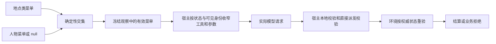
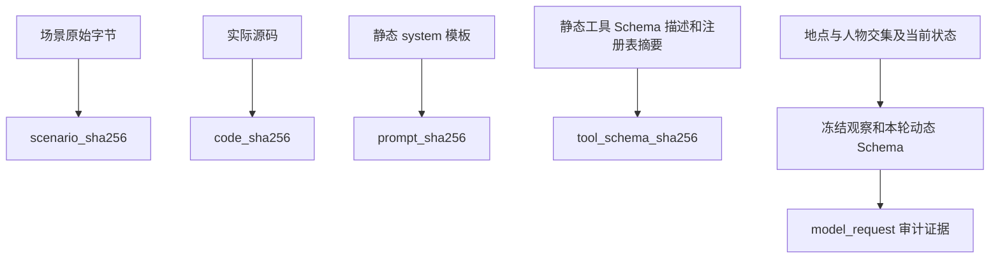

> 历史记录：本文件保存提交 `72f004b0087efa1b6f6d662ac6a143e087e4e21c` 时的过程与判断，不再定义当前系统。
> 当前设计见 [文档入口](../../INDEX.md)；正文中的路径、规则和结果按当时上下文理解。

> 归档基线：2cf230115f4084aef2376e9d77bc976efbed43ea
> 原始路径：`docs/dev/research/interaction-menu-feasibility.md`
> 归档说明：此提交仅定位归档原文快照，不是审查执行证明；原始执行记录与未执行事实按原文保留。

# 交互菜单可行性核查

> 核查日期：2026-09-20
> 核查对象：[交互菜单提案](../PROPOSAL-interaction-menu.md)与
> [冻结特性规格](../SPEC-interaction-menu.md)
> 证据范围：当前工作区源码、现行规格、成熟项目官方文档与原始论文。

## 核查结论

交互菜单在现有 WorldMock 架构中可行。可靠的实现形状是：地点类声明与人物声明先求交集，
再由当前活动、能量、阶段、预算和可见身份继续收窄；人物宿主只把有效菜单投影到本轮工具
Schema，环境在产生领域副作用前用权威状态重新判定。这个形状与业界的动态可执行命令、动作
掩码、策略判定与执行分离机制一致，不需要引入第三方策略引擎。

原提案草案关于“只做运行时筛选即可令实验身份零变动”的结论不成立。静态提示模板哈希不变，只能说明
静态模板未变；菜单声明改变场景身份，相关源码改变代码身份，每轮有效菜单还改变冻结观察、实际
模型请求 Schema 与审计证据。三类证据不能用一个静态模板哈希相互替代。

冻结规格已经修正核查中发现的承重问题：采用地点与人物交集，分别声明工具与活动类型，在模型
Schema、宿主校验和环境执行三处落实，保留活动控制与基本生存入口，不删除候选、事实或可供性
合同，并把声明纳入场景身份。理论与当前代码均未发现阻止该方案落地的反例。

## 开发前基线事实

以下事实取自本特性开发前的 Git 基线 `4cf70db`，不是修订完成后的现状，也不是从文件名或提案
推断的能力。符号名用于避开后续并发修改造成的行号漂移。

| 已核实事实 | 当前证据 | 对设计的约束 |
| --- | --- | --- |
| 生活请求工具共有十五个 | `4cf70db:src/worldmock/life/models.py::REQUEST_MODELS` | 提案所称十二个动作名已过时；工具闭集必须直接取该映射 |
| `start_targeted_activity` 同时承载工作、观看、游戏、读信和浏览 | `4cf70db:models.py::StartTargetedActivityRequest`；`catalog/affordances.toml` | 只筛工具名无法表达“允许工作但禁止游戏”，必须另筛活动类型与目标身份 |
| 基础活动参数是正则约束 | `4cf70db:models.py::StartBasicActivityRequest` | 实际模型请求还须把本轮允许的基础活动收窄成枚举，本地校验也要重验 |
| 人物宿主已按状态、可见目标、品类、活动控制和预算组装动态 Schema | `4cf70db:custom/agents/life_agent.py::LifeAgent.prepare_react_loop` 与 `build_react_tool_schemas` | 菜单应进入既有收窄链，不另建平行动作系统 |
| 工具描述含办公室内容偏好散文 | `4cf70db:custom/agents/life_agent.py::_life_tool_descriptions` | 固定地点提示会与声明冲突；删除后静态工具模板哈希会改变 |
| 环境 `_validate_call` 只校验工具闭集与请求类型 | `4cf70db:src/worldmock/life/engine.py::LifeEngine._validate_call` | 仅隐藏模型工具可被直接调用绕过，环境必须在副作用前权威重验 |
| 运行清单同时记录场景身份、代码身份和模型身份 | `4cf70db:src/worldmock/life/engine.py::LifeEngine._run_manifest` | 菜单声明和源码变化已有独立身份落点，不需要重复的菜单版本层 |
| 实际模型请求按原样写入证据 | `4cf70db:tests/integration/test_grounded_evidence.py::test_model_request_persists_exact_grounded_tools` | 每轮动态 Schema 可以审计，即使静态模板哈希不随地点变化 |
| 地点已有单值 `kind`，人物已有显式配置对象 | `4cf70db:src/worldmock/life/scenario.py::LocationConfig` 与 `AgentConfig` | 地点类与人物是可验证且稳定的两级声明位置 |

提案把可供性注册表 `surface` 当作全部工具名来源也不准确。注册表描述活动类型到启动面的映射，
而购买、消费、工作提交、日程、消息与社交等工具还存在于 `REQUEST_MODELS`。因此冻结规格采用
“工具名取 `REQUEST_MODELS`、活动类型取注册表 `kinds`”的双轴合同是必要修正。

### 声明无消费方

**基线依据：** `4cf70db` 的 `LocationConfig.kind` 已进入场景，但
`LifeAgent.prepare_react_loop`、观察组装和 `LifeEngine._dispatch` 都没有用地点类或人物菜单决定动作准入。

**对应规格：** 冻结规格要求场景完整声明 `interaction_menus_by_location_kind`，每个人物显式声明
`interaction_menu` 或 `null`，观察按权威地点和人物求交集。

**行为断言：** 相同条目在不同地点产生不同有效菜单，同一地点的两个人物也可产生不同有效菜单；
缺声明、地点类漏项或多项均在加载或观察边界失败关闭。

### 共享工具参数无法分别限制

**基线依据：** `4cf70db` 的 `start_targeted_activity` 用同一个请求模型承载五种活动，基础活动也用一个
字符串参数承载等待、睡眠和生活活动。筛掉整个工具会一并删除合法工作，保留工具又不能禁止游戏。

**对应规格：** 工具名与活动类型分别声明；实际 Schema 同时收窄基础活动、定向活动类型、目标身份和
下钻品类，本地校验复验相同约束。

**行为断言：** 允许工作而禁止游戏时仍有 `start_targeted_activity`，但其活动类型和目标枚举只有工作；
构造游戏参数在本地校验和直接宿主派发均被拒绝。

### 直接提交可绕过隐藏菜单

**基线依据：** `4cf70db` 的人物宿主会动态隐藏工具，但 `LifeEngine._validate_call` 只核对全局请求模型；
调用者可以跳过模型请求，直接构造一个全局合法请求。

**对应规格：** 实际模型 Schema、宿主本地校验、宿主直接派发与环境结算都执行菜单约束；环境在支付、
内容消耗、活动状态变化、消息发送和工作评审前重验。

**行为断言：** 直接提交被禁止的工具、活动类型、品类或恢复请求得到
`INTERACTION_MENU_DENIED`，且账户、库存、内容进度、活动、消息和工作评审证据均无副作用。

### 模板身份被误当实验身份

**基线依据：** `4cf70db` 的 `tool_schema_sha256` 摘要静态全量 Schema、描述和注册表摘要，不包含每轮
动态工具子集；运行清单另有 `scenario_sha256` 与 `code_sha256`，模型请求事件还保存实际工具 Schema。

**对应规格：** 菜单声明进入场景原始字节身份，源码变化进入代码身份，动态交集进入冻结观察与实际
模型请求；删除办公室散文使静态工具模板哈希改变。

**行为断言：** 修改地点或人物菜单会改变场景哈希并拒绝旧运行恢复；相同静态模板哈希不能证明两个
菜单场景等价；实际模型请求可还原每轮收到的工具和参数枚举。

## 成熟机制与适用边界

| 依据 | 已验证机制 | 可借机制 | 不适合照搬的部分 |
| --- | --- | --- | --- |
| [TextWorld 官方环境接口](https://textworld.readthedocs.io/en/stable/textworld.html) | `admissible_commands` 是当前状态相关命令并随步骤变化；`possible_admissible_commands` 与 `verbs` 是稳定全集 | 区分稳定动作词汇与每轮有效命令；把有效集放进观察 | 文本命令生成器和自由文本解析不适合本项目的严格请求模型 |
| Côté 等，*TextWorld: A Learning Environment for Text-based Games*，Computer Games Workshop at IJCAI 2018，[arXiv:1806.11532](https://arxiv.org/abs/1806.11532)，[DOI:10.48550/arXiv.1806.11532](https://doi.org/10.48550/arXiv.1806.11532) | 环境维护状态并执行人物提交的命令，可生成受控但变化的交互任务 | 用环境状态产生当前有效动作面，并由环境执行 | 论文不定义 WorldMock 的地点政策、人物权限或实验身份 |
| [Gymnasium 动作掩码官方教程](https://gymnasium.farama.org/tutorials/training_agents/action_masking_taxi/) | 全局六动作保持稳定，`reset` 与 `step` 返回当前状态的二进制有效动作掩码；选取和更新都消费掩码 | 保留静态工具闭集，同时对每轮动作选择做确定性收窄 | 二进制编号掩码不能表达工具参数枚举、可见目标和业务拒绝证据 |
| Huang 与 Ontañón，*A Closer Look at Invalid Action Masking in Policy Gradient Algorithms*，FLAIRS 35，2022，[arXiv:2006.14171](https://arxiv.org/abs/2006.14171)，[DOI:10.32473/flairs.v35i.130584](https://doi.org/10.32473/flairs.v35i.130584) | 给出无效动作掩码用于策略梯度的理论论证，并实证无效动作空间扩大时的影响 | 支持“从动作分布中排除无效动作”这一机制可行性 | WorldMock 不是该论文的训练算法，不能据此声称人物真实性或策略质量改善 |
| [Cedar 授权接口](https://docs.cedarpolicy.com/auth/authorization.html)与[策略验证](https://docs.cedarpolicy.com/policies/validation.html)；Cutler 等，*Cedar: A New Language for Expressive, Fast, Safe, and Analyzable Authorization*，OOPSLA 2024，[DOI:10.1145/3649835](https://doi.org/10.1145/3649835) | 请求以主体、动作、资源和上下文判定；策略可先按 Schema 验证 | 声明加载时校验闭集和形状，请求时基于人物、动作与上下文判定 | 当前规则只有两个集合与少量映射，引入策略语言会增加无收益的配置层 |
| [Open Policy Agent 部署文档](https://www.openpolicyagent.org/docs/deploy)与[决策日志](https://www.openpolicyagent.org/docs/management-decision-logs) | 策略判定点给出决定，应用执行点负责落实；决定可记录输入、结果和策略修订 | 宿主负责呈现与早拒绝，环境负责权威执行；保留可审计的决定输入与结果 | 无需部署外部服务；共享纯函数即可避免网络、版本和可用性复杂度 |
| [MLflow 实验跟踪官方文档](https://mlflow.org/docs/latest/ml/tracking/) | 一个运行同时记录参数、代码版本、指标、标签与产物 | 实验等价性由多维运行证据共同界定，不由单一模板摘要界定 | MLflow 不是本项目的身份合同，也不替代现有运行清单和 SQLite 证据 |

这些来源共同支持一种有限结论：动态有效动作集是成熟机制，且应在选择端与执行端一致落实。它们
不支持把地点菜单当作人物偏好，不支持删除世界事实，也不支持只靠模型看到较少工具来保证执行安全。

## 方案推论与反例

### 地点与人物必须求交集

地点回答“这里允许什么”，人物声明回答“这个实验中的人物允许什么”。取交集具有单调收窄性质：
任何一侧都不能扩大另一侧禁止的动作。人物 `null` 只表示不追加人物限制，地点菜单仍然存在；它不能
成为解析损坏时回退到全部工具的通道。

如果把人物现有的生活活动偏好或启用清单直接当菜单，会混淆条目身份与准入权限。例如人物不启用
某个生活活动条目，不能推出其不能等待、观看或工作；偏好排序也不能推出硬禁止。因此人物菜单必须
是单独、显式、可审计的场景声明。

### 工具与活动类型必须是两条轴

`start_targeted_activity` 是工作、观看、游戏、读信和浏览的共享入口。地点若允许工作而禁止游戏，
工具仍要存在，只能通过 `activity_type` 枚举与对应目标身份继续收窄。`browse_activities` 也需要把
真实品类映射到启动工具及活动类型，不能直接把品类字符串与活动类型字符串求交集。

购买、工作提交、日程与社交并没有一一对应的注册表活动类型。这些工具只按工具轴判定；旅行和消费
则同时要求相应工具与活动类型。这个不对称性来自现有接口事实，不能用一个统一但虚构的“活动类型”
抽象抹平。

### 呈现和执行都必须校验

把菜单投影到实际模型请求可以减少无效选择，却不能阻止测试、宿主直接派发或其他调用者构造请求。
环境必须在支付、内容消耗、活动变更、消息发送和工作评审之前重验。宿主仍需在本地决策校验与直接
派发两处重验，以保证同一进程内的非模型入口也不能绕过，并更早给出错误。

宿主与环境应调用同一共享判定函数，分别使用冻结观察和权威状态。这样复用的是规则，而不是把宿主
的观察当环境权威，也不是把环境对象泄漏给人物。

### 活动控制必须保证可退出

菜单可以阻止新活动，却不能让已经开始或暂停的活动失去收尾路径。等待、睡眠、日程和活动控制相关
保护项必须由声明显式包含，缺失时场景拒绝加载。正在进行的活动仍按既有规则开放继续、暂停、取消、
调速或游戏命令；这些控制不反向授予新启动权限。

暂停活动的恢复同时要求活动类型和相应启动工具仍被允许，并继续满足身份与能量条件。若恢复被禁止，
取消仍可用，因此人物不会被锁在不可恢复且不可结束的状态。

### 菜单不能改写世界事实

有效菜单是准入约束。完整可供性合同、场景事实、候选池、候选排除原因、呈现上限与轮转仍按原合同
产生。若菜单禁止游戏，系统可以从工具 Schema、定向目标和下钻品类中移除游戏入口，但不能声称游戏
条目不存在，也不能伪造候选排除原因。这样才能分别审计“世界有什么”和“此人此地可做什么”。

## 实验身份判据

菜单若只在运行时改变动态 Schema，`prompt_sha256` 与静态 `tool_schema_sha256` 可以保持相同；这只能
证明静态模板相同。菜单声明位于场景原始字节中，因此地点或人物菜单改变时 `scenario_sha256` 必须
改变。实现源码也使 `code_sha256` 改变。不同菜单还会在冻结观察和实际 `model_request` 中留下不同
证据。

本次冻结规格还要求删除固定办公室散文，该文本属于静态工具描述，所以 `tool_schema_sha256` 也应改变，
而 `prompt_sha256` 保持不变。即使未来只有动态菜单不同而两个静态模板哈希相同，也不得宣称两个场景
或两个决策条件等价。

## 对冻结规格的核对结果

| 承重要求 | 冻结规格位置 | 核查结果 |
| --- | --- | --- |
| 地点类与人物声明求交集 | “声明与准入”“观察与人物工具” | 已采纳，人物 `null` 语义明确 |
| 工具与活动类型双轴 | “权威来源与范围裁决”“声明与准入” | 已采纳，来源分别绑定请求模型和注册表 |
| 保护项缺失即拒绝 | “声明与准入” | 已采纳，无自动补齐或全量回退 |
| 候选与事实保持 | “心智模型”“观察与人物工具” | 已采纳，菜单只收窄操作派生物 |
| 独立观察菜单 | “观察与人物工具” | 已采纳，交集确定性排序且进入冻结证据 |
| 三个宿主边界与环境权威重验 | “观察与人物工具”“环境执行与拒绝” | 已采纳，直接调用不能绕过 |
| 活动控制与退出路径 | “声明与准入”“观察与人物工具” | 已采纳，恢复受限而取消保留 |
| 工作评审前预检 | “环境执行与拒绝” | 已采纳，禁止请求不得产生模型费用或评审证据 |
| 多维实验身份 | “实验身份与恢复” | 已采纳，场景、源码、静态模板和动态请求边界清楚 |

实现时仍需特别验证几处容易出现的表面合规：基础活动 Schema 必须出现动态枚举，而不只是保留
正则；共享定向工具须同时过滤活动类型和目标身份；品类须按规格表映射后过滤；暂停恢复要读取观察
中的活动类型并保留取消；只读阶段不得因缺少世界菜单失败；实际发送给模型的请求和直接宿主派发都要
有测试证据。冻结规格的验收台账已覆盖这些风险，不需要新增产品裁决。

## 文件修改核对清单

| 关注点 | 应修改文件 | 一致性目的 |
| --- | --- | --- |
| 权威特性合同 | `docs/dev/SPEC-interaction-menu.md` | 唯一定义声明、观察、宿主、执行、身份与验收 |
| 原始提案 | `docs/dev/PROPOSAL-interaction-menu.md` | 保留历史问题与被纠正项，明确不再是行为权威 |
| 公共接口 | `docs/CONTRACTS.md` | 记录场景字段、观察字段、有效菜单形状与拒绝边界 |
| 实验与验证 | `docs/EXPERIMENT.md`、`docs/VERIFICATION.md` | 区分场景身份、代码身份、静态模板哈希和每轮动态请求证据 |
| 既有开发规格 | `docs/dev/SPEC-life-runtime.md`、`SPEC-life-realism.md`、`SPEC-decision-context.md` | 对齐收窄顺序、人物声明、冻结观察、阶段和预算规则 |
| 架构职责 | `docs/design/01-architecture.md`、`03-resource-engine.md`、`04-simulation-engine.md`、`05-recording-engine.md` | 对齐声明读取、无副作用预检、环境权威与审计责任；`02-exchange-engine.md` 职责不变，仅核查 |
| 配置与输入输出 | `docs/design/08-configuration.md`、`09-io-formats.md` | 记录场景必填字段、观察菜单和业务拒绝证据形状 |
| 导航与状态 | `docs/INDEX.md`、`docs/design/README.md`、`docs/dev/implementation-status.md`、`docs/dev/ANALYSIS-spec-coverage.md` | 指向唯一权威，记录条款到测试与实测结果 |
| 验收证据 | `docs/dev/research/interaction-menu-verification.md` | 记录测试命令、结果、突变与仍未完成的全项目实验边界 |

总体、交付与评估设计若没有菜单行为或接口引用，只需核查，无需为满足清单而改写。设计文档应解释
所属层职责与数据流，完整字段约束继续只放在特性规格和接口合同，避免多个权威副本漂移。

## 证据分层与未决边界

**已核实：** 当前工具闭集、共享启动工具、基础活动正则、宿主动态 Schema 路径、环境现有校验边界、
运行清单身份字段和实际模型请求证据均来自当前工作区；成熟机制来自上表官方文档与原始论文。

**推论：** 地点与人物交集的单调收窄、双轴声明、呈现加执行双重落实、控制可退出和多维实验身份，
是把已核实机制映射到 WorldMock 当前接口所得的设计结论。冻结规格已将这些推论转成可测试合同。

**未决边界：** 各正式场景为不同地点类和人物选择哪些业务条目，是实验政策与场景内容选择，不由
外部论文决定。只要取值满足冻结闭集、保护项与显式声明合同，理论可行性不依赖某一组具体菜单值。
真实长期人物真实性仍需正式实验验证；本机制的单元、集成或端到端测试不能单独证明长期真实性改善。
