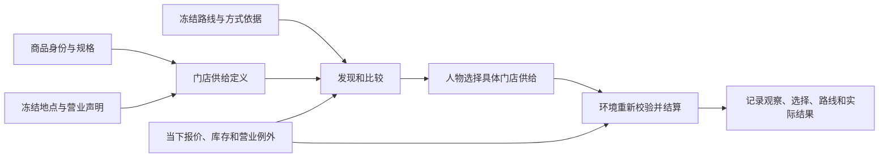

> 归档基线：2cf230115f4084aef2376e9d77bc976efbed43ea
> 原始路径：`docs/dev/research/map-and-storefront-feasibility.md`
> 归档说明：此提交仅定位归档原文快照，不是审查执行证明；原始执行记录与未执行事实按原文保留。

# 地图与门店供给：业界依据与可行性核验

> 核验日期：2026-09-20。核验基线：WorldMock `83698bdf339ec3dd0265844391716d398a02ce14`；
> AgentSociety2 固定提交 `e41550957a50398e08570f10ecd9cdb3fc9dd37c`，包版本 `2.8.7`。
> 角色：为 `PROPOSAL-map-and-storefront.md` 的裁决与开发规格提供独立证据；能力差距描述上述开发前基线，本文不宣告功能已实现。
> 外部依据采用标准正文、产品官方文档、项目源码与作者机构资料。事实、推论和本项目决策分开表达。

## 核验结论

同一商品对应多条门店供给、冻结地点与路线、营业日历、观察后由人物选择、执行时重新校验，均有可采用的成熟机制。
不需要新增地图引擎、在线服务或通用规则语言。理论可行性成立，但不能用外部标准替代本项目的交易原子性、状态归属和行为验收。

冻结规格前应修正三个实质问题：现有步行路线的来源不能仅由文件名证明；提案错误概括了外部平台的地点选择能力；
公开产出作品可能触发其派生数据库的开放义务，不能只保留一句署名规则。

## 商品与门店供给

| 可采用的成熟机制 | 一手证据 | 限制与应修订的提案表述 | 应落入规格的验收 |
| --- | --- | --- | --- |
| 商品与销售条件分别表达 | [Schema.org Offer](https://schema.org/Offer) 将商品引用、卖方、价格、可取得地点和履约方式放在报价对象中 | 支持本项目分离商品与门店供给；不证明所有系统都禁止商品资源带价格 | 同一商品在两家门店可有不同卖方、价格和库存；关闭一条供给不删除商品，也不改变另一条供给 |
| 门店特定库存 | [Merchant API LocalInventory](https://developers.google.com/merchant/api/reference/rest/inventories_v1/accounts.products.localInventories) 以商品及 `storeCode` 定位门店库存 | 它是商品资源的子资源，不等于 WorldMock 必须照搬运行时字段继承 | 门店供给标识贯穿观察、请求、候选、报价、扣库存、卖方入账和记录；不得在任一环节退回只按商品标识结算 |
| 价格可以单独同步 | [GS1 GDSN 标准目录](https://www.gs1.org/standards/gdsn) 独立列出 Price Synchronisation 标准与实现指南 | 本次已核实标准存在；其 PDF 正文未能由浏览工具完整读取，不能据此背书“贸易项目报文只有最小引用”等更细主张 | 规格无需实现 GS1 报文，只采用商品身份不承担门店结算身份这一明确设计 |
| 价格有效期 | [Schema.org PriceSpecification](https://schema.org/PriceSpecification) 提供有效起止表达 | 外部词汇不直接规定本项目所有边界语义；`reviewed_on`、`still_valid_on` 是本项目来源治理字段 | 规格明确起止类型、时区、半开区间、重叠拒绝与未生效状态；执行不得把失效报价静默替换为新价 |

提案的“价格不是商品的属性”“三家成熟体系的做法一致”应改为：
**本项目将实际交易价格放在门店供给及其当前报价上，以支持同商品多门店；这是已有产品/报价分离机制支持的设计选择。**
[Google ProductAttributes](https://developers.google.com/merchant/api/reference/rest/products_v1/ProductAttributes)
本身仍有 `price`、`salePrice`，足以反驳前述绝对化概括。

门店供给定义与当前报价应使用同一个供给身份。定义负责商品、地点、卖方及允许的履约方式；世界状态持有当前库存和当前报价版本。
“继承商品”只应表示引用共享商品身份及规格，不应变成缺失门店字段时回退到旧商品价格或旧单店字段。

## 地图、路线与复现

| 可采用的成熟机制 | 一手证据 | 限制与应修订的提案表述 | 应落入规格的验收 |
| --- | --- | --- | --- |
| 明确来源身份与坐标 | [OpenStreetMap 数据模型](https://wiki.openstreetmap.org/wiki/Elements) 区分 node、way、relation，各有独立标识空间 | 外部整数标识不能脱离来源和元素类型当作全球唯一身份；冻结版本内稳定不等于永久不变 | 地图数据集合固定区域、坐标系、时区、来源和版本；地点引用在集合内唯一且可追溯；场景不再复制名称、坐标和营业定义 |
| 道路路线响应 | [OSRM HTTP API](https://project-osrm.org/docs/v26.4.0/http) 给出请求结构、出行配置、道路距离与时长 | 出行配置在数据准备时由 Lua profile 决定，改 URL 文本或文件名不等于切换道路可行性 | 每条路线绑定起终点、出行方式、实例、请求参数、配置依据、原始响应哈希；步行与驾车分别证明 |
| 明确不可达 | [OSRM Table API](https://project-osrm.org/docs/v26.4.0/http#table-service) 用空单元表达无法找到路线 | 该 API 可启用 `fallback_speed` 用直线距离估时，不能启用后把估值当道路路线 | 有路、路由明确不可达、资料未准备分别可辨；发布范围缺记录必须拒绝，不能填直线估计或冒充不可达 |
| 空间索引粗筛 | [Shapely STRtree](https://shapely.readthedocs.io/en/stable/strtree.html) 支持包围盒查询和几何谓词 | 无谓词查询仅保证包围盒相交；空间近不代表道路可达 | 空间过滤结果进入道路距离/时长判断；若公开半径条件，精筛必须排除包围盒角落中超出圆半径的地点 |
| 固定输入重放 | 冻结原始响应、转换参数、输出及哈希即可让运行期重复消费同一份输入 | 公共实例接口不提供本项目已验证的历史路网版本选择；只有 URL 与时间戳不能保证日后重新请求得到相同结果 | 把“冻结结果重放”与“从原始路网重建同一结果”分开；没有路网和引擎快照时不得宣称后者 |

本次直接读取当前仓库得到以下证据，计数先由清单统计，再独立计算文件哈希复核：

| 当前材料 | 观察结果 | 对规格的影响 |
| --- | --- | --- |
| `corpora/zhangjiang-map/locations.json` | 有十一个地点 | 不能再把具名外部地点都描述为“有身份、无路线文件” |
| `corpora/zhangjiang-map/routes/` 与 `corpora/manifest.json` | 均有二百二十条路线记录 | 文件存在、清单登记、场景选入、运行期可消费必须分别验收 |
| 步行路线与同端点驾车路线 | 一百一十组中有一百零四组文件哈希完全一致 | 同内容本身不能证明错误，但与下述来源共同说明步行依据尚未建立 |
| 步行路线来源 | 六条指向 `routing.openstreetmap.de/routed-foot/`；一百零四条指向 `router.project-osrm.org/` | 不能把一百零四条仅凭命名认定为已验证步行路线；须核查/补齐真正步行配置的准备证据 |
| `catalog/rules/travel-fare.toml` | 注释只主张复现原场景十二条路线的费用 | 这是旧消费范围的依据，不是“仓库只冻结十二条路线”的依据 |
| 地点文件清单来源 | 文件整体标为 `scenario`、`WorldMock-project`，内容同时引用 OSM 真实地点 | 应分别记录外部地点字段与场景营业/供给假设的来源，不能用整个文件的假设标签抹去外部数据来源 |

例如 `home-poi-3538682402-walking.json` 与同端点驾车文件的 SHA-256 均为
`10736e35ab387353bba739c6315b9db8be059b669288b6d57af120777a4ba452`。
冻结规格应要求补齐方式依据，不能在运行期借用驾车响应充当步行可达证据。
若某路线本就是场景设定，应如实声明其假设性质，且不得由此宣称真实道路允许步行。

### 公开步行实例的单条探针

按主任务要求，仅测试当前 `home` 到好德的一条路线；未展开地点对采集，也未修改 `corpora`。
[运营方说明](https://routing.openstreetmap.de/about.html) 确认 FOSSGIS 提供全球 foot 配置，
要求可识别的 User-Agent、每秒最多一个请求、不得抓取或重负载使用。
其 [公开配置仓库](https://github.com/fossgis-routing-server/cbf-routing-profiles)
由运营方说明页直接链接，可作为配置来源依据；不能据此推定当前实例正在运行某个未经返回或声明的提交。

| 探针字段 | 实际结果 |
| --- | --- |
| 成功请求时间 | `2026-09-20T10:56:24.926346+00:00` |
| 实例与请求 profile | `https://routing.openstreetmap.de/routed-foot/`，`/route/v1/foot/` |
| 起点、终点 | `121.6142,31.2025`；`121.6167248,31.2055062`，均来自现有冻结地点目录 |
| 参数 | `alternatives=false&steps=true&overview=full&geometries=geojson&generate_hints=false` |
| 传输方式 | `/usr/bin/curl`，最大等待三十秒，可识别 User-Agent；无自动重试 |
| 路由结果 | `code=Ok`；道路距离 `399.8` 米；路由估计 `319.7` 秒；所有步骤 `mode=walking` |
| 响应证据 | `2852` 字节；SHA-256 `44a99ce26448c736d7680372bdfcbcc61e8af4e41fc588e443f395320500dd04` |
| 上游路网版本 | 响应未提供 `data_version`，不得声称已经固定精确上游路网版本 |
| 吸附端点 | 起点吸附到高斯路，偏离输入点约 `59.09` 米；终点吸附到广兰路，偏离输入点约 `21.68` 米 |

先前一次 Python 标准库 `urllib` 尝试在 TLS 握手阶段失败，未取得路由结果；随后改用系统 curl 成功。
这是传输方法差异，不能据第一次错误宣布实例不可用。
本次结果证明该公开实例能够返回这个起终点的真实步行配置响应；不证明所有地点对可达，也不证明将来重取响应不变。
正式冻结时仍须保存原始字节、完整请求与取得时间，保留请求点和吸附点。
距离与时长应解释为路网吸附端点之间的计算结果；到具体场所入口的连接若是场景假设，须独立说明。

## AgentSociety2 可复用能力及边界

核验使用上述固定提交的源码对象，而非其他会话的未提交文件。
以下路径均相对 `vendor/agentsociety2/packages/agentsociety2/`。

| 能力 | 已核实源码 | 可采用内容与限制 |
| --- | --- | --- |
| 地点记录、投影与空间索引 | `agentsociety2/contrib/env/mobility_space/map.py` 的 `Map`、`_parse_map`、`_build_geo_index` | 已有地点标识、类别、坐标、`pyproj.Proj`、`shapely.STRtree`；无需自行实现投影或空间树 |
| 地点查询 | 同文件 `query_pois` | 使用投影平面距离排序；`query(center.buffer(radius))` 没有几何谓词或后续 `distance <= radius` 过滤，只适合作为粗筛 |
| 地图输入 | 同文件 `Map.__init__` | 输入要求 `map_pb2.Map`，并会读取/写入 `.cache`；当前 OSM 与地点 JSON 不能直接交给它。不能把“包已依赖”等同于“现有地点集合无需准备即可复用” |
| 类别分组 | `agentsociety2/contrib/env/mobility_space/utils/const.py` 的 `POI_CATG_DICT` | 是活动相关分组，不是可直接替代本项目经营业态的统一零售分类；例如 `indoor_entertainment` 同时含餐饮、健身等类别 |
| 地点选择 | `agentsociety2/contrib/env/mobility_space/utils/poi_gravity.py` 的 `gravity_model`、`select_poi_by_gravity`；`environment.py` 的 `recommend_poi_by_gravity` | 确实会从候选中选出一个地点，并推定步行/驾车。提案“选择留给调用方”“选择环节普遍留空”不准确 |
| 已有成熟依赖 | 同包 `pyproject.toml` | 已声明 `Shapely>=2.0.6`、`pyproj>=3.6.0`、`pycityproto>=2.4.5`、`networkx>=3.0`；WorldMock 另直接固定 `networkx==3.6.1` |

建议裁决为：复用已安装的成熟空间/投影能力和已确认适配的数据机制；现有小集合可直接按冻结路线查询。
不为声称“复用 AgentSociety2”而额外制造整幅 protobuf 地图。
不采用其重力推荐工具，是因为本项目要求人物决定选择，并且选择必须使用可审计的门店供给与道路事实；
不是因为它完全没有选择模型。此处不增加在线依赖。

## 营业日历、时效和规则

| 可采用的成熟机制 | 一手证据 | 本项目需要明确的契约 | 验收边界 |
| --- | --- | --- | --- |
| 周期营业与跨午夜 | [OpeningHoursSpecification](https://schema.org/OpeningHoursSpecification) 明确关门时间早于开门时间时跨到次日 | 使用地图当地时区；多个区间、全天开放、明确关闭、未知分别表达；保留原始来源但运行期只解释规范化字段 | 分段空档关闭；周日深夜跨周一正确；边界时刻精确；未知不能变成全天开放 |
| 日期例外优先 | [specialOpeningHoursSpecification](https://schema.org/specialOpeningHoursSpecification) 明确覆盖常规营业声明 | 规格须裁决“整日关闭例外”是否覆盖前一天跨午夜延续，不能留给实现猜测 | 例如常规周日晚开放到周一凌晨，但周一整日关闭，测试必须固定唯一预期 |
| 半开时间区间 | [RFC 5545](https://datatracker.ietf.org/doc/html/rfc5545#section-3.6.1) 的事件采用包含开始、不包含结束的模型 | 可借鉴 `[from,to)`；不等于必须引入完整 iCalendar 或 OSM 营业语法解释器 | 相邻时段无双重命中；首个生效时刻前未定义；重叠、倒置和含混时区输入被拒绝 |
| 生效时间与核对时间分开 | [PriceSpecification](https://schema.org/PriceSpecification) 支持生效期；核对/可信截止字段由本项目自定 | `effective_*` 控制模拟适用期，`reviewed_on` 与 `still_valid_on` 控制来源声明的准入；类型和截止日是否含当日必须写明 | 不能用核对日期提前激活未来报价；不能用可信截止日取代已冻结实验的模拟时间规则 |
| 执行时重新校验 | 门店报价/可得性表达支持独立变化；交易原子性属于本项目要求 | 查询快照不承诺执行成功；自提在场、配送范围、库存、余额、营业及报价版本在规定结算边界校验 | 出发时可买而到达后关门/售罄，保留到达事实并明确失败；拒绝交易不留下部分扣款或扣库存 |

外部标准并不要求 `reviewed_on`、`still_valid_on` 这两个具体字段，也不支持“增加它们几乎没有成本”的估算。
若采纳，必须同步加载、准入、事件记录和测试；若不采纳，由规格明确说明范围，不可留为实现后的待办。
营业声明、地点访问资格、服务可用性与购买条件应保留不同含义，不能用某一家店开门代替商品有货。

## 地点发现与人物选择

| 提案中的主张 | 核验结果 | 建议裁决 |
| --- | --- | --- |
| 没有一个调研平台自带地点/门店选择模型 | 不成立。[MATSim 官方书籍](https://www.matsim.org/files/book/partOne-latest.pdf) 的 Destination Innovation 章节明确提供地点选择算法；[ActivitySim 非强制目的地选择](https://activitysim.github.io/activitysim/develop/dev-guide/components/non_mandatory_destination.html) 明确执行抽样、效用计算与最终选择；本仓库 AgentSociety2 也有选择工具 | 改为“本项目不采用这些模型替人物选择”；保留外部算法作为可借鉴的候选形成/验证机制 |
| UrbanSim 从不做到门店级 | 无法由公开文档证明这种全称否定。[UrbanSim 官方概述](https://cloud.urbansim.com/docs/general/documentation/urbansim.html) 说明其核心是住户、企业与房地产区位选择 | 改为“其标准描述的目标并非本项目的逐次购物履约”，不以“从不”证明不能复用任何机制 |
| 候选必须永远是地点乘供给 | 对购买成立，对住宅、公园、无商品的地点发现不成立 | 地点发现返回具体地点；购买比较呈现具体门店供给并携带地点事实。无供给的公园仍能被发现 |
| 候选必须预先按可达范围圈定 | 对显式道路范围过滤成立；不能据此隐藏用户应能发现的关闭、售罄或某方式不可达的已知地点 | 分开发现范围和动作可行性。提供道路范围条件时精确过滤；未加该条件时可返回已知不可达及其原因 |
| 业态目前没有公开标准 | 过强。[美国 Census 的 NAICS](https://www.census.gov/naics/) 等已有公开经营活动分类 | 本项目可维护满足场景的小词表，并显式映射外部分类；不要把未找到活动环境映射标准写成业态标准完全不存在 |
| 业态自动决定活动环境 | 外部业态/地点分类不能证明具体场所具备本项目需要的活动条件 | 每个地点分别声明经营业态与非空活动环境；准入与运行门使用同一字段，不再用缺字段等于 `anywhere` |

品牌归一可以参考维护中的 [Name Suggestion Index](https://github.com/osmlab/name-suggestion-index)，
其用途是统一常用名称和标签，不是证明每家分店都有完整品牌标识，也不是商品库存目录。
缺失品牌标识不应阻止地点或门店供给准入。

行为验收应验证人物实际接触到两家门店的报价、路程、营业与可得性，以及所选门店供给的标识和选择记录。
“近贵远便宜”不应预设必选某家店。正常测试必须与忽略门店身份、营业、库存、路线方式等源码突变对应，
证明硬约束遭破坏时测试确实失败。

## 许可主张的必要修订

[ODbL 1.0 正文](https://opendatacommons.org/licenses/odbl/1-0/) 支持以下有限结论；
下表是工程准入应保留的分类，不能由一个 `share_alike` 布尔值代替。

| 使用形态 | 准确边界 | 对提案的修订 |
| --- | --- | --- |
| 组织内部使用派生数据库 | 内部使用不触发正文的 Share Alike 条件 | 可保留内部使用说明，但不能把不公开等同于所有许可条件都不存在 |
| 公开传递数据库 | 需遵守许可与通知保留条件 | 内部从一开始保留来源可作为本项目追溯要求，不应误写成通知条款无条件生效 |
| 公开使用派生数据库生成的产出作品 | 产出作品本身和其派生数据库是两个对象；后者仍可能触发共享和提供数据/变更方法的义务 | 删除“地图、图表、文字结论只需注明来源”的无条件断言 |
| 独立数据库形成集合 | 集合与派生数据库不同；原数据库义务仍保留 | 不应把同一仓库并列存放不同许可资料一律判为不兼容合并 |
| 内容许可与数据库许可混合 | 需核对具体许可、数据库关系及使用方式 | 删除“ODbL 与 CC BY-SA 两个方向都不兼容”及“共享布尔字段即可判断”的笼统结论 |

[OpenStreetMap 官方版权页](https://www.openstreetmap.org/copyright)
要求公开使用时说明来源及许可。现有来源声明应延伸到导出清单，但附署名不能替代对交付物类型的判断。
[Overture 官方许可说明](https://docs.overturemaps.org/attribution/) 也按主题和来源列许可，
支持逐来源保留许可信息；它不意味着本次必须引入 Overture。

## 设计文档修改落点

| 文档 | 必须一致的内容 |
| --- | --- |
| `docs/dev/PROPOSAL-map-and-storefront.md` | 纠正上述绝对化论断、路线现状和许可主张；裁决后明确其与最终开发规格的关系 |
| 最终地图与门店供给开发规格 | 固定身份、查询、时间、路线、结算、证据与失败语义；每项要求有测试和突变验收，无未裁决分支或待实现承诺 |
| `docs/CONTRACTS.md` | 地点、门店供给、当前库存/报价、营业日历、发现结果、购买请求和事件字段使用统一术语 |
| `docs/design/00-overview.md` 与 `docs/design/01-architecture.md` | 四引擎仍是唯一职责边界；地图数据集合是资源，无新增地图引擎；人物决定选择 |
| `docs/design/02-exchange-engine.md` | 按门店供给校验营业、履约、报价、库存和访问条件；整单结算与失败原因 |
| `docs/design/03-resource-engine.md` | 商品与供给分离；地点和路线版本引用；业务定义与当前事实分开；来源/许可/假设可追溯 |
| `docs/design/04-simulation-engine.md` | 当前报价、库存与营业例外的所有权；到达、购买和交付时刻的重新校验；事件驱动时间 |
| `docs/design/05-recording-engine.md` | 实际可见的比较信息、选择、引用版本、路线依据及交易结果，连到交付来源声明 |
| `docs/dev/ANALYSIS-map-model.md` 与实现状态文档 | 将旧差距标注为历史基线或以新规格替代，避免保留与实现相反的当前能力宣称 |
| `corpora/LICENSES.md` 与 `corpora/manifest.json` | 真实地图与场景假设的来源分开；路线方式与请求配置可核验；不能只把导出的整个文件标为项目自有资料 |

## 最终规格的独立复核

读取 `docs/dev/SPEC-map-and-storefront.md` 后，上述核心建议已被覆盖，仍应在实现前消除下列歧义：

| 规格位置 | 问题 | 建议明确的契约 |
| --- | --- | --- |
| 产品行为与边界 | “二百二十条 walking/driving 冻结路线”容易被理解为二百二十条均有对应方式证明 | 明确其中一百零四份步行文件仅为待纠正的既有响应，正式发布必须补齐真实步行依据 |
| 冻结输入与地点发现 | 发布拒绝路线缺资料，同时发现又允许缺路线记录返回 `unknown`，可接受输入范围不明确 | 完整性覆盖所有有向端点和方式的记录键；若允许显式 `unknown`，须保存原因并禁止出行；真正缺记录拒绝发布。另一种一致选择是只在发布诊断中出现未知 |
| 许可与交付 | 已正确禁止共享条款布尔值代替兼容判断，但署名不能替代交付类型判断 | 保留原始来源许可，交付声明描述数据库/产出作品关系；不得自动承诺“只署名即合规” |
| 路由实例与配置 | 请求 profile 字符串不等于已验证服务端配置，响应可能没有路网版本 | 记录实际实例、请求、响应步骤方式、原始哈希和运营方配置依据；把未获得的上游精确版本明确列为未知 |

本研究阶段未运行新功能测试，也未改写正式地图和路线语料。本文成果是可核验的设计依据、开发前基线纠错与单条步行可行性探针；
后续规格裁决、代码实现、全文档一致性和端到端验收以主任务的集成结果及验证记录为准。
