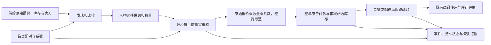

> 历史记录：本文件保存提交 `72f004b0087efa1b6f6d662ac6a143e087e4e21c` 时的过程与判断，不再定义当前系统。
> 当前设计见 [文档入口](../../INDEX.md)；正文中的路径、规则和结果按当时上下文理解。

> 归档基线：2cf230115f4084aef2376e9d77bc976efbed43ea
> 原始路径：`docs/dev/research/map-and-storefront-main-verification.md`
> 归档说明：此提交仅定位归档原文快照，不是审查执行证明；原始执行记录与未执行事实按原文保留。

# 地图与门店供给主线合并验收

> 状态：完整规格的离线工程验收通过；整合现行品类契约、库存转换、交互菜单和决策上下文，无地图特性延期项。
> 日期：2026-09-20
> 行为合同：[地图与门店供给开发规格](../SPEC-map-and-storefront.md)。
> 历史边界：[独立地图分支验收](map-and-storefront-verification.md)保留原测试数字与源码身份；本文记录合并后的独立复验。

## 合并身份与行为

| 身份 | 固定值 |
| --- | --- |
| 主线输入 | `b9e0dc20d1c80393e7a599f390bb100cc638274d` |
| 地图分支输入 | `7c634a722e25a208d0c8f9c1686213338e510447` |
| 完整门禁被测合并提交 | `70af9a70f82ebe9b2b33d5f4d7327f59de150002`，两个父提交分别为上述输入 |
| 测试补强与 Bob 复验提交 | `6fe3ab7b1711c5d7bee9d0bf3f4f22d48a53cb82` |
| 生产源码摘要 | `2add772c6d6f21bc15e250b68bdf7538e6c9c41e71a0f6fabf9f22bd119d6811`，共 134 个文件 |
| 发布身份 | 目录 `4.0`、品类契约与规则绑定版本 `2`；地图结构 `1`、场景结构 `3`、世界结构 `4` |

生产摘要按排序后的 `src/**/*.py`、再按排序后的 `custom/**/*.py`，依次拼接仓库相对路径、空字节、
文件原始字节、空字节后计算 SHA-256。`6fe3ab7` 相对完整门禁提交仅增加两条成功重试后的缓存断言，
并保存该次覆盖率报告；生产、目录、语料、场景及脚本均未变化。后续验收归档提交只改变文档及证据。

人物仍然选择具体门店供给，世界在购买时按所选供给的当前报价与卖方结算。
品类契约决定购买配对和系数，库存使用、配方转换及交互菜单继续使用各自明确的合同。

| 合并交汇 | 最终行为 |
| --- | --- |
| 商品与独立供给 | 商品继承库存使用定义，保留类别与使用效果；报价、卖方和库存只属于供给。购买编译为 `RuleEdge`，删除旧 `price_slot` 与静态购买转账边 |
| 精确购买金额 | `purchase_amount` 调用闭集算子，对原价、数量和系数的整行乘积取整；整单合计行金额，不把已取整单价乘数量 |
| 非作用与零金额 | `no_effect` 供给保留比较事实但不可买；`defined` 零系数可以零额履约，仍扣库存并交付。原始报价仍要求正整数分 |
| 比较与动机 | 同时公开原价、配对状态、系数与一份实际金额；余额与排序使用实际金额。非定义配对的金额为空且不推荐购买，已持有物品仍可使用 |
| 地图准备与出行 | 准备和运行统一解析 `TravelFareRule` 并调用 `evaluate_travel_fare`；不恢复旧文本公式 |
| 原子提交与恢复 | SQL 提交失败时保留世界、事件和待提交观察凭据；成功后清空缓存。地图、供给及品类身份校验同时保留 |

设计文件与原始未提交文档意图的逐项裁决见[文档影响审查](map-and-storefront-document-impact.md)。
整合审查期间原 checkout 未被修改；其总体架构、设计入口和初始提案原字节已纳入特性历史快照 `83698bd`，
INDEX 的地图入口在当前索引保留并补齐正式规格和验收链接。当前设计采用已裁决的合同。

## 逐项验证与完整门禁

完整规格的要求与测试映射继续见[追溯矩阵](../ANALYSIS-spec-coverage.md)和[独立特性逐项台账](map-and-storefront-verification.md)。
本次全量测试重新执行这些测试，以下列出合并交汇及补强的关键生产入口。

| 合同 | 实际行为断言 | 结果 |
| --- | --- | --- |
| 不同门店报价、卖方、库存与精确金额 | `tests/life/test_storefront_category_integration.py::test_independent_quotes_share_exact_category_arithmetic_in_real_engine` | 通过；覆盖实际发现与购买、非整数系数和多份整行取整 |
| 购买配对拒绝与失败原子性 | 同文件 `test_purchase_pairing_recheck_refuses_without_any_domain_state_change` | 通过；拒绝后整个领域状态不变 |
| 已定义零系数与原始报价约束 | 同文件 `test_defined_zero_coefficient_purchase_fulfills_without_account_transfer`、`test_zero_base_quote_remains_invalid_in_frozen_and_persisted_models` | 通过；零额付款仍扣库存并履约，零原价直接拒绝 |
| 公开比较事实 | `tests/life/test_storefront_discovery.py::test_discovery_exposes_category_amount_without_rewriting_quote`、`test_no_effect_supply_remains_visible_without_a_purchase_amount` | 通过；不改写原价，不把非作用配对伪装为免费 |
| 动机与库存使用 | `tests/life/test_motivation.py::test_food_affordability_uses_category_amount_instead_of_raw_quote`、`test_no_effect_purchase_does_not_hide_held_food` | 通过；按实际金额判断余额，保留已持有食物 |
| 地图准备与当前出行规则 | `tests/life/test_map_dataset.py::test_preparation_fetches_full_selected_set_and_publishes_verifiable_version`、`tests/life/test_category_runtime.py::test_travel_coefficient_changes_real_life_engine_payment` | 通过；准备产物可加载，实际出行支付响应品类系数 |
| 提交失败后的恢复与重试 | `tests/life/test_storefront_recovery.py::test_failed_decision_commit_preserves_visible_supply_credentials`、`tests/life/test_category_runtime.py::test_recipe_completion_sql_failure_keeps_engine_and_store_unchanged` | 通过；失败保留缓存，成功重试后同时清空呈现和供给缓存 |
| 最小完整流程及持久化 | `tests/life/test_storefront_recovery.py::test_discovery_purchase_consumption_and_recovery_preserve_storefront_evidence` | 通过；发现、购买、自提或配送、消费及恢复经过真实引擎和 SQLite |

| 检查 | 实测结果 | 源码及证据边界 |
| --- | --- | --- |
| `uv run python scripts/coverage_gate.py` | **3550 passed、4 skipped、24 warnings；退出 0** | `70af9a7`；完整输出归档于验证证据包 |
| 分支覆盖与公共接口 | **96.48%**，6653/6896 分支；未覆盖公共接口 **0** | 机器报告 `docs/dev/coverage-report.json`；快照 `74edc0c8-2389-4c7b-912c-01b7cc95949f` |
| 品类、库存与菜单整合定向测试 | **628 passed** | 同一生产源码；包含相关风格门禁 |
| 补强后的状态与交易测试 | **73 passed** | `6fe3ab7`；`test_category_runtime.py`、`test_storefront_recovery.py`、`test_storefront_category_integration.py` |
| 目录重建检查 | 四个生成输出逐字节一致 | `uv run python scripts/build_catalog.py --check` |
| 正式场景可达性 | **7384 条素材、142 个分区，全部可达** | `uv run python scripts/check_reachability.py --scenario scenarios/white-collar-12-weeks.json` |
| 最终文档检查 | 文档引用门禁与六项文档测试通过 | 归档后的最新输出见验证证据包 |

四个跳过来自既有 `tests/resources/test_equivalence_anchor.py`，依赖本机没有的历史运行产物
`runs/deepseek-multi-47931e06/footprints.sqlite`；不是本特性的占位、延期或新增跳过。
覆盖率报告清单摘要为 `235fee98d01706bc7b9b5bb2d9d8d55702e7fa9fb045f4d9b14df25d12866c2c`。
测试断言补强后没有再次全量测量覆盖率；生产源码未变，相关真实流程另行通过，保留这两个证据边界。

## 独立 Bob 审查与缺口闭合

审查在干净提交的独立 detached worktree 中进行，先固定测试再验证绿色基线，随后只修改生产源码。
每项还原后检查完整 Git diff 与 status，最终移除审查工作树。没有在正式工作区叠加突变。

| 审查 | 初次结果或复验 | 原始报告 |
| --- | --- | --- |
| 购买与品类交汇 | 绿色基线六项通过；七个语义突变全部 killed，无 survived、invalid 或 inconclusive | [购买审查](map-and-storefront-main-bob/purchase/report.md) |
| 提交原子性与恢复身份初次审查 | 四个 killed、一个 survived；遗漏成功后的呈现缓存清理没有被原测试检出 | [初次状态审查](map-and-storefront-main-bob/state-initial/report.md) |
| 状态补测复验 | 原存活补丁逐字节重放后 killed；独立删除成功后的供给缓存清理也 killed；无存活项 | [状态复验](map-and-storefront-main-bob/state-recheck/report.md) |

存活项来自测试缺少成功重试后的缓存断言，生产实现已经正确清理。补强提交增加两个直接状态断言，
由独立审查者在新干净基线上重放原补丁证明检出。初次 survived 报告保持原字节，未改写为通过。
本次审查只针对合并交汇，独立地图特性的原始 Bob 台账继续保留，不能将抽样变异数解释为全规格覆盖率。

## 可复核证据

| 归档 | 内容 |
| --- | --- |
| [验证输出](map-and-storefront-main-bob/verification-evidence.zip) | 完整门禁、目录和可达性、定向回归、文档门禁及源码身份 |
| [购买原始证据](map-and-storefront-main-bob/purchase/evidence.zip) | 319 个原始文件，包含预声明、基线、补丁、stdout、stderr、退出码和还原清理记录 |
| [初次状态原始证据](map-and-storefront-main-bob/state-initial/evidence.zip) | 256 个原始文件，保留初次存活项与环境预检记录 |
| [状态复验原始证据](map-and-storefront-main-bob/state-recheck/evidence.zip) | 143 个原始文件，包含原补丁字节比较和两个独立反例的检出 |
| [证据摘要清单](map-and-storefront-main-bob/archive-manifest.json) | 每个压缩包及其每个文件的 SHA-256，用于逐字节校验 |
| [文件修改清单](map-and-storefront-main-bob/changed-files.txt) | 相对主线输入的最终文件变更范围；功能责任与设计文档映射见文档影响审查 |

本次离线工程验收不改变项目的真实运行状态：正式 DeepSeek 十二周运行、LabelKit 完整自然日交付和
三次隔离盲评仍按[实现状态](../implementation-status.md)记录，没有用测试夹具替代这些项目验收。
