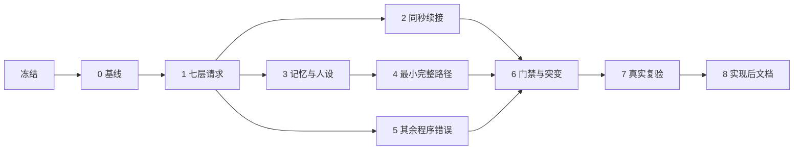

# 人物 Prompt 七层：实施计划、文档同步作业与文件修改清单

> 状态：未冻结提案（草稿规格的实施计划）；随规格冻结改为实施台账。
> 日期：2026-09-27
> 规格：[人物 Prompt 七层与交互修复](../SPEC-persona-prompt.md)。本文只安排怎样落地，行为以规格为准。
> 代码基线：`3ea5b06`（代码与 `bda42ee` 相同）。行号取 `3ea5b06`；AS2 行号取锁定提交 `8768e14`，本机 `vendor/agentsociety2` 子模块未检出。
> 编号：作业编号只在本台账内有效，与时间与能量实施计划中的同名编号无关，跨文档引用时写「人物 Prompt 台账 C3」。〔#N〕标出取决于规格「裁决记录」第 N 行的内容，按推荐写。

## 实施阶段

### 阶段总表

| 阶段 | 内容 | 先落地的文档作业 | 完成判据 |
| --- | --- | --- | --- |
| 冻结 | 裁定 #21–#38；规格改 FROZEN，本文改实施台账；不动代码 | 全部【冻】作业；IX2–IX7 | 文档门禁通过；「冻结条款修订」逐行对上作业；变更集只含文档 |
| 0 基线 | 全量测试 | 无 | 冻结提交上 `pytest tests` 全绿 |
| 1 七层请求与单一行动阶段 | 规格第一章、第二章（续接除外）、第七章中与自述和观察形状相关的下游；世界结构版本 8；消息全文 | 【同】C3（description）、C4、C5、C7、C10、C12（呈现）、C14–C18、C19（第 0 步除外）、C21、C22、C24–C26、C30、C32；DC3；TE3；AI2；AS4；E5-3、E5-5、E5-6、E5-11、E5-12、E6-2、E6-7、E7-2、E8-2、E9-3、VF1、EX1、EX5、MA2、MA4 | 请求只有七层且各层过 Schema；没有自述请求；`decision_started` 先于首个行动请求；交付不调用渲染器；查看器分层；原生工具整次运行不变 |
| 2 同秒续接 | 规格第二章「同秒续接」、第四章第 0 步、开关与只报告子命令 | 【同】C19（第 0 步）、C23、C25（开关）；TE8（续接）；AS2；E4-18；E5-4；E7-4；EX1（开关） | 续接前缀逐字节一致；断链条件全部成立；中秒恢复与不中断运行一致；开关冻结进清单 |
| 3 记忆层与人设层 | 规格第一章「人设层」「记忆层」、第三章；`subject`；只读问答；零条记忆守卫 | 【同】C6、C15（记忆与人设字段）、C27、C28、C29；TE8（`subject`）；RL4；DR3；E5-7（记忆部分）、E5-10、E7-3、E7-5、VF2、MA1、MA3 | 四种 session 结束与零点分区正确；恢复前后逐字节相同；反例通过 |
| 4 最小完整路径 | 规格第五章 | 【同】C3、C8、C9、C10（新字段）、C11、C13；TE4；AI3；IM3；E5-7（订单部分）、E5-11、E8-2、E9-3、E9-4、VF6、EX1（`from`、`to`）、MA6–MA8 | 代点场景连成一条链；重复请求被拒；进食守恒；指名购买 |
| 5 其余程序错误与缺口 | 规格第六章其余各行；删 `wait_only`；预算耗尽事件；购买事实导出 | 【同】C2、C12；E5-7（预算耗尽）、E5-12；MA5、MA6 | 每项回归用例改回旧代码即失败 |
| 6 全量门禁与突变审查 | 全量门禁；独立语义突变审查（VF3 所列） | 无 | 全部门禁通过；覆盖率报告重新生成并提交 |
| 7 真实复验（只报告） | 白领全天、双人半日、续接开关对比 | 无 | 指标写入验收记录；不作门禁 |
| 8 实现后文档 | 全部【后】作业，实现状态最后 | 【后】各行 | 文档门禁通过；IS1 是最后一个提交 |

### 通则

- **批次标记。** 【冻】随规格冻结落地，先于任何代码，适用于不被代码或测试锁定的规范文字；【同】与所在阶段的代码同一变更集，适用于闭集词表、
  错误码、事件字段、工具面、枚举、结构版本、清单阶段键、提示模板与参数名；【后】实现并验证后落地。跨阶段的【同】作业按条款拆分，拆分写在各作业行内。
- **先合同后代码。** 每个代码阶段先提交本阶段的【同】作业，再改代码（`docs/INDEX.md`「状态与变更约定」:295）。
- **每阶段全绿。** 下游随改（事件、清单、质量、交付、查看器）与引起它的改动同阶段落地，任何阶段结束时全量测试都不能红。

### 冻结

用户裁定 #21–#38 后：规格状态改 FROZEN，「裁决记录」第二张表按裁定改为已定；本文状态改为实施台账；落地全部【冻】作业与 IX2–IX7；
提案 `docs/dev/PROPOSAL-decision-context.md` 的文件头注明已收敛为本规格。不动代码。

### 阶段 0：基线

实施前在冻结提交上跑全量测试，结果记入验收记录。本机需先检出 AS2 子模块（`vendor/agentsociety2`）；未检出时 `uv run` 会因找不到可编辑依赖而失败，
只能用已安装锁定解包副本的虚拟环境解释器执行 `python -m pytest tests`。

`3ea5b06` 的实测：本计划起草时以虚拟环境解释器执行全量测试，3,983 passed、8 skipped、1 failed，用时 39 分 18 秒。唯一的失败是
`tests/tools/test_run_viewer.py::test_run_viewer_recorded_names`：本机没有安装 Node.js，该用例按设计在缺 Node 时失败，与代码无关。
阶段 0 须在装有 Node（含 `node:sqlite`）的环境复跑至全绿。

### 阶段 1：七层请求与单一行动阶段

- **环境侧**：新模块 `tool_layer.py`、`todo_layer.py`、`environment_layer.py`、`progress_layer.py`、`readable.py` 与 `prompt_schemas.py`；
  观察输出层数据，取代 `scene` 与 `facts`；可用性单一来源；进度层 session 下界与事件组装；删除结果游标。
- **宿主侧**：新模块 `custom/agents/life_prompt.py`；删除决策自述阶段与预算附录；原生工具整次运行不变（〔#26〕），不再逐轮绑定名称枚举；
  宿主只读私有绑定与层数据，不再反解提示文本；登记后不追加 tool 消息；记忆查询结果只序列化一次；不开放 `memory_step_range`、`memory_tick_range`（〔#37〕）。
- **下游**：`decision_started` 改写入时机与闭集；清单阶段 `action`、`work_review` 与键名 `stage_model_identity`；质量计数；观察重复门禁；
  交付删除渲染并按世界结构版本 8 设门禁；查看器分层解析；`render_day.py`。
- **世界结构版本 7→8**：观察形状、`SessionState.opened_by_action_id`、`ActivityState.paused_at` 在本阶段落地；后续阶段的新字段并入版本 8。
- **完成判据**：见阶段总表；另要求消息全文回归用例、可用性性质测试与唯一出现性质测试通过。

### 阶段 2：同秒续接

环境从模型证据重建续接链并挂到观察返回体（〔#28〕）；宿主在准备阶段之后注入消息并计算 `changes`（〔#27〕）；发送前自检思考；预算第 0 步（〔#30〕）；
运行参数 `same_second_continuation`（〔#31〕）与命令行参数；`scripts/inspect_run.py continuation`；查看器识别续接。普通恢复继续续接，反事实断链（〔#29〕）。

### 阶段 3：记忆层与人设层

记忆层派生（〔#32〕）与共享句式；`persona_card_struct`；人设层渲染与合并（〔#35〕）；`ConclusionMemory.subject` 与校验（〔#33〕）；反思来源标注与归属日期（〔#34〕）；
8000 字符窗口；只读问答使用工作区快照（〔#38〕）；阈值巩固保留、摘要不进提示（〔#36〕）；`recent_memory_limit` 零值守卫。

### 阶段 4：最小完整路径

`start_activity` 的 `from[]`、`to[]`、`answering`（〔#22〕〔#23〕）；订单收货人与请求关联；联系人收货与往来（〔#24〕）；给予；进食开吃份量与小数份；指名购买；
新方式「给予」。验收以真实 LifeEnv 与 SQLite 上的脚本化代点场景为准：请求、下单、送达或给予、后续决策连成一条链。

### 阶段 5：其余程序错误与缺口

恢复不越截止；逾期任务保留与迟交拒绝；删 `wait_only` 与预算耗尽事件（〔#25〕）；`purchases.jsonl`；其余缺口的回归用例。数据集仓库改读 `purchases.jsonl`，单独提交。

### 阶段 6–8

阶段 6 执行全量门禁与独立语义突变审查，突变点见 VF3；阶段 7 按规格第七章的对比协议复验，只报告；阶段 8 落地【后】作业，`implementation-status.md` 最后更新。

### 阶段依赖图

阶段 2 与阶段 3 可以并行；阶段 5 只依赖阶段 1，但与阶段 4 共改 `session_actions.py`、`basket.py`，合入须串行。

## 文档同步作业

逐文档列出改动与批次。FROZEN 文档的每次改动都追加版本行并写明理由（`docs/INDEX.md`「状态与变更约定」:283）；设计文档的重大修订更新文件头并追加版本表
（`docs/design/README.md`「更新约定」:142）。

### 总览

| # | 文档 | 作业 | 冻结条款修订 | 说明 |
| --- | --- | --- | --- | --- |
| 1 | `docs/CONTRACTS.md` | C1–C30、C32 | 1 | C31 不设（见规格「范围外登记」） |
| 2 | `docs/dev/SPEC-decision-context.md` | DC1–DC7 | 2–7、14、27 | 版本表后另有正文，新版本行写在表内 |
| 3 | `docs/dev/SPEC-agent-interaction.md` | AI1–AI7 | 7、8、12、13、15、16、20–22、24、26 | |
| 4 | `docs/dev/SPEC-life-runtime.md` | LR1–LR6 | 7–9、14–16、22、24、28 | |
| 5 | `docs/dev/SPEC-time-and-energy.md` | TE1–TE11 | 3、5、8、10、12、13、15、16、18–24 | |
| 6 | `docs/dev/SPEC-life-realism.md` | RL1–RL6 | 3、11、12、14、15、23–25 | |
| 7 | `docs/dev/SPEC-dayrun-behavior.md` | DR1–DR3 | 12、15、23、24 | |
| 8 | `docs/dev/SPEC-as2-integration.md` | AS1–AS4 | 5、17 | AS2 锁定提交不改 |
| 9 | `docs/dev/SPEC-labelkit-delivery.md` | LK1 | 18 | 改语义，不只是澄清 |
| 10 | `docs/dev/SPEC-interaction-menu.md` | IM1–IM3 | 24、28 | 版本表后另有正文 |
| 11 | `docs/dev/SPEC-day-plan-goals.md` | DP1 | 28 | |
| 12 | `docs/dev/SPEC-map-and-storefront.md` | MS1、MS2 | 24 | |
| 13 | `docs/dev/SPEC-run-viewer-context.md`、`SPEC-run-viewer-names.md` | RV1、RV2 | 28 | 前者无文件头、无版本表，也未登记在 INDEX |
| 14 | `docs/dev/SPEC-category-contract.md` | CC1 | 28 | 核对，不改 |
| 15 | `docs/design/04-simulation-engine.md` | E4-1–E4-22 | — | |
| 16 | `docs/design/05-recording-engine.md` | E5-1–E5-14 | — | 记录引擎接口与行为的权威 |
| 17 | `docs/design/06-delivery.md` | E6-1–E6-8 | — | |
| 18 | `docs/design/07-evaluation.md` | E7-1–E7-5 | — | |
| 19 | `docs/design/08-configuration.md` | E8-1–E8-3 | — | |
| 20 | `docs/design/09-io-formats.md` | E9-1–E9-7 | — | |
| 21 | `docs/design/00-overview.md` | E0-1–E0-5 | — | |
| 22 | `docs/design/01-architecture.md` | E1-1–E1-7 | — | |
| 23 | `docs/design/02-exchange-engine.md` | E2-1–E2-7 | — | |
| 24 | `docs/design/03-resource-engine.md` | E3-1–E3-3 | — | |
| 25 | `docs/design/README.md`、`docs/design/SUMMARY.md` | ER1–ER3、ES1–ES3 | — | |
| 26 | `docs/ARCHITECTURE.md` | AR1–AR4 | 30 | |
| 27 | `docs/VERIFICATION.md` | VF1–VF10 | — | |
| 28 | `docs/EXPERIMENT.md` | EX1–EX6 | 29 | |
| 29 | `docs/INDEX.md` | IX1–IX8 | — | 本规格与本计划的登记行随草稿提交 |
| 30 | `docs/manual/` 与根 `README.md` | MA1–MA8 | — | 根 `README.md` 不改 |
| 31 | 实现状态、覆盖追溯、覆盖基线、查看器验收记录 | IS1、AN1、CB1、RV3 | — | 阶段 8 落地 |
| 32 | 研究材料 | RS1–RS4 | — | 快照说明 |

### 1. `docs/CONTRACTS.md`

状态 FROZEN；接口、字段、Schema、错误码与提示模板的权威。每个改动它的变更集在「版本表」:1423-1465 追加一行，历史行不改。

| # | 章节（标题，行号） | 改什么 | 批次 |
| --- | --- | --- | --- |
| C1 | 「状态归属」:22 | 「自然语言场景描述」改为七层 JSON；身体只以环境层分级进入 | 【冻】 |
| C2 | 「状态归属」:16；「当日目标的配置与质量输出」:202；「动作状态与动作结果」:298 | 删 `wait_only` 阶段与两条升级；受限只经工具层 `available`、`reason` 表达；受限轮用完仍无进行中活动时写 `decision_budget_exhausted`〔#25〕 | 【同】阶段 5 |
| C3 | 「人物工具与管理接口」:50-54、:59；「请求模型的闭集与字面边界」:260-262 | `start_activity` 为五个等长数组 `targets`、`actions`、`ways`、`from`、`to` 与请求级 `answering`〔#22〕〔#23〕，写明各动词的合法组合；方式闭集增「给予」；description 只写用途 | 【同】阶段 4（description 部分阶段 1） |
| C4 | :60；:225-226；:248-249；「地点发现与购买身份」:405-406；「观察投影字段」:581-590 | 「下一次观察的 `facts.progress.results[]`」一律改为进度层 `tool_call.result`（字段不变），在本 session 内持续保留；`details` 不复述参数，增 `outcome`、`candidates`；回看结果在同秒续接中随工具结果返回 | 【同】阶段 1 |
| C5 | :61-63、:266；「当日目标请求」:187-189；:556、:575 | 目标仍记录 `progress_note`，但不呈现；当日计划只在待办层 `day_plan{date, goals[{intent_kind, goal, progressed, remind_time}]}`，生成前为 `null` | 【同】阶段 1 |
| C6 | :63、:267；「记忆字段」:1137-1144 | `ConclusionMemory` 增 `subject: str\|null`（必填可空）：relationship、preference 必填，其他类型为 `null`；relationship 的对象须是已知人物〔#33〕 | 【同】阶段 3 |
| C7 | 「交互菜单声明与有效菜单」:95-96 | 「`scene`、`facts`」改为工具层 `targets` | 【同】阶段 1 |
| C8 | :50-54、:216 首句、:226-228、:255-262、:418、:434-437、:577 末句、:663、:699 | 展示以实际呈现为界，可见期只管展示与比较；`obtain` 可以指名本轮未展示的商品，按当前报价结算；不存在报 `SUPPLY_NOT_FOUND`（`details.candidates` 至多 3 个），重名报 `SUPPLY_NAME_AMBIGUOUS`，登记进 :234-244；不自动替换；其余动词的未列名称仍按协议纠错 | 【同】阶段 4 |
| C9 | :216 的合并句；:241、:244；「供给结算与事件载荷」:446-448 | 两项 `consume` 合成一餐只限各项 `to` 都是自己；指向他人即给予（瞬时、同处、只转移）；订单只有一个收货人，送达入收货人持有；自己收货后再给予只转移一次；订单记 `request_message_id`；重复关联以 `REQUEST_ALREADY_HANDLED` 拒绝 | 【同】阶段 4 |
| C10 | 「领域枚举」:329；:372；:434 | 世界结构版本 7 改 8，三处同步；列出新字段（规格第七章「版本」） | 【同】阶段 1（新字段随各阶段补登） |
| C11 | 「场景联系人」:458-465；「联系人回复」:502、:511 | `Contact` 增可空 `receive_location_id`；联系人持有记入 `contact_holdings`；回复请求增 `history[{speaker, time, text}]`（至多 20 条）与 `received[{item, quantity, time}]`〔#24〕 | 【同】阶段 4 |
| C12 | :65；「活动受理拒绝码」:236；:571 | 开工与恢复使用同一截止约束，恢复不得越过截止；未付款的逾期任务保留到截止当日结束，`outlook` 写「已过截止」；登记 `WORK_SUBMISSION_LATE`；工时达标、活动状态、提交条件分别说明 | 【同】阶段 5（呈现部分阶段 1） |
| C13 | :244；「禁止进入提示的字段」:820-822 | 「数量不够」改为「可消费量为零」；食用按实际持有份量（可小于 1），展示、时长、热量同一口径；开吃份量、暂停保留与结束丢弃 | 【同】阶段 4 |
| C14 | 「观察投影字段」:537、:541-557 | 请求为：system 放系统层，user 放工具、人设、记忆、待办、环境、进度六层 JSON 数组，工具定义走原生 `tools`；重写总述、流程图与分层表 | 【同】阶段 1 |
| C15 | 同节新增小节「七层 Schema」 | 登记 `src/worldmock/life/prompt_schemas.py` 为机器可读形式；列出 `layer` 常量、`targets[].kind` 十一值、`phase`、`action` 五个动词、方式闭集、`tools[].tool` 五值、`contract` 三键、进度层 `type` 六值（含 `condensed`）、`message_arrival.kind` 三值、`task_deadline.stage`、`delivery.status`、`body` 五键及分级文字、`relationships[].view`、`preferences[].noted_on`、`self_notes[{activity, text}]`、待办项 `tools[]`、时刻格式 | 【同】阶段 1（记忆与人设字段阶段 3） |
| C16 | 「场景段落与事实清单」:539-579（改名为「七层字段」） | 逐字段迁移：`current_time`→`observed_at`；`location`、`felt`→环境层；`people_here`、`reachable_places`、`routes`、`products`、`inventory`、`interactive_objects`、`tasks`、`current_activities`、`just_ended`→工具层（`note` 拆成 `reason`＋`note`，加 `price`、`duration`、`quantity`）；`paused_activities`→待办层（加 `paused_at`、`place`、`tools`）；`contacts`→人设层 `relationships`，发消息对象为人物目标；邮件→消息目标与 `message_arrival`；`results`、`alarms`→进度层。删除 `just_now`、`inbox_head`、`inbox_has_older_unread`、`todos_summary`、`local_food_summary`、`precondition_hints`、`same_moment_note`、`drive_summary`、`experiences`、`progress.sessions`、`current_epoch`、`new_material_chars`、`required_skill`、`minimum_skill` | 【同】阶段 1 |
| C17 | 「活动控制行」:617、:627-628、:631；「体感与动机证据」:655；「禁止进入提示的字段」:804、:812-813、:817-818 | 活动列表与交互对象改为工具层活动目标的 `phase`、`state`；写明 `levels` 五键；禁止键表覆盖七层、原生 `tools`、续接消息，并加 `interaction_bindings` 与续接私有键；删「在动态工具说明中关联物品身份与公开名称」 | 【同】阶段 1 |
| C18 | 「已核验经历与当地餐食」:638-651 | 删 `local_food_summary`（:645-649）；`verified_experiences` 只作私有证据；:651 的播客句移到「七层字段」；本节删除，:556 的引用同步 | 【同】阶段 1 |
| C19 | 「可见期与提示预算」:659-677 | 删 :665、:670；:666 改为结果在本 session 内持续保留；:667 的计数范围为原生 `tools`、系统层、六层 JSON、续接消息与预留输出；新增记忆层 8000 字符窗口；:672-677 改为规格第四章（第 0 步提前结束续接〔#30〕，再去 `self_note`、折叠为 `condensed`，受保护项完整保留）；删除自述协议错误与收件头两句 | 【同】阶段 1（第 0 步阶段 2） |
| C20 | 「人物决策提示与生成参数」:830-833 | 每次决策只有一个行动阶段（可含记忆查询与纠错回合），世界请求登记即结束；决策就是工具调用；回复正文可以为空，有则作为该调用的 `self_note` 保留到 session 结束 | 【冻】 |
| C21 | 「请求组成」:837-846 | 删除自述行；行动请求：system 为系统层 JSON，user 为六层 JSON，工具走原生 `tools`；只读请求：system 为只读系统层，user 为人设层与记忆层，外部问题为其后的 user 消息〔#38〕；删身份前言与只读前言 | 【同】阶段 1 |
| C22 | 同节 :847-861 | 删「怎样过一天」全文；逐字登记生活决策与只读问答的系统层全文（规格第一章「系统层」） | 【同】阶段 1 |
| C23 | :863-865；:294-296；「工具返回通道」:907-916；「思考回传」:978-980 | 同一秒内：链首 user 逐字节固定；后续决策追加原生 assistant（含 `reasoning_content`）与一条 tool 消息 `{result, changes, events}`〔#27〕；缓冲由环境从模型证据重建〔#28〕；断链条件；时间推进后调用从事件并入进度层，思考不再出现；登记确认不回给模型；记忆查询条目只在续接消息中 | 【同】阶段 2（:296、:980 的原则句【冻】） |
| C24 | :296 的预算句；「回合预算」:918-922；「模型身份」:960 | 删自述回合；16 个回合全部归行动阶段，为世界请求保留 1 个，剩余不少于 2 时开放记忆查询；预算 JSON 与低预算提示不再追加到 system；单次决策预算与同刻跨决策预算分开计 | 【同】阶段 1 |
| C25 | 「生成参数」:926-937、:946-949；「模型身份」:970、:976；「决策自述证据」:982-985 | 删自述行及说明；行动请求按「带生活工具且 thinking 开启」识别；「两阶段运行身份」改为「阶段运行身份」，键 `two_stage_model_identity` 改为 `stage_model_identity`；阶段键只剩 `action`、`work_review`，`action` 增 `same_second_continuation`〔#31〕；提示与工具指纹重钉；删「决策自述证据」整节 | 【同】阶段 1（开关阶段 2） |
| C26 | 「请求组成」:878、:886 | 零点计划输入的已核验经历写明句式，不再写「与观察同一写法」；删「决策自述」字样 | 【同】阶段 1 |
| C27 | 「人格与卡片字段」:1092、:1099；「CLI 命令接口」:1366 | 卡片以人设层 JSON 呈现（去掉 `situation`，加姓名，合并关系，`view` 与 `preferences`）；600 汉字上限只约束卡片派生部分；编译与结构版本 2 不变；`persona_card_struct` 存入 `profile`；`profile compile` 的渲染输出同步 | 【同】阶段 3 |
| C28 | 「记忆字段」:1150-1153、:1161-1165 | 三区段装配改为人设层与记忆层（`earlier_days`、`earlier_today`，`settled` 与 `self_notes` 分列，派生〔#32〕，零点分区，8000 字符窗口）；主观归纳不再呈现，阈值巩固保留〔#36〕 | 【同】阶段 3 |
| C29 | 同节 :1147-1148、:1167-1168 | 被拒的 conclude 写下的记忆照旧存入主观记忆，但不呈现；就寝反思仍固定 `type=reflection`〔#33〕，快照带来源以便归属日期〔#34〕 | 【同】阶段 3 |
| C30 | 「窗口声明与字段字典编码」:1208-1216 | 注明实际请求含本秒前序决策的原生消息与 `reasoning_content`，原样保留（:1214 不变）；「人物卡片、记忆或场景」改为七层名称；dreaming 读 `self_note` 与层 JSON | 【同】阶段 1 |
| C32 | 「版本表」:1423-1465 | 冻结变更集一行；每个【同】变更集各一行 | 【冻】【同】 |

改名的标题及其入站引用：「场景段落与事实清单」改名为「七层字段」，同批改 `SPEC-life-runtime.md`:693、:932；「已核验经历与当地餐食」删除，同批改本文 :556；
「决策自述证据」删除，同批改 `SPEC-life-realism.md`:103。其余标题保留，引用处（`docs/design/09-io-formats.md`:199、`docs/design/05-recording-engine.md`:148、:298、
`docs/design/08-configuration.md`:221、:275、`docs/design/README.md`:82、`docs/manual/personas.md`:199、`docs/manual/runtime.md`:75 等）只复核语义。

### 2. `docs/dev/SPEC-decision-context.md`

| # | 章节（标题，行号） | 改什么 | 批次 |
| --- | --- | --- | --- |
| DC1 | 「心智模型」:9-28 | 删自述节点与「两次请求」；时序改为规格心智模型的同秒续接 | 【冻】 |
| DC2 | 「权威来源与裁决」:41-45 | 删 :41、:44、:45 三行；:43 注明登记确认从不发给模型，续接时 tool 消息是结算结果 | 【冻】 |
| DC3 | 「唯一命名」:48-64 | 整节删除（:62 的 1.3 与 400 与合同和代码不符，一并消除）；指向本规格第二章 | 【同】阶段 1 |
| DC4 | :73；「上下文与阶段相互独立」:77-92 | :73 按指名购买改写；:77-92 改为同秒续接与只读路径〔#27〕〔#38〕 | 【冻】 |
| DC5 | 「登记确认与结算结果」:94-124 | 保留 :96-103 的回执隔离与 `tool_call_id`、:109-116 的公开结果字段、:118-119 的递归泄漏校验；:105-124 改为结果在本 session 内留在进度层，session 结束后进入记忆层 | 【冻】 |
| DC6 | 「场景信息」:126-139；「预算与失败」:141-148 | 前者改为「七层归属」，只留「邮件正文须阅读后可知」一句并指向本规格；后者按本规格第四章；`SPEC-life-runtime.md`:725 对 `#场景信息` 的链接同批改 | 【冻】 |
| DC7 | 「文件修改清单」:150-159；「验收台账」:163-181；文件头 :3-5；版本表 :183-190 | 清单与台账改写并指向本规格；版本行写在表内（表后另有「当日目标边界」:192-195） | 【冻】 |

### 3. `docs/dev/SPEC-agent-interaction.md`

| # | 章节（标题，行号） | 改什么 | 批次 |
| --- | --- | --- | --- |
| AI1 | :48、:93；「会话字段」:152-166 | 进度层只含当前 session；目标行不显示自述（:160、:166）；8000 字符为记忆层窗口（:161） | 【冻】 |
| AI2 | 「稳定工具面」:183、:191-197、:201-202 | 回看结果进 `tool_call.result.details.recall`，名称只取七层中出现的；不逐轮绑定名称枚举〔#26〕 | 【同】阶段 1 |
| AI3 | 「对象与动作选择」:216-221、:232-242、:249、:256、:258、:264-275；:35-36、:182、:589 | 工具层 `targets`；`from`、`to`、`answering`〔#22〕〔#23〕；小数份与时长折算；开工与恢复都受截止约束 | 【同】阶段 4（工具层部分阶段 1） |
| AI4 | 「保护项修订」:298-308 | 删「启动失败后只准等待」（:303-304）〔#25〕；可用性与环境受理一致 | 【冻】 |
| AI5 | 「前置条件前置与前往提醒」:366-388 | 改由 `contract` 与 `available`、`reason` 表达，删场景前往句 | 【冻】 |
| AI6 | 「上下文分层」:407-452；「发送前 token 计数与进度浓缩」:456-479；「午夜浓缩」:481-494；:416、:426-427 | 七层替换旧分层；预算按规格第四章；午夜为记忆层零点分区 | 【冻】 |
| AI7 | :529-531、:557-558、:567、:588-589、验收 :593-596、:600、:602；文件头 :3-8；版本表 :604-616 | 冻结条款修订 #4–#6 注明被取代；台账改写；版本行 | 【冻】 |

### 4. `docs/dev/SPEC-life-runtime.md`

| # | 章节（标题，行号） | 改什么 | 批次 |
| --- | --- | --- | --- |
| LR1 | :25、:367、:449、:454 | 给予改变持有（同处、只转移）；「事实清单」改为工具层；进食剩余按开吃份量 | 【冻】 |
| LR2 | 「观察投影三部分」:689-697；:701-703 | 改为七层；禁止进入提示的字段覆盖七层、原生 `tools` 与续接消息 | 【冻】 |
| LR3 | 「观察投影行为规则」:707-725 | :707 并入唯一出现；:709 按指名购买；:711（工作材料）按规格「范围外登记」；:713（字幕）落在内容目标 `state`；:716 目标行不显示自述；:725 链接随 DC6 | 【冻】 |
| LR4 | :729-731；「系统提示与身份前言」:742-747；「上下文容量」:749-766 | 系统层替代身份前言与「怎样过一天」，废止 50% 比例；容量按规格第四章 | 【冻】 |
| LR5 | :891-897、:925、:937-941 | 「description 点明配送不校验在场」改为系统层规则与动作 `note`；联系人收货地点与往来〔#24〕 | 【冻】 |
| LR6 | 验收 :965、:970、:980-982；文件头 :3-9；版本表 :1019-1043 | 改写，状态记「本次离线验收待执行」；版本行 | 【冻】 |

### 5. `docs/dev/SPEC-time-and-energy.md`

| # | 章节（标题，行号） | 改什么 | 批次 |
| --- | --- | --- | --- |
| TE1 | 摘要 :17、:20；心智模型 :49；:89；:102-105、:115-121、:151-153、:156-158、「同一秒内的呈现与「刚才」」:182-191 | 常驻提示与 `just_now` 由系统层与续接取代；删 `wait_only`，受限轮用完写预算耗尽事件〔#25〕 | 【冻】 |
| TE2 | :250-253、「让人物趁早吃」:307-324、:426-428 | 吃饭途径句删除，吃饭途径由工具层目标与系统层规则表达 | 【冻】 |
| TE3 | :388、:391-393、:449 | 清单阶段键只剩 `action`、`work_review`；零点计划「不读」清单删「决策自述」 | 【同】阶段 1 |
| TE4 | :463-498、:535 | 请求形状增 `from`、`to`、`answering`〔#22〕〔#23〕；给予 | 【同】阶段 4 |
| TE5 | :555-558、:567、:573、:589、:603-605 | 条件说明改为 `available`、`reason`；小数份与时长折算 | 【冻】 |
| TE6 | 第六章 :617-682 | 整章注明被系统层取代，保留 :680-682「吃饭路径可发现」的验收 | 【冻】 |
| TE7 | :694、:706-709、:725-726、:762-769、:775 | session 结束派生记忆；进度层不按会话分组；回看名称只取七层中出现的；进食暂停与结束 | 【冻】 |
| TE8 | :779-793 | 同秒续接〔#27〕〔#28〕；`Memory.subject`〔#33〕 | 【同】阶段 2（`subject` 阶段 3） |
| TE9 | :811、:819-825、:891-894、:901-904、:922-929、:1003-1006、:1043-1045、:1054-1056 | 目标行不显示自述；逾期任务保留；指名购买；交付不再重渲染 `scene` | 【冻】 |
| TE10 | 裁决 #2 :1067、#8 :1073、#16 :1081；冻结条款修订 :1112、:1118、:1125 | 注明被本规格取代的部分 | 【冻】 |
| TE11 | 验收 :1192、:1195-1196、:1198-1202；文件头 :3-9；版本表 :1208-1225 | 改写；版本行 | 【冻】 |

### 6. `docs/dev/SPEC-life-realism.md`

| # | 章节（标题，行号） | 改什么 | 批次 |
| --- | --- | --- | --- |
| RL1 | :7、:16-25、:31-47、:56 | 删自述与「卡片渲染成中文文本进入提示」；:7 的范围删「两阶段决策调用」 | 【冻】 |
| RL2 | 「设计裁决」:77、:82 | :77 的验收覆盖「购买本身不写偏好」的反例；:82 注明「恢复身份前言」被取代 | 【冻】 |
| RL3 | 「两阶段决策」:86-112 | 改为单一行动阶段；:103 对「决策自述证据」的链接同批删除 | 【冻】 |
| RL4 | 「记忆合同」:114-145 | `subject`；记忆层取代主观归纳与最近条目；巩固保留〔#36〕 | 【同】阶段 3 |
| RL5 | :155-157、「呈现轮转」:311-337（:319 后补一句）、「画像编译」:341-347、:397-398、:403-411 | 删 `drive_summary`；轮转不限制指名购买；人设层；开吃份量 | 【冻】 |
| RL6 | :418-419、:422、:433、:438、:448-461、验收 :488-493、:496、:498；文件头 :3-7；版本表 :549-574 | 阶段键与 dreaming 输入（:438「自述仅 dreaming 可读」改为 `self_note` 随实际请求进入窗口）；版本行 | 【冻】 |

### 7. `docs/dev/SPEC-dayrun-behavior.md`

| # | 章节（标题，行号） | 改什么 | 批次 |
| --- | --- | --- | --- |
| DR1 | :92、:103-106 | 给予与 `from`、`to` | 【冻】 |
| DR2 | :152-161、:167-173、:178 | 指名购买；进食剩余；经历不再写成提示句 | 【冻】 |
| DR3 | 「主观记忆与巩固」:188-206；文件头 :3-8；版本表 :248-255 | `subject`；MEMORY.md 装配与「本轮观察五条为唯一近期事实窗口」改为记忆层；版本行 | 【同】阶段 3 |

### 8. `docs/dev/SPEC-as2-integration.md`

| # | 章节（标题，行号） | 改什么 | 批次 |
| --- | --- | --- | --- |
| AS1 | :22、:44-47、流程图 :56-67、:143、:157-165 | 登记即结束本次决策；续接消息由宿主在准备阶段之后注入 | 【冻】 |
| AS2 | 「决策自述与推理内容保留」:211-222 | 改为「同秒续接与推理内容保留」 | 【同】阶段 2 |
| AS3 | :226-234、「观察记录单写」:264-284、:294-296、:348-359 | 记忆层派生与 `subject`；观察仍每次决策一次、单写；AS2 锁定提交与运行身份不变 | 【冻】 |
| AS4 | 验收 :372、:376、:379；文件头 :3-6；版本表 :383-395 | 测试名与观察项改写；版本行 | 【同】阶段 1 |

### 9–14. 其余规格

| # | 文档与章节（行号） | 改什么 | 批次 |
| --- | --- | --- | --- |
| LK1 | `SPEC-labelkit-delivery.md`:86-87、:103-104、:108-110、:206、验收 :228；文件头 :3-6；版本表 :247-257 | 动作与意图窗口仍以实际请求为 prompt 权威，原样保留续接中的 `reasoning_content`；`self_note` 随实际请求进入窗口并进入 dreaming 输入；删交付时重渲染 `scene`；版本行 | 【冻】 |
| IM1 | `SPEC-interaction-menu.md`:12、:95-96、:115、:184 | 续接下每次决策仍冻结自己的观察；载体改为七层 | 【冻】 |
| IM2 | 同上 :86、:105、:118 | 展示与购买资格分开；不逐轮绑定名称枚举 | 【冻】 |
| IM3 | 同上 :121-127；文件头 :3-5；版本表 :197-203（表后另有正文） | 给予沿用内部动作 `consume`；版本行写在表内 | 【同】阶段 4 |
| DP1 | `SPEC-day-plan-goals.md`:99-101；文件头 :3-6；版本表 :218-225 | 删场景叙述；目标文字、推进状态与提醒只在待办层；版本行 | 【冻】 |
| MS1 | `SPEC-map-and-storefront.md`:77、:79、:85、:87、:89、:110-111、:140 | 指名购买；:79 的来源标记落在工具层商品目标的 `note` | 【冻】 |
| MS2 | 同上 :118；文件头 :3；版本表 :166-171 | 去重规则改为七层唯一出现（浏览结果只列名称）；版本行 | 【冻】 |
| RV1 | `SPEC-run-viewer-context.md`:16、:24-33、:39-46、:50-53 | 按 `layer` 分段、识别续接与时间推进后的并入；旧模板解析保留给历史运行；补文件头与版本表 | 【冻】 |
| RV2 | `SPEC-run-viewer-names.md` | 核对，不改（依赖观察私有证据，不受提示改动影响） | 【冻】 |
| CC1 | `SPEC-category-contract.md`:102-104、:131 | 核对：给予沿用 `consume`，配对不变；丢弃的份量不计摄入。确需修改时新增版本表 | 【冻】 |

### 15. `docs/design/04-simulation-engine.md`（DRAFT v1.8）

| # | 章节（标题，行号） | 改什么 | 批次 |
| --- | --- | --- | --- |
| E4-1 | 文件头 :3-6；版本历史 :675-687 | 升 v1.9，范围补「七层人物提示、同秒续接」 | 【冻】 |
| E4-2 | 「模拟引擎负责什么」:20-22 | 决策就是所选工具调用，回复正文可有可无；登记即结束；同秒再决策时拿到结算结果；人物模块负责选择与记忆 | 【冻】 |
| E4-3 | 「项目框架映射」:34、:60-61；「与其他模块的分工」:86；「设计依据」:100-107 | 「决策自述与行动」→「七层提示与行动」；「登记确认」→「登记即结束，同秒续接回传结算结果」；依据补本规格 | 【冻】 |
| E4-4 | 「提供当前可见的处境」:167-174 | 投影为六层 JSON；删饿时吃饭途径句（:169-171） | 【冻】 |
| E4-5 | 同节 :176-177 | 删「自述与行动分别使用」；同秒后续决策仍各读一次观察，模型只经 tool 消息收到结算结果与改动的条目 | 【冻】 |
| E4-6 | 「人物所见与可做之事」:183-188 | 改写为七层；受限只由 `available`、`reason` 表达，Schema 不收窄〔#26〕 | 【冻】 |
| E4-7 | 同节流程图 :190-201、阶段表 :203-206、:208-210 | 删自述节点与行；system 为系统层，tools 走原生参数，user 为六层；续接追加原生消息 | 【冻】 |
| E4-8 | 同节 :212-218 | 删收件头与收件箱；暂停活动只在待办层；合同在 task 目标；五个动词补 `from`、`to` | 【冻】 |
| E4-9 | 同节 :219-221 | 预算按规格第四章 | 【冻】 |
| E4-10 | 「调用并等待人物决策」时序图 :249-269 | 删自述一步与「配对登记确认」；增同秒续接分支 | 【冻】 |
| E4-11 | 同节 :271-284 | 删「决策自述」；链接改指本规格；session 结束派生记忆、零点分区、`subject`；一次决策一个行动请求；只读路径 | 【冻】 |
| E4-12 | 「校验与占用安排」:322-331 | 归属按 `from`、`to` 结算；给予只转移；指名购买与近似候选 | 【冻】 |
| E4-13 | 「一轮运行」:361-373 | 补同秒续接；:369-372 删只准等待，写预算耗尽〔#25〕 | 【冻】 |
| E4-14 | 「活动生命周期」:410-415；活动表 :434-435；「反馈、续行与结束」:465-466 | 进食开吃份量、暂停保留、结束丢弃、小数份与收尾结果；工作开工与恢复同受截止约束 | 【冻】 |
| E4-15 | 「从实际进度到世界变化」:482-483 | 持有人与收货人按 `to`；逾期任务保留 | 【冻】 |
| E4-16 | 「将真实结果交还人物」:491-500 | 登记不回显；结果在本 session 内留在进度层，之后成为 settled；删「事实清单」「已核验经历写成句子」；链接改指本规格 | 【冻】 |
| E4-17 | 「每轮保存与确认」:509；「结算边界与决策机会」:550 | 回复正文属人物自述，思考不进入任何一层；同刻再决策续接原生消息 | 【冻】 |
| E4-18 | 「9. 恢复与反事实运行编排」:596 | 阶段键删 `decision_statement`，含它的清单拒绝；普通恢复续接，反事实断链〔#29〕 | 【同】阶段 2 |
| E4-19 | 「失败处理」:616-626 | 增指名商品不存在或重名、进度层浓缩后仍超限、跨决策预算耗尽三行 | 【冻】 |
| E4-20 | 「当前实现边界」:644-648 | 冻结时补「人物 Prompt 七层尚未实现」，实现后删除 | 【冻】【后】 |
| E4-21 | 「验收重点」:655、:657、:660 | 一次行动请求、同秒续接、七层 Schema、唯一出现；结果在 session 内持续可见；给予、进食剩余、小数份、逾期 | 【冻】 |
| E4-22 | 「验收重点」:667-673 | 补本特性验收记录链接 | 【后】 |

### 16. `docs/design/05-recording-engine.md`

| # | 章节（标题，行号） | 改什么 | 批次 |
| --- | --- | --- | --- |
| E5-1 | 文件头 :3-6；版本表 :888-904 | 更新日期；追加 `2026-09-27-persona-prompt` 行及各【同】批次行；版本号不变 | 【冻】 |
| E5-2 | 「必须保存的内容」:114、:118 | 请求含续接时本秒前序 assistant 与 tool 消息，响应含可选正文与 `reasoning_content`；记忆层条目是派生视图 | 【冻】 |
| E5-3 | 「事件字段」:142-148 | 观察投影改为层数据与 `progress_event_ids`；「`scene` 与 `facts`」改为「七层」 | 【同】阶段 1 |
| E5-4 | 「共同身体结算与决策证据」:172-173 | 续接的各轮仍逐轮写观察与 `decision_started` | 【同】阶段 2 |
| E5-5 | 「事件正文与资源证据」:210 | `decision_started` 删 `decision_statement`，`data` 为闭集；`action_requested.data` 增 `self_note` | 【同】阶段 1 |
| E5-6 | 同表 :211 | 续接请求的消息与响应正文的留证；`reasoning_content` 只取 `message` 中的一份统计 | 【同】阶段 1 |
| E5-7 | 同表 :215、:217 | 订单记收货人与 `request_message_id`，进食结果记已吃、丢弃、剩余；新增 `environment_event` 的 `decision_budget_exhausted`；memory 快照带来源；relationship、preference 的 `subject` 只在请求与事件中 | 【同】阶段 3、4、5 |
| E5-8 | 「地图与门店供给证据」:226、:229、:234-235 | 「登记确认」→「登记」；收货人与持有人；指名购买的可见性口径；给予不计摄入 | 【冻】 |
| E5-9 | 「已核验经历与主观记忆」:277-284、:289-298 | settled 另立来源（已提交结果与世界事件的确定性句子）；五条窗口不进提示；MEMORY.md 不再装配进提示 | 【冻】 |
| E5-10 | memory_updated.data 表 :300-313；:315-317 | 来源核对按新写入点；「严格等于观察事实窗口」改为等于该轮观察的私有证据窗口 | 【同】阶段 3 |
| E5-11 | 「检查点创建」:573-583 | 封存版本 8 的新字段；续接缓冲不另存〔#28〕 | 【同】阶段 1、4 |
| E5-12 | 「导出行为」:703-713；「质量报告」:756-780 | 新增 `purchases.jsonl`；导出清单与质量报告升 2；质量报告删两项自述计数、增预算耗尽计数 | 【同】阶段 1、5 |
| E5-13 | 「记录生活全过程的实现差距」:321-323 | 冻结时列出本特性差距，实现后删除 | 【冻】【后】 |
| E5-14 | 「记录生活全过程的验收」:329-332 | :332 改为记忆层 settled；增续接证据、记忆层、订单收货人三行 | 【后】 |

### 17–20. `docs/design/06`–`09`

| # | 文档与章节（行号） | 改什么 | 批次 |
| --- | --- | --- | --- |
| E6-1 | 06 文件头 :3-5；版本历史 :934-943 | 升 v1.6 | 【冻】 |
| E6-2 | 06「2. 接收记录引擎导出」:62 | 删「用当前代码的场景渲染重建已存观察」；按层数据投影 | 【同】阶段 1 |
| E6-3 | 06「3.3 动作窗口提取规则」:95-96 | 续接请求含本秒前序决策的消息 | 【冻】 |
| E6-4 | 06 同节表 :113 | 删自述；`self_note` 随实际请求进入动作与意图输入，并进入 dreaming 输入 | 【冻】 |
| E6-5 | 06 同表 :116 | 写明续接 assistant 的 `reasoning_content` 作为实际请求的一部分原样保留（接口合同 :1214），窗口其他事件与目标不额外混入 | 【冻】 |
| E6-6 | 06 同节 :126 | 「人物卡片、记忆、场景」改为人设层、记忆层、环境层 | 【冻】 |
| E6-7 | 06「3.4 dreaming 窗口提取规则」:156-179 | 删自述与 `scene`；读 `self_note` 与层 JSON；`DREAMING_PRIVATE_EVENTS` 等于私有事件集 | 【同】阶段 1 |
| E6-8 | 06「4.2 编码示例」:196-224 | 改用现存的观察字段 | 【后】 |
| E7-1 | 07 文件头 :3-5；版本历史 :763-771 | 升 v1.5 | 【冻】 |
| E7-2 | 07「2.1 协议门禁」:83 | 观察重复按（人物，模拟秒）的续接链计 | 【同】阶段 1 |
| E7-3 | 07 同表 :85-86 | MEMORY.md 身份残留改为检查记忆层 JSON | 【同】阶段 3 |
| E7-4 | 07「2.2 报告项」:98 | token 中位数按单次行动请求（含续接）；增续接轮的思考 token 与缓存命中 | 【同】阶段 2 |
| E7-5 | 07「8.1 报告结构」:662-666 | 随 E7-2、E7-3 | 【同】阶段 3 |
| E8-1 | 08 文件头 :3-5；版本历史 :10-24 | 升 v1.11 | 【冻】 |
| E8-2 | 08「3.1 文件位置与合同」:144 | 世界状态 7 改 8；`Contact.receive_location_id` 的配置说明 | 【同】阶段 1、4 |
| E8-3 | 08「7.2 格式与加载边界」:275 | 锚点随接口合同 | 【冻】 |
| E9-1 | 09 文件头 :3-5；版本历史 :305-320 | 升 v1.12 | 【冻】 |
| E9-2 | 09「3.1」:125-133 | `facts.products` 改为工具层商品目标；展示不是购买资格上限 | 【冻】 |
| E9-3 | 09「3.1」:76、:90-91、SessionState :100-115 | `opened_by_action_id`；`DeliveryState` 的收货人与请求关联 | 【同】阶段 1、4 |
| E9-4 | 09「3.2」:146、:163-164 | 开吃份量；`contact_holdings`；`outbox`；消息全文；`progress_note` 照存不呈现 | 【同】阶段 4 |
| E9-5 | 09「3.2」:172-173 | `verified_experiences` 不进提示，settled 另有来源 | 【冻】 |
| E9-6 | 09「3.4」:236 | summary 在本 session 内是进度层调用参数，之后是记忆层 `self_notes` | 【冻】 |
| E9-7 | 09「3.4」:238 | 客观进度改为「工具层活动目标的 `state`」 | 【冻】 |

### 21–25. `docs/design/00`–`03`、README 与 SUMMARY

| # | 文档与章节（行号） | 改什么 | 批次 |
| --- | --- | --- | --- |
| E0-1 | 00 文件头 :3-5；版本历史 :225-231 | 升 v1.3 | 【冻】 |
| E0-2 | 00「3.2 数据质量原则」:118 | 记忆 `subject` 指向人设层对象 | 【冻】 |
| E0-3 | 00「4. 需求映射表」:136 后 | 增「人物提示七层 JSON、唯一出现、同秒续接」一行 | 【冻】 |
| E0-4 | 00「8. 设计假设」:195 | 注明续接从模型证据重建，不改 AS2 | 【冻】 |
| E0-5 | 00「9. 开放问题」:209 | 长期记忆改为「按 session 派生、零点分区、8000 字符窗口」 | 【冻】 |
| E1-1 | 01 文件头 :3-5；版本历史 :358-366 | 升 v1.5 | 【冻】 |
| E1-2 | 01「2.2 职责与交接」:87 | 「画像、七层提示组装、行动选择、收尾记忆与反思」 | 【冻】 |
| E1-3 | 01「2.3 状态归属与写入边界」:107 | 记忆写入点不变；记忆层是派生视图，关系与偏好在人设层原地呈现 | 【冻】 |
| E1-4 | 01 同节 :116-117 | 记忆层 settled（系统写）与 `self_notes`（人物写）分字段 | 【冻】 |
| E1-5 | 01「3.2 观察、行动与执行」:175、:180-183、:200 | 登记不回显；同秒续接；「登记确认」→「登记」 | 【冻】 |
| E1-6 | 01「6.2 状态与记录」:322 | 按七层 JSON 组织，同一信息只出现一次 | 【冻】 |
| E1-7 | 01「7.2 一致性与交付验收」:347 | 权威列补本规格 | 【冻】 |
| E2-1 | 02 文件头 :3-5；版本历史 :380-384 | 升 v1.3 | 【冻】 |
| E2-2 | 02「交换对象与资源变化声明」:164-166 | 增「给予：只转移持有物」 | 【冻】 |
| E2-3 | 02「校验交换条件」:200-202 | `from` 须真实持有或可取得；`to` 为在场人物、自己或有收货地点的联系人；不足一份也可消费 | 【冻】 |
| E2-4 | 02「门店供给的时态与履约判断」:233-234 | 持有人取 `to`；直接送给他人与收货后再给予不重复转移 | 【冻】 |
| E2-5 | 02「资源变化的计算」:248；「不同交换的计算依据」:262 | 转移补物品给予；进食补暂停保留、结束丢弃；增给予一行 | 【冻】 |
| E2-6 | 02「校验资源分录」:292；「食品交换的规则调用」:320-322 | 补 `from`、`to` 与丢弃份量 | 【冻】 |
| E2-7 | 02「分阶段验证与完成条件」:373 | 补小数份、剩余处理与给予不计摄入 | 【冻】 |
| E3-1 | 03 文件头 :3-5；版本历史 :504-509 | 升 v1.5 | 【冻】 |
| E3-2 | 03「轮转与可达性」:418-419 | 轮转不限制指名购买 | 【冻】 |
| E3-3 | 03「地点发现与供给比较」:431 | 按指名购买改写；近似候选用确定性词项匹配，遵守 :410 禁用向量检索与近似最近邻 | 【冻】 |
| ER1 | README「文档清单」:26 | 04 的职责补「七层人物提示与同秒续接」 | 【冻】 |
| ER2 | README「按任务读」:71-89 | 增「理解人物提示七层、记忆层与同秒续接」一行 | 【冻】 |
| ER3 | README 文件头 :4；「版本」:144-154 | 升 1.7 | 【冻】 |
| ES1 | SUMMARY 文件头 :3 | 更新日期 | 【冻】 |
| ES2 | SUMMARY「04」:131-139；「05」:142-148 | 04 补七层与续接；:145 改为记忆层 settled 与 `self_notes` | 【冻】 |
| ES3 | SUMMARY「时间与能量修订」:191-198 之后 | 新增「人物 Prompt 七层修订」一节，列出同步的文档，注明文档同步不等于已实现 | 【冻】 |

### 26–30. 其余文档

| # | 文档与章节（行号） | 改什么 | 批次 |
| --- | --- | --- | --- |
| AR1 | ARCHITECTURE「活动与经历的唯一归属」:43-44 | 长期记忆视图改为记忆层（结算事实与人物自述分开），关系与偏好在人设层 | 【冻】 |
| AR2 | ARCHITECTURE「核心决策」:73 | 提示按七层 JSON 组织并同秒续接；AS2 人物循环照旧复用 | 【冻】 |
| AR3 | ARCHITECTURE :120-121、:135-146 | 核对：续接不改 AS2，本处不改 | 【冻】 |
| AR4 | ARCHITECTURE 文件头 :4；版本表 :204-214 | 版本行，引规格冻结条款修订第 30 行 | 【冻】 |
| VF1 | VERIFICATION「协议门禁」:114、:119-122 | 观察重复按续接链计，测试名随之改 | 【同】阶段 1 |
| VF2 | VERIFICATION 同节 :116-117 | MEMORY.md 门禁改为检查记忆层 | 【同】阶段 3 |
| VF3 | VERIFICATION 新增「人物 Prompt 七层特性门禁」（:156 后） | 引规格验收台账；独立语义突变覆盖：唯一出现、时间推进时思考消失、续接断链、给予不计摄入、进食丢弃不计摄入、指名购买不替换、恢复不越截止、消息全文、订单去重、预算耗尽不造活动 | 【冻】 |
| VF4 | VERIFICATION「决策上下文」门禁 :167 | 删自述重试；含 `decision_statement` 阶段键的清单拒绝 | 【冻】 |
| VF5 | VERIFICATION「地图与门店供给」:89 | 注明「只授权实际呈现的供给」是该特性验收时的口径，指名购买见新门禁 | 【冻】 |
| VF6 | VERIFICATION「报告项」:304、:310 | token 中位数口径；用餐多样性只计本人进食，给予排除 | 【同】阶段 4 |
| VF7 | VERIFICATION「测试矩阵」:372、:376、:378、:385-388、:390 | 删吃饭途径句与两阶段决策行；增七层提示、同秒续接、记忆层、工作截止与提交、指名购买；状态记「离线验收待执行」 | 【冻】 |
| VF8 | VERIFICATION「实施顺序」:493 | 「两阶段决策」→「七层提示与单次行动请求」 | 【冻】 |
| VF9 | VERIFICATION 文件头 :4；版本表 :510-529 | 版本行 | 【冻】 |
| VF10 | VERIFICATION 新门禁与测试矩阵 | 补验收记录链接，状态改回「离线覆盖」 | 【后】 |
| EX1 | EXPERIMENT「交互菜单与运行身份」:68-69 | 七层模板、只写用途的 description、`from`、`to` 改变两个指纹；阶段键去掉 `decision_statement`；开关冻结进清单 | 【同】阶段 1、2、4 |
| EX2 | EXPERIMENT「AS2 基线与框架依赖」:75-76 | 核对：锁定 `8768e14` 不变 | 【冻】 |
| EX3 | EXPERIMENT「决策点节奏」:244 | 决策点按首个行动请求写入的 `decision_started` 逐次计，续接各轮各计一次 | 【冻】 |
| EX4 | EXPERIMENT「实验假设声明」:312 | 删吃饭途径句的 3600 秒；登记：思考只在同一秒内回传、记忆层 8000 字符窗口、联系人在其收货地点即视为同处、预算耗尽的技术停顿按静息结算 | 【冻】 |
| EX5 | EXPERIMENT :278 | 世界结构 7 改 8 | 【同】阶段 1 |
| EX6 | EXPERIMENT 文件头 :4；版本表 :321-337 | 版本行 | 【冻】 |
| IX1 | INDEX :79 | 提案状态「审阅稿」不在状态词表内，改为 `未冻结提案`（随草稿提交）；冻结后改 `已裁决` | 【冻】 |
| IX2 | INDEX 文档地图 | 冻结时本规格改 FROZEN、本计划改实施台账 | 【冻】 |
| IX3 | INDEX :60、:70、:74、:76 | 两阶段决策、决策自述、七层上下文与进度层、常驻「怎样过一天」各注明由本规格修订或取代 | 【冻】 |
| IX4 | INDEX「按任务读」:160-161 | :161「上下文分层」注明被取代 | 【冻】 |
| IX5 | INDEX「权威层级」:182 | 冻结后改为「已裁决，实施依据为本规格」 | 【冻】 |
| IX6 | INDEX 文档地图（既有漂移） | 登记 `SPEC-run-viewer-context.md` 及其验收记录 | 【冻】 |
| IX7 | INDEX 版本表 :297-313 | 冻结行 | 【冻】 |
| IX8 | INDEX | 登记本特性验收记录 | 【后】 |
| MA1 | `manual/personas.md`:26、:36-37、:59 | 当下处境会编进卡片，但不进入人物提示；需要人物知道的安排写入作息、习惯或场景任务与消息 | 【同】阶段 3 |
| MA2 | `manual/personas.md`:134-135、:164-166 | 卡片以人设层 JSON 呈现（去掉 `situation`，关系与偏好原地更新） | 【同】阶段 1 |
| MA3 | `manual/personas.md`:127-129 | 联系人的亲密度与渠道仍不进提示〔#35〕 | 【同】阶段 3 |
| MA4 | `manual/runtime.md`:75、:130-131、:192 | 锚点；记忆层与人设层看法来自事件与检查点；增「旧阶段键清单被拒」 | 【同】阶段 1 |
| MA5 | `manual/scenarios.md`:84 | 受限轮阶梯删「只开放等待」 | 【同】阶段 5 |
| MA6 | `manual/scenarios.md`:186、:198-213 | 「恢复不越过截止」「逾期任务保留」「消息全文可读」；联系人 `receive_location_id` | 【同】阶段 4、5 |
| MA7 | `manual/resources.md`:253-254 | 「不足一份也可以吃」 | 【同】阶段 4 |
| MA8 | `manual/rules.md`:76 | 给予沿用 `consume`，配对动作闭集不变 | 【同】阶段 4 |

### 31–32. 实现后文档与研究材料

| # | 文档 | 改什么 | 批次 |
| --- | --- | --- | --- |
| IS1 | `docs/dev/implementation-status.md`:3-4、:100-105、:227-243、:297、:316-321 | 新增「人物 Prompt 七层开发状态」；注明被取代的条款；世界格式 8；:297 的三种进食引导改为工具层与系统层；:316-321 补同秒回传 | 【后】最后 |
| AN1 | `docs/dev/ANALYSIS-spec-coverage.md` | 仿 :35 新增「人物 Prompt 七层增量映射」；列出被取代的历史行（A13 :234、RC16 :670、RC18 :672、RC19 :673、RC22 :676、RC23 :677、RC24 :678、RC26 :680、RC27 :681、RC29 :683、RC30 :684、RC32 :686、RC35 :689、RC41 :695、RC62 :716、RC67 :721、EX-7 :924、抽样自验 17 :952），行本身不改；版本表 :1011 | 【后】 |
| CB1 | `docs/dev/coverage-baseline.md`「基线记录」:69-84；版本表 :126-138 | 重跑门禁并追加版本行 | 【后】 |
| RV3 | `docs/dev/run-viewer-context-verification.md` | 七层与续接实现后重验 | 【后】 |
| RS1 | `docs/dev/research/persona-prompt-framework.html` | 页头标明为提案快照，与规格不一致处以规格为准 | 【冻】 |
| RS2 | `docs/dev/research/persona-prompt-schemas/` | 同上；定稿 Schema 以 `src/worldmock/life/prompt_schemas.py` 与接口合同为准 | 【冻】 |
| RS3 | `docs/dev/research/persona-prompt-seven-layers.md` | 快照说明；补写「跟进与其他决策的思考中位」的统计口径（本次复算按决策汇总为 1,325 与 1,440，按回复为 1,329 与 1,198.5，均与原文不同） | 【冻】 |
| RS4 | `docs/dev/PROPOSAL-decision-context.md` | 冻结时文件头注明已收敛为本规格 | 【冻】 |

### 文件头与版本表

| 文件 | 文件头 | 版本表 | 新版本或新行 |
| --- | --- | --- | --- |
| `docs/CONTRACTS.md` | :3 | :1423-1465 | 冻结行与各【同】行 |
| `SPEC-decision-context.md` | :3-5 | :183-190（表后另有正文） | 特性行 |
| `SPEC-agent-interaction.md` | :3-8 | :604-616 | 特性行 |
| `SPEC-life-runtime.md` | :3-9 | :1019-1043 | 特性行 |
| `SPEC-time-and-energy.md` | :3-9 | :1208-1225 | 特性行 |
| `SPEC-life-realism.md` | :3-7 | :549-574 | 特性行 |
| `SPEC-dayrun-behavior.md` | :3-8 | :248-255 | 特性行 |
| `SPEC-as2-integration.md` | :3-6 | :383-395 | 特性行 |
| `SPEC-labelkit-delivery.md` | :3-6 | :247-257 | 特性行 |
| `SPEC-interaction-menu.md` | :3-5 | :197-203（表后另有正文） | 特性行 |
| `SPEC-day-plan-goals.md` | :3-6 | :218-225 | 特性行 |
| `SPEC-map-and-storefront.md` | :3 | :166-171 | 特性行 |
| `SPEC-run-viewer-context.md` | 无 | 无 | 新增文件头与版本表 |
| `docs/design/00`–`09` | 各 :3-5 或 :3-6 | 见上表 E*-1 | 各升一个小版本（05 只改日期、追加特性行） |
| `docs/design/README.md`、`SUMMARY.md` | :4；:3 | :144-154；无 | 1.7；只改日期 |
| `docs/ARCHITECTURE.md`、`docs/EXPERIMENT.md` | :4 | :204-214；:321-337 | 特性行 |
| `docs/VERIFICATION.md` | :4 | :510-529 | 特性行 |
| `docs/INDEX.md` | :3-5 | :297-313 | 草稿登记行、冻结行、验收行 |

被修订文档的文件头注明「按人物 Prompt 规格修订，修订部分待实现」，实现后（【后】）改为已实现。

## 文件修改清单

路径相对仓库根。「改写」指锁定旧行为、须按规格改写或删除的测试；「新增」指新文件或新用例。行号取 `3ea5b06`，AS2 取 `8768e14`。

### 阶段 1：七层请求与单一行动阶段

| 职责 | 文件 | 改什么 |
| --- | --- | --- |
| 七层 Schema | `src/worldmock/life/prompt_schemas.py`（新增） | 七层 Schema 的 Python 常量：在研究稿基础上补 `kind` 十一值、`phase`、`view`、`noted_on`、`self_notes[{activity, text}]`、待办项 `tools[]`、`condensed`、`message_arrival.kind` 三值且邮件 `sender` 可空、`result.status` 取动作状态闭集、时刻的时区格式、`goals` 至多八条、工具定义 `strict` 恒为真 |
| 系统层与提示渲染 | `custom/agents/life_prompt.py`（新增） | 生活与只读系统层常量；六层 user 的紧凑 JSON 渲染（键序固定）；提示指纹绑定系统层与 `prompt_schemas.py` |
| 工具层 | `src/worldmock/life/tool_layer.py`（新增） | 由冻结菜单与私有绑定生成 `targets`；与环境受理同序的可用性判定，`reason` 取拒绝原文；从 `projection.py`:508-514、:719-1043 迁入；他处持有物目标；`control_refusal`、`stage_refusal` 的调用 |
| 待办层、环境层 | `src/worldmock/life/todo_layer.py`、`environment_layer.py`（新增） | 暂停项与 `paused_at` 排序、控制工具可用性；`day_plan`；五项体感、`session_kind`、路程中的路段标签、场所类型中文标签 |
| 进度层 | `src/worldmock/life/progress_layer.py`（新增） | session 下界；`tool_call` 由 `action_requested`、`action_result` 与模型证据中的记忆查询组装；`message_arrival` 全文（`engine.py`:1329-1335、:1398-1403；邮件 `mail_arrival`）；`delivery`；`task_deadline`（截止前 1800 秒与截止时刻推导）；`plan_reminder`（`reminded_at` 推导）；同秒按事件序号；`progress_event_ids` |
| 人读短语 | `src/worldmock/life/readable.py`（新增） | 合并 `activity_control.py`:118-124 与 `dining.py`:101-117 的两套时长口径；金额「元」、份数 |
| 投影 | `src/worldmock/life/projection.py` | 重写 :217-247 输出层数据；删 :50、:52、:192-214、:250-316、:319-324、:352-451（:368-403 的逻辑迁入进度层）、:459-505、:517-537、:546-641、:644-670、:706-709、:1046-1061；:327-349 暂留至阶段 3 |
| 观察 | `src/worldmock/life/observe.py` | :45-69 改用 session 事件；删结果游标 :132-143、:395-405；:152-171 私有证据增 `session_id`；:325-339 去掉活动两组行；:77-86 目标绑定加 `progressed`；删 :115；:173-178 置顶浏览改为本 session 的浏览结果 |
| 渲染与禁用键 | `src/worldmock/life/narration.py` | 删 :108、:124-133、:161-358、:398-409 与自述校验 :16-17、:47-48、:144-145、:361-380；`render_facts` 改为 `render_layer`；禁用键 :56-105 补 `interaction_bindings` 与续接私有键 |
| 公开结果 | `src/worldmock/life/result_projection.py` | :34-62 `occurred_at` 用 ISO，`error_code` 与 `details` 恒写，金额与份数人读；:54-57 加 `candidates`、`outcome`；送达地点与预计时刻 |
| 同刻与已读 | `src/worldmock/life/same_moment.py` | 新增 `stage_refusal`，供工具层、宿主与 :168-177 共用；:211-233「已读」改为全文已呈现 |
| 活动与工作 | `src/worldmock/life/activity_control.py`、`work.py` | 新增 `control_refusal`、刚结束的终态说法；工作的客观进度不再写「还差」；`work.py` 新增 `submission_refusal`、`contract_view`（达标情况写进 `remaining`） |
| 状态字段 | `src/worldmock/life/models.py`、`sessions.py`、`activities.py`、`session_actions.py` | `WORLD_SCHEMA_VERSION` 7 改 8（:22-24）；`SessionState.opened_by_action_id`（:266-285），由 `sessions.py`:71、:84 与 `session_actions.py`:172、:621 传入；`ActivityState.paused_at`（:385-427），`activities.py`:371-389 暂停时写入、恢复时清空 |
| 结果游标 | `src/worldmock/footprints/store.py` | 删 :185-193 的文本嗅探 |
| 宿主 | `custom/agents/life_agent.py` | 删自述：:23、:30-36、:40-45、:301-303、:466-493 的 `with_facts` 分支与「你刚才心里想的是」、:514-605、:621、:854-859、指纹 :1206-1214 的自述部分；:495-512 改用 `life_prompt`；删预算附录 :309-314、:385-390；:409-425 预算只留行动与只读；:778-782 登记后不追加 tool 消息，:800-801 记忆结果只序列化一次；:192-257 description 只写用途；:349-369、:1121-1142、:1151、:1166-1175 不再绑定逐轮枚举；:875-937、:951-972、:1024-1030 改读私有绑定与层数据；:156-162 不开放 `memory_step_range`、`memory_tick_range`〔#37〕 |
| 自述正文提取 | `custom/agents/life_context.py` | 删 :25-29 |
| 决策事件 | `src/worldmock/life/decision_start.py`、`engine.py` | `decision_start.py`:14-25、:50-61、:70-101 改为 `maybe_action_request_start`；`engine.py`:41-42、:278、:554-563 与首个行动请求同批写入，:402-406 `action_requested.data` 增 `self_note` |
| 事件字段 | `src/worldmock/footprints/models.py` | 删 :42-44、:95-106；:152-157 `decision_started.data` 改闭集；:129-135 文档 |
| 质量报告 | `src/worldmock/footprints/quality.py` | 删 :17、:368、:380-381 的两项计数；`DREAMING_PRIVATE_EVENTS` 等于私有事件集；:59 报告版本升 2 |
| 清单 | `src/worldmock/runtime.py`、`src/worldmock/validation.py` | `runtime.py`:341-383 阶段只剩 `action`、`work_review`，键改名 `stage_model_identity`（:283、:341、:441）；`validation.py`:112-157 新闭集，拒绝含 `decision_statement` 的清单 |
| 行为指标 | `src/worldmock/evaluation/behavior_metrics.py` | :189-211 观察重复按（人物，模拟秒）的续接链计；:10 文档 |
| 交付 | `src/worldmock/delivery/windows.py`、`pipeline.py` | `windows.py` 删 :15、:171-178 的渲染，:17-20 dreaming 读 `self_note` 与层 JSON，:215-252 结果按事件引用，:261-266 文档；`pipeline.py`:49、:73-81 世界结构 8 门禁，:114 交付清单升 2 |
| 预算 | `src/worldmock/life/prompt_capacity.py` | 重写：只结构化浓缩快照 user 中的进度层（去 `self_note`、折叠为 `condensed`），受保护集由观察私有证据给出，分层记日志 |
| 查看器 | `tools/run-viewer-context.js`、`tools/run-viewer-context-view.js`、`tools/run-viewer.html` | 删自述阶段；按系统层 JSON 识别行动请求；首个 user 按顶层数组切片；工具层与进度层下钻；`self_note` 标「未经核验」；旧运行的自述请求显示为「其他调用·未解析」 |
| 时间线脚本 | `scripts/render_day.py` | :99-134 改读新观察键 |
| 零点计划输入 | `src/worldmock/life/day_plan_inputs.py` | :7 文档；:129 的经历句函数暂留至阶段 3 |
| 改写 | `tests/life/test_narration.py`；`tests/life/test_progress_layer_projection.py`；`tests/life/test_public_observation_contract.py`；`tests/integration/test_grounded_targets.py`；`tests/integration/test_activity_schema.py`；`tests/integration/test_observation_agent_seam.py`；`tests/integration/test_tool_description_references.py`；`tests/time_and_energy_acceptance.py` | `test_narration.py` 删 :4、:26、:57-163、:165-196、:199-224、:282-337、:386-415，:369-384 改测 `render_layer`；`test_progress_layer_projection.py`:280-437 改测活动目标与待办层，:438-516 改测调用与结果配对、整段保留；`test_public_observation_contract.py`:17-60、:96-152；`test_grounded_targets.py`:55-71、:101-113、:123-171；`test_activity_schema.py`:96-118；`test_observation_agent_seam.py`:67-111；`test_tool_description_references.py`:36-40、:68-80 改为断言描述中没有协议句；`time_and_energy_acceptance.py`:229、:321-337、:880-943 |
| 改写 | `tests/integration/test_life_agent_protocol.py` 及共用自述桩的文件 | 删 :360-387、:533-552（50% 比例）、:953-1005；改写 :39-40、:130-168、:199-246、:361-371、:481-531、:555-578、:606-685、:743-792、:899-949（请求数 3→2、预算序列、登记改为不追加）、:1009-1038、:1042-1134、:1189-1195、:1236-1255（14→13）、:1443-1469；删共用桩 `_DecisionStatementResponse`，同步 `test_conclude_memories.py`:35、:291、:626-651，`test_category_inventory_protocol.py`:18、:36，`test_interaction_menu_roundtrip.py`:20、:41，`test_dayrun_complete_days.py`:20、:100-103，`test_decision_context_roundtrip.py`:19、:31、:98-137 |
| 改写 | `tests/integration/test_decision_context_protocol.py`；`tests/integration/test_agent_branch_coverage.py`；`tests/life/test_decision_context_projection.py`；`tests/footprints/test_store.py` | 前者改写 :42-48、:104-155、:279-304，删 :159-291 的自述用例；`test_agent_branch_coverage.py`:456-471；`test_decision_context_projection.py`:112-230 重写；`test_store.py`:70-71 |
| 改写 | 事件、清单与版本 | `tests/footprints/test_event_fields.py`:15、:155-210（闭集与退役字段）；`tests/footprints/test_quality.py`:431-459、:503-513；`tests/footprints/test_validation.py`:144；`tests/integration/test_run_manifest.py`:83、:97-150；`tests/life/test_restored_model_identity.py`:50-66、:113-124（`decision_statement` 为退役名，覆盖三种生命周期）；`tests/integration/test_runtime.py`:90-135、:875；`tests/integration/test_host_branch_coverage.py`:320、:1039-1050；`tests/life/test_engine_branch_coverage.py`:45、:858-900；`tests/integration/test_grounded_observation.py`:394-473；`tests/life/test_session_state.py`:99-101、:381-411；`tests/life/test_state_serialization.py`:51；`tests/delivery/test_publication.py`:44-55（版本 8） |
| 改写 | 下游与同刻 | `tests/delivery/test_windows.py`:313-335、:380-404；`tests/evaluation/test_behavior_metrics.py`:154；`tests/life/test_same_moment_decisions.py`:619-625、:1343-1383；`tests/life/test_engine_feedback.py`:149；`tests/life/test_parallel_rejection_contract.py`:113；`tests/life/test_location_sessions.py`:164、:653；`tests/life/test_day_planning.py`:201；`tests/life/test_work_review.py`:234、:273、:299、:707、:799；`tests/life/test_storefront_discovery.py`:230、:253；`tests/life/test_experience_sentences.py`:32-94；删 `tests/life/test_domain_branch_coverage.py`:960-975、`tests/life/test_storefront_motivation.py`:120 |
| 改写 | 查看器 | `tests/tools/run_viewer_context.test.cjs` 全文；`tests/tools/run_viewer.test.cjs`:104-240；`tests/fixtures/viewer-context.json`（夹具改为行动、续接与旧运行三种） |
| 新增 | `tests/life/test_tool_layer.py`、`test_todo_layer.py`、`test_environment_layer.py`、`test_progress_events.py`、`test_prompt_layers.py` | 可用性性质测试（每个 `available=false` 的动作提交后拒绝原因与 `reason` 一字不差）；他处持有物；路上不能暂停；受限与待收尾标注；先开始后暂停的活动按暂停时刻排序；计划生成前为 `null`；同秒出发的事件切分；结果整段保留；300 字消息全文；送达、截止、提醒各一次；各层过 Schema；唯一出现性质测试；system 与 `tools` 逐字节稳定；没有自述请求；`decision_started` 先于首个行动请求 |

### 阶段 2：同秒续接

| 职责 | 文件 | 改什么 |
| --- | --- | --- |
| 续接链（环境） | `src/worldmock/life/continuation.py`（新增） | `same_second_chain(store, state, agent_id)`：取本人当前秒最后一个决策的末次行动请求与响应；断链条件（找不到证据、session 不同、之后有反事实干预、缺思考、最终响应不是恰好一个世界请求） |
| 续接组装（宿主） | `custom/agents/life_continuation.py`（新增） | 重建 assistant、生成 tool 消息 `{result, changes, events}`、叠加此前 `changes`、与当前层数据求差、发送前思考自检 |
| 接线 | `src/worldmock/life/engine.py`；`custom/agents/life_agent.py` | `engine.py`:267-275 观察提交后挂续接私有键；`life_agent.py`:615-639 在准备阶段之后注入 |
| 预算第 0 步 | `src/worldmock/life/prompt_capacity.py` | 达到阈值先断链 |
| 开关 | `src/worldmock/runtime.py`；`src/worldmock/cli.py`；`custom/envs/life_env.py` | `runtime.py`:63-78 `RunRequest.same_second_continuation`，:264-287 传递，:433-444 按父清单比对，:620-642、:1072-1078 冻结进人物配置并在恢复时校验；`cli.py`:32-39、:235 `--same-second-continuation on\|off`；`life_env.py`:62-66 传递 |
| 只报告子命令 | `scripts/inspect_run.py` | 注册 `continuation`（:407-427），复用只读连接 :39-44 与 :171-178 |
| 查看器 | `tools/run-viewer-context*.js` | 识别续接：首个请求多于两条消息；前序 assistant 按 `tool_call` 身份匹配来源决策；回传思考单列；输出区加思考原文、缓存命中与 `reasoning_tokens` |
| 新增 | `tests/integration/test_same_second_continuation.py`；`tests/life/test_continuation_metrics.py` | 续接前缀、断链、他人同秒消息只出现一次、时间推进后无原生回合、中秒恢复一致、开关关闭时每次首请求两条消息；子命令的链位置、token 与字符分列、错误分类、计价与质量报告一致、不可比时拒绝、只读连接 |

### 阶段 3：记忆层与人设层

| 职责 | 文件 | 改什么 |
| --- | --- | --- |
| 记忆层 | `src/worldmock/life/memory_layer.py`（新增） | session 归属区间、settled、`self_notes`、未了结判断、反思归属日期、8000 字符窗口；按 `read_agent_events` 的 `after` 增量读取（`footprints/store.py`:195-203），进程内缓存只作加速，恢复后首次全量重建 |
| 共享句式 | `src/worldmock/life/settled_text.py`（新增） | 抽出 `day_plan_inputs.py`:153-177 与 `projection.py`:327-344，补份数与金额 |
| 观察与投影 | `src/worldmock/life/observe.py`；`projection.py` | `observe.py`:34-70、:152-171 生成记忆层与看法偏好，保留私有 `verified_experiences`；删 `projection.py` 暂留的 :327-349 |
| 零点计划输入 | `src/worldmock/life/day_plan_inputs.py` | :133-198 改用共享句式 |
| `subject` | `src/worldmock/life/models.py`；`custom/agents/life_agent.py` | `models.py`:1044-1065 `ConclusionMemory.subject`（必填可空）与类型约束；`life_agent.py`:1066-1090 校验已知人物，写入 AS2 前剥掉 `subject`；:232-239、:249-253、:862-872 同步 |
| 反思来源 | `custom/agents/life_agent.py`；`src/worldmock/life/memory_evidence.py`；`src/worldmock/footprints/quality.py` | 覆写 AS2 `agent/person.py`:557-587 的快照记录，为反思加来源；放宽 `memory_evidence.py`:86-99（:94）与 `quality.py`:599-609 的键集 |
| 人设层 | `custom/agents/life_persona.py`（新增）；`src/worldmock/runtime.py`；`src/worldmock/profile/textgen.py`；`src/worldmock/life/narration.py` | 人设层 JSON、按名称合并、刻钟时刻；`runtime.py`:1062-1071 保存 `persona_card_struct`，:620-649 恢复时校验，测试桩须提供；`textgen.py`:53-62、:76-84 公开窗口与亲密度函数并支持刻钟，`render_card` 不动；`narration.py`:461-480 的 600 汉字检查只查卡片派生部分 |
| 宿主提示 | `custom/agents/life_agent.py` | :440-512 改为人设层与记忆层 JSON；每次生活决策把两层快照存入工作区；只读问答（:497-506、:624-634）读取快照 |
| 记忆运行时 | `custom/agents/life_memory.py` | :44-55 `build_context` 不再向提示提供条目与摘要；:53 零值守卫（零条返回空列表） |
| 改写 | `tests/integration/test_verified_memory.py`:79-94；`tests/integration/test_conclude_memories.py`:151、:242、:264、:670；`tests/life/test_persona_upgrade.py`:118；`tests/profile/test_textgen.py`:67；`tests/life/test_memory_evidence.py`；`tests/footprints/test_quality.py`；`tests/delivery/test_windows.py`；`tests/life/test_day_planning.py`；`tests/tools/run_viewer_context.test.cjs` | 按记忆层与人设层改写；`recent_memory_limit=0` 的回归用例 |
| 新增 | `tests/life/test_memory_layer.py`；`tests/life/test_persona_layer.py` | 四种 session 结束与同秒归属；句式；排除项；空条目；零点分区；未了结在处理后消失；反思日期（23:00、01:00 入睡与 14:00 小睡）；窗口删减与豁免；恢复前后逐字节相同并与 `WorldState.sessions` 交叉核对；人设层 Schema、合并、刻钟、600 汉字、看法替换；首次购买反例 |

### 阶段 4：最小完整路径

| 职责 | 文件 | 改什么 |
| --- | --- | --- |
| 请求形状 | `src/worldmock/life/models.py` | `StartActivityRequest`（:949-962）增 `from`、`to`（`str\|null` 等长数组，Python 字段用别名）与 `answering`；`DeliveryState`（:471-489）增 `recipient_id`、`request_message_id`；`WorldState.contact_holdings`；`AgentState.outbox` |
| 方式与选择 | `src/worldmock/life/interaction_menu.py` | :25-43 方式闭集增「给予」；:127-158 选择解析支持未列名的购买项，`merged_selection` 只合并 `to` 相同的项 |
| 受理 | `src/worldmock/life/session_actions.py` | :102-116 接指名购买；:354-382 收货人与收货地；:384-404 `consume` 分为食用、使用与给予，份量取 `min(1, 持有)`；:136-138 给予按瞬时处理；:593-624 结束进食丢弃剩余并写 `outcome` |
| 指名购买 | `src/worldmock/life/named_purchase.py`（新增）；`src/worldmock/life/storefront_runtime.py` | 名称解析与确定性近似候选；`storefront_runtime.py`:18-36 指名路径不查可见凭据 |
| 订单与交付 | `src/worldmock/life/basket.py`；`src/worldmock/life/commerce.py` | `basket.py`:98-247 按收货人组单，去重键（供给，收货人），按（方式，收货地）拆单；:267-313 份量函数与 `meal_duration`；:315-354 摄入只从 `opened` 结算；`commerce.py`:9-26 送达入收货人持有 |
| 进食开吃份量 | `src/worldmock/life/engine.py`；`src/worldmock/life/activity_evidence.py` | `engine.py`:1177-1219 开始进食时移入 `opened`；`activity_evidence.py`:9-28 写已吃与丢弃 |
| 瞬时给予 | `src/worldmock/life/admission.py`；`activity_control.py`；`same_moment.py` | `admission.py`:95-116、:274-286；`activity_control.py`:82-86；`same_moment.py`:31 |
| 联系人 | `src/worldmock/life/social.py`；`src/worldmock/life/engine.py`；`src/worldmock/runtime.py` | `social.py`:51-63 `Contact.receive_location_id`（可空），:171-179 回复请求的 `history` 与 `received`；`engine.py`:1302-1347 记 `outbox` 并组装历史；`runtime.py`:808-821 回复载荷 |
| 请求关联 | `src/worldmock/life/observe.py`；`custom/agents/life_agent.py` | `observe.py`:72-93 增消息私有绑定；`life_agent.py`:1095-1142 本地校验：`obtain` 放行未列名称，校验 `from`、`to`、`answering` 的组合 |
| 拒绝原因 | `src/worldmock/life/guidance.py` | :19-43 增 `SUPPLY_NOT_FOUND`、`SUPPLY_NAME_AMBIGUOUS`、`REQUEST_ALREADY_HANDLED` 的默认原因与下一步；:87-96 传出 `candidates` |
| 场景 | `scenarios/*.json` 与数据集场景 | 需要收货的联系人补 `receive_location_id`（`Contact` 为 `extra=forbid`，场景摘要随之改变） |
| 改写 | `tests/test_start_activity_contract.py`:129、:202、:237；`tests/life/test_dayrun_inventory_regressions.py`:13-34、:66-73 | 字段集合；单件断言只改食用分支；守恒式改为「库存＋未吃的开吃份量＋已吃＝初始」 |
| 新增 | `tests/life/test_meal_outcome.py`；`tests/life/test_giving.py`；`tests/life/test_named_purchase.py`；`tests/life/test_request_linking.py`；`tests/integration/test_minimum_complete_path.py` | 4 份拿 1 份吃到 300/1500 秒结束：摄入 0.2、丢弃 0.8、库存 3；暂停保留；0.25 份受理且时长 375 秒；直接配送给王磊后王磊持有、双方摄入不变；自己收货再给予只转移一次；同名商品分给两人；给予要求同处；被轮转隐藏的商品按名称可买、不存在给候选且不替换、多店同名报歧义；同一消息重复提交被拒并指向原订单、新需求照常购买；真实 LifeEnv 与 SQLite 上的脚本化代点场景连成一条链 |

### 阶段 5：其余程序错误与缺口

| 职责 | 文件 | 改什么 |
| --- | --- | --- |
| 恢复不越截止 | `src/worldmock/life/work.py`；`activities.py`；`session_actions.py`；`engine.py` | `work.py` 新增恢复上限；`activities.py`:145-164、:381-389 接收上限；`session_actions.py`:562-573 计算；`engine.py`:1149-1153 传入（约 6 行） |
| 逾期任务 | `src/worldmock/life/observe.py`；`work.py`；`guidance.py` | `observe.py`:246-250、:276-299、:617-633 保留未付款的逾期任务到截止当日结束；`work.py`:96-103 `outlook` 增「已过截止」；`guidance.py`:45-50 补 `WORK_SUBMISSION_LATE` 的下一步 |
| 强制等待与预算 | `src/worldmock/life/same_moment.py`；`engine.py`；`models.py`；`footprints/quality.py` | `same_moment.py`:31-71、:114-141 删 `wait_only` 与两条升级；`engine.py`:897-994 写 `decision_budget_exhausted` 并设下一决策时刻；`models.py`:302-313 `SameMomentStage` 闭集；质量报告计数 |
| 购买事实 | `src/worldmock/footprints/purchases.py`（新增）；`footprints/export.py`；`footprints/validation.py` | `project_purchase_facts(events)` 输出 `purchase`、`order_attempt`、`app_browse`；`export.py`:54-59 写 `purchases.jsonl`，:142 导出清单升 2；`validation.py`:34-39、:59、:79-80 加入工件闭集与重算校验 |
| 数据集侧 | `WorldMock-Dataset` 的 `simulate_phone.py`:123-155、:260-261 | 改读 `purchases.jsonl`，按订单去重；缺口原因拆为没有成功购买、下单被拒、浏览未下单；单独提交 |
| 改写 | `tests/life/test_same_moment_decisions.py`:204、:595、:850、:875、:963 | `wait_only` 相关用例 |
| 新增 | `tests/life/test_work_contracts.py`；`tests/footprints/test_purchases.py`；`tests/life/test_decision_budget.py` | 09:10 开工、10:43:01 暂停、11:16:31 恢复，结束不晚于 17:30；17:30 同秒先收尾再提交只付一次；距截止不足 60 秒恢复被拒；截止后任务仍在、提交被业务拒绝且无 `ProtocolError`；事件序号 397 形状计为购买、重放不重复、只浏览计为浏览、被拒计为尝试下单；预算耗尽写事件、不造等待活动、时钟推进、无 `run_failed` |

### 突变审查的目标（阶段 6）

把收货人改回付款人；把丢弃量算进摄入；恢复不设截止上限；份量固定回一份；恢复 `wait_only` 升级；购买事实只收整体完成；时间推进后仍回传思考；
续接跨 session 不断链；可用性标注与受理原因不一致；消息截断回四十字；工具层重复写合同；记忆层写入失败请求。每个突变都须被新增或改写的测试检出。

## 工程约束

- **先文档后代码。** 冻结变更集只含文档，落全部【冻】作业；此后每个阶段先提交本阶段的【同】作业，再改代码。
- **阶段顺序。** 阶段 0 全绿之后才开始代码改动；阶段依赖见依赖图。
- **世界结构版本 8 只升一次。** 阶段 1 把 `WORLD_SCHEMA_VERSION`（`src/worldmock/life/models.py`:24）由 7 升到 8；阶段 3–5 的新字段在发布前并入版本 8；版本 7 的检查点一律拒绝。
- **同批提交。**
  - 删决策自述、清单阶段键、两项质量计数、交付 dreaming 输入与查看器阶段识别同批（阶段 1）；
  - `Contact.receive_location_id` 与三份仓库场景、数据集场景同批（阶段 4）；
  - `purchases.jsonl` 与导出清单升版同批；数据集侧 `simulate_phone.py` 在数据集仓库单独提交（阶段 5）。
- **AS2 不改。** 锁定提交 `8768e14` 与运行身份摘要不变；续接只在 LifeAgent 的准备阶段之后注入。
- **风格门禁棘轮**（`tests/test_style_gate.py`）：行宽不超过 120，函数不超过 50 行且不超过 5 个参数，文件不超过 2,000 行，生产函数 docstring 含中文；
  新增违规零容忍。本特性会改到的已记账文件有 `evaluation/behavior_metrics.py`（DOCSTRING 1）、`runtime.py`（PARAMS 1）、`life/social_actions.py`（PARAMS 1）；
  修掉存量违规须同步减记账。
- **文件行数。** `engine.py` 1,822 行、`projection.py` 1,061 行、`life_agent.py` 1,238 行；各层构建、续接、记忆层、指名购买都放进新模块，引擎与宿主只接线。
- **不新增故障路径。** `_resolve` 只捕获 `BusinessRuleError`（`src/worldmock/life/engine.py`:814）；模型输入或世界状态能触发的情形一律表达为业务拒绝或状态转换。
  顺带消除一条既有故障路径：暂停的进食被别的进食吃掉同一商品后恢复，推进到 `basket.py`:331-333 会抛出未捕获的 `BusinessRuleError`（开吃份量模型下不再发生）。
- **提供商协议。** 续接链中任一 assistant 缺 `reasoning_content` 会得到 400（`max_retries=0` 不重试）；宿主发送前自检并断链，测量时把 400 单列。
- **测试推进。** 同秒有人就绪时 `engine.advance` 拒绝推进；测试用 `advance_until_ready` 或先开始等待。
- **覆盖率门禁**（`scripts/coverage_gate.py`）：分支覆盖率不低于 85%，未覆盖公共接口为零；报告只在阶段 6 重新生成并提交。
- **查看器回归**由 `tests/tools/test_run_viewer.py` 调用 Node（需 `node:sqlite`）执行，缺 Node 即失败。
- **文档链接门禁**（`scripts/documentation_gate.py`）：反引号中的 `docs/…md` 路径必须存在；锚点由一次性脚本核对，结果附在变更说明。
- **本机执行。** `vendor/agentsociety2` 子模块未检出时 `uv run` 失败，须先检出，或用已安装锁定解包副本的虚拟环境解释器执行测试与门禁。

## 版本表

| 版本 | 日期 | 修订内容 |
| --- | --- | --- |
| 0.1 | 2026-09-27 | 初稿：按九路只读核查整理阶段、文档同步作业（接口合同 31 项、冻结规格 13 份、设计文档 12 份及其余文档）与文件修改清单；阶段 0 的本机基线（`3ea5b06`）第一次运行在 30 分钟时限内跑到 77%、无失败，完整结果待补记 |
| 0.2 | 2026-09-27 | 补记阶段 0 的本机全量测试（`3ea5b06`）：3,983 passed、8 skipped、1 failed；失败是查看器回归用例在本机缺 Node.js 时按设计失败，阶段 0 须在装有 Node 的环境复跑 |
