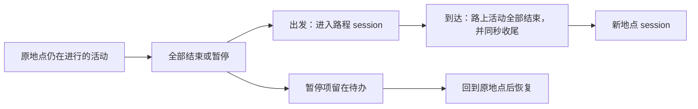

# 人物 Prompt 七层字段与来源

> 本轮仅更新设计，生产 Prompt 链路不变。唯一方案入口是[人物 Prompt 与交互修复方案](../PROPOSAL-decision-context.md)。
> [交互图示 HTML](persona-prompt-framework.html)与[完整字段设计](../PROPOSAL-decision-context.md#七层-json-字段设计)均已在仓库留档。

## 七层字段

每层使用 JSON，各自的 JSON Schema 说明字段名称、类型和允许值。
完整示例见 [examples.json](persona-prompt-schemas/examples.json)。每项信息只在一层出现，
归属见主方案的[唯一出现原则](../PROPOSAL-decision-context.md#唯一出现原则)。

| 层与字段说明 | 内容 | 更新方式 |
| --- | --- | --- |
| 系统层：[system.schema.json](persona-prompt-schemas/system.schema.json) | 执行职责与世界交互规则；每条规则只写一次。 | 固定复用；不混入人物经历、生活建议或对象目录。 |
| 工具层：[tools.schema.json](persona-prompt-schemas/tools.schema.json) | 可选目标及其状态、动作、方式、条件、价格、耗时、数量和其他可用工具；工作合同、进行中与刚结束的活动也在这里。工具定义经原生 `tools` 参数发送。 | 每次观察按冻结菜单重建。 |
| 人设层：[persona.schema.json](persona-prompt-schemas/persona.schema.json) | 冻结卡片去掉当下处境后的字段与姓名；关系与偏好的当前看法。 | 关系与偏好按对象原地替换；不放当日处境。 |
| 记忆层：[memory.schema.json](persona-prompt-schemas/memory.schema.json) | `earlier_days: [{date, settled, self_notes}]`；`earlier_today: [{recorded_at, settled, self_notes}]`。 | session 结束时追加一条；跨过零点并入更早日期，只留未了结的事实与就寝反思。 |
| 待办层：[todo.schema.json](persona-prompt-schemas/todo.schema.json) | 暂停的 activity 与今日 day_plan。 | 暂停项按实际暂停时间从老到新，同刻按事件顺序；计划保留原顺序。恢复或结束后移出暂停部分。 |
| 环境层：[environment.schema.json](persona-prompt-schemas/environment.schema.json) | 观察时间、现有五项体感分级、当前地点或路程的静态信息。 | 随当前观察更新；不放活动经过、消息或可达地点目录。 |
| 进度层：[progress.schema.json](persona-prompt-schemas/progress.schema.json) | 当前 session 的调用连同结果与可选 `self_note`，以及新消息、配送、截止与目标提醒；本秒内的后续决策以原生消息续接。 | 按发生时间排列，每件事出现一次；思考只在本秒原生消息里，时间推进后丢弃。 |

记忆不为 session 建档。session 结束时，系统把成功的世界请求与世界事件各写成一句 `settled`，
把已有 pause/conclude summary 与记忆原文放进 `self_notes`；不新增记忆接口或模型总结调用，也不编造没有写过的 summary。
工具结果使用人物能理解的公开内容；登记与实际执行分开表达，登记语义只写在系统层规则里。

## session 与活动沿用现有规则

[时间与能量规格](../SPEC-time-and-energy.md)的“会话、活动与记忆”已明确这些规则，见第 686–709 行：

进行中的 activity 不能跨出行；没有先处理完时，出行会被拒绝。路上活动不能暂停。
本方案把暂停项留在待办，仍须回原地点才能恢复，不带入路程或新地点作为进行中活动。
pause/conclude 本身不结束 session；session 仍是一段地点停留或路程，由出发、到达切换。

现有实现可直接参照 `src/worldmock/life/sessions.py:56–105`；summary 写入活动的过程见
`src/worldmock/life/session_actions.py:517–539`。本轮不改变这些活动规则。

## 九个差距的直接依据

### 系统层职责与表达混杂

`custom/agents/life_agent.py:267–321` 同时包含身份口吻、生活建议和额外自述要求。
新系统层只留正式、简洁的交互准则，取消单独形成自述再回贴的阶段。

### 可选目标分散与重复

`src/worldmock/life/projection.py:429–449,477–537` 提供对象信息，工具又生成可选名称。
统一放入工具层，保留哪个对象可以执行哪个动作，以及价格、数量、耗时和条件。

### 人物卡片混入可变处境

`src/worldmock/profile/textgen.py:28–43,65–131` 将“本周在忙什么”等处境写入人物卡片。
人设层去掉当日处境，保留卡片其余字段；关系和偏好变化时原地更新。

### 记忆缺少清晰的时间分区

`custom/agents/life_memory.py:44–85` 当前提供主观条目和归纳，没有本方案的两段时间分区。
新记忆层只分 `earlier_days` 与 `earlier_today`，每条记录只有时间、结算事实和人物自述。

### 待办没有独立归属

`src/worldmock/life/projection.py:269–276,649–671` 将暂停活动与计划分散在现有观察中。
待办层统一列出暂停事项与今日计划；暂停时间不能用活动开始时间替代。

### 环境混入动态记录

`src/worldmock/life/projection.py:250–283` 的场景包含活动、消息、目标和可达地点等内容。
环境层只留体感分级与所在环境的静态信息，动态消息与提醒放入进度层。

### 进度不是连续决策记录

`vendor/agentsociety2/packages/agentsociety2/agentsociety2/agent/base/agent_runtime.py:639–648`
每次 decision 清空消息（子模块本次未检出，行号沿用原记录）。新进度层保留当前 session 从开始到现在的决策与可见结果。

### 格式与命名不统一

`src/worldmock/life/narration.py:447–480` 与 `custom/agents/life_agent.py:450–493` 使用旧的内容块和拼接方式。
统一为用户指定的七层名称，各层使用 JSON，并用独立 Schema 说明字段。

### 同一信息多处出现

[接口合同「观察投影字段」](../../CONTRACTS.md#观察投影字段)第 556–557 行：`scene` 与 `facts` 同时带当前时刻、
在场的人、当日计划、体感与持有物；直接消息的前四十字进收件头（`src/worldmock/life/projection.py:621`）。
同一结果还会经 `just_now` 与 `facts.progress.results` 两处出现。新方案按唯一出现原则让每项信息只在一层。

以上对应的旧合同见[决策上下文规格](../SPEC-decision-context.md)、
[人物决策与画像规格](../SPEC-life-realism.md)及[LifeEnv 运行时规格](../SPEC-life-runtime.md)。
它们描述当前实现，不表示本轮设计已经落地。

## 字段取值的依据

七层字段尽量沿用现有合同的取值，避免为提示另造一套口径。

| 字段 | 依据 |
| --- | --- |
| 环境层 `body` 五项 | `src/worldmock/life/felt.py:283–295` 进入提示的五项分级；现有提示没有独立的体力分级，低能量已并入饥饿分级 |
| 人设层字段 | [接口合同「人格与卡片字段」](../../CONTRACTS.md#人格与卡片字段)第 1095–1105 行，以及 `src/worldmock/profile/textgen.py` 的渲染内容；只去掉 `situation` |
| 待办层 `intent_kind` 与 `remind_time` | 接口合同第 124–169 行的十一种意图与 `revise_day_plan` 参数名 |
| 进度层 `delivery.status` | 接口合同第 327 行的订单状态；到达事件只会是 `ready`、`delivered` 或 `cancelled` |
| 进度层 `message_arrival.kind` | 接口合同第 474 行 `direct`、`chat_invite`，以及 `projection.py:609–615` 的邮件行；邮件正文须阅读后可知（[决策上下文规格](../SPEC-decision-context.md)第 138 行） |
| 记忆层 `settled` | 瞬时动作不是活动，不写 summary（[时间与能量规格](../SPEC-time-and-energy.md)第 802 行），所以下单、发消息只能由系统写成结算事实 |
| 记忆层 `settled` 与 `self_notes` 分开 | [一日行为规格](../SPEC-dayrun-behavior.md)第 194 行要求已核验经历与人物自述在提示中明确分开 |
| 可读的价格、时长、数量 | 接口合同第 572、578 行：送达时间与客观进度写成人读短句，不给原始秒数 |
| 进度层 `tool_call.self_note` 可选 | 行动请求开启 thinking、`tool_choice=auto`（接口合同第 929 行），回复正文常为空，见下节测量 |

## 决策、回复正文与思考的依据

主方案把决策定义为所选的工具调用；回复正文可选，作为 `self_note` 保留到 session 结束；
思考只在同一秒的连续决策内回传。本节记录这些选择的依据。

### 业界做法

| 做法 | 来源 | 对本方案的含义 |
| --- | --- | --- |
| 带工具调用的回复可以没有正文；正文主要是给用户看的进度说明，可由提示调节详略 | OpenAI Chat Completions 的 `content` 在有 `tool_calls` 时可为空；GPT-5 提示指南的 tool preambles | 模拟中没有实时读者，正文不是决策的必需部分 |
| 思考只在一次任务的工具循环内回传；跨轮对话一般丢弃 | OpenAI 推理模型指南：多轮对话中推理 token 在每轮后丢弃，含函数调用时回传推理项；GPT-5 指南记录带回前次推理使 Tau-Bench Retail 从 73.9% 升到 78.2%，“不必在每次工具调用后从头重建计划” | 回传思考的收益出现在同一任务的连续调用中，对应本项目同一秒的连续决策 |
| 带 `tools` 的请求必须回传此前每个 assistant 回合的 `reasoning_content`，否则返回 400；不带 `tools` 时回传内容被忽略 | DeepSeek 思考模式文档 | 要丢弃思考，只能把旧回合移出原生消息；这决定了“本秒原生消息 ＋ 进度层 JSON”的切分 |
| 跨越较长时间的计划写成明确的笔记或待办，而不是依赖推理延续 | Anthropic 的上下文工程文章（structured note-taking） | 对应待办层与 pause/conclude/report 的 summary |
| 把推理放进工具参数的 think 工具 | Anthropic 2025-03 发布；2025-12 更新建议多数情况改用扩展思考 | 不采用；本方案不为每次决策增加推理参数 |

### 白领全天运行的测量

数据来自[原始事件](https://github.com/HoldThatThgt/WorldMock-Dataset/blob/main/requests/0001-white-collar-lianqiu/runs/2026-09-28-c9a4fc1-day-r3/worldmock-export/events.jsonl.gz)（运行 `2026-09-28-c9a4fc1-day-r3`）。
行动请求按“工具含 `start_activity` 且 thinking 开启”识别；“同秒跟进”指与上一次决策处于同一模拟秒的决策。

| 测量 | 结果 |
| --- | --- |
| 行动请求的回复 | 182 次，其中 177 次提交了世界请求；全部带 `reasoning_content` |
| 提交世界请求的回复中正文为空 | 97 / 177（55%）；有正文时长 9–165 字，多为人物口吻 |
| 每次回复的思考 | 中位约 1,260 token（4,612 字符），p90 约 17,600 字符 |
| 每次请求的输入 | 中位约 19,600 token；缓存命中中位 2,688 token |
| 思考的语言与内容 | 174 / 182 以英文为主（中文字符不足 30%）；150 / 182 含工具名、JSON、回合预算或 “the user” 等协议用语 |
| 同秒跟进的决策 | 53 / 140（38%）；每秒决策数的分布为 1 次 62 秒、2 次 8 秒、3 次 10 秒、4 次 3 秒、5 次 4 秒 |
| 同秒跟进与其他决策的思考 | 中位 1,486 与 1,373 token；跟进决策用掉全部行动思考的 47% |
| 反复推敲同一件事 | 咖啡能否点到出现在 20 次决策的思考里，包括 08:40:51 的 4 次、08:55:51 的 3 次与 09:10:51 的 3 次 |
| 决策自述 | 140 / 140 次决策都有，仍发生四次下单；自述多次写“牛肉炒面吃完了”，而根因研究记录 11:50 那份只吃了 209 / 1,500 秒 |

咖啡的反复推敲一部分来自旧的决策自述阶段：它在没有事实清单的情况下反复提出「点冰美式」。该阶段在本方案中删除。
同秒续接能否减少思考 token、协议错误与重复推敲，需在同一场景中对比验证。

## 参考来源

| 来源 | 用到的思路 |
| --- | --- |
| Anthropic：[Effective context engineering for AI agents](https://www.anthropic.com/engineering/effective-context-engineering-for-ai-agents)，2025-09-29 | 清晰分区、减少重复上下文、较长计划写成明确笔记。本项目只整理已有 summary，不增加模型压缩调用。 |
| LangChain：[Memory overview](https://docs.langchain.com/oss/python/concepts/memory)，页面未标发布日期 | 区分当前交互记录与更早记忆；不引入其框架或存储组件。 |
| DeepSeek：[Thinking mode](https://api-docs.deepseek.com/guides/thinking_mode)，页面未标发布日期 | 带 `tools` 时必须回传此前全部 `reasoning_content`，否则 400；不带 `tools` 时被忽略。 |
| OpenAI：[Reasoning models](https://developers.openai.com/api/docs/guides/reasoning)，页面未标发布日期 | 多轮对话中推理在每轮后丢弃；含函数调用时回传推理项。 |
| OpenAI：[GPT-5 prompting guide](https://developers.openai.com/cookbook/examples/gpt-5/gpt-5_prompting_guide) | tool preambles 面向用户、可调节；带回前次推理后 Tau-Bench Retail 由 73.9% 升到 78.2%。 |
| Anthropic：[The "think" tool](https://www.anthropic.com/engineering/claude-think-tool)，2025-03-20，2025-12 更新 | 推理放进工具参数的做法；更新后建议多数情况使用扩展思考。 |

已确认的来源与去向、进食和指名购买语义，以及截断、工时、工作、小数份食物等程序错误，
统一收录在主方案的[已确认的交互语义](../PROPOSAL-decision-context.md#已确认的交互语义)与
[统一修复的程序错误](../PROPOSAL-decision-context.md#统一修复的程序错误)，整体方案完成后统一修复。
