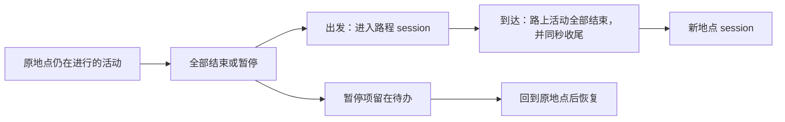

# 人物 Prompt 七层字段与来源

> 本轮仅更新设计，生产 Prompt 链路不变。唯一方案入口是[人物 Prompt 七层重整方案](../PROPOSAL-decision-context.md)。
> [交互图示 HTML](persona-prompt-framework.html)与[完整字段设计](../PROPOSAL-decision-context.md#七层-json-字段设计)均已在仓库留档。

## 七层字段

每层使用 JSON，各自的 JSON Schema 说明字段名称、类型和允许值。
完整示例见 [examples.json](persona-prompt-schemas/examples.json)。

| 层与字段说明 | 内容 | 更新方式 |
| --- | --- | --- |
| 系统层：[system.schema.json](persona-prompt-schemas/system.schema.json) | 正式、简洁的身份与行为准则，说明怎样与世界交互。 | 固定复用；不混入人物经历、生活建议或对象目录。 |
| 工具层：[tools.schema.json](persona-prompt-schemas/tools.schema.json) | 工具定义与可选目标，保留对象和动作的对应关系、操作条件及必要成本。 | 按当前可用内容更新。 |
| 人设层：[persona.schema.json](persona-prompt-schemas/persona.schema.json) | 基础信息、性格习惯、关系和偏好。 | 关系与偏好在原位置更新；不放当日处境。 |
| 记忆层：[memory.schema.json](persona-prompt-schemas/memory.schema.json) | `earlier_days: [{date, summary}]`；`earlier_today: [{recorded_at, summary}]`。 | 前者放昨天及更早的总结，后者放今天更早的总结；跨日后调整时间归属。 |
| 待办层：[todo.schema.json](persona-prompt-schemas/todo.schema.json) | 暂停的 activity 与今日 day_plan。 | 暂停项按实际暂停时间从老到新，同刻按事件顺序；计划保留原顺序。恢复或结束后移出暂停部分。 |
| 环境层：[environment.schema.json](persona-prompt-schemas/environment.schema.json) | 观察时间、身体状况、当前地点或路程的静态信息。 | 随当前观察更新；不放活动经过、消息或可达地点目录。 |
| 进度层：[progress.schema.json](persona-prompt-schemas/progress.schema.json) | 当前 session 的决策、工具调用与结果，以及新消息、配送送达和截止提醒。 | 按发生时间排列，每件事出现一次，不保存 thinking。 |

记忆只保存时间和 summary，不另外建立 session 档案。session 结束只是整理当前进度中已有
pause/conclude summary 的时机，不新增记忆接口或模型总结调用，也不编造没有写过的 summary。
工具结果使用人物能理解的公开内容；登记成功与实际执行成功分开表达。

## session 与活动沿用现有规则

[时间与能量规格](../SPEC-time-and-energy.md)的“会话、活动与记忆”已明确这些规则，见第 686–709 行：

进行中的 activity 不能跨出行；没有先处理完时，出行会被拒绝。路上活动不能暂停。
本方案把暂停项留在待办，仍须回原地点才能恢复，不带入路程或新地点作为进行中活动。
pause/conclude 本身不结束 session；session 仍是一段地点停留或路程，由出发、到达切换。

现有实现可直接参照 `src/worldmock/life/sessions.py:56–105`；summary 写入活动的过程见
`src/worldmock/life/session_actions.py:517–539`。本轮不改变这些活动规则。

## 八个差距的直接依据

### 系统层职责与表达混杂

`custom/agents/life_agent.py:267–321` 同时包含身份口吻、生活建议和额外自述要求。
新系统层只留正式、简洁的交互准则，取消单独形成自述再回贴的阶段。

### 可选目标分散与重复

`src/worldmock/life/projection.py:429–449,477–537` 提供对象信息，工具又生成可选名称。
统一放入工具层，保留哪个对象可以执行哪个动作，以及价格、数量、耗时和条件。

### 人物卡片混入可变处境

`src/worldmock/profile/textgen.py:28–43,65–131` 将“本周在忙什么”等处境写入人物卡片。
人设层去掉当日处境，保留基础信息、性格习惯、关系和偏好；关系和偏好变化时原地更新。

### 记忆缺少清晰的时间分区

`custom/agents/life_memory.py:44–85` 当前提供主观条目和归纳，没有本方案的两段时间分区。
新记忆层只分 `earlier_days` 与 `earlier_today`，每条记录只有时间和 summary。

### 待办没有独立归属

`src/worldmock/life/projection.py:269–276,649–671` 将暂停活动与计划分散在现有观察中。
待办层统一列出暂停事项与今日计划；暂停时间不能用活动开始时间替代。

### 环境混入动态记录

`src/worldmock/life/projection.py:250–283` 的场景包含活动、消息、目标和可达地点等内容。
环境层只留身体状况与所在环境的静态信息，动态消息与提醒放入进度层。

### 进度不是连续决策记录

`vendor/agentsociety2/packages/agentsociety2/agentsociety2/agent/base/agent_runtime.py:639–648`
每次 decision 清空消息。新进度层保留当前 session 从开始到现在的决策与可见结果。

### 格式与命名不统一

`src/worldmock/life/narration.py:447–480` 与 `custom/agents/life_agent.py:450–493` 使用旧的内容块和拼接方式。
统一为用户指定的七层名称，各层使用 JSON，并用独立 Schema 说明字段。

以上对应的旧合同见[决策上下文规格](../SPEC-decision-context.md)、
[人物决策与画像规格](../SPEC-life-realism.md)及[LifeEnv 运行时规格](../SPEC-life-runtime.md)。
它们描述当前实现，不表示本轮设计已经落地。

## 参考来源

| 来源 | 用到的思路 |
| --- | --- |
| Anthropic：[Effective context engineering for AI agents](https://www.anthropic.com/engineering/effective-context-engineering-for-ai-agents)，2025-09-29 | 清晰分区、减少重复上下文。本项目只整理已有 summary，不增加模型压缩调用。 |
| LangChain：[Memory overview](https://docs.langchain.com/oss/python/concepts/memory)，页面未标发布日期 | 区分当前交互记录与更早记忆；不引入其框架或存储组件。 |

信息截断、工时、工作与小数份食物等程序错误仍单独登记，整体方案完成后统一修复。
