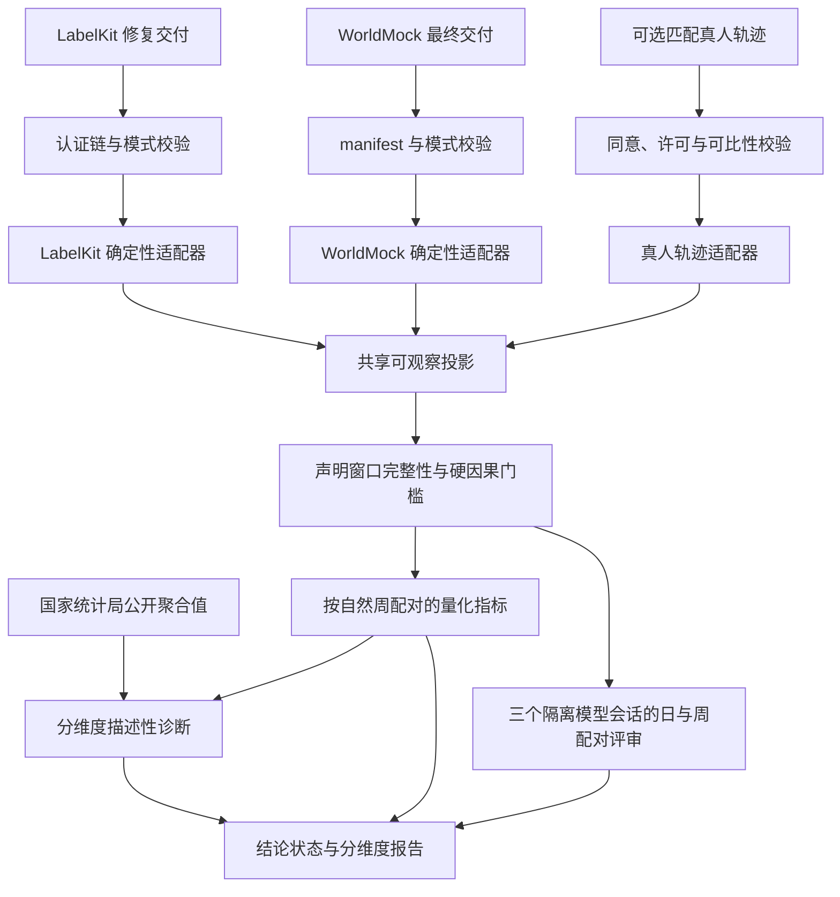

# 十二周数字足迹真实性评估合同

> 状态：调研证据（历史依据，不构成当前规范）｜ 日期：2026-09-15 ｜ 结论：归档中已提交的 DeepSeek 十二周对照数据真实存在；本次没有匹配的真人轨迹，结果状态必须是 `comparative_plausibility_only`。
> 证据快照：2026-09-15 ｜ 评估窗口：2026-01-05 至 2026-03-29，`Asia/Shanghai`

## 结论

既有对照数据真实存在。应使用归档中的已提交 DeepSeek 十二周数据，并以修复产物作为比较输入；
当前工作目录下只有日志的多次十二周尝试不是数据集，任何 partial trace 也不是正式成品。

现有资料只明确了“居住在上海张江生活区、工作在张江高科技园区的白领”这一共享人物设定。
年龄、家庭、收入、具体岗位等属性没有可验证的初始配置。WorldMock 可以拥有完成模拟所需的额外状态，
但这些额外状态不得进入与 LabelKit 的共享评分，避免用一方独有的信息惩罚另一方。

两套合成数据自身不能构成人类真值。本次没有匹配的真人轨迹，仍必须完成比较：工具输出结构差异、
与国家统计局公开时间利用聚合值的分维度对齐情况，以及三个来源遮蔽模型会话的评审偏好。
结果状态必须是 `comparative_plausibility_only`。允许表述“某候选在某维度更符合公开人类活动特性”
和“模型评审更偏好某候选”，不得表述为“已经目标人群实证验证”或把模型评审称作真人评审。
工具同时保留匹配真人参照的输入与判定路径，供后续严格比较使用。

## 已观察事实

### 可用的 DeepSeek 十二周基线

基线根目录：
`/Users/atishoo/Project/Dataset-Person/archive/white-collar-12-weeks-deepseek16-glm52`

本报告对这份归档交付的两份文件固定用两个称法：“主数据”指主文件 `white-collar-12-weeks.jsonl`，“事件流”指同一交付的
逐事件导出文件 `white-collar-12-weeks.stream.jsonl`（两者都是 WorldMock 文档所称的不可变 JSONL）；下文一律沿用这两个称法。

| 证据 | 已验证结果 |
| --- | --- |
| 原始交付清单 `out/white-collar-12-weeks.manifest.json` | `artifacts_committed=true`；运行标识 `ec5742eff472d320dac4f98c6d1fd478` |
| 原始主数据 `out/white-collar-12-weeks.jsonl` | 4,380 行；SHA-256 `4367ccb47d1e04c7b6a0d6c7a885332c690a1e3e96bae22ba21efc513aebb059` |
| 原始事件流 `out/white-collar-12-weeks.stream.jsonl` | 16,320 行；SHA-256 `40b3a8ab16e0e31191297d5eb57485aeb1bffdc7cb6f9c5b8681fd941b49ffb7` |
| 运行报告 `out/white-collar-12-weeks.report.json` | 计划与交付序列均为 4,380；失败序列为零；退出码为零 |
| 修复报告 `repaired/white-collar-12-weeks.repair-report.json` | 记录原始哈希、修复后哈希和全部修复计数 |
| 修复后主数据 `repaired/white-collar-12-weeks.jsonl` | 4,380 行；SHA-256 `ba0f5261d19aa53630851f390bb63b42665a60cdbb1fa3d6bb2782d9424a657f` |
| 修复后事件流 `repaired/white-collar-12-weeks.stream.jsonl` | 16,320 行；SHA-256 `835eae012007f0841e0c831ed696aa3caea4cd77fb552032917cc6a834a58009` |
| 最终审计 `repaired/white-collar-12-weeks.final-audit.json` | `status=pass`，全量审计，无 findings |

原始交付清单只认证原始文件。比较工具必须验证以下完整链条，不能只读取最终审计里的 `pass`：


事件时间戳的实测最小值为 `2026-01-05T06:30:00+08:00`，最大值为
`2026-03-29T21:24:30+08:00`。从 2026-01-05 至 2026-03-29 的八十四个自然日全部出现，
没有窗口外日期；16,320 个事件的 actor 均为 `user`，时区均为 `+08:00`。

修复后数据保持 4,380 个序列和 16,320 个事件。事件类型实测分布为：

| `dataName` | 行数 |
| --- | ---: |
| `screenMemoryEvent` | 10,111 |
| `appUsageEvent` | 4,469 |
| `pasteBoardEvent` | 1,078 |
| `notification` | 203 |
| `publicTimePeriod` | 153 |
| `commute` | 153 |
| `poi` | 153 |

主数据中的行为类型为 `no_intent` 3,876 条、`food_order` 180 条、`navigation` 131 条、
`check_in` 111 条、`coffee_order` 59 条和 `grocery_purchase` 23 条。全部主数据注释记录的模型为
`deepseek-v4-flash`。经定向读取且未输出任何凭据，生成配置显示默认生成端使用 DeepSeek，
语义评判端使用 GLM-5.2。

### 不可用的十二周尝试

`/Users/atishoo/Project/Dataset-Person/out/white-collar-12-weeks-v121-local4b-deepseek`
只有一个 31,050,328 字节的 `screenlog.0`，没有主数据、事件流或交付清单。

`/Users/atishoo/Project/Dataset-Person/out/white-collar-12-weeks-v121-local4b-deepseek-promptfix-r2`
同样只有日志。其他多个十二周目录含 `*.failed.report.json`，其 `artifacts_committed=false`。
这些目录只能作为失败经验，不能作为评估输入、恢复点或“部分十二周”数据。

另有已提交的一周数据 `out/white-collar-week.*`，包含 365 个序列和 1,360 个事件；
因为完整十二周基线已经存在，它只适合做适配器的小规模回归样本，不能替代正式基线。

## 冻结的场景边界

比较窗口按完整自然日解释为
`[2026-01-05T00:00:00+08:00, 2026-03-30T00:00:00+08:00)`，恰好是十二个周一至周日的自然周。
没有事件的时段属于可观察的静默，不得从节律统计中删掉。

八十四日是本次正式场景的验收条件，不是通用评估工具的固定限制。通用工具从 scenario JSON 读取
声明窗口与逐日覆盖声明，可以评估任意完整声明窗口；一日端到端样本必须能够完成校验、适配、
点估计和报告，只把需要更多自然周的指标标为 `insufficient_blocks`。

共享人物只冻结以下已证实属性：

| 属性 | 冻结值 |
| --- | --- |
| 人数 | 一人 |
| 居住区域 | 上海张江生活区 |
| 工作区域 | 上海张江高科技园区 |
| 身份 | 白领 |
| 时区 | `Asia/Shanghai` |

日历中的外生情境按既有生成计划冻结：

| 日历情境 | 日期 |
| --- | --- |
| 春节情境及旅行 | 2026-02-15 至 2026-02-23 |
| 周六调休工作 | 2026-02-14、2026-02-28 |
| 周末加班 | 2026-01-24、2026-03-28 |
| 病假 | 2026-03-12 |
| 事假 | 2026-03-18 |
| 一次额外餐饮情境 | 2026-03-03 |

冻结的是日期、人物和外生情境，不是 LabelKit 的模板、App、事件数量或时间点。
WorldMock 必须独立产生行为，否则比较会退化为对旧数据的复刻测试。

## 评估问题与可比性

评估分别回答以下问题：

- 交付是否完整、可追溯且覆盖同一个八十四日窗口。
- 两套数据在双方都能观察到的数字活动上有何差异。
- 哪些维度更符合国家统计局公开的中国居民时间利用聚合特性。
- 在来源被遮蔽后，三个隔离模型评审会话更偏好哪一套活动轨迹。
- 如果提供匹配真人轨迹，哪一套在预先声明的指标上更接近真人参照。

结果状态只有以下四种：

| `result_status` | 含义 | 允许的结论 |
| --- | --- | --- |
| `invalid_input` | 哈希、行数、模式、时间窗或审计链失败 | 只报告输入错误 |
| `not_comparable` | 人物、日历、粒度或共享可观察字段不足 | 只报告不可比较原因 |
| `comparative_plausibility_only` | 两套合成数据可比较，但没有匹配真人轨迹 | 报告差异、官方聚合对齐维度和模型评审偏好，不报告目标人群实证胜者 |
| `human_reference_comparison` | 匹配真人轨迹通过同一适配和可比性检查 | 可以按预先声明的判定规则报告胜者或无结论 |

公开研究数据不能直接充当这位 2026 年上海张江白领的真值。
LiveLab 的长期手机测量来自规模很小且设备与年代不同的人群；StudentLife 主要是大学生。
它们可验证指标选择，却不满足人物、日历和观察语义的匹配要求。

### 本次使用的官方聚合诊断参照

[国家统计局第三次全国时间利用调查](https://www.stats.gov.cn/xxgk/sjfb/zxfb2020/202410/t20241031_1957217.html)
于 2024 年 5 月采集一个工作日和一个周末日，以十五分钟为间隔记录活动；
[国家统计局答记者问](https://www.stats.gov.cn/zwfwck/sjfb/202410/t20241031_1957218.html)
给出的样本规模约为 10.7 万人。
公开公报给出全国、城镇和年龄段的边际聚合值，没有“上海城镇十八至五十九岁白领”的交叉微观数据。
因此本次同时保留“城镇居民”和“十八至五十九岁居民”两组边际值，不能把两组端点解释为置信区间。

| 活动领域 | 城镇参与者日均时长 | 城镇参与率 | 十八至五十九岁参与者日均时长 | 十八至五十九岁参与率 |
| --- | ---: | ---: | ---: | ---: |
| 个人生理必需 | 12 小时 26 分钟 | 100.0% | 12 小时 12 分钟 | 100.0% |
| 有酬劳动 | 6 小时 23 分钟 | 52.1% | 6 小时 32 分钟 | 75.6% |
| 无酬劳动 | 2 小时 44 分钟 | 76.0% | 2 小时 42 分钟 | 82.7% |
| 个人自由支配 | 3 小时 34 分钟 | 97.2% | 3 小时 8 分钟 | 97.1% |
| 学习培训 | 7 小时 4 分钟 | 25.3% | 5 小时 2 分钟 | 12.8% |
| 交通 | 1 小时 4 分钟 | 84.0% | 1 小时 6 分钟 | 84.9% |
| 互联网使用 | 6 小时 42 分钟 | 94.3% | 7 小时 19 分钟 | 98.7% |

候选活动先按冻结映射聚合到公报活动领域，并按十五分钟格计算参与日比例和参与日条件时长。
只有双方观测语义都与公报领域一致时才比较；导航 App 使用时长不能冒充交通时长，屏幕事件也不能
自动冒充全部互联网使用。每个可用维度分别报告候选与两组官方边际值的绝对差。
只有一方对两个边际值的差都更小时，才能说它在该维度“更符合公开聚合特性”；方向冲突时报告 mixed，
语义不匹配时报告 `not_applicable`。这是一项描述性诊断，没有抽样方差，不能参与目标人群胜者判定。

## 共同数据模型与适配

共同模型分成证据事件、活动会话和自然日三个层级。这样既完整保留 16,320 个 LabelKit 事件，
又不会把同一活动的屏幕、通知、剪贴板等子事件当成独立的人类行为来放大频率。

| 层级 | 必需字段 | 统计用途 |
| --- | --- | --- |
| 证据事件 | `dataset_id`、`source_event_id`、`person_id`、`occurred_at`、`event_family`、`channel`、`activity_id`、`source_pointer` | 完整性、渠道覆盖、事件内时间与因果检查 |
| 活动会话 | `activity_id`、`person_id`、`start_at`、`end_at`、`activity_category`、`application_category`、`location_bucket`、`outcome`、`caused_by` | 节律、时长、多样性、转换和因果连续性 |
| 自然日 | `calendar_date`、`calendar_class`、声明窗口内的完整活动向量、逐日覆盖声明、渠道支持掩码 | 配对比较、自然日块自助法和模型评审抽样 |

所有字段保留来源指针和 provenance。共享类别映射写入冻结配置，并由确定性代码完成；
评估期间不得调用大模型重新解释内容。

LabelKit 适配器读取修复后的主数据与事件流，使用
`_meta.event.owner_sequence_id` 和主数据 `_meta.stream.member_ids` 建立事件到会话的连接；
`appUsageEvent` 的 `startTime` 与 `duration` 构成区间。现有
`/Users/atishoo/Project/Dataset-Person/export_stream_views.py`
已经实现时间戳、App 区间包含和重叠校验，可复用其已验证语义，但不得修改 Dataset-Person。

WorldMock 适配器只读取最终交付清单及公开的事件、活动和动作结果接口。
内部思考、私有记忆和旧 spike transcript 不进入共享投影或模型评审。
生产规则引擎只提供规则版本与逐条判定结果；评估工具不得复制一套容易漂移的规则实现。

适配必须满足以下不变量：

- 输入的每个证据事件恰好产生一个共同证据事件，不得采样或静默丢弃。
- 一个来源事件不能同时归入两个活动会话。
- 无法映射的类别使用 `unknown` 并计入映射覆盖率，不能猜测。
- 一方不存在的渠道标为 `not_applicable`，不能记作零质量或零事件。
- 共同指标只在两方都支持的字段上计算；真人参照指标还要求真人参照支持同一字段。

## 执行流程



## 输入与硬因果门槛

输入门槛要求清单已提交、文件存在、行数与 SHA-256 一致、事件标识唯一、时间戳带时区、
引用可解析，并完整覆盖 scenario JSON 声明的自然日窗口。清单必须逐日区分“完整观察但无事件”与
“没有交付该日”。本次正式配置声明八十四个自然日；一日端到端配置只声明一个自然日。
任何失败都产生 `invalid_input`，不会继续给出真实性得分。

因果检查直接调用冻结版本的生产规则判定接口。以下已确认的错误属于硬因果错误：

- `caused_by` 指向不存在的事件，或子事件发生在其必需前因之前。
- 动作的完成、失败或交付发生在动作开始之前。
- 同一人物在同一时段处于互斥地点，或移动违反冻结的可达性规则。
- 已声明的资源账本发生余额、库存或配额下溢。
- 同一尝试在没有重试事件时同时拥有互斥终态。

只要出现一条带完整证据链的硬因果错误，该候选就得到 `causal_gate_failed`，不能成为胜者。
缺失渠道不是因果错误；如果某条规则所需字段不在共享观察范围内，该规则标为 `not_applicable`。

## 必须实现的量化指标

每项指标都输出原始统计量、有效自然日数、有效周数、缺失原因和置信区间。
禁止把各维度加权成一个“真实性总分”。

| 维度 | 固定统计方式 | 研究依据 |
| --- | --- | --- |
| 周内节律 | 把声明窗口内的完整自然周转为 168 个星期小时桶；以 `base=2` 报告归一化分布的 Jensen-Shannon distance、工作日与周末分布、夜间静默区间；不足一个完整自然周或全零向量为 `not_applicable` | 手机使用存在稳定的日节律和工作日/周末差异 |
| 活动量与时长 | 按自然日比较活动数、活跃分钟数、会话时长的中位数和分位数；对真人轨迹报告一阶 Wasserstein distance | 事件总量不足以表达持续时间和日间变化 |
| 爆发性与记忆性 | 按可比事件家族分别计算有限样本修正的 burstiness 和相邻间隔相关的 memory；禁止混合屏幕回显与活动会话 | burstiness 与 memory 描述不同的时间组织性质 |
| 多样性与转换 | 报告活动类别和 App 类别的 Shannon entropy、有效类别数、类别转换分布的 Jensen-Shannon distance、首次出现曲线 | 屏幕使用研究以熵和 App 转换衡量行为多样性 |
| 例行与变化 | 把每个自然日编码为固定十分钟活动类别序列；报告同类工作日的 Hamming distance、跨周对应日距离和十二周漂移 | 时间日记研究表明顺序、时间与持续时长需要分别保留 |
| 因果连续性 | 报告每条规则的适用分母、命中数、违规数和证据链；硬错误另行否决 | 长周期真实性要求结果在后续状态中持续，而不只是文本像真 |

Kernel maximum mean discrepancy 和 classifier two-sample test 可以发现两种来源是否容易区分，
但分类器也可能只学到序列化或采集渠道特征。它们不进入必须实现的胜者判定，也不能单独证明真实性。

## 缺失渠道与分母

每个指标都有显式 `support_mask`。核心活动统计使用声明窗口内的全部自然日，包括已声明完整观察的
零活动日；渠道指标只使用双方都支持该渠道的自然日，真人参照指标再与真人参照取交集。报告同时给出：

- `eligible_days`：进入分母的自然日。
- `eligible_weeks`：至少含一个有效自然日的自然周。
- `excluded_days_by_reason`：按 `missing_channel`、`unknown_mapping`、`invalid_interval` 等原因计数。
- `coverage_ratio`：有效自然日除以 scenario JSON 声明的自然日数。

当某渠道任一方完全不提供时，该维度为 `not_applicable`。原始交付缺少声明窗口内任一自然日属于
`invalid_input`；原始交付覆盖声明窗口、但共同活动层因观察语义无法覆盖时属于 `not_comparable`。
任何实现都不得把缺失渠道转换为零值后参与平均。

## 自然日块自助法

本次正式窗口恰好由十二个周一至周日块组成。所有差值按相同自然周配对，使用固定随机种子，
从这十二个七日块中有放回抽取十二块，重复 10,000 次，报告双侧 95% percentile confidence interval。
事件行不能作为独立样本。若有多个真人参照，先按人抽样，再在人内按自然周抽样。

通用工具按声明窗口和 `block_days` 构造连续自然日块。少于两个块时仍输出点估计与完整报告，
置信区间状态为 `insufficient_blocks`，不把一日端到端运行判为输入失败。

春节、病假等只出现一次的情境仍完整保留，但其置信区间只能表达这次十二周案例，
不能外推为上海白领总体规律。

## 来源遮蔽的模型配对评审

本次评审者是三个隔离的模型会话，不是真人。每个会话只接收冻结评分规则和遮蔽后的评审包，
不得继承生成任务上下文、读取候选目录、查看另外两个会话的答案或在解盲后改分。
使用 Codex 子代理时创建无历史上下文的独立任务；使用外部 judge 时为每个会话创建独立上下文。

评审包同时包含自然日对和完整自然周对。两套候选使用相同日期、日历标签和共享渠道，
每个会话的左右位置由冻结种子独立随机化。评审数据不得包含 provider、模型名、文件路径、运行标识、
内部思考、provenance 或可推断来源的格式标记。解盲 key 单独保存，三个会话全部提交后才能读取。

本次自然周对覆盖全部十二周。自然日对包含所有非普通日历情境；每个自然周再从普通工作日和普通周末中
各选择一个 SHA-256 排序最小的日期，选择只依赖日期、日历类别和冻结种子，不能依赖候选内容。

三个模型会话分别判断以下维度：

- 时间节律是否像完整的一天或一周。
- 行动与后果是否连续且无因果跳跃。
- 是否始终符合共享人物与日历情境。
- 长期结果是否在后续日期留下合理影响。
- 重复例行与自然变化是否平衡。
- 是否缺失人类在该情境下通常会有的重要活动。

每个维度允许 `left`、`right`、`tie` 和 `unjudgeable`。偏好统计把 left 记为 `1`、right 记为
`-1`、tie 记为 `0`，`unjudgeable` 不进入偏好分母但必须报告数量和原因。
按自然周块自助法计算偏好差置信区间，并用 Krippendorff's alpha 报告三个会话的一致程度。
`alpha >= 0.80` 且偏好差区间不跨零时可以说“模型评审更偏好某候选”；
否则模型评审结论为 `inconclusive`，但评估任务仍完整结束。

每份评审记录必须保存 `reviewer_kind=model`、provider、模型名、隔离会话标识、prompt hash、packet hash
和原始响应。这些字段只进入解盲后的评审 metadata，
不进入 review pack。即使三个会话都隔离，同一基础模型的误差仍可能相关；高 alpha 只能说明模型会话一致，
不能称作真人评审一致性，也不能证明目标人群会作出相同判断。

## 结论判定

本次没有匹配真人轨迹，输出 `result_status=comparative_plausibility_only`，但评估不会因此停止。
最终报告必须并列给出：

- 每个共享量化维度的候选差异和自然周块自助法区间。
- 每个可映射国家统计局领域的 `public_aggregate_alignment`，其值为 candidate A、candidate B、mixed 或 `not_applicable`。
- 每个评审维度及总体的 `model_review_preference`，其值为 candidate A、candidate B、tie 或 `inconclusive`。
- 同模型会话相关性、观察语义差异和国家聚合值不是目标人物真值的限制。

这组结果允许回答“哪些维度更符合公开人类活动特性”和“模型评审偏好谁”，
不输出目标人群实证意义上的总胜者。

以后提供匹配真人轨迹时，以候选到真人参照的距离为方向统一的分维度结果。候选只有同时满足以下条件，
才可以标为 `human_reference_candidate`：

- 输入门槛和硬因果门槛全部通过。
- 在所有预先声明的主要量化维度上没有显著更差，并至少在一个维度上显著更接近真人参照。
- 量化判定使用配对自然日块自助法的 95% 置信区间，不使用事件行伪造样本量。

真人参照量化维度彼此冲突或区间跨越等价边界时，`result_status` 保持
`human_reference_comparison`，同时输出 `decision=mixed_or_inconclusive`。
模型评审若与真人参照方向不同，必须并列暴露分歧，不能覆盖真人参照结果。
一方因硬错误失去资格不会自动证明另一方更像人类。

## 产物合同

每次评估写入独立目录，至少包含：

| 文件 | 内容 |
| --- | --- |
| `manifest.json` | 输入路径的逻辑标识、哈希、行数、评估版本、配置哈希、随机种子和产物哈希 |
| `input-validation.json` | 每个输入身份、修复认证链和场景哈希 |
| `mapping-report.json` | 原始事件数、活动数、映射覆盖率、unknown 及丢弃数；丢弃数必须为零 |
| `causal-validation.json` | 生产因果检查器、共同支持和两侧 findings |
| `metrics.json` | 分维度统计、支持分母、自然周块自助法区间和状态 |
| `official-reference.json` | 国家统计局边际值、语义支持和逐维度对齐方向 |
| `blind-review-pack.json` | 三个隔离包的公开索引、哈希和选择覆盖 |
| `review-packets/reviewer-*.json` | 已遮蔽且顺序随机的日与周配对 |
| `unblinding-key.json` | 单独保存的解盲映射，不进入评审包 |
| `review-results.json` | 三份评分、原始响应、解盲结果、偏好、alpha 和会话相关性 |
| `prepare-receipt.json`、`result.json` | 准备工件认证与最终状态判定 |
| `report.md` | 面向人的结论、限制、证据链接和不允许越界的措辞 |

相同输入哈希、配置哈希和随机种子必须产生字节一致的指标、抽样和模型评审包。

## 文件修改清单

评估实现统一放在 `worldmock.evaluation`，测试统一放在 `tests/evaluation`。
项目只保留 `worldmock evaluate` 这个入口，不新增 `realism` 包、第二个 console script 或模块执行入口。

| 文件 | 责任 |
| --- | --- |
| `src/worldmock/evaluation/models.py` | 共同三层模型、结果状态、支持掩码和产物模式 |
| `src/worldmock/evaluation/public_evidence.py` | 公开结构事实、真实对象关联与 closed 映射 |
| `src/worldmock/evaluation/adapters.py` | WorldMock、LabelKit 修复链和真人参照的确定性适配 |
| `src/worldmock/evaluation/metrics.py` | 节律、时长、爆发性、记忆性、多样性、转换、例行和块自助法 |
| `src/worldmock/evaluation/aggregate_reference.py` | 国家统计局聚合值、十五分钟聚合、观察语义检查和分维度对齐 |
| `src/worldmock/evaluation/review.py` | 配对抽样、来源遮蔽、模型评审记录、解盲、偏好区间和会话一致性 |
| `src/worldmock/evaluation/runner.py` | 输入门槛、因果门槛、决策状态、manifest 和报告编排 |
| `src/worldmock/cli.py` | `worldmock evaluate` 的参数与 handler；自身不是第二个入口 |
| `scenarios/evaluation.json` | 冻结人物、声明窗口、日历、类别映射、指标、种子和模型评审抽样规则 |
| `tests/evaluation/test_adapters.py` | 认证链、无丢失映射、声明窗口和缺失渠道 |
| `tests/evaluation/test_metrics.py` | 手算小样本、自然日块自助法、爆发性和距离方向 |
| `tests/evaluation/test_review.py` | 来源遮蔽、三个隔离会话、模型 metadata、确定性抽样和解盲时机 |
| `tests/evaluation/test_runner.py` | 四种结果状态、一日端到端、正式八十四日门槛、硬因果否决与无结论路径 |
| `tests/evaluation/test_evaluation_scenario.py` | 共享人物和正式场景严格模式 |
| `pyproject.toml` 与锁文件 | 将实现直接导入的 `numpy`、`pandas`、`scipy` 和成熟 alpha 实现声明为直接依赖 |

训练加载器和生产规则引擎由相邻功能模块负责。评估模块只消费它们的正式公开接口；
不得在评估目录新增第二套 loader、状态转换器或 fallback。

评估分准备与收口两步，但都通过同一个 `worldmock evaluate` 入口完成。准备步骤认证数据、计算指标并冻结
review pack；三个隔离模型会话只能读取该 pack。收口步骤验证三份评分与 pack hash，解盲并生成最终报告。

```text
worldmock evaluate --worldmock <worldmock-export> --legacy <labelkit-repaired-delivery> \
  --scenario scenarios/evaluation.json --output <evaluation-directory>
```

```text
worldmock evaluate --output <evaluation-directory> \
  --reviews <reviewer-01-record.json> <reviewer-02-record.json> <reviewer-03-record.json>
```

两次调用是同一评估运行的状态转换，不是两个命令入口。收口必须拒绝 pack hash、输入哈希、
配置哈希或评分会话数不匹配的记录。

提供匹配真人轨迹时，在准备调用中追加 `--human-reference <delivery>`；没有该参数时自动使用
`comparative_plausibility_only` 和 scenario 中的官方聚合诊断参照。

## 验收案例

| 场景 | 预期结果 |
| --- | --- |
| 读取上述归档修复链 | 认证 4,380 个活动和 16,320 个事件，八十四日齐全，丢弃数为零 |
| 读取只有 `screenlog.0` 的旧十二周目录 | `invalid_input`，错误指出缺少已提交 manifest 和数据文件 |
| 修改修复后任一 JSONL 字节 | 修复哈希检查失败，不能运行指标 |
| 一日 scenario 与两套完整一日交付 | 命令成功，输出点估计；周节律和置信区间为 `insufficient_blocks` |
| 正式 scenario 删除任一自然日覆盖声明 | `invalid_input`，不能用八十三日结果冒充十二周 |
| LabelKit 没有 WorldMock 私有状态渠道 | 私有状态维度为 `not_applicable`，不进入任何共享分母 |
| 某 App 类别无法映射 | 映射为 `unknown` 并增加覆盖缺口，事件总数不变 |
| 构造终态早于开始的活动 | 真实生产规则接口报告证据，候选被硬因果门槛否决 |
| 固定输入、配置和种子运行两次 | 指标、10,000 次抽样结果和模型评审包字节一致 |
| 搜索 review pack 中的模型名、provider、路径和运行标识 | 全部不存在；review key 独立保存 |
| 三份模型评分来自同一基础模型的隔离会话 | metadata 明示相关性；不得标为三名真人或独立人群证据 |
| 互联网或交通的活动语义与国家统计局定义不匹配 | 对应官方聚合诊断为 `not_applicable`，不把缺失记作偏差 |
| 候选只对一个官方边际值更接近 | 该维度 `public_aggregate_alignment=mixed` |
| 只提供两套合成数据和三份模型评审 | 状态为 `comparative_plausibility_only`，仍输出全部维度对齐和模型偏好 |
| 真人参照人物或观察渠道不匹配 | `not_comparable`，不能用公开学生数据补位 |
| 真人量化结果与模型评审方向相反 | 并列暴露分歧，不生成总分强行排序 |

实现测试必须接受 Uncle Bob mutation review。至少要杀死“跳过哈希验证”“静默丢一条事件”
“把缺失渠道当零”“把一日工具窗口拒绝为非八十四日”“去掉硬因果否决”“泄露 review key”
“把模型会话写成真人评审”“没有真人参照仍宣布目标人群实证胜者”等行为破坏 mutant。

## 依赖与现状边界

当前 `pyproject.toml` 已直接锁定 `numpy`、`pandas`、`scipy`、`matplotlib` 和
`krippendorff`。评估实现不依靠 AgentSociety2 的传递依赖，也没有为非主要分类器诊断引入
`scikit-learn`。

WorldMock 完整导出现在固定包含活动会话、真实 segments、来源事件连接和认证 quality 工件。当前剩余的
实测边界是正式八十四天导出尚未完成；在该工件出现前，不能预报双方实际共同字段或盲评维度可判定比例。

## 研究依据

- [国家统计局第三次全国时间利用调查公报（第一号）](https://www.stats.gov.cn/xxgk/sjfb/zxfb2020/202410/t20241031_1957217.html)
  说明调查以十五分钟记录一个工作日和一个周末日，是本次官方聚合诊断的采集口径依据。
- [国家统计局第三次全国时间利用调查公报（第三号）](https://www.stats.gov.cn/zt_18555/zthd/lhfw/2025/2025_qgsjlydc/202501/t20250127_1958534.html)
  提供城镇和十八至五十九岁居民的活动参与率、参与者日均时长与互联网使用聚合值。
- [国家统计局对第三次全国时间利用调查的答记者问](https://www.stats.gov.cn/zwfwck/sjfb/202410/t20241031_1957218.html)
  说明约 10.7 万人样本、六个主要活动领域、十三个主要活动大类和公开值的群体适用边界。
- [LiveLab: Measuring Wireless Networks and Smartphone Users in the Field](https://www.yecl.org/livelab/publications/10.PerfEval.LiveLab.pdf)
  展示长期手机测量中的用户差异、App 采用和随时间变化，说明单日快照不足以验证十二周真实性。
- [Quantifying daily rhythms with smartphone data](https://www.nature.com/articles/s41598-022-09273-y)
  使用一周 168 个小时桶分析屏幕活动，支持保留工作日、周末和静默时段的周内节律方法。
- [Burstiness and memory in complex systems](https://barabasi.com/media/pub_imports/files/233.pdf)
  将事件间隔分布的 burstiness 与相邻间隔相关的 memory 分开，避免把两种时间性质混成一个指标。
- [Finite-size effects on burstiness](https://journals.aps.org/pre/abstract/10.1103/PhysRevE.94.032311)
  说明有限样本会偏置传统 burstiness，支持使用有限样本修正形式。
- [Screenomics: A Framework to Capture and Analyze Personal Life Experiences and the Ways that Technology Shapes Them](https://pmc.ncbi.nlm.nih.gov/articles/PMC7065687/)
  展示屏幕使用的时间结构、工作日差异和 Shannon entropy 等多样性分析。
- [Patterns of everyday activities across social contexts](https://pmc.ncbi.nlm.nih.gov/articles/PMC6004479/)
  以固定时间格的活动序列及序列距离研究日常规律，支持十分钟活动向量与顺序比较。
- [Time diary validation against wearable sensors](https://pmc.ncbi.nlm.nih.gov/articles/PMC6546612/)
  表明活动的时间、顺序和持续时长需要分别评估。
- [scikit-mobility](https://www.jstatsoft.org/article/download/v103i04/4320)
  提供成熟的人类移动性统计实现和熵、活动范围等标准指标；位置指标仅在三方位置语义可比时启用。
- [A Kernel Two-Sample Test](https://www.jmlr.org/papers/v13/gretton12a.html) 与
  [Revisiting Classifier Two-Sample Tests](https://arxiv.org/abs/1610.06545)
  支持把两样本检验限定为来源可分性诊断，而不是人类真实性真值。
- [Generative Agents: Interactive Simulacra of Human Behavior](https://arxiv.org/abs/2304.03442)
  使用人类评审衡量行为可信度，支持本合同的评审维度；本次模型评审是更弱的证据，不能等同该研究的人类评审。
- [Reliability in Content Analysis: Some Common Misconceptions and Recommendations](https://onlinelibrary.wiley.com/doi/abs/10.1111/j.1468-2958.2004.tb00738.x)
  给出 Krippendorff's alpha 的可靠性解释；本次只把它解释为三个模型会话的一致程度。
- [ActivitySim estimation mode](https://activitysim.github.io/activitysim/develop/users-guide/estimation-mode/index.html)
  成熟活动仿真工具以观测旅行调查选择进行估计和校准，支持“只有合成对合成时不能声明人类真值”的边界。
