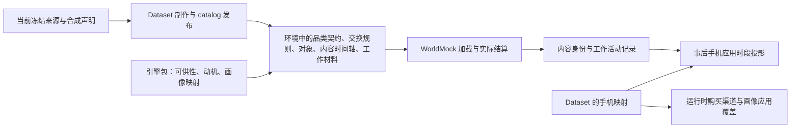
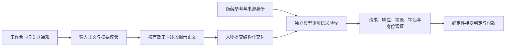

# 资源与规则引擎简化：数据、应用、娱乐与工作证据

> 代码基线：7e1ffab3b49971922069c0c1fa400ffcbb075beb

本记录为 proposal 的只读证据，不修改运行行为，也不把新需求与旧行为的差异称为现有缺陷。
核对时间为 2026-10-06。WorldMock-Dataset 检出身份为
`7417b63abb78818130de67ab2098ea75b68917d3`；既有三个未跟踪路径未改动。
下文未加仓库前缀的路径属于 WorldMock，`WorldMock-Dataset/` 前缀属于数据仓；路径均相对仓库根。
数据仓工具路径均相对 `WorldMock-Dataset/tools/`，例如 `environment_rules.py`；这类工具引用不属于 WorldMock 源码。
本轮未执行测试、完整模拟或来源重新抓取。

## 事实摘要

当前环境内容已经归数据仓，但品类契约和交换规则尚未变成引擎固定规则。
运行端的应用概念主要是购买渠道和手机配置覆盖投影；娱乐仍直接选择内容，应用归属主要在导出时解析。
工作是一整套材料、交付、独立语义验收和付款流程，不能只删材料文件就得到“主题加工时”。

## Catalog 与规则所有权

| 当前事实 | 直接证据 | 对 proposal 的约束 |
| --- | --- | --- |
| 数据仓没有 `src/` 或 `pyproject.toml`；实际制作代码在工具目录，依赖已安装的 WorldMock | `WorldMock-Dataset/README.md:8–20`；数据仓工具子目录 `environment_prepare/` 实际文件清单 | 不应假设数据仓有独立 Python 软件包或新的依赖系统 |
| 引擎持有结构、通用加载器、可供性、动机与画像映射；Dataset 持有来源准备、catalog 与场景发布 | `WorldMock-Dataset/README.md:8–17`；`docs/dev/SPEC-environment-data-ownership.md:24–34` | 保留显式外部环境输入，避免重新把具体对象写回引擎 |
| 品类契约和交换规则目前仍由 Dataset 冻结审核，运行端读取环境文件 | `WorldMock-Dataset/environment/zhangjiang-baseline/catalog/README.md:7–18`；`docs/dev/SPEC-category-contract.md:63–66`；`src/worldmock/categories/loader.py:20–59` | “分类规则和交换规则钉死 WorldMock”必须作为新的所有权变更明确替换现行规范 |
| 只有三份通用规则由引擎包提供，再被 Dataset 复制以绑定输入身份 | `environment_rules.py:8–22`；`src/worldmock/life/world_setup.py:81–93` | 可以借用包资源的现成机制；不能把当前三份规则的归属扩大解释为所有规则已经归引擎 |
| Dataset 构建器原样复制品类契约和交换规则，并读取食品原件、来源池与冻结契约 | `environment_prepare/catalog.py:896–929` | 新环境发布应删除这两份可编辑规则输入和逐条食品营养准备依赖，而非增加并行的新格式 |
| 原目录是资源、原生对象、墓碑、继承品类、交换声明与数值来源覆盖的组合 | `environment_prepare/catalog.py:1–15, 150–186`；`WorldMock-Dataset/environment/zhangjiang-baseline/catalog/README.md:30–36` | 新对象 catalog 只承载明确需要的名称、内容、类型和绑定关系；不能把原通用继承机制换名字保留 |

## app 缺少统一运行目录

| 当前事实 | 直接证据 | 拟议变化必须满足的断言 |
| --- | --- | --- |
| 场景仅有可选的手机配置路径与摘要，没有正式应用 catalog 字段 | `src/worldmock/life/scenario.py:659–675` | 环境注册时提供应用 catalog；应用成为运行时的实际可选对象 |
| 应用名称来自手机配置 `app_display_names`，不是从真实应用服务抓取 | `src/worldmock/profile/coverage_apps.py:27–38, 55–94` | 真实名称由 Dataset 明确提供；“真实名称”不能被写成真实平台在线集成 |
| Dataset 的预检要求所选应用名可对应人物 ISSUE 中的名称 | `preflight_persona.py:43–67` | 保留名称和来源可核对的原则，但不要把每个人物手机投影配置当作全环境应用注册 |
| 当前购买渠道已经允许一个应用聚合多个卖家和地点 | `src/worldmock/profile/coverage_apps.py:97–109` | 可复用一个应用对应多个地点的关系事实；新声明应直接绑定地点与应用，而非绕到卖家账户反推 |
| `PhoneSimulationCoverage` 仅声明活动到应用、卖家到应用、应用显示名 | `src/worldmock/profile/coverage_apps.py:27–38, 115–130` | 当前模型没有应用到多内容、内容到多应用、应用内选择或通知锁定语义 |
| Dataset 已有 `content_apps_by_id`，但仅用于把已发生的 watch 内容身份投影为一个应用 | `simulate_phone.py:125–154` | 不能把这个事后单值映射宣称为现成的运行时多对多绑定；新运行事件要直接记录实际应用与内容 |
| 手机购物时段与送达通知仍按卖家反推 app，支付使用另一项应用配置 | `simulate_phone.py:213–260` | 删除 `purchase_apps_by_seller` 的事后归属；订单与配送事件直接携带已选择 app，应用名称只从同一目录读取 |
| 手机事件交接仍校验独立配置摘要，并要求手机来源为场景合成 | `labelkit_input.py:37–56, 106–118, 139–156` | 替换此校验链以承接运行时应用事实；不能把新的原生 app 事件重新标为旧场景合成来源 |

购买已经通过 app channel 参与运行端解析；当前差距是缺少覆盖各类行为的统一 app 运行目录。
娱乐、购物及通知的手机记录仍有事后投影路径，但不能将现状说成“所有 app 概念都只存在于事后导出”。
新目录作为唯一名称与绑定来源时，必须覆盖运行端、Dataset 手机导出和 LabelKit 输入交接三者。
通用事件转换与交接仍可存在，但不得另外维护内容、卖家、名称到 app 的第二套归属规则。

## 娱乐仍直接选择内容并读取分段素材

| 当前事实 | 直接证据 | 拟议变化必须满足的断言 |
| --- | --- | --- |
| 内容以标题直接列入人物可执行目录；人物按内容身份进入 watch | `src/worldmock/life/named_catalog.py:62–78`；`src/worldmock/life/rules.py:90–106` | 新动作选择应用，具体内容由运行规则选定；旧按标题直接选娱乐内容的入口应删除 |
| 当前娱乐类型为电影、剧集、播客、小说片段、新闻、笑话、字幕体验、游戏会话 | `src/worldmock/life/scenario.py:447–471` | 用户要求的文章、图文、短视频、长视频、实况是新的内容分类闭集，应直接替换当前娱乐分类 |
| 所有当前娱乐条目需要时长和带摘要的时间轴；播客还必须有音轨及摘要 | `src/worldmock/life/scenario.py:459–489`；`src/worldmock/life/content.py:133–150` | 摘要内容不应再强制配套 SRT、真实音轨和字幕解析器 |
| 当前内容接触按实际播放区间揭示字幕，接续与重看由内容进度决定 | `src/worldmock/life/content.py:153–175`；`src/worldmock/life/rules.py:90–106` | 保留时间、进度、已接触内容的可信记录；新摘要呈现方式应另行明确，不伪装成真实逐秒字幕观看 |

## 缺少同 session 推送指定消费

在本次读取的运行模型与消费路径中，没有发现 `app_id`、应用会话或应用内容推送模型；
`push` 命中为寻路的 `heapq.heappush`，`notification` 命中为工作通知校验。
此结论限定于已读的 WorldMock `life/` 与 `profile/coverage_apps.py`，不把字符串搜索等同于运行证明。

新 proposal 需要把以下行为写成可验证约束：本地时间 08:00 至 22:00 的推送来自该应用绑定内容；
人物在同一会话打开应用时消费被推送的明确内容；完成后继续使用应用才回到随机选择。
“会话”必须给出开始、结束和过期边界，且保存恢复不能重新抽选或丢失指定内容。
这些都是新增产品规则，当前手机时段投影不能提供它们。

主提案建议复用地点／路途 session，其现行依据已经实际核对：
`src/worldmock/life/sessions.py:1–13` 定义初始停留、出发切到路途、到达或中止切回停留、实验截止结束，
并将状态随共同检查点保存；`src/worldmock/life/sessions.py:34–37` 返回每个人物唯一的活动会话。
这能为推送资格提供已有明确边界，无需新建应用会话。
推送的 app、内容和资格状态仍是新增状态，不能仅凭现有 session 就宣称推送恢复已获支持。
地点 session 没有独立起止事件，主提案应通过现有会话切换钩子终止资格，不能依赖尚不存在的通知事件。

## 工作依赖材料与独立验收

| 当前事实 | 直接证据 | 简化时必须明确替换的内容 |
| --- | --- | --- |
| 每项工作需要合同、预约、截止、技能、有效工时、原文与隐藏参考路径及摘要 | `src/worldmock/life/scenario.py:373–424` | 仅保留主题与工时意味着删除材料与参考，并重新裁定合同完成口径，不能保留隐含的验收前提 |
| 每项工作加载时就读取并验证材料与参考，缺失则拒绝创建世界 | `src/worldmock/life/world_setup.py:96–105` | 删除启动期材料完整性负担，而不是生成空文件满足旧加载器 |
| 工作正文按已结算有效工时比例揭示，活动保存正文字符位置 | `src/worldmock/life/work.py:174–205` | 主题和真实累计时间交给进度播报提示；不再维护原文字符揭示状态 |
| 提交会读取原文和参考、计算付款并校验雇主资金；接受后才结算 | `src/worldmock/life/work.py:208–244` | 以工时完成为新的可观察事实；不要继续把合成进度叙述送入来源语义验收 |
| 独立模型逐项判断参考覆盖、来源支持和矛盾，协议有摘要与摘录校验 | `src/worldmock/life/work_review.py:24–37, 46–113` | 删除工作内容语义评审模型、隐藏参考、交付逐字段比对与摘录校验 |
| 评审协调器拥有调用、证据保存、结果解析与至多三次协议纠正 | `src/worldmock/life/work_review_runtime.py:39–88, 90–122` | 删除整条工作评审协调流程；保留通用模型调用设施供其他现有需求使用 |
| 现行规范明确要求材料、真实产出与独立内容验收 | `docs/dev/SPEC-life-runtime.md:579–638` | proposal 要标明有意替换这些条款，不把主题与工时实现误称为符合旧语义验收规范 |
| 场景已有独立固定工资记录，按预排时刻进入工资事件并做账户转账，不读取工作任务或验收结果 | `src/worldmock/life/scenario.py:545–552`；`src/worldmock/scheduling/compile.py:82–88`；`src/worldmock/scheduling/effects.py:119–134`；`docs/CONTRACTS.md:881–885` | 保留既有预排工资结算，删除工作任务提交与验收付款链，无需为主题工作新造计酬系统 |

工作进度数值仍应由真实模拟工时决定，语言模型只编写与主题和当前工时相符的进度及操作描述。
由模型宣称“已完成”直接增加工时会把状态权威交回叙述，不能达到简化并保持可信行为的目的。
工资采用已有的预排固定金额结算，和主题工作进度分离；删除任务交付验收不会切断正常工资收入。
上班地点、作息、消息和日程属于人物生活规则的边界，不能从“删除工作内容材料”自动推出全部删除。

## 正式环境当前存在的具体负担

对 `WorldMock-Dataset/environment/zhangjiang-baseline/scenarios/single-person.json` 做 JSON 只读计数，
当前有 193 项 `contents`、56 项 `tasks`、30 项 `games`、168 项 `products`；顶层没有手机配置字段。
这只是本文件的输入计数，不代表这些内容均在实际模拟中被消费。

首项工作引用 AMI 会议原文与隐藏参考，见该文件 `879–894` 行；
环境 README 明确记录了 975 条冻结语料记录、30 个 TextWorld 游戏与 976 个保留语料文件，
见 `WorldMock-Dataset/environment/zhangjiang-baseline/README.md:16–38`。
来源重新准备包含食品、Sintel 字幕、AMI 标注、真实地图路线和 TextWorld 游戏，见同文件 `64–81` 行。
这正是用户希望以真实应用与作品名称、合成或真实摘要、合成数值替换的制作与维护范围。

当前空档中的“刷 B 站、刷抖音、刷小红书”只是生活活动声明；数据仓明确说明刷手机不产生应用使用记录，
见 `WorldMock-Dataset/environment/README.md:39–46`。新方案如果再把它们保留为另一套娱乐入口，
应用消费仍会与生活活动语义分裂；应直接采用新的应用使用行为。

## 建议删除与保留

| 处理 | 对象 | 理由与验收边界 |
| --- | --- | --- |
| 删除 | Dataset 可修改的品类树、属性继承增量、交换配对声明、闭集算子配置及两份规则输入 | 新规则的唯一权威在 WorldMock；改变对象名称不能改变运行规则 |
| 删除 | 食品原始营养来源准备、逐条营养声明、食品来源映射与当前为其服务的分类扩容逻辑 | 零食、饮品、正餐由系统固定热量，Dataset 不再提供逐食品热量 |
| 删除 | 运行端按具体娱乐标题选内容的接口，以及独立的内容到应用事后单值归属 | 人物选应用；运行时确定内容和记录事实；一个内容可供多个应用 |
| 删除 | 娱乐必须绑定字幕或音轨的要求、来源专用内容准备的运行依赖 | 摘要即可成为内容，真实或合成来源要清楚标记 |
| 删除 | 工作输入、隐藏参考、逐段正文揭示、交付结构、独立工作语义验收 | 新工作对象只有主题和工时，叙述由进度播报生成 |
| 保留 | 外部环境注册、明确结构、引用校验、冻结输入身份、随机状态保存恢复 | 简化对象不应造成同一次运行恢复后改变对象或重复抽选 |
| 保留 | 真实经过时间、内容实际接触、实际进食、资金与持有状态的确定性结算 | 模型负责选择和编写，不任意修改既有事实 |
| 保留 | 独立预排的工资结算 | 复用现有工资事件和账户转账，工作叙述不决定收入 |
| 保留 | 历史运行与导出证据的字节 | 新格式直接替换生产输入与加载入口；历史证据不改写，不提供旧运行兼容 |

食品到店绑定与“相同地点类型具有完全相同商品”之间需要统一语义：推荐按地点类型形成唯一商品集合，
显式选择店铺时校验同类型店铺集合一致，`all` 展开为全部可提供食品的店铺。
不能一面允许任意单店独有食品，一面保证同类型地点商品完全相同；最终选择由 proposal 主文裁定。

外卖全地图可达是用户补充的硬约束：应用绑定决定是否可以外卖，配送范围不能再次按真实地图路线、
服务半径或地点类别裁掉。配送所需时间是否取合成路径长度，由主文给出唯一规则；可达性不能与时间估算混淆。

## 已有依赖

`pyproject.toml:10–30` 已声明 Pydantic、NetworkX、JSON Schema 等依赖。
Dataset 制作代码已经导入安装的 WorldMock 校验器与模型，例如
`environment_prepare/storefront_build.py:9–12`，
以及 `environment_prepare/lifestyle.py:12`。
应用 catalog、内容绑定和精简对象结构可以使用现有结构校验体系；本证据不提出新增第三方包。
网络检索与成熟产品方案的论证由 proposal 主文提供，本记录只陈述实际仓库证据。

## 主提案复核

本节针对主提案的未冻结设计，
只检查当前提案是否覆盖所读调用链，不声称任何行为已经实现。

| 复核项 | 结论 | 需要在冻结规格时钉住的边界 |
| --- | --- | --- |
| 工作主题、工时与合成叙述 | 方向一致：主文把完成度交给实际工时，模型只描述本段进度与操作；独立工资保留 | 工时不能因另一个并行活动而额外增加；合成操作不自行发消息、付款或修改世界事实 |
| session 复用 | 具有现行代码依据，且主文明确是建议 | 使用当前人物活动 session；切换后资格过期但内容进度保留；恢复不得重复推送或改选内容 |
| 应用唯一目录覆盖导出链 | 主文已要求事件确定 app，但初稿删除表只明确点出内容映射，仍需覆盖购物、配送与手机交接 | `simulate_phone.py` 不再按卖家或内容重分配 app；`labelkit_input.py` 不再强制套用旧合成手机来源形状 |
| 地图与目录跨机器 | 主文已有固定图发布、相同种子重现和跨平台验收方向 | 明确固定规则版本、对象和边的稳定排序、规范序列化；加载与恢复读取已发布图，不重新抽图；所有引用相对发布环境 |
| 规则与格式切换 | 主文明确旧格式拒绝、完整切换和不可变历史 | 环境格式、场景格式、事件／检查点、手机导出与交接格式的变化要共同列入删除与更新范围；禁止通过旧字段忽略实现“兼容” |

环境身份之外还需绑定 WorldMock 固定规则版本：既然热量、速度、推送和配送公式不再来自环境，
仅记录环境文件哈希不足以说明运行采用哪一套行为。此处可复用已有运行身份，不应再造 Dataset 规则配置。
