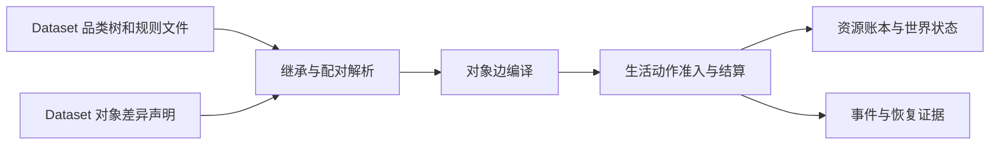

> 历史记录：本文件保存提交 `72f004b0087efa1b6f6d662ac6a143e087e4e21c` 时的过程与判断，不再定义当前系统。
> 当前设计见 [文档入口](../../../INDEX.md)；正文中的路径、规则和结果按当时上下文理解。

# 资源与规则引擎简化：地图、食品与门店证据

> 代码基线：7e1ffab3b49971922069c0c1fa400ffcbb075beb

审查日期：2026-10-06。
本记录只读取 WorldMock 当前源码、现行规范、依赖声明和定向测试；没有运行测试或模拟，没有修改生产代码。
外卖全地图可达按用户追加要求处理。下文的可验证断言是新方案验收建议，不是已经实现的结论。

## 两个引擎的实际边界

**现状证据。** 当前资源侧不是一个独立的可插拔 ResourceEngine 类，而是目录加载、品类解析、对象编译和资源账本共同组成的职责。
`src/worldmock/catalog/loader.py:56-64,82-103` 依次读取清单、品类、交换规则、资源定义、对象、弃用标记及交通规则。
`src/worldmock/catalog/compiler.py:40-73,76-90` 将品类继承后的对象与配对编译为运行视图和 typed edges。
`src/worldmock/resources/ledger.py:30-66,79-125` 维护资源守恒和上下界，应用分录时复制余额，支持整体失败不改输入。

规则侧已有明确的 Python 闭集：`src/worldmock/categories/rules.py:26-36,137-166` 声明购买、食品能量、耐用品、
出行、工作和库存转换算子；`src/worldmock/life/rules.py:24-43,45-70` 使用 Python 函数进行生活动作准入。
因此，简化重点应是删除通用配置和编译链，不能把现状描述为任意脚本规则解释器。

**对应现行规范。** `docs/dev/SPEC-category-contract.md:25-39` 明确两引擎共享冻结契约，人物选择动作，环境独占结算；
`docs/dev/SPEC-category-contract.md:142-148` 要求闭集算子及守恒。该架构本来就禁止模型补规则和任意表达式。

**未来可验证断言。** 资源引擎只注册固定类型的实际对象并检查引用；规则引擎根据系统固定类型执行明确的 Python 规则。
注册一个同类型的新食品只需增加名字、类别及绑定，不修改规则文件，不生成对象专属能量边。
原子购买、余额非负、按实际食用进度结算及恢复幂等继续经现有世界提交与账本验证。

## 分类和交换规则仍由环境发布

**现状证据。** `src/worldmock/categories/loader.py:20-21,24-59` 从外部 JSON 读取品类和交换规则；
`src/worldmock/catalog/loader.py:87-101` 同时读取 Dataset 的资源定义与交通时间文件。
`src/worldmock/life/world_setup.py:62-78,81-84` 对包资源只检查活动、动机及人物映射的冻结副本。
`docs/manual/rules.md:35-48` 明确外部环境仍可配置品类继承、槽位、配对、算子参数、交通倍数和身体参数。

**对应现行规范。** `docs/dev/SPEC-environment-data-ownership.md:24-30,38-40` 只把活动闭集、动机参数、人物映射钉在引擎；
`docs/dev/SPEC-category-contract.md:63-66` 仍要求 Dataset 提供品类契约和交换规则。
本轮“分类规则和交换规则在 WorldMock 系统端钉死”扩大了系统权威范围，是规范变更。

**未来可验证断言。** Dataset 不能注册新食品类别、规则算子、属性增量、配对或结算公式；未知规则字段直接拒绝。
固定热量、移动速度、到店消费及 App 外卖准入均由 WorldMock 同一权威定义给出。
环境仍冻结实际对象与绑定的身份；运行身份同时绑定引擎规则版本和环境内容摘要。
不要求 Dataset 人工复制一套可修改规则，也不允许复制文件成为第二个配置入口。

## 可删除的品类解释与维护机制

**现状证据。** `src/worldmock/categories/models.py:22-50,63-115,128-150` 支持属性绝对赋值、相对加法、比例乘法、
单继承品类树、动态槽位及三态配对；`src/worldmock/catalog/models.py:254-283` 分别维护原始增量对象和编译对象。
`src/worldmock/catalog/loader.py:67-79,162-173` 读取逐对象、逐资源追加版本；`src/worldmock/catalog/models.py:307-314`
另有弃用标记。这些机制服务于开放品类维护，并非简单目录所必需。

**对应现行规范。** `docs/dev/SPEC-category-contract.md:73-101` 冻结树、槽位与增量语义；
`docs/dev/SPEC-category-contract.md:124-140` 冻结双端祖先配对、最具体命中、歧义与触达闭包；
`docs/dev/SPEC-category-contract.md:227-237` 要求 `worldmock category` 的细化、归属建议及发布流程。
这些是现行合规能力，不能标成实现缺陷。

**未来可验证断言。** 采用系统固定枚举和类型到行为的直接映射后，可整段删除动态槽位、增量继承、配对继承、
对象边编译、未定义配对触达闭包、品类细化及建议发布命令。新环境以一个不可变快照发布，旧格式直接拒绝。
若最终确认目录只保留当前快照，逐对象追加历史和 tombstone 也可被环境快照身份取代；历史运行的冻结证据仍保留。
身份核验、引用存在性、唯一标识、有限非负数和原子发布继续保留，不能以简化为由删掉基本输入完整性。
展示名称允许相同，按地点、作品与集数等上下文区分；名称不代替对象身份。

## 地图依赖真实坐标与路线响应

**现状证据。** `src/worldmock/life/map_models.py:111-130` 要求地点经纬度、经营业态、活动环境和来源；
`src/worldmock/life/map_models.py:194-232` 要求路线状态、OSRM 响应、路由实例及 foot/car profile。
`src/worldmock/life/travel.py:30-54,75-100` 按起点、终点、方式查唯一冻结路线，并核对真实响应距离与时长；
`src/worldmock/life/travel.py:124-132` 从路线几何生成轨迹。
`src/worldmock/life/map_data.py:60-82` 校验地点、供给、路线和配送范围的交叉引用。

**对应现行规范。** `docs/dev/SPEC-map-and-storefront.md:35-39,44-56,72-75` 采用真实张江地点、WGS84 坐标和冻结路由；
`docs/dev/SPEC-life-runtime.md:643-662` 要求真实道路路线及与模拟日期、时段相符的交通依据。
用户当前要求取消真实地图，必须显式取代以上地理真实性合同。

**未来可验证断言。** 图以地点身份作节点，正长度作无向边权；全图连通且每个节点至少一条边。
单节点环境无法满足“至少一条非自环边”，应在登记阶段拒绝，而不是添加无意义自环。
“每个节点至少一条边”本身不保证连通，例如两个互不连通的节点对均满足它；因此建议把连通作为新方案明示约束。
移动距离为最短路径边长之和，移动时长由系统固定速度换算；同种子、同地点集合生成同一冻结图。
运行和恢复都读已冻结图，不重新随机连边，不请求外部地图。

删除候选包括 OSM/OSRM 专属响应文件、profile 核验、真实地理来源与过期路况处理、球面距离及路线折线插值。
如果导出仍需要定位记录，应单独修订输出合同为地点或合成坐标，不能把随机图伪装成真实 GPS。
这一点需要主提案覆盖后续导出影响，不能只删地图加载器。

## 同类店铺允许差异供给

**现状证据。** `src/worldmock/life/map_models.py:150-175` 的供给是独立的地点、商品、卖方、报价、库存、履约定义；
`src/worldmock/catalog/models.py:285-291` 明确禁止商品购买边携带门店购买金额。
`docs/manual/resources.md:198-206,211-235` 说明当前地点类型只控制商品准入池，每店另选类别和具体对象，并按种子生成报价。

**对应现行规范。** `docs/dev/SPEC-map-and-storefront.md:80-107` 明确禁止把类型准入池复制到所有同类店铺；
`docs/dev/SPEC-map-and-storefront.md:109-123` 甚至要求每对餐馆互有至少三项不同正餐。
`docs/dev/SPEC-map-and-storefront.md:133-156` 另规定对象价格范围、门店定位和确定性报价扰动。
同类同菜单是本轮主动取代这些要求，不是修正旧实现。

**未来可验证断言。** 同一地点类型的服务集合和商品集合必须逐项相同；相同食品可由多店提供。
食品与店铺绑定或 `all` 展开仅决定实际供给对象集合，不在运行时生成新的业务规则。
建议 `all` 表示所有具有售卖食品能力的店铺，不能把办公室、公园等非店铺变成食品卖家。
为了同时满足“逐店绑定”和“同类同菜单”，显式逐店绑定展开后若使同类店铺菜单不相同，登记必须拒绝并指出缺失绑定。
这是需要主提案明确的输入约束，不能在加载时偷偷向其他店铺补商品。

简化可删除逐店 category/object 并集声明和菜单差异验收；地点类型与食品三个类别使用同一系统词表。
用户尚未要求取消付款、库存或营业时段，不能由“菜单相同”推导这些运行状态也相同。
是否保留差异价格可由主提案定夺；系统不再需要来源驱动的价格范围继承和门店价格分位机制。

## 食品依赖个体营养与配方

**现状证据。** `src/worldmock/categories/rules.py:58-63` 的食品规则仍指向可配置的 energy_slot 和 duration_slot；
`src/worldmock/catalog/compiler.py:129-137` 从对象有效属性读取热量并编译食品能量边；
`src/worldmock/life/semantics.py:425-441` 把边金额写成 `energy_kcal_per_unit`，并传递食品份量。
`src/worldmock/life/scenario.py:310-341` 要求可食用对象有食品份量；
`src/worldmock/life/basket.py:339-345,383-395` 用逐商品热量乘实际份量进行结算。
当前“食品热量”与“身体净增加能量”不是同一数值：`src/worldmock/life/body.py:259-278` 还应用睡眠不足相关利用效率和身体能量上限。
`src/worldmock/life/basket.py:273-283,298-311` 从对象读取食用时长，多件同时食用时取各件折算时长的最大值。

**对应现行规范。** `docs/dev/SPEC-category-contract.md:86-98,191-197` 要求品类槽位和规则命名槽值进入真实食品结算；
`docs/dev/SPEC-life-runtime.md:547-558` 把 Open Food Facts 的食品营养和份量作为来源准入；
`docs/manual/rules.md:68-88,125-134` 展示逐食品密度范围和食品算子。
`docs/dev/SPEC-life-runtime.md:508-517` 则规定取得、开吃、部分摄入、丢弃和库存独立记录；该交易生命周期与真实营养来源可分开保留。

**未来可验证断言。** 食品只归属零食、饮品、正餐之一；热量由 WorldMock 固定类别表给出。
同类别两件食品的完整一份实际摄入热量相同，Dataset 不能覆盖；改名字、摘要或人物喜好不改变热量。
人物依据名称和画像选择，系统不再从营养标签或菜系猜测偏好。
已经取得、按实际食用进度摄入、避免同一份被吃两次等事实约束继续验证。
可删除逐食品热量密度、份量营养推导、食品数据库限定、规则命名槽及对应来源审查。
新公式须分别写清类别提供的原始热量、身体实际能量增量、食用时长、部分消费及丢弃；固定热量不能默默取消利用效率和上限，
也不能在没有食用时长来源的情况下继续声称按消费比例结算已经闭合。是否删除效率应成为单独设计决定。

原料和做饭不是三类即食食品之一。现行 `docs/dev/SPEC-category-contract.md:204-222` 有真实原料到正餐的转换合同；
新 proposal 应明确这一能力保留还是撤销，不能只删 ingredient 分类而留下“制作”动作及空配方入口。

## App 直接登记取代手机配置派生渠道

**现状证据。** `src/worldmock/profile/coverage_apps.py:27-38,97-109` 读取手机配置的卖家账户到 App 映射，
再从实际供给推导 App 的门店集合；它不是独立 App catalog。`src/worldmock/profile/coverage_apps.py:41-52`
的渠道只含标识、称呼及成员门店，没有外卖规则。
`src/worldmock/life/load_checks.py:49-66` 在手机配置校验失败时记录 warning 并返回空渠道；
`tests/life/test_purchase_channels.py:107-115,148-156` 明确锁定“未配置或无效配置没有渠道”的现行行为。

**对应现行规范。** `docs/dev/SPEC-map-and-storefront.md:363-390` 规定 App 仅为门店入口，采用手机配置投影而不新增目录。
本轮“环境注册必须提供 App catalog”替换这个权威来源；现状不能直接声称已经具有所需 App 注册机制。

**未来可验证断言。** App catalog 是 App 名称与关系的唯一输入；店铺直接绑定有效 App 身份，App 可绑定多家店铺。
无 App 的餐饮店只允许到店取得；有 App 的餐饮店才能通过该 App 下外卖单。
无效 App、缺失店铺、冲突绑定均在登记时直接失败，不再 warning 后删掉 App 能力。
现有名字归一和 App 到成员店查询可以保留为普通名称查询，删除从手机导出配置反向推导运行入口的链路。
后续手机足迹应由实际选用 App 产生，不能按成交后卖家再猜一个 App。

## 外卖仍限制配送地点与路线

**现状证据。** `src/worldmock/life/map_models.py:159-174` 要求配送能力与显式目的地列表一致；
`src/worldmock/life/basket.py:176-190` 先核对每件商品的配送范围，再以最慢备货加驾车时长排送达事件；
`src/worldmock/life/basket.py:193-211` 对缺路线、不可达或未知路线拒绝。
同地点配送允许无道路段；人物离开收货地也不会把物品自动搬到其新位置，
`tests/life/test_storefront_commerce.py:137-157` 的实际断言是物品送到订单的 home 而人物已在 office。

**对应现行规范。** `docs/dev/SPEC-map-and-storefront.md:49,72-75,365-367` 冻结供给履约范围和路线；
`docs/dev/SPEC-life-runtime.md:653-658` 冻结预计与实际送达及备货假设。
“外卖全地图可达”取代配送范围与可达性拒绝；它不自动取消订单、支付或明确收货地点。

**未来可验证断言。** 每一家绑定 App 且可营业出售食品的店铺，都可向地图任一合法地点下单送达。
最远地点、住宅、办公室、店铺自身均不因配送半径、目的地列表或地图资料未知被拒绝。
预计时间可复用随机图最短距离与系统固定配送速度，并加系统固定备货时间；全地图可达不意味着瞬时送达或等时送达。
删除 `delivery_destination_ids`、配送半径、驾车专属可达性判断及相关提示分支。
目标不存在仍是输入错误；接单时固定收货节点，人物移动后订单仍送至该节点。
付款、后台配送、交付及重复送达幂等继续保留；人物持有食品的数量必须准确结算。
店铺库存的去留按主提案建议裁决，不把当前店铺库存扣减当作新方案的无条件要求。

## 已存在的成熟依赖与最小验证路径

**现状证据。** `pyproject.toml:10-29` 已锁定 Pydantic、NetworkX、JSON Schema、NumPy 等依赖。
`src/worldmock/delivery/training.py:10` 已使用 NetworkX；无需为距离图再引入图算法包。
官方 [NetworkX 最短路文档](https://networkx.org/documentation/networkx-3.6/reference/algorithms/shortest_paths/index.html)
说明已有加权最短路；官方 [随机生成树文档](https://networkx.org/documentation/stable/reference/algorithms/generated/networkx.algorithms.tree.mst.random_spanning_tree.html)
说明支持带 seed 的随机生成树。网络检索日期为 2026-10-06。
长度字段必须先由 Pydantic 强制完整、有限且为正，不能依赖图算法缺失 weight 时默认取 1 的行为。

**对应现行规范。** `docs/dev/SPEC-category-contract.md:57-58` 已要求优先复用 Pydantic、JSON Schema、hashlib 和账本；
`docs/dev/SPEC-environment-data-ownership.md:28-34,43-45` 要求显式外部环境、真实端到端边界和无兼容路径。

**未来可验证断言。** 先用已有依赖做最小闭环：登记一张连通图、两个同类型餐饮店、一个 App、每类一个食品；
人物移动到店、到店购买进食、通过 App 向远端地点下单、时间推进后交付、恢复后不重复交付。
这一闭环通过后再扩充目录，避免先拆掉运行路径。
针对新不变量做 Uncle Bob 变异验证：允许 Dataset 改热量、使同类菜单不同、允许无 App 店铺外卖、
重新启用配送白名单或重复送达，均应被真实引擎行为测试杀死。

## 提案审阅更正记录

主提案已将 app 现状改为“缺少统一运行目录”，不再把全部 app 能力概括为行为后的手机投影。
当前购买渠道已经参与运行来源解析，仍以本记录“App 直接登记取代手机配置派生渠道”章的源码证据为准。
主提案已将删除做饭明确标为设计建议，不作为用户已经明确要求的删除项。
本记录据此统一未来断言：标识唯一、同名展示靠上下文区分；人物持有数量准确结算，店铺库存去留另行裁决。
