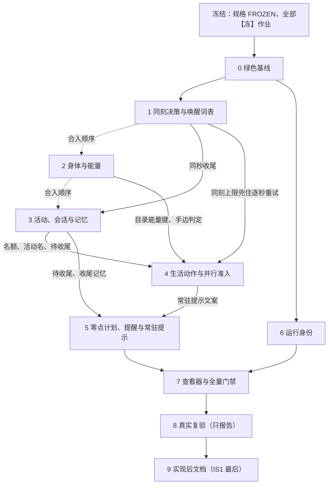

# 时间与能量：实施计划、文档同步作业与文件修改清单

> 状态：**实施台账**。规格于 2026-09-24 冻结；每个阶段合入后记下合入提交。
> 日期：2026-09-24
> 依据：[时间与能量特性规格](../SPEC-time-and-energy.md)（v1.0，FROZEN）。行为以规格为准；本文只写落地顺序、已提交文档的同步作业与文件改动，不另定行为。
> 口径：
> - 代码与已提交文档的行号取 `778beca`；行号随实施漂移时以函数名或章节标题为准。
> - 已提交文档在规格冻结前不改；下列作业在冻结时或随对应代码落地。
> - 批次标记：【冻】规格冻结时落地，先于任何代码；【同】与对应代码同一变更集；【后】实现并验证后落地；【条·#N】整项取决于规格「裁决记录」冻结前待确认的第 N 行（#19–#23、#25），按推荐写。只有部分内容取决于待确认裁决时，在该部分前标〔#N〕。
> - 待确认裁决（2026-09-24 用户指示按规格实现，均按推荐裁定）：#19 超长派生时长，#20 方式载体，#21 联系人回复何时送达，#22 他处持有物，#23 并行准入载体，#25 `catalog_version`。
> - 「第 X 章」指规格正文章节；「修订 N」指规格「冻结条款修订」第 N 行；「一·引擎」这类标签指本文「文件修改清单」的职责列。

## 实施阶段

### 阶段总表

批次标记与〔#N〕的含义见文首「口径」。作业编号见「文档同步作业」；「一·引擎」这类标签见「文件修改清单」。跨阶段的【同】作业按条款拆分，表中只列编号，拆分见各阶段小节。

| 阶段 | 内容 | 先落地的文档作业（作业编号） | 完成判据 |
| --- | --- | --- | --- |
| 冻结 | 裁定 #19–#23、#25；规格改 FROZEN；本计划改为实施台账；不动代码 | 全部【冻】；C38、E4-21、E5-19 的冻结部分；IX1–IX4、IX6；【条·#22】LR28 | 文档门禁通过；冻结条款修订逐行对上作业；变更集只含文档 |
| 0 绿色基线 | 第九章：空层合法、夹具、版本 7、快照地点、目标回看、跨任务提交、交付版本核对 | 【同】C19、C20、C21、C23、C28、C38、E3-1、E3-2、E5-13、E6-5、E8-2、E9-2、E9-4、EX10、VF1、VF10 | `pytest tests` 全绿，原 50 项失败转绿；版本 6 检查点被拒；四处抛错点消失 |
| 1 同刻决策 | 第一章（「刚才」与依赖名额、待收尾的受限轮分支除外）；唤醒词表加两员；同刻轮次度量；删旧场景参数 | 【同】C1、C14、C18、C19、C21、C38、LR5、LR7、AI8、E5-3、E5-4、E5-6、E5-13、E5-18、E7-1、E8-1、E8-2、E9-2、E9-3、VF2、MA1、MA2、MA5；〔#21〕C25 | 同秒轮数不超过上限加三；推进时人人有进行中活动且没有待收尾活动；四处唤醒词表成员一致；旧键场景被拒 |
| 2 身体与能量 | 第二章；第三章（目录除外）；第八章节律、作息初值、配送时刻 | 【同】C15、C27、C28、C30、C32、C33、C38、E9-2、LR7、MA3、MA7、MA9、MA13 | 0 kcal 下活动全受理且无 `ValueError`；跨档预测不晚于实际；代码无能量闸门符号 |
| 3 活动、会话与记忆 | 第七章（接着看除外）；第八章播报、进度、终态与自述不当事实；取消 `finish`；交付裁去记忆；第一章受限轮中依赖名额与待收尾的三支（`conclude_pending`、`resume_or_conclude`、`conclude_only`） | 【同】C1、C4、C6、C15、C17、C18、C19、C20、C27、C28、C30、C33、C34、C35、C37、C38、AI6、AI8、AI15、E5-5、E5-11、E5-13、E5-18、E8-2、E9-2、E9-3、E9-4、LR7、MA2（:84 名额满的受限轮分支）、MA4 | 会话随出行切换；待收尾同秒收尾；每轮恰好一个世界请求；提示无内部身份；导出等于检查点 |
| 4 生活动作与并行准入 | 第五章；「刚才」；接着看；开工 60 秒与「做不完」标记；唯一一次目录变更与数据集重建 | 【同】C1、C3、C4、C5、C15、C16、C17、C19、C20、C25、C27、C28、C30、C32、C33、C38、AI6、AI7、AI8、E9-3、E9-4、MA4、MA8、MA13；【条·#25】C39、E3-3、E8-7、EX13 | 组合表逐行成立；「自己」恒在；选错得原因与下一步；目录核对通过 |
| 5 零点计划、提醒与常驻提示 | 第四章；第六章 | 【同】C4、C6、C8–C11、C13、C15、C17、C20、C28、C34、C35、C38、AI6、AI8、AI15、E5-5、E5-6、E5-13、E7-1、E8-1、E8-2、E9-2、E9-3、E9-4、LR7、VF2、MA2、MA6、MA11 | 同日只生成一次；提醒只触发一次；人物工具 8 个；零点计划不进决策统计与交付 |
| 6 运行身份 | 第八章运行身份；与阶段 1–5 并行 | 【同】AS6、E5-12、EX2、EX3、MA10、MA11、MA12、RM1 | AS2 缺失或不符即拒绝启动；清单含 `git_commit`、`git_dirty` |
| 7 查看器与全量门禁 | 查看器；复验统计子命令；全量门禁与突变测试 | 无新增作业；执行 VF4；验收记录建档 | 全部门禁通过；覆盖率报告重新生成并提交 |
| 8 真实复验 | 练秋湖与 r14 复跑，只报告 | 无 | 八项指标写入验收记录；不作门禁 |
| 9 实现后文档 | 全部【后】作业，实现状态最后 | 【后】E4-21、E4-24、E5-19、E5-20、VF12、IX5、AN1、CB1、IS1 | 文档门禁通过；IS1 是最后一个提交 |

### 通则

- **变更集。** 每个阶段合入一个变更集，可含多次提交。【同】作业在同一变更集内先于代码提交。跨阶段的【同】作业按条款拆分，各阶段只落本阶段代码兑现的部分，下文括号注明。改到 FROZEN 文档的变更集都追加版本行；C38 在冻结变更集补登未入表的提交并追加冻结行，此后每个改 `docs/CONTRACTS.md` 的阶段各追加一行。改到设计文档的变更集更新文件头与版本表。每阶段合入后，本计划记下该阶段的合入提交。
- **每阶段门禁。** 合入前全部通过：
  - `uv run pytest tests`，含风格门禁 `tests/test_style_gate.py` 与查看器回归 `tests/tools/test_run_viewer.py`（经 Node 执行 `tests/tools/run_viewer.test.cjs`，需要 `node:sqlite`，缺 Node 即失败）；
  - `scripts/coverage_gate.py`：分支覆盖率不低于 85%，未覆盖公共接口为零（`scripts/coverage_gate.py:24`）。门禁每次运行都重写 `docs/dev/coverage-report.json`，该文件只在阶段 7 提交；
  - `scripts/documentation_gate.py`。
- **风格。** 行宽不超过 120，函数不超过 50 行且不超过 5 个参数，文件不超过 2000 行，生产函数 docstring 含中文；新增违规为零。改到 `_OUTSTANDING`（`tests/test_style_gate.py:29-38`）中有记账的文件时，修掉的存量违规同步减记账，计数不符同样失败。涉及的文件：`life/schedule.py`（阶段 1、2、5）、`life/motivation.py`（1、4）、`evaluation/behavior_metrics.py`（1、4、5）、`life/social_actions.py`（4）、`catalog/affordances.py`（4）、`runtime.py`（5、6）。
- **`engine.py` 行数。** 现为 1749 行，风格门禁的 2000 行上限即判据。同刻计数与受限轮阶梯、地点会话切换与待收尾、零点计划与提醒都放在新模块，引擎只接线。
- **世界结构版本 7。** 阶段 0 把 `WORLD_SCHEMA_VERSION`（`src/worldmock/life/models.py:23`）由 6 升为 7，只升这一次。阶段 1（同刻计数、受限轮阶段、按人物暂存的呈现留痕）、阶段 3（地点会话，活动的 `concluded_at`、`report_anchor_at`、`session_ids`、`name` 与移来的自述字段）、阶段 5（提醒字段）新增的世界结构字段都并入版本 7；E5-13、E8-2、E9-2、E9-3、E9-4 的字段说明随各阶段补写。阶段 5 合入前产生的 7 版检查点不作恢复承诺，真实复验只用最终代码产生的运行。版本 6 的检查点一律以版本不符拒绝。
- **不新增故障路径。** `_resolve` 只捕获 `BusinessRuleError`（`src/worldmock/life/engine.py:814`）。每阶段逐条审查差异中新增的 `raise`：模型输入或世界状态能触发的情形一律表达为业务拒绝或状态转换，`ProtocolError` 只留给协议违约。各阶段须消除的既有抛错点写在该阶段的完成判据里。零点计划 `plan_day` 的协议错误与模型故障按第四章处理，不属业务情形。
- **测试推进。** 同秒有人就绪时 `engine.advance` 拒绝推进（`engine.py:585-586`）；测试用 `advance_until_ready`，或先开始等待。
- **热点文件。** 四个文件的改动按阶段分到不同函数，下表列各阶段的主要改动面。同一函数跨阶段改动的有五处，每次只改其中一个独立分支：`_visible_action_contracts`（阶段 0 的任务名、3 的控制工具、5 的 `plan_day`）、`_available_action_models`（3、5）、`prepare_react_loop`（1 的收窄、5 删日首门控 :717-721）、`_recall_task_summary`（0、3）、`advance`（1 的呈现暂存与同刻归零、5 的零点节律判定段后移）。

  | 文件 | 阶段与改动面 |
  | --- | --- |
  | `src/worldmock/life/engine.py` | 0：`_advance_one_activity`（`:1399`）、评审准备（`:312-314`）与提交（`:1138-1139`）。1：`_after_success`、`_after_rejection`、`_reused_result`、删 `_after_unknown`、`_put_agent_and_defer_feedback`、`_require_boundary_action`、`_deliver_social_message`、`_register_delivered_message`、`commit_decision_round` 与 `advance` 的呈现暂存和同刻归零。2：删 `_require_energy_plan` 及其调用、`recovery_kinds`、删 `_remaining_activity_energy`、`AFFORDANCE_CONTRACT_KEYS` 与 `affordance_contract`、`_body_boundary_at`、`_initial_agent`。3：出发与到达的会话切换接线、`_resolve` 的终态记录、`record_memory_update`。4：`_ops_action`、`_advance_activities` 的交谈缓解。5：`_next_epoch`（零点与未触发的提醒候选）、`advance`（零点边界的节律移到计划提交之后）、`_dispatch` 与 `_plan_day`（改为系统登记入口）、`_revise_day_plan`。6：`_run_manifest` |
  | `src/worldmock/life/session_actions.py` | 0：`_recall_task_summary`（`:411`）。3：`_start_activity`（名额与形状错误码）、`_open_session`、`_report_status`、`_pause_activity`、`_conclude_activity`、`_sessions_for_names`、`_recall_task_summary`、`_with_goal_summaries`。4：`_resolve_interaction_bindings`、`_dispatch_start_action`、`_targeted_duration`、`_start_lifestyle_action`、到店取得与送达地 |
  | `custom/agents/life_agent.py` | 0：`_visible_interactive_objects`（`:966`）、`submit_work` 任务名枚举（`:1017`）。1：`prepare_react_loop` 的受限轮收窄。3：删 `finish` 与 `memory_read`、覆写 `_run_react_turn`、`_react_budget` 与决策自述的回合预算、`_visible_action_contracts` 与 `_available_action_models` 的控制工具部分、删来源身份枚举、经历句子渲染、`_dispatch_strict_memory`。4：`_bind_start_activity_schema`、`_validate_start_activity`、`menu_action_error` 的调用处、`start_activity` 工具文案。5：删 `plan_day` 与日首门控、`revise_day_plan` 的 Schema、`_LIFE_INSTRUCTIONS` |
  | `src/worldmock/life/projection.py` | 1：受限轮的 `scene` 说明。2：`_public_products`、`_public_inventory`、`_public_routes`、`body_projection`、`build_observation` 之后的途径句装配。3：`_session_fact_rows`、`_session_fact_row`、`_active_session_scene_rows`（删 `current_sessions`）。4：`_interaction_bindings`、`_interaction_binding`、`_resource_available`、`_task_object_rows`、`_content_object_rows`、`_person_object_rows`、`_mail_object_rows`、`_inbox_rows`、`_task_fact_rows`、`_progress_result` 与 `_progress_result_details`、手边持有物与他人在场。5：`_plan_row`、`_plan_fact`、`_progress_alarms` |

- **待确认裁决。** 2026-09-24 用户指示按规格实现，均按推荐裁定。下表「本计划所按」即裁定方案：

  | 裁决 | 本计划所按 | 选另一方案时 | 阶段 |
  | --- | --- | --- | --- |
  | #19 超长派生时长 | 观看、游戏内容与生活活动超过 86400 秒按 86400 受理并公开计划时长；出行仍拒绝 | 改为拒绝，说明中给出可受理的时长；138264 秒条目的用例改为断言拒绝 | 4 |
  | #20 方式载体 | `actions[i]` 取五个动词，另设等长必填数组 `ways[i]` | `actions[i]` 保留可读动作短语，五个动词只作分类；Schema 不增数组 | 冻结、4、7 |
  | #21 联系人回复何时送达 | 预排送达，延迟为实验常量，送达时以 `message_arrival` 唤醒，睡眠中过滤 | 保持当秒送达；阶段 1 不改回复时序，也不改写锁定当秒送达的用例 | 冻结、1 |
  | #22 他处持有物 | 人物知道他处持有物及地点，只能在当地使用；LR28 随冻结落地 | `facts.inventory` 只列当前地点；LR28 不落地 | 冻结、2 |
  | #23 并行准入载体 | 保留注册表占用交集判定，按第五章重列占用 | 删 `resource_claims`、`occupied_resources`、`RESOURCE_CONFLICT`、`ELIGIBILITY_RESOURCE_CONFLICT`，按准入事实判定，并改写 `_validate_activity_collection` 与 `_expected_activity_claims` | 冻结、4 |
  | #25 `catalog_version` | 按 `catalog/affordances.toml` 自身约定升版，三份场景与两个数据集场景同步 | 沿用 `2913546` 的先例，只刷新 `catalog/manifest.json` 摘要 | 4 |

### 冻结：规格定稿与【冻】作业

**目标。** 规格定稿，全部【冻】作业在一个只含文档的变更集中落地；此后代码按已冻结的文本实施。

**前置。** 裁决记录 #19–#23、#25 由用户裁定；规格 v0.13 与本计划的冻结前修订完成。

**先落地的合同与文档同步作业。**
- 【冻】全部：
  - `docs/CONTRACTS.md`：C2、C7、C12、C22、C24、C26、C29、C31。C38 是【同】作业，其中补登未入表提交与追加冻结行两项随本变更集落地，其余版本行随各阶段追加。
  - 冻结规格：LR1–LR4、LR6、LR8–LR27、LR29–LR32；DR1–DR12；AI1–AI5、AI9–AI13、AI16–AI19；DP1–DP9；RL1–RL3、RL5、RL7、RL8；DC1–DC9；IM1–IM9；MS1–MS4；AS1–AS5、AS7–AS9；LK2、LK3；CC1（核对，不改）。
  - 设计文档：E4-1–E4-20、E4-22、E4-23；E5-1、E5-2、E5-6–E5-10（E5-6 的 :196、:198 两句除外，随阶段 5、1 的【同】）、E5-14–E5-17；E6-1–E6-4；E7-2–E7-5；E8-3–E8-6；E9-1、E9-5；E0-2–E0-7；E1-1、E1-3–E1-6、E1-8–E1-10；E2-1–E2-6；ER1–ER3；ES1–ES3。
  - 实验、验收与架构：EX1、EX5–EX7、EX8a、EX8b、EX9、EX11、EX12；VF3–VF5、VF7、VF9、VF11、VF13、VF14；AR2–AR7。
  - 根 README：RM2。用户手册描述当前可用的配置，手册作业都标【同】，随所述行为的代码落地。
- 【冻→后】的冻结部分：E4-21 补「时间与能量规格尚未实现，以绿色基线为前提」；E5-19 补本规格的实现差距行。
- INDEX：IX1（本规格改 `FROZEN`，本计划改 `实施台账`）、IX2（版本行）、IX3（数字人交互规格一行的工具数与修订条数）、IX4（当日目标规格一行注明部分条款被修订、待实现；文档地图中词表外的状态值改为词表取值）、IX6（「按任务读」中突发事件一行的闭集指向）。
- 本计划状态头由「未冻结提案」改为「实施台账」。
- 【条·#22】LR28：采纳时与规格「冻结条款修订」中 life-runtime「随身持有与远程订购」的修订随本变更集落地。【条·#23】RL6、VF6 按推荐方案不改。C25 的〔#21〕部分在阶段 1 处理；【条·#25】C39、E3-3、E8-7、EX13 在阶段 4 处理。
- 依赖待确认裁决的【冻】作业按裁定写（依赖裁决的【同】作业在所属阶段注明）：
  - 〔#19〕E2-2、E4-11 中派生时长上限的写法；
  - 〔#20〕AI2、AI12、DR5、DC3、IM2、IM3、IM5、E1-1、E4-7、E4-11、E7-4、E8-3、E9-1 中「五个动词」与方式的写法；
  - 〔#21〕LR30 中联系人回复的句子、EX11 的联系人回复延迟一行；
  - 〔#23〕C24、C26、LR2、LR12、LR20、LR24、LR27、LR30、DR2、DR4、DR5、AI9、E1-4、E2-1、E4-11、E8-4、AR2 中占用的写法。

**代码与测试。** 无。

**完成判据。**
- 变更集不含代码、测试、场景、目录与数据集改动。
- `scripts/documentation_gate.py` 通过；一次性脚本核对本次触及文件中的 `docs/…md「标题」` 引用与 `](…md#锚点)` 都指向现有标题，结果附在变更说明。
- 「冻结条款修订」的每一行都对上已落地的【冻】作业，或写明随哪一阶段的【同】作业落地。
- 每份改动的 FROZEN 文档都有版本行；设计文档的文件头与版本表已更新。

**与其他阶段的依赖。** 所有代码阶段都在本变更集之后。

### 阶段 0：绿色基线（issue #1）

合入提交：`37c3f7a`。

**目标。** 完成第九章「仍须修复」四项与「对新增行为的约束」中的交付版本核对，使 `778beca` 上 `tests/life` 与 `tests/integration` 的 50 项失败转绿，并把世界结构升到版本 7。此后各阶段都以全绿为起点。

**前置。** 冻结。

**先落地的合同与文档同步作业。**
- 【冻】（冻结时已落地，本阶段兑现）：AI4 的版本引用、E4-19 的世界版本句、E4-20 的「交互对象为空」行、E5-1 的版本注记、E5-8（快照 `location_id` 为开始地点）。
- 【同】：
  - C19：新建「活动受理错误码」节，登记 `WORK_TASK_IN_PROGRESS`；
  - C20（版本部分）、C21（世界结构部分；生活场景结构保持 3）、C23、E3-1、E3-2、EX10、VF1、VF10：世界结构 7，旧检查点以版本不符拒绝；
  - C28：交互对象层可为空；
  - E5-13：版本句移到「检查点创建」，改为 7；
  - E6-5：交付先核对导出最终检查点的世界结构版本；
  - E8-2、E9-2：版本 7；
  - E9-4：`location_id` 为开始地点，结算不覆盖；
  - C38：本阶段的接口合同版本行。
- 【后】无。

**代码与测试。**
- 「九·空层（先做）」「九·空层」：`_visible_interactive_objects`（`custom/agents/life_agent.py:966`）接受空列表，`start_activity` 照常可见；对象为空时 `_bind_start_activity_schema`（`:1131-1148`）省略 `targets`、`actions` 的 `enum` 键，不绑定空枚举，所填名称不在本轮对象中时由 `_validate_start_activity`（`:1114-1128`）按协议错误在本轮重试（第九章第 1 条）；新增用例断言空层时发给模型的 `start_activity` Schema 不含空 `enum`。`tests/integration/test_agent_branch_coverage.py:103` 的空层致命参数改为「空层时决策继续、无 `run_failed`」；`tests/integration/test_dayrun_complete_days.py` 的两项失败是验证目标。按裁决 #11 空列表合法；「自己」恒在列表中要到阶段 4 撤回剪裁后才成立。
- 「九·夹具」：`tests/life/test_domain_branch_coverage.py` 的 `_activity`（`:265-273`）补 `location_id`；`tests/life/test_dayrun_inventory_regressions.py` 不改。
- 「九·版本」：`WORLD_SCHEMA_VERSION` 由 6 升 7；`tests/life/test_session_state.py` 与 `tests/life/test_state_serialization.py` 改为 7，并增「版本 6 拒绝」。
- 「九·`location_id`」：删 `engine.py:1399` 的覆盖；不新增「当前地点」字段，到达地点取 `data.arrival.location_id`。`footprints/experiences.py` 的 `_arrival` 删 `:265` 一条核对。`tests/footprints/test_verified_experiences.py` 的夹具改为出发地，增「快照为出发地仍产生 `arrived`」。
- 「九·目标回看」：`session_actions.py:411` 改读 `intent_kind`；`tests/life/test_day_plan.py` 增按目标名称回看的往返用例。
- 「九·跨任务提交」：评审准备（`engine.py:312-314`）与提交（`:1138-1139`）改用同一判定「被提交的任务本身不在进行中」，判定放在 `work.py` 的 `_validate_submission_contract`；被提交的任务正在进行时报 `WORK_TASK_IN_PROGRESS`；`:1138-1139` 的 `ProtocolError` 只留给应评审而未评审。`submit_work` 的任务名枚举（`life_agent.py:1017`）列出全部可见的未付款任务，未达标的以 `WORK_INCOMPLETE` 说明。`tests/life/test_work_review.py` 增跨任务用例与在进行中拒绝用例；`tests/life/test_engine_branch_coverage.py` 的同任务用例与评审未留证守卫用例不变；`tests/integration/test_life_agent_protocol.py` 中锁定「未达标时提交工具不开放」的用例随之改写。
- 「九·交付版本」：`delivery/pipeline.py` 的 `deliver` 核对导出最终检查点的 `state.schema_version` 等于当前 `WORLD_SCHEMA_VERSION`，不符即拒绝；`tests/delivery/` 增对应用例；交付设计由 E6-5 同批改写。
- 「引用修正」：`_visible_interactive_objects` 文档串中的旧标题引用随本阶段改。

**完成判据。**
- `uv run pytest tests` 全量零失败（含 `tests/footprints`、`tests/delivery`、`tests/tools`）；原 50 项失败全部转绿。
- 验收台账「绿色基线」行：按目标名称回看成功；做甲任务时提交已达标的乙任务进入评审、结算付款、甲继续；提交正在做的任务以 `WORK_TASK_IN_PROGRESS` 拒绝；出行快照的 `location_id` 为出发地，到达经历照常产生；工作、驾车、浏览进行中交互对象层为空时决策继续，无 `run_failed`；版本 6 检查点以版本不符被拒。
- 不新增故障路径，并消除四处既有抛错点：空层 `RuntimeError`（`life_agent.py:966`）、到达核对 `IntegrityError`（`experiences.py:265`）、目标回看 `AttributeError`（`session_actions.py:411`）、跨任务提交 `ProtocolError`（`engine.py:1138-1139`）。
- 通则中的各门禁通过。

**与其他阶段的依赖。** 其余阶段都以本阶段为起点；阶段 6 在本阶段合入后可与阶段 1–5 并行。

### 阶段 1：同刻决策与唤醒词表

合入提交：`745ebd8`（评审修复另见后续提交）。

**目标。** 实现第一章：决策不耗时；没有进行中活动（或有待收尾活动）就在同一秒再决策；同刻上限与受限轮阶梯；边界兜底 `no_active_activity`；唤醒原因按轮替换；候选时刻修正；重放计入轮数；人物之间的消息同秒送达；同一秒内沿用首轮的呈现窗口；拒绝情绪脉冲每秒至多一次；空闲重估间隔的新口径；`max_same_moment_decisions` 取代 `max_consecutive_rejections`，`activity_feedback_seconds` 下限改为 60。唤醒词表一次加入 `no_active_activity` 与 `plan_reminder_due` 两员，后者到阶段 5 才有来源。「刚才」（`scene.just_now`）放到阶段 4。

**前置。** 阶段 0。

**先落地的合同与文档同步作业。**
- 【冻】（本阶段兑现）：C7（同刻上限收窄）、C22、C26（拒绝后同秒再决策）；LR3、LR4、LR6、LR8（增量字段载体）、LR9（无进行中活动取当前时刻、以本次决策时刻为上次决策时刻）、LR10、LR11（一轮一个请求与拒绝后规则）、LR15（业务拒绝脉冲每秒至多一次）、LR30（清醒收件人同秒获得机会）；DR3、DR6（不产生空白区间）、DR10（同刻再决策）；AI9（删冷却与延迟、两条新触发）；DP5（在手承诺）；DC4、IM1、IM5（同刻上限）；MS2（不另排下一秒）；AS2、AS4、AS7（有人就绪不推进）；E4-7、E4-8、E4-11、E4-12、E4-18、E4-20（同刻部分）；E5-2（同秒轮序）、E5-6（`decision_started` 字段）、E5-17（唤醒原因分两份）；E7-2（轮次计数）；E0-3、E0-5；E1-5、E1-6、E1-8；EX1、EX8a、EX8b、EX9；VF5、VF7（同刻部分）、VF9（:357 决策不耗时、同秒多轮不推进，新增「同刻决策」行）、VF13；AR4、AR6（同刻部分）。
- 【同】：
  - C1（同刻决策计数）；C14（重估间隔的适用对象、`max_same_moment_decisions`、补登 `activity_feedback_seconds` 与 `progress_report_interval_seconds`）；C18（同刻上限收窄一句）；C19（`SAME_MOMENT_ACTION_RESTRICTED`）；C21（旧键 `max_consecutive_rejections` 的场景按未知字段拒绝）；C38（版本行）；
  - LR5（闭集加两员，睡眠允许集合加 `plan_reminder_due`）；LR7（`planned_end` 说明、`discovery_result` 删「下一秒」、`rejection_feedback` 单列、`no_active_activity` 行）；AI8（同刻上限收窄段）；
  - E5-3（受限轮观察私有证据的 `same_moment_stage`）；E5-4；E5-6（:198 越界请求保留 `SAME_MOMENT_ACTION_RESTRICTED`）；E5-13（同刻计数与呈现暂存）；E5-18（`decision_rhythm` 的同刻轮次）；E7-1、VF2（观察重复门禁按 `decision_id` 计，同刻轮次不进分母）；E8-1（重估间隔、新参数、旧键被拒）；E8-2（同刻计数与呈现暂存）、E9-2（呈现暂存）、E9-3（同刻计数、`pending_wake_reasons`）；MA1、MA2（场景参数与模拟节奏）、MA5。
- 〔#21〕采纳时：C25 的联系人回复送达部分与代码同批。
- 【后】无。

**代码与测试。**
- 「一·引擎」「一·节律」「一·状态」「一·参数」「一·动机」「一·宿主」「一·度量」「一·闭集校验」「一·场景」「一·测试夹具」「一·改写」「一·新增」「唤醒词表」全部，按第一章「实现约定」：
  - 人物新增 `same_moment_rounds` 与 `same_moment_stage`，阶梯的六个取值一次定全，随版本 7。计数与阶梯放新模块，引擎只在 `_after_success`、`_after_rejection`、`_reused_result`、`_require_boundary_action` 与 `advance`（时钟推进时归零）接线；删无调用方的 `_after_unknown`；`_put_agent_and_defer_feedback` 只保留游戏回合顺延并改名。
  - 同刻轮次的 `pending_wake_reasons` 替换为本轮原因（`no_active_activity`、`rejection_feedback`），不带入上一轮原因。
  - `consecutive_rejections` 保留，只作挫败感输入，分母改为 `max_same_moment_decisions`；删 `WakeSnapshot.consecutive_rejections`；拒绝结果 `data` 改用 `same_moment_round`、`max_same_moment_decisions`、`next_decision_at`。
  - `decision_started` 与 `body_settlement` 的写入路径接入 `validate_decision_rhythm`（见「一·闭集校验」）。
  - LifeAgent 在 `prepare_react_loop` 中按观察私有证据的 `same_moment_stage` 收窄世界请求工具与名称枚举，`scene` 加一句受限轮说明。本阶段没有名额与待收尾，`conclude_pending`、`resume_or_conclude`、`conclude_only` 三个分支在阶段 3 接通。
  - 场景参数：`scenario.py`、`semantics.py` 删旧键、加新键（缺省 3），生活场景 `schema_version` 保持 3；三份 `scenarios/*.json` 与「数据集侧·场景」中两个数据集场景删 `max_consecutive_rejections` 的改动同批提交。
  - 唤醒词表五处同步点同批：`src/worldmock/life/schedule.py`、`src/worldmock/footprints/models.py`、`src/worldmock/footprints/quality.py`、`tests/footprints/test_event_fields.py`、`tests/life/test_wake_reasons.py`；两处「成员不可增删」注释改为「不可改名、不可删除，新增走版本表」。
- 第一章另外三节：
  - 人物之间的消息：`rhythm._read_new_messages` 移到唤醒判定之后；`_deliver_social_message`、`_register_delivered_message` 登记清醒收件人同秒就绪，在本轮全部动作结算后合并。〔#21〕采纳时联系人回复改为预排送达，并改写 `tests/life/test_export_integration.py` 与 `tests/integration/test_runtime.py` 中锁定当秒送达的用例。
  - 同一秒内的呈现（「一·呈现」）：`observe.py:45` 的单份呈现暂存改为按人物暂存在世界状态中；`commit_decision_round` 不再逐轮并入，时钟推进时由 `state_commit.flush_presentation` 逐人合并；本秒首轮置顶的浏览结果随暂存保存，同一秒后续各轮继续置顶；受限轮的说明句经 `narration.render_scene` 渲染。
  - 拒绝的情绪代价与重估间隔：`service_refused` 脉冲同一人物同一秒至多一次；进行中的等待不算在手承诺（`rhythm._has_commitments`）。
- 测试推进：`tests/life/conftest.py` 的 `advance_next`（`:106-110`）在有人同秒就绪时会触发 `engine.py:585-586` 的拒绝；调用它的用例先开始等待，或改用 `advance_until_ready`（`:113`）。
- 「引用修正」：`scenario.py` 中「播报节律」的引用、`tests/footprints/test_event_fields.py` 中事件闭集的引用随本阶段改。

**完成判据。**
- `tests/life/test_same_moment_decisions.py`：运行开始、活动结束、瞬时动作、业务拒绝之后都在同秒再决策；受限轮先开放开始（等待可选），开始被拒后只开放等待，等待不被业务拒绝；`activity_feedback_seconds` 为 60 时同秒轮数不超过上限加三；时钟推进时每人都有进行中活动且没有待收尾活动；有进行中活动时播报后不在同秒再决策；`pending_wake_reasons` 按轮替换，醒来那一秒只做一次就寝后反思；重放轮计入轮数；睡眠中不因 `no_active_activity` 唤醒；首次决策含重估候选，重估候选恒为本次决策时刻加间隔；删旧参数后 `motivation_internal` 仍有产出（观察层会吞掉动机异常，用例断言产出存在）。
- 同一秒各轮的呈现窗口不变，本秒首轮回灌的浏览结果在后续轮次仍置顶；两人同轮时各自的呈现留痕互不覆盖；同一秒至多一次 `service_refused`；清醒的收件人在消息到达的同秒获得机会，已达同刻上限时改在下一边界；只在等待且无其他在手承诺时使用空闲间隔。
- 唤醒词表：新成员依次追加在 `progress_report_due` 之后；`SLEEP_ALLOWED_REASONS` 只多 `plan_reminder_due`；质量报告没有「未识别」原因；同刻轮次的原因写入 `decision_started`，不写 `body_settlement`；`tests/footprints/test_quality.py` 与 `tests/evaluation/test_behavior_metrics.py` 各有一例同刻轮数统计。
- 含 `max_consecutive_rejections` 的场景与 `activity_feedback_seconds` 小于 60 的场景加载失败；三份仓库场景与两个数据集场景加载通过。
- 越界请求只在绕过本地校验时出现，以 `SAME_MOMENT_ACTION_RESTRICTED` 业务拒绝并计入轮数。
- 不新增故障路径：受限轮的收尾、结束与等待都不会被业务拒绝；`validate_decision_rhythm` 只校验系统写入的原因。
- 通则中的各门禁通过。

**与其他阶段的依赖。** 阶段 3（待收尾在同秒收尾）、阶段 4（撤回剪裁后的逐秒重试由同刻上限兜住）、阶段 5（提醒到期同秒决策）依赖本阶段。阶段 2 与本阶段没有逻辑依赖，因共改 `rhythm.py`、`engine.py`、`projection.py` 而排在其后合入。

### 阶段 2：身体与能量

合入提交：`8e70d31`（评审修复 `317bf14`）。

**目标。** 实现第二章（低能量两档饥饿显示、商品热量、路线费力）、第三章（能量不阻断任何活动、结算以 0 截断、饥饿跨档预测、吃饭途径句），以及第八章「节律」（困意从当前压力扫描、餐时窗口起止入候选）、「作息初值」与「呈现」中的人读配送时刻。第三章要求删除的目录键 `energy_projection` 并入阶段 4 的唯一一次目录变更。

**前置。** 阶段 1（合入顺序）。

**先落地的合同与文档同步作业。**
- 【冻】（本阶段兑现）：C2、C29（吃饭途径句及其例外）；LR9（100 kcal 阈值、餐时窗口、饥饿跨档扫描）、LR14、LR15、LR16、LR17（能量下限）、LR19、LR22、LR23（途径句例外）、LR24（恢复不查能量）、LR27（能量不构成排除）；DR6（零能量不限制活动）、DR7（途径句）、DR10（不可行预警无来源）；AI10（能量不是前置条件）、AI12（途径句）；DP5（删不可行签名）；DC9；IM3、IM5、IM6、IM7（删能量）；MS2（恢复不查能量）；E4-5（身体初值）、E4-6、E4-8（旅途 MET 句改写）、E4-11（删能量）、E4-14（0 截断与全部饥饿阈值）、E4-18（删活动不可行）、E4-20（能量为 0 行）；E6-2；E8-5；E0-2、E0-4；E1-9；E2-2、E2-3、E2-5（能量部分）；EX5、EX6、EX7、EX11；VF9（能量、低能量两档、作息初值、标签、吃饭途径句）；AR4（能量不构成可行性约束）。
- 【同】：C15（检查项中能量不参与）；C27（`local_food_summary`）；C28（`products` 的 `energy` 与人读配送、`routes` 的 `effort`、`inventory` 行、`drive_summary` 行归位）；C30（删暂停控制行的能量字段）；C32（删 `ELIGIBILITY_ENERGY_INSUFFICIENT`）；C33（删 `energy_feasibility` 禁键、`routes` 字段、删「能量可行性」）；C38（版本行）；E9-2（商品 `energy` 与人读配送）；LR7（删「或当前活动不可行」，`activity_infeasible` 保留但无来源）；MA3、MA7、MA9（阈值约束随阈值校验）、MA13（人读送达时刻、每份热量）。
- 〔#22〕采纳时 `_public_inventory` 按地点列出并注明只能在当地使用；不采纳时只列当前地点。
- 【后】E5-20（调试工具显示 `body.values` 与 `body.levels`）留到阶段 9。

**代码与测试。**
- 「二·饥饿显示」「二·阈值」「二·分级序」「二·标签」「二·脚本」「二·改写」「二·新增」：400 取身体配置的紧急阈值；100 是 `felt.py` 的新常量 `APPETITE_STARVING_KCAL`，不进目录；`BodyConfig.validate_body` 校验阈值次序；删 `body_observation`、`body.felt_levels`、`body.felt_values` 与 `ScenarioSemantics.alert_codes`；`narration.ROUTE_ALLOWED_FIELDS` 加 `effort`。
- 「三·闸门」「三·结算」「三·恢复校验」「三·节律」「三·观察」「三·候选」「三·禁键」「三·改写」「三·新增」：
  - 按第三章「删除的机制」，动机评分（`motivation_internal`）保留按能量取舍，`energy_floor_exempt`、`ENERGY_RECOVERY_ACTIVITY_KINDS`、`maximum_energy_duration_seconds` 只为它保留；「三·动机」一行只核对不改，`tests/life/test_motivation.py` 与 `tests/life/test_body.py` 中锁定这些保留项的用例不改。
  - `settle_body`、`settle_shared_body` 删豁免分支，对所有活动集合以 0 截断。
  - `activity_infeasible` 的来源、`_warning_signatures` 的不可行分支、`WakeSnapshot.activity_infeasible` 与 `commitment_threatened` 的不可行分支一并删除。
  - 引擎的 `AFFORDANCE_CONTRACT_KEYS` 与 `affordance_contract` 去掉 `energy_projection`，`tests/life/test_affordance_contract.py` 改为五键；注册表字段与 toml 中的键留到阶段 4。
- 「三·途径句」「三·装配」「三·跨档预测」「三·改写/新增」：`dining.local_food_summary` 按第三章的顺序取第一条成立的途径，只引用本轮观察中的事实；途径句在 `projection.build_observation` 得出饥饿分级之后生成；「在路上的」取 `state.deliveries` 中本人待送达的配送单；「手边能吃的」经 `projection` 的手边持有物判定取值，阶段 4 改为现场地点后自动得到途中语义。饥饿跨档与困意使用同一种扫描。
- 「八·困意与餐时」「八·作息初值」，以及「八·呈现」的配送时刻部分：`basket.py` 的 `_order_fulfillment` 与 `_delivery_route` 抽成纯函数，供购买、投影与途径句共用；`facts.products[].delivery_eta` 取代 `delivery_delay_seconds`；`initial_body` 从惯常起床时刻反推，复用 `sleep.initial_sleep_pressure` 与 `sleep.pressure_after_awake`。
- 「八·新增」中作息初值与预测的用例（`tests/life/test_sleep_two_process.py`、`tests/life/test_activity_effects.py`）。
- 「引用修正」：`observe.py` 两处引用随本阶段改。

**完成判据。**
- 验收台账「能量感知」行：低于紧急阈值（400 kcal）至少「饿得难受」，低于 100 kcal 为「饿得发慌」，08:00 与 20:00 都成立；紧急阈值不高于 100 kcal 的场景加载时被拒；提示中不含身体数值；食品带 `energy`（不足 5 千卡写「几乎不含热量」），路线带 `effort`，`feasible` 只看是否可达。
- 「能量不拦人」行：0 kcal 时观看、工作、出行与恢复都受理，结算在 0 截断，全程无 `ValueError`；带透支活动的检查点可恢复；饥饿每跨一档都在进行中活动里唤醒；饥饿为「饿」及以上时途径句按第三章顺序取第一条成立的，在途送达超过 3600 秒时另补一条，低于「饿」时保留原当地餐食句；`src/` 与 `custom/` 中不再有 `INSUFFICIENT_ENERGY`、`energy_feasibility`、`ELIGIBILITY_ENERGY_INSUFFICIENT`；`motivation_internal` 仍按能量取舍。
- 「候选时刻」行的预测部分：困意与饥饿的预测不晚于实际，误差不超过 1 秒，升档、降档都有候选；餐时窗口起止为候选；300 kcal 时给出 100 kcal 候选。
- 「唤醒词表」行：`activity_infeasible` 不再产生；`commitment_threatened` 只来自临近截止与临近闭店。
- 「本机运行修复」行中的两项：练秋湖 00:00 起点的首个观察困意为「困」或以上；配送行给出人读送达时刻，且与实际送达一致。
- 低能量下 `felt_bands_now` 与上次决策时的分级同源（`observe._snapshot_decision_references` 与唤醒判定传入同一能量与紧急阈值），不误报 `felt_band_change`。
- 不新增故障路径：路线键白名单（`narration.py:394-406`）含 `effort`，渲染不抛错；结算透支报错（`body.py:146-147`、`:187-188`）与恢复时的能量校验（`engine.py:719`）删除。
- 通则中的各门禁通过。

**与其他阶段的依赖。** 阶段 4 依赖本阶段：目录变更要删的 `energy_projection` 此时已无消费方；途径句的手边判定在阶段 4 改为现场地点。阶段 3 排在本阶段之后合入。

### 阶段 3：活动、会话与记忆

合入提交：`80b5fdd`（合并 `40c8675`；评审修复另见后续提交）。

**目标。** 实现第七章（接着看除外）：会话改为地点停留与路上，由系统随出发与到达切换；每人两个活动名额；活动一结束成为待收尾，同秒 `conclude_activity`；取消 `finish`，记忆随 `conclude_activity.memories` 写入，来源由系统登记；发给人物模型的内容不含内部身份。同批实现第八章「活动」（播报锚点、客观进度、结束暂停恢复留记录、自述不当事实）与第九章交付链中裁去 `conclude_activity.memories` 的一处。取消 `finish`、`conclude_activity.memories`、记忆质量解析与交付窗口裁剪在同一变更集。

**前置。** 阶段 1（待收尾依赖同秒再决策与受限轮）；阶段 2（合入顺序）。

**先落地的合同与文档同步作业。**
- 【冻】（本阶段兑现）：C29（经历只以句子给模型）、C31；LR2（名额与地点会话）、LR13、LR20（控制集合含待收尾）、LR21、LR23（进度层按会话分组）、LR24（恢复须回开始地点）、LR26、LR29；DR5（取消 `finish`、点名活动、恢复只在开始地点、路上的活动不能暂停、到达时一并结束）、DR7（到达收尾那一秒）、DR8、DR9（记忆写入与来源）；AI2–AI5、AI9（以活动为单位的播报）、AI12（进度层）、AI13、AI16（名额常量）、AI17（会话、自述、三数组、名额）；RL1、RL2、RL3、RL7；DC1、DC2、DC5、DC6；IM5（名称与控制对象）；MS2（恢复只在开始地点）、MS4；AS3、AS5、AS7（失败与记忆）；LK2（`memories` 不进意图与 `dreaming` 输入）；E4-7（进度层与一次请求）、E4-8（到达同秒）、E4-9、E4-11（出发前与刚结束先收尾）、E4-13、E4-14（出行行）、E4-15、E4-16、E4-17（记忆写入时机）；E5-6（结束与暂停留记录）、E5-9（到达地点与句子）、E5-10、E5-15、E5-17（记忆来源检查）；E6-1（裁去 `memories`）；E7-2（控制轮单列）、E7-3、E7-4（控制工具）；E1-3、E1-4（记忆写入点）；VF5（刚结束先收尾）、VF9（世界请求登记即结束、记忆无 refs、无内部身份、空记忆、LabelKit 输入不含记忆正文）、VF14；AR5、AR6（生活决策无 `finish`）。
- 【同】：
  - C1（活动名额、地点会话）；C4（回看、恢复、暂停、结束四行，含 `memories`）；C6（「活动控制工具」）；C15、C17（名称指向活动、三数组等长、`memories` 行）；C18（`finish` 段其余，含回合预算）；
  - C19（`ACTIVITY_CONCLUSION_REQUIRED`、`ACTIVITY_PAUSE_UNAVAILABLE`；`SESSION_LIMIT_EXCEEDED` 改为名额语义，形状错误改报 `ACTION_REQUEST_INVALID`；`ACTIVITY_PRECONDITION_UNMET` 用于出发前与别处恢复）；C20（`boundary_type` 闭集、`route_ended`、`interruption_reason`）；
  - C27（`current_activities` 只列进行中活动，「刚结束」一行）；C28（`progress` 行、身份列表加「活动」）；C30（控制行含待收尾）；C33（禁止进入提示的身份键）；C34（两次请求、行动工具）；C35（返回不含条目身份、删「与结束」）；C37；C38（版本行）；
  - AI6（取消 `finish`、控制对象改为活动）；AI8（活动退出通道）；AI15（活动的暂停、恢复与结束留记录）；
  - E5-5（`activity_concluded`、`activity_paused`、`activity_resumed` 与实验截止的 `activity_truncated` 复用 `environment_event`）；E5-11（`memory_updated.data.trigger` 的列表形状与两个取值一次定全）；E5-13（地点会话与名额）；E5-18（`memory_references` 与问题码）；E8-2、E9-2（`sessions`）、E9-3（名额）、E9-4（活动新字段）；LR7（`progress_report_due` 行）；MA2（:84 名额满的受限轮分支：名额被暂停活动占满时只开放恢复或结束）；MA4（名额）。
- 【后】E5-19 的差距行删除留到阶段 9。

**代码与测试。**
- 会话与生命周期：「七·地点会话」「七·切换」「七·模型」「七·绑定」「七·浓缩」「七·进度层」「七·宿主」（控制工具一行）「七·会话改写」「七·会话新增」，以及「五·受理」中名额与形状错误码的部分：
  - 名额常量 2，进行中、暂停中与待收尾的活动各占一个；阶段 4 不再改 `_start_activity`。两个名额都被暂停活动占满时，出行以 `SESSION_LIMIT_EXCEEDED` 拒绝。
  - 待收尾用 `ActivityState.concluded_at` 表示，`ActivityStatus` 闭集不变。世界结束的活动（计划结束、到达、路上开始的活动随到达结束）成为待收尾；`scene` 列出「刚结束：<活动名>」，做别的以 `ACTIVITY_CONCLUSION_REQUIRED` 拒绝。
  - 出发前有进行中活动，以 `ACTIVITY_PRECONDITION_UNMET` 拒绝并点名；路上活动的暂停以 `ACTIVITY_PAUSE_UNAVAILABLE` 拒绝；暂停的活动只在开始地点恢复，别处恢复以 `ACTIVITY_PRECONDITION_UNMET` 拒绝并点名地点，别处可以直接结束。
  - 到达时出行与路上开始的活动同秒结束（`route_ended`）；运行开始、途中结束出行、到达被拒、实验截止按第七章「会话与活动的字段」处理。
  - 同一轮可见名称重名时追加序号，不抛 `ValueError`（`observe.py:727-735`）。
  - `scene` 删 `current_sessions` 与 `narration._session_sentences`，「正在做」只来自进行中活动。
  - 受限轮的 `conclude_pending`、`resume_or_conclude`、`conclude_only` 分支在 LifeAgent 与引擎两侧接通：名称枚举分别只列待收尾活动、占名额的暂停活动与占名额的活动。
- 第八章「活动」：「八·播报」「八·活动进度」「八·终态」，「八·改写」中进度、会话模型与反馈的部分，「八·新增」中播报与导出的部分。播报锚点为 `report_anchor_at`；进度从活动的 `elapsed_seconds`、`effective_work_seconds` 与 `work_totals` 读取，写成人读时长；`SessionState` 上没有写入方的字段删除；结束、暂停与恢复逐活动写 `environment_event`，原始动作的子活动全部终结时经 `action_evidence._terminal_action_records` 写一次终态。
- 记忆与身份：「七·AS2 决策循环」（LifeAgent 覆写 `_run_react_turn`，AS2 锁定提交不改）「七·请求」「七·宿主」（删 `finish` 与回合预算一行）「七·记忆运行时」「七·写入与证据」「七·经历」「七·质量」「七·记忆改写」「七·记忆新增」：
  - `after_step` 沿用 AS2 签名，宿主把 `memories` 按 `task` 展平后经原路径写入；登记后结算被拒的 `conclude_activity`，其记忆作为人物自述保留。
  - 删 `memory_read`；记忆查询只返回 {type, text, time, epistemic_status}；删 `finish` Schema 中的来源身份枚举。
  - 已核验经历在 `observe` 与 `projection` 渲染成句子，结构行仍是私有证据。
  - 质量报告按 `trigger` 列出的每个写入点分别核对。
- 「交付窗口」的记忆部分：`delivery/windows.py` 的 `_public_event_data`（`:175-176`）对意图与 `dreaming` 输入裁去 `request.memories`，动作窗口保留完整请求；`tests/delivery/test_windows.py` 增「带记忆的 `conclude_activity` 不泄露记忆正文」。数据集侧 `prepare_labelkit_input.py` 同样裁去 `memories`（「数据集侧·交接」）；`simulate_phone.py` 按导出的 `activity_type` 与购买结果形状核对，形状变化即同批修改。
- 「五·测试夹具」中 `tests/life/test_export_integration.py` 补一次带记忆的 `conclude_activity`。
- 「引用修正」：`rhythm.py` 三处「播报节律」引用与 `tests/footprints/test_branch_coverage.py` 的「资金守恒验证」引用随本阶段改。

**完成判据。**
- `tests/life/test_location_sessions.py`：出发与到达时会话自动切换；有进行中活动时出行被拒并点名活动；到达当秒出行与路上的活动一并结束并成为待收尾；活动刚结束时当秒被请去收尾，做别的以 `ACTIVITY_CONCLUSION_REQUIRED` 被拒，另一项活动不受影响，收尾前时钟不推进；两个名额被进行中、暂停中或待收尾的活动占满时不能开始新活动，`conclude_activity` 后释放；两项都暂停时同秒再决策，恢复其一后时钟可推进，结束其一后仍同秒再决策；离开后恢复被拒，返回后恢复成功；跨日重名的会话与活动不抛错；运行开始、途中结束出行、到达被拒、实验截止的会话切换符合第七章。
- `tests/life/test_same_moment_decisions.py` 补两例：待收尾时屡次做别的、两个名额都被暂停活动占满，同秒轮数都不超过上限加三。
- `tests/integration/test_conclude_memories.py`：一轮决策恰好一个世界请求且没有 `finish`；`memories` 与 `task` 等长，总数不超过 8，字段受限；来源由系统登记；发给人物模型的系统提示、用户消息、Schema（含枚举）与工具返回中没有内部身份（扫描八位以上十六进制串与 `*_id` 键）；回合预算耗尽仍无受理的世界请求即运行故障；只读问答的 `finish` 与其他工具同批被拒。
- 一日内经结束活动写满 10 条后恰好触发一次巩固，此前写入的就寝反思条目不影响触发；质量报告不再出现依赖 `finish` 与 `refs` 的问题码，带记忆的 `conclude_activity` 没有对应 `memory_updated` 时报 `conclusion_without_memory_update`。
- 「本机运行修复」行中的四项：播报只针对进行中活动，锚点为 `report_anchor_at`；场景不含 `current_sessions` 与人物自述；活动进度随结算增长；主动结束的活动在导出中为 `cancelled`，暂停与恢复在导出中与最终检查点逐项一致。
- 不新增故障路径：可见名称重名（`observe.py:727-735`）、会话层解析（`life_agent.py:989-999`）与进度层活动行的渲染禁键（`narration.py:61`）不再抛错；跨日重名、到达被拒、途中结束出行无 `run_failed`。
- 通则中的各门禁通过。

**与其他阶段的依赖。** 阶段 4 依赖本阶段的名额、活动名与待收尾；阶段 5 依赖本阶段的待收尾（提醒结束的睡眠成为待收尾）与 `conclude_activity.memories`（零点计划的输入）。

### 阶段 4：生活动作与并行准入

**目标。** 实现第五章：五个动词加方式〔#20〕；按私有绑定解析菜单；按注册表占用与准入事实判定并行〔#23〕；途中的现场地点；动作照常列出并带说明；选错时公开原因与下一步；交谈的接受与结束；派生时长上限〔#19〕。同批实现第一章「刚才」、第七章「接着看」的接触次数、第八章「工作」（60 秒开工条件与「做不完」标记）和「呈现」中的「接着看 / 从头再看」，以及唯一一次目录变更〔#25〕与数据集重建。

**前置。** 阶段 3（名额、活动名、待收尾）；阶段 2（目录中待删的能量键已无消费方）；阶段 1（逐秒重试由同刻上限兜住）。

**先落地的合同与文档同步作业。**
- 【冻】（本阶段兑现）：C24、C26（占用冲突、照常列出）；LR11（一个请求至多开始两项）、LR12、LR17（接触次数）、LR18、LR20（准入与占用）、LR27（占用排除）、LR30；DR2、DR4、DR5（五个动词与准入）、DR11；AI2（`actions` 取五个动词）、AI10（错误码漂移更正、照常列出）、AI11、AI12（不剪裁、五个动词）；DP7（外部约束闭集）；RL2（动作不按状态隐藏）；DC3；IM1–IM4、IM5（动词对应与准入）；MS2（发现是 `interact` 的浏览对象）；E4-7（不按当前活动剪裁、五个动词）、E4-11（五个动词、派生时长上限）、E4-14（工作行）；E7-2（被动轮与引导性拒绝）、E7-4；E8-3、E8-4；E9-1；E1-1、E1-4（准入）、E1-5（删状态隐藏）；E2-1、E2-2、E2-4、E2-5；EX1；VF5、VF7（引导性拒绝）、VF9（社交）；AR2、AR4（动作照常列出）。【条·#23】RL6、VF6 按推荐方案不改；#23 选删除占用时在本阶段按作业所写改动。
- 【同】：
  - C1（占用重列）；C3；C4（`start_activity` 行）；C5；C15（检查项其余）；C16；C17（组合准入与 `actions` 闭集）；C38（版本行）；
  - C19（`ACTIVITY_DURATION_INVALID`、`ROUTE_DURATION_INVALID`，`ACTIVITY_PRECONDITION_UNMET` 的公开原因与下一步）；C20（`partner_ended`）；C25（社交拒绝码表：`template` 策略不再以 `CONTACT_REPLY_NOT_MODEL` 拒绝，增 `CHAT_ALREADY_ACTIVE`）；
  - C27（`scene.just_now`）；C28（`tasks` 的「做不完」、`interactive_objects` 其余、`details` 的计划时长、原因、下一步与回看结果）；C30（控制行的占用）；C32（`ELIGIBILITY_RESOURCE_CONFLICT` 按重列的占用）；C33（`actions` 为动词、方式与说明）；
  - AI6（:184 的 `ways`）；AI7；AI8（五类保护项）；E9-3（途中、`occupied_resources`）；E9-4（`resource_claims`、`partner_ended`）；MA4（五个动词、占用与准入）、MA8、MA13（86400 上限与「接着看 / 从头再看」）。
  - 依赖待确认裁决的：C3、C4、C17、AI6、AI7、MA4 依赖〔#20〕；C16、AI7、MA13 依赖〔#19〕；C1、C15、C16、C17、C30、C32、E9-3、E9-4、MA4、MA8 依赖〔#23〕。
- 【条·#25】C39、E3-3、E8-7、EX13：按推荐随本阶段的目录变更落地，写升版后的目录版本；#25 选只刷新摘要时不改。
- 【后】无。

**代码与测试。**
- 「五·请求」「五·内部闭集」「五·动作解析」「五·受理」（绑定与派生时长部分）「五·撤回剪裁」「五·制作」「五·公开拒绝」「五·途中」「五·准入顺序」「五·资源占用」「五·标签消费方」「五·测试夹具」「五·改写（剪裁与互斥）」「五·改写（动作短语）」（`tests/tools/run_viewer.test.cjs` 留到阶段 7）「五·新增」：
  - 请求形状为 `start_activity(targets[], actions[], ways[])`〔#20〕；`START_ACTIVITY_ACTIONS`、注册表的 `action`、场景的 `allowed_actions` 不改；映射不唯一或不在本轮闭集时报 `ACTION_REQUEST_INVALID`。按标签反解动作的调用方全部改为按私有绑定解析，否则 `interact` 反解为空，所有 `start_activity` 都报 `INTERACTION_MENU_DENIED`。
  - 占用〔#23〕：按第五章「并行准入」重列 `catalog/affordances.toml` 各 kind 的 `resource_claims` 与 `social_actions.SOCIAL_RESOURCE_CLAIMS`；`_expected_activity_claims`、`_validate_activity_collection` 与新占用一致，检查点恢复不抛错；互斥只由注册表声明的占用判定，不另设按动作名的规则；`RESOURCE_CONFLICT`、`occupied_resources`、`resource_claims`、`ELIGIBILITY_RESOURCE_CONFLICT` 保留。
  - 撤回 `778beca` 按人物状态的剪裁；公开行为 `{object, actions: [{action, note}]}`，`note` 取代 `preconditions_met`；`start_activity` 工具文案删「只选 preconditions_met 为真的对象」；按世界事实的过滤保留。
  - 公开拒绝：`facts.progress.results[].details` 加 `reason` 与 `next_step`，由确定性代码生成，内部地点身份换成地点名；回看结果进入 `details.recall`；受理的计划时长写入 `details`。
  - 「刚才」（「一·刚才」）：同刻轮次的 `scene.just_now` 写上一轮本人世界请求的公开结果，每秒首轮为空串。
  - 交谈（「五·交谈」）：对发起人选择交谈即接受，计划结束时刻对齐发起方；同一对人物重复发起报 `CHAT_ALREADY_ACTIVE`；一方结束时对方同秒结束（`partner_ended`，成为待收尾）；缓解按双方同时进行的秒数结算；删无调用方的 `social.chat_settlement`；交谈与通话时长按区间截取，不再触发请求模型的校验异常。联系人 `template` 策略落一条占位回复，`none` 策略照常送达、不回复。
  - 「五·联系人与外部约束」：`evaluation/goal_metrics.py` 的 `EXTERNAL_CONSTRAINT_ERROR_CODES` 删 `PICKUP_LOCATION_REQUIRED` 与工作地点、技能不符；引导性拒绝计入 `other_rejections`。「五·社交测试」：改写锁定 `CONTACT_REPLY_NOT_MODEL` 的用例，删 `social.chat_settlement` 的用例，按同时进行的秒数改写社交结算用例，补 `template`、`CHAT_ALREADY_ACTIVE` 与收件人同秒机会的用例。
- 「三·可供性」：删 `energy_projection` 与 `energy_limit_kinds`；`energy_floor_exempt` 按第三章保留。「三/五·目录身份」〔#25〕：改 `catalog/affordances.toml` 后重算 `catalog/manifest.json` 摘要，`scripts/build_catalog.py --check` 通过；升版时三份场景与两个数据集场景的 `catalog_version` 同步。`tests/catalog/test_affordance_shadow.py` 随之改写。
- 「七·接着看」：`rules.validate_start` 中的接触次数只在首次与从头重看时加一；`motivation._watch_candidate` 同一口径；`quality._watch_repeats` 只计 `repeat=true`。
- 「八·工作」「八·呈现」（内容方式部分），以及「八·改写」中开工的用例：开工动作照常列出，距截止或剩余合同不足 60 秒时带说明，选了以 `ACTIVITY_DURATION_INVALID` 返回原因与下一步；`facts.tasks[]` 的 `completion_outlook` 只在时长上界不足时出现；内容对象的方式为「接着看」「从头再看」（播客为「接着听」「从头再听」），已看完或剩余不足 60 秒时给全长并从头派生，受理侧 `_targeted_duration` 与 `rules.validate_start` 同样记 `repeat`、从 0 起播。
- 数据集侧一次重建，与 WorldMock 的目录变更同时合入（注册表用同一个键闭集校验数据集目录副本）：「数据集侧·目录副本」（目录逐字节拷入 0001 后重跑 `build_runtime_dataset.py`，0002 重跑 `build_scenario.py`）「数据集侧·生成器」「数据集侧·场景」（0001 的 `background_story` 写入工作日起床与打卡时刻；`catalog_version` 按 #25）「数据集侧·文档」。「数据集侧·地图」：`build_map.py` 不重跑；`ISSUE.md` 与 `runs/` 不改。
- 「引用修正」：`projection.py`、`catalog/affordances.py`、`catalog/affordances.toml` 中「对象与动作选择」的引用，以及 `life_agent.py` 中 `_START_ACTIVITY_MAX_TARGETS` 注释的引用随本阶段改。

**完成判据。**
- `tests/life/test_parallel_admission.py`：
  - 第五章组合表逐行成立：驾车配播客或免提通话受理，到达时结束；驾车配视频、游戏、浏览、食用、睡眠以 `RESOURCE_CONFLICT` 拒绝，与出行同一请求时结果与组内先后无关；驾车配办公室工作、当面交谈、到店取得按目标在场拒绝；工作配食用、观看、播客受理；两段观看、观看与游戏、交谈与通话、两条出行拒绝；驾车时发消息、远程下单、提交成果以 `ACTIVITY_PRECONDITION_UNMET` 拒绝。
  - 途中的地点投影与菜单；订单与取得的先后；共同身体只结算一次，各活动分别留证。
  - 整组拒绝后，余额、库存、位置和已有活动都不变；拒绝的原因与 `next_step` 进入 `facts.progress.results`。
  - `scenarios/white-collar-12-weeks.json` 中 138264 秒的条目按 86400 秒受理〔#19〕。
- `tests/life/test_social_rounds.py`（multi-person 场景）：途中人物不算在场，不能被邀请交谈；交谈被接受时不再发邀请；一方结束时对方同秒结束；同秒轮次中的邀请与接受无 `run_failed`；反馈间隔为 60、7200、86400 秒时交谈、通话、等待都无 `run_failed`。
- 交互对象层恒含「自己」；按世界事实过滤后没有动作的对象不进 `targets` 枚举，决策照常；列出的每个动作都存在能满足其条件的状态；列出的动作不再报 `INTERACTION_MENU_DENIED`；引导性拒绝计入 `other_rejections`，不计外部约束。
- 接着看不增加接触次数，也不计重复观看；开工 60 秒说明与「做不完」标记符合第八章；「接着看 / 从头再看」的时长正确。
- 目录：`scripts/build_catalog.py --check` 通过；三份仓库场景与两个数据集场景在新目录下加载通过；数据集目录副本与 WorldMock 目录逐字节一致。
- 不新增故障路径：新占用在检查点恢复时满足资源不变量（`models.py:598-607`）；派生的交谈与通话时长不再触发请求模型构造异常；新公开行形状不触发交互对象层的形状校验（`life_agent.py:976-980`）。
- 通则中的各门禁通过。

**与其他阶段的依赖。** 阶段 5 的常驻提示文案依赖本阶段的动词、方式与「出发时一并开始」；阶段 7 的查看器按本阶段的请求形状显示；阶段 8 使用本阶段重建的数据集。

### 阶段 5：零点计划、计划提醒与常驻提示

**目标。** 实现第四章：`plan_day` 移出人物工具；场景本地零点与启动路径由运行时的独立后台任务 `plan_day` 为每个人物生成当日计划（照搬联系人回复的后台调用方式），不经人物、不是决策，人物工作区与记忆不变；目标带 `remind_time`，提醒到点只触发一次，可结束睡眠。实现第六章：系统提示加「怎样过一天」一节，两阶段同文，删过时的供给差异句。

**前置。** 阶段 3（待收尾；`conclude_activity.memories` 是零点计划的输入）；阶段 4（常驻提示描述的行为）；阶段 1。

**先落地的合同与文档同步作业。**
- 【冻】（本阶段兑现）：C12；LR2（计划与提醒）、LR4（零点与提醒边界）、LR8（零点计划说明）、LR9（提醒候选）、LR25；DR6（边界来源）、DR10（零点计划说明）；AI9（`plan_reminder_due` 行）、AI12（system 与自述）、AI16、AI19；DP1–DP4、DP5（提醒与睡眠集合）、DP6、DP8、DP9；RL1（零点计划生成目标）、RL2（system 与删日首计划）、RL5；DC4、DC8；IM2、IM5、IM7、IM9（`plan_day` 后台化）；MS3；AS9；LK2（带 `purpose` 的请求不作 prompt）；E4-2、E4-3、E4-5（启动流程与恢复）、E4-7（system）、E4-10、E4-12（边界来源）、E4-14（睡眠行）、E4-17（零点计划保存）、E4-18（零点与提醒）、E4-19（恢复不重复生成）、E4-20（零点计划失败）；E5-2（后台任务）、E5-6（环境事件）、E5-7、E5-9（零点计划不产生事实）、E5-16、E5-17（`model_usage` 按 `purpose` 分列）；E6-1、E6-3；E7-2（排除零点计划请求、登记来源）；E0-3；E1-1、E1-3、E1-6；EX9；VF3、VF9（提醒与播报）；AR3。
- 【同】：
  - C38（版本行）；E7-1、VF2（观察重复门禁排除带 `purpose` 的请求）；MA6、MA11（零点计划调用模型，计划、提醒与 `plan_submitted_dates` 来自检查点）；
  - C4（删 `plan_day` 行，`revise_day_plan` 加 `remind_time`）；C6（「八个」）；C8–C11；C13（删 `PLAN_ALREADY_SUBMITTED`，增 `PLAN_REMIND_TIME_INVALID`）；C15、C17（`plan_day` 与 `remind_time`）；C20（`plan_reminder`）；C28（`day_plan`）；C34（「怎样过一天」、只读不含、零点计划请求组成）；C35（生成参数的零点计划行、按 `purpose` 区分请求）；
  - AI6（删 `plan_day`）；AI8（八个工具）；AI15（零点计划审计行）；
  - E5-5（`day_plan_generated` 复用 `environment_event`）；E5-6（:196 零点计划请求与响应带 `purpose="plan_day"`）；E5-13（计划与提醒）；E8-1（目标条目只收 `remind_time`）；E8-2、E9-3（提醒与幂等键）；E9-2（提示不用增量引用）；E9-4（`plan_reminder`）；LR7（`plan_reminder_due` 行）；MA2（零点计划与 `remind_time` 的说明）。
- 【后】无。

**代码与测试。**
- 「四·环境」「四·后台任务」「四·引擎」「四·计划模型」「四·节律」「四·睡眠终止」「四·呈现」「四·宿主」「四·回灌截止」「四·度量」「四·测试夹具」「四·改写」「四·新增」「四·新增（宿主）」「四·新增（记录侧）」。
- 执行位置：`src/worldmock/runtime.py` 新增与 `settle_pending_model_replies`（:747）并列的后台任务，照搬联系人回复的后台调用方式；LifeEnv 在 `step` 推进之后、启动路径的检查点之后与普通恢复的 `init` 末尾 await 它，挂点不同于联系人回复的 `commit_decision_round`（原因见「四·环境」）；独立客户端取清单中的模型身份；不经 LifeAgent，不读写人物工作区与记忆运行时（`custom/agents/life_memory.py` 不因零点计划改动），不产生 `observation`、`decision_started`、`memory_updated`；计划经引擎的系统登记入口写入；本边界照常形成共同检查点。
- 引擎只接线：`_next_epoch` 加入场景本地零点与未触发的提醒；零点边界（不是终点）的 `advance` 先结算旧日区间（含节律的结算段：情绪账、按旧计划计的目标推进与活动进度中的 `day_plan` 快照），再使旧计划失效（:599-600）并提交；该秒节律的判定段（唤醒原因与 `next_decision_at`）在零点计划提交之后执行（见「四·引擎」）；`_plan_day` 移出 `_dispatch`，改为系统登记入口：校验目标，写 `day_plan` 与 `plan_submitted_dates`，与 `day_plan_generated` 及模型证据一次提交；`begin_decision_round`、`commit_decision_round`、`observe`、`record_model_exchange`、`_ready` 不改。调度与提醒逻辑放新模块。
- 沿用既有字段 `plan_submitted_dates`（`models.py:332`），不新增字段。运行终点恰为零点时不执行；恢复、重放与反事实分支按它不重复执行。
- 提醒：`PlanGoal` 加 `remind_at` 与 `reminded_at`；修订按第四章保留、替换或取消提醒；到期结束睡眠时 `status=completed`，`boundary_type` 与 `interruption_reason` 记 `plan_reminder`，睡眠成为待收尾。`facts.day_plan` 的目标行带提醒时刻，人物自述标「你自己记下的，未经核验」；`facts.progress.alarms` 加提醒句。
- 记录：`environment_event.data.kind="day_plan_generated"`，`model_request` 与 `model_response` 带 `data.purpose="plan_day"` 并计入 `model_usage`，不新增事件类型，不写 `memory_updated`。`footprints/store.py` 的 `last_agent_progress_request_seq` 排除带 `purpose` 的请求；`goal_metrics._plan_snapshot` 以登记事件为来源；`behavior_metrics._decision_model_requests` 排除带 `purpose` 的请求。
- 「六·常驻提示」「六·测试」：`_LIFE_INSTRUCTIONS` 追加「怎样过一天」，决策自述与动作两阶段共用；删过时的供给差异句；只读问答不含该节。

**完成判据。**
- `tests/life/test_day_planning.py`（确定性客户端桩经后台任务的 `client` 参数注入，同 `runtime.py:747`，不调用模型）：零点边界（该秒的唤醒与决策在计划提交之后判定）；跨零点前最后一个区间的活动按旧计划推进目标，零点边界 `activity_progress.data.day_plan` 为旧计划；跨零点的长睡眠中没有生活决策；场景在本地日中途启动；从计划尚未生成的初始检查点普通恢复时在首次决策之前生成；同一人物同日只生成一次，恢复、重放与反事实分支不重复；终点为零点的场景没有 `plan_day` 请求，`run_ended` 之后没有事件；`plan_day` 前后重估候选、体感参照与在场参照不变；空提醒不唤醒；提醒准确唤醒且只唤醒一次，同时到期的合并；计划结束与提醒同秒时记 `boundary_type=planned_end`，提醒记为已触发；带提醒的目标被睡眠或等待推进后提醒仍按时触发；修订取消旧提醒，原样重发已触发的目标不被拒绝；提醒结束睡眠并按实际时刻结算，被提醒叫醒后做一次就寝后反思；非睡眠活动不被停止；输入含当日已核验经历句子与当日 `conclude_activity` 的 `summary`、`memories`，不含人物主观记忆库；输出不合法时附回错误重试（次数按第四章），耗尽或传输失败为运行故障并保留请求、响应与错误证据。
- 运行记录以 `purpose="plan_day"` 区分零点计划与人物决策，`model_usage` 计入零点计划；交付窗口、决策 token 统计与协议门禁不含零点计划请求；`goal_metrics` 以 `day_plan_generated` 为登记来源。
- 人物工具面 8 个，`life_env` 的工具面校验通过；运行清单阶段键仍为三个，`validation.py`、`runtime.two_stage_model_identity` 及其测试不改。
- 第六章：两阶段 system 含同一节；`tests/integration/test_life_agent_protocol.py` 的禁用词与中文句子占比检查通过；只读问答不含该节；过时的供给句不在提示中。
- `plan_day` 不调用 LifeAgent；人物工作区与记忆字节不变；不产生 `observation`、`decision_started`、`memory_updated`；无 `run_failed`。「路径可发现、选择有据」在阶段 8 观察。
- 不新增故障路径：提醒与计划结束同秒、终点为零点、零点计划与决策同秒都无 `run_failed`。
- 通则中的各门禁通过。

**与其他阶段的依赖。** 阶段 7 依赖本阶段（事件形状定稿）。

### 阶段 6：运行身份

合入提交：`04892f5`（合并 `f56074d`、`ae88f03`）。

**目标。** 实现第八章「运行身份」：`runtime_code_sha256` 覆盖实际导入的 AS2 包，与锁定提交 `8768e14` 的摘要常量比对；包目录缺失、为空或摘要不符时，`run`、`resume`、`replay`、`validate` 拒绝启动；运行清单记 `git_commit` 与 `git_dirty`。真实复验以此为前提。

**前置。** 阶段 0。可与阶段 1–5 并行开发，在阶段 7 之前合入。

**先落地的合同与文档同步作业。**
- 【冻】（本阶段兑现）：AS1、E4-19（代码身份）、E5-14。
- 【同】：AS6、E5-12、EX2、EX3、MA10、MA11（恢复时的代码身份）、MA12、RM1。
- 【后】无。

**代码与测试。** 「八·运行身份」；「八·改写」中运行身份的用例（`tests/integration/test_runtime.py`、`test_host_branch_coverage.py`、`test_grounded_evidence.py`、`test_category_identity.py`、`test_run_manifest.py`）；「八·新增」中运行身份的用例。改动面为 `runtime.py`、`validation.py` 的 `validate_project`、`models.py` 的 `RunIdentity` 与 `engine.py` 的 `_run_manifest`。`runtime.py` 在风格门禁中有一笔 `PARAMS` 记账，修掉即减记账。

**完成判据。**
- AS2 字节变化改变 `code_sha256`；包目录缺失、为空或摘要不符时四个入口以 `IntegrityError` 拒绝；安装位置不同时摘要相同。
- 清单含 `git_commit` 与 `git_dirty`，非 Git 检出时为 null，二者不参与恢复比对。
- EXPERIMENT「AS2 基线与框架依赖」登记的摘要与代码常量逐字相同（EX3）。
- 按 MA10 初始化子模块后，本机启动通过。
- 通则中的各门禁通过。

**与其他阶段的依赖。** 阶段 7 的全量门禁与阶段 8 的复验都在本阶段合入之后。

### 阶段 7：查看器与全量门禁

**目标。** 查看器按最终事件形状显示；补真实复验的只读统计子命令；在最终代码上跑全部门禁并重新生成覆盖率报告。

**前置。** 阶段 1–6 全部合入。

**先落地的合同与文档同步作业。** 无新增作业。执行冻结时落地的 VF4（时间与能量特性门禁），以及验收台账「文档一致性」「工程门禁」两行。本阶段新建本特性验收记录（`docs/dev/research/` 下的 `time-and-energy-verification.md`，见「文件修改清单」的「验收记录」行），写入全量门禁、覆盖率、VF4 突变结果与源码身份。

**代码与测试。**
- 「查看器」：`tools/run-viewer.html` 删 `plan_day` 标签；`start_activity` 显示动词与方式〔#20〕；`conclude_activity` 显示记忆条数；结束原因补 `plan_reminder`、`route_ended`、`partner_ended`、`paused`、`cancelled`；环境事件补 `day_plan_generated` 与 `activity_concluded`、`activity_paused`、`activity_resumed`；拒绝行显示同刻轮次，不再显示「连续拒绝」；`decision_started` 显示唤醒原因；显示地点会话。`tests/tools/run_viewer.test.cjs` 改写动作短语（「五·改写（动作短语）」留下的一项），并补齐以上各项。
- `scripts/inspect_run.py` 新增子命令，只读计算验收台账「真实复验」行的八项指标，附一个合成运行库上的用例。

**完成判据。**
- `uv run pytest tests` 全量通过，含 `tests/tools/test_run_viewer.py`。
- 风格门禁零新增违规，`_OUTSTANDING` 的计数与实际一致。
- `scripts/coverage_gate.py` 在最终代码上重新生成 `docs/dev/coverage-report.json` 并随本阶段提交：分支覆盖率不低于 85%，未覆盖公共接口为零。
- `scripts/documentation_gate.py` 通过；一次性脚本核对本规格同步任务触及的文件中 `docs/…md「标题」` 引用与 `](…md#锚点)` 都指向现有标题，结果附在变更说明。
- 文档一致性：「冻结条款修订」与【冻】【同】作业逐条完成；已提交文档中旧工具面、`finish`、能量闸门、一秒边界的表述全部消失。
- 突变测试（VF4）：在干净提交上覆盖同刻上限、能量截断、唤醒闭集、提醒一次、名额释放、身份不进提示六项，每项突变都被测试杀死。
- 全量门禁、覆盖率、突变结果与源码身份已写入本特性验收记录。
- 不新增故障路径：阶段 0–5 列出的既有抛错点全部消除；验收台账「无新增故障」行的用例全部通过（能量为 0、对象全被挡、提醒与活动结束同秒、出发与到达同秒、检查点恢复、交谈对方结束、反馈间隔为 60 秒、跨日重名、到达被拒、途中结束出行、零点计划与决策同秒）。

**与其他阶段的依赖。** 阶段 8 在本阶段合入后的干净提交上运行。

### 阶段 8：真实复验（只报告）

**目标。** 在最终代码上复跑练秋湖场景，与 `2026-09-28-deepseek-flash-after-wake-fix` 对照；在持有数据的机器上复跑 r14 场景。只报告，不作门禁；除同刻轮数分布（质量报告 `decision_rhythm` 的同刻轮次统计，E5-18）外不登记为常设报告项。

**前置。** 阶段 7；阶段 4 重建的数据集；阶段 6 的运行身份（复验在干净提交上运行，清单的 `git_dirty` 为假）。

**先落地的合同与文档同步作业。** 无。结果写入阶段 7 建档的本特性验收记录，由阶段 9 的 IX5 登记入口。

**内容。** 用阶段 7 的子命令只读计算：
- 无进行中活动总时长：每人共同身体结算区间的并集，减去活动实际区间的并集；
- 同刻轮数分布：按（人物，`occurred_at`）计 `decision_started` 数；
- 播报唤醒占比：提供决策的唤醒中带 `progress_report_due` 的比例及仅因它的比例，对照值为 50/53 与 22/53；
- 最低饥饿分级：观察中最饿的一档；
- 首次进食前最低能量：每人每个本地日第一次进食正进度之前，`body_settlement` 的最低 `energy_kcal`；
- 进食次数：进食正进度的活动数；
- 步行占比：步行出行时长占全部出行时长，只有驾车的场景记「不适用」；
- 零点计划是否含早于 08:30 的提醒。

另记第六章的定性观察：饿时是否发现浏览、取得、等交付、食用的路径并说明取舍；是否虚构商品、重复下单或把自述当成食用。

**完成判据。**
- 两份复验的八项指标、定性观察与运行身份（`code_sha256`、`git_commit`）写入本特性验收记录。
- 复验中出现 `run_failed` 时按缺陷回到所属阶段修复，修复后重跑阶段 7 的门禁与本阶段。

**与其他阶段的依赖。** 阶段 9 引用本阶段的验收记录。

### 阶段 9：实现后文档

**目标。** 落地全部【后】作业；`docs/dev/implementation-status.md` 最后。

**前置。** 阶段 8。

**先落地的合同与文档同步作业。**
- 【后】E4-21：删设计文档 04「当前实现边界」中「尚未实现」一句。
- 【后】E4-24：设计文档 04「验收重点」补本特性验收记录的链接。
- 【后】E5-19：删记录引擎设计中本规格的实现差距行，验收表对应行改为已实现。
- 【后】E5-20：「调试工具」改为显示 `body.values` 与 `body.levels`，删已兑现的差距行。
- 【后】VF12：「时间与能量特性门禁」链接本特性验收记录；VF9 改动的测试矩阵行按验收记录改回「离线覆盖」。
- 【后】IX5：INDEX 登记本特性验收记录（`dev/research/time-and-energy-verification.md`），并删 :61 职责列中 IX4 加入的「，修订条款待实现」。
- 【后】AN1：`docs/dev/ANALYSIS-spec-coverage.md` 新增「时间与能量增量映射」，指向本特性验收记录，历史行不改。
- 【后】CB1：`docs/dev/coverage-baseline.md`「基线记录」按阶段 7 重新生成的报告改写。
- 【后·最后】IS1：`docs/dev/implementation-status.md` 的状态头、当前世界格式（版本 7 与 6→7 新增字段）、能量可行性行改为「能量不阻断」、新增「时间与能量开发状态」节；单独作为最后一个提交。
- `docs/VERIFICATION.md`（VF12）、`docs/dev/coverage-baseline.md`（CB1）与 INDEX（IX5）追加版本行；改到的设计文档更新文件头与版本表。

**代码与测试。** 无。

**完成判据。** `scripts/documentation_gate.py` 通过；一次性锚点核对重跑通过；IS1 是本特性的最后一个提交。

**与其他阶段的依赖。** 无后续阶段。

### 阶段依赖图

实线为逻辑依赖；虚线只约束合入顺序（共改热点文件）。

## 文档同步作业

逐文档列出已提交文档的改动与批次。FROZEN 文档的每次改动都追加版本行（`docs/INDEX.md`「状态与变更约定」:276）；设计文档的重大修订更新文件头并追加版本表行（`docs/design/README.md`「更新约定」:141）。【冻】作业依据「接口或行为变更先更新所属合同再改代码」（同节 :288）先于代码落地；闭集词表、错误码、事件 `data.kind`、工具面、枚举、结构版本与场景参数名由代码或测试互锁，标【同】，与对应代码同一变更集；记录引擎设计（05）是记录引擎接口的权威，其中这类名称同样随【同】。DRAFT 设计文档 04、00、01 冻结时按目标行为写，未实现部分由 E4-21 标注；08、09 中互锁的名称随【同】。各作业落在哪一阶段见「实施阶段」。

### 总览

| # | 文档 | 作业 | 冻结条款修订 | 说明 |
| --- | --- | --- | --- | --- |
| 1 | `docs/CONTRACTS.md` | C1–C35、C37–C39 | 修订 1 | 唤醒闭集与饥饿分级不在接口合同（`docs/design/05-recording-engine.md`「共同身体结算与决策证据」:163-164 指向 life-runtime），落在作业 2；`max_consecutive_rejections` 与 `INSUFFICIENT_ENERGY` 在接口合同中本不存在，改为新增「决策节律场景参数」（C14）与「活动受理拒绝码」（C19）；C39 为【条·#25】 |
| 2 | `docs/dev/SPEC-life-runtime.md` | LR1–LR32 | 修订 2–11；〔#22〕修订 30 | LR28 为【条·#22】 |
| 3 | `docs/dev/SPEC-dayrun-behavior.md` | DR1–DR12 | 修订 12–15 | 无版本表，DR12 新增 |
| 4 | `docs/dev/SPEC-agent-interaction.md` | AI1–AI13、AI15–AI19 | 修订 17–21 | 该规格修订 #2 改为常量名额 |
| 5 | `docs/dev/SPEC-day-plan-goals.md` | DP1–DP9 | 修订 22 | 无版本表，DP9 新增 |
| 6 | `docs/dev/SPEC-life-realism.md` | RL1–RL3、RL5–RL8 | 修订 16 | RL6 为【条·#23】 |
| 7 | `docs/dev/SPEC-decision-context.md` | DC1–DC9 | 修订 23 | |
| 8 | `docs/dev/SPEC-interaction-menu.md` | IM1–IM9 | 修订 24 | |
| 9 | `docs/dev/SPEC-map-and-storefront.md` | MS1–MS4 | 修订 25 | 无版本表，MS1 新增 |
| 10 | `docs/dev/SPEC-as2-integration.md` | AS1–AS9 | 修订 26 | AS2 锁定提交不改 |
| 11 | `docs/dev/SPEC-labelkit-delivery.md` | LK2、LK3 | 修订 27 | 只澄清 |
| 12 | `docs/dev/SPEC-category-contract.md` | CC1 | — | 【冻】核对，不改 |
| 13 | `docs/design/04-simulation-engine.md` | E4-1–E4-24 | — | |
| 14 | `docs/design/05-recording-engine.md` | E5-1–E5-20 | — | 记录引擎接口与行为的权威 |
| 15 | `docs/design/06-delivery.md` | E6-1–E6-5 | — | |
| 16 | `docs/design/07-evaluation.md` | E7-1–E7-5 | — | |
| 17 | `docs/design/08-configuration.md` | E8-1–E8-7 | — | E8-7 为【条·#25】 |
| 18 | `docs/design/09-io-formats.md` | E9-1–E9-5 | — | |
| 19 | `docs/design/00-overview.md` | E0-2–E0-7 | — | |
| 20 | `docs/design/01-architecture.md` | E1-1、E1-3–E1-6、E1-8–E1-10 | — | |
| 21 | `docs/design/02-exchange-engine.md` | E2-1–E2-6 | — | |
| 22 | `docs/design/03-resource-engine.md` | E3-1–E3-3 | — | E3-3 为【条·#25】 |
| 23 | `docs/design/README.md` | ER1–ER3 | — | |
| 24 | `docs/design/SUMMARY.md` | ES1–ES3 | — | |
| 25 | `docs/EXPERIMENT.md` | EX1–EX3、EX5–EX7、EX8a、EX8b、EX9–EX13 | 修订 28 | EX13 为【条·#25】 |
| 26 | `docs/VERIFICATION.md` | VF1–VF7、VF9–VF14 | — | VF6 为【条·#23】 |
| 27 | `docs/ARCHITECTURE.md` | AR2–AR7 | 修订 29 | |
| 28 | `docs/manual/` 下 `scenarios.md`、`personas.md`、`rules.md`、`runtime.md`、`resources.md`；根 `README.md` | MA1–MA13、RM1–RM2 | — | `scenarios/*.json` 与数据集场景见「文件修改清单」 |
| 29 | `docs/INDEX.md` | IX1–IX6 | — | 本规格与本计划的登记行随规格草稿提交，不在作业内 |
| 30 | `docs/dev/ANALYSIS-spec-coverage.md`、`docs/dev/coverage-baseline.md`、`docs/dev/implementation-status.md` | AN1、CB1、IS1 | — | 阶段 9 落地，`implementation-status.md` 最后 |

### 1. `docs/CONTRACTS.md`

状态：FROZEN；接口、字段、错误码与场景参数的权威。每个改动它的变更集在文末「版本表」追加一行。

| # | 章节锚点（标题，行号@778beca） | 改什么 | 依据（规格章节 / 修订 N） |
| --- | --- | --- | --- |
| C1【同】 | 「状态归属」:16 | 「人物活动」行保留 `occupied_resources`，占用名按第五章重列〔#23〕；补同刻决策计数 `same_moment_rounds`、受限轮阶段 `same_moment_stage` 与活动名额（常量 2）；增「地点会话」一行：`sessions`（`kind` 取 `stay`、`transit`，`status` 取 `active`、`ended`，名称为地点或路段加开始时刻），修改权限为「环境随出发与到达开始和结束」（阶段 3） | 一、五、七；修订 1 |
| C2【冻】 | 「资源与需求字段」:29 | `available_energy` 说明加「非负；结算以 0 截断，不阻止任何活动」 | 三 |
| C3【同】 | 「人物工具与管理接口」:52-53 | 「对象名称与动作短语」改为「对象名称、五个动词与方式」〔#20〕；私有绑定目标加「履约方式」 | 五；修订 1 |
| C4【同】 | 同节工具表 :58-64 | :58 `start_activity` 改为 `targets[]`、`actions[]`、`ways[]` 三个等长数组〔#20〕，`actions[i]` 取 `travel`、`interact`、`obtain`、`consume`、`sleep`。:59 可回看任务、目标、活动或会话名（会话名为地点加开始时刻），结果在下一次观察的 `facts.progress.results[].details.recall` 中呈现。:60 恢复对象由会话改为活动。:61 暂停对象改为进行中活动，暂停仍占名额，路上的活动不能暂停。:62 加 `memories: list[list[Memory]]`（与 `task` 等长，合计 ≤8）；可结束进行中、暂停或待收尾的活动，结束后释放名额。删 :63 `plan_day` 行。:64 条目加 `remind_time` | 四、五、七；修订 1 |
| C5【同】 | 「交互菜单声明与有效菜单」:82-84 | 写明 `allowed_actions` 的闭集 `START_ACTIVITY_ACTIONS` 是内部标准动作，不是人物词表，场景文件不改；人物所选（对象，动词，方式）经私有绑定映射为内部动作后按菜单判定；保护项 `wait`、`sleep` 分别对应 `interact`（自己）与 `sleep` | 五 |
| C6【同】 | 同节 :86-87 | 「九个」改「八个」；「会话退出通道」改「活动控制工具」 | 四、七 |
| C7【冻】 | 同节 :89-91 | 门控列表删「能量、」「日首计划、」；补「条件未满足的动作照常列出并附说明，不剪裁；唯一的状态性收窄是同刻上限的受限轮」 | 一、三、四、五 |
| C8【同】 | 「当日目标请求」:115-116 | 改为「零点后台任务 `plan_day` 生成当日计划，人物以 `revise_day_plan` 修订」；「两个字段」改「三个字段」 | 四；修订 1 |
| C9【同】 | 同节字段表 :120-123 | 增 `remind_time`（`str \| null`，必填可空，场景本地 `HH:MM`）：换算为当日绝对时刻，须晚于生成或修订时刻、早于次日零点。`goal` 说明补「可写粗略时段，文字不驱动活动」 | 四 |
| C10【同】 | 同节 :125-127 | :125 保留「清单零至八条，数组顺序就是优先级」；后半句「首次清单可以为空；当日只允许一次成功提交」改为「同一人物同一本地日只生成一次（幂等键 `plan_submitted_dates`），可为空；恢复与重放不重复生成」。:127 三个字段完全相同的条目保留登记时刻与提醒状态，不重校时刻；只改 `remind_time` 的条目保留登记时刻并换成新提醒；被替换或删除的目标，旧提醒取消 | 四 |
| C11【同】 | 同节 :129-133 | `PlanGoal` 加 `remind_at`、`reminded_at`（`int \| null`）。写明计划登记载体：零点计划写 `environment_event`（`visibility=system`，`data.source_event_ids` 为输入来源），`data.kind="day_plan_generated"`，`data.day_plan` 与修订结果同形，目标的 `registered_at` 为该事件时刻 | 四 |
| C12【冻】 | 同节流程图 :137、工具开放段 :161-163 | 流程图起点改「零点计划生成有序目标（可带提醒）」。工具开放段改为：`plan_day` 不是人物工具；有当日计划即开放 `revise_day_plan`；只有 `remind_time` 触发定时决策，提醒可结束睡眠 | 四 |
| C13【同】 | 同节错误表 :165-171 | 删 `PLAN_ALREADY_SUBMITTED` 行：`plan_day` 不再是人物工具，同日重复生成在调用前由 `plan_submitted_dates` 拦下，不以业务拒绝返回。增 `PLAN_REMIND_TIME_INVALID`：`remind_time` 换算后不晚于生成或修订时刻，或不早于次日零点；格式错误归 `ACTION_REQUEST_INVALID` | 四、九 |
| C14【同】 | 「当日目标的配置与质量输出」:179-181 | 两种间隔的适用对象改为：进行中的等待不算在手承诺；人物只在等待、且没有未推进目标、可见未完成任务、暂停活动或其他进行中活动时用空闲间隔。其后增「决策节律场景参数」：`max_same_moment_decisions`（正整数，缺省 3，取代 `max_consecutive_rejections`；合同原本就没有后者）；补登代码已有、合同未登记的 `activity_feedback_seconds`（整数秒，60–86400；下限由代码现行的 1 提到 60，等待时长取它）与 `progress_report_interval_seconds`（缺省 1800） | 一、八 |
| C15【同】 | 「请求字段与结算检查」:193-198 | :193 检查项改为当前菜单（按映射后的内部动作）、名额、注册表占用〔#23〕、目标在场、实际地点、出行方式、物品状态及其余领域条件，能量不参与。:194 `recall_task_summary` 的名称唯一对应本人可回看的任务、当日目标、活动或会话（会话名为地点加开始时刻）；只读。:195 `task[]` 每项唯一对应本人进行中、暂停中或待收尾的活动（活动名为「做什么＋对象＋开始时刻」），`conclude_activity` 三数组等长。删 :198 的 `plan_day`，`revise_day_plan` 加 `remind_time` 校验 | 五、七 |
| C16【同】 | 同节 :200-203 | 「报价、余额和占用」保留，占用按第五章重列〔#23〕。补：观看、游戏内容与生活活动的派生时长超过 86400 秒时按 86400 秒受理，并在结果写明计划时长〔#19〕；出行超限仍以 `ROUTE_DURATION_INVALID` 拒绝 | 五 |
| C17【同】 | 「请求模型的闭集与字面边界」:212-216 | :212「组合资源相容」改为「组合按第五章准入：注册表占用交集〔#23〕与准入事实」。:213 `actions` 闭集为五个动词；增 `ways` 行：取对应对象本轮列出的方式短语〔#20〕。:214 `recall_task_summary.task_name` 取可见任务、当日目标、活动或会话名称；`submit_work.task_name` 仍取可见任务名称。:215-216 名称指向活动（同 C15）。增 `conclude_activity.memories` 行 | 五、七 |
| C18【同】 | 「动作状态与动作结果」:244 | `finish` 段替换为：生活决策开放八个人物工具与预算内的记忆查询；一轮决策恰好一个世界请求，登记即结束本轮，回合预算按去掉 `finish` 后的流程重算；达到同刻上限后按受限轮阶段收窄，越界请求以 `SAME_MOMENT_ACTION_RESTRICTED` 拒绝；有待收尾活动时做别的，以 `ACTIVITY_CONCLUSION_REQUIRED` 拒绝；只读问答保留只读 `finish`。「冲突响应……预算耗尽才终止」保留 | 一、七 |
| C19【同】 | 「请求字段与结算检查」:203 后新增「活动受理拒绝码」 | 列入 `ACTIVITY_DURATION_INVALID`、`ROUTE_DURATION_INVALID`、`SESSION_LIMIT_EXCEEDED`（名额超限）、`ACTIVITY_PRECONDITION_UNMET`（需要在某地；出发前须先结束或暂停；暂停的活动在别处恢复；驾车时手动操作；附 `unmet` 与 `suggested`）、`ACTIVITY_CONCLUSION_REQUIRED`、`ACTIVITY_PAUSE_UNAVAILABLE`、`SAME_MOMENT_ACTION_RESTRICTED`、`WORK_TASK_IN_PROGRESS`。数组不合法、不等长或目标重复改报 `ACTION_REQUEST_INVALID`。注明引导性拒绝码 `ACTIVITY_PRECONDITION_UNMET`、`ACTIVITY_CONCLUSION_REQUIRED`、`SESSION_LIMIT_EXCEEDED` 计入 `other_rejections`，不入外部约束闭集；合同本无 `INSUFFICIENT_ENERGY`，删除只发生在代码 | 三、五、七、九 |
| C20【同】 | 「领域枚举」:275 | 版本 5 改 7。增 `ActivityState.boundary_type` 闭集：现有 `planned_end`、`feedback`、`game_feedback`、`paused`、`cancelled`、`experiment_end`、`counterfactual_replay`，新增 `plan_reminder`、`route_ended`、`partner_ended`。`interruption_reason` 列取值：现有 `agent_cancelled`、`experiment_end`、`LOCATION_ACCESS_DENIED`（到达准入失败，`storefront_runtime.py:52`），新增 `plan_reminder`、`route_ended`、`partner_ended` | 四、五、七、九 |
| C21【同】 | 「冻结地图与场景引用」:314 | 世界状态结构 5 改 7；场景结构保持 3，含旧键 `max_consecutive_rejections` 的场景按未知字段拒绝 | 一、九 |
| C22【冻】 | 「地点发现与购买身份」:348 | 删「下一秒」。改为：浏览是活动，结果随浏览结束或下一次观察回灌；没有进行中活动时同一秒再决策；`discovery_result` 保留名称，当前无触发来源 | 一 |
| C23【同】 | 「持久化当下事实」:375 | 5 改 7，旧检查点以版本不符拒绝 | 九 |
| C24【冻】 | 「交谈与通话」:430、:432、:434-435 | :435「恒占位置与注意力」改为「交谈、通话占用 `voice`、`ears`（第五章）〔#23〕；交谈要求双方在场且都不在途中，通话可与驾车并行；不可暂停」。:430、:432 改为：时长由 `activity_feedback_seconds` 派生后截取，通话 600–3600 秒、交谈 60–7200 秒，受理结果写明计划时长。:434 接受判定补：发起人正有以对方为伙伴的进行中交谈时，对方对发起人选择交谈即接受，计划结束时刻对齐发起方；一方结束时对方同秒结束（`partner_ended`） | 五 |
| C25【同】 | 「联系人回复」:441-452；「社交拒绝错误码」:463-464 | :441 改为「`none`：消息照常送达、不回复；`template`：落一条占位回复文本；`model`：触发一次独立模型调用；给非 `model` 策略联系人发消息不再被拒绝」。:463 注明派生时长不再触发 `CALL_DURATION_OUT_OF_RANGE`。删 :464 `CONTACT_REPLY_NOT_MODEL`（代码中唯一来源 `engine.py:1274` 随第五章去掉）。表中增 `CHAT_ALREADY_ACTIVE`（同一对人物重复发起交谈）。〔#21〕采纳时 :441-452 另增：联系人回复登记为预排送达，延迟为实验常量（缺省 300 秒），送达时以 `message_arrival` 唤醒，睡眠中过滤 | 一、五 |
| C26【冻】 | 「社交拒绝错误码」:465、:470-473 | :465 `RESOURCE_CONFLICT` 保留，占用按第五章重列〔#23〕。:470-471 改为：交互对象照常列出，条件未满足或占用冲突的动作附一句可读说明，不剪裁。:472-473 改为：业务拒绝（含 `RESOURCE_CONFLICT`）后按第一章在同一秒再决策，受 `max_same_moment_decisions` 约束；删按最早活动结束时刻排期 | 一、五；修订 18 |
| C27【同】 | 「场景段落与事实清单」:496 | `scene` 增 `just_now`（同刻轮次写上一轮本人世界请求的公开结果，每秒首轮为空串）；`local_food_summary` 的含义见 C29；`current_activities` 只列进行中活动，待收尾活动写「刚结束：<活动名>」 | 一、三、七 |
| C28【同】 | 同节 facts 行 :511-522 | :511 tasks 增 `completion_outlook`「到截止前做不完」，只在时长上界不足时出现。:512 products 食品加 `energy`（每份约 N 千卡，按 5 进位取整到 10；不足 5 千卡写「几乎不含热量」）；配送以 `delivery_eta` 写人读送达时刻，不给原始秒数。:513 routes 加 `effort`（轻松、一般、费力），`feasible` 只表示可达。:513 后新增 `inventory` 行：地点名称、商品名称、数量；食品带 `energy`（与 products 同口径）；〔#22〕采纳时另写「列出他处持有物及其所在地点，只能在当地使用」，不采纳时只列当前地点的持有物。:514 day_plan 由零点计划生成，目标行显示提醒时刻，自述标「你自己记下的，未经核验」。:515 interactive_objects 列出可见的全部对象，动作为 `{action, note}`，不按状态剪裁；内容方式写「接着看」「从头再看」及时长；「自己」恒在，列表为空也合法。:516 progress 改为按会话（地点停留或一段路）分组的活动行，客观进度写人读时长，自述标「你自己记下的，未经核验」；`alarms` 另含计划提醒触发句，在同一秒后续同刻轮次中保留，直到人物有进行中活动。:518-520 `details` 加受理的计划时长、`reason`、`next_step` 与 `recall`。:521 身份列表加「活动」。:522 `drive_summary` 移回表内。:497 `facts` 字段列表增 `experiences`；:522 后增 `experiences` 行：本人最近五条已核验经历写成的中文句子（例如「14:17 开车到了张江办公室」），与私有 `data.verified_experiences` 同一窗口与顺序，不含任何内部身份 | 二、三、五、七、八 |
| C29【冻】 | 同节 :501；「已核验经历与当地餐食」:571-578 | :571-575 观察事件保留原字段作证据，模型只见句子；删「可作为本轮人物自述的引用」一句。:577-578 饥饿为「饿」及以上时改为吃饭途径句：六档取第一条成立的，只引用本轮观察的事实，不授权未呈现的供给，在途送达晚于 3600 秒时另补一条；不饿时保留原当地餐食句。:501 加例外：吃饭途径句可带一条途径的人读时长或送达时刻 | 三、七 |
| C30【同】 | 「活动控制行」:544-563 | :557-558 删 `minimum_energy_cost_kcal`、`resume_energy_feasible`。:562-563 `occupied_resources` 保留，占用名按第五章重列〔#23〕；:563 改为「候选与环境准入按同一注册表资源交集判定；交互对象与人物工具 Schema 不按占用剪裁，冲突的动作照常列出并带说明，选了由环境以 `RESOURCE_CONFLICT` 业务拒绝」。待收尾活动（状态为 `completed`、`failed` 或 `cancelled` 且 `concluded_at` 为空的活动；`truncated` 不收尾）另列一组控制行，只接受 `conclude_activity`；:550「恒为 active」只约束进行中一组 | 三、七 |
| C31【冻】 | 「可见期与提示预算」:601-604 | 浓缩单位改为较旧会话中已收尾的活动；进行中、暂停中与待收尾的活动完整保留 | 七 |
| C32【同】 | 「排除原因码」:649-650 | :649 `ELIGIBILITY_RESOURCE_CONFLICT` 保留，按重列的占用判定〔#23〕。:650 删 `ELIGIBILITY_ENERGY_INSUFFICIENT` | 三、五 |
| C33【同】 | 「禁止进入提示的字段」:732-740 | :732 删 `energy_feasibility`（与 `narration.py` 禁用键同步），增 `agent_id`、`activity_id`、`source_event_id`、`event_seq`、`product_id`、`location_id`、`destination_id`、`content_id`（与第七章「发给模型的内容不含内部身份」一致）。:734「完整活动快照（`activity_snapshot`、`activities`）」后注明：`progress.sessions[].activities` 是活动进度行，不是完整快照，允许进入提示。:735 routes 改为「目的地、方式、分钟、票价、费力与是否可达」。:738 删「能量可行性、」。:739-740 actions 改为「动词加方式的短语与说明（`{action, note}`）」 | 二、三、七 |
| C34【同】 | 「人物决策提示与生成参数」:757；「请求组成」:765-768 | :757 改为自述与动作两次请求。:765 system 加固定一节「怎样过一天」，两阶段同文。:766 行动工具改为「八个人物工具与预算内记忆查询；世界请求登记即结束本轮」。:768 后登记「怎样过一天」全文，只读不含。增零点计划的请求组成行（运行时后台请求，同联系人回复：不在决策机会中发出，不调用人物，不含记忆摘要）：输入按第四章「输入、调用、失败与记录」，输出 `{goals: [{intent_kind, goal, remind_time}]}` 的中文模板与 Schema | 四、六、七 |
| C35【同】 | 「工具返回通道」:779；「生成参数」:791-803；「模型身份」:814 | :779 记忆查询只返回 {type, text, time, epistemic_status}，不含条目身份。生成参数表增零点计划行（与「联系人回复」行 :796 同形），给出 `max_tokens` 与附回重试的有限次数，不进清单阶段键。:802-803 改为按 `purpose` 区分请求。:814 删「与结束」，回合预算按去掉 `finish` 后的流程重算 | 四、七 |
| C37【同】 | 「记忆字段」:986-1016 | :986 `conclude_activity.memories` 逐项对应 `task[]`，合计零至八条。:995 `source` 由系统按写入点固定为 `activity_conclusion` 或 `reflection`（与 `memory_updated.data.trigger` 同一组取值）。删 :996 `refs` 行，改为「来源由系统登记（`action_result.data.memory_sources`）」。:1000 返回不含条目身份。:1009 结束活动写入的条目计入待巩固条数，就寝反思不计。:1014 反思对输入记忆身份的引用属系统内部 | 七 |
| C38【同】 | 「版本表」:1274-1294 | 追加 `<冻结日>-time-and-energy` 行。补登以下提交未入表的改动：db7d629（合并时改写「人格与卡片字段」的 `TimeWindow` 段，删日程骨架就寝锚点句）、2d97d3d、d998a31、fa150fb、aa22dc8、3880738、2913546、eee89fc、778beca | 修订 1 |
| C39【条·#25】 | 「品类契约与目录字段」:870 | 「当前原生目录为 `4.0`」改为阶段 4 升版后的目录版本；契约与交换规则版本 `2` 不变；随阶段 4 的目录变更同批。#25 选只刷新摘要时不改 | 五；修订 1 |

### 2. `docs/dev/SPEC-life-runtime.md`

状态：FROZEN。改动追加文末「版本表」行。

| # | 章节锚点（标题，行号@778beca） | 改什么 | 依据（规格章节 / 修订 N） |
| --- | --- | --- | --- |
| LR1【冻】 | 文件头 :3-7 | 状态行加「按时间与能量规格修订 2–11（裁决 #22 采纳时另含修订 30），受影响条款须重新验收」；更新日期 | 修订 2–11；〔#22〕修订 30 |
| LR2【冻】 | 「状态归属规则」:25 | 「占用资源」改为「占用资源与名额」〔#23〕；增「地点会话｜环境随出发与到达开始和结束」「当日计划与提醒｜零点计划生成，人物清醒时修订」两行 | 四、七；修订 8 |
| LR3【冻】 | 「共享时钟」时序图 :53-66 | :62 后加分支 `alt 仍有人物没有进行中活动或有待收尾活动（仍有人物就绪）`：形成共同检查点，不推进，回到「同步当前时间」；`else` 保留 :63-65。图下注「同一秒可有多轮决策，每轮各形成检查点」 | 一；修订 2 |
| LR4【冻】 | 同节 **时间推进规则** :72-76 | 第 3 条加前提「无人就绪时」，边界列表加「场景本地零点、当日目标提醒」。第 4 条保留前半，尾句改为「同一秒的再决策不推进时钟，轮数受同刻上限约束」。第 5–7 条替换为三条：同刻再决策；上限取值引 EXPERIMENT「活动节奏与同刻决策上限」；有进行中活动时的规则 | 一；修订 2 |
| LR5【同】 | 「决策节律：结算边界与唤醒条件分离」:93-104 | :93 改为「不可改名、不可删除，新增走版本表」。:96-101 末尾追加 `"progress_report_due", "no_active_activity", "plan_reminder_due"`。:104 睡眠允许集合加 `plan_reminder_due` | 一、四；修订 3 |
| LR6【冻】 | 同节 :106 | 锚点改为 `05-recording-engine.md#共同身体结算与决策证据`；缺字段的口径改引 VERIFICATION「协议门禁」:119、:127 | 修订 3 |
| LR7【同】 | 同节触发表 :108-120 | :110 `planned_end` 改为「活动由世界结束：到达引擎派生的计划时长、被提醒结束睡眠，或交谈对方结束（`partner_ended`）；交谈对方结束而本人仍有其他进行中活动时，同刻轮也记此原因」。:114 删「或当前活动不可行」。:118 改为「保留名称，当前无触发来源」。:119 删「下一秒」，改为「保留名称，当前无触发来源；浏览是活动，结果随浏览结束或下一次观察回灌」。:120 拆出 `rejection_feedback`：同一秒业务拒绝后的再决策轮，只由同刻规则写入。增三行：`progress_report_due` 只计进行中活动，锚点为活动的 `report_anchor_at`（开始、恢复或对该活动播报时写入）；`no_active_activity` 边界结算后没有进行中活动的人物必获决策，同刻再决策轮也记它，不进睡眠允许集合；`plan_reminder_due` 提醒到期，同时到期的合并，睡眠中结束睡眠，该边界唤醒原因为 `planned_end`、`wake_from_sleep`、`plan_reminder_due` | 一、四、八；修订 3 |
| LR8【冻】 | 同节 **静默边界** :124-129 | 补：场景本地零点与启动路径由运行时后台任务 `plan_day` 为人物生成当日计划（同联系人回复），不调用人物，不提供决策，不写 `decision_started`，不计同刻轮数；其模型请求与响应带 `data.purpose="plan_day"`，计划写 `environment_event`（`data.kind="day_plan_generated"`），按记录引擎设计留证。:126「不调用模型」改「不调用人物决策模型」。:127 注明带 `purpose="plan_day"` 的 `model_request` 例外。:128 写入者改为「本区间共同身体结算（`environment_event.data.kind=body_settlement`）」。:129「提交的计划持续时间」改「开始的活动」 | 一、四；修订 4 |
| LR9【冻】 | 同节 **下一次决策机会** :134-145 | 首句：没有进行中活动的人物取当前时刻。候选加 100 kcal 阈值、午晚餐窗口起止、当日目标提醒（睡眠中也计入）、进行中活动的播报到期。:136 困意与饥饿都从当前状态扫描预测（步长不超过 900 秒、最多 24 小时，二分到整秒；饥饿含昼夜项与餐时项，交谈、通话同样预测）。以本次决策时刻作为上次决策时刻。:142-145 空闲间隔的适用对象改为：进行中的等待不算在手承诺；人物只在等待、且没有未推进目标、可见未完成任务、暂停活动或其他进行中活动时用空闲间隔 | 一、四、八；修订 5 |
| LR10【冻】 | 同节 **验证** :147 | 测试名改 `test_sleep_accepts_only_existing_sleep_reasons`（`test_wake_reasons.py:104`）；补同刻决策与提醒测试 | 修订 3 |
| LR11【冻】 | 「决策机会规则」:160-164 | :160 改为「一轮只提交一个世界请求，`start_activity` 至多同时开始两项」。:163 改为「同一轮内不能在已登记请求之外再免费浏览、工作或进食；下一轮何时提供按时间推进规则」。:164 业务拒绝按第 5–7 条 | 一、五；修订 4 |
| LR12【冻】 | 「并发与占用」:168-172 | :168 改为：占用由注册表显式声明，占用名与声明表按第五章重列〔#23〕；准入另按目标在场、实际地点、出行方式与物品状态判定。:170-172 规则示例改为：驾车只容播客与免提通话；工作可与食用、观看、播客并行，身体只结算一次，各活动分别累计，不默认折半。保留「不同人物可以并行」 | 五；修订 8 |
| LR13【冻】 | 「运行观测」:202 | 「记忆引用问题」改「记忆写入与来源登记问题」 | 七；修订 11 |
| LR14【冻】 | 「两过程睡眠模型」**参数** :229、示例 :239 | 初始压力改为：假定自惯常起床时刻（`chronotype_midsleep + sleep_need_hours/2`）起一直清醒反推，不预置活动。:239 后补一个 00:00 起点的示例 | 八；修订 6 |
| LR15【冻】 | 「其他体感分级」:273、:277-282、:310、:312 | 能量低于身体配置的紧急阈值（400 kcal）时无条件至少「饿得难受」；低于 100 kcal 为第六档「饿得发慌」，只由能量决定；100 kcal 登记到 EXPERIMENT。:310「饿」注明指饥饿分级「饿」及以上，含「饿得发慌」。:312「业务拒绝 −0.05」补「同一人物同一模拟秒至多一次」 | 一、二；修订 6 |
| LR16【冻】 | 「数值与分级的分离」:335 | 商品每份热量与路线费力是商品和路线事实，可进事实清单，不算身体数值 | 二；修订 6 |
| LR17【冻】 | 「转换效率算法」:365-366、:376-378、:382-383、:401 | 能量变化结果以 0 为下限。接触次数只在首次与从头重看时加一。有效工作量乘能量效率因子。:401 后加一句「低能量的代价是饥饿上升与工作变慢，不拒绝、不停止活动」 | 三、七；修订 7 |
| LR18【冻】 | 「具体活动结算」:418 | 看节目行加「接着看从上次位置继续；看完只能从头再看」 | 七、八；修订 7 |
| LR19【冻】 | 「身体参数与单位」**能量精度** :551-556、**效率曲线** :558-562、**娱乐与社交** :570-572 | 能量精度改为：结算与预测共用成本函数；所有活动集合以 0 截断、不报错；能量不参与受理、路线与恢复。效率曲线加能量节点 `(0,0.5)`、`(399.9,0.5)`、`(400,0.8)`、`(800,1.0)`。接触次数定义同 LR17 | 三；修订 7 |
| LR20【冻】 | 「活动组合政策」:579-585、:588-591 | :579-583 占用名与声明按第五章重列〔#23〕，准入仍按占用交集判定，另加准入事实（目标在场、实际地点、出行方式、物品状态）；能量不参与；整组原子受理；每人两个名额，进行中、暂停与待收尾各占一个。:584 暂停与终态释放占用，名额在 `conclude_activity` 后释放。:588-589 控制集合含待收尾活动（状态为 `completed`、`failed` 或 `cancelled` 且 `concluded_at` 为空的活动；`truncated` 不收尾），这类活动只接受 `conclude_activity`。:590-591 的占用名同步 | 五、七；修订 8 |
| LR21【冻】 | 「结算间隔与续行」:602、:606-607、:611、:613-617 | :602 选项改为「继续、暂停或结束」；活动因计划结束、提醒结束睡眠、到达、途中结束出行或交谈对方结束而结束时，同一秒收尾。:606-607 暂停的活动只在开始地点恢复；在别处恢复以 `ACTIVITY_PRECONDITION_UNMET` 拒绝并点名地点，在别处可以直接结束；生产测试改为「离开后恢复被拒」与「返回后恢复」。:611 睡眠期的决策机会加当日目标提醒。:613-617 加投入秒数与有效秒数的累加；主动结束、暂停与恢复逐活动写 `environment_event`（`activity_concluded`、`activity_paused`、`activity_resumed`） | 七、八；修订 9 |
| LR22【冻】 | 「不进入提示的字段」:650 | 后半句改为「能量数值与能量可行性不约束工具 Schema」 | 三；修订 10 |
| LR23【冻】 | 「观察投影行为规则」:662、:668 | :662 改为「活动客观进度（按地点会话分组）和人物自述；自述只在进度层的活动行（含 `results[].details.recall` 的回看结果）与 `facts.day_plan` 的目标行出现，标『你自己记下的，未经核验』」。:668 加例外：饥饿为「饿」及以上时，`scene.local_food_summary` 的吃饭途径句可带一条途径的人读时长或送达时刻 | 三、七、八；修订 10 |
| LR24【冻】 | 「交互菜单的运行边界」:681-682 | 改为：进行中与暂停活动的播报、暂停与结束独立控制；恢复须回到开始地点，重验注册表占用〔#23〕、地点、归属与身份，能量不参与 | 三、七；修订 10 |
| LR25【冻】 | 「系统提示与身份前言」:689 | 系统提示 = 身份前言 + 固定「怎样过一天」。两阶段同文，只读不含。按词数计人物与情境内容不少于 50%（现有测试 `tests/integration/test_life_agent_protocol.py` 的 `test_system_prompt_is_identity_first_with_word_share` 按中文句子计）。删「引用规则」 | 六；修订 10 |
| LR26【冻】 | 「上下文容量」:698-700 | 浓缩单位改为会话（地点停留）中已收尾的活动 | 七；修订 10 |
| LR27【冻】 | 「统一候选契约」:726；「两条排除纪律」:741、:745 | :741 删「能量不足、」（:726 的资格列本无能量项）；:726、:741 的「资源占用」保留，占用按第五章重列〔#23〕。:745 例句改为人读说明，原因码只进证据 | 三、五；修订 11 |
| LR28【条·#22】 | 「随身持有与远程订购」:836、:838、:840 | 采纳时：:836 改为「人物知道他处持有物及其所在地点，只能在当地使用」；:838 通过判据改为「他处持有物带所在地点列出，不在手边可用的一组」；:840 失败判据改为「把他处持有物呈现为手边可用」；验收矩阵 :925 该行改回待重新验收。不采纳时不改 | 范围外登记；修订 30；裁决 #22 |
| LR29【冻】 | 「地图与门店供给行为」:851 | 改为「暂停后只在开始地点恢复并重验环境」 | 七；修订 9 |
| LR30【冻】 | 「社交最小可行版」:881-886 | :881 途中人物不算在场。:882 补「清醒的收件人在同一秒获得决策机会，计入其同刻轮数；睡眠中不唤醒」。:883 接受按第五章「交谈」：对方对发起人选择交谈即接受，不再发邀请；一方结束时对方同秒结束。:884 改为「面向场景联系人；时长由场景 `activity_feedback_seconds` 派生后截到 600–3600 秒，受理结果写明计划时长，不因派生值拒绝；可与驾车并行，占用 `voice`、`ears`〔#23〕；按结算费率缓解社交需要」。〔#21〕:886 补「联系人回复为预排送达，送达时以 `message_arrival` 唤醒，睡眠中过滤」 | 一、五；修订 11 |
| LR31【冻】 | 「验收矩阵」:903-926 | :904 加三个新原因（`progress_report_due`、`no_active_activity`、`plan_reminder_due`）与睡眠允许集合。:905 改为「同刻决策」行：所引 `test_rejection_waits_one_second_and_next_observation_reports_once` 不存在（对应用例为 `test_engine_feedback.py:94`），`test_tenth_consecutive_rejection_delays_retry_without_failing_run`（:116）随连续拒绝冷却删除；证据改引新测试。:908 加低能量两档与作息初值。:909 改为能量 0 截断。:910 加结束、暂停、恢复的逐活动记录与进度累加。:915 加「发给人物模型的内容无内部身份」。:925 按 LR28〔#22〕，:926 按 LR26。改动行状态记「本次离线验收待执行」（:896-898 词表） | 验收台账；修订 11 |
| LR32【冻】 | 「版本表」:964-978 | 追加本次修订行；补记 2026-09-21 以来未入表的就地改动：2d97d3d（唤醒闭集以 `commitment_threatened` 取代 `plan_block_boundary`、在手承诺间隔）、d998a31（活动组合政策）、2913546（拒绝冷却与上下文容量） | 修订 2–11；〔#22〕修订 30 |

### 3. `docs/dev/SPEC-dayrun-behavior.md`

状态：FROZEN，无版本表；DR12 新增版本表。

| # | 章节锚点（标题，行号@778beca） | 改什么 | 依据（规格章节 / 修订 N） |
| --- | --- | --- | --- |
| DR1【冻】 | 文件头 :3 | 加「部分条款由时间与能量规格修订，修订部分待实现」 | 修订 12–15 |
| DR2【冻】 | 「人物体验与范围」:11、流程图 :18 | 「资源允许」「按资源和目标校验」改为「按占用、目标、地点与出行方式」〔#23〕 | 五；修订 15 |
| DR3【冻】 | 「等待与内容接触」:37 | 删「及没有活动的空白时间」 | 一；修订 14 |
| DR4【冻】 | 「唯一状态与资源准入」:59-61、:63-66、:68-85 | :61 恢复核对「资源」保留，补两个名额与准入事实。:63 `position` 一句改为第五章的占用名。:65-66 改为「观察的 `occupied_resources` 保存当前活动声明的排序并集，供环境准入与动作条件说明使用，不剪裁可选动作（时间与能量规格第五章）；它是可重建的只读投影，不另存世界资源槽」。:68-80 资源表按第五章占用表重列〔#23〕，表后补准入事实表。:82-83 允许与冲突的组合按第五章组合表改写。:84 删「与能量」。:85「组合由资源交集判定，不另写白名单」保留 | 五；修订 12 |
| DR5【冻】 | 「人物入口与独立控制」:89-106 | :89-91 改为 `{targets, actions, ways}`〔#20〕，`actions` 取五个动词。:92-93 资源相容保留〔#23〕，加两个名额与准入事实。:99 改为「每轮决策提交一个世界请求，登记即结束，不再单独 `finish`」。:101「点名会话」改「点名活动」。:103 恢复只在开始地点，重验目标、占用与准入条件，能量不参与。:104 补「路上的活动不能暂停（`ACTIVITY_PAUSE_UNAVAILABLE`）」。:105-106 到达时出行与路上开始的活动同一秒结束（后者记 `route_ended`），成为待收尾；途中结束出行时，路上开始的活动同样记 `route_ended` 并成为待收尾；接着听不增加接触次数；同时结束的在一轮内一并收尾；截止截断句保留 | 五、七；修订 13 |
| DR6【冻】 | 「共同时间与身体结算」:111、:113-118 | :111 边界来源加计划提醒、餐时窗口起止、场景本地零点。:113 改为「时钟只在人人有进行中活动时推进，不产生空白区间」。:114-115 改为「零能量不限制任何活动」。:117 删「准入、…不可行性」。删 :118 | 一、三；修订 14 |
| DR7【冻】 | 「餐馆的实际进食路径」:136-139 | :136-137 改为「到达收尾那一秒起呈现本店可购供给」。:139 后补吃饭途径句（第三章） | 三、七；修订 15 |
| DR8【冻】 | 「事件投影」:151-154 | 身份只留在私有观察；发给模型写成句子。:154 删「记忆引用有效」 | 七；修订 15 |
| DR9【冻】 | 「主观记忆与巩固」:169-190 | :169 改为 `conclude_activity.memories[i]` 对应 `task[i]`，合计 ≤8。:173-174 来源由系统登记。删 :181-183 的可见引用集合 | 七；修订 15 |
| DR10【冻】 | 「持续活动与必要唤醒」:194-195、:204-205 | :194 首句改为「静默边界推进全部活动，不调用人物决策模型、不提供决策、不生成观察、不写人物记忆；场景本地零点与启动路径由运行时后台任务 `plan_day` 生成当日计划，按时间与能量规格第四章留证」。:194-195 次句改为：边界首轮一次决策；没有进行中活动、有待收尾活动或业务拒绝之后，同一秒可再决策，受 `max_same_moment_decisions` 约束。:204-205 改为「`activity_infeasible` 保留名称，当前无来源」 | 一、三；修订 15 |
| DR11【冻】 | 「实现顺序与完整验收」:219 | 「允许组合」改「时间与能量规格第五章的组合」 | 五；修订 15 |
| DR12【冻】 | 文末新增「版本表」 | 补记 2913546 就地对齐工具面；登记本次修订 | INDEX FROZEN 规则 |

### 4. `docs/dev/SPEC-agent-interaction.md`

状态：FROZEN。改动追加文末「版本表」行。

| # | 章节锚点（标题，行号@778beca） | 改什么 | 依据（规格章节 / 修订 N） |
| --- | --- | --- | --- |
| AI1【冻】 | 文件头 :3 | 补「按时间与能量规格修订，修订部分待实现」 | 修订 17–21 |
| AI2【冻】 | 「心智模型」:16-32、:35 | 三级结构图改为：当日目标（零点计划生成）→会话（地点停留或一段路，系统开始与结束）→活动（占一个名额）。:32 改为「活动的状态由系统字段推出；会话随出发与到达切换」。:35 改为「`start_activity` 只提交等长的 `targets`、`actions`、`ways`，逐项配对；`actions[i]` 取五个动词，`ways[i]` 取对象列出的方式」〔#20〕 | 七；修订 17 |
| AI3【冻】 | 「权威来源与范围裁决」:53-54 | 「会话生命周期」改「活动生命周期」 | 七；修订 17 |
| AI4【冻】 | 「三级结构与概念边界」:63-67；「任务与会话的关系」:71-81；「会话与活动的关系」:85-104；「会话的状态位置」:114 | 表格与状态图按修订 17 改写；:65 任务行「谁创建」改为「零点计划 `plan_day`（人物可 `revise_day_plan` 修订）」；`task_kind`、`task_ref` 移到活动；:104 会话闭集改为 `active`、`ended`（`kind` 取 `stay`、`transit`）；名额句改为「每人两个名额，进行中、暂停中与待收尾的活动各占一个」。:114 引用改 `models.py:23`，注「时间与能量规格升为 7」，原「5→6」记录保留 | 七；修订 17 |
| AI5【冻】 | 「会话字段」:118-168 | 按第七章「会话与活动的字段」重写 JSON 例与字段表：会话取 `stay` 或 `transit`，字段为 `session_id`、`agent_id`、`kind`、`location_id`（或 `origin_id`、`destination_id`）、`status`、`started_at`、`ended_at`、`activity_ids`、`name`。删会话上的 `segments`、`invested_seconds`、`effective_seconds`、`remaining_contract_seconds`、`preconditions_unmet`，进度改挂活动。:155 删 `scene` 会话概括。:161、:167-168 自述改为活动级（500 字符）。:162 `PlanGoal.progress_note` 保留，只在 `facts.day_plan` 的目标行出现，标「你自己记下的，未经核验」 | 七、八；修订 17 |
| AI6【同】 | 「稳定工具面」:172-214 | :172 改为 8 个工具（`finish` 本来不在九个之内）。:176-179 登记动作只剩 `revise_day_plan`，生活决策无 `finish`。:184 删「并建立会话」，「收」列改为 `targets: list[str]`、`actions: list[str]`、`ways: list[str]`（等长 1–2 项）〔#20〕。:184、:185 可见性列「永恒可见」补「（同刻上限的受限轮除外，见时间与能量规格第一章规则 3）」。:186 `report_status` 在有进行中或暂停的活动时可见：播报进行中活动；点名暂停的活动即恢复它，恢复只在开始地点。:187 `pause_activity` 在有进行中活动时可见，路上的活动不能暂停。:188 `conclude_activity` 在有进行中、暂停或待收尾的活动时可见，收 `memories`。删 :191 `plan_day` 行；:192 可见性改为「当日已有计划时（含空清单）」。:194-202 名称规则改为：三个控制工具的 `task[]` 只取活动名（「做什么＋对象＋开始时刻」）；`recall_task_summary.task_name` 取任务、当日目标、活动或会话名；`submit_work.task_name` 仍取任务名；名称冲突仍不设隐含优先级。:204 删 `plan_day`。:205 改为「播报先校验全部活动名与阶段，接受进行中或暂停中的活动；暂停只接受进行中的活动，路上的活动除外；结束接受进行中、暂停中或待收尾的活动」。:206「各会话的 `progress_note`」改为「各活动的 `progress_note`」。:208 改为「播报暂停中的活动即在其开始地点恢复它；结束只结束所选活动，未选活动保持原状」。:209 改为「没有可结束的活动时结束工具业务拒绝」，删「已暂停会话须先恢复才能主动结束」。:211-214 注「已由时间与能量规格第四章取代」 | 四、七；修订 18 |
| AI7【同】 | 「对象与动作选择」:218-278 | :218-223 示例改为动词加方式〔#20〕。:229「资源」保留，补「准入事实」。:236-237 绑定改为活动名与会话名。:249 补「距截止与剩余合同都不少于 60 秒才开工」。:250-252 超过 86400 秒取上限〔#19〕。:254 交谈、通话时长由 `activity_feedback_seconds` 派生后截取（通话 600–3600 秒、交谈 60–7200 秒），不再受请求模型 120 分钟上限约束。:258-261 改为：非出行活动最短 60 秒；观看、游戏内容与生活活动超过 86400 秒按 86400 秒受理并在结果写明计划时长〔#19〕；出行超限以 `ROUTE_DURATION_INVALID` 拒绝；能量不参与。:263-265「Schema 约束」改为 `targets`、`actions`、`ways` 三个必填数组〔#20〕。:267 行号改 `models.py:1024`。:270-272 补「memories 数量与长度上限只由校验兜住」。:276-278 准入按第五章，删 `plan_day` | 三、五、七；修订 19 |
| AI8【同】 | 「保护项修订」:282-294 | :282「四类」改「五类」。:286 注明同刻上限的受限轮是例外。:287 改为「活动退出通道：有进行中、暂停或待收尾的活动时可见」。:288 成员保留内部标准动作 `wait`、`sleep`（场景 `allowed_actions` 与菜单保护项沿用内部名），补注「人物所见分别为 `interact` 的『自己』对象（方式『等待』）与动词 `sleep`」。:289 改为「当日目标登记｜`revise_day_plan`｜不保留则无法修订当日目标与提醒；当日已有计划时可见」，删去 `plan_day`。:293 改「八个工具」。新增一段写受限轮收窄（阶段取值见第一章「实现约定」） | 一、四、七；修订 18 |
| AI9【冻】 | 「决策轮循环与播报节律」:298-345 | 时序图以活动为单位：`planned_end` 后同一秒 `conclude_activity`。:307 改为「每 1800 秒且活动进行中」。:338 改为「沉默边界不调用人物决策模型」。触发表 :318、:321 改为活动；增 `no_active_activity`、`plan_reminder_due` 两行。:324 行号改 `schedule.py:55-57`、`:308-309`，睡眠集合 4 项。:337「会话」改「活动」。:340-343 替换：业务拒绝后按第一章在同一秒再决策，受 `max_same_moment_decisions` 约束；删连续拒绝冷却与 `RESOURCE_CONFLICT` 延迟排期。:344 改为「占用检查的结果写成动作说明，不剪裁对象」〔#23〕 | 一、四、八；修订 20 |
| AI10【冻】 | 「前置条件前置与前往提醒」:353-355、:358、:363-372 | 删 :358 能量行（所引 `engine.py:1205` 已过时，HEAD 上在 :1044），表后补「能量不是前置条件」。:353 更正错误码漂移：代码为 `ACTIVITY_PRECONDITION_UNMET`（`work.py:64`）。:354 同样更正为 `ACTIVITY_PRECONDITION_UNMET`（`work.py:58-64`，`unmet` 含 `required_skill`）；:355 行号改 `work.py:72`。:365 的 `suggested` 可点名要先处理的活动。:369-370 改为照常列出并带说明 | 三、五；修订 20 |
| AI11【冻】 | 「游戏简化」:388 | 「`play` 动作」改「`interact` 的合法目标」 | 五；修订 21 |
| AI12【冻】 | 「上下文分层」:398-426 | :398 system 加「怎样过一天」。:400 目标层改为 `facts.day_plan` 的目标行，删「`scene` 一句」；`PlanGoal.progress_note` 保留，标「你自己记下的，未经核验」。:401 补吃饭途径句。:402 改为不剪裁，动作为 `{action, note}`，「自己」恒在，层可为空。:404 改为 8 个工具、五个动词〔#20〕。:406-426 sessions 行改为按会话分组的活动行 | 六、七、八；修订 21 |
| AI13【冻】 | 「发送前 token 计数与进度浓缩」:451-455 | 浓缩单位改为会话与已收尾活动 | 七；修订 21 |
| AI15【同】 | 「事件与重建约束」:481-497 | :484「不需要新增事件类型」保留，「九个工具」改「八个工具」。:485 改为「`revise_day_plan` 走既有动作路径；零点计划 `plan_day` 的计划登记写 `environment_event`（`data.kind="day_plan_generated"`），不产生 `action_requested`」。:491 会话由系统随出发与到达开始和结束，只进世界状态（同 :494）；活动的暂停、恢复与结束写 `action_requested`，并逐活动写 `environment_event`（`activity_paused`、`activity_resumed`、`activity_concluded`，带活动快照）。:493 改为「活动的客观结算」。审计表加零点计划行：`model_request`、`model_response` 带 `purpose="plan_day"`，计划写 `day_plan_generated` | 四、七、八；修订 21 |
| AI16【冻】 | 「冻结条款修订」:505-511、:513 | #1 注明本次再增 `no_active_activity`、`plan_reminder_due`。#2 改为「进行中、暂停中与待收尾合计 ≤2（常量）」，删 `max_concurrent_sessions`，「保留占用交集」不变。#7 注「已由时间与能量规格修订 2 取代」。:513「沉默边界不调用模型」改「沉默边界不调用人物决策模型」 | 修订 21 |
| AI17【冻】 | 「验收台账」:566-581 | :566 改为会话自动切换、两个名额、可直接结束暂停的活动。:567 改为活动级自述。:568 改为三数组。:572 改为同刻上限、无 `run_failed`。:575 改为「触发前全部会话可见；触发后按会话合并较旧的已收尾活动，保留进行中、暂停中与待收尾的活动、当前提醒及全部新结果；事件和权威状态字节不变；仍超限则带分层 token 用量报容量故障」。:576「沉默边界不调用模型」改「沉默边界不调用人物决策模型」。:577 改为名额与准入分别验证 | 验收台账；修订 21 |
| AI18【冻】 | 「版本表」:583-588 | 加 1.4 行；补记 eee89fc、778beca 在 :343-344、:369-370 的就地改动 | 修订 17–21 |
| AI19【冻】 | 「实现顺序」:526；「与既有文档的一致性核对」:536、:544 | :526「9 工具」改「8 工具」。:536「九个模型可见工具」改「八个人物工具」。:544 改为「保护项改为八个工具与活动控制工具」 | 四、七；修订 21 |

### 5. `docs/dev/SPEC-day-plan-goals.md`

状态：行为合同已冻结，无版本表；DP9 新增版本表。

| # | 章节锚点（标题，行号@778beca） | 改什么 | 依据（规格章节 / 修订 N） |
| --- | --- | --- | --- |
| DP1【冻】 | 文件头 :3 | 追加「生成方式、提醒与部分节律由时间与能量规格修订；修订条款验收前，台账对应行只代表旧行为」 | 修订 22 |
| DP2【冻】 | 「心智模型与范围」:9-11、:13-22 | :9-10 改为「当日目标清单由零点计划 `plan_day` 生成，人物可 `revise_day_plan` 修订；只有 `remind_time` 产生提醒边界」。流程图起点改「零点计划生成有序目标」，加提醒边 | 四；修订 22 |
| DP3【冻】 | 「提交与修订」:33、:35-43 | :33 改为「场景本地零点先结算旧日、使旧计划失效，再由零点后台任务 `plan_day` 生成；中途启动时在首个决策前生成；同日一次（`plan_submitted_dates`）；允许空清单」。:35「条目仅接受 `intent_kind` 与 `goal`」改为「条目接受 `intent_kind`、`goal` 与可空 `remind_time`」。:36「条目禁止绝对时刻、时长和旧字段」改为「`remind_time`（场景本地 `HH:MM`，须晚于生成或修订时刻、早于次日零点）是条目唯一的时刻字段；禁止时长和旧字段；`goal` 可写粗略时段」。删 :37。:38-39 加提醒时刻与状态。:42-43 改为：`intent_kind`、`goal`、`remind_time` 完全相同的未推进条目保留登记时刻与提醒状态，不重校时刻；只改 `remind_time` 的条目保留登记时刻并换成新提醒；改变文字、删除或重新加入表示替换，旧提醒取消 | 四；修订 22 |
| DP4【冻】 | 「实际推进与情绪」:58-59 | 登记载体改为零点计划的 `environment_event`（`data.kind="day_plan_generated"`）与修订的 `action_result`，仍不创建新事件类型；零点先结算旧日，再执行零点计划 | 四；修订 22 |
| DP5【冻】 | 「事件驱动的决策节律」:63-70、:72-78、:80-81、:85-87 | :66-67 在手承诺改为：未推进当日目标、可见未完成工作任务、暂停活动与进行中活动（进行中的等待除外）；人物只在等待且没有上述承诺时用空闲间隔。表加「`remind_time` 到期｜精确在提醒时刻唤醒，记 `plan_reminder_due`，同时到期的合并；睡眠中结束睡眠」行。:76 改为「`activity_infeasible` 保留名称，当前无来源」。:80-81 删活动不可行签名。:86 改为「睡眠只接受睡眠允许原因（含 `plan_reminder_due`）」 | 一、三、四；修订 22 |
| DP6【冻】 | 「人物可见内容与工具」:91、:96-98 | :91 披露提醒时刻。:97 改为「人物工具只有 `revise_day_plan`，有清单即开放，可改提醒」。:98 贯通测试改为「零点计划与 LifeAgent 修订，各自到 LifeEngine、SQLite、下一观察、恢复」 | 四；修订 22 |
| DP7【冻】 | 「度量输出合同」:151、:158-163 | :151 改为回放零点计划的登记事件（`day_plan_generated`）、修订结果与活动推进。:151-152 补：只改 `remind_time` 的条目保留原实例，不产生新实例，也不记为丢弃。:159-163 外部约束闭集删 `PICKUP_LOCATION_REQUIRED` 与 `WORK_LOCATION_REQUIRED`（后者在代码中是 `ACTIVITY_PRECONDITION_UNMET`，`goal_metrics.py:13-19`，属既有漂移），只保留营业、到达准入、路线与工作可用性。引导性拒绝码 `ACTIVITY_PRECONDITION_UNMET`、`ACTIVITY_CONCLUSION_REQUIRED`、`SESSION_LIMIT_EXCEEDED` 归 `other_rejections` | 四、五；修订 22 |
| DP8【冻】 | 「验收台账」:195、:197 | :195 改为「零点计划生成、同日一次、跨日、修订与提醒」。:197「双间隔」改为「双间隔（进行中的等待不算在手承诺）」，状态改待重验 | 四；修订 22 |
| DP9【冻】 | 文末新增「版本表」 | 补记 d998a31 在 :54-55（并行活动各自提供目标证据）、:75（闭店预警条件）、:80-83（预警签名）的就地改动；登记本次修订 | INDEX FROZEN 规则 |

### 6. `docs/dev/SPEC-life-realism.md`

状态：FROZEN。改动追加文末「版本表」行。

| # | 章节锚点（标题，行号@778beca） | 改什么 | 依据（规格章节 / 修订 N） |
| --- | --- | --- | --- |
| RL1【冻】 | 「产品行为」:16-21 | :17「再 finish」改「登记即结束」。:18-19 改为零点计划 `plan_day` 生成目标，可带提醒，清醒时可修订。:19-21 改为结束活动时写记忆；巩固触发保留 | 四、七；修订 16 |
| RL2【冻】 | 「两阶段决策」:89、:94-95、:106-107 | :89 改两次请求。:94 system 加「怎样过一天」。:95 改为「恰好一个世界请求，登记即结束」。:106 改为「无 finish，记忆随 `conclude_activity.memories`，允许空」。:107 删「日首计划」，补「动作不按状态隐藏」 | 六、七；修订 16 |
| RL3【冻】 | 「记忆合同」:116-117、:121、:133-134、:137-141 | :116-117 改为 `conclude_activity.memories`；播报与暂停不带记忆。:121 改为「无 `refs`，来源由系统登记」。:133-134 保留「每条引用支持它的记忆身份」，补注：这是记忆运行时后台调用对 AS2 条目身份的内部引用（时间与能量规格第七章「发给模型的内容不含内部身份」所列例外），不进人物决策提示。:139-140 改为「系统登记的来源不证明自由文字属实」 | 七；修订 16 |
| RL5【冻】 | 「当日目标」:177-183、:185 | 流程图改为 `PLAN[零点计划 plan_day] --> GOALS[生成有序目标，可带提醒]`，加提醒边。:185 改为「作息只经零点计划影响目标与可选提醒；提醒只给一次决策机会，不驱动活动」 | 四；修订 16 |
| RL6【条·#23】 | 「`location_kinds` 的运行期强制语义」:214-215 | 按推荐方案不改：占用交集判定保留，「地点不可行」与「资源冲突」仍是两个可区分的原因码。#23 选删除占用时，改为「地点不可行必须带独立原因码」，删资源冲突一方 | 五；修订 16 |
| RL7【冻】 | 「验收矩阵」:487-488 | :487 改为「`conclude_activity.memories` 空数组合法」。:488 触发条件不变，补「待巩固条数与重要度累计只计 `conclude_activity` 写入的条目，就寝反思不计」，状态改待重验 | 验收台账；修订 16 |
| RL8【冻】 | 「版本表」:546-562 | 追加 `<冻结日>-time-and-energy` 行；补记 2026-09-21 以来未入表的就地改动：2d97d3d、4ae28c7、fa150fb、d998a31、8df4045、2913546 | 修订 16 |

### 7. `docs/dev/SPEC-decision-context.md`

状态：FROZEN。改动追加文末「版本表」行。

| # | 章节锚点（标题，行号@778beca） | 改什么 | 依据（规格章节 / 修订 N） |
| --- | --- | --- | --- |
| DC1【冻】 | 「心智模型」:19-29 | 时序图删 :23 的「可选记忆查询后 finish」，记忆查询移到动作前；:22 改为「登记确认，本次决策结束」。:28-29 改为两次请求 | 七；修订 23 |
| DC2【冻】 | 「权威来源与裁决」:40、:43 | 只改裁决列。:40 改为「动作登记受理即结束本次决策」。:43 改为「生活决策无 finish；只读问答保留只读 finish」 | 七；修订 23 |
| DC3【冻】 | 「地点发现与供给比较」:69 | 「动作短语」改「动词与方式」 | 五；修订 23 |
| DC4【冻】 | 「上下文与阶段相互独立」:87、:89 | :87 改为「行动工具先受冻结观察中的有效交互菜单约束，再由阶段、同刻上限与预算继续收窄」（删「状态、」「可见引用、」「日首计划、」）。:89 改为「当日目标由零点计划生成，不开放 `plan_day`；世界请求登记后决策结束」。:92 保留 | 一、四；修订 23 |
| DC5【冻】 | 「登记确认与结算结果」:104、:107、:122-124 | :104 改为「记忆不带来源引用，来源由系统登记」。:107 改「活动客观进度」。:122-124 浓缩按会话合并已收尾活动 | 七；修订 23 |
| DC6【冻】 | 「验收台账」:171 | 改为「动作前可有记忆查询，动作登记后决策结束，生活决策无 finish」 | 七；修订 23 |
| DC7【冻】 | 「版本表」:182-188 | 追加第 4 行；补记 2026-09-21 以来未入表的就地改动：2d97d3d、d998a31、2913546 | 修订 23 |
| DC8【冻】 | 「当日目标边界」:192-193 | 改为「当日目标由零点计划生成，人物只可修订未推进目标及其提醒」 | 四；修订 23 |
| DC9【冻】 | 「场景信息」:129 | 句末加例外：「饥饿为『饿』及以上时，`scene.local_food_summary` 的吃饭途径句可带一条途径的人读时长或送达时刻，只引用本轮观察已有的事实；可达地点仍只保留名称与营业状态」 | 三；修订 23 |

### 8. `docs/dev/SPEC-interaction-menu.md`

状态：FROZEN。改动追加文末「版本表」行。

| # | 章节锚点（标题，行号@778beca） | 改什么 | 依据（规格章节 / 修订 N） |
| --- | --- | --- | --- |
| IM1【冻】 | 「心智模型」:10 | 改为「动作还要满足可见目标、阶段、同刻上限与预算；不按当前活动或能量隐藏，未满足条件的带说明」 | 三、五；修订 24 |
| IM2【冻】 | 「权威来源与范围裁决」:33-35、:42 | :33「九项」改「八项」，注 `plan_day` 已移出人物工具。:35「不新增动词」加注：人物的五个动词与方式〔#20〕经私有绑定映射为内部标准动作，菜单按内部动作判定，不新增动作名。:42 裁决列改为「动作照常列出并带说明，撤回 `2913546` 至 `778beca` 间按人物状态的剪裁；菜单只按地点类与人物声明剪裁」 | 四、五；修订 24 |
| IM3【冻】 | 「声明与准入」:62、:72、:74-76 | :62 来源注「内部闭集，模型可见动词见时间与能量规格第五章」。:72 保护项注明对应的动词。:74「其他八项」改「其他七项」；:74-75 删「能量」，其余状态校验保留，只是不隐藏，拒绝时说明。:76 改为「当前不可行时照常列出并附说明」 | 三、五；修订 24 |
| IM4【冻】 | 「地图地点与发现工具」:83 | 发现改为 `interact` 的浏览对象，菜单仍以 `browse` 限制 | 五；修订 24 |
| IM5【冻】 | 「观察与人物工具」:103、:105-106、:111、:114-116、:120-126 | :103 删「日首计划」，加同刻上限。:105 名称含活动名。:106 控制对象改活动，可结束暂停中的活动。:111 改为「暂停的活动仍在观察与回看选项中可见；播报可在其开始地点恢复它，另核对当前资源〔#23〕与地点条件，能量不参与」。:116 改为「活动控制按可读活动名（做什么＋对象＋开始时刻）分别开放；恢复须回到活动开始的地点，另核对当前资源〔#23〕与地点条件，能量不参与」。:114 改为「动作登记即结束」。:115「相容」改「按第五章准入」。:120 表头注明领域动作与动词的对应 | 三、四、五、七；修订 24 |
| IM6【冻】 | 「环境执行与拒绝」:141 | 删「及能量要求」 | 三；修订 24 |
| IM7【冻】 | 「验收台账」:186-187 | :186 改为「当日计划由零点计划生成；等待/睡眠入口保留；活动控制保留，恢复须回到开始地点并受资源〔#23〕与资格约束；世界请求登记即结束本轮，只读阶段保持原规则」。:187 删「能量」 | 三、四；修订 24 |
| IM8【冻】 | 「版本表」:196-200 | 追加第 2 行；补记 2026-09-21 以来未入表的就地改动：2d97d3d、d998a31、2913546 | 修订 24 |
| IM9【冻】 | 「当日目标保护项」:202-206 | 改为「`revise_day_plan` 名称与保护资格保留；`plan_day` 不在人物工具与菜单中，当日计划由零点后台任务 `plan_day` 经引擎的系统登记入口写入」 | 四；修订 24 |

### 9. `docs/dev/SPEC-map-and-storefront.md`

状态：冻结特性合同，无版本表；MS1 新增版本表。

| # | 章节锚点（标题，行号@778beca） | 改什么 | 依据（规格章节 / 修订 N） |
| --- | --- | --- | --- |
| MS1【冻】 | 文件头 :3；文末新增「版本表」 | 注明哪些条款被修订；补记 d998a31 在 :107-112（三家指定餐馆的本店供给场景假设）的就地改动；登记本次修订。:49 的「世界结构 4」描述当时的发布，不改 | 修订 25 |
| MS2【冻】 | 「地点发现与候选呈现」:65、:91、:93 | :65 改为「发现是 `interact` 的浏览对象，占一个名额；浏览结束的同一秒收尾并再决策，不另排下一秒」。:91 改为「贯穿菜单领域动作 `browse`…」。:93 改为「恢复只在开始地点，校验环境、菜单与归属，能量不参与；在别处恢复以 `ACTIVITY_PRECONDITION_UNMET` 拒绝并点名地点，在别处可以直接结束」 | 一、三、七；修订 25 |
| MS3【冻】 | 「记录、恢复与交付」:118 | 提示中的供给行一律写完整行，不用 `supply_id/based_on_action_id/changes` 引用 | 七；修订 25 |
| MS4【冻】 | 「验收台账」:135 | 改为「换地点后只能结束暂停活动，回原地点可恢复并保留暂停进度」 | 七；修订 25 |

### 10. `docs/dev/SPEC-as2-integration.md`

状态：FROZEN。改动追加文末「版本表」行。

| # | 章节锚点（标题，行号@778beca） | 改什么 | 依据（规格章节 / 修订 N） |
| --- | --- | --- | --- |
| AS1【冻】 | 文件头 :5 | 维护分支提交 `849bac78` 改为当前锁定提交 `8768e14`；上游基线 `670c94ff` 不改 | 八；修订 26 |
| AS2【冻】 | 「决策调度改动」:76-90 | 算法改为：有人就绪就执行一轮；再查询，仍有人就绪则不推进；否则 `env.step`；每步形成检查点（锁定 AS2 `society.py:224-240` 已如此） | 一；修订 26 |
| AS3【冻】 | 「失败传播改动」:133-163 | 生活决策在世界请求登记后由 LifeAgent 覆写的 `_run_react_turn` 结束本轮，AS2 锁定提交不改；回合预算耗尽仍无登记的世界请求即失败；只读问答保留 `finish`，`finish` 不得与其他工具同批。算法段同步 | 七；修订 26 |
| AS4【冻】 | 「恢复与检查点改动」:178 | 改为「每个决策轮或推进边界收一个共同检查点」 | 一；修订 26 |
| AS5【冻】 | 「记忆运行时改动」:220 | 改为「AS2 侧不再为本特性改动：`conclude_activity.memories` 由宿主按 `task` 展平后经 `after_step` 原路径写入，空数组合法」 | 七；修订 26 |
| AS6【同】 | 「AS2 基线与分支」:281-285 | :281 上游基线不改。:283 后补「锁定提交：`8768e14`（子模块指针，运行身份按它的源码摘要比对）」；补「运行身份哈希实际导入的 AS2 包目录（除 `__pycache__` 外的全部文件），为空、导入失败或与锁定提交不符即拒绝启动」 | 八；修订 26 |
| AS7【冻】 | 「验收矩阵」:353、:357、:361 | :353 改为「有人就绪不推进」。:357 改为「回合预算耗尽仍无登记的世界请求即致命；只读 finish 同批拒绝」。:361 改为 `conclude_activity` 的记忆路径 | 一、七；修订 26 |
| AS8【冻】 | 「版本表」:367-376 | 追加第 6 行 | 修订 26 |
| AS9【冻】 | 「LifeEnv 职责」:327-330 | :328「不代替 AS2 管理模型调用」改为「不代替 AS2 管理人物的模型调用」，补「零点计划 `plan_day` 与联系人回复一样，是运行时的后台模型调用，由 LifeEnv 在推进之后、启动路径的检查点之后与普通恢复的 `init` 中调用，不经人物、不改人物工作区」。「决策调度改动」与「LifeAgent 职责」不改 | 四；修订 26 |

### 11. `docs/dev/SPEC-labelkit-delivery.md`

状态：FROZEN。本特性只澄清，不改条款语义。

| # | 章节锚点（标题，行号@778beca） | 改什么 | 依据（规格章节 / 修订 N） |
| --- | --- | --- | --- |
| LK2【冻】 | 「证据窗口与输入结构」:103、:108、:109；「验收矩阵」:228 | :103 注明带 `purpose="plan_day"` 的零点计划请求不作动作 prompt。:108 补「`conclude_activity.memories` 不进意图与 `dreaming` 输入，动作目标保留完整参数」。:109 改为「…可供性合同、游戏目录与内部状态（旧导出另含能量可行性）」。:106 的边界类型已覆盖提醒结束与到达结束，不改。:228「私有载体边界」补「意图与 `dreaming` 输入不含 `conclude_activity.memories` 正文，动作目标保留完整请求」，验证列补「交付窗口」行新增的 `tests/delivery/test_windows.py` 用例名 | 四、七；修订 27 |
| LK3【冻】 | 「版本表」:247-255 | 追加一行；补记 2026-09-21 以来未入表的就地改动：2913546 | 修订 27 |

### 12. `docs/dev/SPEC-category-contract.md`

状态：FROZEN。本特性只核对，不改。

| # | 章节锚点（标题，行号@778beca） | 改什么 | 依据（规格章节 / 修订 N） |
| --- | --- | --- | --- |
| CC1【冻】 | 「配对解析与可触达检查」:103；「库存转换配方」:163 | 核对项，本文不改：第五章「请求形状与菜单」规定「制作」是 `obtain` 的方式，经私有绑定映射到既有 `consume:use` 库存转换配方，内部标准动作不变；这与裁决 #20 选哪一方案无关。实现若需要新的配对动作，先改时间与能量规格并走其版本表 | 五 |

### 13. `docs/design/04-simulation-engine.md`

状态：DRAFT v1.5（职责设计）。重大修订更新文件头并追加「版本历史」行。

| # | 章节锚点（标题，行号@778beca） | 改什么 | 依据（规格章节 / 修订 N） |
| --- | --- | --- | --- |
| E4-1【冻】 | 文件头 :3-6 | 更新日期；版本 v1.6；范围行加「同刻决策、活动名额与生命周期、零点计划」 | 更新约定 |
| E4-2【冻】 | 「项目框架映射」:29-78 | :47 的 `SETTLE --> WAKE` 注明零点计划（例如 `SETTLE -->\|场景本地零点：plan_day 登记当日计划\| WAKE`），不连向 `PERSON`，不加虚线（:78 规定虚线只表示结果回灌）；启动路径见 E4-5。:59 边标签改「一次请求，登记即结束决策」。:77 后补「零点计划由运行时在场景本地零点与启动路径执行（同联系人回复），不经人物模块」 | 四 |
| E4-3【冻】 | 「与其他模块的分工」:93 | :93 后补「零点计划 `plan_day` 是运行时后台任务（同联系人回复），不经人物调用链，计划由其后的共同检查点封存」 | 四 |
| E4-4【冻】 | 「设计依据」:97-101 | 补数字人交互规格与时间与能量规格 | 权威 |
| E4-5【冻】 | 「输入与启动流程」:112-123、:127、:135 | 流程图 C 与 A 之间插入「生成当日计划（零点计划启动路径）」。:127「初始活动」改「身体初值（不预置活动，按作息反推，算法见 life-runtime）」。:135 后补「恢复按 `plan_submitted_dates` 不重复生成计划与提醒」 | 四、八 |
| E4-6【冻】 | 「提供当前可见的处境」:160-161 | 补饥饿分级在低能量不被钳住、商品热量与路线费力、饿时的吃饭途径句（确定性生成）；数值与阈值引 life-runtime | 二、三 |
| E4-7【冻】 | 「人物所见与可做之事」:174-177、:188、:195-198、:206-210 | :174-175 进度层按会话分组，写活动客观进度，自述标未经核验，Schema 与返回不含内部身份。:176-177 改为「冻结菜单收窄 `start_activity` 的动作选项，再由可见对象与剩余回合收窄；不按人物当前活动、能量或日首计划剪裁，唯一的状态性收窄是同刻上限的受限轮」。:188 改「剩余回合与同刻轮数」。:195-196 合并为「按预算查询记忆后提交恰好一个世界请求，登记即结束」。:198 system 含「怎样过一天」。:206-207 改五个动词与方式〔#20〕。:208-210 按会话合并已收尾活动 | 一、三–七 |
| E4-8【冻】 | 「发现与比较门店供给」:215、:228-231 | :215 改为：浏览是占名额的活动，筛选与分页结果随浏览结束（`browse_result`）或在下一次观察时回灌；`discovery_result` 保留在唤醒闭集中，当前没有触发来源，不另排下一秒。:228 改为「暂停的活动只在开始地点恢复；在别处恢复以 `ACTIVITY_PRECONDITION_UNMET` 拒绝并点名地点，保留暂停进度；在别处可以直接结束」。:229-230 保留访问失败的语义，补「到达同一秒出行与路上开始的活动结束、会话切换并收尾」。:230 的「旅途中事件边界的剩余能量判断复用当前活动实际方式的 MET」改为「旅途中的身体结算与阈值预测复用当前活动实际方式的 MET」；:231「不能用不存在的通用 `travel` 或 `lifestyle` 费率替代驾车、步行或具体生活活动」保留 | 一、三、七 |
| E4-9【冻】 | 「调用并等待人物决策」:248-252、:262、:264-266 | :248-249 改为提交恰好一个请求，登记即结束。删 :250 的 finish 注记，:251-252 保留。:262 后补记忆写入点。:264-266 改两次请求 | 七 |
| E4-10【冻】 | 「接收当日目标并记录实际推进」:273-275 | 改为：场景本地零点先结算旧日、使旧计划失效，再由运行时后台任务 `plan_day`（同联系人回复）为每个人物生成计划，经引擎的系统登记入口写入世界状态并写 `environment_event`（`data.kind="day_plan_generated"`）；`remind_time` 登记为一次性提醒边界（`plan_reminder_due`，睡眠中结束睡眠，结束原因 `plan_reminder`）；修订按第四章保留、替换或取消提醒 | 四 |
| E4-11【冻】 | 「校验与占用安排」:294-296、:302-308 | :295 恢复检查删「能量」，「资源」保留〔#23〕，补「恢复只在开始地点」。:302-305 改为：一轮提交一个世界请求，`start_activity` 取五个动词〔#20〕、至多开始两项；两个名额；注册表占用与准入事实；出发前先结束或暂停进行中的活动（否则 `ACTIVITY_PRECONDITION_UNMET`），刚结束的活动先 `conclude_activity`（否则 `ACTIVITY_CONCLUSION_REQUIRED`）；派生时长上限〔#19〕；删「共同能量」。:307-308 改指同刻上限 | 一、三、五、七 |
| E4-12【冻】 | 「一轮运行」:314-333、:335-344 | 流程图 R 改为「是否有人物无进行中活动、有待收尾活动或获同刻机会」，K 注 `no_active_activity`、`rejection_feedback`。:335 补「决策不耗时」。:338「计划起点」改「计划提醒、活动播报、场景本地零点」。:342-344 替换为同刻再决策与上限 | 一、四 |
| E4-13【冻】 | 「活动生命周期」:373-383 | 换为：名额、播报、暂停、刚结束同秒 `conclude_activity`、释放名额。拒绝节点指向第 5 节 | 七 |
| E4-14【冻】 | 「实际区间、身体变化与效率」:399-406、:413-418 | 工作行补进度累加与 60 秒开工。睡眠行补提醒结束。出行行补会话切换与到达同秒结束。:413 后补能量 0 截断、边界预测覆盖全部饥饿阈值；阈值数值引 life-runtime | 三、七、八 |
| E4-15【冻】 | 「反馈、续行与结束」:425、:429 | :425 播报只针对进行中活动，锚点为活动的 `report_anchor_at`。:429 补：计划结束或提醒结束时同一秒收尾；结束、暂停与恢复逐活动写 `environment_event`；原始动作的全部子活动终结时写一次终态；暂停不是终态 | 七、八 |
| E4-16【冻】 | 「将真实结果交还人物」:459-461 | 补：经历写成句子；记忆查询返回与 Schema 不含内部身份 | 七 |
| E4-17【冻】 | 「每轮保存与确认」:465-466 | 补：零点计划在该边界的共同检查点前，与计划、提醒同一次提交并留证；`conclude_activity` 的记忆在登记的同一轮由宿主经 `after_step` 写入，环境只校验形状并随 `action_requested` 留证 | 四、七 |
| E4-18【冻】 | 「结算边界与决策机会」:505-520 | 表增「同刻再决策」「场景本地零点」两行。:507「不调用模型」改「不调用人物决策模型」，注明零点计划的后台调用不是人物调用；:514 注明带 `purpose="plan_day"` 的 `model_request` 例外。:510 补计划提醒。:516-517 改为引用闭集，只点名 `no_active_activity`、`plan_reminder_due` 与播报到期；「活动不可行」改为「`activity_infeasible` 保留名称，当前无来源」；写明边界后没有进行中活动的人物必获决策。:520 锚点改 `#共同身体结算与决策证据` | 一、四、八（与修订 3 同口径） |
| E4-19【冻】 | 「9. 恢复与反事实运行编排」:547、:550 | :547 代码身份含实际导入的 AS2，并记 `git_commit` 与 `git_dirty`。:550 后补世界版本 7；恢复与反事实分支按 `plan_submitted_dates` 判定：当日已生成零点计划的不重复生成计划与提醒，未生成的在首次决策之前执行（反事实分支在干预检查点之后，普通恢复在 `init` 中） | 四、八、九 |
| E4-20【冻】 | 「失败处理」:570-573 | :570-571 改为业务拒绝后同一秒再决策，受同刻上限约束。增「能量为 0｜照常受理与结算，以 0 截断」「交互对象为空｜合法状态，决策照常」两行。:573 注明空交互对象层不属于必需观察不可用。增「零点计划输出不合法｜附回错误重试（有限次数，按时间与能量规格第四章）；耗尽或传输失败为运行故障，保留请求、响应与错误证据」行 | 一、三、四、五、九 |
| E4-21【冻→后】 | 「当前实现边界」:595-597 | 冻结时补「时间与能量规格尚未实现，以绿色基线为前提」；实现后删除 | 九 |
| E4-22【冻】 | 「验收重点」:604、:608、:610 | :604 改为「原生人物调用每次只读取一次观察；自述、行动和只读输入边界清楚；初始上下文固定；工具面不按人物状态剪裁（同刻上限的受限轮除外），只随阶段与预算变化；生活决策无 `finish`（只读问答保留）」。:608 补「决策不耗时、推进时人人有进行中活动且没有待收尾活动、同秒轮数有上界」。:610 改为「静默边界不调用人物决策模型，实际唤醒原因完整；边界结算后没有进行中活动的人物必获决策；计划提醒准确唤醒且只一次，可结束睡眠；零点计划不提供决策；睡眠与游戏遵守各自边界」。增「身体与能量」「活动与会话」两行 | 验收台账 |
| E4-23【冻】 | 「版本历史」:621-630 | 追加 v1.6 行；补记 v1.5 之后未入表的正文改动：2bce358（地图与供给初始化、发现与比较门店供给、门店营业与报价事件；预排事件的调价与整单配送；恢复加载供给状态）、2d97d3d（当日目标）、d998a31（同人活动集合与共同身体结算）、2913546（活动执行与进度层） | 更新约定 |
| E4-24【后】 | 「验收重点」:617 后 | 仿 :617-618 补「时间与能量的逐条证据见时间与能量验收记录」，链接到本特性验收记录（`dev/research/time-and-energy-verification.md`） | 验收台账 |

### 14. `docs/design/05-recording-engine.md`

状态：已整合 v1.2；记录引擎接口与行为的权威。改动按本文惯例追加「版本表」行。

| # | 章节锚点（标题，行号@778beca） | 改什么 | 依据（规格章节 / 修订 N） |
| --- | --- | --- | --- |
| E5-1【冻】 | 文件头 :4；「版本表」:818-826 | 追加 `<冻结日>-time-and-energy` 行，版本号按本文惯例不改；注明结构版本 5→6 漏登，现直接改为 7 | 更新约定 |
| E5-2【冻】 | 「必须保存的内容」:111-118 | 增「后台任务」行：零点计划 `plan_day` 的请求与响应（`purpose="plan_day"`）、计划与提醒及其来源；须能与人物决策区分。「人物决策」行补同一秒内的轮序 | 四 |
| E5-3【同】 | 「事件字段」:141-145 | 阶段 1，与 C1、E9-3 同批。受限轮的观察私有证据另记 `same_moment_stage`（本轮开放的动作类），并与实际 Schema、环境派发核对 | 一 |
| E5-4【同】 | 「共同身体结算与决策证据」:153-164 | :162 后补：同刻轮次没有区间，不写共同身体结算；唤醒原因只记于 `decision_started.data.wake_reasons` 与观察；边界兜底的 `no_active_activity` 照常写入结算 | 一 |
| E5-5【同】 | 「事件类型枚举」:166-185；「事件正文与资源证据」:201 | 闭集不变。注明复用：结束、暂停与恢复写 `environment_event`（`data.kind` 取 `activity_concluded`、`activity_paused`、`activity_resumed`）；实验截止时每项被截断的活动（进行中或暂停）写 `environment_event`（`data.kind="activity_truncated"`）；零点计划的计划登记写 `environment_event`（`data.kind="day_plan_generated"`）。这五个 `data.kind` 登记在 :201。`day_plan_generated` 取 `visibility=system`，`data.day_plan` 与修订结果同形（目标的 `registered_at` 为该事件时刻），`data.source_event_ids` 为输入来源事件；`activity_concluded`、`activity_paused`、`activity_resumed` 带 `activity_id`、活动快照 `data.activity` 与含本次请求事件的 `caused_by`；`activity_truncated` 带 `activity_id`、截断后的活动快照 `data.activity` 与开始该活动的请求事件 `caused_by`（同源两项的聚合终态不带快照，导出据逐活动快照与最终检查点逐项一致） | 四、八 |
| E5-6【冻】（:196、:198 两句【同】） | 「事件正文与资源证据」:195-201 | :195 列 `decision_started` 的 `data` 字段（含 `wake_reasons`），同刻轮数按每秒的 `decision_started` 计。【同】（阶段 5，与 C35 同批）:196 零点计划的 `model_request`、`model_response` 带 `purpose="plan_day"`，与人物决策请求区分。【同】（阶段 1，与 C19 同批）:198 补「同刻上限受限轮的越界请求保留 `SAME_MOMENT_ACTION_RESTRICTED`，计入同刻轮数」。:199 注明结束、暂停与恢复不写 `activity_progress`，逐活动另写 `environment_event`（带活动快照，名称登记见 E5-5）；暂停不是终态。:200 补「主动结束使原始动作的全部子活动终结时，按自然结束的同一路径写一次终态，并更新 `processed_actions`；同源两项的聚合终态不带快照」。:201 的 `data.kind` 登记见 E5-5；会话切换只进世界状态，提醒到期记于唤醒原因 | 一、四、七、八 |
| E5-7【冻】 | 「地图与门店供给证据」:233-235 | 提示中不用 `based_on_action_id/changes`，一律写完整行 | 七 |
| E5-8【冻】 | 「activity_progress 事件」:244-245 | 注明快照 `location_id` 为开始地点（出行为出发地），结算不改写；到达地点取 `data.arrival.location_id`，不另设「当前地点」字段 | 九 |
| E5-9【冻】 | 「已核验经历与主观记忆」:260-269 | :261 到达取 `arrival.location_id`。:265 加「零点计划不能产生事实」。:266-267 改为「模型只见确定性句子」；零点计划读当日已核验经历的句子 | 四、七、九 |
| E5-10【冻】 | 同节 :271-279 | :271 改为：记忆写入点为 `conclude_activity` 与就寝反思两处，阈值巩固不变（`trigger` 字段与取值见 E5-11，随阶段 3）；`memory_*` 查询结果仍是 `subjective` 自述，只读返回，不是写入点。删「合法 `refs`…」；来源由系统登记（第四、七章） | 七 |
| E5-11【同】 | 同节 `memory_updated.data` 表 :281-295 | 增 `trigger` 与 `decision_id`。`trigger` 是本步写入点的有序列表（顺序为 `activity_conclusion`、`reflection`）：一次 `after_step` 可以同时写入收尾记忆与就寝反思（醒来那一轮睡眠待收尾，人物带记忆收尾，同一步又做就寝后反思），AS2 的 `MemoryUpdateEvidence` 不带写入点，由引擎推导（见「七·写入与证据」）。结束活动的来源另记于 `action_result.data.memory_sources`（活动、会话与已核验经历身份）。:288 `observation_event_id` 为本轮观察。:289 `verified_event_ids` 改为系统登记的来源。:294-295 按 `trigger` 中的每个写入点分别核对 | 七 |
| E5-12【同】 | 「持久化结构」:361、:373-377 | 清单冻结的 `code_sha256` 覆盖实际导入的 AS2；清单记 `git_commit` 与 `git_dirty`，二者不参与恢复比对；AS2 缺失、为空或不符即拒绝 | 八 |
| E5-13【同】 | 「地图与供给的恢复身份」:549 | 版本句移到「检查点创建」，改为 7，旧状态直接拒绝。另列检查点必须封存的内容：`same_moment_rounds`、`same_moment_stage`、按人物暂存的本秒呈现留痕、计划与提醒状态（`plan_submitted_dates` 为既有字段）、地点会话与名额 | 九 |
| E5-14【冻】 | 「分支状态与发布」:606 | 代码身份覆盖实际导入的 AS2 | 八 |
| E5-15【冻】 | 「导出行为」:653、:659-660 | 主动结束与暂停也写快照，导出与世界状态逐项一致；结算不改写 `location_id` | 八、九 |
| E5-16【冻】 | 「质量报告」:696-699 | 改为零点计划的 `day_plan_generated`、修订结果与结算事件保存完整清单（含 `remind_time`）；恢复不重复生成 | 四 |
| E5-17【冻】 | 同节 :702-706 | 「记忆引用检查」改「记忆来源检查」。重复观看只计从头重看。唤醒原因分两份：边界取共同身体结算，决策轮取 `decision_started`。`model_usage` 含零点计划，按 `purpose` 分列 | 一、四、七 |
| E5-18【同】 | 同节分组 :712-714 | `memory_references` 分组保留名称，内容改为按写入点 `trigger` 核对系统登记的来源。问题码改为按写入点：`finish_without_memory_update` 改为 `conclusion_without_memory_update`，含义是带非空 `memories` 的 `conclude_activity` 请求（`action_requested`；登记后结算被拒时记忆照写）在同一 `decision_id` 下没有 `trigger` 含 `activity_conclusion` 的 `memory_updated`；`memory_update_without_successful_finish` 改为 `memory_update_without_source`，含义是 `memory_updated` 的某个写入点找不到对应登记（`activity_conclusion` 没有同一决策的 `conclude_activity` 请求）；删 `unknown_memory_reference`。`decision_rhythm` 增同刻轮次统计（按人物与模拟秒计 `decision_started`） | 一、七 |
| E5-19【冻→后】 | 「固定截止导出的实现差距」:730-736；新增「记录生活全过程的实现差距」 | 冻结时加两行：结束与暂停无快照（`session_actions.py:504-564`，`_pause_activity`、`_conclude_activity`）；结算改写出行 `location_id`（`engine.py:1399`）。另列同刻证据、零点计划后台任务与系统登记入口、记忆来源、经历句子化的差距；验收表对应行记「待实现」。实现后删差距行 | 七、九 |
| E5-20【后】 | 「调试工具」:775；「运行查询与诊断的实现差距」:809 | 实现后删 :809；:775 改为「显示 `body.values` 与 `body.levels`」 | 二 |

### 15. `docs/design/06-delivery.md`

状态：DRAFT v1.2。

| # | 章节锚点（标题，行号@778beca） | 改什么 | 依据（规格章节 / 修订 N） |
| --- | --- | --- | --- |
| E6-1【冻】 | 「3.3 动作窗口提取规则」:112、:115、:117 | :112 补「`conclude_activity.memories` 属记忆写入，意图与 `dreaming` 输入裁去该参数」。:115 补「零点计划的请求带 `purpose="plan_day"`，不作窗口 prompt」。:117 补「动作窗口的目标保留完整请求（含 `conclude_activity.memories`），记忆更新事件仍不进 `target.outcomes`」 | 四、七 |
| E6-2【冻】 | 同节 :123-125 | 「能量可行性」改为「内部身份（旧导出另含已删除的能量可行性）」 | 三 |
| E6-3【冻】 | 「3.4 dreaming 窗口提取规则」:138-140 | 标题保留，00:136 与 04:561 依赖此锚点。首段补一句：零点计划的模型交换与 `day_plan_generated` 登记（系统可见）不进任何窗口；零点及其后的事件归入新一日 | 四 |
| E6-4【冻】 | 文件头 :3-5；「版本历史」:927-933 | v1.3 | 更新约定 |
| E6-5【同】 | 「2. 接收记录引擎导出」:59-62；「7.1 deliver 命令」:559-563；「7.2 原子性保证」流程图 | :61 后补「交付先核对导出最终检查点的 `state.schema_version` 等于当前 `WORLD_SCHEMA_VERSION`，不符即拒绝，不构造窗口」；deliver 伪代码与流程图在准备窗口前加这一核对 | 九 |

### 16. `docs/design/07-evaluation.md`

状态：DRAFT v1.1。

| # | 章节锚点（标题，行号@778beca） | 改什么 | 依据（规格章节 / 修订 N） |
| --- | --- | --- | --- |
| E7-1【同】 | 「2.1 协议门禁（Gates）」:83、:84 | 门禁语义以源码为准，随「一·度量」的 `_observation_gate` 改动落地（排除零点计划请求的部分随阶段 5）。:83 判定对象改为「同一观察文本出现于不同 `decision_id` 请求中的最大数目」，排除 `work_review` 与 `purpose="plan_day"` 的请求。:84 补「同刻轮次不进分母」 | 一、四 |
| E7-2【冻】 | 「2.2 报告项（Reports）」:98-100、:111-112、:131 | :98 同 E7-1 的排除。:99 continue 与等待仍算被动（等待按结果活动 `kind=wait` 判定）；只做结束、暂停或修订的控制轮单列。:100 分边界与决策轮两份计数。:111 登记来源为零点计划的 `day_plan_generated` 与修订结果。:112 引导性拒绝码 `ACTIVITY_PRECONDITION_UNMET`、`ACTIVITY_CONCLUSION_REQUIRED`、`SESSION_LIMIT_EXCEEDED` 计入 `other_rejections`，外部约束闭集删 `PICKUP_LOCATION_REQUIRED` 与工作地点、技能不符。:131「consume 计入用餐（含 use 模式）」改为「consume 仅在有 eat 正实际进度时计入用餐；use 模式未归类」（既有漂移，以 `evaluation/behavior_metrics.py:31`、`:71` 为准） | 一、四、五、七 |
| E7-3【冻】 | 「3.1 三层数据模型」:193；「活动会话（ActivitySession）」:219-233；「8.1 报告结构」:657 | 术语「活动会话」改「活动」，注「代码名沿用，与地点会话无关」。字段块对齐 `evaluation/models.py:152-169`：删未实现的 `location_id`、`partner_id` | 七 |
| E7-4【冻】 | 「3.2 适配器职责」:248-255 | 〔#20〕动词与方式配对；细分交互取结果快照 `kind`；控制工具按 `task[]` 逐活动投影；结束状态取实际终态（完成或已取消） | 五、七 |
| E7-5【冻】 | 文件头 :3-5；「版本历史」:762-767 | v1.2 | 更新约定 |

### 17. `docs/design/08-configuration.md`

状态：DRAFT v1.5。

| # | 章节锚点（标题，行号@778beca） | 改什么 | 依据（规格章节 / 修订 N） |
| --- | --- | --- | --- |
| E8-1【同】 | 「3.1 文件位置与合同」:120-123 | :120-122 两种间隔的适用对象：进行中的等待不算在手承诺，人物只在等待且没有其他在手承诺时用空闲间隔。:123 改为「目标条目只接收 `remind_time`（必填、可为 null，场景本地 `HH:MM`），不接收时长或其他调度参数」。其后补 `max_same_moment_decisions`（缺省 3）与 `activity_feedback_seconds` 下限 60，写明含旧键 `max_consecutive_rejections` 的场景按未知字段拒绝 | 一、四 |
| E8-2【同】 | 同节版本表 :134-135 | :134 生活场景 `schema_version` 保持 3，说明补「含旧键 `max_consecutive_rejections` 拒绝」。:135 世界状态 5 改 7（HEAD 代码已是 6），说明补地点会话、活动开始地点、同刻计数、按人物暂存的呈现留痕、提醒 | 一、九 |
| E8-3【冻】 | 「3.2 交互菜单声明」:147-149、:152 | :147-149 写明 `allowed_actions` 取内部标准动作闭集，不是人物动词；人物所选（对象，动词，方式）〔#20〕经私有绑定映射为内部动作后按菜单判定，场景文件不改。:152 补「途中按出发地菜单解析，再由出行方式的准入收窄」 | 五 |
| E8-4【冻】 | 「地图引用与门店供给初值」:174-176 | 改为两个名额都须空闲；逐项按注册表占用〔#23〕与准入事实判定，能量不参与；名额不足报 `SESSION_LIMIT_EXCEEDED` | 五、七 |
| E8-5【冻】 | 「3.4 人物差异与衍生体感」:211 | 「由场景开始时刻和人物睡眠参数计算」改为「按惯常起床时刻反推」 | 八 |
| E8-6【冻】 | 文件头 :4-5；「版本历史」:10-19 | v1.6 | 更新约定 |
| E8-7【条·#25】 | 「3.1 文件位置与合同」版本表 :132 | 按推荐升 `version_major` 时，「商品目录 `version_major`」一行改为升版后的值；只升 minor 或 #25 选只刷新摘要时不改 | 五 |

### 18. `docs/design/09-io-formats.md`

状态：DRAFT v1.3。

| # | 章节锚点（标题，行号@778beca） | 改什么 | 依据（规格章节 / 修订 N） |
| --- | --- | --- | --- |
| E9-1【冻】 | 「记录引擎的数据格式」:62-63 | `allowed_actions` 为内部标准动作名；人物所选（对象，动词，方式）〔#20〕映射为内部动作后判定；途中按出发地菜单解析，再由出行方式的准入收窄 | 五 |
| E9-2【同】 | 「3.1 WorldState（世界状态）」:75、:88 后、:93 后、:105-112；3.1 表后 | :75 改 `Literal[7]`。补 `sessions` 行（dict[str, SessionState]；一段地点停留或一段路，`kind` 取 `stay`、`transit`，由系统随出发与到达开始和结束）。3.1 表后补 SessionState 字段表，逐字段列出 `session_id`、`agent_id`、`kind`（`stay`、`transit`）、`location_id`（停留时）、`origin_id` 与 `destination_id`（路上时）、`status`（`active`、`ended`）、`started_at`、`ended_at`、`activity_ids`、`name`（名称格式按时间与能量规格第七章「会话与活动的字段」），随世界结构版本 7，与 C1、E5-13 同批定名。:93 `presentation_state` 行后补按人物暂存的本秒呈现留痕一行（人物→对象→时刻，同一秒各轮沿用该秒首轮的呈现窗口，时钟推进时由 `flush_presentation` 逐人并入 `presentation_state`），字段名与 C1、E5-13 同批定名，随世界结构版本 7。:105-106 按名称公开，食品带 `energy`，配送写人读时刻。:110-111 改为「提示不用增量引用」，:107-109 保留 | 一、二、七、九 |
| E9-3【同】 | 「3.2 AgentState（人物状态）」:120、:129-130、:140、:143-147 | :120 补「出行中仍为出发地」。:129 注「等于当前时刻即同一秒再决策」。:130 `consecutive_rejections` 保留，注明只作动机层挫败感的输入；其后增 `same_moment_rounds`、`same_moment_stage`（六个取值）。:140 目标带 `remind_at`、`reminded_at`。:140 后补 `plan_submitted_dates` 行（set[str]，已生成当日计划的场景本地日期；零点计划 `plan_day` 的幂等键，既有字段 `models.py:332`，恢复、重放与反事实分支据此不重复生成）。:143-147 改为两个名额（进行中、暂停与待收尾各占一个）；`occupied_resources` 保留，占用名按第五章重列〔#23〕。表中补 `pending_wake_reasons` 行（list[str]，本轮唤醒原因，成员属唤醒闭集；同刻轮次替换为本轮原因：没有进行中活动记 `no_active_activity`，业务拒绝之后记 `rejection_feedback`，二者同时成立按枚举顺序记两项；交谈对方同秒结束且本人仍有其他进行中活动时记 `planned_end`；上一轮原因不带入） | 一、四、五、七 |
| E9-4【同】 | 「3.4 ActivityState（活动状态）」:177-202 | 补 `location_id`（开始地点，不被覆盖）、`next_interaction_at`、`concluded_at`、`report_anchor_at`、`session_ids`、`name`，以及从会话移来的 `task_kind`、`task_ref`、`plan_goal_intent_kind`、`progress_note`、`note_updated_at`、`note_history`。:200-201 `boundary_type`、`interruption_reason` 列取值（同 C20）：两列都新增 `plan_reminder`、`route_ended`、`partner_ended`；`interruption_reason` 现有取值为 `agent_cancelled`、`experiment_end`、`LOCATION_ACCESS_DENIED`。:196 `resource_claims` 保留，占用名按第五章〔#23〕。注明进度随结算累加 | 四、七、八、九 |
| E9-5【冻】 | 文件头 :3-5；「版本历史」:269-276 | v1.4 | 更新约定 |

### 19. `docs/design/00-overview.md`

状态：DRAFT v1.1。

| # | 章节锚点（标题，行号@778beca） | 改什么 | 依据（规格章节 / 修订 N） |
| --- | --- | --- | --- |
| E0-2【冻】 | 「3.1 核心原则」:102 | 加「引导而不拦截；能量不阻断任何活动」 | 心智模型、三 |
| E0-3【冻】 | 「4. 需求映射表」:135-136 | :135 改为「决策不耗时，时间只在人人有进行中活动且没有待收尾活动时推进」，加引本规格。:136 前增「零点计划」行 | 一、四 |
| E0-4【冻】 | 「5. 算法与工程背书总表」:152 | 补低能量显示与「能量不阻断」，背书引第三章，分界引 EXPERIMENT | 二、三 |
| E0-5【冻】 | 「6. 设计决策」:169 | 改为「决策不耗时；没有进行中活动或有待收尾活动者同一秒再决策，人人有事且无待收尾后按下一事件推进」 | 一 |
| E0-6【冻】 | 文件头 :4-5；「版本历史」:224-229 | v1.2 | 更新约定 |
| E0-7【冻】 | 「3.2 数据质量原则」:118 | 「记忆引用」改为「记忆来源（由系统登记）」 | 七 |

### 20. `docs/design/01-architecture.md`

状态：DRAFT；文件头 v1.2，版本表已到 v1.3。

| # | 章节锚点（标题，行号@778beca） | 改什么 | 依据（规格章节 / 修订 N） |
| --- | --- | --- | --- |
| E1-1【冻】 | 「1.1 系统定位」:35、:37 | :35「九个」改为「八个人物工具（取消 `finish`，`plan_day` 移出人物工具，〔#20〕`start_activity` 取五个动词）；工具数以接口合同为准」。:37 补「两个活动名额」 | 四、五、七 |
| E1-3【冻】 | 「2.2 职责与交接」:87、:90 | 数字人职责补结束活动时的记忆；模拟引擎补零点计划（运行时后台任务 `plan_day`，不经人物）、计划与提醒、会话切换 | 四、七 |
| E1-4【冻】 | 「2.3 状态归属与写入边界」:106-107、:114-118 | :106 对象补计划、提醒、会话。:107 补记忆的写入点：`conclude_activity` 与就寝反思两处（阈值巩固不变）。:114 改为两个名额、注册表占用〔#23〕与准入事实。:116 补「来源由系统登记」 | 五、七 |
| E1-5【冻】 | 「3.2 观察、行动与执行」:172-190、:195、:198 | 时序图 :178 后加 `alt` 分支：没有进行中活动、有待收尾活动或被拒绝时，同一秒再给机会。:195 删「状态…能量」，阶段收窄保留。:198 改为「决策不耗时；有进行中活动且无唤醒条件才静默续行」 | 一、三、五 |
| E1-6【冻】 | 「3.3 事件驱动的时间推进」:203-205、:207-218、:221 | 正文与流程图改为：人人有进行中活动且没有待收尾活动才推进，边界含计划提醒与场景本地零点；`DECIDE` 后判断本人是否有进行中活动且没有待收尾活动，不满足就同一秒回到决策（受同刻上限约束）。:221 加引本规格 | 一、四 |
| E1-8【冻】 | 「4. 已采用的设计决策」:258 | 时间推进改为决策不耗时加同刻再决策 | 一 |
| E1-9【冻】 | 「6.2 状态与记录」:313 | 补商品热量与路线费力，发给模型的内容不含内部身份 | 二、七 |
| E1-10【冻】 | 「7.2 一致性与交付验收」:338；文件头 :4-5；「版本历史」:349-356 | :338 权威补本规格；头部改 v1.4，追加版本行 | 更新约定 |

### 21. `docs/design/02-exchange-engine.md`

状态：DRAFT v1.1，无版本历史；E2-6 新增。

| # | 章节锚点（标题，行号@778beca） | 改什么 | 依据（规格章节 / 修订 N） |
| --- | --- | --- | --- |
| E2-1【冻】 | 「项目框架映射」:38；「新增状态资源、对象或语料」:109；「交换对象与资源变化声明」:164；「可供性与活动声明」:180-183；「食品交换的规则调用」:320 | :180 占用名改为第五章的 `idle`、`travel`、`eyes`、`ears`、`hands`、`voice`、`work`〔#23〕。:181-183 改为：交换条件对每一启动项重算地点（出行中为「途中」）、资格、目标与占用；两次出行与途中到店取得一律拒绝；能量不参与；两个名额；声明表与组合仍链到一日行为规格（按 DR4 重列）。:38、:109、:164、:320 的「占用」保留 | 五 |
| E2-2【冻】 | 「校验交换条件」:201、:203、:207 | :201 资格与地点补「途中」。:203 改为「时长与并行」，派生时长上限〔#19〕引模拟引擎。:207 改为「能量不是交换条件，预计成本只用于结算与预测」 | 三、五 |
| E2-3【冻】 | 「资源变化的计算」:255 | 「预计投入」后补「（能量除外）」 | 三 |
| E2-4【冻】 | 「不同交换的计算依据」:265 | 接触次数只在首次与从头重看加一 | 七 |
| E2-5【冻】 | 「分阶段验证与完成条件」:372-373 | :372 补「能量不足不构成拒绝；距截止或剩余合同不足 60 秒不开工（`ACTIVITY_DURATION_INVALID`）」。:373 补接触次数口径 | 三、七、八 |
| E2-6【冻】 | 文件头 :4-5；文末新增「版本历史」 | v1.2 | 更新约定 |

### 22. `docs/design/03-resource-engine.md`

状态：DRAFT v1.2，无版本历史；E3-2 新增。

| # | 章节锚点（标题，行号@778beca） | 改什么 | 依据（规格章节 / 修订 N） |
| --- | --- | --- | --- |
| E3-1【同】 | 「构建与版本」:315 | 世界状态结构 5 改 7（已落后于 HEAD 的 6）；生活场景结构保持 3 | 九 |
| E3-2【同】 | 文件头 :4-5；文末新增「版本历史」 | v1.3，只记版本事实的同步 | 更新约定 |
| E3-3【条·#25】 | 「构建与版本」:315 | 按推荐升版时，「当前目录为 `4.0`」改为升版后的目录版本，与 `catalog/manifest.json` 的 `version_major`、`version_minor` 一致；随阶段 4 的目录变更同批。#25 选只刷新摘要时不改 | 五 |

### 23. `docs/design/README.md`

状态：设计文档集入口。

| # | 章节锚点（标题，行号@778beca） | 改什么 | 依据（规格章节 / 修订 N） |
| --- | --- | --- | --- |
| ER1【冻】 | 「文档清单」:26 | 04 职责改为「…动作受理与同刻再决策、共享时间、活动名额与地点会话、共同身体结算、零点计划与计划提醒、威胁唤醒和恢复编排」 | 一、四、七 |
| ER2【冻】 | 「按任务读」:73-88 | 增「理解时间如何流动、何时决策、能量如何影响人物」行；:79 接着读补本规格第二、三章 | 权威 |
| ER3【冻】 | 文件头 :4；「更新约定」:141；「版本」:143-152 | 文件头日期改为冻结日；追加 1.6。「更新约定」:141 改为「重大修订需要更新文件头的日期与版本，并在该文档的版本表记录修订内容；记录引擎设计沿用以特性标识命名的版本行，版本号不变」：现行字面要求版本表在文档开头，只有 08 如此，其余文档与 E2-6、E3-2 新增的表都在文末 | 更新约定 |

### 24. `docs/design/SUMMARY.md`

状态：设计草稿总览，不冻结。

| # | 章节锚点（标题，行号@778beca） | 改什么 | 依据（规格章节 / 修订 N） |
| --- | --- | --- | --- |
| ES1【冻】 | 「资源与身体模型修订」:42 | 补「也不以能量阻断或停止活动」 | 三 |
| ES2【冻】 | 「04-simulation-engine.md」:131-136；文件头 :3 | :135 后补亮点：同刻再决策、零点计划与提醒、地点会话与名额；:136 不改；头部日期更新 | 一、四、七 |
| ES3【冻】 | 「后续维护建议」:189 前新增「时间与能量修订」 | 列出本次同步的设计文档，注明文档同步不等于已实现 | — |

### 25. `docs/EXPERIMENT.md`

状态：FROZEN。改动追加文末「版本表」行。

| # | 章节锚点（标题，行号@778beca） | 改什么 | 依据（规格章节 / 修订 N） |
| --- | --- | --- | --- |
| EX1【冻】 | 「交互菜单与运行身份」:55-57 | 改为「地点类与人物声明求交集后，可见目标、决策阶段、回合预算与同刻上限的受限轮收窄本轮实际动作；不按人物状态或能量隐藏，当前不可行的动作照常列出并附说明；没有日首计划阶段」 | 一、三、四、五；修订 28 |
| EX2【同】 | 同节 :61-63 | 代码身份含实际导入的 AS2；记 Git 提交与未提交标志；AS2 缺失或不符即拒绝。提示与工具面变化使 `prompt_sha256`、`tool_schema_sha256` 改变，与旧运行不可合并比较 | 六、八；修订 28 |
| EX3【同】 | 「AS2 基线与框架依赖」:69 | 位置列加锁定提交 `8768e14`（子模块指针）；表增一行「AS2 源码摘要｜<阶段 6 登记的代码常量值>｜`8768e14` 的源码摘要，运行身份按它比对」，与该常量同一变更集，值逐字相同 | 八；修订 28 |
| EX5【冻】 | 「身体初始值」:138-145 | 增「初始睡眠压力｜按惯常起床时刻反推｜-｜实验假设」（四列）；注明起点落在惯常睡眠时段内或接近它时，人物以困倦开始 | 八；修订 28 |
| EX6【冻】 | 「效率曲线」:162-165 | 增行「工作效率（能量）｜`energy_kcal`｜(0, 0.5)、(399.9, 0.5)、(400, 0.8)、(800, 1.0)｜线性」（四列，节点取品类契约的 `work_efficiency_factors`） | 三；修订 28 |
| EX7【冻】 | 「需求状态」:171；新增「能量感知标签」 | :171 加两条低能量规则。新表：商品热量取整到 10 千卡；路线费力按 MET 分三档（<2、2–3、≥3） | 二；修订 28 |
| EX8a【冻】 | 「活动节奏与拒绝边界」:206 | 标题改为「活动节奏与同刻决策上限」，与 LR4 同一冻结变更集；life-runtime :76 的引用由 LR4 改写，:974 历史行不改 | 一；修订 28 |
| EX8b【冻】 | 同节 :211 | 与 EX8a、LR4 同一冻结变更集，换为「同刻决策上限 `max_same_moment_decisions`｜3｜轮/人物/模拟秒｜场景缺省值；达到上限后的受限轮见 `docs/dev/SPEC-life-runtime.md`「时间推进与并发活动」」（四列）。EXPERIMENT 不受代码或测试互锁，不必等阶段 1 | 一；修订 28 |
| EX9【冻】 | 「决策点节奏」:220-228 | :224 口径写明：`D` 按 `decision_started` 逐轮计，同一秒的多轮各计一次，静默边界不计。:220-222 的实测值注「实施前快照」。:226 删「计划块起点」，补计划提醒、30 分钟播报、同刻决策；末句改为「所以重估间隔不是决策间隔，是决策间隔的上界：有在手承诺时取 `reconsideration_interval_seconds`（5400 秒）；只在等待且没有其他在手承诺时取 `idle_reconsideration_interval_seconds`（缺省 10800 秒）；睡眠不受重估间隔约束」。:228 补「同一秒各轮沿用该秒首轮的呈现窗口（时间与能量规格第一章），轮转上界中的有效决策点按有 `decision_started` 的不同模拟秒计；同刻轮次出现前两种计法相同」 | 一、四；修订 28 |
| EX10【同】 | 「地图与门店供给的实验身份」:258 | 「世界结构 `4`」改为 `7`，与接口合同「冻结地图与场景引用」:314 的版本边界一致（C21 同批） | 九；修订 28 |
| EX11【冻】 | 「实验假设声明」:283-289 | 补：低能量显示（100 kcal）、路线费力分界与热量取整、在途送达「很晚」的 3600 秒、能量效率、初始睡眠压力。〔#21〕另补联系人回复延迟（缺省 300 秒）。同刻上限只在 EX8b 登记 | 二、三、八；修订 28 |
| EX12【冻】 | 文件头 :4；「版本表」:297-304 | 追加行；补记未入表的修订：c582330（「经济参数」交通报价改为引用品类契约与交换规则、内容表「商品」行），2bce358、70af9a7（「地图与门店供给的实验身份」节与目录 4.0 行），2913546（:55-56） | 修订 28 |
| EX13【条·#25】 | 「地图与门店供给的实验身份」:258 | 按推荐升版时，「当前组合的目录为 `4.0`」改为升版后的目录版本，与 `catalog/manifest.json` 的 `version_major`、`version_minor` 一致；随阶段 4 的目录变更同批。#25 选只刷新摘要时不改 | 五；修订 28 |

### 26. `docs/VERIFICATION.md`

状态：验收权威；文件头为 NOT-COMPLETE。改动追加文末「版本表」行。

| # | 章节锚点（标题，行号@778beca） | 改什么 | 依据（规格章节 / 修订 N） |
| --- | --- | --- | --- |
| VF1【同】 | 「地图与门店供给」:92、:94 | :94「世界版本 5」注明是该特性验收时的版本，现行版本见接口合同；:92「目录 4.0」同样注明是该特性验收时的身份 | 九 |
| VF2【同】 | 「协议门禁」:114、:127 | 阶段 1：:114 按 `decision_id` 计，:127 同刻轮次不进分母；阶段 5：:114 排除 `purpose="plan_day"` 的请求。门禁语义以源码为准，与 E7-1 同批。:114 同 E7-1。:127 补「同刻轮次不写共同身体结算，不进分母」 | 一、四 |
| VF3【冻】 | 「当日目标特性门禁」:137-140、:143 | 覆盖 `remind_time` 换算与拒绝（`PLAN_REMIND_TIME_INVALID`）、零点计划同日一次、提醒只一次、修订取消旧提醒、恢复不重复；人物工具闭环限 `revise_day_plan`。:143「空计划门控」后注「（日首计划门控已由时间与能量规格删除，本项只对应当日目标特性验收时的源码）」 | 四 |
| VF4【冻】 | 新增「时间与能量特性门禁」（:145 后） | 引本规格验收台账，不复述；绿色基线是实施前置；全量测试、覆盖、风格、链接；在干净提交上做 Uncle Bob 突变，覆盖同刻上限、能量截断、唤醒闭集、提醒一次、名额释放、身份不进提示；真实复验只报告 | 验收台账 |
| VF5【冻】 | 「工程门禁」交互菜单表 :174、:175 | :174 改为：单动作阶段、回合预算、可见目标与活动控制照常；不按状态与能量隐藏；无日首计划；待收尾时先收尾；仅同刻上限的受限轮收窄。:175「不重复增加拒绝计数」后补「重放轮计入同刻轮数」 | 一、三、四、五、七 |
| VF6【条·#23】 | 「工程门禁」候选与呈现一致性 :271 | 按推荐方案不改：「地点不可行与资源冲突是两个可区分的原因码」仍成立。#23 选删除占用时，删去资源冲突一方 | 五 |
| VF7【冻】 | 「报告项（Report-Only）」:293-295、:309-311、:313 | :293 同 E7-2 :98：判定对象为排除 `purpose="work_review"` 与 `purpose="plan_day"` 的决策 `model_request`。:294 同 E7-2 :99。:295 分边界与决策轮两份。:309-311 补：引导性拒绝码 `ACTIVITY_PRECONDITION_UNMET`、`ACTIVITY_CONCLUSION_REQUIRED`、`SESSION_LIMIT_EXCEEDED` 计入 `other_rejections`，不计外部约束受阻。:313 同 E7-2 :131 | 一、五 |
| VF9【冻】 | 「测试矩阵」:357、:359、:363、:365、:369-373 | :357 补「决策不耗时、同秒多轮不推进」。:359 补能量 0 截断。:363 删「合法 finish、非法引用」，改为「世界请求登记即结束、记忆无 refs」。:365 补「意图与 `dreaming` 窗口不含 `conclude_activity.memories`，动作窗口保留完整请求；检查点结构版本与当前不符时交付被拒」。:369「无唤醒条件的边界不调用模型且留痕」改为「无唤醒条件的边界不调用人物决策模型且留痕」；「每类唤醒条件各触发一次」改为「每类有触发来源的唤醒条件各触发一次；`activity_infeasible`、`discovery_result` 保留在闭集中、当前无来源，验证其不产生」；删「睡眠不被打断」，改「只被睡眠允许原因打断」，并加提醒与播报。:370 补低能量两档与作息初值。:371 补标签、吃饭途径句、无内部身份。:372 改为「`conclude_activity` 允许空记忆」。:373「社交」补「交谈要求双方在场且都不在途中；对发起人选择交谈即接受，不再发邀请；一方结束时对方同秒结束，重复发起以 `CHAT_ALREADY_ACTIVE` 拒绝；清醒收件人同秒获得机会；给 `none` 策略联系人的消息照常送达、不回复，`template` 策略落占位回复」，〔#21〕采纳时另补「联系人回复预排送达」，测试列加 `tests/life/test_social_rounds.py`。增「同刻决策」行。以上改写与新增的行，状态都记「离线验收待执行」（:351 词表） | 一、三、四、五；验收台账 |
| VF10【同】 | 「实施顺序」:480 | 改为「使用当前世界状态版本（见接口合同）」，不写死数字 | 九 |
| VF11【冻】 | 文件头 :4；「版本表」:496-504 | 追加 `<冻结日>-time-and-energy` 行；补登未入表的修订：32e815e、f8a55e2、6659b00（「决策上下文」门禁、文件头与测试矩阵措辞），c582330、02a54dd（「品类契约特性门禁」与文件头），b9e0dc2（测试矩阵「交互菜单」行状态），2bce358、7c634a7、70af9a7、761241c（地图与门店供给门禁），2d97d3d（当日目标特性门禁），d998a31（一日行为可信性特性门禁） | — |
| VF12【后】 | 「时间与能量特性门禁」；「测试矩阵」 | 门禁末尾补「证据统一见本特性验收记录」并链接 `dev/research/time-and-energy-verification.md`（仿 :145）；VF9 改动的各行按验收记录把状态改回「离线覆盖」。VF4 在冻结时不写该路径（文档链接门禁要求反引号路径存在） | 验收台账 |
| VF13【冻】 | 「工程门禁」候选与呈现一致性 :274；「报告项（Report-Only）」:307 | 两处的 `D` 注明为「有 `decision_started` 的不同模拟秒数（每人物每天）；同一秒的多轮沿用首轮呈现窗口，只计一次，见 `docs/EXPERIMENT.md`「决策点节奏」」；同刻轮次出现前两种计法相同 | 一 |
| VF14【冻】 | 「真实性评估与结论边界」:424 | 「证据事件、活动会话与自然日」改为「证据事件、活动（评估代码名 `ActivitySession`，与地点会话无关）与自然日」；「一个会话里的多个屏幕帧」改为「一项活动里的多个屏幕帧」；与 E7-3 同一冻结变更集 | 七 |

### 27. `docs/ARCHITECTURE.md`

状态：FROZEN。改动追加文末「版本表」行。

| # | 章节锚点（标题，行号@778beca） | 改什么 | 依据（规格章节 / 修订 N） |
| --- | --- | --- | --- |
| AR2【冻】 | 「活动与经历的唯一归属」:40-41 | 改为「每人两个活动名额；能否同时进行按注册表声明的占用〔#23〕与目标、地点、出行方式判定，能量不参与」 | 五；修订 29 |
| AR3【冻】 | 「必须达到的行为」:56 | 改为「按零点计划为其生成、可自行修订的当日计划」 | 四；修订 29 |
| AR4【冻】 | 「核心决策」:73、:75 | :75 补「决策不消耗模拟时间，没有进行中活动者同一秒再决策」，理由「时间线不留空」。:73 理由补「能量不构成可行性约束；动作照常列出，选错由业务拒绝说明」 | 一、三、五；修订 29 |
| AR5【冻】 | 「整体架构」:98 | 边标签「记忆引用」改「记忆」 | 七；修订 29 |
| AR6【冻】 | 「必须修改的核心行为」:137-138、:141 | :138 补「有人就绪时同一时刻可连续多轮，无人就绪才推进」。:141 补「生活决策已取消 finish，本条只约束只读问答」 | 一、七；修订 29 |
| AR7【冻】 | 文件头 :4；「版本表」:201-208 | 追加行；补登未入表的修订：c582330（「品类契约的独立归属」）与 d998a31（「活动与经历的唯一归属」、日期 2026-09-21） | 修订 29 |

### 28. 用户手册与根 README

状态：用户手册与根 README，不冻结。手册描述当前可用的配置（`docs/INDEX.md`「文件归属」:264），所以手册作业都标【同】，随所述行为的代码同批，按条款拆分的在括号中注明阶段；只有 RM2 与行为无关，标【冻】。

| # | 章节锚点（标题，行号@778beca） | 改什么 | 依据（规格章节 / 修订 N） |
| --- | --- | --- | --- |
| MA1【同】 | `manual/scenarios.md`「看懂场景的组成」:42 | 必填组删 `max_consecutive_rejections` | 一 |
| MA2【同】 | `manual/scenarios.md`「修改日期与模拟节奏」:66、:79-84、:91-93 | 阶段 1：场景参数与模拟节奏（:66、:79-84、:91-92 的在手承诺；:84 名额满的受限轮分支除外）；阶段 3：:84 名额满的受限轮分支（名额被暂停活动占满时只开放恢复或结束）；阶段 5：:91-93 的零点计划、`remind_time` 与睡眠唤醒。:66 改为 `"max_same_moment_decisions": 3`。:81 约束改为「秒，60–86400」，说明改为「结算间隔，也是等待、浏览、交谈的计划时长」。:82-83 在手承诺按新口径：进行中的等待不算在手承诺。:84 换为同刻上限行（不标失败；名额被暂停活动占满时只开放恢复或结束）。表增 `progress_report_interval_seconds`。:91-93 改为决策不耗时、零点计划生成目标、`remind_time` 与睡眠唤醒，在手承诺改为「未推进目标、可见未完成任务、暂停活动与进行中活动（等待除外）」 | 一、四 |
| MA3【同】 | 同文件「修改人物、身体与账户」:114-117 | 阶段 2。补：起点困意按作息反推（链接 personas）；能量不阻止活动；两档低能量饥饿，阈值来自目录的紧急阈值与代码常量 100 kcal | 二、三、八 |
| MA4【同】 | 同文件「限制人物可以做什么」:142、:146-148、:159-162 | 名额部分随阶段 3，其余随阶段 4。:142 删「体力」，改为「列出菜单内全部动作，受理时按占用、目标、地点与出行方式核验」。:147-148 场景配置用内部英文动作名；模型看到五个动词与方式〔#20〕，经私有绑定映射回内部动作。:160 改为「不因状态隐藏；阶段与同刻上限照常收窄」。:161-162 改为「一次最多选择两个交互对象，`targets[]`、`actions[]` 与 `ways[]`〔#20〕按顺序一一对应，所选动作都须在有效菜单中；每人两个名额；按注册表占用〔#23〕与准入事实核验，能量不参与」 | 三、五、七 |
| MA5【同】 | 同文件「校验自己的场景」:253-260 | 增一行：旧场景含 `max_consecutive_rejections` 被拒时的处理 | 一 |
| MA6【同】 | `manual/personas.md`「写出一个能够生活的人」:27；「正文与实际世界条件要一致」:128-130 | 阶段 5。必须准点的事写明时刻；零点计划可据此设提醒，提醒能叫醒睡着的人。系统不从文字推断时刻，提醒是否设置由生成结果决定 | 四、八 |
| MA7【同】 | 同文件「在场景中填写人物」:106-108、:116-119 | 阶段 2。:116 后补惯常起床时刻公式与起点困意（公式只在此处写一次）；惯常睡眠时段是惯常起床时刻之前的 `sleep_need_hours` 小时；起点困意不读 `bedtime_window`。:108 补「窗口起止是食欲跳变的预测时刻，跨档才给决策」 | 八 |
| MA8【同】 | `manual/rules.md`「活动声明」:186-190、:197、:203 | 阶段 4。:187「能量豁免」注明只供内部动机评分。:197 `resource_claims` 的取值改为第五章的占用名〔#23〕。:203 `habit_members` 注明归并键是内部动作名，不是模型动词 | 三、五 |
| MA9【同】 | 同文件「身体规则」:377-379 | 阶段 2，与阈值校验同批。:377 约束列改为「100 < 紧急阈值 < 饥饿阈值 ≤ 上限（100 为代码常量 `APPETITE_STARVING_KCAL`，不满足时加载拒绝）」，并补「紧急阈值同时是『至少饿得难受』的下限」。:378 补 MET 决定路线标签。:379 补起点困意 | 二、八 |
| MA10【同】 | `manual/runtime.md`「准备环境」:12-15 | 命令前加 `git submodule update --init vendor/agentsociety2 vendor/labelkit`；说明 AS2 须为锁定提交，不符即拒绝启动 | 八 |
| MA11【同】 | 同文件「从校验到新建运行」:94-96；「从检查点恢复」:123-124 | 阶段 5：:94 补「零点计划也调用模型」；:123-124 补「计划、提醒与 `plan_submitted_dates` 来自检查点」。阶段 6：:123-124 补「代码身份含实际导入的 AS2」，与 MA10、MA12 同批 | 四、八 |
| MA12【同】 | 同文件「常见错误」:174-181 | 增 AS2 身份不符一行（报错文案按第八章）；:181 补「升级代码后旧检查点不能恢复」 | 八 |
| MA13【同】 | `manual/resources.md`「编写门店供给与商品」:189；「新增商品对象」:246-252；「编写内容与工作材料」:342-345 | 阶段 2：:189 补人读送达时刻；:252 后补「每份热量取整后显示」。阶段 4：:345 补 86400 上限〔#19〕与「接着看 / 从头再看」 | 二、五、八 |
| RM1【同】 | `README.md`「安装」:47-49 | 同 MA10 | 八 |
| RM2【冻】 | `README.md`「主文档集」:21 | 「已定稿的特性实施规格」改为「特性实施规格；是否冻结以文件抬头与 `docs/INDEX.md` 为准」 | INDEX「状态与变更约定」 |

### 29. `docs/INDEX.md`

状态：入口。本规格与本计划的登记行、「按任务读」中的时间与能量入口随规格草稿提交落地，不在本表；下列作业只改 `778beca` 上已提交的内容与冻结后的状态。

| # | 章节锚点（标题，行号@778beca） | 改什么 | 依据（规格章节 / 修订 N） |
| --- | --- | --- | --- |
| IX1【冻】 | 「特性规格与提案」中本规格与本计划两行（随规格草稿提交，不在 `778beca`） | 本规格状态由 `未冻结提案` 改为 `FROZEN`；本计划状态改为 `实施台账` | INDEX「状态与变更约定」 |
| IX2【冻】 | 「版本表」:290 起 | 追加冻结版本行，登记规格冻结与本节作业 | INDEX「状态与变更约定」 |
| IX3【冻】 | 「特性规格与提案」:74（数字人交互规格一行） | 「稳定工具面（7 个工具）」改为「稳定工具面」，不写个数（`778beca` 上该规格 :172 为 9 个，阶段 5 随 AI6 改为 8 个）；「显式修订四条既有冻结条款并随冻结生效；遗留 2 处实现落地缺口，不改变条款语义」改为「显式修订七条既有冻结条款并随冻结生效；工具面、会话与记忆写入点由时间与能量规格修订」；「会话层与生命周期」改为「三级结构（当日目标、地点会话、活动）」，「并发上限」改为「活动名额」 | 修订 17–18 |
| IX4【冻】 | 「特性规格与提案」:61（当日目标规格一行） | 职责列补「生成方式、提醒与部分节律由时间与能量规格修订，修订条款待实现」；状态列「已实现，确定性验收通过」不在「状态与变更约定」词表内，改为 `FROZEN`。同一词表规则下：:64、:65、:89 改为 `验收记录`，:66-69 改为 `审查记录` | 修订 22；INDEX「状态与变更约定」 |
| IX5【后】 | 「特性规格与提案」；「按任务读」中时间与能量一行（随规格草稿提交） | 实现并验证后登记本特性验收记录（`dev/research/time-and-energy-verification.md`）：文档地图增一行，状态 `验收记录`；阅读入口补验收记录；删 :61 职责列中 IX4 加入的「，修订条款待实现」 | 验收台账 |
| IX6【冻】 | 「按任务读」:155（设计突发事件类世界事件） | 「`docs/CONTRACTS.md` 取事件与唤醒闭集」改为「`docs/design/05-recording-engine.md` 取事件闭集，`docs/dev/SPEC-life-runtime.md` 取唤醒闭集」；接口合同不含这两个闭集，属既有漂移 | 权威层级 |

### 30. 实现并验证后

状态：各文件只在阶段 9 落地；`docs/dev/implementation-status.md` 最后。

| # | 章节锚点（标题，行号@778beca） | 改什么 | 依据（规格章节 / 修订 N） |
| --- | --- | --- | --- |
| AN1【后】 | `dev/ANALYSIS-spec-coverage.md` 新增「时间与能量增量映射」（仿 :35） | 列出被修订、历史映射不再代表现行条款的各行：A5 :179、A14 :188、E3 :199、E14 :210、E16 :212、E18 :214、E24 :220、R6 :249、R8 :251、C7 :266、C8 :267、T4 :297、T7 :300、X9 :408、DEV38 :516、DEV39 :517、DEV43 :521、DEV48 :526、DEV49 :527、RC1 :608、RC3 :610、RC11 :618、RC17 :624、RC28 :635、RC30 :637、CC10 :747、「抽样自验（20/20）」第 4 条 :892；历史行不改；指向本特性验收记录（`research/time-and-energy-verification.md`） | 验收台账 |
| CB1【后】 | `dev/coverage-baseline.md`「基线记录」:67-84 | 已提交的报告是一次中断运行（2026-09-22、`passed:false`）；重跑门禁，改写首节；「版本表」（:109）追加一行 | 工程约束 |
| IS1【后·最后】 | `dev/implementation-status.md` 状态头 :3-4；「候选与呈现：本轮新增章的落地状态」:142；「当前世界格式」:214-218；「已冻结条款与确定性证据」:274；「已具备的真实运行证据」:311 | :142 与 :214-218 版本改 7，并列出 6→7 的新增字段。:274 能量可行性行改为「能量不阻断」。:311 注明为能量闸门时期的收据。新增「时间与能量开发状态」节 | 九 |

## 文件修改清单

路径相对仓库根；「数据集侧」路径相对 `../WorldMock-Dataset/requests/`。行号取自 `778beca`。「改写」指锁定旧行为、须按规格改写或删除的测试；「新增」指新文件或新用例。AS2 源码的行号取自锁定提交 `8768e14`，本机 `vendor/agentsociety2` 子模块未检出。〔#N〕标出取决于规格「裁决记录」冻结前待确认的第 N 行（#19–#23、#25，已按推荐裁定）的内容，按推荐写；各行在哪一阶段落地见「实施阶段」。

| 职责 | 文件 | 改什么 |
| --- | --- | --- |
| 九·空层（先做） | `custom/agents/life_agent.py` | `_visible_interactive_objects`（:959-968）：空列表是合法状态（裁决 #11），不再抛 `RuntimeError`；`start_activity` 照常可见。撤回剪裁后「自己」（等待、睡觉）恒在列表中（阶段 4），正常运行不出现空层。`_bind_start_activity_schema`（:1131-1148）在对象为空时不写 `targets`、`actions` 的 `enum` 键；所填名称不在本轮对象中时，仍由 `_validate_start_activity`（:1114-1128）按协议错误在本轮重试 |
| 九·空层 | `tests/integration/test_agent_branch_coverage.py`；`tests/integration/test_dayrun_complete_days.py` | 改写：删前者 :103 的空层致命参数，新增「空层时决策继续、无 `run_failed`」与「空层时 `start_activity` 的 Schema 不含空 `enum`」；后者两项失败随之转绿，作为验证目标 |
| 九·夹具 | `tests/life/test_domain_branch_coverage.py` | `_activity`（:265-273，用 `model_construct`）补 `location_id="home"`。失败的 48 项都是 `tests/life/test_dayrun_inventory_regressions.py:12` 的同一参数化用例（经 :5 导入的 `_use_activity`（:299-303）调用该夹具），该文件不改 |
| 九·版本 | `src/worldmock/life/models.py` | `WORLD_SCHEMA_VERSION`（:23）由 6 升 7；旧检查点以版本不符拒绝 |
| 九·版本 | `tests/life/test_session_state.py`；`tests/life/test_state_serialization.py` | 改写：前者 :64-66 常量、:368-409 最小状态与版本用例改为 7，用「版本 6 拒绝」取代只测 5；后者 :51 改为 7 |
| 九·`location_id` | `src/worldmock/life/engine.py` | 删 `_advance_one_activity` 中 :1399「用人物当前地点覆盖活动快照」。不新增「当前地点」字段：人物地点只在到达时改变，到达地点取活动 `data.arrival.location_id` |
| 九·`location_id` | `src/worldmock/footprints/experiences.py` | `_arrival`（:251-269）只核对 `arrival.location_id == destination_id`，删「快照 `location_id` 须等于到达地」一条（:265）。不改则删掉 :1399 后，每次到达后的观察都抛 `IntegrityError`（运行期经 `observe.py:103-104` 调用） |
| 九·`location_id` | `tests/footprints/test_verified_experiences.py` | 改写 :47 夹具，`location_id` 改为出发地；新增「快照为出发地仍产生 `arrived`」 |
| 九·目标回看 | `src/worldmock/life/session_actions.py`；`tests/life/test_day_plan.py` | :411 `g.kind` 改为 `g.intent_kind`；新增按目标名称回看的往返用例 |
| 九·跨任务提交 | `src/worldmock/life/engine.py`；`src/worldmock/life/work.py`；`custom/agents/life_agent.py`；`tests/life/test_work_review.py`；`tests/integration/test_life_agent_protocol.py` | 评审准备（engine.py:312-314）与提交（:1138-1139）改用同一判定「被提交的任务本身不在进行中」（`observe.py:224` 的 `submission_ready` 已是此判定），判定放在 work.py 的 `_validate_submission_contract`（:148）；被提交的任务正在进行时报 `WORK_TASK_IN_PROGRESS`；:1138-1139 的 `ProtocolError` 只留给应评审而未评审。`submit_work` 的任务名枚举（life_agent.py:1017）列出全部可见的未付款任务，未达标的以 `WORK_INCOMPLETE` 说明。新增用例：做甲任务时提交已达标的乙任务，进入评审、结算付款、甲继续；提交正在做的任务被拒。`tests/life/test_engine_branch_coverage.py` 的 `test_prepare_pending_work_review_during_independent_wait`（:958）与 `test_submit_work_guards_review_presence_and_identity`（:1234）不改。`test_life_agent_protocol.py` 的 `test_incomplete_work_can_be_recalled_but_cannot_be_submitted`（:226-235）改写：未达标的任务仍列在 `submit_work` 的名称枚举中，提交以 `WORK_INCOMPLETE` 业务拒绝 |
| 九·交付版本 | `src/worldmock/delivery/pipeline.py`；`tests/delivery/` | `deliver`（:43）核对导出最终检查点的 `state.schema_version` 等于当前 `WORLD_SCHEMA_VERSION`，不符即拒绝：交付用交付时刻的 `narration.render_scene` 重新渲染已存场景（`delivery/windows.py:167-171`）。增对应用例 |
| 一·引擎 | `src/worldmock/life/engine.py`；`src/worldmock/life/same_moment.py`（新增） | `_after_success`（:830-850）：无进行中活动或有待收尾活动时 `next_decision_at` 取当前时刻；候选以本次决策时刻为上次决策时刻（现 :427 → `observe.py:561-577` 在写入前取值）。`_after_rejection`（:852-887）：删冷却，删 `RESOURCE_CONFLICT` 按最早结束时刻延后（:856-862）；未达同刻上限时 `next_decision_at` 取当前时刻；有进行中活动、没有待收尾活动且达到上限时按 `next_decision_candidates` 取候选；无进行中活动或有待收尾活动且达到上限时进入受限轮；`service_refused` 脉冲（:864-867）同一人物同一秒至多一次；结果 `data`（:873-875）以 `same_moment_round`、`max_same_moment_decisions`、`next_decision_at` 取代 `consecutive_rejections`、`maximum_rejections`。删无调用方的 `_after_unknown`（:899-903）；`_reused_result`（:905-926）删无条件加一秒；`_put_agent_and_defer_feedback`（:1661）只保留游戏回合顺延，改名并改文档串；`_require_boundary_action`（:950）按受限轮阶段复核，越界报 `SAME_MOMENT_ACTION_RESTRICTED`；`_ready`（:1520-1527）文档串改为「`next_decision_at` 已到的人物就绪」。`_deliver_social_message`（:1321）、`_register_delivered_message`（:1237）登记清醒收件人同秒就绪，在本轮全部动作结算后合并。交谈一方结束、对方同秒结束时（阶段 4 接通），对方 `next_decision_at` 取当前时刻，计入其同刻轮数；`pending_wake_reasons` 在对方仍有其他进行中活动时记 `planned_end`，否则记 `no_active_activity`；与收件人登记一样在本轮全部动作结算后合并，不被对方本轮的 `_after_success` 覆盖。`_after_success`、`_after_rejection`、`_reused_result` 安排同秒再决策时，把 `pending_wake_reasons` 替换为本轮原因：无进行中活动记 `no_active_activity`，业务拒绝记 `rejection_feedback`，两者都成立时按枚举顺序记两项，不保留上一轮原因（现 `_after_success` 在 :847 清空，`_after_rejection` 不改它）。`advance`（:581）推进时钟时把 `same_moment_rounds` 归零，`same_moment_stage` 复位为 `open`。计数与受限轮阶梯放新模块 `src/worldmock/life/same_moment.py`，引擎只接线 |
| 一·节律 | `src/worldmock/life/schedule.py`；`src/worldmock/life/rhythm.py`；`tests/life/test_wake_reasons.py` | `WakeSnapshot`（:114-147）与 `evaluate_wake_reasons`（:259-312）增加边界兜底 `no_active_activity`，由 `rhythm._wake_snapshot`（:348-393）置位；删 `WakeSnapshot.consecutive_rejections` 及其派生（rhythm.py:384-385）；`rejection_feedback` 只由同刻规则写入（schedule.py:140、:298 的边界来源删除）；`next_decision_time`（schedule.py:313-341）不改，仍只取严格晚于当前时刻的候选；重估候选不再过期，靠「一·引擎」以本次决策时刻为上次决策时刻计算候选。`rhythm._read_new_messages`（:199）移到唤醒判定之后。`_has_commitments`（rhythm.py:276-286）：进行中的等待不算在手承诺；人物只在等待，且没有未推进目标、可见未完成任务、暂停活动或其他进行中活动时返回假。`tests/life/test_wake_reasons.py:127-153` 补一例：只有进行中等待时不算承诺 |
| 一·状态 | `src/worldmock/life/models.py`；`src/worldmock/life/observe.py` | `AgentState` 增 `same_moment_rounds` 与 `same_moment_stage`（`open`、`conclude_pending`、`start_or_resume`、`resume_or_conclude`、`conclude_only`、`wait_only`），随版本 7。`consecutive_rejections`（:318）保留，只作动机层挫败感的输入，不再参与唤醒与冷却。`WorldState` 增按人物暂存的本秒呈现留痕，随版本 7。`observe._observation_evidence`（observe.py:92-108）增 `same_moment_stage`，只作私有证据，不进 `scene` 与 `facts` |
| 一·呈现 | `src/worldmock/life/observe.py`；`src/worldmock/life/state_commit.py`；`src/worldmock/life/projection.py`；`src/worldmock/life/narration.py`；`src/worldmock/life/engine.py`；`src/worldmock/life/models.py` | `observe.py:45` 的单份呈现暂存改为按人物暂存在世界状态中；同一秒各轮沿用首轮的呈现窗口。`commit_decision_round` 不再在 engine.py:416 把留痕并入 `presentation_state`，改为按人物写入世界状态中的本秒呈现暂存，删 :431 的清空；`advance`（:591）推进时钟时由 `flush_presentation`（state_commit.py:46-59）逐人并入 `presentation_state` 并清空暂存。本秒首轮 `_shared_supply_window`（observe.py:780-790）置顶的供给身份随暂存保存；同一秒后续各轮从暂存取回置顶项，不依赖 `_recent_action_results`（:321-331，它的截止点是上一轮进度请求）。受限轮的 `scene` 加一句可读说明，不写次数；`render_scene`（narration.py:288-321）为它加一句，模块文档 :10-11 的句子清单同步。「刚才」（`scene.just_now`）在阶段 4 实现，见「一·刚才」 |
| 一·刚才 | `src/worldmock/life/projection.py`；`src/worldmock/life/narration.py`；`tests/life/test_same_moment_decisions.py` | 阶段 4 落地。`_scene_projection`（projection.py:203-229）增 `just_now`：同刻轮次用一句中文写上一轮本人世界请求的公开结果（已受理；被拒绝的原因与下一步；消息已送出；已下单），每秒首轮为空串，不含内部身份；`render_scene`（narration.py:288-321）渲染该句，模块文档 :9-11 的句子清单同步。用例断言同刻轮次写上一轮结果、每秒首轮为空串 |
| 一·参数 | `src/worldmock/life/scenario.py`；`src/worldmock/life/semantics.py` | 删 `max_consecutive_rejections`（scenario.py:537、:679；semantics.py:493），增 `max_same_moment_decisions`（缺省 3，正整数）；`activity_feedback_seconds` 下限由 1 改为 60。两模型均 `extra="forbid"`（models.py:34-37），带旧键即加载失败。生活场景 `schema_version`（scenario.py:524、:672 的 `Literal[3]`；semantics.py:485）保持 3 |
| 一·动机 | `src/worldmock/life/motivation.py`；`src/worldmock/life/observe.py` | 受挫度（motivation.py:279-280、:376-382）的分母改为 `max_same_moment_decisions`，结果截到 1；`observe.py:388-389` 传参同步。`observe.py:343-353` 会吞掉异常，漏改只会让 `motivation_internal` 静默消失，用例断言产出存在 |
| 一·宿主 | `custom/agents/life_agent.py` | `prepare_react_loop`（:692）读取观察私有证据的 `same_moment_stage`；工具可见性在 `_available_action_models`（:1062），`start_activity`、`conclude_activity`、`report_status` 的名称枚举在 `_bind_start_activity_schema`（:1131）与 `_bind_session_schemas`（:1151），本地校验在 `_validate_prepared_action`（:1086），四处按同一阶段收窄世界请求；记忆查询照常开放。六个阶段一次接入，`conclude_pending`、`resume_or_conclude`、`conclude_only` 三个分支在阶段 3 接通 |
| 一·度量 | `src/worldmock/footprints/quality.py`；`src/worldmock/evaluation/behavior_metrics.py`；`tests/evaluation/test_behavior_metrics.py` | `_decision_rhythm_quality`（:350-376）增同刻轮数分布（按人物与模拟秒统计 `decision_started`），并按 `decision_started.data.wake_reasons` 统计轮次原因。`_wake_reason_distribution`（behavior_metrics.py:321-336）保留按 `body_settlement` 的边界计数，另增按 `decision_started.data.wake_reasons` 的轮次原因计数。两处现在只读 `body_settlement`，而同刻轮次不写该事件；`tests/evaluation/test_behavior_metrics.py:214-225` 与 `tests/footprints/test_quality.py:304-332` 原断言不变。`_observation_gate`（behavior_metrics.py:189-206）改为按 `decision_id` 计数：同一决策内重发的同一 user 观察只计一次，排除带 `purpose` 的请求（阶段 5）；改写 `test_observation_repetition_gate_pass_and_fail`（:130），并补同刻多轮与行动循环重发各一例（E7-1、VF2 同批） |
| 一·闭集校验 | `src/worldmock/life/decision_start.py`；`src/worldmock/life/rhythm.py`；`tests/footprints/test_event_fields.py` | `defer_decision_starts`（decision_start.py:27-43）写入 `wake_reasons` 时，以及 `apply_decision_rhythm` 注解 `body_settlement`（rhythm.py:110-113）时，调用 `footprints.models.validate_decision_rhythm`（:76-90），闭集外的原因在写入时拒绝。`test_event_fields.py` 新增：`wake_reasons` 含未知成员时两条写入路径都以 `ValueError` 拒绝，含 `no_active_activity`、`plan_reminder_due` 时受理 |
| 一·场景 | `scenarios/multi-person.json`、`scenarios/multi-person-half-day.json`、`scenarios/white-collar-12-weeks.json` | 删第 10 行的 `max_consecutive_rejections`（用缺省 3 时可不写新键）；与 `scenario.py` 同批提交 |
| 一·测试夹具 | `tests/life/conftest.py` | `advance_next`（:106-110）：有人同秒就绪时 `engine.advance` 抛 `ProtocolError`（engine.py:585-586）。35 个调用它的测试文件中，瞬时动作或拒绝后直接推进的用例须先开始等待，或改用 `advance_until_ready`（:113） |
| 一·改写 | `tests/life/` 下：`test_engine_feedback.py`、`test_commerce.py`、`test_engine_branch_coverage.py`、`test_model_input_killpoints.py`、`test_resource_conflict_progress.py`、`test_scenario.py`、`test_wake_reasons.py`、`test_motivation.py`、`test_domain_branch_coverage.py` | `test_engine_feedback.py`：:94-114（拒绝后 `+1`，:102）、:116-138（第十次拒绝冷却，删除） `test_commerce.py`：:132（重放 `+1`） `test_engine_branch_coverage.py`：:1261-1289（:1266 读旧参数） `test_model_input_killpoints.py`：:113-142（:124） `test_resource_conflict_progress.py`：:33-41（`RESOURCE_CONFLICT` 延迟）、:44-63 `test_scenario.py`：:118、:171 `test_wake_reasons.py`：:55（删 `WakeSnapshot.consecutive_rejections` 后改写） `test_motivation.py`：:223、:414-424（分母改为 `max_same_moment_decisions`） `test_domain_branch_coverage.py`：:688 |
| 一·新增 | `tests/life/test_same_moment_decisions.py` | 覆盖： - 运行开始、活动结束、瞬时动作、业务拒绝之后都在同秒再决策； - 受限轮各阶段依次开放；收尾、结束与等待不被业务拒绝，开始或恢复被拒后按规则 3 收窄；`activity_feedback_seconds` 为 60 时同秒轮数不超过上限加三； - 重放轮计入轮数； - 时钟只在人人有进行中活动且没有待收尾活动时推进；有进行中活动时播报后不在同秒再决策； - `pending_wake_reasons` 按轮替换，醒来那一秒只做一次就寝后反思； - 睡眠中不因 `no_active_activity` 唤醒； - 首次决策含重估候选，重估候选恒为本次决策时刻加间隔； - 删旧参数后 `motivation_internal` 仍有产出； - 同一秒各轮的呈现窗口与轮转游标不变；收尾后的同秒轮次仍能选到本秒首轮回灌的浏览结果； - 同一人物同一秒至多施加一次 `service_refused` 脉冲； - 人物消息到达时清醒的收件人在同秒获得机会，睡眠中不唤醒； - 只在等待且没有其他在手承诺时使用 `idle_reconsideration_interval_seconds`； - 绕过本地校验的越界请求以 `SAME_MOMENT_ACTION_RESTRICTED` 业务拒绝并计入轮数； - 含 `max_consecutive_rejections` 的场景加载失败； - `activity_feedback_seconds` 为 59 的场景加载失败（负例加入 `tests/life/test_scenario.py:165-175` 的参数表）； - 两人同轮观察后各自的呈现留痕都保留，后观察者不覆盖前者； - 收件人已达同刻上限时，消息机会改在下一边界提供； - `start_or_resume` 阶段 `start_activity` 的名称与方式枚举不含到店购买与远程下单，瞬时生活动作不开放； - 交谈对方结束、本人仍有其他进行中活动时，同刻轮的原因为 `planned_end`（阶段 4 用例）。 另在 `tests/footprints/test_quality.py`、`tests/evaluation/test_behavior_metrics.py` 各补一例同刻轮数 |
| 唤醒词表 | `src/worldmock/life/schedule.py`（:32-52、:55-58）；`src/worldmock/footprints/models.py`（:34-40、:76-90）；`src/worldmock/footprints/quality.py`（:384-399）；`tests/footprints/test_event_fields.py`（:19-25、:48-55）；`tests/life/test_wake_reasons.py`（:24-29、:36-38） | 五处同步点中四处成员表都加 `no_active_activity`、`plan_reminder_due`（schedule.py、footprints/models.py、test_event_fields.py、test_wake_reasons.py）；第五处 quality.py:384-399 经导入的 `WAKE_REASON_NAMES`（:19）自动一致，不改，只核对新成员不进「未识别」计数。`SLEEP_ALLOWED_REASONS` 只加 `plan_reminder_due`，schedule.py:58 的文档串改为「计划结束、唤醒事件与当日目标提醒」。schedule.py:33 与 footprints/models.py:31 的注释「成员不可增删」改为「不可改名、不可删除，新增走版本表」。写入期校验见「一·闭集校验」 |
| 二·饥饿显示 | `src/worldmock/life/felt.py`；`src/worldmock/life/projection.py`；`src/worldmock/life/observe.py`；`src/worldmock/life/rhythm.py`；`src/worldmock/life/scenario.py` | 分级函数 `appetite_level`（felt.py:232-234）改为 `appetite_level(appetite, energy_kcal, emergency_kcal)`，`summarize_felt_levels`（:257-271，现有 5 个参数）的能量与紧急阈值经一个参数对象传入，不越过风格门禁的 5 个参数上限：低于身体配置的 `emergency_threshold_kcal` 至少「饿得难受」，低于新常量 `APPETITE_STARVING_KCAL`（100）为「饿得发慌」，该档不进 `APPETITE_BANDS`；分级表（:39-44）与 `APPETITE_KCAL_FLOOR`（:27）的注释同步。`projection.body_projection`（:105-112，调用在 :109）增加身体配置参数，把能量与紧急阈值传给 `summarize_felt_levels`；它的两个调用方 `projection.build_observation`（:182）与 `observe._snapshot_decision_references`（observe.py:569）同步传入；rhythm.py 的两处调用（:179-181、:357-359）同样传入。`projection.felt_values`（:115）不改。`BodyConfig.validate_body`（scenario.py:80，阈值核对在 :84）改为校验 `APPETITE_STARVING_KCAL < emergency_threshold_kcal < hunger_threshold_kcal <= maximum_energy_kcal` |
| 二·阈值 | `src/worldmock/life/body.py`；`src/worldmock/life/semantics.py` | `_energy_boundaries`（:478-484）的阈值加 100。删无生产调用方的 `body_observation`（:327-349）、`felt_levels`（:320）、`felt_values`（:309）与模块文档 :11；删 `ScenarioSemantics.alert_codes`（semantics.py:144、:324）。目录 `alert_rules` 仍是 800、400 的来源 |
| 二·分级序 | `src/worldmock/life/rhythm.py` | `HUNGRY_BANDS`（:36）与 `_BAND_ORDER`（:41）加「饿得发慌」 |
| 二·标签 | `src/worldmock/life/projection.py`；`src/worldmock/life/observe.py`；`src/worldmock/life/narration.py` | `_public_products`（:376-387）与 `_public_inventory`（:390-396）加 `energy`。`_public_routes`（:367-374）与 `observe._route_rows`（:233-239）加 `effort`，按 `activity_met["travel:{mode}"]` 分档，MET 分界（2、3）为 `projection.py` 常量。`narration.ROUTE_ALLOWED_FIELDS`（:106-114）加 `effort`，同步 :15-18 的模块文档与 `_check_route_entries`（:394-406）的「五键」说明；白名单外的键会抛错，漏改则每次渲染都失败 |
| 二·脚本 | `scripts/inspect_run.py` | :134-138 不再读 `alert`，改读 `body.values` 与 `body.levels` |
| 二·改写 | `tests/life/test_felt_states.py`；`tests/life/test_engine_branch_coverage.py`；`tests/life/test_revision_contract.py`；`tests/life/test_narration.py`；`tests/life/test_semantics.py` | `test_felt_states.py`：`appetite_level` 的单参调用（:47、:53、:75、:80、:87、:107、:119、:177）与 `summarize_felt_levels` 的五参调用（:403、:437-439、:443）按新签名补 `energy_kcal`、`emergency_kcal`（取不低于 400 的能量与 400，原锚点结论不变）；核对 :40-53 的锚点，新增两条低能量规则在 08:00 与 20:00 都成立，紧急阈值不高于 100 kcal 的场景被拒 `test_engine_branch_coverage.py`：删 :36-37 与 :43 对 `body.felt_levels`、`body.felt_values`、`body_observation` 的导入；:293-303、:306-313 两个用例改测 `projection.felt_values` 与 `projection.body_projection`；:316-331 整个用例删除（`body_observation` 与告警一并删除），分级、数值两组的键集断言改为对 `projection.body_projection` 断言；:362-367 在 300 kcal 时应给出 100 kcal 候选，另用低于 100 kcal 的身体断言无候选 `test_revision_contract.py:112-115` 与 `test_narration.py:257-297`：routes 键集加 `effort` `test_semantics.py:63-69`：`test_alert_codes_map_catalog_uppercase_to_engine_lowercase` 删去 :65-66 对 `semantics.alert_codes` 的断言，保留 :67-69 的 800、400、2400 断言，改名为阈值来源用例（目录 `alert_rules` 仍是 800、400 的来源） |
| 二·新增 | `tests/life/test_public_observation_contract.py` | 食品行 `energy` 按 5 进位取整到 10 千卡，不足 5 千卡为「几乎不含热量」，非食品无 `energy`；`facts.inventory` 的食品同样带 `energy`；路线 `effort`：MET < 2「轻松」、2 ≤ MET < 3「一般」、≥ 3「费力」，驾车为轻松、步行为费力，未核实的路线也给；`feasible` 等于 `status == "reachable"`，零能量时仍为真 |
| 三·闸门 | `src/worldmock/life/engine.py` | 删 `_require_energy_plan`（:1036-1044）、它的四处调用（:1015-1016、:1083-1084、:1123-1124、:1301-1302）与 `energy_check` 参数（:992、:1093、:1282）。删恢复时的 `validate_activity_energy` 调用（:719，导入在 :38），删无调用方的 `_remaining_activity_energy`（:1742-1749）。`recovery_kinds`（:776-778）随 `RhythmInputs.recovery_kinds` 删除。`AFFORDANCE_CONTRACT_KEYS`（:169-172）与 `affordance_contract`（:197）去掉 `energy_projection`。清理随之无用的导入（:60、:69-70、:74） |
| 三·结算 | `src/worldmock/life/body.py` | `settle_body`（:146-147）与 `settle_shared_body`（:186-188）删豁免分支，对所有活动集合以 0 截断、不报错。`ENERGY_RECOVERY_ACTIVITY_KINDS`（:35-36）与 `maximum_energy_duration_seconds` 中的豁免（:297）只为内部动机评分保留（第三章「删除的机制」） |
| 三·恢复校验 | `src/worldmock/life/activity_validation.py`；`src/worldmock/life/activities.py`；`src/worldmock/life/body.py` | 删 `validate_activity_energy`（activity_validation.py:26-34）与导入（:8-9）。删闸门移除后无人调用的共同能量预测：activities.py 的 `active_energy_entries`（:256）、`combined_energy_cost`（:273）、`maximum_combined_duration`（:284）；body.py 的 `shared_energy_cost`（:227）、`maximum_shared_energy_duration`（:240）。清理 activities.py:16、:21-22 中已删或已无用的导入。`maximum_energy_duration_seconds`（body.py:285）保留，只供动机评分 |
| 三·节律 | `src/worldmock/life/rhythm.py`；`src/worldmock/life/schedule.py` | 删 `_activity_infeasible_signatures`（rhythm.py:450-465，唯一判据是能量）、`_warning_signatures` 的 `infeasible` 分支、`WakeSnapshot.activity_infeasible` 与 `commitment_threatened` 的不可行分支（schedule.py:286、:296）、`_delivered_warning_signatures` 的不可行分支（rhythm.py:343-344）；`activity_infeasible` 保留在闭集中，当前不产生。删 `RhythmInputs.recovery_kinds`（rhythm.py:60、:456、:549） |
| 三·观察 | `src/worldmock/life/observe.py` | 删 `energy_feasibility`（:153-154）与 `_activity_energy_feasibility`（:623-631）。`_route_catalog`（:599-620）去掉能量成分，`_route_rows`（:238）的 `feasible` 只表示能否到达。`_paused_activity_observation`（:634-648）删 `minimum_energy_cost_kcal` 与 `resume_energy_feasible`，同时删去只为能量计算存在的 `agent`、`factors`、`entries`、`cost`、`feasible`、函数内对 `ENERGY_RECOVERY_ACTIVITY_KINDS` 的导入与 `body` 参数（调用处 :98 随之去掉 `self.semantics.body`）。文档 :37、:146 删「能量可行性」。清理 :19-20 的导入：`maximum_shared_energy_duration`、`shared_energy_cost`、`active_energy_entries` 与 `activity_factors` 都删除 |
| 三·候选 | `src/worldmock/life/candidates.py`；`src/worldmock/life/presentation.py` | 删 `_energy_reason`（:496-518）、级联中的这一项（:401-402）与闭集成员 `ELIGIBILITY_ENERGY_INSUFFICIENT`（:61、:80）。`presentation.candidate_inputs`（presentation.py:472-512）不再传 `energy_kcal` 与 `body`（:503-504），文档（:476-485）删「能量」；删 `CandidateInputs` 的 `energy_kcal`、`body` 字段（candidates.py:179-182），`tests/life/test_candidates.py:129` 与 :403、:411、:418、:465 的 `energy_kcal=` 参数随之删除。运行期三处调用都用 `moment=False`（observe.py:116、:139、:452），这是残留合同 |
| 三·动机 | `src/worldmock/life/motivation.py` | 不改：内部动机评分（`motivation_internal`，只供评估、不进提示）继续按能量取舍（:741、:894、:977、:1076 等），`energy_floor_exempt`、`ENERGY_RECOVERY_ACTIVITY_KINDS`、`maximum_energy_duration_seconds` 只为它保留（第三章「删除的机制」） |
| 三·可供性 | `catalog/affordances.toml`；`src/worldmock/catalog/affordances.py` | 删 `energy_projection`：toml 的 :27 注释及各 kind 条目；affordances.py 的键表（:67）、字段（:96）、`energy_limit_kinds`（:264-268）与解析（:413）。`energy_floor_exempt`（toml :17；affordances.py :66、:89、`energy_recovery_kinds` :227-230、:406）不改。toml 改动与目录身份同批（见「三/五·目录身份」） |
| 三·禁键 | `src/worldmock/life/narration.py` | 删 `energy_feasibility` 禁键（:15、:53、:431），与接口合同「禁止进入提示的字段」同步；验收要求代码中不再有 `energy_feasibility` |
| 三/五·目录身份 | `catalog/manifest.json`；`scenarios/*.json`；数据集场景；`scripts/build_catalog.py`；`tests/catalog/test_catalog_data.py`；`tests/life/test_semantics.py` | 改 `catalog/affordances.toml` 后重算摘要（manifest.json:67-69），用 `scripts/build_catalog.py --check` 核对。〔#25〕按推荐：toml :9 写明「修改即 catalog_version 级变更」，升版后三份场景与两个数据集场景的 `catalog_version` 同步（`src/worldmock/life/semantics.py:305-309` 版本不符即拒绝）。升版改 `scripts/build_catalog.py` 的 `manifest_base`（:857-858 的 `version_major`、`version_minor`，:855 文档串中的「4.0」同步），重跑生成 `catalog/manifest.json`（:2-3）；改写 `tests/catalog/test_catalog_data.py:85`、`:202` 与 `tests/life/test_semantics.py:162` 的 `(4, 0)`。选另一方案时沿用 `2913546` 只刷新摘要，这些不改。全特性只有这一次目录变更（阶段 4） |
| 三·改写 | `tests/life/test_energy_feasibility.py`、`test_body.py`、`test_body_flows.py`、`test_shared_body.py`、`test_wake_reasons.py`、`test_candidates.py`、`test_narration.py`、`test_engine_branch_coverage.py`、`test_affordance_contract.py`（`tests/life/`）；`tests/catalog/test_affordance_shadow.py`；`tests/integration/activity_fixtures.py`；`tests/integration/test_life_agent_protocol.py` | `test_energy_feasibility.py`：:45-123 按「能量不拦人」重写（:53 另见第四章） `test_body.py`：:65-86 透支 `ValueError` 改为 0 截断；:102-113 测 `maximum_energy_duration_seconds`，不改 `test_body_flows.py:227-233` `test_shared_body.py`：删 :13-16 对 `active_energy_entries`、`combined_energy_cost`、`maximum_combined_duration`、`maximum_shared_energy_duration`、`shared_energy_cost` 的导入；删 :68-87 `test_shared_energy_duration_matches_actual_settlement_at_limit` 与 :101-113 `test_combined_energy_public_predictors_include_social_met_and_candidate`；:133-135 的透支 `ValueError` 改为 0 截断；删 :136-137 `test_wake_reasons.py`：删 :54 参数行（`WakeSnapshot` 不禁止多余字段，删字段后该行得不到原因）；:107 去掉 `activity_infeasible=True`；:400-432 改为断言零能量下不产生 `activity_infeasible` 与 `commitment_threatened` `test_candidates.py`：:54、:400-420、:461-466 `test_narration.py`：:209、:236，删禁键 `test_engine_branch_coverage.py:272-281` 测保留的 `maximum_energy_duration_seconds`，不改；受删除影响的 :293-331 见「二·改写」 `test_affordance_contract.py:21-24`：合同改为五键 `test_affordance_shadow.py`：:56、:170-176、:321 删 `energy_projection` 与 `energy_limit_kinds` 的断言；:47、:140-143、:316 的 `energy_floor_exempt` 不改；新增负例：kind 条目带 `energy_projection` 时以 `IntegrityError`（declares unknown keys）拒绝，未同步的目录副本由此被拦下 `activity_fixtures.py:21-22`；`test_life_agent_protocol.py`：:174、:200、:505 `tests/life/test_motivation.py` 与 `tests/life/test_domain_branch_coverage.py:778-828` 锁定动机层按能量取舍，不改 |
| 三·新增 | `tests/life/test_energy_feasibility.py` | 0 kcal 时观看、工作、出行与恢复都受理，结算在 0 截断，全程无 `ValueError`；带透支活动的检查点可恢复；饥饿每跨一档都会在进行中活动里唤醒；`src/` 与 `custom/` 中不再有 `INSUFFICIENT_ENERGY`、`energy_feasibility` 与 `ELIGIBILITY_ENERGY_INSUFFICIENT`（测试以这些字符串做泄漏样本，不在检查范围）；`motivation_internal` 仍按能量取舍 |
| 三·途径句 | `src/worldmock/life/dining.py` | `local_food_summary`（:8-22）扩为第三章的六档途径句，按顺序取第一条成立的：手边能吃的、在路上的、这里就能买的、能送到这里的、附近能买的、都没有。「在路上的」取 `state.deliveries` 中本人 `status == "pending"` 的配送单（观察事件 `pending_deliveries`，observe.py:172-174），不取 `pending_events`；其预计送达距现在超过 3600 秒时，再补第 3、4、5 档（这里就能买的、能送到这里的、附近能买的）中第一条成立的。饥饿低于「饿」时保留原当地餐食句 |
| 三·装配 | `src/worldmock/life/observe.py`；`src/worldmock/life/projection.py`；`src/worldmock/life/narration.py` | `_projection_extras`（:75-90）现在只凭 `DiscoveryContext` 算这句话（:84），改为传入本轮商品行、路线行与待送达订单。饥饿分级要到 `projection.build_observation`（:182-183）才得出，途径句须在其后生成，再写进 `scene` |
| 三·跨档预测 | `src/worldmock/life/body.py`；`src/worldmock/life/rhythm.py` | `_felt_band_boundaries`（:451-475）增食欲档位扫描：能量按当前共同净消耗推进，逐时刻计入昼夜项与餐时项，取首个分级变化的整秒，含 400、100 两个保底档。交谈、通话期间同样预测（代谢当量取 `CHAT_MET`、`CALL_MET`）；游戏按回合、睡眠按睡眠允许原因处理，不另做预测。改 `next_shared_body_boundary_seconds`（:422-437）与 `rhythm.next_decision_candidates`（rhythm.py:140-149） |
| 三·改写/新增 | `tests/life/test_dayrun_restaurants.py`；`tests/life/test_activity_effects.py` | `test_dayrun_restaurants.py`：改写 :13、:75-133 的旧文案断言。 `test_activity_effects.py`：改写 `test_body_boundary_uses_curve_node_and_food_net_energy`（:137-161）：401 kcal、12:00 进食净增能量时，食欲约 0.91（饿得难受），约 500 秒后降到「很饿」，食欲降档成为最早候选，`consume_seconds` 改为断言等于食欲降档扫描给出的整秒，娱乐跨档（13500 秒）改由 `_felt_band_boundaries` 的返回值断言；`test_body_boundary_predicts_first_energy_threshold_second`（:123-135）不传 `hour_of_day`，不改。 新增：按顺序取第一条成立的途径，只引用观察中已有的事实；食欲跨档候选不晚于实际，升档、降档都有候选 |
| 四·环境 | `custom/envs/life_env.py` | `_STABLE_TOOL_SURFACE`（:19-21）去掉 `plan_day`，注释「九个」改为「八个」；`_validate_registered_tool_surface`（:68-84）要求 `REQUEST_MODELS`、稳定工具面与人物动作工具三者一致。零点计划任务（「四·后台任务」）的调用照搬 `commit_decision_round`（:104-111）在 :109-110 await `settle_pending_model_replies` 的方式，但挂点不同：联系人回复挂在 `commit_decision_round`，零点推进时若无人就绪不经过该处（AS2 `society/society.py:232-238` 只在有人就绪时开决策轮，否则只经 `_advance`），启动路径也须在首次决策之前生成；为满足第四章「零点先生成计划、再判定该秒的唤醒与决策」与「首次决策之前生成」，改挂以下三处，`life_env.py` 因此除删 `plan_day` 工具面外另增这些调用： - `step`（:148-153）在 `engine.advance` 之后 await 它，零点边界随后调用引擎的零点节律入口（见「四·引擎」）； - `checkpoint`（:129-133）在检查点提交之后 await 它，覆盖新建运行的初始检查点与反事实分支的干预检查点（反事实干预要求版本恰好加一，AS2 `society/society.py:193-194`，不能放进 `apply_counterfactual`）； - 普通恢复（子清单 `branch_kind` 为 `resume`，`footprints/checkpoint.py:118` 写入；engine.py:655 按同一字段认反事实分支）由 `init`（:46-66）在引擎打开与既有核对之后 await 它：AS2 在 restored 模式不形成初始检查点（society.py:167-168），首轮决策又先于 `step`（society.py:232-240），从计划尚未生成的检查点（例如新建运行的初始检查点）普通恢复时，首次决策之前只经过这里。该调用早于 AS2 `Society.init` 登记故障的 `try`（society.py:162、:164），任务异常由 `init` 先经 `engine.fail_run` 登记运行故障再抛出。 无人缺当日计划时任务在构造客户端之前返回，其余检查点与恢复不受影响。不增登记入口；`submit_action`、`commit_decision_round`、`scheduling_state` 不改 |
| 四·后台任务 | `src/worldmock/runtime.py` | 新增与 `settle_pending_model_replies`（:747-772）并列的零点计划任务，调用点见「四·环境」：按 `AgentState.plan_submitted_dates`（models.py:332）找出缺当日计划的人物（按编号排序），`current_time >= end_time` 时不执行，无人缺计划时在构造客户端之前返回；客户端取清单 `model_identity`，身份与参数核对同 `ContactReplyClient`（:685-716），类名独立，免得替换 `ContactReplyClient` 的既有用例截获零点计划调用；保留可注入的 `client` 参数。请求参数（`max_tokens`、中文模板、输出 Schema `{goals: [{intent_kind, goal, remind_time}]}`）为模块常量，登记在接口合同「请求组成」「生成参数」，由 `code_sha256` 覆盖，不进清单阶段键：`validation.py:138-139` 与 `two_stage_model_identity` 不改。输入按第四章只读世界状态与足迹记录，不读人物工作区与记忆运行时，装配放新模块；达到窗口 85% 时先裁较早的当日经历句子。输出不合法时附回错误重试，次数按第四章。每次请求与响应写 `model_request`、`model_response`（`data.purpose="plan_day"`，带 `call_id`、`attempt`、`phase`，形状同工作验收 `action_evidence.py:158-199`），成功时经引擎的系统登记入口与计划、`day_plan_generated` 一次提交；重试耗尽或传输失败时先提交已有尝试的证据再抛出，按先例成为运行故障：推进路径经 `Society.run`，启动路径经 `Society.init` 或 `Society.apply_counterfactual` 的 `_report_run_failure`（AS2 society.py:169-170、:197-198），普通恢复经 `LifeEnv.init` 的 `engine.fail_run`（见「四·环境」） |
| 四·引擎 | `src/worldmock/life/engine.py`；`src/worldmock/life/models.py` | `_next_epoch`（:1529-1545）加入场景本地零点，以及各人物 `day_plan` 中未触发、晚于当前时刻的 `remind_at`（提醒不依赖人物的 `next_decision_at` 进入边界候选）。零点边界（不是终点）按第四章「运行时机」先结算旧日、再 `plan_day`、后判定唤醒，`apply_engine_rhythm`（:597-598）在该边界拆成结算段与判定段：`advance`（:581-610）仍在旧计划失效（:599-600）之前执行结算段，即情绪账与按旧计划计的目标推进（rhythm.py:99 的 `_settle_mood`，含 :195 调用的 `_goal_and_deadline_pulses`，:253-273）以及活动进度草稿的 `day_plan` 标注（:114-115），活动进度草稿随 `advance` 提交：旧日末段的推进计入旧计划，`goal_metrics._plan_snapshot`（goal_metrics.py:200-201）读到旧计划快照，零点计划读得到末段经历与旧日目标的推进情况。判定段即唤醒判定、`next_decision_at`、`pending_wake_reasons` 与 `delivered_warning_signatures`（rhythm.py:100-109、:116-131），活动反馈对齐（:570-577），以及共同身体结算草稿的唤醒字段（:111-113），连同该草稿留给零点节律入口；后台任务提交计划后，LifeEnv.step 调用引擎新增的零点节律入口，只执行判定段并提交，判定该秒的唤醒原因与 `next_decision_at`（在手承诺按新计划计，新计划的提醒进入候选），然后才提供决策。零点节律入口不再执行 `_settle_mood`，否则 `read_new_messages`（阶段 1 由 `_read_new_messages` 改名）与 `_apply_awake_social_ledger` 会重复记账。终点恰为零点时不执行 `plan_day`，`advance` 照旧执行整个节律。`_plan_day`（:1165-1189）移出 `_dispatch`（:927，handler :945），改为系统登记入口：接收目标、来源与模型证据，校验目标（校验拆成纯函数，供后台任务的附回重试使用），写 `day_plan` 与 `plan_submitted_dates`（models.py:332），与 `environment_event`（`data.kind="day_plan_generated"`，`visibility=system`，带 `data.day_plan` 与 `data.source_event_ids`）及模型证据一次提交，`version+1`；当日已登记时为 `ProtocolError`，调用方先按 `plan_submitted_dates` 拦下。`_revise_day_plan`（:1190 起）支持 `remind_time`，按第四章保留、替换或取消提醒；处理提醒到期结算。`begin_decision_round`、`commit_decision_round`、`observe`、`record_model_exchange`、`_ready` 不改。不写 `action_requested`，不新增事件类型（否则牵动 `footprints/models.py:107` 与 `evaluation/adapters.py:57-73`）。调度与提醒逻辑放新模块 |
| 四·计划模型 | `src/worldmock/life/schedule.py`；`src/worldmock/life/models.py` | `PlanGoal`（:178-200）加 `remind_at`、`reminded_at`（`int \| null`），`DayPlan`（:201-222）随之；`revise_day_plan`（:344-355）按第四章保留、替换或取消提醒。`PlanGoalInput`（models.py:773-787）加 `remind_time`（必填可空，`HH:MM`）；`PlanDayRequest`（:788-808）移出 `REQUEST_MODELS`（:1019），复用为零点计划输出的校验模型。`remind_time` 格式错误报 `ACTION_REQUEST_INVALID`，时刻不合法报 `PLAN_REMIND_TIME_INVALID`；删 `PLAN_ALREADY_SUBMITTED`（engine.py:1172-1173） |
| 四·节律 | `src/worldmock/life/rhythm.py`；`src/worldmock/life/schedule.py` | 当日未触发的提醒时刻经 `NextDecisionQuery`（schedule.py:155-176）的新字段进入 `next_decision_time`（:313-341），睡眠中不剔除；`WakeSnapshot`（:114-146）增加提醒到期标志，由 `rhythm._wake_snapshot`（:348-392）置位，`evaluate_wake_reasons`（:259-310）命中时记 `plan_reminder_due`，同时到期的只计一次；`rhythm.next_decision_candidates`（:135-168）传入提醒时刻 |
| 四·睡眠终止 | `src/worldmock/life/activities.py` | 新增提醒截断睡眠的路径：`status=completed`，`ended_at` 为提醒时刻，`boundary_type` 与 `interruption_reason` 都记 `plan_reminder`，按实际时长结算，睡眠成为待收尾；计划结束与提醒同秒时记 `boundary_type=planned_end`，提醒记为已触发。现在只有 `_advanced_activity`（:373）写 `planned_end` |
| 四·呈现 | `src/worldmock/life/projection.py`；`src/worldmock/life/narration.py` | `_plan_row` 与 `_plan_fact`（:428-447）带提醒时刻；`_progress_alarms`（:258-262）加提醒句；更新 `_plan_sentence`（narration.py:200-211） |
| 四·宿主 | `custom/agents/life_agent.py` | 删 `plan_day` 工具：文案 :306、`_visible_action_contracts` :1015、`_visible_plan_day_contract` :1046、`_available_action_models` :1082、`_validate_prepared_action` :1109。删日首门控：`_DAY_START_WAKE_REASONS` :58、:717-721、`_plan_required_before_other_actions` :1031-1043。`revise_day_plan` 的 Schema 加 `remind_time`，并改写 `_TOOL_DESCRIPTIONS["revise_day_plan"]`（:314-321）：删「Do not provide times or durations」，说明每条目标必须给出 `remind_time`（场景本地 HH:MM 或 null），原样保留的条目连同提醒保持登记 |
| 四·回灌截止 | `src/worldmock/footprints/store.py` | `last_agent_progress_request_seq`（:185-192）排除带 `purpose` 的请求。否则含进度层的零点计划请求会被当成截止点，`observe._recent_action_results`（:321-331）就会丢掉新结果 |
| 四·度量 | `src/worldmock/evaluation/goal_metrics.py`；`src/worldmock/evaluation/behavior_metrics.py` | `_plan_snapshot`（:194-207）现在只认已完成的 `action_result`，改为同时把 `environment_event.data.kind="day_plan_generated"` 识别为登记；`_deliberate_goals`（:281-296）随之调整，`quality.json.day_plan_metrics`（quality.py:74）与之同源。`_decision_model_requests`（behavior_metrics.py:168-172，现只排 `work_review`）排除任一带 `purpose` 的请求 |
| 四·测试夹具 | `tests/life/conftest.py` | `stage_day_plan`（:68-81）保留为预置计划，另加确定性零点计划客户端桩，经后台任务的 `client` 参数注入（同 `settle_pending_model_replies`）；引擎测试不调用模型。联系人回复在没有待回复请求时提前返回（runtime.py:758-760），零点计划在新建运行中人人缺当日计划，不会提前返回：经 LifeEnv 驱动（`init`、`step`、`checkpoint`）的测试在 `worldmock.runtime` 上替换零点计划客户端类（同 test_runtime.py:482 替换 `ContactReplyClient`），或预置当日 `plan_submitted_dates`；`stage_day_plan` 现在只置 `day_plan`，用于 LifeEnv 调用之前时同时写入当日日期 |
| 四·改写 | `tests/life/test_day_plan.py`、`test_revision_contract.py`、`test_engine_branch_coverage.py`、`test_model_input_killpoints.py`、`test_energy_feasibility.py`；`tests/integration/test_life_agent_protocol.py`、`test_observation_agent_seam.py`、`test_grounded_targets.py`、`test_activity_schema.py`、`test_interaction_menu.py`、`test_dayrun_complete_days.py`、`test_env_lifecycle_coverage.py`；`tests/footprints/test_goal_export.py`；`tests/evaluation/test_goal_metrics.py` | 这些测试把 `plan_day` 当人物工具提交或断言它可见，改为经零点计划的系统登记入口或直接置 `day_plan`；经 LifeEnv 驱动的按「四·测试夹具」注入零点计划桩： - `test_day_plan.py`：:166、:193-201、:254 - `test_revision_contract.py:144-170` - `test_engine_branch_coverage.py:1370-1392` - `test_model_input_killpoints.py:110` - `test_energy_feasibility.py:53` - `test_life_agent_protocol.py`：:61、:156、:258-272 - `test_observation_agent_seam.py`：:52-246 - `test_grounded_targets.py:197-210` - `test_activity_schema.py`：:29、:144 - `test_interaction_menu.py:94` - `test_dayrun_complete_days.py`：:98-99；:234 的推进路径注入零点计划桩 - `test_env_lifecycle_coverage.py`：:225 对新建运行的 `env.checkpoint` 与 :248 的 `env.step` 会触发零点计划任务，注入零点计划桩 - `test_goal_export.py:70-104`（:84 登记，:88-89 等待） - `test_goal_metrics.py:38-41`（`plan_result` 夹具补 `day_plan_generated` 登记事件） - `remind_time` 必填可空后，未给该键的目标构造补 `"remind_time": null`：`test_day_plan.py`：:56、:196-197、:272-273；`test_revision_contract.py`：:54、:169、:175-180；`test_engine_branch_coverage.py:1396-1397`；`test_model_input_killpoints.py:96`；负例 `test_day_plan.py` 的 :44、:50、:60、:64、:71 与 `test_model_input_killpoints.py:99` 补 `"remind_time": null`，使其仍只因原条件失败（缺字段时字段错误先于 after 校验器抛出，:99 的 `match="exceeds 300 characters"` 不再命中）；`test_observation_agent_seam.py`：:53、:210；`test_activity_schema.py:150` 的目标字段集加 `remind_time` `tests/delivery/test_windows.py:317` 是合成夹具，不必改 |
| 四·新增 | `tests/life/test_day_planning.py` | 零点后台任务 `plan_day` 的用例，确定性客户端桩经 `client` 参数注入，不调用模型。覆盖： - 零点边界：先结算旧日、旧计划失效，再生成，然后才判定该秒的唤醒原因与 `next_decision_at`（在手承诺按新计划计，新计划的提醒进入候选）；跨零点前最后一个区间的活动按旧计划推进目标，零点的 `activity_progress.data.day_plan` 为旧计划，零点计划输入含该区间的经历；场景在本地日中途启动时在初始检查点之后、首次决策之前生成；起点恰为零点时只按启动路径生成一次；终点为零点时不执行，节律照旧在 `advance` 内判定；从新建运行的初始检查点普通恢复，首次决策前已有当日计划且不重复生成； - 跨零点的长睡眠中没有生活决策，睡眠不被零点打断；`plan_day` 本身不改 `next_decision_at`； - 不调用 LifeAgent；人物工作区与记忆字节不变；不产生 `observation`、`decision_started`、`memory_updated`；运行清单阶段键仍为三个；无人缺当日计划时不构造客户端； - 输入含人物卡片与 `background_story`、当日已核验经历句子、本人当日公开动作结果、当日 `conclude_activity` 的 `summary` 与 `memories`，不含身体数值、决策自述与人物主观记忆库； - 计划结束与提醒同秒时记 `boundary_type=planned_end`，提醒记为已触发，此后不再触发； - 同一人物同日只生成一次；恢复、重放与反事实分支不重复；零点计划前后重估候选、体感参照与在场参照不变； - 输出不合法时附回错误重试（次数按第四章），耗尽或传输失败为运行故障，请求、响应与错误证据保留，`model_request`、`model_response` 带 `purpose="plan_day"`； - 空提醒不唤醒；提醒准确唤醒且只唤醒一次，同时到期的合并；被睡眠或等待推进后的目标仍按时提醒；修订取消旧提醒，原样重发已触发的目标不被拒绝； - `remind_time` 格式错误报 `ACTION_REQUEST_INVALID`；换算后不晚于生成或修订时刻、或不早于次日零点，报 `PLAN_REMIND_TIME_INVALID`； - 提醒结束睡眠并按实际时刻结算，被叫醒后做一次就寝后反思；非睡眠活动不被停止； - 呈现：`facts.day_plan` 的目标行带「提醒 08:15」；提醒触发那一秒 `facts.progress.alarms` 出现「到了你给『<目标>』定的 08:15」，在同一秒后续的同刻轮次中保留，人物有进行中活动后消失；场景目标句（`narration._plan_sentence`）同步 |
| 四·新增（宿主） | `tests/integration/test_runtime.py`；`tests/integration/test_host_branch_coverage.py` | 仿联系人回复的宿主用例（test_runtime.py:462、:501；test_host_branch_coverage.py:654、:676、:772）：`LifeEnv.step` 推进到场景本地零点后调用零点计划任务，计划在本步检查点之前提交；新建运行在初始检查点之后、首次决策之前生成；从计划尚未生成的初始检查点普通恢复：`LifeEnv.init` 在首次决策之前生成一次，不重复；无人缺当日计划时不构造客户端；客户端身份或参数与清单不符即 `ProtocolError`；异常成为运行故障：推进路径经 `Society.run`，启动路径经 `Society.init` 或 `Society.apply_counterfactual`，普通恢复由 `LifeEnv.init` 经 `engine.fail_run` 登记 |
| 四·新增（记录侧） | `tests/footprints/test_store.py`；`tests/evaluation/test_behavior_metrics.py`；`tests/footprints/test_quality.py` | `test_store.py`：含进度层且带 `purpose="plan_day"` 的 `model_request` 不成为 `last_agent_progress_request_seq` 的截止点；`test_behavior_metrics.py`：`_decision_model_requests` 与决策 token 中位数不计 `purpose="plan_day"` 的请求；`test_quality.py`：`model_usage` 计入 `purpose="plan_day"` 的请求与响应 |
| 五·请求 | `src/worldmock/life/models.py` | `StartActivityRequest`（:857-867）增 `ways: list[str]`〔#20〕，三数组等长一至二项；`actions[]` 取五个动词；`ways[i]` 取对象本轮列出的方式短语（步行、驾车；工作、观看、游玩、交谈、通话、阅读、浏览、进行、等待；到店、远程下单、制作；食用、使用；接着看、从头再看、接着听、从头再听；睡觉）。Schema 的枚举不含内部身份 |
| 五·内部闭集 | `src/worldmock/catalog/affordances.py` | 不改：`START_ACTIVITY_ACTIONS`（:27-30）保留为内部标准动作闭集，供菜单、习惯归并与证据使用，不是人物词表。场景与数据集的 `allowed_actions`、toml 的 `action` 与 `habit_members`、保护项 `wait`、`sleep` 都沿用内部名 |
| 五·动作解析 | `src/worldmock/life/interaction_menu.py`；`src/worldmock/life/menu_execution.py`；`custom/agents/life_menu.py`；`custom/agents/life_agent.py` | 动作短语表（interaction_menu.py:17-24）改为动词与方式短语，加「接着看」「从头再看」「接着听」「从头再听」（都映射为观看）。`canonical_action`（:101-109）与 `menu_allows_action`（:70-87）改为按私有绑定解析：按标签反解时 `interact` 得到 None，所有 `start_activity` 都会报 `INTERACTION_MENU_DENIED`（menu_execution.py:9-15）。同步 `life_menu.menu_action_error`（:31-41）及其调用处（life_agent.py:787、:845），以及 `_bind_start_activity_schema`（:1131-1148）与 `_validate_start_activity`（:1114-1130）。映射不唯一或不在本轮闭集时报 `ACTION_REQUEST_INVALID` |
| 五·受理 | `src/worldmock/life/session_actions.py` | `_start_activity`（:49-65）：数组不合法、不等长或目标重复改报 `ACTION_REQUEST_INVALID`（现为 `SESSION_LIMIT_EXCEEDED`，:51-55）；名额计数（进行中、暂停与待收尾各占一个，常量 2），超限报 `SESSION_LIMIT_EXCEEDED`（阶段 3）。`_resolve_interaction_bindings`（:134-153）与 `_dispatch_start_action`（:155-177）按「动词＋对象＋方式」解析。〔#19〕`_targeted_duration`（:200-220）与 `_start_lifestyle_action`（:245-248）超过 86400 秒时按 86400 受理，并在结果中写明计划时长；出行超限（:187-189）仍拒绝 |
| 五·撤回剪裁 | `src/worldmock/life/projection.py`；`custom/agents/life_agent.py` | `_interaction_bindings`（:489-500）不再丢弃没有动作的对象；`_interaction_binding`（:503-518）与 `_resource_available`（:521-537）撤回按人物状态的剪裁，动作照常列出；公开行改为 `{object, actions: [{action, note}]}`，`note` 取代 `preconditions_met`（:589-593），条件未满足的对象（如 `_task_object_rows`，:617-633）带一句可读说明。按世界事实的过滤保留。`_person_object_rows`（:736-754）同场人物只列交谈，通话只给通讯录联系人；`_mail_object_rows`（:757-766）只收 `kind == "mail"` 的场景邮件，交谈邀请、人物消息与联系人回复不作为阅读对象；`_inbox_rows`（:399-416）交谈邀请的头句写「对<发起人>选择交谈即接受」。`start_activity` 的工具描述删「只选 preconditions_met 为真的对象」（life_agent.py:277-279）。宿主 `_visible_interactive_objects`（life_agent.py:969-981）按新公开行解析：`actions` 为 `{action, note}` 对象列表，删去 `preconditions_met` 校验（:979-980），并放宽 :976-978：`actions` 可以是空列表（按世界事实过滤后没有可用动作，例如供给的 `purchase_allowed` 为假时 `projection._interaction_actions` 返回空列表，projection.py:574-575），空动作对象不进 `start_activity` 的 `targets` 枚举；对象映射到可选动作短语，与 `_bind_start_activity_schema` 的方式短语一致；不改则 :976-980 对每轮决策准备抛 `RuntimeError` |
| 五·制作 | `src/worldmock/life/projection.py`；`src/worldmock/life/session_actions.py` | `_interaction_actions` 的持有物分支（projection.py:566-570，现只按 `product.use_modes` 列「食用」「使用」）按品类契约判断该物品的 `consume:use` 规则是否为库存转换配方（与 `inventory_recipe.prepare_inventory_recipe` 同一判据）：是则列动词 `obtain`、方式「制作」，私有绑定为 `canonical_action=consume`、`use_mode=use`；否则列 `consume` 的「使用」。`session_actions._start_consume_action`（:302）按绑定解析，内部动作不变 |
| 五·公开拒绝 | `src/worldmock/life/result_projection.py`；`src/worldmock/life/projection.py`；`src/worldmock/life/rules.py` | `unmet` 与 `suggested` 现在只在私有的 `ActionResult.data` 中（engine.py:879-882），`message` 是英文（:872）。`public_action_result`（:34-51）与 `_progress_result`（:272-280）公开一句中文原因和 `details.next_step`（点名要先处理的活动或要去的地点，由确定性代码生成）。`rules.py` 的 `suggested`（:54-60）改用可读名，不含 `destination_id` |
| 五·途中 | `src/worldmock/life/rules.py`、`work.py`、`session_actions.py`、`social_actions.py`、`social.py`、`projection.py`、`rhythm.py`、`commerce.py`、`basket.py` | 出行中的 `location_id` 要到达才改（travel.py:98）。以下现场资格判定改用「现场地点」，有进行中出行即为途中： - `validate_start` 与 `validate_activity_location`（rules.py:45-102）； - `validate_work_start`（work.py:52-64）； - 食用与使用的持有量核对（`commerce.held_quantity`，commerce.py:29-31，经 `basket.validate_meal_inventory` basket.py:278-282 调用）：有进行中出行时按无持有物处理； - 到店取得（session_actions.py:283-284 的自提分支）；配送资格与送达地（:285-286、:299）不改，沿用 `agent.location_id`（途中为出发地）； - 交谈的发起（social_actions.py:51-75）与在场判定（social.py:252）； - 手边持有物（projection.py:483-486）； - 他人在场（projection.py:84-101，rhythm.py:395-399 同源）。 驾车途中的发消息、远程下单、提交成果以 `ACTIVITY_PRECONDITION_UNMET` 拒绝；步行途中受理，远程下单的送达地沿用 `agent.location_id`（出发地，第五章「请求形状与菜单」、第八章「呈现」） |
| 五·准入顺序 | `src/worldmock/life/session_actions.py`；`src/worldmock/life/engine.py` | 第五章规定多条准入同时不成立时按名额、目标在场与实际地点、出行方式、占用、物品状态的顺序报第一条。现在同组逐项派发（`_start_parallel_actions`，session_actions.py:67-94），`_consume`（engine.py:1092-1131）又先核库存（:1102-1106）后核占用（:1112），同一请求里的「驾车＋食用」会因组内先后报 `PRODUCT_NOT_HELD` 或 `RESOURCE_CONFLICT`。改为：`_start_parallel_actions` 在逐项派发前，对整组按名额、目标在场与实际地点、出行方式、占用（组内各项与已有进行中活动的占用交集）的顺序先行判定，再逐项派发；`_consume` 的占用核对移到库存核对之前；结果与组内先后无关 |
| 五·资源占用 | `catalog/affordances.toml`；`src/worldmock/life/social_actions.py`；`src/worldmock/catalog/affordances.py`；`src/worldmock/life/models.py`；`src/worldmock/life/activities.py`；`src/worldmock/life/projection.py`；`src/worldmock/life/candidates.py`；`src/worldmock/life/rules.py` | 〔#23〕按推荐：保留注册表占用交集判定，只重列占用。 - 按第五章占用表重列 toml 各 kind 的 `resource_claims`（:39-151，含驾车的条件占用 :98）与 `SOCIAL_RESOURCE_CLAIMS`（social_actions.py:39），占用名改为 `idle`、`travel`、`eyes`、`ears`、`hands`、`voice`、`work`；`RESOURCE_CLAIM_SLOTS`（affordances.py:38）同步。 - 播客（`podcast_episode`）只占 `ears`，其余观看占 `eyes`、`ears`：`_parse_resource_claims`（affordances.py:453-456，现只接受 `mode:<出行方式>`）增加 `content_kind:<kind>` 条件维度；`AffordanceView.resource_claims`（:232-241）增参数 `content_kind`；调用方 `activities.resource_claims`（activities.py:249-253）、`projection._resource_available`（:536）、`candidates._resource_reason`（:466）与 `_expected_activity_claims`（models.py:618-620）传入内容类型。观看活动在受理时把内容类型写入 `activity.data["content_kind"]`，由 `rules.validate_start` 的观看分支取自场景内容，供检查点恢复时核对占用。 - 核对 `_validate_activity_collection`（models.py:578 起，占用核对在 :598-607）与新占用一致，新受理的组合在检查点恢复时不抛 `ValueError`。 - `RESOURCE_CONFLICT`、`occupied_resources`、`resource_claims`、`ELIGIBILITY_RESOURCE_CONFLICT` 保留；`_require_available_resources`（engine.py:1028-1034）、presentation.py:495-500、observe.py:101-102、affordances.py:388 只随占用名变化。 - 导出读取（adapters.py:543、:572）随占用名变化；`adapters.py:74` 的 `_DIGITAL_RESOURCES` 与 :544 的数字交互判定改按活动 kind：旧占用含 `device` 的 `work`、`watch`、`play_game`、`read_mail`、`browse` 记为数字交互，保持现有分类，`tests/evaluation/test_adapters.py` 补对应用例。 - 互斥只由注册表声明的占用判定，不另设按动作名的规则；`778beca` 上没有按动作名的互斥规则，无需删除。 选另一方案时删除上述四项，并改写 `_validate_activity_collection` 与 `_expected_activity_claims` |
| 五·交谈 | `src/worldmock/life/social_actions.py`；`src/worldmock/life/social.py`；`src/worldmock/life/session_actions.py`；`src/worldmock/life/engine.py`；`src/worldmock/life/models.py` | 对发起人选择交谈即接受：不再发邀请，计划结束时刻对齐发起方；同一对人物重复发起报 `CHAT_ALREADY_ACTIVE`；一方结束时对方同秒结束（`status=completed`，`boundary_type` 与 `interruption_reason` 都记 `partner_ended`，成为待收尾）。缓解按区间内双方同时进行的秒数结算，以推进前的状态判定（改 `chat_accepted`，social_actions.py:109，与 engine.py 的 `_advance_activities`，:1337）；同时进行的秒数经 `advance_social_shared`（social_actions.py:142）与 `_social_body_relief`（:161）传入，`accepted: bool` 改为该秒数，无生产调用方的 `advance_social`（:118）同步。删无生产调用方的 `social.chat_settlement`（:278）。`_start_social_action`（session_actions.py:262-271）按区间截取派生时长：通话 600–3600 秒、交谈 60–7200 秒，不再报 `CALL_DURATION_OUT_OF_RANGE`，也不再触发 `StartSocialActivityRequest.duration_minutes`（models.py:825，`le=120`）的构造异常 |
| 五·联系人与外部约束 | `src/worldmock/life/engine.py`；`src/worldmock/evaluation/goal_metrics.py`；`src/worldmock/runtime.py`；`custom/envs/life_env.py` | `_contact_reply_request`（engine.py:1274）不再以 `CONTACT_REPLY_NOT_MODEL` 拒绝：`template` 策略落一条占位回复（`social.template_reply`，:344），`none` 策略照常送达、不回复。〔#21〕采纳时（阶段 1），`settle_pending_model_replies`（runtime.py:747-772，由 life_env.py:109-110 在决策轮提交后调用）生成的回复与 `template` 占位回复都登记为 `CONTACT_REPLY_DELAY_SECONDS`（缺省 300 秒）后到期的预排事件，由 `_process_scheduled`（engine.py:1482）送达收件箱，并以 `message_arrival` 唤醒，睡眠中过滤；`_commit_contact_reply`（runtime.py:807 起）不再以当前时刻直接写入收件箱。`EXTERNAL_CONSTRAINT_ERROR_CODES`（goal_metrics.py:13-19）删 `PICKUP_LOCATION_REQUIRED` 与 `ACTIVITY_PRECONDITION_UNMET`，引导性拒绝计入 `other_rejections` |
| 五·社交测试 | `tests/life/test_engine_branch_coverage.py`；`tests/life/test_social_rounds.py`；`tests/life/test_social.py`；`tests/life/test_domain_branch_coverage.py`；`tests/life/test_shared_body.py` | `test_social.py`：删 :17 的 `chat_settlement` 导入与 :134-141 的 `test_chat_settlement_rates_for_accept_and_decline`，否则整个文件导入失败。`test_domain_branch_coverage.py`：:455-460 按 `chat_accepted` 的新口径改写，:463-495 的 `accepted=` 改为同时进行的秒数；`test_shared_body.py:146-152` 同改。改写 `test_send_message_rejects_unknown_recipient_and_non_model_contact`（:1402-1416）：`RECIPIENT_NOT_FOUND` 部分不改；:1416 的 `CONTACT_REPLY_NOT_MODEL` 断言改为「给 `none` 策略的同事发消息受理、送达，不产生回复」。`test_social_rounds.py` 补：`template` 策略落一条占位回复（`social.template_reply`）；同一对人物重复发起交谈以 `CHAT_ALREADY_ACTIVE` 拒绝；人物消息与交谈邀请送达时，清醒的收件人在同秒获得机会，睡眠中不唤醒。〔#21〕采纳时另改写 `tests/life/test_export_integration.py` 的 `test_model_npc_reply_loop_delivers_to_inbox_with_evidence`（:214）与 `tests/integration/test_runtime.py` 的 `test_life_env_commit_settles_model_reply_into_inbox`（:462） |
| 五·标签消费方 | `src/worldmock/life/motivation.py`；`src/worldmock/life/engine.py`；`src/worldmock/evaluation/public_evidence.py`；`src/worldmock/evaluation/behavior_metrics.py` | `classify_action_event`（motivation.py:212-224）与 `_ops_action`（engine.py:444-447）改读绑定或活动 kind。`public_evidence._start_shapes` 与 `_start_shape`（:266-301）按结果中的活动快照 `kind` 分类；`_control_actions`（:304-332）保持每个 task 一组的 `activity_ids`；`_result_state`（:420-427）的结束状态取活动实际终态。`behavior_metrics._is_passive_action`（:296-300）按活动 `kind=wait` 判定；`_autonomous_decision_rate`（:303-320）把只含控制动作的轮次单列 |
| 五·测试夹具 | `tests/life/conftest.py`；`tests/life/test_export_integration.py` | `start_activity`（:154-160）改为按「动词＋对象（＋方式）」构造。`_wait_request`（:73-77）现按 `canonical_action == "wait"` 取标签，它是唯一的真实「引擎→导出→窗口」链路，改用新词表，并补一次带记忆的 `conclude_activity` |
| 五·改写（剪裁与互斥） | `tests/life/test_parallel_acceptance.py`、`test_parallel_activities.py`、`test_resource_conflict_progress.py`、`test_interaction_menu_runtime.py`、`test_public_observation_contract.py`、`test_candidates.py`、`test_state_serialization.py`、`test_domain_branch_coverage.py`、`test_work_review.py`、`test_activity_location_kinds.py`、`test_grounded_observation.py`、`test_shared_body.py`（`tests/life/`）；`tests/catalog/test_affordance_shadow.py`；`tests/integration/test_parallel_rejection_contract.py`、`activity_fixtures.py`；`tests/test_start_activity_contract.py`；`tests/evaluation/test_behavior_metrics.py`、`test_adapters.py`、`test_branch_coverage.py`、`conftest.py`、`test_runner.py` | `test_parallel_acceptance.py:11-37`：观看配睡眠或游玩判 `RESOURCE_CONFLICT`，按新占用核对 `test_parallel_activities.py`：`_start_pair` 按旧动作名；:80-104 是到达语义 `test_resource_conflict_progress.py:26-31`：工作对象被剪掉 `test_interaction_menu_runtime.py:34-42`：行形状、`preconditions_met` 全为真、「步行前往」 `test_public_observation_contract.py:26-29` `test_candidates.py`：:53、:395-399、:491；`test_state_serialization.py`：:45、:81、:136，二者按重列的占用名改写 `test_affordance_shadow.py`：:86-98 的 `EXPECTED_RESOURCE_CLAIMS` 按第五章占用表重写，另加 watch 按 `content_kind` 的两例（播客只占 `ears`，其余观看占 `eyes`、`ears`）；:250-258 的用例随新增的 `content_kind` 参数改写 `test_domain_branch_coverage.py`：:436-452 社交 `RESOURCE_CONFLICT` 按新占用核对；:594-595 的旧占用名换成新占用名 `test_activity_location_kinds.py:83`：生活活动的占用改为 `{'hands'}` `test_grounded_observation.py:214`（旧占用名提交时经 `WorldState` 校验抛 `ValueError`）、`test_shared_body.py:92`：旧占用名换成新占用名 `tests/integration/activity_fixtures.py:12`：交谈、通话改取 `SOCIAL_RESOURCE_CLAIMS` `tests/evaluation/conftest.py:232`、`:296` 与 `tests/evaluation/test_runner.py:118`：按 `device` 判定数字交互的夹具改按活动 kind（同「五·资源占用」的 `adapters.py` 改动） `test_parallel_rejection_contract.py:12-25` `test_start_activity_contract.py:85-160` `test_behavior_metrics.py:196-225`；`test_adapters.py:184-300`；`tests/evaluation/test_branch_coverage.py:1824-2062` `test_work_review.py`：:259、:388（返工拒绝也带 `next_step`） 清点方法：在 `tests/` 下检索 `"position"`、`"attention"`、`"device"`、`"vehicle"`、`resource_claims`、`occupied_resources` |
| 五·改写（动作短语） | `tests/life/`：test_activity_title_embedding、test_affordance_contract、test_candidate_wiring、test_category_runtime、test_commerce、test_day_plan、test_dayrun_restaurants、test_energy_feasibility、test_engine_branch_coverage、test_engine_feedback、test_engine_round、test_export_integration、test_grounded_observation、test_interaction_menu_invariants、test_interaction_menu_runtime、test_lifestyle、test_money_settlement、test_motivation、test_news_feed、test_opslog、test_parallel_activities、test_resource_conflict_progress、test_social、test_storefront_category_integration、test_storefront_recovery、test_travel_time、test_work_contracts、test_work_review `tests/integration/`：test_activity_schema、test_agent_branch_coverage、test_category_identity、test_category_inventory_protocol、test_dayrun_complete_days、test_dayrun_parallel_agent、test_decision_context_protocol（只断言参数集）、test_env_lifecycle_coverage、test_grounded_evidence（只断言参数集）、test_grounded_targets、test_interaction_menu、test_interaction_menu_roundtrip、test_life_agent_protocol、test_observation_agent_seam、test_parallel_rejection_contract、test_runtime、test_storefront_tools `tests/evaluation/`：test_adapters、test_behavior_metrics、test_branch_coverage `tests/footprints/`：test_goal_export、test_render_day `tests/test_start_activity_contract`；`tests/tools/run_viewer.test.cjs`（`.py` 均省略） | 除标「只断言参数集」的两个文件外，这 50 个文件直接写中文动作短语（`actions=[…]` 或 `"actions": […]`），或按 `canonical_action`、绑定标签取动作，全部改用新词表；经 `conftest.start_activity` 构造的用例随夹具一起改。`test_activity_title_embedding.py:11-21` 的 `_start_visible` 按私有绑定的 `preconditions_met` 过滤并直接取 `actions[0]["label"]`，改为按新绑定形状选当前可执行的对象（`note` 为空），请求按「动词＋对象＋方式」构造。清点方法：在 `tests/` 下检索 `actions=\["`、`"actions": \["`、`canonical_action`、`\["label"\]` 与 `preconditions_met`。〔#20〕以下断言 `start_activity` 参数集或请求字段集为 {"targets", "actions"}，改为含 `ways` 的三键：`tests/integration/` 下 test_activity_schema.py:101、test_category_inventory_protocol.py:92、test_dayrun_parallel_agent.py:53、test_decision_context_protocol.py:325、test_grounded_evidence.py:113、test_grounded_targets.py:67、test_interaction_menu.py:95、test_interaction_menu_roundtrip.py:114、test_life_agent_protocol.py:219、test_storefront_tools.py:96、:190；`tests/life/test_lifestyle.py`：:84、:89；`tests/test_start_activity_contract.py:88`。清点时另检索 `"targets", "actions"` |
| 五·新增 | `tests/life/test_parallel_admission.py`；`tests/life/test_social_rounds.py` | 前者覆盖： - 第五章组合表逐行：驾车配播客或免提通话受理、到达时结束；驾车配视频、游戏、浏览、食用、睡眠以 `RESOURCE_CONFLICT` 拒绝；驾车配办公室工作、当面交谈、到店取得按目标在场拒绝；工作配食用、观看、播客受理；两段观看、观看与游戏、交谈与通话、两条出行拒绝；驾车时发消息、远程下单、提交成果以 `ACTIVITY_PRECONDITION_UNMET` 拒绝；同一请求中驾车与食用无论组内先后都报 `RESOURCE_CONFLICT`； - 途中地点投影与菜单；订单与取得的先后；共同身体只结算一次、各活动分别留证； - 呈现的供给库存为 0 时该对象不进 `targets` 枚举，决策继续，无 `run_failed`； - 持有物的 `consume:use` 规则是库存转换配方时列 `obtain`「制作」，否则列 `consume`「使用」，二者都映射回内部动作 `consume`； - 整组拒绝后余额、库存、位置与已有活动不变； - 拒绝的 `reason` 与 `next_step` 进入 `facts.progress.results`； - 〔#19〕`scenarios/white-collar-12-weeks.json:4270` 的 138264 秒条目按 86400 秒受理。 后者用 multi-person 场景：途中人物不算在场、不能被邀请交谈；交谈被接受时不再发邀请；一方结束时对方同秒结束；同秒轮次中的邀请与接受无 `run_failed`；反馈间隔为 60、7200、86400 秒时交谈、通话、等待都无 `run_failed` |
| 六·常驻提示 | `custom/agents/life_agent.py` | `_LIFE_INSTRUCTIONS`（:349-360）追加「怎样过一天」一节，决策自述（:602）与动作（:574）两阶段共用；删 :357-358 过时的供给差异句（含内部字段名 `based_on_action_id`、`supply_id`）；身份前言的其余句子与 `scene` 的当地餐食句不动 |
| 六·测试 | `tests/integration/test_life_agent_protocol.py` | :474-484 的禁用词与中文句子占比照旧；新增断言：决策自述与动作两阶段的 system 都含「怎样过一天」且文字相同；只读问答的 system 不含该节；system 中不再出现 `based_on_action_id`、`supply_id` |
| 七·地点会话 | `src/worldmock/life/session_actions.py`；`src/worldmock/life/result_projection.py`；`src/worldmock/life/projection.py` | `_open_session`（:321-361）改为地点会话。`_report_status`、`_pause_activity`、`_conclude_activity`（:474-564）的 `task[]` 改为点名活动（名称为「做什么＋对象＋开始时刻」）；`_sessions_for_names`（:421-441）改为解析活动；`_session_with_summary`（:442-454）与 `_with_goal_summaries`（:455-473）改为把自述写到活动字段；`_recall_task_summary`（:381-420）接受任务名、目标名、活动名或会话名，结果写入 `details.recall`：`public_action_result`（result_projection.py:34-51）透传 `data.recall`，`_progress_result_details`（projection.py:283-299）把它写成 `details.recall`，任务给 {名称, 截止, 最近自述}，活动给 {名称, 地点, 已做与有效时长, 状态, 自述}，会话给 {地点, 起止, 活动名列表}，都不带身份。有进行中活动时选择出行以 `ACTIVITY_PRECONDITION_UNMET` 拒绝并点名活动；有待收尾活动时做别的以 `ACTIVITY_CONCLUSION_REQUIRED` 拒绝；路上活动的暂停以 `ACTIVITY_PAUSE_UNAVAILABLE` 拒绝；暂停的活动在别处恢复以 `ACTIVITY_PRECONDITION_UNMET` 拒绝并点名地点，在别处可以直接结束 |
| 七·切换 | `src/worldmock/life/engine.py`；`src/worldmock/life/travel.py` | 出发时结束地点会话、开始路上会话；到达时（travel.py:92-99）同秒结束出行与路上开始的活动（后者 `status=cancelled`，`boundary_type` 与 `interruption_reason` 记 `route_ended`，媒体位置保留），开始新地点的会话，这些活动成为待收尾。运行开始、途中结束出行、到达被拒、实验截止按第七章「会话与活动的字段」处理 |
| 七·模型 | `src/worldmock/life/models.py`；`src/worldmock/life/observe.py`；`src/worldmock/life/projection.py`；`src/worldmock/life/session_actions.py`；`custom/agents/life_agent.py` | `SessionState`（:250-278）按第七章「会话与活动的字段」改为一段地点停留或一段路（`kind` 取 `stay`、`transit`，`status` 取 `active`、`ended`），删除 `session_name`（:261）、`task_name`（:260）等字段，名称改由 `name` 承载；`session_name` 的读取点 observe.py:63、:730，projection.py:241，session_actions.py:339-353、:387、:431，life_agent.py:994、:1010-1013、:1021、:1023-1026 随之改读活动名或会话名。`ActivityState`（:365 起）增 `concluded_at`、`report_anchor_at`、`session_ids`、`name`，并接收从会话移来的 `task_kind`、`task_ref`、`plan_goal_intent_kind`、`progress_note`、`note_updated_at`、`note_history`（`SessionState` 没有 `summary` 字段）。待收尾是状态为 `completed`、`failed` 或 `cancelled` 且 `concluded_at` 为空的活动（`truncated` 不收尾），`ActivityStatus` 闭集不变 |
| 七·绑定 | `src/worldmock/life/observe.py` | `session_bindings`（:62-65）改为活动绑定与会话绑定，名称带开始时刻；`_validate_visible_binding_names`（:727-735）遇到重名不得抛 `ValueError`，否则就是新增故障路径 |
| 七·浓缩 | `src/worldmock/life/prompt_capacity.py` | `_terminal_sessions`、`_history_row`、`compact_by_task`、`compact_all_history`（:47-90）改为按地点会话及其下的活动浓缩，保留进行中、暂停中与待收尾（状态为终态且 `concluded_at` 为空）的活动行，只合并较旧的已收尾活动（现 :51 只按 `phase` 属于「进行中」「已暂停」划分） |
| 七·进度层 | `src/worldmock/life/projection.py`；`src/worldmock/life/narration.py`；`src/worldmock/life/prompt_capacity.py`；`tests/life/test_narration.py` | `FORBIDDEN_OBSERVATION_KEYS`（narration.py:47-91）按字面键禁止 `activities`（:61），`_raise_if_forbidden`（:381-391）会拒绝进度层活动行，每轮渲染都抛 `ForbiddenObservationFieldError`。改为：父键为 `sessions` 时放行 `activities`，其余位置照旧禁止，写法仿 `FORBIDDEN_PROFILE_FIELDS` 的（父键，子键）规则（:99-102）；`test_narration.py` 补两例：进度层活动行可渲染，顶层或其他位置的 `activities` 仍被拒。`projection._session_fact_rows`（projection.py:247-255）按会话分组列出活动，自述标「你自己记下的，未经核验」（`projection.py:446` 与 `prompt_capacity.py` 中的标记文字同步）。删场景的 `current_sessions`（projection.py:227、`_active_session_scene_rows` :302-317）与 `narration._session_sentences`（:258）；「正在做」只由 `_activity_sentences`（:183）从进行中活动生成；`scene` 列出「刚结束：<活动名>」 |
| 七·接着看 | `src/worldmock/life/rules.py`；`src/worldmock/life/motivation.py`；`src/worldmock/footprints/quality.py` | `exposure_count`（rules.py:76）只在首次与从头重看（`repeat`）时加 1；`repeat` 的判定（rules.py:72-75）在阶段 4 随「八·呈现」扩到剩余不足 60 秒；按接触次数摊薄缓解的位置在 activities.py:321。`_watch_candidate`（motivation.py:961-1002，:968）的缓解估计同一口径。`_watch_repeats`（quality.py:245-263）只把 `repeat=true` 计为重复观看 |
| 七·宿主 | `custom/agents/life_agent.py` | 控制工具的可见性与名称契约（`_visible_action_contracts` :1004-1030，`_available_action_models` :1062-1085）改为按活动判定；工具文案（:275-305）中的「会话」改为「活动」。`_visible_sessions`（:985-1001）改为从 `facts.progress.sessions[].activities[]` 读取活动名与阶段（含待收尾），不再读 `session_name` 与「已结束/已中断」阶段，不改则 :996-999 每轮抛 `RuntimeError`；`_prepare_life_action_state`（:734-740）与 `_bind_session_schemas`（:1151-1159）改用活动名 |
| 七·会话改写 | `tests/test_start_activity_contract.py`；`tests/life/test_session_state.py`、`test_progress_layer_projection.py`、`test_decision_context_projection.py`、`test_engine_feedback.py`、`test_news_feed.py`、`test_wake_reasons.py`、`test_work_review.py`、`test_work_review_protocol.py`、`test_dayrun_restaurants.py`、`test_parallel_activities.py`、`test_storefront_recovery.py`、`test_work_contracts.py`、`test_engine_branch_coverage.py`、`test_parallel_acceptance.py`；`tests/footprints/test_quality.py`、`test_branch_coverage.py`；`tests/integration/test_meal_checkpoint.py`、`test_observation_agent_seam.py`、`test_grounded_targets.py`、`test_life_agent_protocol.py`、`test_dayrun_parallel_agent.py`、`test_activity_schema.py`、`test_agent_branch_coverage.py` | `test_start_activity_contract.py:162-229`：:179 `SESSION_NOT_ACTIVE`，:190-191 字段集（加 `memories`），:215-229 只结束进行中会话 `test_session_state.py:284-360`：会话模型 `test_progress_layer_projection.py:224-263` `test_decision_context_projection.py:88-100`：按任务浓缩 `test_engine_feedback.py:43-73` `test_news_feed.py:183-218`：按重开摊薄、`exposure_count == 3` `test_wake_reasons.py:244-310`：会话控制 `test_quality.py:116` 与 `tests/footprints/test_branch_coverage.py:193-194`：`repeat_watch` `test_work_review_protocol.py`：`_finish_and_export`（:307-331）不再从 `state.sessions` 与 `activity_ids` 取会话，`report_status` 的 `task` 改为该等待活动的名称（「做什么＋对象＋开始时刻」）；`_wait_request` 随「五·测试夹具」一起改 `test_dayrun_restaurants.py:59`、`test_parallel_activities.py:41`、`test_storefront_recovery.py:120`、`test_work_contracts.py:283` 与 `test_engine_branch_coverage.py:1473-1477`：控制请求的 `task` 改为活动名（「做什么＋对象＋开始时刻」），不再从 `state.sessions` 取 `session_name` 或 `task_name` `test_dayrun_parallel_agent.py:94`：改为按活动名断言 `test_activity_schema.py:44-48` 与 `test_agent_branch_coverage.py:119-125`：进度层夹具改为会话名加 `activities[]` `test_parallel_acceptance.py:36`：改为断言只剩运行开始的停留会话 其余文件按会话控制改写。清点方法：在 `tests/` 下检索 `session_name`、`state.sessions`、`.task_name` |
| 七·会话新增 | `tests/life/test_location_sessions.py` | 覆盖： - 出发与到达时会话自动切换；运行开始、途中结束出行、到达被拒、实验截止的会话切换符合第七章； - 有进行中活动时出行以 `ACTIVITY_PRECONDITION_UNMET` 被拒并点名活动； - 到达当秒出行与路上的活动一并结束，成为待收尾； - 活动刚结束时当秒被请去收尾，做别的以 `ACTIVITY_CONCLUSION_REQUIRED` 被拒，另一项活动不受影响，收尾前时钟不推进； - 两个名额被进行中、暂停或待收尾的活动占满时不能开始新活动，`conclude_activity` 后释放； - 两项都暂停时同秒再决策，恢复其一后时钟可推进； - 离开后恢复被拒，返回后恢复成功； - 接着看不增加接触次数，也不计重复观看； - 跨日重名的会话与活动不抛错 |
| 七·AS2 决策循环 | `custom/agents/life_agent.py` | LifeAgent 覆写 `_run_react_turn`，世界请求登记后结束本轮；AS2 锁定提交 `8768e14` 不改。现状（AS2 源码，行号取锁定提交）：决策循环只在收到 `finish` 时结束（`agent/base/agent_runtime.py:513-539`、`:655-664`）；记忆只经 `_finish_react_loop`（:708-723）→ `agent/person.py:546` → `memory_runtime.after_step`（:314-339）写入；`finish` 的 Schema 在 person.py:393-394 注入。宿主把 `conclude_activity.memories` 按 `task` 展平，经 `after_step` 原路径写入；只读问答仍用 `finish` |
| 七·请求 | `src/worldmock/life/models.py` | `ConcludeActivityRequest`（:938-960）增 `memories: list[list[Memory]]`，`Memory` 的四个字段内联（strict Schema 用 `WithJsonSchema`）；本地校验三数组等长、记忆总数不超过 8、`text` 非空、不超过 1000 字符、不含八位以上十六进制身份、`keywords` 不超过 12 个（现由 `LifeMemoryEpisode.validate_local_limits`，life_agent.py:173-174 承担，随其删除移到此处）、`importance` 取 0–1 |
| 七·宿主 | `custom/agents/life_agent.py` | 删生活决策的 `finish`：`_TOOL_MODELS` :241-244、`life_action_tool_names` :263 中的扣除、:437、`_budgeted_tool_models` 的 :507-508（只读分支 :505-506 保留）、:791；文案 :328-338 改写为只读问答专用的 finish 描述（只说明 answer），不删键（只读 Schema 经 `_tool_schema` 的 `descriptions[name]`，:1196，取同一键）。删 `_life_visible_refs` 的维护（:528-530、:703、:731、:888）与 `_episode_ids`（:1225-1235）。回合预算按去掉 `finish` 后重算：`_react_budget`（:482-497）行动前只需 1 个回合，删去 `after_action` 阶段；决策自述前的 `_life_require_turns("decision_statement", 3)`（:638）改为 2。删 `memory_read`：请求模型（:136-146）、文案（:327）、`_MEMORY_TOOL_MODELS` 的 `memory_read`（:238）、`_MEMORY_RUNTIME_ACTIONS` 的 `memory_read`（:253）与 `_dispatch_strict_memory` 的 memory_read 分支（:880-887）；记忆查询由 `_dispatch_strict_memory`（:865）投影为 {type, text, time, epistemic_status}。随 `finish` 删 `LifeMemoryEpisode`、`FinishRequest`（:149-205）与 `_validate_finish`（:799-805），`ReadonlyFinishRequest`（:208）保留。删来源身份枚举：`_environment_source_ids` :942-956、`_bind_finish_reference_ids` :1203-1211。已核验经历只渲染观察给出的句子（见「七·经历」；现在 :553-554 把整行 JSON 写进用户消息）。工具返回（`_append_react_tool_result`，:859-863）不含身份 |
| 七·记忆运行时 | `custom/agents/life_memory.py` | `after_step`（:55-83）签名不改（AS2 不改），`finish_memories` 参数承载展平后的 `conclude_activity.memories`；`_validate_subjective_memories`（:102-113）按新形状校验，`source` 由系统按写入点填写；阈值巩固的载荷只传 {type, text, time}。阈值触发不再调用 AS2 `store.should_consolidate`（:68-71）判定条数与重要度：`after_step` 按 `store.unconsolidated()` 中 `source` 不为 `reflection` 的条目自行计条数与重要度，阈值取 `MemoryConsolidationConfig`（10 条、3.0）；就寝边界触发不变 |
| 七·写入与证据 | `src/worldmock/life/session_actions.py`；`src/worldmock/life/memory_evidence.py`；`src/worldmock/life/engine.py` | `_conclude_activity`（:535-564）接收 `memories`，环境只校验形状并随 `action_requested` 留证；`action_result.data` 增私有字段 `memory_sources: [{task, activity_id, session_id, verified_event_ids}]`；`memory_updated.data` 增 `trigger` 与 `decision_id`。`trigger` 取本步写入点的有序列表（顺序为 `activity_conclusion`、`reflection`）：一次 `after_step` 可同时写入收尾记忆与就寝反思（`life_memory.py:66-67`、`:75-76`），AS2 的 `MemoryUpdateEvidence` 不带写入点，由引擎在 `record_memory_update`（engine.py:553-580）中推导：同一 `decision_id` 已登记（`action_requested`）带非空 `memories` 的 `conclude_activity` 时含 `activity_conclusion`；绑定观察的 `wake_reasons` 含 `wake_from_sleep` 时含 `reflection`。`_memory_evidence_data`（memory_evidence.py:15-45）与 `record_memory_update` 按 `trigger` 中的每个写入点分别核对来源。登记后结算被拒的 `conclude_activity`，其记忆作为人物自述保留，来源标为该动作 |
| 七·经历 | `src/worldmock/life/observe.py`；`src/worldmock/life/projection.py`；`custom/agents/life_agent.py` | `data.verified_experiences`（observe.py:103-104）与 `footprints/experiences.py` 产出的结构行不变，仍是私有证据（该文件只按「九·`location_id`」改 `_arrival`）；`projection` 按同样五条窗口与顺序，用场景的地点、商品与内容名称生成 `facts.experiences` 句子（例如「14:17 开车到了张江办公室」），出行方式取自所属出行活动；`life_agent._life_user_sections`（:553-554）只渲染这些句子，不再写整行 JSON |
| 七·质量 | `src/worldmock/footprints/quality.py` | 改 `_memory_quality`（:402-429）、`_inspect_memory_response`（:431-458）、`_inspect_memory_update`（:502-528）、`_response_tool_calls`（:580-596）、`_memory_references`（:611-627）： - 按 `trigger` 中的每个写入点分别核对来源（收尾与反思同在一步时两项都核对）：`activity_conclusion` 对应已登记的 `conclude_activity`，`reflection` 沿用； - 删 `refs` 与 `memory_read` 身份核对；问题码按 E5-18 改为按写入点：`finish_without_memory_update`（:421）改为 `conclusion_without_memory_update`（带非空 `memories` 的 `conclude_activity` 请求在同一 `decision_id` 下没有 `trigger` 含 `activity_conclusion` 的 `memory_updated`；登记后结算被拒时记忆照写），`memory_update_without_successful_finish`（:527）改为 `memory_update_without_source`（写入点找不到对应登记），删 `unknown_memory_reference`（:451）；`tests/footprints/test_quality.py` 与 `tests/footprints/test_branch_coverage.py` 相应用例同步（见「七·记忆改写」）； - 分组 `memory_references` 保留名称 |
| 七·记忆改写 | `tests/integration/test_life_agent_protocol.py`、`test_decision_context_protocol.py`、`test_decision_context_roundtrip.py`、`test_verified_memory.py`、`test_agent_branch_coverage.py`、`test_activity_schema.py`、`test_dayrun_complete_days.py`、`test_grounded_evidence.py`、`test_interaction_menu_roundtrip.py`、`test_category_inventory_protocol.py`；`tests/footprints/test_quality.py`、`test_branch_coverage.py`；`tests/life/test_memory_evidence.py` | 以下用例依赖 `finish`、`refs` 或 `finish_memories`： - `test_life_agent_protocol.py`：:55 删 `memory_read`；`_finish_args`（:129-142）改为 `conclude_activity.memories` 形状（无 `refs`）；删 `test_finish_accepts_only_current_visible_environment_refs`（:367）与 `test_finish_schema_contains_only_sources_shown_this_decision`（:393）；桩 `_Dispatcher`（:590-608）、`_StepDispatcher`（:673）、`_PrematureFinishDispatcher`（:698）、`_GroundedCorrectionDispatcher`（:712）去掉生活决策的 `finish` 响应；:844、:1010、:1047、:1144、:1177、:1212、:1248、:1276 各用例按「世界请求登记即结束、回合预算去掉 `finish`」改写；:1088-1109、:1159-1174 锁定旧预算报错文本（「requires 2 model turns but only 1 remain」「requires 3 model turns but only 2 remain」），按新预算（自述前 2、行动前 1）改写；:1306、:1419 改为经 `conclude_activity.memories` 写入；只读问答的 :335 与 :1113 不改 - `test_decision_context_protocol.py`：:86、:149-152、:203（旧预算报错文本）、:251-255 - `test_decision_context_roundtrip.py:36` - `test_verified_memory.py:56-220` - `test_agent_branch_coverage.py:78-95` - `test_activity_schema.py`：:20、:61、:173-198 - `test_dayrun_complete_days.py`：:59、:80-93 - `test_grounded_evidence.py`：:65-78、:149-185 测只读问答的 `finish`，不改 - `test_interaction_menu_roundtrip.py:43`；`test_category_inventory_protocol.py:39` - `test_quality.py`：:32-45、:206-302 - `tests/footprints/test_branch_coverage.py`：:60、:244、:279 - `test_memory_evidence.py:14-26`：观察窗口拒绝 - 删 `memory_read` 后：`test_agent_branch_coverage.py`：:20、:91-93、:156-175；`test_activity_schema.py`：:20、:161-164；`tests/footprints/test_branch_coverage.py:241-253` |
| 七·记忆新增 | `tests/integration/test_conclude_memories.py` | 一轮决策恰好一个世界请求且没有 `finish`；`memories` 与 `task` 等长，总数不超过 8，字段受限；来源由系统登记；发给人物模型的系统提示、用户消息、Schema（含枚举）与工具返回中都没有内部身份（扫描八位以上十六进制串与 `*_id` 键）；回合预算耗尽仍无登记的世界请求即运行故障；只读问答的 `finish` 与其他工具同批被拒；结束活动写满 10 条、重要度合计低于 3.0 时恰好触发一次巩固，此前写入的就寝反思条目不影响触发 |
| 八·困意与餐时 | `src/worldmock/life/body.py`；`src/worldmock/life/rhythm.py`；`src/worldmock/life/engine.py` | `_felt_band_boundaries`（:457-465）改为从当前压力求解，并复核昼夜阈值。`next_body_boundary_seconds`（:401-419，现有 5 个参数）与 `next_shared_body_boundary_seconds`（:422-437）的餐时窗口经一个参数对象传入（`_felt_band_boundaries` 同样处理），不越过风格门禁的 5 个参数上限，两处调用方都要传入：`rhythm.next_decision_candidates`（:146，`inputs.meal_windows_by_agent` 已在 :550 备好）与 `engine._body_boundary_at`（:1547-1559，从 :780 取） |
| 八·作息初值 | `src/worldmock/life/body.py`；`src/worldmock/life/sleep.py`；`src/worldmock/life/engine.py` | `initial_body`（:381-398）改为从惯常起床时刻反推；`initial_sleep_pressure`（sleep.py:131-146）是纯函数，可以复用；调用处在 engine.py:1598-1599 |
| 八·播报 | `src/worldmock/life/rhythm.py`；`src/worldmock/life/models.py`；`src/worldmock/life/activities.py`；`src/worldmock/life/session_actions.py` | `_progress_report_due` 与 `_next_progress_report_at`（:487-528）只遍历本人的 ACTIVE 活动；锚点为活动字段 `report_anchor_at`，在开始、恢复以及对该活动播报时写入当前时刻（现按会话 `note_updated_at` 计）：`start_activity`（activities.py:120）与 `_resume`（:391）写 `report_anchor_at`；`_report_status`（session_actions.py:474）对被播报的活动写当前时刻 |
| 八·活动进度 | `src/worldmock/life/projection.py`；`src/worldmock/life/models.py` | `_session_fact_row`（:232-244）改为从活动读 `elapsed_seconds` 与 `effective_work_seconds`（activities.py:361-379 已在累计），任务累计取 `work_totals`（work.py:175-180），写成人读时长，例如「已做约 2 小时，有效约 1.5 小时，还差约 2 小时」；`_active_session_scene_rows` 随 `current_sessions` 删除（见「七·进度层」）；删无写入方的 `SessionState` 字段 `segments` 至 `preconditions_unmet`（models.py:271-275）。`engine.py` 不用加「活动进度累加」 |
| 八·终态 | `src/worldmock/life/session_actions.py`；`src/worldmock/life/engine.py`；`src/worldmock/life/action_evidence.py` | `_pause_activity`、`_conclude_activity`（:504-564）与 `report_status` 的恢复，每改变一项活动就写一条 `environment_event`：`data.kind` 取 `activity_paused`、`activity_concluded` 或 `activity_resumed`，`activity_id` 为该活动，`data.activity` 为活动快照，`caused_by` 含本次请求事件。原始动作的全部子活动都终结时，经 `_terminal_action_records`（action_evidence.py:41）写一次终态并更新 `processed_actions`（改 `_resolve`，engine.py:792）。导出重建（`footprints/validation.py:33-35` 比对）与最终检查点逐项一致 |
| 八·工作 | `src/worldmock/life/projection.py`；`src/worldmock/life/session_actions.py` | 开工动作照常列出：`_task_object_rows`（:617-633，:625 现在只看剩余合同，不足时剪掉动作）改为「距截止与剩余合同都不少于 60 秒」，不足时带说明「离截止不到一分钟，来不及开始」。人物选了以 `ACTIVITY_DURATION_INVALID` 返回原因与下一步（`_targeted_duration`，session_actions.py:204-219 已按同一公式拒绝）。「到截止前做不完」写在 `_task_fact_rows`（projection.py:450-469）的 `completion_outlook`，只在时长上界不足时出现。`observe.py:218` 是 `facts.tasks` 与提交绑定的来源，不改；已过截止的任务照旧不列出 |
| 八·呈现 | `src/worldmock/life/projection.py`；`src/worldmock/life/basket.py`；`src/worldmock/life/session_actions.py`；`src/worldmock/life/rules.py` | 配送时间按 `basket.py:149-181`（`_order_fulfillment`、`_delivery_route`）的同一算法求预计送达时刻，该算法抽成纯函数，供购买、投影与途径句共用；`facts.products[].delivery_eta` 取代 `_public_products` 中的 `delivery_delay_seconds`（:386）；送不到时写「暂时送不到这里」。内容对象（`_content_object_rows`，:686-701）的方式为「接着看」或「从头再看」，播客（`podcast_episode`）为「接着听」或「从头再听」，已看完或剩余不足 60 秒的给全长并从头派生时长。受理侧同步：`_targeted_duration` 的观看分支（session_actions.py:208-212）对已看完或剩余不足 60 秒的内容取全长；`validate_start` 的观看分支（rules.py:69-79，`repeat` 判定在 :72-75）把剩余不足 60 秒与已看完同样记为 `repeat`、从 0 起播，`exposure_count` 随之加一；否则为「接着看」，从上次位置开始，时长取剩余。不改则剩余不足 60 秒时派生时长小于 60，报 `ACTIVITY_DURATION_INVALID`；给全长而按上次位置起播，报 `CONTENT_END_EXCEEDED` |
| 八·运行身份 | `src/worldmock/runtime.py`；`src/worldmock/validation.py`；`src/worldmock/life/models.py`；`src/worldmock/life/engine.py` | `runtime_code_sha256`（:428-445）现在哈希 `vendor/agentsociety2/...` 下的 `*.py`（:431、:433），而本机该子模块为空；改为哈希 `importlib.util.find_spec("agentsociety2")` 所在包目录下除 `__pycache__` 外的全部文件，标签 `agentsociety2/<相对路径>`，与安装位置无关；为空、导入失败或与锁定版本不符即拒绝启动。同步 `_run_identity`（:278-289）与 `_require_runtime_identity`（:417-425）。`validate_project`（validation.py:49）同样核对 AS2 身份，为空、导入失败或不符时以 `IntegrityError` 拒绝。`RunIdentity`（models.py:61-71）增 `git_commit` 与 `git_dirty`，由 `_run_manifest`（engine.py:1610-1625）写入。runtime.py 增常量 `AS2_LOCKED_SOURCE_SHA256`（按 `8768e14` 源码算得，与 EXPERIMENT「AS2 基线与框架依赖」中的值相同，EX3）；`git_commit`、`git_dirty` 为 `str \| None`、`bool \| None`，非 Git 检出时为 null，不参与恢复比对 |
| 八·改写 | `tests/life/test_progress_layer_projection.py`、`test_session_state.py`、`test_engine_feedback.py`；`tests/integration/test_runtime.py`、`test_host_branch_coverage.py`、`test_grounded_evidence.py`、`test_category_identity.py`、`test_run_manifest.py` | `test_progress_layer_projection.py:224-263`：改为从活动取值、人读时长 `test_session_state.py:296-360`：随字段删除改写 `test_engine_feedback.py:43-73`：断言结束时写入原始动作的终态结果与活动快照 运行身份相关（按新规则改写，或替换 AS2 定位）：`test_runtime.py:143-151`、`test_host_branch_coverage.py`（:364、:448-458）、`test_grounded_evidence.py:187-198`、`test_category_identity.py:51`、`test_run_manifest.py:140-150` |
| 八·新增 | `tests/life/test_sleep_two_process.py`、`test_activity_effects.py`、`test_wake_reasons.py`、`test_export_integration.py`、`test_work_review.py`、`test_dayrun_restaurants.py`、`test_news_feed.py`；`tests/integration/test_runtime.py` | - 工作：距截止或剩余合同不足 60 秒时开工动作照常列出，带「离截止不到一分钟，来不及开始」，选了以 `ACTIVITY_DURATION_INVALID` 返回原因与 `next_step`；`completion_outlook` 只在时长上界不足时出现；已过截止的任务照旧不列出（`test_engine_branch_coverage.py:804-816` 不改）。 - 呈现：`facts.products[].delivery_eta` 与实际送达一致，送不到时写「暂时送不到这里」；内容已看完或剩余不足 60 秒给「从头再看」并按全长派生，未看完给「接着看」与剩余时长。  - 作息初值：从惯常起床反推、跨午夜取模 24、练秋湖 00:00 起点的首个观察为「困」或以上；`TestInitialSleepPressure`（:246-276）测的是纯函数，不改。 - 预测：从当前压力预测，候选不晚于实际；餐时窗口起止是候选。 - 播报：只对进行中活动；锚点正确；暂停与睡眠之后不再播报。 - 导出：结束得 `cancelled`、暂停得 `paused`，`activities.jsonl` 逐项等于最终检查点。 - 运行身份：AS2 字节变化改变 `code_sha256`；缺失或不符即拒绝；安装位置不同摘要相同；清单含 `git_commit` 与 `git_dirty` |
| 查看器 | `tools/run-viewer.html`；`tests/tools/run_viewer.test.cjs` | `TOOL_LABELS`（:318-322）与 `readableReq`（:592-594）删 `plan_day`；`start_activity` 显示动词与方式（:582-583）〔#20〕；`conclude_activity` 显示记忆条数；`BND_LABELS`（:324）补 `plan_reminder`、`route_ended`、`partner_ended`、`paused`、`cancelled`；`ENVK_LABELS`（:325-326）补 `day_plan_generated`、`activity_concluded`、`activity_paused`、`activity_resumed`；拒绝行（:498-499、:624）不再显示「连续拒绝」，改显示同刻轮次；`decision_started`（:475-476）显示唤醒原因；显示地点会话；`model_request` 摘要（:516、:618）读取 `$.data.purpose`，`plan_day` 显示为「零点计划模型请求」。测试改写 :127-237 的动作短语（:428 测活动类型标签，不改），并补齐以上各项 |
| 交付窗口 | `src/worldmock/delivery/windows.py`；`tests/delivery/test_windows.py` | `_public_event_data`（:163-179）对 `action_requested` 整体透传请求（:175-176），意图与 `dreaming` 输入裁去 `conclude_activity.memories`，动作窗口保留完整请求。新增用例：带记忆的 `conclude_activity` 不泄露记忆正文 |
| 数据集侧·场景 | `0001-white-collar-lianqiu/scenarios/qingpu-lianqiu-white-collar.json` | 删 :5 的 `max_consecutive_rejections`。:56 的 `background_story` 补「工作日 08:00 闹钟叫醒，08:20 出门，08:55 前在北二门打卡」，内容取自 ISSUE.md（它是原文快照，哈希被 `corpora/phone-simulation.json:7` 钉住，不改）。:48-51 的 `catalog_version` 按〔#25〕跟随目录副本；:562 起的五个基础地点类菜单不改（内部动作名不变） |
| 数据集侧·场景 | `0002-business-sales-zhaoming/scenarios/shanghai-zhaoming-business-2026-09-28.json` | `build_scenario.py:152` 以 0001 场景为模板生成，0001 删 :5 后重跑即去掉该键，不手改 JSON；与 WorldMock 的 `scenario.py` 同批 |
| 数据集侧·生成器 | `0001-white-collar-lianqiu/build_runtime_dataset.py` | 生成器会读取并写回场景（:536、:562），重新生成非基础地点菜单、目录钉扎与合成供给，只改场景 JSON 会被覆盖。须改： - 主流程在 :543 读入供给后覆盖 `build_map.py` 的基础供给（:543 原样保留非生成供给）：`supply-coffee-beverage-iced-americano` 与 `supply-lunch-meal-0007` 的 `delivery_destination_ids` 加 `home`（后者也是 :639、:666、:681 的模板，派生供给随之带 home）；5 条 `supply-grocery-*` 的 `delivery_delay_seconds` 改为场景假设值，与 :621 的盒马合成供给取同一值； - :621 覆盖盒马的 `delivery_delay_seconds`； - :639、:666、:681 由午餐模板派生的外卖供给，送达地加 `home`； - `complete_routes`（:345-364）为已存在但状态为 `unknown` 的 `coffee→home`、`lunch→home` 生成合成可达路线（配送要求唯一可达的驾车路线，`basket.py:165-178`）； - 主流程覆盖基础 `lunch` 地点与 :272 复制出的模拟商户的营业日历，补晚餐时段；基础 `lunch` 承载 :681 由午餐模板派生的外卖供给，现各日只营业 600–900 分钟（取自 `build_map.py:64-65`）。覆盖值写在 `build_runtime_dataset.py` 中，不重跑 `build_map.py`； - :711、:714 不写死 4.2：:711 同时写 `version_major`，两处的主版本取自 WorldMock `catalog/manifest.json` 升版后的主版本，次版本为 WorldMock 次版本加 2（现为 4.0 → 4.2），具体版本号随 #25 裁定写入； - :207-228（`product_object`）、:634（`add_menu`）、:657-661（`add_unpriced_merchants`）的外卖菜品，以及 :618（`add_hema`）经 :39 `ENERGY_BY_CATEGORY` 取值的盒马熟食，都按一份餐的标准份量与能量计；包装食品保持每 100 g，并写明份量； - :728-733 的菜单不改（内部动作名不变） |
| 数据集侧·地图 | `0001-white-collar-lianqiu/build_map.py` | 不改、不重跑。:102-108 的基础供给（咖啡、午餐只送 `office`，盒马 46800 秒）与 :64-65 的营业时段只是取值来源；重跑会重新请求 OSRM，并把 `locations.json` 覆盖为 5 个点（丢掉 23 个开放地图地点）。覆盖值在 `build_runtime_dataset.py` 的主流程中写入 |
| 数据集侧·目录副本 | `0001-white-collar-lianqiu/catalog/affordances.toml`、`manifest.json`、`README.md`；`0002-business-sales-zhaoming/catalog/` | WorldMock 的 `catalog/affordances.toml` 每次修改后，逐字节（LF）拷入 0001，保留其 `objects.jsonl`，重跑 `build_runtime_dataset.py`，由 `refresh_manifest_identity` 刷新摘要。0002 随后重跑 `build_scenario.py`（:38 从 0001 拷贝目录，:49 刷新摘要）；〔#25〕升版时同改 :47 的 `version_minor` 与 :157 的 `catalog_version`，使场景与拷入的目录一致：:47 同时写 `version_major`，主版本跟随 WorldMock 目录，次版本为 0001 次版本加 2（现为 4.2 → 4.4），具体版本号随 #25 裁定写入 |
| 数据集侧·交接 | `0001-white-collar-lianqiu/prepare_labelkit_input.py` | `worldmock_rows`（:62-77）把可见的 `action_requested` 整条写入 `payload` 与 `input`（:69-70）；改为对 `data.tool_name == "conclude_activity"` 的 `action_requested` 先裁去 `data.request.memories`，再写入。与交付窗口裁剪同批（阶段 3） |
| 数据集侧·文档 | `0001-white-collar-lianqiu/RUN_REPORT.md`、`PROPOSAL.md`、`README.md`、`ENVIRONMENT_DATASETS.md`、`catalog/README.md` | RUN_REPORT.md:13 改为「12 项，11 项完成；1 项等待已由人物 `conclude_activity` 结束，因缺终态记录导出仍为 active」。PROPOSAL.md :86-87、:300 同步配送目的地、外卖营业时段与盒马延迟，:351-352 同步私有字段口径。重建后刷新 README.md:17-26、ENVIRONMENT_DATASETS.md 的数量表与 catalog/README.md:3 的目录版本。ENVIRONMENT_DATASETS.md 另登记盒马配送延迟的场景假设值（取代 `build_map.py` 的 46800 秒），并按数据集的裁定写明 23 个开放地图地点是否补到店供给：不补时注明第三章「附近能买的」途径在本场景不会出现；另写明地图只有驾车，真实复验的步行占比与「费力」标签在本场景不适用。`simulate_phone.py` 按导出的 `activity_type`、`travel_mode`、`segments` 与购买结果形状取数（:78、:85、`activity_sessions` :105-118、`purchase_sessions` :123-154），本特性不改活动类型名与购买结果形状时不改。`runs/` 不改 |
| 验收记录 | `docs/dev/research/` 下新增 `time-and-energy-verification.md` | 阶段 7 建档：规格验收台账逐条到测试、全量门禁与覆盖率输出、VF4 的 Uncle Bob 突变结果与源码身份；阶段 8 写两份复验的八项指标、定性观察与运行身份；阶段 9 由 IX5、AN1、E4-24、VF12 引用。冻结时文件不存在，已提交文档中不以带 `docs/` 前缀的反引号路径引用它，否则文档链接门禁失败 |
| 引用修正（随所在行顺带） | `src/worldmock/life/scenario.py`、`rhythm.py`、`projection.py`、`observe.py`；`custom/agents/life_agent.py`；`src/worldmock/catalog/affordances.py`；`catalog/affordances.toml`；`tests/footprints/test_event_fields.py`、`test_branch_coverage.py`；`tests/integration/test_env_lifecycle_coverage.py` | scenario.py:535、rhythm.py:63、:489 与 :511 引的「播报节律」改为「决策轮循环与播报节律」。`tests/footprints/test_branch_coverage.py:825` 的 `docs/dev/SPEC-footprints.md「资金守恒验证」`（该文件不存在）改引 `docs/design/05-recording-engine.md`「资金守恒验证」。projection.py:600、life_agent.py:50 与 :962-963 引的「动作参数：能力如何收进 action」，以及 affordances.py:27、toml :29-30 引的「交互对象 x 动作表」，都改为「对象与动作选择」。observe.py:146 删「能量可行性」；:195 改引接口合同「场景段落与事实清单」。test_event_fields.py:27 改引 `docs/design/05-recording-engine.md`「事件类型枚举」。`tests/integration/test_env_lifecycle_coverage.py:93` 引的 SPEC-life-realism「日程骨架」（该节已不存在）改引 `docs/dev/SPEC-agent-interaction.md`「稳定工具面」 |

## 工程约束

- **先文档后代码。** 冻结变更集只含文档，落全部【冻】作业；此后每个阶段先提交本阶段的【同】作业，再改代码（`docs/INDEX.md`「状态与变更约定」:288）。
- **阶段顺序。** 阶段 0（issue #1）先行；`uv run pytest tests` 全绿后，再开始阶段 1 以后的各阶段。依赖与合入顺序见「实施阶段」的阶段依赖图。
- **世界结构版本 7 只升一次。** 阶段 0 把 `WORLD_SCHEMA_VERSION`（`src/worldmock/life/models.py:23`）由 6 升到 7。此后各阶段对 `WorldState` 及其子模型的改动都在发布前并入版本 7，不逐阶段升版：同刻计数与受限轮阶段、按人物暂存的呈现留痕、地点会话、活动的 `concluded_at`、`report_anchor_at`、`session_ids`、`name` 与移来的自述字段、提醒字段、重列的占用名。版本 6 的检查点一律拒绝；阶段 5 合入前产生的 7 版检查点不作恢复承诺。
- **同批提交。** 以下各组改动必须同批提交：
  - 删 `scenario.py` 的 `max_consecutive_rejections`，与三份场景、两个数据集场景同批（`extra="forbid"`）；
  - 改 `catalog/affordances.toml`，与 `catalog/manifest.json` 摘要、数据集目录副本同批；全特性只改一次（阶段 4）。`catalog/affordances.toml` 在工作树中为混合换行（`core.autocrlf=true`；`.gitattributes` 在 `catalog/` 下只约束 `catalog/snapshots/traffic/**`，另有 `corpora/**`，`catalog/affordances.toml` 不受约束）：同批给 `.gitattributes` 增 `catalog/** text eol=lf`，在 LF 工作树重算 `catalog/manifest.json`，并通过 `scripts/build_catalog.py --check`；
  - 唤醒词表的五处同步点同批（阶段 1）；
  - 取消 `finish`、`conclude_activity.memories`、记忆质量解析与交付窗口裁剪同批（阶段 3）。
  AS2 锁定提交 `8768e14` 不改；运行身份按该提交的源码摘要比对（阶段 6）。
- **风格门禁棘轮**（`tests/test_style_gate.py`）：行宽不超过 120，函数不超过 50 行且不超过 5 个参数，文件不超过 2000 行，生产函数的 docstring 含中文；新增违规零容忍。`_OUTSTANDING`（:29-38）中已有记账、且本特性会改到的文件有：
  - `catalog/affordances.py`（FUNCLEN 2、DOCSTRING 1）
  - `evaluation/behavior_metrics.py`（DOCSTRING 1）
  - `life/motivation.py`（DOCSTRING 1）
  - `life/schedule.py`（FUNCLEN 1，`evaluate_wake_reasons`）
  - `life/social_actions.py`（PARAMS 1）
  - `runtime.py`（PARAMS 1）

  修掉存量违规时须同步减少记账，计数不符同样会失败。参数上限（`MAX_PARAMETERS = 5`，:24）：`body.next_body_boundary_seconds`（`src/worldmock/life/body.py:401-403`）与 `felt.summarize_felt_levels`（`src/worldmock/life/felt.py:257-263`）现各 5 个参数，二者不在 `_OUTSTANDING` 中；本特性为它们加入的餐时窗口、能量与紧急阈值改为经一个参数对象传入（边界预测一个、体感分级一个），`_felt_band_boundaries` 同样处理，任何函数不越过 5 个参数（见「二·饥饿显示」「八·困意与餐时」）。`rhythm._wake_snapshot`（`src/worldmock/life/rhythm.py:348-392`）与 `engine.prepare_pending_work_review`（`src/worldmock/life/engine.py:304-348`）现各 45 行，本特性都要改；改动抽成辅助函数，不越过 50 行上限。
- **`engine.py` 行数。** 现为 1749 行，上限 2000。同刻计数与受限轮阶梯、零点计划与提醒、地点会话切换、待收尾都放进其他模块，引擎只接线。
- **不新增故障路径。** `_resolve` 只捕获 `BusinessRuleError`（`src/worldmock/life/engine.py:814`）。模型输入或世界状态能触发的情形一律表达为业务拒绝或状态转换，`ProtocolError` 只留给协议违约；零点计划 `plan_day` 的协议错误与模型故障按第四章处理，不属业务情形。本特性会触发的既有抛错点，在所属阶段改掉：
  - 空交互对象层（`custom/agents/life_agent.py:966-968`，阶段 0）；
  - 到达核对（`src/worldmock/footprints/experiences.py` 的 `_arrival`，:262-267，阶段 0）；
  - 目标回看（`src/worldmock/life/session_actions.py:411`，阶段 0）；
  - 跨任务提交（`src/worldmock/life/engine.py:1138-1139`，阶段 0）；
  - 路线键白名单（`src/worldmock/life/narration.py:394-406`，阶段 2）；
  - 结算透支（`src/worldmock/life/body.py:146-147`、`:187-188`，阶段 2）；
  - 恢复时的能量校验（`src/worldmock/life/engine.py:719`，阶段 2）；
  - 可见名称重名（`src/worldmock/life/observe.py:727-735`，阶段 3）；
  - 会话层解析（`custom/agents/life_agent.py:989-999`，阶段 3）；
  - 进度层活动行与渲染禁键（`src/worldmock/life/narration.py:61`，阶段 3）；
  - `WorldState` 的占用不变量（`src/worldmock/life/models.py:598-607`，阶段 4）；
  - 交互对象层形状校验（`custom/agents/life_agent.py:976-980`，阶段 4；空 `actions` 列表合法）；
  - 社交时长的请求模型构造（`src/worldmock/life/models.py:825`，阶段 4）。
- **测试推进。** 同秒有人就绪时，`engine.advance` 拒绝推进（`src/worldmock/life/engine.py:585-586`）；测试要么用 `advance_until_ready`，要么先开始等待。
- **覆盖率门禁**（`scripts/coverage_gate.py:24`）：分支覆盖率不低于 85%，未覆盖公共接口为零。已提交的 `docs/dev/coverage-report.json` 是一次中断的运行，门禁每次运行都会重写它，只在阶段 7 重新生成并提交。
- **查看器回归**由 `tests/tools/test_run_viewer.py` 调用 Node（需 `node:sqlite`）执行 `tests/tools/run_viewer.test.cjs`，缺 Node 即失败。
- **文档链接门禁**（`scripts/documentation_gate.py`）：文档中以反引号写出的 `docs/…md` 路径必须存在。门禁不检查锚点：触及文件中的 `docs/…md「标题」` 引用与 `](…md#锚点)` 由一次性脚本核对，结果附在变更说明。
- **数据集只经生成器改。** `build_runtime_dataset.py` 产出的字段不手改 JSON；`build_map.py` 不重跑；`runs/` 与 `ISSUE.md` 不改。

## 版本表

| 版本 | 日期 | 修订内容 |
| --- | --- | --- |
| 0.1 | 2026-09-24 | 初稿：从规格 v0.11 拆出实施阶段、逐文档的文档同步作业（作业编号沿用审计结果，前置裁决并入规格正文）与文件修改清单；按规格 v0.12 的裁决改写并行准入、当日计划的执行位置、错误码与事件口径 |
| 0.2 | 2026-09-24 | 随规格 v0.13 按用户裁定改当日计划：零点计划 `plan_day` 是运行时的独立后台任务，照搬联系人回复的后台调用方式（`runtime.py:747`），不是决策轮，不经人物、不改人物工作区与记忆；裁决 #24 已定，AS9 由【条·#24】改为【冻】。阶段 5 的作业、文件行与测试随之改写：LifeEnv 在 `step` 推进之后、启动路径的检查点之后与普通恢复的 `init` 末尾调用（联系人回复挂在 `commit_decision_round`，零点无人就绪时与首次决策之前都不经过该处，所以挂点不同，`life_env.py` 除删 `plan_day` 工具面外另增这些调用），零点边界的节律拆成两段，结算段（含按旧计划计的目标推进）仍在旧计划失效之前，唤醒判定段移到计划提交之后，引擎 `_plan_day` 改为系统登记入口，沿用 `plan_submitted_dates`，不新增阶段键；删零点的记忆补写与归纳，`trigger` 只剩 `activity_conclusion`、`reflection`，数字人交互规格的午夜浓缩与修订 #3 不改。删作业 C36、AI14、RL4、LK1、MA14、E0-1、E1-2、E1-7、EX4、VF8、AR1（其余编号不变），删 E0-3、E1-3、E4-2、E4-3、E4-19、E6-1、E6-3、RL1、RL7、ES2 中的命名部分，`dreaming` 不再加「离线」限定 |
| 0.3 | 2026-09-24 | 规格冻结（v1.0）：用户指示按规格实现，裁决 #19–#23、#25 按推荐裁定；本文状态改为实施台账，文首口径、「通则」与「文件修改清单」首段中待确认裁决的说明随之改写；冻结阶段的作业（全部【冻】、C38 与 E4-21、E5-19 的冻结部分、IX1–IX4、IX6、【条·#22】LR28）随冻结变更集落地 |
