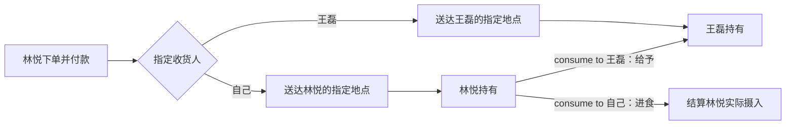
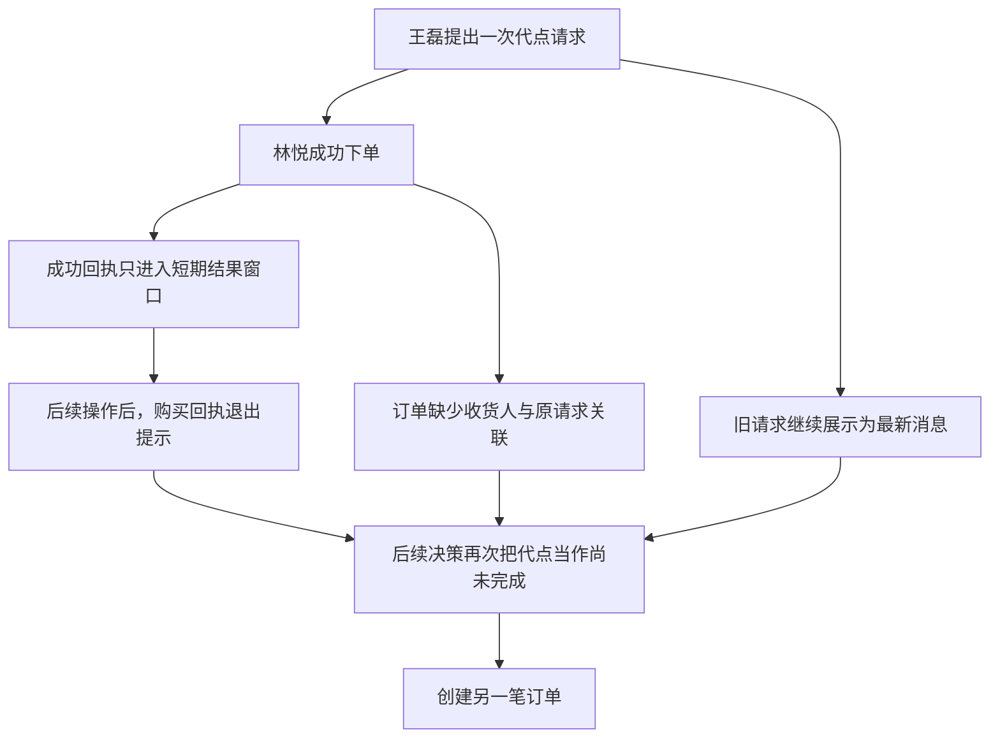
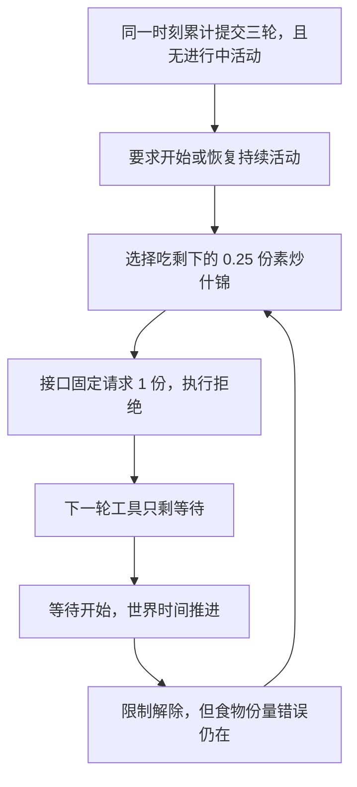
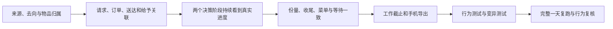

# 白领全天模拟：重复下单、给予、进食与强制等待的根因分析

记录日期：2026-09-27。模拟日期：2026-09-28，Asia/Shanghai。

本文记录原始运行证据、用户已确定的语义和待实施建议，不代表修复已经完成，也不替代现行接口规格。
本轮只读核对了模型请求、观察、动作结果、活动、订单和运行源码快照，没有修改生产代码或重跑模拟。
此前工作区中已有的结束进食、指名购买等代码草稿，未用于这次运行，不能作为本文问题已经修复的依据。

**核心结论：旧的代点请求持续可见，但已经替谁买过、送到哪里、是否交付的事实没有持续进入决策。**
重复下单不能只用“没有提醒人物查看库存”解释；强制等待也不能解释为人物当时没有事情可做。
两者分别涉及事实保留、消息归属、物品归属，以及展示、受理和决策限制之间的不一致。

**本轮处理决定：先完成每轮人物提示的整体方案，再统一修复程序错误。**

用户要求先把现有提示框架、填充内容及其增长和退出规则画清楚，核对真实模型输入后再讨论整体方案。
本轮仅分析提示并登记问题，不修改生产代码，不把调整提示当作下列程序错误的修复。
下表均为已定位、待整体方案完成后统一修复的问题；当前没有新增完成或验收声明。

| 程序错误 | 已核对的触发与后果 | 后续必须验证的结果 |
| --- | --- | --- |
| 直接消息截断且没有全文入口 | 王磊的回复只展示前四十个字符，后面的工作安排无法读取 | 人物能够取得完整消息；发件人、时间和正文保持对应 |
| 工作恢复越过合同截止 | 暂停后恢复只平移剩余时长，结束从 17:10:51 后移到 17:44:21，越过 17:30 截止 | 开始和恢复使用一致的截止约束，截止同秒按合同处理 |
| 有效工时达标与提交状态不一致 | 截止时已累计约 6.40 小时有效工时，要求为四小时；仍在工作使提交就绪状态保持为否 | 分开呈现工时达标、活动是否结束和提交条件，达标时能明确选择收尾并提交 |
| 逾期工作从观察和工具中消失 | 工作结束时任务已过期，任务及提交入口一起消失；本次没有提交请求 | 保留任务结果与逾期原因，提交和结算遵守现行合同，不擅自增加迟交规则 |
| 不足一份的食物无法再次消费 | 系统结算留下 0.25 份，菜单仍说可以吃，但执行代码固定请求一份并拒绝 | 展示、实际可消费数量、时长和热量使用一致约定；模型无需补填接口没有的数量或时长字段 |
| 混合动作的购买记录遗漏 | 进食与购买并行时整体回执为 in_progress，手机投影漏掉已成功购买的购物与支付环节 | 按订单创建事实生成记录并去重，持续活动不影响其中已完成购买的导出 |
| 最近主观记忆的零条配置失效 | 配置允许 recent_memory_limit 为零，但 WorldMock 的读取路径把零交给底层后重新变为默认八条 | 零条配置不展示最近条目，非零配置按对应窗口读取；此问题不作为本次默认八条运行重复下单的原因 |

失败后强制等待、指名购买、物品来源去向、请求与订单关联，以及主观自述如何参与后续决策，
继续作为整体方案的讨论内容，不能仅凭上表的程序错误已经定位就宣称这些问题已经解决。

**证据范围与追溯入口。**

| 项目 | 对应内容 |
| --- | --- |
| 场景 | 林悦，练秋湖白领场景，完整自然日 |
| 运行目录 | `2026-09-28-c9a4fc1-day-r3` |
| 运行身份 | `a7ed196b47f74a11971ff9d5b2c650f6` |
| 代码基线 | `c9a4fc17510fb88b6f0074328625351039988a53`，另含归档中的启动修复 |
| 运行源码身份 | `c0a3d9b369cb4ec027c3a2535d1c3def0bc81b1d83b1be4c4b57879599af2725` |
| 数据依据 | 原始世界事件、实际模型输入和工具调用、活动进度、订单、最终检查点 |
| 结论边界 | 人物的自述和主观记忆不能代替执行凭据；结构性缺口已定位，修复效果仍需行为测试与复跑验证 |

运行源码身份以[运行报告][run-report]和[源码归档][runtime-source]中的清单为准。
[行为复核报告][behavior-audit]提供原始事件定位；[原始事件][events]保存模型请求和实际执行记录。
本文的代码链接用于定位相关模块；重现当时行为应使用冻结源码归档，而不是当前工作区草稿。

**用户已经确定的语义，与本文建议的实现需要分开。**

| 内容 | 状态 | 约定 |
| --- | --- | --- |
| `obtain`、`consume` 增加 `from`、`to` | 用户要求 | 人物能够声明从哪里获得或消耗、给予谁 |
| `consume` 的 `to` 指向他人 | 用户已确定 | 都是给予，只转移物品，不表示对方已经食用 |
| `consume` 的 `to` 指向自己 | 用户已确定 | 才具有进食语义 |
| 暂停进食 | 用户已确定 | 保留这次餐食的剩余部分，允许恢复 |
| 结束进食 | 用户已确定 | 不再继续，销毁这次餐食的剩余部分；不销毁其他未开吃的份数 |
| 指名购买与轮转 | 用户已确定 | 环境存在的商品不能因 `rotation_deferred` 被禁止指名购买；不存在时返回错误和近似候选 |
| 来源、收货人、地点的具体字段结构 | 待实施建议 | 逐个商品携带来源和去向，明确持有人或商家及地点 |
| 代点请求与订单关联 | 待实施建议 | 用真实订单和交付事实记录处理进度，区分重复履行与新增需求 |
| 删除失败后强制等待的规则 | 待实施建议 | 保留等待选择和有限决策预算，同时保留其他可执行活动 |

**来源与去向必须参与结算。**

现有 `consume` 也支持非食品自用；本文建议保留这一物品类型分支，不将它列为用户新确认的语义。

当前购买路径把执行人物同时用作付款人和库存归属人，把人物当前位置用作收货地点。
因此“给王磊买一份”只能存在于语言叙述中，实际商品仍进入林悦的办公室库存。
对应代码为 [购买请求派生][session-actions] 的 `_start_purchase_action`、
[订单结算][basket] 的 `_build_orders` 和 [送达结算][commerce] 的 `deliver_order`。

建议采用以下结果语义；其中直接配送给他人的具体字段与状态设计仍属方案。

| 动作 | `from` | `to` | 权威状态变化 |
| --- | --- | --- | --- |
| `obtain` | 指定商家 | 自己、指定收货地点 | 执行人物付款，配送完成后进入自己的库存 |
| `obtain` | 指定商家 | 王磊、指定收货地点 | 执行人物付款，配送完成后进入王磊的库存 |
| `consume` | 自己在指定地点的持有物 | 自己 | 按物品类型进食或自用，结算实际使用量 |
| `consume` | 自己在指定地点的持有物 | 王磊 | 从自己的库存移出，进入王磊的库存，不给任何人增加摄入量 |

直接送给王磊，与林悦先收货再给予王磊，是两条不同的交付路径，不能重复结算。

每个商品应分别携带来源和去向，支持同名商品分别给自己和王磊。
直接给予必须符合人物位置与物品可取得条件，不能因为写了他人名字就跨地点转移。
远程交付则通过订单声明的配送过程完成。

王磊目前是[通讯录联系人][social]，没有物品持有状态和收货地点。
支持给予需要补齐这些状态，但不要求把每个联系人都变成全天自主决策的人物。
暂停餐食占用的份量还应绑定原活动，避免被另一项消费重复占用。

**重复下单前，旧请求持续保留，而购买回执和归属信息缺失。**

王磊最初的代点请求只投递一次。10:30 林悦主动邀拼单，10:35 收到“牛肉炒面、少辣”的回复。
该请求随后持续出现在本次运行的 116 条观察中，已读状态没有使它退出历史展示。
四次购买全部发生在王磊第二条回复于 11:50 送达之前。

| 下单时刻 | 实际行为 | 人物当时看到的事实 |
| --- | --- | --- |
| 10:35 | 买牛肉炒面和虾仁什锦炒面各一份，自述牛肉给王磊、另一份给自己 | 首次代点请求，无此前午餐订单，办公室无可用餐食；家中有素炒什锦 |
| 10:43:01 | 再买一份牛肉炒面，自述先给王磊下单 | 场景提示最早的牛肉订单约 10:55 到；事实清单没有完整在途订单；上一单回执已退出短期结果窗口 |
| 10:55:47 | 吃已有牛肉炒面，同时再买一份，自述给王磊，实际仍归林悦 | 明确显示牛肉、虾仁各一份；第二单仍在途，但未显示；最近结果是等待收尾 |
| 11:45:01 | 再买一份牛肉炒面，前一秒又承诺“这就给你点一份” | 明确显示约 2.82 份牛肉炒面及一份虾仁炒面；原代点请求仍可见；最近结果是消息送达 |

后续购买并非新的催单触发，也不是同一订单的网络重试。
尤其 11:45 已显示充足库存，当次库存展示仍未阻止重复行为。
单独补充提示能否解决重复下单，需要行为验证，不能从这次记录直接推定。
下图是依据证据整理的解释路径，各项修改对行为的独立影响仍待验证。

| 可定位的缺口 | 运行证据与实现机制 |
| --- | --- |
| 成功事实短暂可见 | 四次购买的模型请求均重新构造 `system` 与 `user`；购买回执曾经展示，之后退出增量结果窗口。`observe._recent_action_results` 按上次发送进度请求的位置截取结果 |
| 瞬时购买缺少持续呈现 | 购买不产生持续活动；已核验经历主要从活动进度提取，不能承担订单的完整历史。购买事实应由订单状态持续提供 |
| 在途订单投影不完整 | 原始观察有 `pending_deliveries`，公开事实没有对应列表；`dining.local_food_summary` 在有手边食物时直接返回，否则最多提示最早一份在途餐食 |
| 消息归属丢失 | 场景中的收件消息只放正文，不带发件人和时间；前置决策自述还没有完整事实清单 |
| 已读旧消息继续像新消息 | 历史请求持续留在“最新消息”中，后续人物仍说“他刚说”等表述 |
| 订单没有表达替谁办理 | 商品进入林悦库存，没有王磊的持有物转移记录；同一代点请求与订单、给予结果之间没有关联 |

消息归属问题有直接表现：首次下单前，林悦把王磊的“刚把数据对完……钱我转你”写成自己的自述。
这说明前置自述会混淆他人的状态与本人状态。它是明确的输入问题，但不能据此断言所有重复下单都由它单独造成。

相关实现见[人物提示构造][life-agent]、[观察结果窗口][observe]、[公开投影][projection]、
[餐食提示][dining]及[已核验经历][experiences]。

建议让两个决策阶段都看到带说话者和时间的消息，以及相关订单和交付事实。
场景强调本轮新消息，历史消息保留在往来记录中；已读不等于已经履行，也不能用简单删除已读消息代替处理状态。

订单持续展示商品、收货人、地点、配送状态；库存区分未开吃的食物与暂停餐食占用的剩余份量。
下单时显式关联正在回应的代点请求，处理进度由订单、送达、给予事件更新，不能靠主观记忆宣布完成。
同一请求再次提交时返回已关联订单；新的额外需求仍可购买。

只增加 `from/to` 可以解决归属；若要求可靠地区分重复履行与新增需求，还需要明确的原请求关联。
不能按“今天买过同样商品”全局禁购，也不能只凭自然语言相似就认定两次请求相同。

**强制等待是运行限制，不是人物没有别的事情可做。**

本次场景的同刻上限是三轮世界动作提交。成功下单、成功收尾、失败操作都会计数，
不是连续失败三次；一次世界决策内部的模型调用与协议纠错，也不是这个计数。
没有进行中活动时，这些瞬时操作不推进模拟时间。

| 等待开始时刻 | 活动实际时长 | 性质 |
| --- | --- | --- |
| 10:43:01 | 12 分 46 秒 | 普通阶段主动选择等待外卖 |
| 18:45:00 | 15 分钟 | 强制进入 `wait_only` 后开始等待 |
| 19:00:00 | 15 分钟 | 强制进入 `wait_only` 后开始等待 |
| 19:19:40 | 15 分钟 | 强制进入 `wait_only` 后开始等待 |
| 19:34:40 | 12 分 52 秒 | 强制进入 `wait_only` 后开始等待，提前结束 |

晚间四次的前一轮拒绝均为 `PRODUCT_NOT_HELD`，库存均仍有 0.25 份素炒什锦。
同一观察一边写“可以直接吃”，一边又反馈“手边没有这件东西”，持续诱导再次尝试。
消费请求固定一份，库存校验却要求满足这份数量，是直接的接口矛盾。

等待默认计划十五分钟，来自 `activity_feedback_seconds`，并非依据外卖剩余时间计算。
世界时间一推进，`wait_only` 就复位为普通阶段；获得下一次决策机会仍需等到相应唤醒事件。
因此解除限制、等待活动结束、人物再次决策，是不同的时刻。

四段合计 57 分 52 秒是等待活动的累计时长，不能解释为连续锁定或完全闲坐这么久。
19:22:06 等待仍在进行时，人物已恢复普通阶段并开始浏览；后来还发生等待与进食并行。
已有进行中活动且无待收尾活动时，达到同刻上限会按正常节律推进，不走上述强制等待分支。

另有一处独立矛盾：宿主只裁剪工具参数和本地校验，提示里的 `facts.interactive_objects`
仍列出浏览商品目录、食用素炒什锦、睡觉等选项。
于是人物按提示选择浏览，工具又报目标不可交互。
本次 43 次协议错误中有 18 次为目标不可交互，集中于受限阶段，不能一概归于模型没有遵守格式。
现有受限说明只有“你已经想了好几轮，先定下一件事”，没有解释具体限制与解除条件。

对应实现见[同刻计数与阶段变化][same-moment]、[宿主工具裁剪][life-agent]、
[动作时长与份量派生][session-actions]及[菜单事实投影][projection]。

建议保留主动等待，删除“受限阶段启动失败一次便只准等待”的升级规则。
达到同刻上限后，仍允许选择当前真正可执行的持续活动，包括符合地点条件的工作、阅读、浏览、恢复活动和等待。
菜单、工具参数、宿主校验和引擎受理使用一致的可执行结果；不能执行的对象可以保留事实说明，但必须标明原因。

有限决策预算仍需保留。纠错预算耗尽应明确报告技术决策失败，不把技术失败记录成人物主动等待。
单次模型回合预算与同刻跨决策预算需要分别约束，避免跨决策继续无限重试。
若确实只剩等待，说明应指出具体世界原因和解除事件。
本次没有查到必须让人物干等十五分钟的真实场景约束。

**进食收尾不能把提前结束显示成完整吃完。**

实际进食按时间比例结算，因此一份餐食吃了部分时间，会留下小数份量。
问题在于人物可见的收尾状态把完成、取消和失败都归成“已收尾”，缺少实际终态和份量。
例如 11:50 的牛肉炒面只吃了 209 秒，计划时长为 1,500 秒，人物却写“吃完了”；
14:05 的一次进食仅持续一秒，也被写成吃完。

| 操作 | 已吃部分 | 本次剩余部分 | 其他未开吃的份数 |
| --- | --- | --- | --- |
| 暂停 | 按实际进度结算 | 保留并绑定原活动 | 保留 |
| 结束 | 按实际进度结算 | 丢弃，不补算热量 | 保留 |
| 自然吃完 | 按完整进度结算 | 没有剩余 | 保留 |

例如有四份饭，本次拿一份吃了 0.2 份再结束：摄入为 0.2 份，丢弃 0.8 份，另外三份不受影响。
正数剩余份量的展示和执行仍需独立修正，不能只靠结束时销毁食物掩盖不足一份无法消费的问题。

建议在当前事实、收尾结果和回看中明确呈现完成、提前结束或失败，以及已吃、丢弃、剩余份量。
人物可以保留主观感受和记忆，但一句“吃完了”不能覆盖结算结果。
前置自述会放大部分偏差，却不是全部原因：有的错误在前置自述已经出现，有的直到工具收尾才出现。
不需要为每一句主观自述再增加模型审查。
相关实现见[活动状态投影][activity-control]、[公开进度][projection]及[收尾处理][session-actions]。

**工作没有报酬，还存在恢复越过截止与任务消失的问题。**

| 时刻 | 实际状态 |
| --- | --- |
| 初次开始工作 | 原计划 17:10:51 结束 |
| 10:43:01 | 暂停工作 |
| 11:16:31 | 恢复时按剩余活动时长重算结束，变成 17:44:21，超过合同 17:30 截止 |
| 17:30 | 仍在工作，有效工时约 6.40 小时，合同要求仅四小时；因仍有进行中工作，尚未标为可以提交 |
| 17:44:21 | 任务因过期从观察中隐藏，模型的 `submit_work` 工具也随之消失 |

全天没有成果提交请求，因此应描述为没有提交，而不是提交失败。
[活动恢复][activities]的 `_resume` 只按当前时间加剩余时长重算，没有重新限制工作截止；
[任务观察][observe]隐藏过期任务，[工具准备][life-agent]再根据可见任务决定是否提供提交工具。

建议恢复工作时重新检查合同截止；有效工时达标时明确提示可以结束并提交。
逾期任务仍保留可见状态和不能继续结算的原因，是否允许迟交或付款由合同明确规定。
不能用隐藏任务代替解释结果，也不能把工时足够自动当作成果已经提交并验收。

**商品发现、对话完整性与手机导出还需要分别修正。**

| 问题 | 已确认的原因 | 建议 |
| --- | --- | --- |
| 咖啡和盒马目标食材没有购买 | 商品存在，但未进入轮转窗口；工具又要求从已展示商品中选择 | 按用户要求，浏览继续受轮转影响，指名购买检查完整环境供给；不存在或重名时返回原因和候选，不自动替换商品 |
| 盒马“挑好了”却没有订单 | 一次浏览仅执行五秒便结束，尚未取得完整结果，却写出番茄、上海青已挑好和家中还有米 | 明确浏览未完成、未取得结果；采购完成以订单事实判断，不能从总结推断 |
| 联系人回复缺少往来 | 回复模型只有联系人档案和当前一条来信，没有双方历史 | 提供双方可知、带说话者和时间的往来；本次四次下单不能归因于王磊反复忘记后重新提出要求 |
| 联系人消息后半段不可读 | 直接消息公开投影只取前四十字，且没有完整阅读入口 | 提供完整消息或明确可用的阅读入口，避免截断行动项 |
| 手机记录漏掉成功订单 | “进食加购买”的整体回执是 `in_progress`，手机投影只接受整体 `completed` | 按订单创建事实生成购买记录，并按订单身份去重 |
| 把没有订单解释为没用过应用 | 购物手机事件从成功订单的商家映射产生，没有独立打开或浏览应用的完整记录 | 报告保持“没有成功购买凭据”的口径；浏览、想下单和实际下单分别记录 |

对应实现见[联系人回复请求][runtime]、[消息公开投影][projection]及[手机购买投影][phone-projection]。

**整体方案完成后的实施建议，以跑通真实交付为起点。**

下列顺序保留为实施建议；启动条件是先完成上述人物提示整体方案，并统一纳入已登记的程序错误。

先用最小场景跑通王磊请求、林悦下单、实际送达或给予、下一轮正确识别已经办理的完整过程，
再覆盖并行活动、暂停餐食和其他问题。复用项目现有 Pydantic、订单、库存和事件记录即可，
不需要为这份方案新增第三方依赖或一套通用承诺系统。
正式实施时直接更新现行接口、调用方和测试，不保留旧接口兼容层，不增加迁移或失败后自动替代动作。

成熟产品的可复用原则是把对话事件与动作结果关联，并独立保存订单履约状态。
[Rasa 的事件模型][rasa-events]记录消息、回复和动作产生的状态变化；
[Shopify 的履约模型][shopify-fulfillment]区分订单、履约工作、目的地和履约状态。
本文借鉴这些已经验证的状态职责划分，不引入其完整产品或额外业务框架。

**验收需要证明事实进入了后续决策，而不只证明模拟到达午夜。**

| 验证对象 | 行为测试 | 变异测试应能发现的错误 |
| --- | --- | --- |
| 直接配送给王磊 | 林悦付款，送达后王磊持有，林悦库存和双方摄入不增加 | 把收货人改回付款人，或把送达当作食用 |
| 收货后给予王磊 | 先增加林悦库存，再通过给予只转移一次 | 重复到达或重复回执再次增加库存，给予产生热量 |
| 同商品不同去向 | 同一请求中的同名商品可以分别归不同收货人 | 按商品名合并后丢失收货人 |
| 同一代点请求 | 成功后跨暂停、收尾、发消息仍能看到对应订单；重复提交关联原订单，新需求可另购 | 删除请求关联、丢掉成功状态，或把所有同商品购买都拒绝 |
| 消息归属与历史 | 两个阶段均有发件人和时间，旧消息不会冒充新消息 | 删除说话者、时间或新旧区分 |
| 暂停与结束餐食 | 部分摄入后暂停保留；结束丢弃本次剩余，其他份数保留 | 把丢弃量加成摄入量、扣掉其他份数，或重复使用暂停占用的份量 |
| 不足一份的食物 | 有 0.25 份时，展示和执行数量一致，热量及完成时长遵守同一份量合同 | 把请求数量重新固定为一份 |
| 失败后的活动选择 | 食物动作失败后仍能选择有效阅读、浏览或工作，等待仍可主动选择 | 恢复失败后只准等待的裁剪，或让提示与工具可执行项不一致 |
| 有限决策预算 | 无法产生合法动作时明确报告技术失败，停止该次推进 | 把预算耗尽转成自动等待，或让跨决策重试无限继续 |
| 工作暂停恢复 | 恢复后不越合同截止，工时达标可收尾提交；截止同秒可按合同结算，付款仅一次 | 删除截止约束、隐藏逾期状态或重复付款 |
| 指名购买 | 隐藏但存在的商品可按来源购买；不存在、重名或交易条件不满足时给出准确反馈 | 把轮转当作不存在，或自动替换成近似商品 |
| 混合动作中的订单 | 进食持续进行时，已创建订单仍进入手机记录，重复回执不重复生成 | 只检查整体 `completed`，或移除订单去重 |

上述测试与变异尚未执行。真实全天复跑还需核对人物是否把新的订单、消息、给予和进食事实用于后续选择。
确定性测试可以证明接口和状态约束；模型行为改善程度需要真实运行比较，不能在方案阶段宣称已经消除重复下单。

[run-report]: https://github.com/HoldThatThgt/WorldMock-Dataset/blob/main/requests/0001-white-collar-lianqiu/RUN_REPORT_2026-09-28_C9A4FC1.md
[behavior-audit]: https://github.com/HoldThatThgt/WorldMock-Dataset/blob/main/requests/0001-white-collar-lianqiu/diagnostics/2026-09-28-behavior-audit.md
[events]: https://github.com/HoldThatThgt/WorldMock-Dataset/blob/main/requests/0001-white-collar-lianqiu/runs/2026-09-28-c9a4fc1-day-r3/worldmock-export/events.jsonl.gz
[runtime-source]: https://github.com/HoldThatThgt/WorldMock-Dataset/blob/main/requests/0001-white-collar-lianqiu/runs/2026-09-28-c9a4fc1-day-r3/logs/execution/runtime-source.zip
[phone-projection]: https://github.com/HoldThatThgt/WorldMock-Dataset/blob/main/requests/0001-white-collar-lianqiu/simulate_phone.py
[life-agent]: ../../../custom/agents/life_agent.py
[observe]: ../../../src/worldmock/life/observe.py
[projection]: ../../../src/worldmock/life/projection.py
[dining]: ../../../src/worldmock/life/dining.py
[session-actions]: ../../../src/worldmock/life/session_actions.py
[basket]: ../../../src/worldmock/life/basket.py
[commerce]: ../../../src/worldmock/life/commerce.py
[social]: ../../../src/worldmock/life/social.py
[experiences]: ../../../src/worldmock/footprints/experiences.py
[same-moment]: ../../../src/worldmock/life/same_moment.py
[activity-control]: ../../../src/worldmock/life/activity_control.py
[activities]: ../../../src/worldmock/life/activities.py
[runtime]: ../../../src/worldmock/runtime.py
[rasa-events]: https://rasa.com/docs/reference/primitives/events/
[shopify-fulfillment]: https://shopify.dev/docs/api/admin-graphql/latest/objects/FulfillmentOrder
