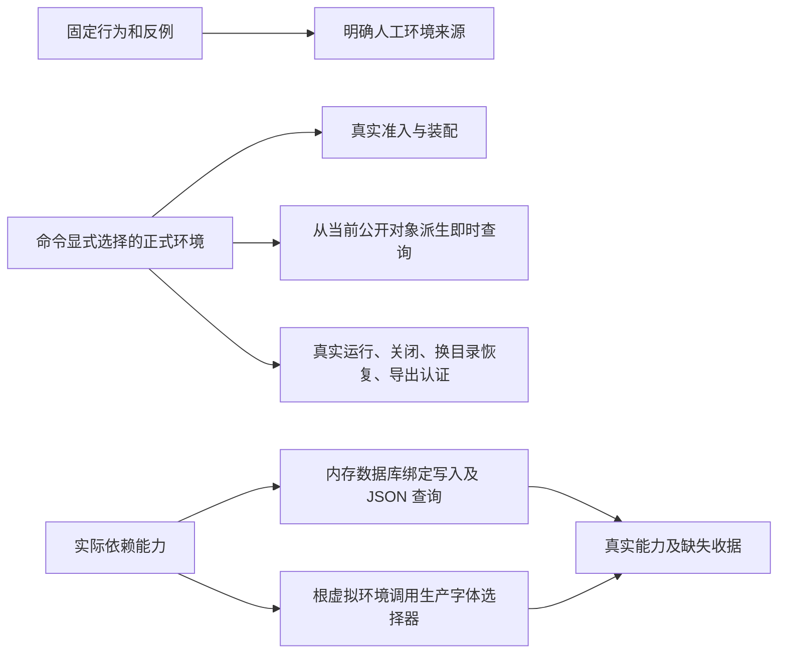

# 正式回归修复验收

> 状态：现行记录；实际通过以本轮源码与平台匹配的完整收据为准
> 日期：2026-10-07

用户授权修复引擎测试输入职责、引导与验证入口，保持冻结规格、生产生活规则和正式数据不变。
原 5701 个节点、固定行为断言、错误码、循环上限与覆盖率阈值全部保留；新增验证用于防止职责再次混淆。
两个原未定因节点已在同源码下分别运行人工与正式输入，根因是测试需要人工内容中的中途决策与身体边界。
没有据此修改身体、时钟、内容或活动算法，也没有把原失败收据重写为通过。

字符串场景名的固定引擎夹具读取人工环境；显式 Path 使用给出的实际场景。
保存、恢复与报告沿用创建运行的同一场景来源。缓存只复用未改写的人工或所选正式场景，
所有变异和外部副本仍执行真实加载。全局正式目录选择不变，准入、缓存隔离和名称派生查询保留正式输入。
新增正式生命周期测试在隔离副本完整保留人物、目录与语料，只派生一小时窗口，
逐集合筛选消息、账单和工资，保存原窗口、原摘要及保留记录；完成实际动作、关闭、搬移、重开与认证导出。
该派生窗口证明通用生命周期，不替代上文原发布场景的完整日证明。

Node 版本只作身份记录，引导必须实际执行 SQLite 读写与 JSON 查询。
中文绘图能力由生产字体选择器在根虚拟环境子进程核验；缺字体不新增 skip。
release 缺能力立即拒绝，dev 的缺失记录不能成为通过收据，测试会话也不能通过。
Linux CI 使用现有 Node 24 配置并明确安装 Debian Noto CJK 与 libatomic1；没有引入新包、字体选择器或兼容层。

本轮实际提交、冻结规格与 97 个正式文件摘要、原节点保留证明、独立 Bob 变异记录以及
macOS/Linux standard、full、当前覆盖率收据集中保存在
[正式回归修复验收](../../execution/2026-10-07-formal-regression-repair/README.md)。
结果只按该轮真实 summary.json 和平台收据判定，不复用人工环境或首次失败运行的覆盖率输入。
Windows、另一物理机器、第三仓手机消费与五条跨平台浮点末位差异仍按上文各自边界登记。

