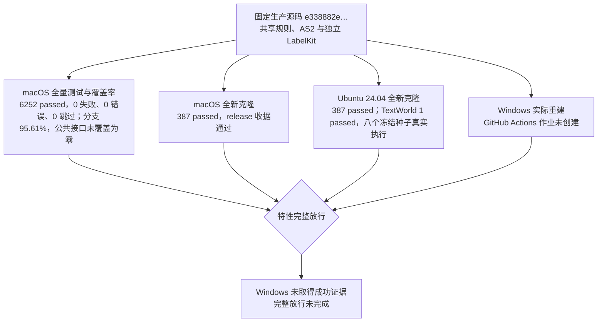

> 历史记录：本文件保存提交 `72f004b0087efa1b6f6d662ac6a143e087e4e21c` 时的过程与判断，不再定义当前系统。
> 当前设计见 [文档入口](../INDEX.md)；正文中的路径、规则和结果按当时上下文理解。

# 共享规则与可重建环境验收记录

> 代码基线：`08d61a7ae0a99812375a87df0e29b1490e06fd6f`
> 引用出处：`docs/dev/coverage-report.json` @ `06e3ea0e04bcbb3022eac820a08005ef32b6b1c8`
> 引用出处：`docs/dev/shared-rules-fresh-macos.json` @ `06e3ea0e04bcbb3022eac820a08005ef32b6b1c8`
> 引用出处：`docs/dev/shared-rules-fresh-linux.json` @ `06e3ea0e04bcbb3022eac820a08005ef32b6b1c8`
> 引用出处：`docs/dev/shared-rules-platform-verification.json` @ `06e3ea0e04bcbb3022eac820a08005ef32b6b1c8`
> 本记录保留共享特性合并前的实测；当前主线整合独立登记已观察证据。补测、各变异与平台执行分别绑定正文声明的提交，不作为合并后全量或跨平台通过结论。

> 规格：[最终开发规格](SPEC-shared-rules-and-rebuildable-env.md)。
> 实施基线：`2cf230115f4084aef2376e9d77bc976efbed43ea`；分支 `codex/shared-rules-rebuildable-env`。
> 本记录只按实际命令和各次被测源码登记证据，不继承其它特性的通过数字。

## 方案裁决与文档一致性

| 主题 | 最终裁决 | 保留的现行合同 |
| --- | --- | --- |
| 规则共享 | 原始定义保留在所属模块，消费者导入同一实现，删除复制定义和旧导入名 | 工作纯字符串原文字节、场景输入格式、已有拒绝码 |
| 活动家族 | 统一声明与读取；缺品类保持未知 | 计划不猜进度、评估缺证、生产受理拒绝 |
| 时间与数值 | 时长上限一致，区间端点严格整数，曲线有限非负 | 一般活动 86400 秒、消费 60–14400 秒 |
| 模型纠正 | 共用解析与 Schema 错误格式 | 各模型通道的回显、指令与重试预算 |
| 记忆与 AS2 | WorldMock 维护同类记忆合并与观察单写业务，AS2 保留必要生命周期和完整直接环境注册补丁 | 主观类型、来源字段、共同恢复、反思预算、故障传播 |
| 环境 | 固定公开源制品与有序补丁，独立 LabelKit 环境，标准库引导 | 实际生产字节身份，无 SSH、无隐式 uv、无旧来源分支 |
| 放行 | 不允许测试跳过取得通过，双平台和 Linux 语料证据合并 | 85% 分支覆盖率、零未覆盖公共接口、真实总体实验独立 |

全部设计章节、合同、安装手册、关联规格和验收门禁同步清单以最终规格为准。
历史版本表保留原始提交及当时结论；现行正文的安装来源、公共导入和职责按本特性更新。

AS2 完整历史补丁已重建出原摘要 `65a902ec66df42296d4e4c85e424bce3512e437133fc6be9fa597766fc30a334`；
业务移出后的最终摘要为 `bb655cb3b4d7a68c725431a507192389b4e6770015e9673d6f5e9ef92dba1c46`，由 SERIES 和运行时直接核对。

<a name="shared-rules-verification-主线整合证据"></a>
## 主线整合证据

共享特性与主线分层整合的完整日比较，使用已验收共享特性提交
`06e3ea0e04bcbb3022eac820a08005ef32b6b1c8` 的隔离源码生成基线；未修改其生产源码，
保留原有 61 个业务断言，只在测试侧使用主线已有身份固定与摘要辅助函数。
两个独立 pytest 进程分别完成种子 `20260105` 和 `20260106`，合计 4 passed、0 failures、
0 errors、0 skipped；每个种子的两次事件、资产、检查点和认证导出摘要逐字节相同。
原始回执、导入来源和测试测量补丁保留为独立来源，属于脚本模型完整日，不是供应商模型实跑。

| 基线或检查 | 当前作用与已观察结果 | 证据边界 |
| --- | --- | --- |
| `tests/fixtures/dayrun-layering-baseline.json` | 固定 `2cf230115f4084aef2376e9d77bc976efbed43ea` 的主线分层历史行为；保留与原有 147 个变异生成结果迁移证明的对应关系 | 不改写原基线，也不用于忽略共享特性授权的目录身份与记忆归属变化 |
| `tests/fixtures/dayrun-shared-rules-baseline.json` | 固定隔离共享特性 `06e3ea0e04bcbb3022eac820a08005ef32b6b1c8` 的真实独立双跑摘要，作为现行完整日回归依据 | 基线来自合并前源码，不从合并后产物重录，不删除业务字段 |
| 当前整合完整日输出 | 两个种子的签名分别与独立共享特性基线相等，已核对事件和导出工件、运行资产及检查点摘要 | 仅证明这些实际完整日输出的比较，不代表合并提交的全量、覆盖率或平台门禁已通过 |
| 当前整合门禁 | 唯一 runner 核对同次运行身份、覆盖摘要、实际输入和阶段完成条件；节点结果、覆盖率与接口缺口以[现行机器门禁报告](coverage-report.json)登记 | 机器报告中的实际被测提交与输入摘要决定证据范围，合并前数字不能代表其它提交；平台证据分别按原来源判定 |

以下实现与工程、平台、变异结果为正文声明提交的合并前实测。

## 实现与测试证据

机器登记位于 `tests/shared_rules_acceptance.py`，由 `tests/test_shared_rules_spec.py` 对照冻结规格逐行核对，
包括具体节点存在、无跳过标记、环境章节齐备和最终 AS2 身份一致。
最终共享活动、叶子规则、模型客户端、事件解析、AS2 与环境的组合回归为 278 passed；
此前设计汇编、规格、风格、目录语义、时间与能量及实际时长边界的组合回归为 63 passed；
该次快照尚未包含总览同步后的新增检查，现行文档结果另见下表。
消费拒绝与睡眠注册表补强后的共享活动测试为 42 passed。组合包含重复节点，不相加作为全量数字。

| 规则组 | 实际入口与实现 | 具体行为测试 |
| --- | --- | --- |
| 摘要与安全文件 | `footprints.models`、`corpora.manifest`；请求、验收、品类、地图、内容和电话配置消费者 | `test_shared_primitives.py` 的字节同源、非有限拒绝、路径顺序和各原消费者符号链接拒绝 |
| 写入与错误 | `footprints.assets.atomic_write`、`errors.reject_value`、所属错误构造 | 发布顺序、失败清理、旧文件保持、单条日志及模型错误单条日志 |
| 时长、工作与出行 | `life.durations`、`work_start_refusal`、`planned_travel` | `test_shared_rules.py` 的工具层、按名清单与受理交叉测试，工作三入口、出行三入口 |
| 缓解与可供性 | `life.activities`、注册表 `met_lookup_key` | 非法接触次数两路径同时拒绝，合法速率相同、MET 同源 |
| 家族与计划 | `life.schedule.activity_family`、共享整数区间 | 缺品类不推进不加分、社交家族推进目标、非法区间不推进 |
| 词表、邮件与合同 | 唯一活动名称表、`mail_headers`、`CONTRACT_OBJECT_IDS` | 名称派生、真实揭示邮件与观察字段、换合同模板后的真实加载及资源倍率 |
| 候选与睡眠边界 | `CANDIDATE_ACTIVITY_KINDS` 与现有身体睡眠判定 | 五种候选的实际资源排除；睡眠恢复与无娱乐分录 |
| 区间、日期与事件 | `footprints.intervals`、`timeline_labels`、`evaluation.adapters` | 四类报告非法端点拒绝、主体过滤、23/25 小时本地日、适配只解析一次供两个消费者 |
| 主观记忆 | `life.memory_evidence`、WorldMock 记忆扩展 | 独立反思合法、共同快照、来源校验、24 小时与 Jaccard 精确边界 |
| 公共模型与客户端 | `base_models`、`IndependentModelClient`、`model_feedback` | 曲线布尔/非有限/负值拒绝、浅深冻结区分、三客户端身份与序列化、三通道原预算及纠正回显 |
| 防漂移 | `tests/test_single_source.py` | 真实全树无业务克隆；临时复制函数、规则表、错误归属实际失败 |
| 固定环境 | `bootstrap.py`、`bootstrap_sources.py`、`bootstrap_environment.py` | 旧与新真实源码重建、制品破坏拒绝、锁逐哈希比对、明确 Python、独立环境和 profile |
| 重建与门禁 | `fresh_check.py`、`coverage_gate.py`、CI | 无 SSH/缓存命令、平台摘要比较、分片恰一次、空/跳过/失败拒绝、模拟跨卷错误后的真实字节复制 |

## 工程与平台证据

冻结规格所列生产功能已实现；没有留待实现项。平台验收按真实执行结果分别登记。没有使用 skip、xfail、缺组件的 dev 收据或旧版绿色结果代替通过。



| 检查 | 被测身份与结果 | 证据 |
| --- | --- | --- |
| 完整测试与覆盖率 | 6252 passed，0 失败、0 错误、0 跳过；分支 95.61%，公共接口未覆盖为零；干净提交 `08d61a7ae0a99812375a87df0e29b1490e06fd6f`，24 个分片，每个测试文件恰一次 | [机器门禁报告](coverage-report.json) |
| macOS 新机器重建 | macOS arm64、Python 3.12.13、Node v26.0.0；387 passed，release 收据 `passed=true`、缺组件为空 | [macOS 重建收据](shared-rules-fresh-macos.json) |
| Ubuntu 新机器重建与 TextWorld | 387 passed；TextWorld 1 passed，八个冻结种子真实执行 | [Linux 重建收据](shared-rules-fresh-linux.json)；[平台记录](shared-rules-platform-verification.json) |
| Windows 新机器重建 | 未运行；GitHub Actions 在创建作业前 `startup_failure`，没有 jobs、check runs 或日志 | [实际失败运行](https://github.com/HoldThatThgt/WorldMock/actions/runs/37233682441) |
| 独立源码变异 | 75 个有效独立变异全部 killed，0 survived；另有一个因无关种类查表失败的 invalid 变异，不计入检出数 | 本记录下节的固定基线、变异台账与复验结果 |
| 文档一致性与风格 | 总览、共享规则与设计同步组合 64 passed；最终报告和收据同步后的文档、规格、汇编与风格检查 22 passed | 冻结规格登记、全设计章节引用、设计汇编 `--check`、文档测试和源码风格门禁 |

完整覆盖率使用当前锁定解释器及隔离临时覆盖数据运行，报告中的 Git 提交、生成时间、运行标识与覆盖数据摘要绑定这次实际测量。

```sh
python scripts/coverage_gate.py --shards 24
python scripts/fresh_check.py --repository . --commit 08d61a7ae0a99812375a87df0e29b1490e06fd6f --output .work/fresh-check.json
```

macOS 与 Ubuntu 检查均从无共享对象的 Git 克隆开始，不初始化子模块；Git SSH 命令禁用，pip 缓存禁用。
使用标准库 venv、固定公开源码、有序补丁、哈希依赖、锁定构建后端及独立 LabelKit 环境；实际安装成功后再运行快速验收。
收据的生产摘要为 `e338882e0b59934c49083aeb3779ef686a839cc2c361e4d01099f9d95fe34ed1`，
AS2 摘要为 `bb655cb3b4d7a68c725431a507192389b4e6770015e9673d6f5e9ef92dba1c46`。

`6e1c4162041f8caa14e23845b9e711958cc1d68c` 只补强一个测试文件的拒绝存在断言与实际身体模块的注册表注入，
生产源码及上述摘要与 `08d61a7` 完全相同；共享规则 42 passed 和两个原存活变异的最终复验直接绑定该补测提交。
此后验收收据与文档提交不改变生产源码；完整报告保留实际被测提交，不改写成后续提交的结果。

Ubuntu aarch64 的真实安装已失败：上游固定 Inform7 归档缺少 `inform7-compilers_6M62_aarch64.tar.gz`。
引导在 TextWorld wheel 构建失败后以退出码 1 终止，未执行快速测试或语料验收，也没有生成通过收据。
当前 Linux 64 位验收按锁定上游实际能力使用 x86_64；没有改平台值、替换编译器、跳过语料或降低安装校验。

另一次 x86_64 userland 在 aarch64 内核下的 binfmt 容器安装因 GCC 编译 Jericho 时段错误失败；原固定制品的重复编译也失败，该尝试不计通过。
最终成功运行使用 QEMU 11.1.2 的完整 x86_64 Linux 虚拟机，内核与 userland 均为 x86_64；物理宿主仍为 ARM macOS，明确记录 CPU 仿真。
Ubuntu 24.04.4、Python 3.12.3、Node v18.19.1；未安装 uv，Git SSH 与 pip 缓存禁用；原引导及安装参数未变。
快速验收实际为 387 passed / 595.81 秒；TextWorld 固定节点实际为 1 passed / 94.60 秒，生成并执行 1201–1208 的全部八个游戏到达 won。
最终退出码为零，release 收据通过、缺部件为空；源码、AS2、LabelKit 和全部锁摘要与 macOS 收据相同。

Windows 的成功收据与 Ubuntu 收据的同提交摘要比较尚未取得，故本特性完整平台放行未完成。
干净提交 `c6602b7` 上记录的两次 CI 运行同样在创建作业前失败，作业数均为零；
平台记录保留每次运行的原提交，不把零作业解释为已执行 Windows 检查。
工作流通过 actionlint，仓库 Actions 已启用；实际 run 没有作业和日志，具体启动原因未定位。
本特性的确定性测试不替代已有正式模型全天运行、十二周实验、隔离盲评与完整自然日交付要求。

实施前的定向基线为 60 passed；共享活动相关基线为 287 passed。
初次实现后的完整运行发现测试桩、旧日志断言、真实 AS2 直接环境注册与公共接口覆盖缺口，均已修复并重新测量。
固定锁首次真实 editable 安装缺少 `editables`，已用现有 Hatch 构建后端要求补齐固定依赖，并加入真实安装验收；macOS 新克隆成功证明该缺口闭合。

## 独立源码变异审查

按 `uncle-bob-review` 只在干净提交创建的 detached worktree 内改变生产源码。
每项先声明规格、唯一语义改动与固定测试，再取得绿色基线、执行变异、保存实际失败并立即恢复源码。
不修改审查树的测试、锁、补丁、生成 vendor 或调用工作区；复验前的补测在独立实现提交完成。

| 审查范围 | 基线提交 | 基线测试 | 首次与最终结果 |
| --- | --- | --- | --- |
| 字节、路径、模型、区间、客户端及唯一归属 | `658acc3` | 76 passed | 28 个有效变异，初次 26 killed、2 survived；原路径变异在 `08d61a7` 基线 9 passed 后全部 killed |
| 活动、出行、缓解、家族、词表、合同与社交 | `658acc3` | 58 passed | 20 个有效变异，初次 18 killed、2 survived；两个原存活变异经补测原样复验全部 killed；另一个 invalid 排除 |
| 固定环境、门禁、记忆与观察 | `658acc3` | 247 passed | 26 个有效变异全部 killed；真实 editable 缺依赖另按实现缺口修复，未用模拟命令测试掩盖 |
| 完整直接环境注册 | `08d61a7` | 215 passed | 一个有效变异 killed；实际 scanner 拒绝缺 `begin_decision_round` 的 LifeEnv |
| 消费上限与未启用睡眠通道复验 | `6e1c416` | 42 passed | 两个原变异全部被业务断言 killed；恢复后固定三案例 3 passed |

75 个有效独立变异全部 killed，0 survived；另有一个因无关种类查表失败的 invalid 变异，不计入检出数。原变异的重复复验不增加独立变异数，不声称穷尽每个可能突变。
固定 AS2 的专用测试属于实际基线与功能验收，不冒充对生成依赖源码的突变。

| 原存活变异 | 补强后的具体业务断言 | 原样复验的实际失败 |
| --- | --- | --- |
| 删除声明中的 `..` 拒绝 | 根目录内 `child/../normal.json` 即使解析后文件存在仍拒绝；安全文件、语料和地图原消费者 | 三个 `DID NOT RAISE IntegrityError`，4.33 秒 |
| 删除各路径组件符号链接拒绝 | 指向根内普通文件的文件链接与目录链接同样拒绝；上述三个实际消费者 | 六个 `DID NOT RAISE IntegrityError`，4.56 秒 |
| 消费上限从 14400 放大为 86400 | 14401 秒预查明确返回拒绝，14400 秒实际受理成功 | `assert listed is not None` 失败；1 failed、1 passed，2.27 秒 |
| 让 SLEEP 恢复依赖 `sleep_channel` | 同一注册表声明 awake，真实单活动与共同身体结算仍恢复一小时睡眠不足 | 共同结算后不足账 4.454545 小时而非 3 小时；1 failed，1.63 秒 |

注册变异只把真实 LifeEnv 的 `begin_decision_round` 改名，保留函数体。
变异仍能解析、导入、默认构造；实际 scanner 的接受类型从 `{'LifeEnv'}` 变成空集，业务断言失败。
独立诊断确认无导入错误、step 存在、可默认构造、工具数为零，直接合同缺失，因此失败来自不完整注册。
恢复后同一节点 1 passed；caller HEAD、完整 status 与被测固定 AS2 摘要均未变。

### 字节、路径、模型与客户端变异台账

| 规则 | 生产路径 | 规格锚点 | 固定测试节点 | 结果 | 因果证据 |
| --- | --- | --- | --- | --- | --- |
| JSON nonfinite rejection | `src/worldmock/footprints/models.py` | `最终规格「规范 JSON 摘要」` | tests/test_shared_primitives.py::test_digest_consumers_reject_nonfinite_values_with_log | killed | Failed: DID NOT RAISE ValueError |
| JSON canonical UTF8 bytes | `src/worldmock/footprints/models.py` | `最终规格「规范 JSON 摘要」` | tests/test_shared_primitives.py::test_structured_digest_and_raw_string_contracts_use_same_bytes | killed | assert b'{"nested":{..."\\u00e9",1]}' == b'{"nested":{...\xc3\xa9",1]}' |
| SHA256 lowercase form | `src/worldmock/footprints/models.py` | `最终规格「SHA-256 形式」` | tests/test_shared_primitives.py::test_sha256_format_is_strict | killed | AssertionError: assert True is False |
| Declared parent path rejection | `src/worldmock/corpora/manifest.py` | 安全文件 | `tests/test_shared_primitives.py::test_safe_file_consumers_reject_parent_reference_that_resolves_inside_root` | killed（复验） | 三个根内声明路径未拒绝 |
| Every symlink component rejection | `src/worldmock/corpora/manifest.py` | 安全文件 | `tests/test_shared_primitives.py::test_safe_file_consumers_reject_symlink_that_resolves_inside_root` | killed（复验） | 六个根内链接未拒绝 |
| Atomic pending cleanup | `src/worldmock/footprints/assets.py` | `最终规格「原子写」` | tests/test_shared_primitives.py::test_atomic_publication_order_and_failed_replace_cleanup | killed | 临时替换失败后仍留下 pending 文件 |
| Curve bool rejection | `src/worldmock/base_models.py` | `最终规格「曲线与效率因子」` | tests/test_shared_primitives.py::test_curve_models_shared_by_life_and_catalog_reject_invalid_numbers | killed | Failed: DID NOT RAISE ValidationError |
| Efficiency resource nonblank | `src/worldmock/base_models.py` | `最终规格「曲线与效率因子」` | tests/test_shared_primitives.py::test_efficiency_factor_blank_and_empty_constraints_and_freeze_distinction | killed | Failed: DID NOT RAISE ValidationError |
| Efficiency nonempty curve | `src/worldmock/base_models.py` | `最终规格「曲线与效率因子」` | tests/test_shared_primitives.py::test_efficiency_factor_blank_and_empty_constraints_and_freeze_distinction | killed | Failed: DID NOT RAISE ValidationError |
| Ordinary field freezing | `src/worldmock/base_models.py` | `最终规格「严格模型」` | tests/test_shared_primitives.py::test_efficiency_factor_blank_and_empty_constraints_and_freeze_distinction | killed | Failed: DID NOT RAISE ValidationError |
| Deep container freezing | `src/worldmock/categories/common.py` | `最终规格「严格模型」` | tests/test_shared_primitives.py::test_efficiency_factor_blank_and_empty_constraints_and_freeze_distinction | killed | Failed: DID NOT RAISE TypeError |
| Strict unknown fields | `src/worldmock/base_models.py` | `最终规格「严格模型」` | tests/test_shared_primitives.py::test_efficiency_factor_blank_and_empty_constraints_and_freeze_distinction | killed | Failed: DID NOT RAISE ValidationError |
| Strict nonbool integer intervals | `src/worldmock/footprints/intervals.py` | `最终规格「有效区间」` | tests/test_shared_primitives.py::test_interval_consumers_do_not_count_invalid_settlements | killed | assert not True |
| Actual body subject filtering | `src/worldmock/footprints/intervals.py` | `最终规格「共同身体结算筛选」` | tests/test_shared_primitives.py::test_body_settlement_subject_filter_is_shared_and_strict | killed | AssertionError: assert {'1': 10, '2': 20, 'None': 30} == {'1': 10, '2': 20} |
| DST real local day bounds | `src/worldmock/footprints/timeline_labels.py` | `最终规格「场景本地日」` | tests/test_shared_primitives.py::test_renderer_and_label_report_use_manifest_timezone_and_real_local_day | killed | assert (1773032400 - 1772946000) == 82800 |
| Independent reflection snapshot | `src/worldmock/life/memory_evidence.py` | `最终规格「主观记忆证据」` | tests/test_shared_primitives.py::test_independent_reflection_snapshot_is_valid_across_memory_quality_and_behavior | killed | AssertionError: assert False |
| Date blocks retain tail | `src/worldmock/evaluation/metrics.py` | `最终规格「日期区段」` | tests/evaluation/test_shared_event_parsing.py::test_metric_and_review_date_blocks_share_full_window_partition | killed | assert [(datetime.da...(2026, 1, 6))] == [(datetime.da...(2026, 1, 8))] |
| Client model and endpoint identity | `src/worldmock/model_endpoint.py` | `最终规格「独立模型客户端」` | tests/test_shared_model_clients.py::test_original_clients_reject_identity_and_retry_drift | killed | Failed: DID NOT RAISE ProtocolError |
| Client zero internal retry declaration | `src/worldmock/model_endpoint.py` | `最终规格「独立模型客户端」` | tests/test_shared_model_clients.py::test_original_clients_reject_identity_and_retry_drift | killed | Failed: DID NOT RAISE ProtocolError |
| Client serialized object response | `src/worldmock/model_endpoint.py` | `最终规格「独立模型客户端」` | tests/test_shared_model_clients.py::test_original_clients_reject_unserializable_responses | killed | Failed: DID NOT RAISE ProtocolError |
| Correction actual previous response | `src/worldmock/model_feedback.py` | `最终规格「纠正消息」` | tests/test_shared_model_clients.py::test_three_corrections_keep_original_tools_budgets_and_channel_echo | killed | AssertionError: assert {} == {'choices': [...free text'}}]} |
| Exact request tool name | `src/worldmock/model_feedback.py` | `最终规格「纠正消息」` | tests/test_shared_model_clients.py::test_original_tool_argument_consumers_reject_wrong_count_name_and_json_text | killed | Failed: DID NOT RAISE PlanDayOutputError |
| Shared schema field feedback | `src/worldmock/model_feedback.py` | `最终规格「纠正消息」` | tests/test_shared_model_clients.py::test_original_schema_feedback_uses_shared_sanitized_error_details | killed | AssertionError: assert 'goals: Input...ield required' == 'arguments: I...ield required' |
| WorldMock error logging once | `src/worldmock/model_feedback.py` | `最终规格「故障日志」` | tests/test_shared_model_clients.py::test_original_tool_argument_consumers_reject_wrong_count_name_and_json_text | killed | assert 2 == 1 |
| Declared ValueError logging | `src/worldmock/errors.py` | `最终规格「故障日志」` | tests/test_shared_primitives.py::test_value_error_rejection_logs_once_and_preserves_message | killed | AssertionError: assert [] == ['exact reason'] |
| Production function clone detection | 临时生产文件 `bob_copied_rule.py`（变异工作树内） | `最终规格「防漂移守卫」` | tests/test_single_source.py::test_production_shared_rules_have_one_owner_and_no_business_clones | killed | AssertionError: assert not ['function clone: temporary production file bob_copied_rule.py:1:copied_date_blocks, src/worldmock/evaluation/metrics.py:827:date_blocks'] |
| Production copied rule table detection | 临时生产文件 `bob_copied_rule.py`（变异工作树内） | `最终规格「防漂移守卫」` | tests/test_single_source.py::test_production_shared_rules_have_one_owner_and_no_business_clones | killed | AssertionError: assert not ['rule table clone: temporary production file bob_copied_rule.py:1, src/worldmock/life/memory_evidence.py:98'] |
| Production wrong rule owner detection | 临时生产文件 `bob_copied_rule.py`（变异工作树内） | `最终规格「防漂移守卫」` | tests/test_single_source.py::test_production_shared_rules_have_one_owner_and_no_business_clones | killed | AssertionError: assert not ['wrong owner: temporary production file bob_copied_rule.py:1 defines canonical_json'] |

### 活动与领域规则变异台账

| 变异 | 规格 | 生产文件 | 固定测试节点 | 最终结果与因果 |
| --- | --- | --- | --- | --- |
| 取消一般活动时长上限 | 活动时长 | `src/worldmock/life/durations.py` | `tests/life/test_shared_rules.py::test_content_duration_matches_tool_layer_named_catalog_and_admission`<br>`tests/life/test_shared_rules.py::test_lifestyle_duration_matches_tool_layer_named_catalog_and_admission` | killed；Shared listing/admission returned 200000 instead of the required 86400. |
| 取消内容尾部不足一分钟的重启规则 | 活动时长 | `src/worldmock/life/durations.py` | `tests/life/test_shared_rules.py::test_content_duration_matches_tool_layer_named_catalog_and_admission` | killed；The valid near-end restart state produced ACTIVITY_DURATION_INVALID through tool_layer -> durations. |
| 放大消费时长上限 | 活动时长 | `src/worldmock/life/models.py` | `tests/life/test_shared_rules.py::test_consume_duration_limit_matches_listing_and_real_admission` | killed（复验）；14401 秒错误返回 None，明确拒绝存在断言失败；14400 秒实际受理通过 |
| 取消开工截止拒绝 | 开工阻断 | `src/worldmock/life/work.py` | `tests/life/test_shared_rules.py::test_work_refusal_matches_listing_and_admission` | killed；Removing the shared deadline refusal made tool-layer admission reach WORK_TASK_NOT_VISIBLE instead of producing the required deadline refusal. |
| 删除出行倍率 | 出行时长 | `src/worldmock/life/travel.py` | `tests/life/test_shared_rules.py::test_travel_plan_matches_tool_layer_admission_and_engine_validation` | killed；Actual travel listing returned 600 rather than the semantic factor's 1110 seconds. |
| 接受不匹配的出行时长 | 出行时长 | `src/worldmock/life/engine.py` | `tests/life/test_shared_rules.py::test_travel_plan_matches_tool_layer_admission_and_engine_validation` | killed；Engine accepted mismatched supplied duration: DID NOT RAISE ROUTE_DURATION_MISMATCH. |
| 接受缺失接触次数 | 缓解速率 | `src/worldmock/life/activities.py` | `tests/life/test_shared_rules.py::test_invalid_exposure_evidence_fails_both_preview_and_settlement` | killed；Missing exposure_count was accepted: DID NOT RAISE ValueError. |
| 接受布尔接触次数 | 缓解速率 | `src/worldmock/life/activities.py` | `tests/life/test_shared_rules.py::test_invalid_exposure_evidence_fails_both_preview_and_settlement` | killed；Boolean True exposure_count was accepted: DID NOT RAISE ValueError. |
| 删除重复接触衰减 | 缓解速率 | `src/worldmock/life/activities.py` | `tests/life/test_shared_rules.py::test_valid_content_rate_matches_preview_and_settlement` | killed；Second exposure yielded 0.15 instead of 0.075. |
| 删除偏好下限 | 缓解速率 | `src/worldmock/life/activities.py` | `tests/life/test_shared_rules.py::test_valid_content_rate_matches_preview_and_settlement` | killed；Zero preference yielded 0.0 instead of the required 0.15 floor-adjusted rate. |
| 预估绕过权威代谢键 | 缓解速率 | `src/worldmock/life/motivation.py` | `tests/life/test_shared_rules.py::test_registry_met_key_is_shared_by_preview_and_settlement` | killed；Actual motivation continuation looked up stale watch rather than declared:watch and raised KeyError. |
| 为缺品类猜测活动家族 | 活动家族 | `src/worldmock/life/schedule.py` | `tests/life/test_shared_rules.py::test_unknown_lifestyle_family_does_not_advance_or_score` | killed；Missing lifestyle category guessed lifestyle:sport instead of None. |
| 删除社交活动家族 | 社交活动家族 | `src/worldmock/life/schedule.py` | `tests/life/test_shared_rules.py::test_social_family_advances_the_social_goal` | killed；Real chat family was no longer recognized, returning None instead of chat. |
| 接受布尔计划区间 | 有效区间 | `src/worldmock/life/schedule.py` | `tests/life/test_shared_rules.py::test_invalid_interval_does_not_advance_the_plan` | killed；A boolean interval endpoint changed the day plan instead of leaving it unchanged. |
| 复制睡眠中文名称 | 中文活动名称 | `src/worldmock/life/tool_layer.py` | `tests/life/test_tool_layer.py::test_a_co_present_person_asleep_can_be_messaged_but_not_talked_to` | killed；Real observed sleeping person's state was 正在躺着 rather than 正在睡觉. |
| 对所有活动错误读取睡眠通道 | 睡眠通道 | `src/worldmock/life/body.py` | `tests/life/test_body.py::test_awake_and_sleep_settle_independent_resources`<br>`tests/life/test_body_flows.py::test_sleep_recovers_deficit_and_decays_pressure`<br>`tests/life/test_body_flows.py::test_sleep_emits_no_entertainment_flow`<br>`tests/life/test_tool_layer.py::test_a_co_present_person_asleep_can_be_messaged_but_not_talked_to`<br>`tests/life/test_shared_body.py::test_social_shared_progress_and_control_public_boundaries` | invalid；CHAT 无注册表声明导致 KeyError，未检验睡眠约束；不算 killed |
| 让睡眠恢复读取未启用通道 | 睡眠通道 | `src/worldmock/life/body.py` | `tests/life/test_shared_rules.py::test_declared_sleep_channel_does_not_control_body_sleep_settlement` | killed（复验）；共同身体恢复依赖 awake 声明，4.454545 不等于固定期望 3 |
| 邮件头泄露正文 | 邮件头 | `src/worldmock/life/content.py` | `tests/life/test_shared_rules.py::test_mail_headers_match_content_revelation_and_observation` | killed；Actual unread mail headers leaked body, contradicting exact expected unread fields. |
| 合同继续使用旧对象身份 | 合同对象集合 | `src/worldmock/life/semantics.py` | `tests/life/test_shared_rules.py::test_contract_templates_match_scenario_loading_and_resource_mapping` | killed；Scenario loading with the shared contract IDs failed because semantics still asked for removed contract-hourly. |
| 漏掉候选资源排除 | 候选种类 | `src/worldmock/life/candidates.py` | `tests/life/test_shared_rules.py::test_candidate_kind_mapping_drives_real_generation_and_resource_filter` | killed；Actual content generation omitted the required ELIGIBILITY_RESOURCE_CONFLICT exclusion. |
| 删除社交资源结算 | 社交资源分录 | `src/worldmock/life/social_actions.py` | `tests/life/test_domain_branch_coverage.py::test_social_actions_advance_applies_felt_ledger_by_shared_seconds` | killed；Actual call social_need remained 0.8 rather than settling to 0.44. |

### 环境与记忆变异台账

| 变异名称 | 规格锚点 | 生产路径与违例 | 固定测试节点 | 结果及因果证据 |
| --- | --- | --- | --- | --- |
| 跳过固定制品摘要核对 | `最终规格「源码与换行身份」` | `scripts/bootstrap_sources.py`：Accept a tampered fixed patch artifact without checking its hash | `tests/test_bootstrap.py::test_rebuild_refuses_corrupt_artifacts_before_publishing[patch]` | killed；exit=1；Failed: DID NOT RAISE RuntimeError |
| 接受被破坏的 AS2 源码 | `最终规格「源码与换行身份」` | `scripts/bootstrap_sources.py`：Accept wrong existing AS2 source bytes | `tests/test_bootstrap.py::test_series_rebuilds_the_real_package_and_refuses_source_corruption` | killed；exit=1；Failed: DID NOT RAISE RuntimeError |
| 运行入口接受非固定 AS2 | `最终规格「源码与换行身份」` | `src/worldmock/runtime.py`：Allow actual imported unlocked AS2 at production entry points | `tests/integration/test_runtime.py::test_unlocked_as2_refuses_run_resume_replay_and_validate[mismatch]` | killed；exit=1；Bypassed locked source refusal and entered _read_deepseek_key; the fixture deliberately has no credential file, so FileNotFoundError replaced the required pre-credential IntegrityError. |
| 接受不符版本的解释器 | `最终规格「环境引导与收据」` | `scripts/bootstrap_environment.py`：Accept a Python 3.13 interpreter for the fixed 3.12 environment | `tests/test_bootstrap.py::test_explicit_uv_missing_and_wrong_python_are_errors` | killed；exit=1；Failed: DID NOT RAISE RuntimeError |
| 取消依赖哈希安装 | `最终规格「环境引导与收据」` | `scripts/bootstrap_environment.py`：Install dependencies without pip hash verification | `tests/test_bootstrap.py::test_pip_offline_install_requires_hashes_and_source_build_uses_locked_backend` | killed；exit=1；AssertionError: assert '--require-hashes' in ['<temporary-path>', '-m', 'pip', 'install', '--disable-pip-version-check', '-r', ...] |
| 离线制品路径访问在线索引 | `最终规格「环境引导与收据」` | `scripts/bootstrap_environment.py`：Permit online index access in the wheelhouse path | `tests/test_bootstrap.py::test_pip_offline_install_requires_hashes_and_source_build_uses_locked_backend` | killed；exit=1；AssertionError: assert '--no-index' in ['<temporary-path>', '-m', 'pip', 'install', '--disable-pip-version-check', '--require-hashes', ...] |
| 源码安装启用隐式构建隔离 | `最终规格「环境引导与收据」` | `scripts/bootstrap_environment.py`：Let editable installation use an unpinned isolated build backend | `tests/test_bootstrap.py::test_pip_offline_install_requires_hashes_and_source_build_uses_locked_backend` | killed；exit=1；AssertionError: assert ('--no-deps' in ['<temporary-path>', '-m', 'pip', 'install', '--disable-pip-version-check', '--no-deps', ...] and '--no-build-isolation' in ['<temporary-path>', '-m', 'pip', 'install', '--disable-pip-version-check', '--no-deps', ...]) |
| 发布环境接受缺失部件 | `最终规格「门禁、可选部件与操作系统」` | `scripts/bootstrap_environment.py`：Release no longer rejects missing Node or LabelKit | `tests/test_environment_profiles.py::test_release_rejects_each_missing_component` | killed；exit=1；Failed: DID NOT RAISE RuntimeError; Failed: DID NOT RAISE RuntimeError |
| 开发环境缺部件却报告通过 | `最终规格「门禁、可选部件与操作系统」` | `scripts/bootstrap_environment.py`：Missing dev components produce passed true | `tests/test_environment_profiles.py::test_dev_environment_receipt_records_missing_without_absolute_paths` | killed；exit=1；assert True is False |
| 新机器检查启用 pip 缓存 | `最终规格「新机器检查」` | `scripts/fresh_check.py`：Fresh check permits reuse of pip cache | `tests/test_fresh_check.py::test_fresh_checkout_disables_submodules_ssh_and_pip_cache` | killed；exit=1；AssertionError: assert '0' == '1';  |
| 新机器检查启用 Git SSH | `最终规格「新机器检查」` | `scripts/fresh_check.py`：Fresh check enables SSH | `tests/test_fresh_check.py::test_fresh_checkout_disables_submodules_ssh_and_pip_cache` | killed；exit=1；AssertionError: assert 'ssh' == 'false';  |
| 新克隆初始化子模块 | `最终规格「新机器检查」` | `scripts/fresh_check.py`：Fresh clone initializes submodules | `tests/test_fresh_check.py::test_fresh_checkout_disables_submodules_ssh_and_pip_cache` | killed；exit=1；AssertionError: assert '--no-recurse-submodules' in ['git', 'clone', '--recurse-submodules', '--no-local', '--no-checkout', 'https://example.invalid/repo', ...] |
| 接受平台源码摘要不一致 | `最终规格「新机器检查」` | `scripts/fresh_check.py`：Accept different platform runtime bytes | `tests/test_fresh_check.py::test_platform_comparison_rejects_mismatch_and_incomplete_evidence[code_sha256]` | killed；exit=1；Failed: DID NOT RAISE RuntimeError |
| 覆盖率门禁接受跳过 | `最终规格「门禁、可选部件与操作系统」` | `scripts/coverage_gate.py`：Coverage gate passes a suite with skipped tests | `tests/test_coverage_gate.py::test_main_never_passes_for_skipped_empty_or_failed_tests` | killed；exit=1；AssertionError: assert 0 == 1;  +  where 0 = <function main at 0x107503920>(['--shards', '2']) |
| 覆盖率门禁接受空测试 | `最终规格「门禁、可选部件与操作系统」` | `scripts/coverage_gate.py`：Coverage gate passes an empty test suite | `tests/test_coverage_gate.py::test_main_never_passes_for_skipped_empty_or_failed_tests` | killed；exit=1；AssertionError: assert 0 == 1;  +  where 0 = <function main at 0x10b30f920>(['--shards', '2']) |
| 测试分片重复分配文件 | `最终规格「门禁、可选部件与操作系统」` | `scripts/coverage_gate.py`：Shard assignment runs a file more than once | `tests/test_coverage_gate.py::test_shards_cover_all_files_once_and_keep_directory_order` | killed；exit=1；AssertionError: assert 5 == 4;  +  where 5 = len(['temporary-suite/a/test_a.py', 'temporary-suite/a/test_b.py', 'temporary-suite/a/test_b.py', 'temporary-suite/b/test_c.py', 'temporary-suite/test_root.py']) |
| 扩大记忆合并时间窗 | `最终规格「源码与换行身份」；AS2 集成规格「记忆运行时改动」` | `custom/agents/life_memory_store.py`：Merge a same-type episode beyond the preserved 24 hour window | `tests/as2/test_worldmock_memory_boundaries.py::test_host_merge_window_has_closed_twenty_four_hour_boundary` | killed；exit=1；AssertionError: assert ('m_00000060_000001' == 'm_00000060_000001';  |
| 抬高记忆合并相似度阈值 | `最终规格「源码与换行身份」；AS2 集成规格「记忆运行时改动」` | `custom/agents/life_memory_store.py`：Reject an episode that meets the preserved similarity threshold | `tests/as2/test_worldmock_memory_boundaries.py::test_host_merge_similarity_uses_the_frozen_threshold` | killed；exit=1；AssertionError: assert 2 == 1;  +  where 2 = len([{'id': 'm_00000060_000001', 'agent_id': 1, 'tick': 60, 'tick_duration_sec': 60, ...}, {'id': 'm_00000060_000002', 'agent_id': 1, 'tick': 60, 'tick_duration_sec': 60, ...}]) |
| 合并记忆更换原身份 | `最终规格「源码与换行身份」；AS2 集成规格「记忆运行时改动」` | `custom/agents/life_memory_store.py`：Give a merged episode a new identity instead of retaining it | `tests/as2/test_worldmock_memory_boundaries.py::test_host_merge_window_has_closed_twenty_four_hour_boundary` | killed；exit=1；AssertionError: assert ('m_00000060_000001' == 'm_00000060_000002';  |
| 记忆恢复接受破坏的检查点 | `最终规格「源码与换行身份」` | `custom/agents/life_memory.py`：Host restore accepts a corrupt checkpoint | `tests/as2/test_worldmock_memory_boundaries.py::test_host_restore_binds_dedicated_store_and_keeps_strict_checkpoint_validation` | killed；exit=1；Failed: DID NOT RAISE ValueError |
| 抬高待整理记忆数量阈值 | `最终规格「源码与换行身份」；AS2 集成规格「记忆运行时改动」；时间与能量规格「finish 并入 conclude_activity」` | `custom/agents/life_memory.py`：Do not consolidate at ten pending conclusion entries | `tests/as2/test_worldmock_life_hooks.py::test_consolidation_triggers_pending_threshold` | killed；exit=1；assert False is True |
| 抬高整理重要度阈值 | `最终规格「源码与换行身份」；AS2 集成规格「记忆运行时改动」；时间与能量规格「finish 并入 conclude_activity」` | `custom/agents/life_memory.py`：Do not consolidate when accumulated importance reaches the frozen threshold | `tests/as2/test_worldmock_life_hooks.py::test_consolidation_triggers_importance_accumulation` | killed；exit=1；assert False is True |
| 忽略睡眠边界整理 | `最终规格「源码与换行身份」；AS2 集成规格「记忆运行时改动」；时间与能量规格「finish 并入 conclude_activity」` | `custom/agents/life_memory.py`：Ignore the sleep boundary consolidation trigger | `tests/as2/test_worldmock_life_hooks.py::test_consolidation_triggers_sleep_boundary` | killed；exit=1；AssertionError: assert (False, '') == (True, 'sleep boundary');  |
| 把反思计入收尾整理阈值 | `最终规格「源码与换行身份」；AS2 集成规格「记忆运行时改动」；时间与能量规格「finish 并入 conclude_activity」` | `custom/agents/life_memory.py`：Count bedtime reflection entries toward conclusion consolidation thresholds | `tests/integration/test_conclude_memories.py::test_threshold_consolidation_counts_conclusion_entries_but_not_bedtime_reflection` | killed；exit=1；assert [True, True, False, False] == [True, False, True, False];  |
| 记忆写入接受无效主观快照 | `最终规格「主观记忆证据」` | `custom/agents/life_memory.py`：Allow a malformed non-subjective snapshot at the host write boundary | `tests/as2/test_worldmock_memory_boundaries.py::test_shared_snapshot_validator_guards_the_host_write_boundary` | killed；exit=1；Failed: DID NOT RAISE RuntimeError |
| 重复写入生活观察 | `最终规格「源码与换行身份」` | `custom/agents/life_agent.py`：Emit both structured data and its textual duplicate for one life observation | `tests/as2/test_worldmock_life_hooks.py::test_structured_observation_appears_once_in_user_message` | killed；exit=1；AssertionError: assert 'observation' not in {'turn': 0, 'action': 'observe', 'ok': True, 'data': {'scene': 'kitchen-sink-a1', 'items': [{'name': 'pan', 'count': 1}]}, ...} |

## 文件修改清单

以下清单固定为 `2cf230115f4084aef2376e9d77bc976efbed43ea` 到 `06e3ea0e04bcbb3022eac820a08005ef32b6b1c8` 的共享特性变更；
它不包含后续主线分层整合，不作为合并提交的文件修改清单。

最终清单按实施基线与本分支实际 Git 变更生成。所有路径相对仓库，新增/修改/删除分别登记，每个文件恰一次。
规格中的文档原子同步清单逐项覆盖全部现行设计、关联冻结规格、合同和操作手册；历史版本表保持当时身份。

| 分组 | 新增 | 修改 | 删除 | 合计 |
| --- | --- | --- | --- | --- |
| 设计与规格 | 1 | 24 | 0 | 25 |
| 其它文档与验收产物 | 4 | 18 | 0 | 22 |
| 生产模块与输入 | 5 | 98 | 0 | 103 |
| 引导、门禁与依赖制品 | 19 | 5 | 3 | 27 |
| 行为测试 | 28 | 44 | 0 | 72 |
| 总计 | 57 | 189 | 3 | 249 |

### 设计与规格

| 相对路径 | 变更 |
| --- | --- |
| `docs/design/00-overview.md` | 修改 |
| `docs/design/01-architecture.md` | 修改 |
| `docs/design/02-exchange-engine.md` | 修改 |
| `docs/design/03-resource-engine.md` | 修改 |
| `docs/design/04-simulation-engine.md` | 修改 |
| `docs/design/05-recording-engine.md` | 修改 |
| `docs/design/06-delivery.md` | 修改 |
| `docs/design/07-evaluation.md` | 修改 |
| `docs/design/08-configuration.md` | 修改 |
| `docs/design/09-io-formats.md` | 修改 |
| `docs/design/README.md` | 修改 |
| `docs/design/SUMMARY.md` | 修改 |
| `docs/design/worldmock-design.html` | 修改 |
| `docs/dev/PROPOSAL_2026-10-04_SHARED_RULES_AND_REBUILDABLE_ENV.md` | 修改 |
| `docs/dev/SPEC-as2-integration.md` | 修改 |
| `docs/dev/SPEC-category-contract.md` | 修改 |
| `docs/dev/SPEC-day-plan-goals.md` | 修改 |
| `docs/dev/SPEC-dayrun-fidelity.md` | 修改 |
| `docs/dev/SPEC-labelkit-delivery.md` | 修改 |
| `docs/dev/SPEC-life-realism.md` | 修改 |
| `docs/dev/SPEC-life-runtime.md` | 修改 |
| `docs/dev/SPEC-map-and-storefront.md` | 修改 |
| `docs/dev/SPEC-persona-prompt.md` | 修改 |
| `docs/dev/SPEC-shared-rules-and-rebuildable-env.md` | 新增 |
| `docs/dev/SPEC-time-and-energy.md` | 修改 |

### 其它文档与验收产物

| 相对路径 | 变更 |
| --- | --- |
| `README.md` | 修改 |
| `catalog/README.md` | 修改 |
| `docs/ARCHITECTURE.md` | 修改 |
| `docs/CONTRACTS.md` | 修改 |
| `docs/EXPERIMENT.md` | 修改 |
| `docs/INDEX.md` | 修改 |
| `docs/VERIFICATION.md` | 修改 |
| `docs/dev/coverage-baseline.md` | 修改 |
| `docs/dev/coverage-report.json` | 修改 |
| `docs/dev/implementation-status.md` | 修改 |
| `docs/dev/shared-rules-and-rebuildable-env-verification.md` | 新增 |
| `docs/dev/shared-rules-fresh-linux.json` | 新增 |
| `docs/dev/shared-rules-fresh-macos.json` | 新增 |
| `docs/dev/shared-rules-platform-verification.json` | 新增 |
| `docs/manual/README.md` | 修改 |
| `docs/manual/delivery.md` | 修改 |
| `docs/manual/evaluation.md` | 修改 |
| `docs/manual/personas.md` | 修改 |
| `docs/manual/resources.md` | 修改 |
| `docs/manual/rules.md` | 修改 |
| `docs/manual/runtime.md` | 修改 |
| `docs/manual/scenarios.md` | 修改 |

### 生产模块与输入

| 相对路径 | 变更 |
| --- | --- |
| `catalog/affordances.toml` | 修改 |
| `catalog/manifest.json` | 修改 |
| `custom/agents/life_agent.py` | 修改 |
| `custom/agents/life_memory.py` | 修改 |
| `custom/agents/life_memory_store.py` | 新增 |
| `custom/agents/life_reflection.py` | 修改 |
| `scenarios/multi-person-half-day.json` | 修改 |
| `scenarios/multi-person.json` | 修改 |
| `scenarios/white-collar-12-weeks.json` | 修改 |
| `scripts/build_catalog.py` | 修改 |
| `scripts/render_day.py` | 修改 |
| `src/worldmock/base_models.py` | 新增 |
| `src/worldmock/catalog/__init__.py` | 修改 |
| `src/worldmock/catalog/admission.py` | 修改 |
| `src/worldmock/catalog/builder.py` | 修改 |
| `src/worldmock/catalog/compiler.py` | 修改 |
| `src/worldmock/catalog/inspect.py` | 修改 |
| `src/worldmock/catalog/loader.py` | 修改 |
| `src/worldmock/catalog/models.py` | 修改 |
| `src/worldmock/categories/common.py` | 修改 |
| `src/worldmock/categories/contract.py` | 修改 |
| `src/worldmock/categories/identity.py` | 修改 |
| `src/worldmock/categories/maintenance.py` | 修改 |
| `src/worldmock/categories/models.py` | 修改 |
| `src/worldmock/categories/provenance.py` | 修改 |
| `src/worldmock/categories/rules.py` | 修改 |
| `src/worldmock/corpora/manifest.py` | 修改 |
| `src/worldmock/corpora/map_prepare.py` | 修改 |
| `src/worldmock/corpora/storefront.py` | 修改 |
| `src/worldmock/corpora/storefront_build.py` | 修改 |
| `src/worldmock/delivery/evidence_encoding.py` | 修改 |
| `src/worldmock/delivery/pipeline.py` | 修改 |
| `src/worldmock/delivery/replay.py` | 修改 |
| `src/worldmock/delivery/trace_validation.py` | 修改 |
| `src/worldmock/delivery/training.py` | 修改 |
| `src/worldmock/delivery/windows.py` | 修改 |
| `src/worldmock/errors.py` | 修改 |
| `src/worldmock/evaluation/adapters.py` | 修改 |
| `src/worldmock/evaluation/behavior_metrics.py` | 修改 |
| `src/worldmock/evaluation/errors.py` | 修改 |
| `src/worldmock/evaluation/goal_metrics.py` | 修改 |
| `src/worldmock/evaluation/io.py` | 修改 |
| `src/worldmock/evaluation/metrics.py` | 修改 |
| `src/worldmock/evaluation/public_evidence.py` | 修改 |
| `src/worldmock/evaluation/review.py` | 修改 |
| `src/worldmock/evaluation/scenario.py` | 修改 |
| `src/worldmock/evaluation/validation.py` | 修改 |
| `src/worldmock/evaluation/workload_metrics.py` | 修改 |
| `src/worldmock/footprints/export.py` | 修改 |
| `src/worldmock/footprints/intervals.py` | 新增 |
| `src/worldmock/footprints/models.py` | 修改 |
| `src/worldmock/footprints/quality.py` | 修改 |
| `src/worldmock/footprints/store.py` | 修改 |
| `src/worldmock/footprints/timeline_labels.py` | 修改 |
| `src/worldmock/footprints/validation.py` | 修改 |
| `src/worldmock/life/activities.py` | 修改 |
| `src/worldmock/life/activity_control.py` | 修改 |
| `src/worldmock/life/body.py` | 修改 |
| `src/worldmock/life/candidates.py` | 修改 |
| `src/worldmock/life/content.py` | 修改 |
| `src/worldmock/life/day_planning.py` | 修改 |
| `src/worldmock/life/durations.py` | 新增 |
| `src/worldmock/life/engine.py` | 修改 |
| `src/worldmock/life/errand_state.py` | 修改 |
| `src/worldmock/life/felt.py` | 修改 |
| `src/worldmock/life/game.py` | 修改 |
| `src/worldmock/life/interaction_menu.py` | 修改 |
| `src/worldmock/life/map_data.py` | 修改 |
| `src/worldmock/life/map_models.py` | 修改 |
| `src/worldmock/life/memory_evidence.py` | 修改 |
| `src/worldmock/life/memory_layer.py` | 修改 |
| `src/worldmock/life/models.py` | 修改 |
| `src/worldmock/life/motivation.py` | 修改 |
| `src/worldmock/life/named_catalog.py` | 修改 |
| `src/worldmock/life/observe.py` | 修改 |
| `src/worldmock/life/presentation.py` | 修改 |
| `src/worldmock/life/progress_layer.py` | 修改 |
| `src/worldmock/life/prompt_schemas.py` | 修改 |
| `src/worldmock/life/readable.py` | 修改 |
| `src/worldmock/life/relevance.py` | 修改 |
| `src/worldmock/life/scenario.py` | 修改 |
| `src/worldmock/life/schedule.py` | 修改 |
| `src/worldmock/life/semantics.py` | 修改 |
| `src/worldmock/life/session_actions.py` | 修改 |
| `src/worldmock/life/settled_text.py` | 修改 |
| `src/worldmock/life/sleep.py` | 修改 |
| `src/worldmock/life/social.py` | 修改 |
| `src/worldmock/life/social_actions.py` | 修改 |
| `src/worldmock/life/tool_layer.py` | 修改 |
| `src/worldmock/life/travel.py` | 修改 |
| `src/worldmock/life/work.py` | 修改 |
| `src/worldmock/life/work_review.py` | 修改 |
| `src/worldmock/model_endpoint.py` | 修改 |
| `src/worldmock/model_feedback.py` | 新增 |
| `src/worldmock/profile/coverage.py` | 修改 |
| `src/worldmock/profile/coverage_apps.py` | 修改 |
| `src/worldmock/profile/extractor.py` | 修改 |
| `src/worldmock/profile/injection.py` | 修改 |
| `src/worldmock/profile/models.py` | 修改 |
| `src/worldmock/resources/ledger.py` | 修改 |
| `src/worldmock/resources/models.py` | 修改 |
| `src/worldmock/runtime.py` | 修改 |
| `src/worldmock/scheduling/events.py` | 修改 |

### 引导、门禁与依赖制品

| 相对路径 | 变更 |
| --- | --- |
| `.gitattributes` | 修改 |
| `.github/workflows/rebuildable-environment.yml` | 新增 |
| `.gitignore` | 修改 |
| `.gitmodules` | 删除 |
| `patches/agentsociety2/README.md` | 新增 |
| `patches/agentsociety2/SERIES` | 新增 |
| `patches/agentsociety2/baseline.tar.gz` | 新增 |
| `patches/agentsociety2/decision-round.patch` | 新增 |
| `patches/agentsociety2/evidence/original.patch.gz` | 新增 |
| `patches/agentsociety2/failure-propagation.patch` | 新增 |
| `patches/agentsociety2/memory-checkpoints.patch` | 新增 |
| `patches/agentsociety2/model-lifecycle.patch` | 新增 |
| `patches/agentsociety2/package-metadata.patch` | 新增 |
| `pyproject.toml` | 修改 |
| `requirements/build-lock.txt` | 新增 |
| `requirements/labelkit-build-lock.txt` | 新增 |
| `requirements/labelkit-lock.txt` | 新增 |
| `requirements/labelkit-source.json` | 新增 |
| `requirements/lock.txt` | 新增 |
| `scripts/bootstrap.py` | 新增 |
| `scripts/bootstrap_environment.py` | 新增 |
| `scripts/bootstrap_sources.py` | 新增 |
| `scripts/coverage_gate.py` | 修改 |
| `scripts/fresh_check.py` | 新增 |
| `uv.lock` | 修改 |
| `vendor/agentsociety2` | 删除 |
| `vendor/labelkit` | 删除 |

### 行为测试

| 相对路径 | 变更 |
| --- | --- |
| `tests/as2/test_agent_react_validation.py` | 新增 |
| `tests/as2/test_decision_round.py` | 新增 |
| `tests/as2/test_direct_router.py` | 新增 |
| `tests/as2/test_direct_runner_failures.py` | 新增 |
| `tests/as2/test_llm_callback_lifecycle.py` | 新增 |
| `tests/as2/test_llm_dispatcher_no_retry.py` | 新增 |
| `tests/as2/test_llm_dispatcher_transport.py` | 新增 |
| `tests/as2/test_memory.py` | 新增 |
| `tests/as2/test_memory_restore.py` | 新增 |
| `tests/as2/test_society_decision_round.py` | 新增 |
| `tests/as2/test_worldmock_life_hooks.py` | 新增 |
| `tests/as2/test_worldmock_memory_boundaries.py` | 新增 |
| `tests/as2/test_worldmock_registration.py` | 新增 |
| `tests/catalog/test_affordance_shadow.py` | 修改 |
| `tests/catalog/test_branch_coverage.py` | 修改 |
| `tests/catalog/test_builder.py` | 修改 |
| `tests/catalog/test_catalog_data.py` | 修改 |
| `tests/catalog/test_inspect.py` | 修改 |
| `tests/catalog/test_loader.py` | 修改 |
| `tests/catalog/test_models.py` | 修改 |
| `tests/categories/test_catalog_integration.py` | 修改 |
| `tests/categories/test_maintenance.py` | 修改 |
| `tests/conftest.py` | 新增 |
| `tests/corpora/test_branch_coverage.py` | 修改 |
| `tests/corpora/test_textworld_runtime.py` | 新增 |
| `tests/dayrun_fidelity_acceptance.py` | 修改 |
| `tests/delivery/test_host_delivery_coverage.py` | 修改 |
| `tests/delivery/test_labelkit_process.py` | 修改 |
| `tests/errands_workday_acceptance.py` | 修改 |
| `tests/evaluation/test_adapters.py` | 修改 |
| `tests/evaluation/test_branch_coverage.py` | 修改 |
| `tests/evaluation/test_metrics.py` | 修改 |
| `tests/evaluation/test_shared_event_parsing.py` | 新增 |
| `tests/file_copy.py` | 新增 |
| `tests/footprints/test_branch_coverage.py` | 修改 |
| `tests/footprints/test_export.py` | 修改 |
| `tests/footprints/test_quality.py` | 修改 |
| `tests/footprints/test_render_day.py` | 修改 |
| `tests/footprints/test_validation.py` | 修改 |
| `tests/integration/test_life_agent_protocol.py` | 修改 |
| `tests/integration/test_runtime.py` | 修改 |
| `tests/integration/test_strict_reflection.py` | 修改 |
| `tests/life/purchase_worlds.py` | 修改 |
| `tests/life/test_coverage_closure_models.py` | 修改 |
| `tests/life/test_domain_branch_coverage.py` | 修改 |
| `tests/life/test_duration_boundaries.py` | 新增 |
| `tests/life/test_export_integration.py` | 修改 |
| `tests/life/test_map_dataset.py` | 修改 |
| `tests/life/test_memory_evidence.py` | 修改 |
| `tests/life/test_motivation.py` | 修改 |
| `tests/life/test_parallel_admission.py` | 修改 |
| `tests/life/test_prompt_layers.py` | 修改 |
| `tests/life/test_readable.py` | 修改 |
| `tests/life/test_semantics.py` | 修改 |
| `tests/life/test_shared_rules.py` | 新增 |
| `tests/life/test_storefront_arrival.py` | 修改 |
| `tests/life/test_work_efficiency_factors.py` | 修改 |
| `tests/resources/fixtures/anchor-money.json` | 新增 |
| `tests/resources/test_equivalence_anchor.py` | 修改 |
| `tests/shared_rules_acceptance.py` | 新增 |
| `tests/test_bootstrap.py` | 新增 |
| `tests/test_coverage_gate.py` | 修改 |
| `tests/test_environment_profiles.py` | 新增 |
| `tests/test_fresh_check.py` | 新增 |
| `tests/test_shared_model_clients.py` | 新增 |
| `tests/test_shared_primitives.py` | 新增 |
| `tests/test_shared_rules_spec.py` | 新增 |
| `tests/test_single_source.py` | 新增 |
| `tests/test_start_activity_contract.py` | 修改 |
| `tests/test_time_and_energy_completeness.py` | 修改 |
| `tests/time_and_energy_acceptance.py` | 修改 |
| `tests/tools/test_run_viewer.py` | 修改 |

清单逐项与 Git 差异比对，数量和唯一性均通过；两个原 Gitlink 按删除登记，生成的 vendor 源码不进入版本库。

## 业界依据

哈希依赖安装按 [pip 的安全安装流程](https://pip.pypa.io/en/stable/topics/secure-installs/)，
锁导出按 [uv 官方命令](https://docs.astral.sh/uv/reference/cli/)。
固定换行按 [Git attributes](https://git-scm.com/docs/gitattributes)，源码重建使用
[Git apply](https://git-scm.com/docs/git-apply)，测试分片数据由
[coverage combine](https://coverage.readthedocs.io/en/latest/commands/cmd_combine.html) 合并。
平台声明以 [TextWorld 上游](https://github.com/microsoft/TextWorld) 的实际安装边界和锁中制品为证据。

## 版本表

| 版本 | 日期 | 修改 |
| --- | --- | --- |
| 共享规则与可重建环境 | 2026-10-05 | 记录并发方案裁决、完整实现和独立验收 |
| 主线整合证据 | 2026-10-05 | 登记隔离共享特性完整日双跑及与整合输出的实际比较，现行全量证据由机器报告按被测身份登记 |
