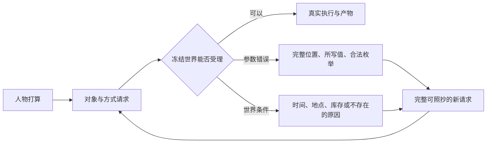

> 历史记录：本文件保存提交 `72f004b0087efa1b6f6d662ac6a143e087e4e21c` 时的过程与判断，不再定义当前系统。
> 当前设计见 [文档入口](../../INDEX.md)；正文中的路径、规则和结果按当时上下文理解。

> 归档基线：2cf230115f4084aef2376e9d77bc976efbed43ea
> 原始路径：`docs/dev/PROPOSAL_2026-09-30_TOOL_INTERACTION.md`
> 归档说明：此提交仅定位归档原文快照，不是审查执行证明；原始执行记录与未执行事实按原文保留。

# 工具交互摩擦与世界缺口：定稿方案

> 状态：方案于2026-10-01依据附件复审定稿；最终开发合同见[工具交互规格](SPEC-tool-interaction.md)。
> 生产实现尚未开发，本文件记录问题和取舍，不定义另一套接口或验收结果。
> 原始提案来自2026-09-30的两个人物全天运行分析；其外部 requests/execution 原始材料不在本仓库，
> 历史拒绝次数和token估计不能作为本仓库本次已复验的证据。

## 要解决的问题

人物有合理的打算，却需要反复猜名字、参数和时间。工作邮件已经到达，但工作还要等人工设定的钟点；
做饭活动结束却没有可吃的产物；世界目录很大，具体餐馆和菜市场仍只有少量甚至没有对象。
世界知道哪些参数合法、任务何时开放、地点有哪些库存，却没有把这些事实准确反馈给人物。

## 并发源码核对结果

| 关注点 | 本仓库核对结果 | 定稿行为 |
| --- | --- | --- |
| 参数冗余与报错 | actions由ways唯一确定；现有错误只给顶层field/index且根校验可漏明细 | items一项一对象并删除actions，完整path与合法枚举，候选完整tool/arguments |
| 只读查询 | recall目前混入世界请求；浏览是耗时活动，现有工具没有只读世界查询 | recall与固定query_world即时返回，按公开品类完整分页，浏览揭示新事实仍耗时 |
| 普通工作 | visible_task_ids目前由WORK_AVAILABLE写入，邮件related_task_id未用于到达告知 | 普通开放由本人最早通知推导；输入只写appointment=null或真实预约对象 |
| 通知完整性 | 白领56任务中46项无关联通知，多人物6任务中5项无通知 | 正式场景补齐受派人物通知，不留无邮件旧行为回退 |
| 地点供给 | 三餐馆各一份正餐，两个零售地点各一乳制品，菜市场零供给，主要商品集中market | kind限定准入，每店声明完整品类/菜单，丰富度和菜单差异做发布门禁 |
| 地点价格 | 已有独立Quote/库存和显式调价；对象不得携带真实交易价 | 有来源整数分范围与每店价格定位，种子只产生固定小幅扰动，Quote冻结 |
| 料理 | inventory_recipe支持单输入单输出，但正式转换规则与输出绑定尚未具备 | 正式食材包到正餐的真实库存转换，制作后才可食用 |
| 习惯覆盖 | 覆盖率是关键词命中，不能证明行为链 | 保留运行警告；正式数据集以明确动作夹具验证完整链 |

源码和文件范围逐项登记在最终规格；此前运行的重放材料须另行取得，不能假定已在仓库。

## 最终取舍

| 方案 | 决定 | 理由 |
| --- | --- | --- |
| 加长系统提示或技能加载器 | 不采用 | 引擎事实与接口错误由确定性代码解决；重复规则增加提示负担 |
| 活动结构与购买偏好 | items逐项对象，中文精确购买偏好 | 消除数组错位，购买必须选择、非购买null；旧英文/数组不兼容 |
| 收尾缺字段默认为空 | 不采用 | views/memories显式空数组与strict全字段必填保持一致 |
| 任务读完邮件才知道，之后等开放 | 改为邮件到达公开合同，普通工作同时开放 | 合同元信息与正文阅读权限分开，地点已约束办公条件 |
| 重复填写普通工作的开放时间 | 删除 | 普通工作从通知派生内部开放时间；仅真实预约填写开始及依据，保留截止 |
| 稀疏门店商品与同店目录复制 | 删除 | 类别限定准入，逐店完整集合满足丰富度，保留菜单差异、库存和履约 |
| 每件商品全范围随机报价 | 不采用 | 门店价格定位加固定±五个百分点波动，只构建一次，显式调价和恢复一致 |
| 料理先给现成饭作为替代 | 不采用 | 现有库存配方足够实现正式制作与食用链，无需临时路径 |
| 搜索与示例的试点开关 | 不采用 | 一个固定query_world复用解析权限，错误给完整请求，不增加配置层 |
| 失败记录迁入人物记忆 | 不采用 | 当日操作备忘从审计事件派生，跨时刻保留，不复制人物记忆 |
| 无损紧凑工具层 | 采用 | 仅分组合并相同信息，完整观察、资格、控制工具和false/零值守恒 |

最终接口、字段名、发布日期、行为测试、源码变异与设计文档清单只在[工具交互规格](SPEC-tool-interaction.md)
和[接口合同](../CONTRACTS.md)维护。接口错误、任务、供给价格、料理、查询、提示分阶段独立端到端验收。
地图3、场景4、目录5.0、品类合同和规则绑定3分别在首次受影响阶段发布；后续内容变更不得同版覆盖，世界8沿用。
白领与多人场景保留既有不同random_seed，分别冻结两份供给发布，不为共享地图改人物实验种子。

## 已核验的成熟做法

Pydantic已有精确错误位置和上下文；Shopify将商品与地点库存分开；Jira区分开始日期与截止日期；
TextWorld公开当前可执行命令。Dynamics 365按门店绑定品类展开商品集合，并管理门店报价。
最终规格复用项目已有依赖；丰富度门槛与价格定位加小幅扰动是当前场景假设，不声称商业产品采用相同公式。

- [Pydantic错误结构](https://docs.pydantic.dev/latest/errors/errors/)
- [Dynamics 365门店商品集合](https://learn.microsoft.com/en-us/dynamics365/commerce/set-up-assortments)
- [Dynamics 365门店报价](https://learn.microsoft.com/en-us/dynamics365/commerce/tasks/base-price-trade-agreements)
- [Shopify地点库存](https://help.shopify.com/en/manual/fulfillment/setup/locations/setting-up-locations)
- [Jira工作日期](https://support.atlassian.com/jira-software-cloud/docs/schedule-work-for-kanban-teams-on-your-roadmap/)
- [Anthropic工具设计](https://www.anthropic.com/engineering/writing-tools-for-agents)
- [TextWorld可执行命令](https://textworld.readthedocs.io/en/stable/textworld.html)
