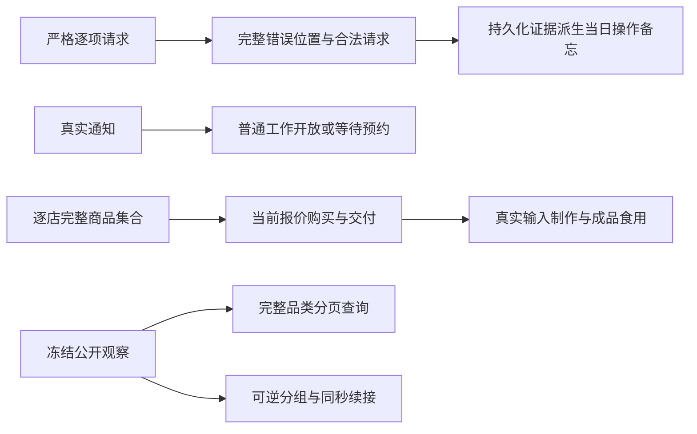

> 历史记录：本文件保存提交 `72f004b0087efa1b6f6d662ac6a143e087e4e21c` 时的过程与判断，不再定义当前系统。
> 当前设计见 [文档入口](../../INDEX.md)；正文中的路径、规则和结果按当时上下文理解。

> 归档基线：2cf230115f4084aef2376e9d77bc976efbed43ea
> 原始路径：`docs/dev/tool-interaction-verification.md`
> 归档说明：此提交仅定位归档原文快照，不是审查执行证明；原始执行记录与未执行事实按原文保留。

# 工具交互验收记录

本文记录 `SPEC-tool-interaction.md` 的实际生产实现与验收。历史接口的测试数字不作为本次通过结果。

## 发布身份

| 产物 | 本次冻结身份 |
| --- | --- |
| 正式场景 | 三份场景结构 4，完整选择 431 条供给；分别钉定自己的种子地图 |
| 地图 | 结构 3；20260105 与 20260106 各自构建并冻结报价 |
| 目录 | 5.3；172 个对象、168 件产品、28 个品类 |
| 品类及规则绑定 | 3 |
| 世界 | 8；操作备忘由已有事件派生，不增加世界字段 |
| 语料清单摘要 | `3e2386c78e96072cd0d2a065023a67ab29fdb02bd1e94237883b1954e80146df` |
| 20260105 地图摘要 | `bc695051216c3aae4a893c249e6e2dfbea0f208a38aff80132f3e016bddb3036` |
| 20260106 地图摘要 | `aa79768f0e12877c030b18578b8174c8e1507692d7e08a4cdacb80725f54fdb5` |

供给阶段的目录 5.0 已单独验收；后续对象与配方的内容改变发布到 5.3。不能将首次受影响版本误写成最终认证版本。

## 生产行为

规格内的生产功能已实现，没有延期实现项。旧请求数组、旧偏好值和旧工作开放输入直接拒绝。
完整观察保留原结构，模型看到的工具层使用可逆分组；查询读取同一份冻结公开事实。

| 实际链路 | 已验证结果 |
| --- | --- |
| 协议、宿主与环境 | 严格字段、闭集偏好、完整嵌套路径、批次全部错误与原子拒绝；服务故障保留实际阶段 |
| 通知与工作 | 普通收件即开放；预约收件只公开合同，实际到点才开放；正文阅读、技能、地点及素材均有真实门禁 |
| 供给与定价 | 两个种子各有 431 条完整供给，逐店集合与菜单有差异；报价确定、范围有效，调价不改已成交订单 |
| 购买与料理 | 当前 Quote 扣款、扣库存、交付；实际食材在完成时消耗，成品入库后才能食用 |
| 查询与预算 | 同权限全集分页、严格 offset、尾页为 null；不改世界、不要求浏览；末回合及截断重试关闭查询 |
| 备忘与紧凑呈现 | 拒绝跨会话保留、次日清空、不写人物记忆；false、零值、合同与控制工具解组无损 |
| 查看器与文档 | 消费当前请求和分组形状；接口、提示、发布身份与设计汇编同步 |

## 行为与源码变异

[行为登记](../../tests/tool_interaction_acceptance.py)包含规格全部 13 类行为、51 个独立节点入口。
[完整性守卫](../../tests/test_tool_interaction_acceptance.py)检查行为表、可执行节点、空实现、延期标记和删除的字段。
46 项非等价源码变异全部被行为断言杀死；完整性与代码风格联合门禁 50 项通过。
基础行为组实际执行 47 项通过，基础失败、收集错误、超时及存活均不算杀死。

变异使用独立 Python 解释器导入真正改变后的生产源码，行为测试保持原样。
每份收据包含原文与变异源码摘要、实际节点、标准输出和退出状态；不修改共享工作树。
中央收据保存在 `.work/tool-interaction/mutation-receipts/`，摘要为 `mutation-summary.json`。
所有 46 份原文摘要已与当前源码逐项比对。

| 独立验收 | 实际结果 |
| --- | --- |
| 中央完整性、46 项源码变异及代码风格 | 50 项通过 |
| 查看器的两个 Node 测试文件 | 62 项通过 |
| 正式习惯声明与原生动作链 | 25 项通过：声明完整性及全部 24 条动作链 |
| 正式输入装配 | 三份场景均通过真实加载、种子核验和完整供给核验 |
| 两个人物、两个种子的脚本化全天 | 2 项通过，完整 24 小时动作、检查点恢复、导出和全部请求审查 |
| 全仓 Python 回归 | 当前收集 5183 个节点：5177 项通过、6 项条件跳过；另有 1 个模块在收集阶段跳过 |

这些测试组存在交叉，不将各组通过数相加。
全仓收据覆盖 259 个模块，逐一对照当前收集清单，未执行节点、退休节点及剩余失败均为零。
两项既有符号链接测试因 Windows 权限跳过，四项历史资金锚定测试因缺少旧运行产物跳过；
TextWorld 模块因现有锁定依赖没有 Windows wheel 在收集阶段跳过。规格行为登记没有跳过项。
逐节点原生结果与复验收据保存在 `.work/tool-interaction/regression-final/`，
当前收集清单的对照证据为 `.work/tool-interaction/current-collection-evidence.json`。

脚本化全天分别使用种子 20260105 与 20260106，实际运行 LifeEngine、LifeEnv 和 LifeAgent。
两次启动的源码摘要都与本文当前身份相同，运行期间没有生产源码变化；实际模型请求、事件和导出保留供审计。
脚本传输及测试身份是测试夹具，不能将其解释为真实模型调用或正式 CLI 的认证身份。
每次原生 pytest 结果和源码收据分别保存为 `final-day-native-<seed>.jsonl` 与 `protocol-day-<seed>-receipt.json`。

习惯夹具精确保留两张实际人物卡的 9 条习惯声明及来源摘要，另显式映射故事中的完整动作链。
两段睡眠真实结算了 25200 和 27000 秒；短剧、通勤播客、周末娱乐、通知后工作及购买后食用均经过实际完成判定。
品牌、温度及平台等故事用语保留在人物叙述中，不凭测试造出世界功能。

## 正式输入与源码身份

| 场景 | 种子 | 场景摘要 |
| --- | --- | --- |
| white-collar-12-weeks | 20260105 | `9cce8d18e6a30a7d6a7fbcc1a16de865e8b466d684200dfcc5e526b192dddbea` |
| multi-person | 20260106 | `cac97b80f5bac895b3903400a6cc7840b77067bd60b6ac857ec3a2d6f475ba24` |
| multi-person-half-day | 20260106 | `6e0e2557d1da2c978e4410daf5e60bd918f3f4c563f43474f5444599b2966241` |

三份场景均选择 168 件商品、431 条供给。完整装配证据为 `.work/tool-interaction/formal-inputs.json`。
198 份当前生产源码及查看器文件摘要清单为 `.work/tool-interaction/current-source-identity.json`，
该清单的摘要为 `a0ac57c279d96f8958d999bd10be3b43fdf9ab8c9aa7033dad7c9d3d3d72eb2c`。

## 真实模型全天验收

按现行冻结模型参数多次执行 `scenarios/multi-person.json`，两位正式人物，种子 20260106。
最后一次目录为 `runs/tool-interaction-final-day`。实际 CLI 在人物编译阶段失败：
`requests.exceptions.ConnectionError`，`api.deepseek.com` 的响应读取超时。
`status.json` 实际记录 `status=failed`、`phase=stopped`、`error_type=ConnectionError`。
异常日志保存为 `.work/tool-interaction/live-final-day.log`。

| 全天指标 | 本次可认证结果 |
| --- | --- |
| 协议错误率、业务拒绝率、重复尝试 | 无；人物编译失败，未产生完整全天决策证据 |
| 世界查询次数、模型回合与 token | 无完整全天结果 |
| 预算耗尽、完整成功行为与门店选择 | 无完整全天结果 |
| 每阶段固定模型前后对照 | 未取得，不能作阶段因果归因 |

原生行为测试和脚本化全天测试不替代这项真实模型验收。
初始化期间修复缺陷的运行保留为调试证据，不认证为冻结源码的全天结果。
上述服务阻断没有通过替换模型、复用虚假人物卡或跳过编译来规避；未取得的指标不记为零。
