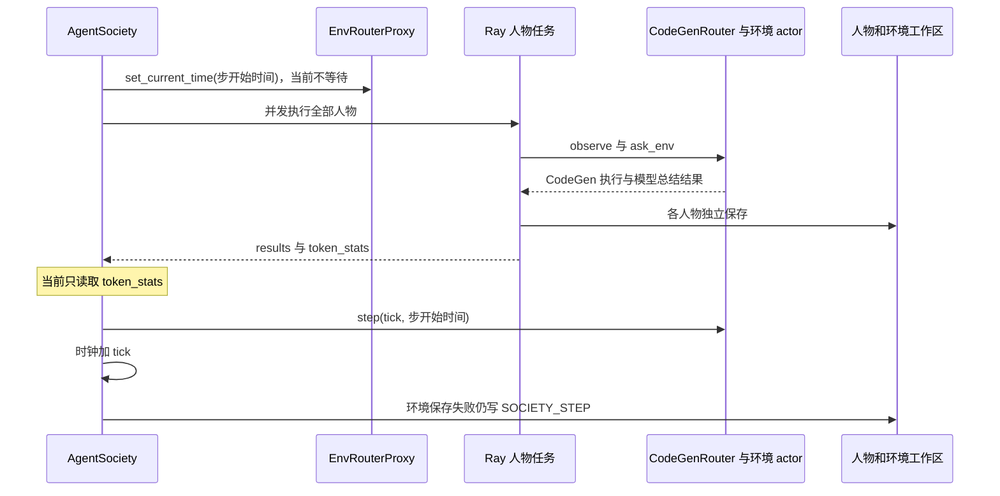
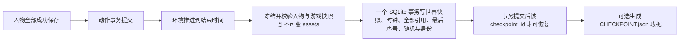

<!-- worldmock-doc: {"authority":"research","canonical_path":"docs/history/research/as2-feasibility.md","implementation_state":"COMPLETE","kind":"research","owner":"worldmock-core","replaces":[],"schema":"worldmock.document.metadata.v1","status":"SUPERSEDED","superseded_by":"docs/ARCHITECTURE.md","version":"2026-09-15"} -->
**Status: SUPERSEDED** — 接入方案已实施，后续以实际接入代码与运行证据为准。

# AgentSociety 2 接入可行性与核心改动独立审查

日期：2026-09-15  
审查范围：`vendor/agentsociety2` 的真实源码、官方文档和 `docs/agentsociety2-design.md`  
源码基线：`670c94fff7c64c4f79b632125f2ccf968155e746`，标签 `agentsociety2-v2.8.7`  
结论状态：理论与源码结构均支持实现，但必须修改核心链路；仅增加 `LifeEnv` 和 `LifeAgent` 不能达到设计合同。

## 审查结论

方案可以在现有 AgentSociety 2 执行链上完成，不需要另写人物循环，也不需要引入另一套多智能体框架。
可复用的主体是人物工作区重建、Ray 批量执行、ReAct 模型调用、人物记忆、环境 actor 和自定义模块注册。

当前核心行为会破坏 WorldMock 要求：Society 不检查人物失败；远程时钟同步不等待；环境收到的是步开始时间；
恢复允许部分环境从空状态启动；保存失败仍提交 Society 步进；ReAct 会把文本解析和合成记忆当作降级路径；
检查点由相互独立的文件组成，且恢复覆盖原运行目录。以上均是已在固定提交源码中观察到的事实。

可冻结的实现方向如下：

- 让 Society 成为决策轮协调者，LifeEnv actor 成为唯一世界状态写入者。
- 人物模型调用保持并发；所有生活动作只登记提案，收齐人物结果后按持久化顺序在一个数据库事务中结算。
- LifeAgent 继续使用现有 ReAct 循环和记忆，只暴露类型明确的生活、记忆与结束工具。
- 生活工具走等待返回的直接环境调用，不经过 CodeGen、生成 Python 或第二次模型总结。
- 以事件边界推进时间；先冻结人物与游戏快照，再以 SQLite 中最后提交的检查点记录形成共同恢复点。
- 任何必要观察、模型协议、人物保存、记忆归纳、世界结算或检查点保存失败均终止当前运行；不推进时间，
  不提交本轮动作，也不发布检查点。

## 证据边界

本报告把固定提交源码作为接口事实，把官方文档作为公开合同，把成熟项目的做法作为架构验证。
早期手机工程只提供“意图、执行结果与世界事实必须分开”的经验，不证明 AgentSociety 2 已接入 WorldMock。

本次已读取用户引用的两项 Codex 任务。手机任务证明执行意图不能代替真实结果；LabelKit 长周期任务属于后续
数据对比边界，不用于推断 AgentSociety 2 的运行能力。

本报告没有实现生产代码。父任务随后完成固定锁安装与上游基线验证；该结果只证明未修改基线可导入、所选上游
测试通过，不证明本文要求的生活调度、严格协议或共同恢复已经实现。

## 官方与成熟方案核验

| 证据 | 官方事实 | 对本方案的约束 |
| --- | --- | --- |
| [AgentSociety 2 固定提交](https://github.com/tsinghua-fib-lab/AgentSociety/commit/670c94fff7c64c4f79b632125f2ccf968155e746) | 提交发布 2.8.7，包声明 Python 3.11 至 3.13 | 维护分支必须从此提交开始，依赖必须使用同提交锁文件 |
| [自定义模块文档](https://agentsociety2.readthedocs.io/en/latest/custom_modules.html) | 工作区使用 `custom/agents` 与 `custom/envs`；类必须在扫描文件中直接定义 | `LifeAgent` 和 `LifeEnv` 外壳放在 WorldMock 根目录的 `custom` 下，业务模块从 `src/worldmock` 导入 |
| [环境模块文档](https://agentsociety2.readthedocs.io/en/latest/env_modules.html) | `step(tick, t)` 的 `t` 是本步结束后的模拟时间；恢复在初始化之后执行 | Society 必须传结束时间，恢复必须完整覆盖初始化状态 |
| [执行架构文档](https://agentsociety2.readthedocs.io/en/latest/architecture.html) | 人物由 Ray Task 从工作区重建并并发执行，环境由共享 router actor 管理 | 可以保留现有 fan-out；共同状态只能由环境 actor 串行提交 |
| [存储文档](https://agentsociety2.readthedocs.io/en/latest/storage.html) | Replay 是追加分析数据，workspace 是覆盖式恢复状态，两者职责不同 | Replay 不能冒充共同检查点；数字足迹数据库的已提交检查点记录才是恢复权威 |
| [Ray actor 调用顺序](https://docs.ray.io/en/latest/ray-core/actors/task-orders.html) | 单线程 actor 只保证同一提交者的顺序，不保证不同 Ray worker 的到达顺序 | 不得按生活动作 RPC 的抵达顺序结算；先登记，再由 Society 传入明确顺序统一结算 |
| [Ray actor 故障语义](https://docs.ray.io/en/latest/ray-core/fault_tolerance/actors.html) | 默认至多执行一次仍可能出现“已执行但调用者收到异常”；关键状态由应用检查点恢复 | 动作使用持久化唯一标识去重；变更调用不启用自动重试；未知结果终止并从共同检查点分支恢复 |
| [SimPy 时间与调度](https://simpy.readthedocs.io/en/latest/topical_guides/time_and_scheduling.html) | 成熟离散事件队列用时间与严格递增事件标识确定同一时刻顺序 | LifeEnv 待发生事件固定按 `occurred_at, priority, sequence` 排序并持久化 |
| [SQLite 事务](https://www.sqlite.org/lang_transaction.html) | SQLite 串行化写事务，一个事务可以完整提交或回滚 | 世界状态、资源结算、动作状态和对应事件在同一写事务提交 |
| [SQLite 原子提交](https://www.sqlite.org/atomiccommit.html) | 原子性覆盖数据库事务，并不自动覆盖多个普通文件 | 先把不可变快照写成按哈希寻址的素材，再由数据库事务提交全部引用；未引用素材可安全清理 |

没有必要引入 SimPy。它验证了离散事件的排序规则，但 WorldMock 的待发生事件本来就必须持久化在 SQLite；
直接用数据库中的有序事件表可以同时满足排序、查询和恢复，依赖更少，状态归属也更清楚。

## 固定提交中的实际执行链

这条链适合固定 tick 的普通仿真，不满足“只唤醒可决策人物、按下一事件推进、失败不结算、共同恢复”的生活模拟。

## 源码观察事实

| 位置 | 已观察行为 | 影响 |
| --- | --- | --- |
| `society/society.py:581-646` | 全部人物每步运行；`set_current_time` 后立即 fan-out；只合并批次 token 统计；环境收到步开始时间 | 人物异常会被忽略；远程时钟存在竞态；结束时间合同被违反；无法按事件唤醒 |
| `agent/runner.py:109-140` | 每个人物异常被转换成 `ok=False`；成功人物立即保存工作区 | Society 必须检查全部 `results`；失败前已经产生的提案和文件不能视为共同提交 |
| `env/env_router_proxy.py:46-52` | 远程 `set_current_time` 是 fire-and-forget | 必须改为异步等待，并在人物任务提交前完成 |
| `env/env_router_actor.py:27-38,78-100` | actor 并发度为一时可作为世界单写入者；内部固定构造 CodeGenRouter | 世界状态串行化可行；生活直接调用需要新增 actor RPC，不能绕过 actor 访问数据库 |
| `env/router_base.py:362-383` | router 初始化后恢复环境；`step` 已声明 `t` 为结束时间 | Society 传参必须修正为 `end_t = start_t + tick` |
| `env/router_base.py:404-453` | 单模块恢复失败会记错并从空状态继续；保存收集异常后只记错 | WorldMock 恢复和保存必须 fail closed，不能出现部分新状态与部分检查点状态 |
| `agent/base/agent.py:463-506` | `ask_env` 已由宿主覆盖 `id`、`agent_id`、`person_id` | 设计中的身份绑定已部分存在；直接生活工具必须复用该原则，人物参数中不出现可伪造身份 |
| `agent/base/agent.py:1416-1456` | 通用 `ask_env` 强制模板缓存；异常被转换为普通工具失败 | 生活动作不能走这个入口，否则基础设施错误可能让模型继续猜测 |
| `agent/base/agent.py:1574-1742` | ReAct 轮次耗尽时合成回答或记忆并返回成功样结果 | 必须删除该降级路径；轮次耗尽属于本轮人物失败 |
| `agent/base/agent.py:1922-2008` | 无原生工具调用时解析多种文本格式；只读问答还能从自由文本合成 finish | 正式 LifeAgent 只接受原生工具调用；文本不得升级为权威动作或记忆 |
| `agent/base/agent.py:2065-2119` | 同一模型响应含 finish 和业务工具时，只保留第一个 finish | 会静默丢动作；必须整批拒绝并且不执行任何调用 |
| `agent/base/tool_schema.py:21-355` | 当前只能替换或增加工具 Schema，不能让子类选择完整工具集合 | LifeAgent 需要一个完整工具清单钩子，以隐藏通用写文件、脚本和 `ask_env` 动作 |
| `agent/person.py:346-358,392-480` | 世界描述失败返回空文本；初始观察异常只写 debug；step 开始先写 AGENT.json | LifeAgent 必需观察失败必须抛出；共同检查点不能由单个 AGENT.json 的新旧程度推断 |
| `agent/memory_runtime.py:289-365` | 非法 finish memory 会逐条宽松转换；归纳失败只告警 | 记忆 Schema 或必要归纳失败必须使人物结果失败，不能生成替代记忆 |
| `society/society.py:418-434` | 环境保存失败只告警，随后仍写 `SOCIETY_STEP.json` | 当前文件可以声称完成一个实际未保存的步，必须由 SQLite 检查点记录替代其恢复权威 |
| `society/society.py:483-569` | `SOCIETY_STEP.json` 可缺失并回退旧字段；恢复复用原 `run_dir` | 必须删除旧布局回退；恢复必须读取父检查点并写入新的空运行目录 |
| `society/cli.py:42-56,245-271` | `PersonAgent.init_description` 声明的多个记忆配置键不在 `AGENT_CONFIG_KEYS`，会落入 profile | 当前配置不能按文档生效；应以类型明确的 LifeAgent 配置修正并测试实际 round-trip |
| `society/cli.py:379-453` | resume 在原目录进行；配置漂移只告警；自定义目录从 run_dir 向上寻找第一个 `custom` | 分支恢复与严格哈希校验需改；run_dir 必须放在 WorldMock 根目录之下以确定扫描根 |
| `society/models.py:63-68` | RunStep 只有 `num_steps` 与固定 `tick` | 十二周运行需要以明确结束时刻为合同，内部步长由下一个事件边界决定 |
| `env/router_codegen.py:1689-1727` | 初始化会为 observe/statistics 调用 coder 模型生成代码；模板缓存使用 embedding | LifeAgent 观察和生活动作必须走直接 RPC；否则 DeepSeek embedding 缺失会触发另一条执行路径 |
| `config/config.py:96-225,538-559` | coder 与 embedding 默认继承主模型连接，embedding 还默认 OpenAI 模型名 | 正式运行必须显式绑定使用与禁用的角色，不能靠继承和默认模型 |
| `storage/workspace_state.py:19-33` | 单个文本文件通过临时文件与 `os.replace` 原子写 | 单文件完整不等于人物、世界和 Society 形成同一个检查点 |

## 必须冻结的接口合同

### 模拟时间与运行终点

正式运行使用一个带时区的开始时刻和一个严格晚于开始时刻的结束时刻。现有 `RunStep.num_steps + tick` 不能作为
十二周生命周期的外部合同，应改为 `RunStep.until`。Society 内部重复执行决策轮，直到共同提交的模拟时间等于
`until`；如果下一个事件晚于 `until`，最后一步截断在 `until` 并产生明确的运行结束事件。

`LifeEnv.scheduling_state()` 返回：

| 字段 | 合同 |
| --- | --- |
| `current_time` | 环境已经确认的 UTC epoch 秒 |
| `ready_agent_ids` | 当前必须进行新决策的人物，升序且无重复 |
| `next_event_at` | 下一待发生事件的 UTC epoch 秒；没有事件时为空 |
| `world_state_version` | 当前已提交世界版本 |

每个决策轮先处理当前时刻所有到期事件，再查询调度状态。只有 `ready_agent_ids` 进入 Ray fan-out。
完成本轮决策与动作结算后，下一结束时间取下一个待发生事件、下一个需求复评边界和运行终点中的最早值。
推进值必须严格大于零；同秒即时事件按 `priority, sequence` 全部处理，若仍停留在同一版本则报错终止。

`RouterBase.step(tick, t)`、EnvRouterActor、EnvRouterProxy、Society 与 LifeEnv 统一约定：`t` 是结束时间，
且 `t - previous_time == tick`。任何不连续都抛出英文错误并记录失败事件。

### 决策轮与动作结算

Society 为每轮创建不可伪造的决策上下文，至少包含 `run_id`、`round_id`、`decision_id`、`agent_id`、
`observed_at` 和 `world_state_version`。为满足函数最多五个入参，该上下文以一个不可变数据对象传递，不能继续给
`step_agent_batch` 增加位置参数。

LifeEnv 的管理接口最小集合如下：

| 接口 | 使用者 | 行为 |
| --- | --- | --- |
| `begin_decision_round(contexts)` | Society | 核验人物与世界版本，创建本轮并持久化实际结算顺序 |
| `observe(context)` | LifeAgent | 只返回该人物在该时刻可见的需求、活动、资源、内容和到期反馈 |
| `submit_action(context, action)` | LifeAgent | 校验 Schema 并登记一项提案；不修改余额、库存、活动或时间 |
| `commit_decision_round(round_id)` | Society | 核验所有预期人物均成功后，按已保存顺序在一个 SQLite 事务中接受或拒绝动作 |
| `abort_decision_round(round_id, error)` | Society | 标记提案未提交并保存失败原因；不得结算任何世界状态 |
| `scheduling_state()` | Society | 返回可决策人物、下一事件与世界版本 |
| `checkpoint(request)` | Society | 冻结世界数据库状态并返回检查点引用、哈希、版本和最后事件序号 |

模型调用可以任意完成顺序返回。动作结算顺序由 `begin_decision_round` 持久化的实际人物序列决定，不能依赖
Ray worker 到达顺序、字典顺序或未来重新计算随机顺序。相同 `decision_id` 与 `action_id` 在数据库中唯一；
重复提交返回同一已登记结果，不产生第二次扣款、库存变化或活动。

人物工具返回两类结果：合法请求得到 `submitted`，业务规则拒绝得到 `rejected` 并带明确原因；传输、Schema、
身份、世界版本和数据库异常直接抛出，属于人物执行失败。不能把基础设施异常包装成业务拒绝后让模型继续。

### ReAct 工具协议

LifeAgent 继续调用 `AgentBase.run_react_loop`，但以下规则必须由核心测试固定：

- 每次模型响应只能是若干只读查询、一个生活动作，或唯一一个 `finish`。
- `finish` 与任何其他工具同批出现时整批无效，不执行其中任何工具。
- 一个 `decision_id` 最多登记一个生活动作；等待也使用明确的生活动作，不靠不完整 finish 猜测。
- LifeAgent 工具清单只包含类型明确的生活工具、只读记忆工具和 finish；不暴露通用工作区写入、脚本执行、
  skill 转发或 `ask_env`。
- 只接受 OpenAI-compatible 响应中的原生 `tool_calls`。自由文本、XML、JSON 文本和 Python 形式调用均无效。
- 一次 Schema 纠正调用可以保留，但它是同一决策的明确模型重试，所有请求和响应都写证据；重试仍失败则人物失败。
- 达到 ReAct 轮次上限、缺少 finish、非法记忆、finish 引用不存在的请求或事件都使人物失败。
- 生活动作已登记后，后续模型只能做只读查询并单独 finish；第二个动作使人物失败并中止本轮。

业务工具必须通过 LifeAgent 覆盖的 dispatch 直接调用 EnvRouterProxy，不经过 `CodeGenRouter.ask`、生成代码、
模板 embedding 或 SummaryStage。宿主从决策上下文注入人物身份；模型工具参数中没有 `agent_id`。

### 失败传播

Society 必须读取每个批次的每项 `results`。只要一个人物 `ok=False`：

- 等待所有已提交人物任务收敛，收集完整错误与模型证据。
- 调用 `abort_decision_round`，不得调用 `commit_decision_round`、环境时间推进或共同检查点。
- 当前运行状态写为 failed 或 interrupted，保留检查点后的部分证据用于审计。
- 后续恢复从最后一个共同检查点创建子运行，绝不在失败运行中继续。

生活业务拒绝已经是一个成功记录的动作结果，不触发上述基础设施失败流程。

### 共同检查点与分支恢复

单个 JSON 的 `os.replace` 不能解决多文件一致性。共同检查点只以 SQLite 中的不可变检查点记录为提交权威：

在写事务开始前，所有人物状态、记忆、游戏状态和新增文件均写入按内容哈希寻址的 `assets`，随后重新读取核验。
SQLite 检查点记录在一个事务中绑定父运行、检查点标识、模拟时间、决策轮、完整世界快照、世界版本、最后事件序号、
全部人物与游戏快照引用、内容目录哈希、场景哈希、模型与提示身份、依赖锁哈希、AS2 提交、WorldMock 提交和随机状态。
任何素材冻结或核验失败都不能开启检查点写事务；事务失败时只有无引用素材，不存在可恢复的半检查点。

`CHECKPOINT.json` 只能作为提交后的便携收据，包含 `checkpoint_id` 和非敏感身份并可从数据库重新生成。它不参与恢复
判定，缺失或内容与数据库不符时以数据库为准。不得计算持续修改中的 `footprints.sqlite` 文件哈希并把它冒充不可变快照。
密钥和完整授权头不进入数据库记录或收据。

恢复接口同时接收父运行只读数据库中的 `source_checkpoint_id` 与必须为空的 `target_run_dir`。它读取该检查点记录，
验证所有素材引用、哈希、Schema、提交和冻结配置，再从记录内的世界快照和不可变素材建立子运行并初始化 actor。
父数据库中检查点之后的事件不进入子运行。任何缺失、损坏、版本不符或配置漂移都在创建子运行事实前失败。
不读取旧布局，不回退 `SOCIETY.json` 标量，不迁移旧 Schema，不在父运行目录写任何文件。

模型输出本身不保证相同输入得到相同决定。共同检查点保证世界与人物状态一致；审计重放读取已保存的原始模型响应和
动作，不重新调用模型并宣称决定可逐字复现。

### 模型与依赖配置

固定提交的 `pyproject.toml` 只声明宽下界。独立安装曾解析到 `mcp 2.x`，随后在
`mcp.server.fastmcp.tools.base.Tool` 导入处失败；改用上游 `uv.lock` 后已固定 `mcp 1.26.0` 并完成导入。
因此正式环境必须从该锁文件创建，不能用裸 `pip install` 解析最新依赖。

冻结版本至少包括：

| 组件 | 固定版本或身份 |
| --- | --- |
| AgentSociety 2 | `2.8.7`，提交 `670c94fff7c64c4f79b632125f2ccf968155e746` 加维护分支提交 |
| Python | 3.12 |
| mcp | 1.26.0 |
| litellm | 1.89.2 |
| ray | 2.55.1 |
| mem0ai | 2.0.7 |
| 默认模型 | DeepSeek OpenAI-compatible base URL，`deepseek-flash` |
| coder 模型 | 显式配置为同一 DeepSeek base URL 与 `deepseek-flash`，不靠默认角色继承 |
| embedding | LifeAgent 正式路径禁用；不继承主模型 API key，不尝试不存在的 embedding 后再改走代码生成 |

`.work/verification/deepseek-tool-preflight.json` 已独立读取非敏感字段：HTTP 状态为 200，耗时 1.39 秒，
`deepseek-flash` 返回原生 `tool_calls`，函数为 `report`，参数通过 JSON 对象返回。该探查只证明一次传输和协议解析成功；
实现后还必须用 LifeAgent 全工具 Schema 做多轮真实预检，并分别验证 Schema 严格性、混合调用拒绝和稳定性。

正式清单记录 base URL 的规范化身份、模型名、请求参数、实际响应 model、响应标识、usage、工具调用、重试次数和
提示哈希。API key 只从受限环境文件载入，不写日志、清单或命令行。

## 最小必要文件修改清单

### AgentSociety 2 维护分支

| 文件 | 改动 |
| --- | --- |
| `packages/agentsociety2/agentsociety2/society/society.py` | 用决策轮协调替换固定全员 tick 热路径；等待时钟；检查所有人物结果；提交或中止动作；调用共同检查点；分支恢复 |
| `packages/agentsociety2/agentsociety2/society/models.py` | 把运行合同改为明确 `until`；增加不可变决策上下文和严格检查点请求模型，或把这些模型放入下述独立模块 |
| `packages/agentsociety2/agentsociety2/society/decision_round.py` | 新增短小协调辅助模块，负责调度状态校验、人物结果汇总和正时间推进计算，避免继续膨胀 Society |
| `packages/agentsociety2/agentsociety2/society/cli.py` | 固定 WorldMock 自定义扫描根；显式模型角色预检；新运行终点；父检查点到新目录恢复；配置与锁哈希严格校验 |
| `packages/agentsociety2/agentsociety2/agent/runner.py` | 以一个上下文对象传入决策身份；返回保存引用与完整失败；不改变并发 fan-out |
| `packages/agentsociety2/agentsociety2/agent/service_proxy.py` | EnvLike 加入直接观察、动作、决策轮、调度和检查点接口；时钟接口改为可等待 |
| `packages/agentsociety2/agentsociety2/agent/base/agent.py` | 删除文本工具与合成 finish 降级；混合 finish 整批拒绝；轮次耗尽抛错；增加完整工具清单和每次模型证据钩子；拆分后低于两千行 |
| `packages/agentsociety2/agentsociety2/agent/base/react_protocol.py` | 承接严格 ReAct 响应校验与证据类型，使被修改的 AgentBase 文件和函数满足源码大小限制 |
| `packages/agentsociety2/agentsociety2/agent/base/tool_schema.py` | 允许 LifeAgent 提供完整闭集工具 Schema，而非在通用集合上只能替换或追加 |
| `packages/agentsociety2/agentsociety2/agent/person.py` | 抽出可覆盖的必要观察钩子；观察失败传播；step 不复制；模型证据与记忆结果进入 runner 返回 |
| `packages/agentsociety2/agentsociety2/agent/memory_runtime.py` | 删除宽松记忆转换；非法 finish memory 与触发后的归纳失败传播；成功写入返回可核验引用 |
| `packages/agentsociety2/agentsociety2/env/env_router_proxy.py` | 等待时钟设置；增加直接环境与管理 RPC；所有变更 RPC 返回提交身份 |
| `packages/agentsociety2/agentsociety2/env/env_router_actor.py` | 在同一 actor 中路由 LifeEnv 直接调用；保持 LifeEnv 并发度为一；不按 RPC 到达顺序结算 |
| `packages/agentsociety2/agentsociety2/env/router_base.py` | 统一结束时间；环境保存与恢复 fail closed；为 actor 提供按模块名的类型化直接调用入口 |
| `packages/agentsociety2/agentsociety2/society/checkpoint.py` | 新增 AS2 侧快照收集与检查点请求协调；把请求委托给环境，不保存第二套恢复权威 |
| `packages/agentsociety2/agentsociety2/config/config.py` | 移除正式运行依赖的角色继承；embedding 变为真正可禁用；模型身份可写入冻结清单 |
| `packages/agentsociety2/pyproject.toml` 与 `uv.lock` | 收紧会破坏导入的 mcp 主版本边界；维护分支提交锁文件 |

任何被修改的现有六入参接口都应改成上下文对象，使新旧生产函数满足最多五个入参。新增接口声明使用中文
Doxygen 风格注释；代码、日志和异常文本使用英文。生产函数不超过五十行，文件不超过两千行，每行不超过一百二十字符。

### WorldMock 接入边界

| 文件 | 改动 |
| --- | --- |
| `custom/agents/life_agent.py` | 直接定义可扫描 LifeAgent 外壳；工具闭集、LifeEnv 直接 dispatch、观察钩子和模型证据回调 |
| `custom/envs/life_env.py` | 直接定义可扫描 LifeEnv 外壳；声明人物只读与动作工具，业务实现导入 `worldmock.life` |
| `src/worldmock/life/` | 身体、活动、工作、消费、内容、出行、场景和持久化事件队列；只有 LifeEnv 调用写接口 |
| `src/worldmock/footprints/` | SQLite 事务、事件与素材模型、检查点引用、固定范围导出 |
| `pyproject.toml` | 使用本地固定 AS2 维护分支及其锁定安装方式；删除作废手机与 Concordia 生产依赖和旧入口 |

CLI 从 `run_dir` 向上寻找第一个含 `custom/` 的目录。正式 run_dir 必须位于 WorldMock 根目录之下，且
`WorldMock/custom` 是该向上路径中唯一的 `custom` 目录。`LifeEnv` 与 `LifeAgent` 的类定义不能只从别处重新导出。

## 必须修改或新增的测试

当前已有测试中有三类断言与新合同相反，不能保留为兼容测试：

| 现有测试 | 必须改成的断言 |
| --- | --- |
| `tests/framework/test_society_resume.py::test_to_workspace_env_failure_does_not_abort` | 环境保存失败必须抛出，不写已提交检查点 |
| `tests/framework/test_society_resume.py::test_from_workspace_falls_back_when_no_step_file` | 缺少 SQLite 已提交检查点记录必须拒绝，不读取旧字段 |
| `tests/framework/test_env_workspace_contract.py::test_partial_restore_does_not_abort_others` | 任一必需模块恢复失败使整体恢复失败 |
| `tests/framework/test_env_workspace_contract.py::test_to_workspaces_one_module_failure_does_not_abort_others` | 任一必需模块保存失败使本轮检查点失败 |
| `tests/test_agent_react_validation.py` 的 fallback 与 lenient 用例 | 文本工具、轮次耗尽和非法记忆均抛出严格协议错误 |

新增验收按真实入口组织：

| 验收 | 独立可测行为 |
| --- | --- |
| 自定义扫描 | 从 WorldMock 内 run_dir 找到两个外壳；移走直接类定义后扫描失败；不存在第二扫描根 |
| DeepSeek 协议 | 真实 `deepseek-flash` 对完整 LifeAgent Schema 返回原生工具调用；无原生调用时运行失败 |
| 工具闭集 | 模型看不到 `ask_env`、写文件、脚本和未批准 skill；工具参数没有 agent_id |
| 身份绑定 | 伪造人物字段无法改变宿主注入身份；事件、动作和工作区人物一致 |
| 时钟先后 | 延迟远程时钟设置时人物任务不会先开始；环境只接受结束时间；不连续时间失败 |
| 事件边界 | 新活动早于上限结束、多人睡眠、同秒事件、运行终点截断均按固定顺序处理；没有零时间循环 |
| 人物唤醒 | 忙碌且无反馈的人物不调用模型；到期反馈、需求复评或显式可决策边界才进入 fan-out |
| 到达顺序无关 | 人为反转 Ray 返回与动作到达顺序，数据库结果仍等于持久化结算顺序 |
| 决策原子性 | 一个 agent 抛错时，其他已经登记的提案全部未提交；时钟、余额、库存和活动不变 |
| 业务拒绝 | 余额不足等拒绝保留事件并允许本轮提交，不被误判为基础设施异常 |
| 动作幂等 | 同一 action_id 重发不重复扣款、不重复活动、不重复结果事件 |
| ReAct 严格性 | finish 与动作同批时零工具执行；第二动作失败；文本调用失败；轮次耗尽失败 |
| 记忆严格性 | 非法条目、无效事件引用、归纳异常均使人物失败；不得产生 coerced 或 fallback memory |
| 共同检查点 | 在人物保存、素材冻结、素材核验和 SQLite 事务各位置注入故障；只有已提交 checkpoint_id 可恢复，孤立素材不可恢复 |
| 分支恢复 | 父运行字节与目录时间戳不变；子运行关联父检查点；世界、人物、内容进度、随机状态和事件序号一致 |
| 锁文件安装 | 从全新 Python 3.12 环境按 `uv.lock` 安装后可导入 Society、CLI、EnvRouterProxy；mcp 解析为 1.26.0 |
| 十二周范围 | 模拟时间精确覆盖十二周；没有固定秒 tick 空转；所有事件时间位于范围内或明确标为结束截断 |

生产实现完成后必须对以上合同运行 Uncle Bob 源码突变审查。至少破坏时钟等待、结束时间、人物失败检查、
结算顺序、动作唯一约束、SQLite 检查点提交、父目录只读和记忆严格校验，测试都必须杀死突变。

## 设计文档需立即修订的点

| 当前设计表述 | 必须冻结的修订 |
| --- | --- |
| “AS2 身份绑定需要补充”较宽泛 | 说明现有 `ask_env` 已注入三种身份；新增直接工具继承宿主注入且参数不含身份 |
| “人物工具登记请求，收齐后执行”没有失败轮协议 | 增加 begin、commit、abort 决策轮和任一人物失败时不结算合同 |
| “按稳定序号处理”未说明跨 worker 顺序 | 保存实际人物结算顺序；不得依赖 Ray 到达顺序 |
| “继续复用 ReAct”未限定工具响应形态 | 固定原生 tool_calls、工具闭集、finish 独占响应、一次动作和轮次耗尽失败 |
| “共同检查点”未定义提交权威 | 指定 SQLite 的不可变检查点记录为唯一权威；JSON 只可作为可再生成收据 |
| “恢复创建新运行分支”未定义只读父目录 | 恢复 API 同时接收父检查点和空子目录，写父路径立即失败 |
| “DeepSeek 接入”未说明 AS2 多角色与 embedding | 默认与 coder 显式同一模型；Life 路径禁用 embedding 和 CodeGen fallback |
| “十二周”仍可被固定 num_steps 理解 | 外部合同使用带时区 `until`，内部只按事件边界推进 |
| “可重现”容易被理解为模型逐字确定 | 状态结算确定、模型证据可审计；逐字重放读取原响应，不重新请求模型 |
| 配置漂移当前只告警 | 模型、提示、场景、内容、规则、代码和依赖哈希不匹配时硬失败 |

## 阻塞事实与剩余风险

静态可行性与基线安装不存在架构阻塞。父任务已用上游 frozen lock 重建 `.venv-as2`，验证
AgentSociety 2 2.8.7、mcp 1.26.0、litellm 1.89.2 和 Ray 2.55.1 可导入，并运行四个关键上游测试文件；
`.work/verification/as2-baseline.log` 的精确结果为 `27 passed in 17.58s`。日志只保存 pytest 结果，没有保存测试文件名，
最终总验证清单应由父任务补回实际命令。

功能实现仍有以下硬门槛：

- 一次 DeepSeek 原生工具调用成功不证明完整 LifeAgent Schema 在长周期中稳定。协议不满足时必须停机，不能启用文本解析。
- 共同检查点先冻结人物与游戏素材，再由 SQLite 事务提交引用，只保证恢复到完整边界；检查点后的部分模型证据和事件会
  留在失败父运行中，这是审计记录，不能进入子运行已发生事实。
- Ray 默认至多执行一次仍可能返回未知结果。生活动作唯一标识和决策轮中止必须实际通过故障注入验证。
- 固定事件调度可以保证给定动作后的世界结算顺序，不能保证外部模型未来返回相同选择。

父任务无需更换 AgentSociety 2 或另选人物框架。需要在最终规格中接受并冻结本报告的严格决策轮、直接工具、
事件终点、共同检查点和依赖锁合同；否则“完整十二周、失败可恢复、足迹可追溯”无法同时成立。
