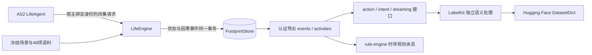

# LifeEnv、真实内容与 LabelKit 交付可行性审查

> 审查日期：2026-09-15  
> 权威规格：[`agentsociety2-design.md`](../agentsociety2-design.md)  
> 审查范围：Life 领域、正式语料、足迹进入 LabelKit、训练 loader 与规则消费者边界。

## 审查结论

方案已经从理论可行推进到可执行实现。当前最简单且长期可维护的链路是：AS2 人物只提交闭集 Pydantic
请求；`LifeEngine` 以有类型 Python 领域函数结算活动和资源；`FootprintStore` 在同一 SQLite 事务内保存世界与事件；
导出器从固定事件截止生成活动视图；LabelKit 只消费已经认证的动作、意图和 dreaming 窗口；训练入口真实调用
Hugging Face Datasets，规则夹具真实调用 rule-engine。



正式时间窗是 `2026-01-05T00:00:00+08:00` 至 `2026-03-30T00:00:00+08:00`，覆盖上海张江
生活区居住和张江高科技园区工作的一个白领人物。关联 LabelKit 任务的旧数据覆盖同一地点和 84 天，共
4,380 个活动序列和 16,320 个事件。旧数据没有年龄、收入和家庭结构，所以比较工具只能比较共同可观察的时间节律、
活动结构、转移关系、重复模式和因果一致性，不能伪装为人口属性匹配。

领域能力由独立测试强制覆盖；正式 84 天人物仍自主选择，某个领域在正式轨迹中出现零次也必须如实报告，不能用脚本或
硬配额替人物补齐。完整 84 天 DeepSeek 运行与三个隔离模型会话盲评属于后续运行证据，当前报告不预声明结果。

## 已观察事实

### 当前依赖与真实消费者

| 观察对象 | 当前实现证据 | 结论 |
|---|---|---|
| AS2 | 根依赖固定 `agentsociety2==2.8.7`，使用仓库内实际维护分支 | 复用原生人物、ReAct、Ray 路由和工作区，不重写代理框架 |
| 模型请求 | `litellm==1.89.2`；正式身份固定 DeepSeek `/beta`、`deepseek-flash`、thinking disabled、`tool_choice=required`、所有函数 strict、`max_retries=0` | 每个外部调用对应一个 request 和一个 response/failure；严格声明仍由本地校验核验，完整真实预检结果见验收记录 |
| 训练 loader | `src/worldmock/delivery/training.py` 实际调用 `load_dataset("json", features=...)` 并保存、重载 `DatasetDict` | 没有用项目自写 JSON 读取冒充训练生态接口 |
| 规则消费者 | `src/worldmock/delivery/rules.py` 实际构造带类型解析器的 `rule_engine.Context` 和 `Rule` | Life 业务仍用直接领域函数；项目没有自造表达式解释器 |
| 游戏 | `textworld==1.7.0`；八个冻结游戏均实际 `reset`、逐命令 `step` 到赢，并在恢复时重放 | 检查点不序列化 TextWorld 私有对象 |
| 状态与足迹 | SQLite 单写者；账户变化由事件顶层 `data.resource_changes` 逐账户核对 | 付款、工资、交通费和初始注资都有唯一双边事实 |

Hugging Face 官方文档明确 `load_dataset` 可从 JSON 数据文件构造数据集，并接受显式 `features`：
[Loading methods](https://huggingface.co/docs/datasets/package_reference/loading_methods)。rule-engine 官方文档说明未知 symbol
默认失败，并支持 `Context.type_resolver` 做求值前类型检查：
[Getting Started](https://zerosteiner.github.io/rule-engine/getting_started.html)。TextWorld 官方环境接口公开 `reset` 和
`step`，但没有供本任务依赖的通用磁盘快照协议：
[TextWorld Environment](https://github.com/microsoft/TextWorld/blob/main/textworld/core.py)。这些成熟接口与当前实现吻合。

真实小时记录暴露 Datasets 默认 JSON 解码改变浮点数的问题。生产入口仍使用 `load_dataset`，并固定官方
`Json(decode=False)` 保留 JSON 文本；标准 `json.loads` 用于逐字段核对，DatasetDict 保存重载后原值完全一致。
这项无损读取与正常整数、嵌套缺失和 null 区别均有实际训练加载测试。

### 正式来源选择

| 本地路径 | 实际冻结子集 | 运行用途 | 来源与许可 |
|---|---|---|---|
| `corpora/open-food-facts/` | 八条条码白名单；每条都有名称、来源份量和每份能量 | 食品事实；价格、库存与配送明确为场景假设 | [Open Food Facts API](https://openfoodfacts.github.io/openfoodfacts-server/api/)，ODbL |
| `corpora/sintel/` | 官方英文 SRT，26 个 cue；另存媒体身份，`visual_experience=false` | **字幕体验**的播放、暂停、倍速、重复和知识截止 | [Sintel 下载页](https://durian.blender.org/download/)，CC BY 3.0 |
| `corpora/ami-es2002/` | AMI 手工标注 1.6.2 的 `ES2002a-d` 输入转写、摘要 XML 和分离 oracle | 工作正文和隐藏验收参考 | [AMI 下载页](https://groups.inf.ed.ac.uk/ami/download/)，CC BY 4.0 |
| `corpora/textworld/` | 种子 `1201` 至 `1208` 的八个实际游戏、生成选项和 walkthrough 身份 | 游戏命令、公开状态、输赢与恢复 | [Microsoft TextWorld](https://github.com/microsoft/TextWorld)，MIT |
| `corpora/zhangjiang-map/` | 固定 bbox OSM 文件与 home、office、market 全有向地点对的 driving/walking 响应，共十二条 | 离线路线距离、时长、geometry 和来源身份 | [OSM copyright](https://www.openstreetmap.org/copyright)，ODbL；[OSRM Route API](https://github.com/Project-OSRM/osrm-backend/blob/master/docs/http.md) |
| `corpora/scenario-mail/` | 48 个线程、144 封与正式日历一致的场景邮件 | 到达、标题、正文阅读、任务和配送通知 | WorldMock 场景材料 |
| `corpora/scenario-catalog/` | 八个食品和八个非食品商品 | 报价版本、库存、履约与使用效果 | 食品事实引用 OFF；其余均标 `scenario` |

正式体验没有下载或播放 Sintel 影片，人物只能接触英文字幕时间轴。测试和导出都使用
`experience_label=subtitle_experience`，不得把它报告成视觉观看。AMI 的 oracle 文件不进入人物观察；工作正文也只有随实际
工作时间逐步揭示后才可见。

OFF 白名单是：`6923644266066`、`6928804010114`、`6917878044729`、`6924743919211`、
`6920152460061`、`6920459902387`、`6901209212215`、`8935090914864`。取得器要求远端返回同一条码、
非空名称、原始 `serving_size` 与 `energy-kcal_serving`；它不会把 mL 推断为 g，也不会生成缺失营养字段。

### 真实重新取得收据

在不覆盖正式 `corpora/` 的前提下，生产入口于本次审查实际运行以下历史命令。
该独立 `.venv-as2` 环境随后已删除；当前重跑入口是根 `.venv/bin/worldmock prepare-corpora --output <新目录>`。

```bash
PYTHONPATH=src:. .venv-as2/bin/python - <<'PY'
from pathlib import Path
from worldmock.corpora.fetch import prepare_corpora
prepare_corpora(Path('/tmp/worldmock-corpora-prepare-20260915'))
PY
```

完整日志位于 `/tmp/worldmock-corpora-prepare-20260915.log`。发布目录包含 49 个 manifest 条目和一个 manifest 文件；
条目总字节数为 `27,108,090`，`manifest.json` 为 `30,624` bytes，SHA-256 为
`51b6541cef8896f3ccbe59591f8f89914aa2e11aaf48019c3c9b7b47013609cb`。随后 `load_manifest` 实际读取并哈希
校验全部 49 个条目，`returned_matches_validated=True`；八个 TextWorld walkthrough 也在 prepare 内逐命令执行到赢。

正式运行仍绑定仓库内已审定快照：49 个条目、`27,177,572` bytes，manifest SHA-256
`487f769808b6859bf1e430c8a93320a444b9afaf54339989699d5c57e7acd55b`。重新取得结果与正式快照不相同：
公共路线响应、OSM 导出、OFF 返回及转换输出共有多处字节变化。这个对照证明运行必须读取场景中冻结的 manifest 哈希；
prepare 得到的是待审定的新内容版本，不能在运行中替换正式内容，也不能把当前路由响应称为 2026 年实时交通。

公共 OSRM/FOSSGIS 只用于低频 prepare，正式 run 完全离线。Docker daemon 当前不可用不构成运行阻塞，系统也没有把公共
服务失败转成 Docker 或直线距离回退。

## 领域实现裁决

### 世界状态和时间

`WorldState` 顶层保留 `version`、UTC 整数秒 `current_time`、实验终点、人物、活动、账户、库存、订单、后台事件、
随机种子和随机状态。只读观察可在同一世界版本追加事件；任何状态变化只允许版本加一，并且必须在同一事务有原因事件。

人物的 `next_decision_at` 是持久、权威的下一决策时刻。它同时覆盖一秒反应间隔、活动反馈、游戏交互、活动结束和身体阈值。
`Society` 不能在仍有人物就绪时推进时间。所有前台主活动互斥；邮件到达、任务截止和配送是允许并行到期的后台事实。

长活动每 900 秒形成反馈边界，人物显式选择继续、暂停或取消。睡眠只在计划结束或可唤醒环境事件处重新决策，不每十五分钟
强迫醒来。业务拒绝和瞬时成功在当前时刻后一秒才允许再次决策；连续十次业务拒绝写人物决策失败和 `run_failed`。

### 资源、身体和活动

| 领域 | 最简单权威实现 | 已锁定的拒绝或中断边界 |
|---|---|---|
| 身体 | 按实际区间结算基础能耗、MET、睡眠不足、娱乐需要、食物利用和工作效率 | 负能量预算、身体阈值、实验终点截断 |
| 工作 | 实际工时 × 睡眠效率 × 所需技能；持有 `work_notes` 时再乘冻结的 `1.10` | 地点、技能、开放时间、截止、累计最大工时、返工、雇主资金 |
| 工作验收 | 同一个 DeepSeek 配置独立读取已揭示全文、隐藏 oracle、交付和固定 rubric；代码依据逐项支持与矛盾字段计算接受 | 传输或 Schema 错误致命；语义未通过是业务返工 |
| 购买 | 接受时一次扣款并预留库存；人物与商家双边账户同事务 | 报价、营业、库存、余额、地点、重复动作参数冲突 |
| 消费 | 商品按实际进食/使用进度从当前位置库存扣减；中断保留已消费比例 | 未持有、持有在其他地点、使用方式或时长不匹配 |
| 配送 | 到期后进入订单目的地库存；人物所在位置不改变物品所在地 | 人物不能在办公室直接使用家中已交付商品 |
| 出行 | prepare 冻结路线；启动成功时预付 driving 费用，walking 为零；取消不退款 | 无路线、不可达、时长不符、资金不足 |
| 内容 | SRT cue 只按实际媒体位置揭示；暂停空档不推进；重复从零开始，效果除以接触次数 | 越过片尾、未来 cue、非内容目标 |
| 邮件 | 到达后观察只见标题；完成有时长阅读后正文才进入已读知识 | 到达前读取、未知消息 |
| 游戏 | TextWorld 返回的 admissible command 才能执行；保存命令日志和公开状态哈希 | 无效命令、终局后命令、未知执行结果不伪造进度 |

工作付款、购买和 driving 费用只出现在唯一 `action_result.data.resource_changes` 顶层。相同 `action_id` 与相同参数重放
持久终态，不再次改变账户、库存或活动；相同 `action_id` 携带不同参数是协议错误。每个活动保存原始 action、decision 和
request event，所有 `action_accepted`、`activity_progress` 与终态 `action_result` 均使用相同 `activity_id` 并直接回链原请求。

正式 driving 费用来自场景：六条有向路线为 `500`、`555` 或 `706` 分，walking 六条均为零。人物初始余额为
`800,000` 分，雇主账户为 `4,000,000` 分，交通账户为 `10,000,000` 分，两个商家各为 `10,000,000` 分。
这些数值是 `experiment_assumption`，不声称为真实人物收入或资产。

### 内容发现与恢复

首次观察会给人物可选择的地点、当前位置出发路线、字幕内容 ID、TextWorld 游戏 ID、商品浏览目标和当前可见任务/邮件；
模型无需猜内部 ID。完整正文仍必须通过有时长活动取得。最近动作结果只查询该人物上一次观察事件序号之后的
`action_result`，并回传真实 event ID；其他人物的结果与待配送订单不会泄漏。

共同检查点要求全部 `agent:<id>` 快照和一个 Life 快照。Life 快照固定世界版本、时间、场景和语料身份及全部游戏进度；
打开已有运行时重放每个 TextWorld 命令日志并核对公开状态。反事实分支只允许在当前父检查点派生的新分支首次决策前执行一次
`set_balance_fen`，并以场景对手账户维持双边守恒；来源必须是父检查点截止内目标人物可见事件。

## LabelKit 与训练边界

认证导出固定生成 `manifest.json`、`events.jsonl`、`activities.jsonl`、`quality.json`、`asset-index.jsonl` 和检查点素材。
活动视图只从事件携带的权威活动快照重建，实际执行区间由 `activity_progress.interval_start/interval_end` 拼接，暂停时间不会
误算为活动时间。

`prepare_windows` 从同一认证导出生成三类证据窗口：

| 任务 | 模型可见输入 | 独立目标 | 关键门禁 |
|---|---|---|---|
| action | 动作请求前、同一 decision 中人物可见的观察 | 已发生请求及其全部结果 | 不能看到请求或未来结果；结果按原 action ID 回链 |
| intent | 观察、请求及人物可见的已发生结果 | 同一实际动作事实 | 可读业务拒绝和终态，不可读模型私有请求 |
| dreaming | 一个人物一个自然日的可见事件 | induction、reflection 或 counterfactual 模式 | 引用不晚于知识截止；假设不能冒充原轨迹事实 |

`model_request`、`model_response`、`memory_updated` 与 `decision_started` 都是 system 私有事件；原始推理或隐藏工作 oracle 不会进入
人物输入。LabelKit 负责独立语义输出和来源验证，不能改写 WorldMock 的时间、动作、账户变化和终态。

训练 loader 使用显式 `Features` 调用 Hugging Face Datasets，再按 `source_group_id` 拆分并保存重载。相同运行、恢复分支和
反事实分支不能跨 split。规则 runner 只把事件投影为申请余额、价格、付款、交付、持有、顺序和区间事实；手写
`expected_match` 是独立 oracle，不能由 LifeEngine 或 rule-engine 自己生成。

## 实际文件清单

| 路径 | 当前责任 |
|---|---|
| `src/worldmock/life/models.py` | 严格请求、状态、活动、结果、模型身份和反事实合同 |
| `src/worldmock/life/scenario.py` | 场景 Schema、静态引用和数值范围校验 |
| `src/worldmock/life/body.py`、`activities.py` | 身体结算、活动生命周期、反馈、中断和身体阈值 |
| `src/worldmock/life/commerce.py`、`travel.py` | 商品、库存、配送、消费进度、路线和交通费 |
| `src/worldmock/life/content.py`、`game.py` | SRT/邮件知识截止与 TextWorld 真实执行、重放 |
| `src/worldmock/life/work.py`、`work_review.py` | AMI 正文揭示、合同、独立 DeepSeek 评审和工资 |
| `src/worldmock/life/rules.py`、`engine.py` | 闭集领域组合、共同轮、时钟、事件和检查点 |
| `custom/envs/life_env.py` | 原生 AS2 `EnvBase` 生命周期与有类型管理接口 |
| `src/worldmock/corpora/manifest.py`、`fetch.py` | 符号链接安全、哈希清单和完整 prepare 入口 |
| `corpora/` | 正式 49 项冻结内容；运行时只读 |
| `scenarios/white-collar-12-weeks.json` | 单人物 84 天正式场景，56 个工作日 package 合同 |
| `scenarios/multi-person.json` | 两人物、共享库存/任务与 package/hourly/piece 合同验证场景 |
| `tests/life/`、`tests/corpora/` | 正常、拒绝、边界、中断、幂等、多人和真实依赖门 |

旧手机和 Concordia 生产路径不在这份清单中；只有 `docs/history/mobile-prototype-lessons.md` 可作为经验记录保留。运行、状态、
足迹、交付、评估和 AS2 核心文件由父任务及对应工作者维护，本报告不替他们作接口决策。

## 验收矩阵

| 验收面 | 当前真实测试证据 | 破坏时必须失败的性质 |
|---|---|---|
| 观察与时钟 | 首轮目录可发现；反馈、睡眠、身体阈值、后台事件和一秒反应边界 | 同秒无限决策、越过更早事件、终点后继续 |
| 活动来源 | engine 真实推进后 export、`validate_export`、`prepare_windows` 全链通过 | 快照 activity ID 不一致、终态丢原 action/request |
| 身体与工作效果 | 不同技能、睡眠效率、work notes、内容重复和消费能量按实际秒数结算 | 固定写满工时、工具无效、暂停区间重复结算 |
| 工作合同 | package/hourly/piece、迟交、累计时长、返工、无资金和两人争同任务 | 未验收付款、重复付款、按技能再次扣计时工资 |
| 资金与库存 | 购买、工资、driving 同一事务双边入账；相同付费动作重放一次 | 单边金额、嵌套账本、重复扣款、未知账户 |
| 内容与邮件 | 真实 SRT 跨暂停/续播/repeat；邮件到达前、标题和读后正文 | 未来 cue、暂停空档 cue、免费正文或他人订单泄漏 |
| 游戏 | 八个生成游戏 walkthrough；引擎命令、无效命令、未知结果和检查点重放 | 模型直改分数、非 admissible 成功、重放状态漂移 |
| 出行与持有 | 十二条冻结路线、按距离报价、位置推进、远端库存不可使用 | 瞬移、未付款启程、取消退款、办公室使用家中商品 |
| 多人物 | 种子改变同秒顺序；相同检查点恢复同顺序；共享库存和任务竞争 | 请求到达顺序覆盖冻结顺序、两个赢家 |
| 反事实 | 双边余额/version/source/event；晚到、他人、重复和首次决策后来源均拒绝 | 普通恢复可干预、祖先 branch 截止误用 |
| 语料 | 49 项全部 load、符号链接父组件拒绝、真实 OFF/AMI/SRT/OSRM/TextWorld | 缺文件、hash 漂移、错误条码、路线无 geometry |

## 验证结果

本次冻结前执行：

```text
PYTHONPATH=src:. .venv-as2/bin/python -m pytest -q tests/life tests/corpora
110 passed, 3 warnings in 5.28s

uvx --from ruff==0.15.0 ruff check --select F821,E501,F401 --line-length 120 \
  src/worldmock/life src/worldmock/corpora custom/envs/life_env.py tests/life tests/corpora
All checks passed

PYTHONPATH=src:. .venv-as2/bin/python -m pytest -q tests/footprints tests/delivery tests/integration
125 passed, 3 warnings in 12.35s

PYTHONPATH=src:. .venv-as2/bin/python -m worldmock.cli validate \
  --scenario scenarios/white-collar-12-weeks.json
valid=true; scenario_sha256=b3597303538e1b916e69739a79d4ad2d85c9d4ec50590ee613800c5687d2cf01;
corpus_entries=49; checked_schemas=11; all seven dependency versions matched

AST 与逐行约束扫描：17 个 Life/Corpora/LifeEnv 生产文件；超 2,000 行文件、超 50 行函数、
超五个入参、超 120 字符行和缺少中文 `@brief` 的接口均为 0
```

其中新增的生产边界节点包括：

- `test_subtitles_reveal_only_played_intervals_across_pause_and_repeat`
- `test_textworld_checkpoint_replays_commands_and_rejects_invalid_input`
- `test_browse_purchase_replay_and_remote_delivery_use_one_canonical_payment`
- `test_work_material_requires_time_and_paraphrase_can_be_paid`
- `test_completed_activity_exports_terminal_outcome_and_training_windows`
- `test_seed_changes_competition_order_and_checkpoint_restores_it`

真实 DeepSeek 工作评审正反例原始响应、usage 和本地解析结论保存在
`tests/life/fixtures/work_review_deepseek_responses.json`，实际探针收据在
`.work/verification/work-review-deepseek.json`。这些证据区分了传输成功、Schema 解析和语义接受，不用字符相似度充当总结验收。

## 剩余风险与结论边界

| 边界 | 当前结论 |
|---|---|
| 重新取得可重复性 | 上游数据和公共路线会改变；运行复现依赖冻结内容字节、manifest SHA 和代码 SHA，不依赖再次下载得到相同字节 |
| 公共路由服务 | 只证明本次 prepare 可取得完整响应，不提供服务 SLA；正式运行没有网络依赖 |
| 字幕体验 | 只证明基于官方 SRT 的文本时间体验；不能用于评价视觉注意或影片观看真实性 |
| 工作语义评审 | 同模型独立评审减少逐字答案匹配问题，但仍是模型判断；完整请求、响应、usage、rubric 和代码终判必须保留供复核 |
| 正式行为分布 | 领域机制和数据消费者已有测试证据；24 小时及 84 天 DeepSeek 自主运行完成前，不能判断其睡眠、工作、消费和内容分布 |
| 旧数据比较 | 16,320 事件是另一记录生成机制的产物；必须同时比较活动时间、转移、周期、因果错误和覆盖，不以事件数接近作为胜负 |
| 真人参照 | 评估工具可读取真人比较与盲评记录，但当前没有同人物级真人 84 天数据；国家统计局聚合值只能作外部尺度参照 |

因此，Life 领域与真实内容的实现已达到可进入真实 24 小时和 84 天运行的工程边界。最终交付仍需以正式运行的唯一终态检查点、
认证导出、LabelKit 成功清单、DatasetDict、规则结果、Uncle Bob mutation 记录和真实性报告共同证明；任一正式运行故障都应
保留为 `run_failed`，不能从局部测试推断长期人物行为已经通过。
