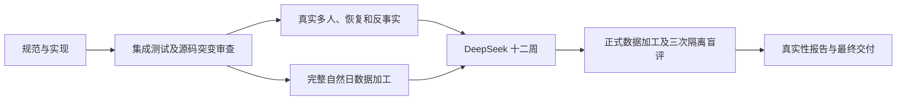

# AS2 生活仿真开发验收记录

更新时间：2026-09-16。权威合同为 `docs/agentsociety2-design.md`。

## 当前结论

生活、内容、足迹、共同恢复、LabelKit 加工及真实性评估均已有实际实现。
最终交付尚未完成：完整反事实分支、完整自然日加工、
正式 DeepSeek 十二周及三次实际隔离盲评仍需通过。短窗口、测试夹具和单条语义通过不能替代这些结果。

## 本轮修正

| 范围 | 实现合同 | 当前证据 |
| --- | --- | --- |
| 能量可行性 | 环境公开各类时长上限及路线成本，工具按同一观察限制，恢复前重新核验能量；精确足额活动按固定近零数值精度完成分段结算，真实不足仍拒绝 | 已冻结；Life与integration 272 passed；`.work/verification/energy-feasibility-implementation/implementation-receipt.json` |
| 工作评审协议 | 最多初次加两次输出纠正，原响应先持久化，语义拒绝及基础设施异常不重评 | 已冻结；工作评审、导出和质量相关69 passed；`.work/verification/work-review-protocol/receipt.json` |
| 无损模型输入 | 同窗口重复完整字段使用RFC 6901单跳字典，最终训练恢复完整输入；逻辑窗口、编码行和实际trace分别绑定 | 已冻结；delivery 113 passed；382窗口往返及四种哈希种子一致，`.work/verification/evidence-encoding/capacity-receipt.json` |
| 语义合同 | 三任务共享证据、分类及聚合要求，保留不同因果主题，32条只是上限 | 三份项目配置及实际请求合同测试通过；完整真实语义交付另行验收 |
| trace关联 | 核对当前配置、完整输入输出、逐轮生成和独立评审、逐记录最终通过及成功结束 | 无效trace与缺失调用反例修正；localhost真实CLI正反分支及历史真实69记录成功trace通过 |
| 人物隔离 | 认证消费者按实际请求人物拒绝同一不透明标识下的异人来源 | 已冻结；窗口13项及trace交叉20项通过，`.work/verification/delivery-integration-cross-review/narrow-recheck.log`；正常Society产生不同人物决策标识 |

生产容量测量的最大初稿为633215 estimated tokens，最大合法候选及最大实见累计意见的返工为676930，
均低于生成输入预算768928；评审为675882，低于867232。每次实际调用仍执行完整预算检查。
这些值不是任意未来意见长度的数学保证，也不证明模型已经正确理解全部单跳引用。

## 本轮冻结基线（35b321e）

提交 `35b321ef8e7ee55458a5378ddead2debe1c190406`，运行源码摘要
`ddf2c12544393b0071d7cf07e5d369bcfc328f1c8c87d50d78e70a863c213428`。本轮统一门与突变审查已通过。

| 门禁 | 实际结果 | 收据 |
| --- | --- | --- |
| 统一根门 | 517 passed；formal 与 multi 场景校验通过；依赖与代码约束全部匹配；前后快照一致 | `.work/verification/energy-review-delivery-gate/receipt.json` |
| 增量源码突变审查 | 31 项：26 killed、5 survived（全部为纵深防御层缺口）、0 invalid；5 个缺口已补针对性测试并经独立复验 5/5 killed | `.work/verification/bob-target-only/incremental-35b321e-mutations.json` |
| 缺口修复后回归 | 522 passed（517 + 5 新测试）；修复仅新增测试，生产代码零改动；独立复测确认五条防线均为唯一防线命中 | 同目录复验记录；`tests/delivery/test_evidence_encoding.py`、`tests/delivery/test_labelkit_process.py` |

## Dreaming 评审截断修复（judge 输出上限上调）

dreaming 第五次失败定性为评审 thinking 模式下隐藏推理耗尽 `32768` 输出预算（一次恰好截断、可见输出为空）；
该机制与此前 action/语义失败机制相互独立。截断请求原样重放探针返回 200、`finish=stop`、
completion 25504（reasoning 24790）、耗时 109.5 秒，收据 `.work/verification/delivery-validated-contracts/judge-cap-probe.json`。
据此调整 `labelkit-projects/config.toml` 的 `[llm.judge]`：`max_output_tokens` 32768→65536、`timeout_s` 180→360；
`[llm.default]` 与零传输重试规范不动。修复方向 D（上调 `max_repair_rounds`）搁置：
生成器对点名修复项三轮均不执行，加轮无效；失败集逐轮漂移表明方差主导。

## 最近完成的冻结基线

以下证据属于提交 `aafbcf9ce431f29a21a9bec2a19a549b6b474040`，运行源码摘要为
`5697d00f26a942222fe3eed6c99ccf49efb7a106396f6ad932d5c1706f05e660`，当时规范摘要为
`9984fd77c757b103ad5c6b6679fe2c56a541adcce5954cdc57a1e715477de77a`。
它们不覆盖随后增加的能量、工作评审纠正、字段字典及trace条款。

| 门禁 | 实际结果 | 收据 |
| --- | --- | --- |
| 根项目 | 436 passed，前后源码、规范、测试与配置字节一致 | `.work/verification/final-budget-history-lifecycle-gate/receipt.json` |
| AS2维护分支 | 全量417 passed；提交 `91a368109fb0ad39f4a3b21542112335f18d3ed2` | `.work/verification/litellm-callback-lifecycle/implementation-receipt.json` |
| 增量源码突变审查 | 本次108项：104 killed、0 survived、4 invalid、0 inconclusive；前后基线436/417/3通过；全部恢复clean，临时worktree已删除 | `.work/verification/bob-target-only/incremental-bob-report.md` |
| 历史突变复用 | 另有50项历史killed按依赖重评复用，未伪称本次重跑；四项invalid属于等价或不可达分支 | 同目录 `incremental-causal-adjudication.json` |
| LabelKit维护分支 | 累计评审意见与完整上下文修正提交 `e8f168fe32436f7e6bce1660698c05e488ab7314`，相关CLI localhost回归通过 | `.work/verification/annotation-critique-history-design/receipt.json` |
| 启动材料 | 正式及多人场景均验证49语料条目和11份Schema | 根集成门收据 |

LabelKit全量operators的历史尝试有缺失示例夹具错误，不能称为整个上游仓库测试全绿。
实际集成使用两个独立依赖环境，没有更改另一个 `/Users/atishoo/Project/LabelKit` 工作区。

## 实际运行与数据消费

| 范围 | 实际结果 | 证据与边界 |
| --- | --- | --- |
| 多人完整一天 | run `c5b79980a8604d19b3299949d3573c59`；2981事件、85活动、188动作请求，149接受、39拒绝；188记忆更新、610对模型请求响应 | `.work/verification/runtime-acceptance/budget-lifecycle/multi-export`，完整导出认证通过 |
| 普通恢复 | run `cc9049d5b64946b789bda7a85efe6d1a`；从07:00非初始共同检查点恢复至次日零点，CLI与导出成功 | 同目录 `resume-export`、`parent-after-resume.json`；父目录逐字节不变 |
| 反事实失败 | run `5bc2ccb3c1a5474da9b0c61504505451`；17:16工作评审漏必填字段，414对模型记录保留，CLI退出1 | 同目录 `counterfactual-failure/receipt.json`；无完整导出，父目录不变 |
| 实际回合预算 | 188次生活决策共453次带预算请求，每次最多5轮；预算及工具一致，610次响应无回调上限警告 | 同目录 `actual-budget-and-callback-receipt.json`；真实运行未触及预算临界值，临界值由行为测试验证 |
| 实际生活行为 | 人物二34次零能量拒绝均有正确反馈，23:00前存在可行配送进食路径；工资95000分、食品1300分、交通2110分逐事件对账 | 同目录 `energy-audit/report.md`；行为观察不是人类真实性证明 |
| 完整候选模型对照 | 相同完整输入与候选仅更换模型，Flash和Pro均拒绝且均漏掉一项已确认问题 | `.work/verification/complete-candidate-judge-model-comparison/`；不据单条记录切换模型或宣称强弱 |
| 最新完整日加工失败 | action扫描69条、68条通过，256次调用传输全部成功，语义仍不合格；未执行后续intent/dreaming/规则/训练 | `.work/verification/day-reasoned-citations/failure-receipt.json`；无最终交付清单 |
| 历史真实小时消费 | 真实小时足迹的5条语义数据、规则4分支11事件及DatasetDict保存重载经过实际消费者验证 | `.work/verification/deepseek-hour-real-rules.json`、`deepseek-hour-hf-lossless/receipt.json`；不是完整自然日或十二周交付 |

历史失败原件与收据保留在 `.work/verification/` 和 `runs/`，不改写失败输出。
`docs/research/*-final-audit.md` 已标记历史快照，不能用早期发现描述当前实现。

## 十二周及真实性比较

正式窗口为上海时区2026-01-05零点至2026-03-30零点，共84天。
`scenarios/white-collar-12-weeks.json` 已冻结，十二周实际运行尚未启动。
比较对象只读来自 `/Users/atishoo/Project/Dataset-Person/archive/white-collar-12-weeks-deepseek16-glm52`，
已认证84天、16320事件和4380活动。评估工具已有49项测试，覆盖共同字段、匿名对象引用、真实状态变化、
可判定性、配对周统计与区间、一致性及不强制优胜者的结论规则。

正式新数据必须完成精确终点、完整导出认证及action、intent、dreaming、规则和训练加载交付。
统计比较使用认证原始足迹；三个新建隔离模型会话分别读取盲评包并保存原始回答，当前smoke包不是实际盲评。
缺少匹配人群的真实个体数据时，只报告相对合理性，不声称验证了人类相似度。

## 路径清理

旧Android、Concordia、手机实验代码、配置、测试与入口均已删除；受版本控制路径中，
相关旧工程仅保留 `docs/history/mobile-prototype-lessons.md` 经验档案。
当前文件职责和新增模块清单见权威规范“文件职责”章节；运行产物、测试探针与环境目录不进入版本控制。
