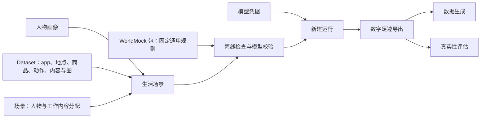

<a name="readme-用户配置手册"></a>
# 用户配置手册

WorldMock-Dataset 提供具体世界，WorldMock 执行这个世界并记录结果。
以下命令在 WorldMock 根目录执行，WorldMock-Dataset 与它位于同一父目录；环境路径均显式传入。
先按[运行配置](runtime.md#runtime-准备环境)建立并激活 WorldMock 环境；本手册的 `python` 和 `worldmock` 命令均在该环境中执行。

从这里开始，把 WorldMock 配置成你想观察的人物与生活环境。
本手册介绍当前程序实际读取的配置、编写方法和检查步骤；配置格式的正式定义仍由
[状态与序列化](../design/09-io-formats.md)、对应特性规格和[记录引擎合同](../design/05-recording-engine.md)维护。

<a name="readme-按你想改变的事情选择入口"></a>
## 按你想改变的事情选择入口

| 你想改变什么 | 阅读页面 | 主要输入 |
| --- | --- | --- |
| 人物是谁、习惯和兴趣、作息（含下班与到家）、联系人、睡眠需要 | [人物画像](personas.md#personas-人物画像) | 场景的 `agents`，画像正文 |
| 模拟日期、人数、余额、工作安排、分配内容、消息、账单、允许的行动 | [生活场景](scenarios.md#scenarios-生活场景) | `experiments/my-world/scenarios/*.json` |
| app、地点、商品、动作、内容与图 | [世界素材](resources.md#resources-定义地点门店供给与世界素材) | 清单和六个目录 JSON；对象绑定，不含语料目录 |
| 人物动机、身体初值和画像映射 | [规则配置](rules.md#rules-调整世界规则与人物动机参数) | 场景人物参数与明确画像编译；固定规则与常数由引擎包维护 |
| 模型凭据、新建运行、恢复和反事实条件 | [运行配置](runtime.md#runtime-运行配置) | 私密凭据、命令参数、干预 JSON |
| 评估数据、统计设置、人工参照与盲评 | [真实性评估](evaluation.md#evaluation-自定义评估与盲评输入) | 评估配置、评审文件 |



<a name="readme-创建自己的第一个场景"></a>
## 创建自己的第一个场景

命令在 WorldMock 根目录执行，安装见[运行配置](runtime.md#runtime-运行配置)。先将当前人工环境完整复制到新目录，保留场景与目录的相对引用，再编辑人物。它是一天的最小样例，不是正式发布环境；数据仓发布后可改用实际新目录，旧发布目录不能当作新格式输入。

```bash
python - <<'PY'
import json
import shutil
from pathlib import Path

source = Path("tests/fixtures/environment")
target = Path("experiments/my-world")
shutil.copytree(source, target)
scenario = target / "scenarios/single-person.json"
scene = json.loads(scenario.read_text(encoding="utf-8"))
scene["scenario_id"] = "my-persona-day"
scenario.write_text(json.dumps(scene, ensure_ascii=False, indent=2) + "\n", encoding="utf-8")
print(scenario)
PY
```

修改 `agents` 的画像和参数，并从 `catalog/contents.json` 分配 `work_content_ids`；动作请求保持五字段项 `{name, way, from, to, app}`；改变日期或窗口时核对日历、消息、工资、账单及工作安排。新目录已存在时复制直接失败，请选新目录或明确编辑已有环境，不覆盖发布字节。

先执行不调用模型的目录与完整场景加载检查：

```bash
worldmock validate --environment experiments/my-world
python - <<'PY'
from pathlib import Path
from worldmock.life.world_setup import load_scenario

scene, digest = load_scenario(Path("experiments/my-world/scenarios/single-person.json"))
print(scene.scenario_id, len(scene.agents), digest)
PY
```

这检查结构 8、引用、目录及图准入。准备好[模型凭据](runtime.md#runtime-填写模型凭据)后，完整场景校验抽取人物卡片并报告覆盖率：

```bash
worldmock validate --scenario experiments/my-world/scenarios/single-person.json \
  --coverage-out .work/my-persona-day-coverage.json
worldmock run --scenario experiments/my-world/scenarios/single-person.json --output runs/my-persona-day
```

输入警告随标准错误流及 `input_warnings` 返回，覆盖率只报告与警告；不能据此放宽目录、版本或身份校验。具体含义见[人物画像](personas.md#personas-常见错误)。真实模型选择、长期节律、完整交付和真实性评估另行执行；一天人工样例不能满足正式十二周或所有交付门禁。

<a name="readme-文件放在哪里"></a>
## 文件放在哪里

保持 `catalog/`、`scenarios/` 在同一环境根内并列：

```text
experiments/my-world/
├── catalog/       # 清单、六个目录文件
└── scenarios/     # 结构 8、环境标识与版本
```

正式环境和制作工具由 WorldMock-Dataset 维护，路径由其发布决定。WorldMock 提供固定规则、生成与检查命令；场景上两级解析环境目录，输出相对当前工作目录解析。复制完整环境并保留环境钉。

<a name="readme-修改配置前要知道的约定"></a>
## 修改配置前要知道的约定

| 约定 | 对编写配置的影响 |
| --- | --- |
| JSON 不支持注释和尾逗号；TOML 支持 `#` 注释 | 示例标注为“局部片段”时要合并到完整文件，不要直接替代整份配置 |
| 结构字段严格校验 | 拼错字段、使用旧格式或新增不存在的配置键会失败 |
| 金额通常是整数分，时长通常是秒 | 人物作息是自午夜起的小时数；食品店铺固定全天服务，不声明营业时间 |
| 关联使用稳定标识 | 改名字与改标识不同；改标识后要同步引用它的主题分配、账户、消息和内容 |
| 哈希绑定实际文件字节 | 素材变动要重新准备相应清单和引用，不能随便填一个哈希让验证通过 |
| 配置不热更新 | 新设定用新运行目录；恢复必须匹配父运行的场景、代码和资源身份 |
| 运行产物由程序生成 | 不手改检查点、运行清单、画像编译溯源、足迹和生成报告来改变人物 |

本手册中的离线示例只证明配置可被当前加载器读取；模型生成质量、长时间运行与正式验收需要实际执行各自流程。

<a name="readme-手册版本表"></a>
## 版本表

| 版本 | 日期 | 变更 |
| --- | --- | --- |
| `2026-10-06-rrs-docs` | 2026-10-07 | app 与主题入口、当前人工环境完整复制及场景检查；正式发布和真实运行边界 |
| `2026-10-07-acs-rules` | 2026-10-07 | 固定规则版本 2；目录格式 2、场景结构 8、世界结构 11、运行清单 4；环境仅发布目录与场景，规则只从包读取。 |
| `2026-10-07-acs-close` | 2026-10-08 | 手册入口按 app、地点、商品、动作、内容五类对象，场景结构 8、五字段动作请求及仅含 catalog/scenarios 的环境根收口 |
