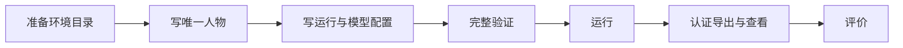

# 使用 WorldMock

一份完整环境描述一个世界、一个人物和一次运行。先准备[世界素材](resources.md#resources-设计环境数据集)、
[人物](personas.md#personas-编写-persona-toml)与[运行配置](runtime.md#runtime-编写-config-toml)，
再按照[运行手册](runtime.md)验证和启动。
环境根只有 catalog/、persona.toml、config.toml，不放场景文件、README、地图或额外素材目录。

`tests/fixtures/dataset-environment` 是明确标识的合成测试示例，模型服务地址是无效测试地址。
创建自己的环境时，按[配置字段](../design/08-configuration.md)填写实际服务与元数据地址，并通过环境变量提供凭据。
固定规则的解释见[规则](rules.md)，格式以当前模块设计为准。
