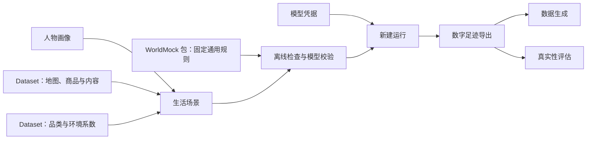

<a name="readme-用户配置手册"></a>
# 用户配置手册

> 2026-10-07：按[资源与规则引擎简化规格](../dev/SPEC-resource-and-rule-simplification.md#spec-rrs-资源与规则引擎简化开发规格)修订「文件放在哪里、按你想改变的事情选择入口」（阶段 1）；「修改配置前要知道的约定」（阶段 3）。

WorldMock-Dataset 提供具体世界，WorldMock 执行这个世界并记录结果。
以下命令在 WorldMock 根目录执行，WorldMock-Dataset 与它位于同一父目录；环境路径均显式传入。
先按[运行配置](runtime.md#runtime-准备环境)建立并激活 WorldMock 环境；本手册的 `python` 和 `worldmock` 命令均在该环境中执行。

> 2026-10-01：[工具交互规格](../dev/SPEC-life-runtime.md#tool-interaction-工具请求)已冻结并已实现；本手册描述当前程序实际读取的配置。
> 2026-10-03：按[个人事务与工作安排规格](../dev/SPEC-as2-integration.md#errands-workday-运行修复入库)同步入口表（作息含下班与到家、场景工作安排）。

从这里开始，把 WorldMock 配置成你想观察的人物与生活环境。
本手册介绍当前程序实际读取的配置、编写方法和检查步骤；配置格式的正式定义仍由
[接口合同](../CONTRACTS.md#contracts-worldmock-接口合同)、对应特性规格和[记录引擎合同](../design/05-recording-engine.md#recording-engine-worldmock-产品设计说明书-记录引擎)维护。

<a name="readme-按你想改变的事情选择入口"></a>
## 按你想改变的事情选择入口

| 你想改变什么 | 阅读页面 | 主要输入 |
| --- | --- | --- |
| 人物是谁、习惯和兴趣、作息（含下班与到家）、联系人、睡眠需要 | [人物画像](personas.md#personas-人物画像) | 场景的 `agents`，画像正文 |
| 模拟日期、人数、余额、工作安排、主题、消息、账单、允许的行动 | [生活场景](scenarios.md#scenarios-生活场景) | `experiments/my-world/scenarios/*.json` |
| 地点、生成图、店铺、食品、内容、生活活动和语料 | [世界素材](resources.md#resources-定义地点门店供给与世界素材) | 七份目录 JSON、生活活动和联系人邮件语料 |
| 人物动机、身体初值和画像映射 | [规则配置](rules.md#rules-调整世界规则与人物动机参数) | 场景人物参数与明确画像编译；固定规则与常数由引擎包维护 |
| 模型凭据、新建运行、恢复和反事实条件 | [运行配置](runtime.md#runtime-运行配置) | 私密凭据、命令参数、干预 JSON |
| 把足迹加工成训练数据与规则测试数据 | [数据生成](delivery.md#delivery-自定义训练数据交付) | `labelkit-projects/` |
| 评估数据、统计设置、人工参照与盲评 | [真实性评估](evaluation.md#evaluation-自定义评估与盲评输入) | 评估配置、评审文件 |



<a name="readme-创建自己的第一个场景"></a>
## 创建自己的第一个场景

命令均在 WorldMock 根目录执行，环境安装见[运行配置](runtime.md#runtime-运行配置)。
先沿用 Dataset 发布的地图、素材和环境规则，复制一个生活场景，再修改人物；需要扩展世界时再读对应页面。
以下脚本从单人物场景创建一天的场景文件，保留截止时刻落在当天的任务和有关消息，过滤窗口外预排事件。
它只写新配置，不调用模型，也不启动模拟。

```bash
python - <<'PY'
import json
from datetime import datetime
from pathlib import Path

source = Path("../WorldMock-Dataset/environment/zhangjiang-baseline/scenarios/single-person.json")
target = Path("../WorldMock-Dataset/environment/zhangjiang-baseline/scenarios/my-persona-day.json")
scene = json.loads(source.read_text(encoding="utf-8"))
scene["scenario_id"] = "my-persona-day"
scene["end_at"] = "2026-01-06T00:00:00+08:00"
start = datetime.fromisoformat(scene["start_at"])
end = datetime.fromisoformat(scene["end_at"])
scene["tasks"] = [
    task for task in scene["tasks"]
    if start < datetime.fromisoformat(task["due_at"]) <= end
]
task_ids = {task["task_id"] for task in scene["tasks"]}
scene["messages"] = [
    message for message in scene["messages"]
    if datetime.fromisoformat(message["sent_at"]) < end
    and (not message.get("related_task_id") or message["related_task_id"] in task_ids)
]
for section in ("bills", "payrolls", "price_changes", "product_releases"):
    scene[section] = [
        item for item in scene.get(section, [])
        if start < datetime.fromisoformat(item["due_at"]) < end
    ]
with target.open("x", encoding="utf-8") as output:
    output.write(json.dumps(scene, ensure_ascii=False, indent=2) + "\n")
print(target)
PY
```

生成的文件仍是陈曦及其原有环境。按[人物画像](personas.md#personas-人物画像)修改 `agents` 中的正文和人物参数。
模板的日历日期可以落在本次短运行窗口外；它们只在对应日期影响机会，不会延长场景。
新文件已存在时脚本会报错，请选择新名称或直接编辑已有文件。

先做不调用模型的完整场景加载检查：

```bash
python - <<'PY'
from pathlib import Path
from worldmock.life.world_setup import load_scenario

scene, digest = load_scenario(Path("../WorldMock-Dataset/environment/zhangjiang-baseline/scenarios/my-persona-day.json"))
print(scene.scenario_id, len(scene.agents), digest)
PY
```

这会检查场景结构、引用、目录与地图准入，不能替代画像抽取和真实模型运行。
准备好[模型凭据](runtime.md#runtime-填写模型凭据)后再执行完整校验；这个步骤会调用模型并写画像覆盖率报告：

```bash
worldmock validate \
  --scenario ../WorldMock-Dataset/environment/zhangjiang-baseline/scenarios/my-persona-day.json \
  --coverage-out .work/my-persona-day-coverage.json
```

校验会把运行输入警告逐条写到标准错误流（`Input warning <警告码> (agent <人物编号>): <说明>`），并列在输出 JSON 的
`input_warnings` 里，例如口味题材与场景内容对不上、场景作息覆盖了正文抽取的作息。警告不阻止校验和运行，
含义与改法见[人物画像](personas.md#personas-常见错误)；人物卡片的世界可执行覆盖率低于 80% 时校验失败。

校验通过后，使用新的输出目录开始运行：

```bash
worldmock run \
  --scenario ../WorldMock-Dataset/environment/zhangjiang-baseline/scenarios/my-persona-day.json \
  --output runs/my-persona-day
```

一天的自定义场景用于观察自己的设定；它不满足正式十二周评估或所有交付门禁。
数据生成和真实性评估各自的输入条件见对应页面。

<a name="readme-文件放在哪里"></a>
## 文件放在哪里

保持 `catalog/`、`corpora/`、`scenarios/` 在同一环境根内并列：

```text
experiments/my-world/
├── catalog/       # 七份 JSON 与三份包规则副本
├── corpora/       # 生活活动、联系人、邮件及清单
└── scenarios/     # 结构 7，钉住环境标识与版本
```

具体正式环境和制作工具由 Dataset 维护，重制后的路径由其发布决定。WorldMock 提供固定规则和真实生成、检查命令；场景上两级解析环境目录，corpus_root 相对场景位置解析，输出相对当前工作目录解析。移动场景时复制完整环境并保留环境钉，不能依赖相邻仓库搜索。

<a name="readme-修改配置前要知道的约定"></a>
## 修改配置前要知道的约定

| 约定 | 对编写配置的影响 |
| --- | --- |
| JSON 不支持注释和尾逗号；TOML 支持 `#` 注释 | 示例标注为“局部片段”时要合并到完整文件，不要直接替代整份配置 |
| 结构字段严格校验 | 拼错字段、使用旧格式或新增不存在的配置键会失败 |
| 金额通常是整数分，时长通常是秒 | 人物作息是自午夜起的小时数；食品店铺固定全天服务，不声明营业时间 |
| 关联使用稳定标识 | 改名字与改标识不同；改标识后要同步引用它的任务、账户、消息和素材 |
| 哈希绑定实际文件字节 | 素材变动要重新准备相应清单和引用，不能随便填一个哈希让验证通过 |
| 配置不热更新 | 新设定用新运行目录；恢复必须匹配父运行的场景、代码和资源身份 |
| 运行产物由程序生成 | 不手改检查点、运行清单、画像编译溯源、足迹和生成报告来改变人物 |

本手册中的离线示例只证明配置可被当前加载器读取；模型生成质量、长时间运行与正式验收需要实际执行各自流程。
