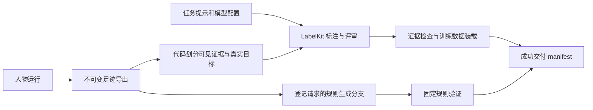
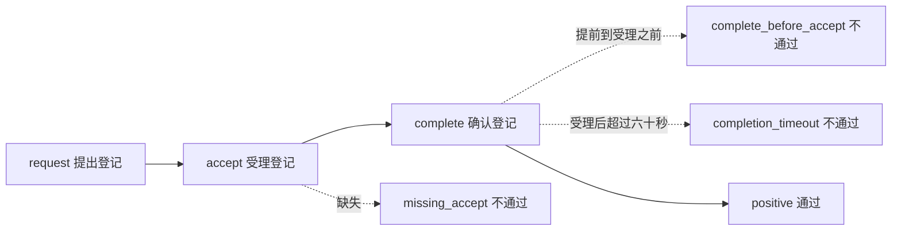

<a name="delivery-自定义训练数据交付"></a>
# 自定义训练数据交付

把人物的真实经历加工成经历归纳、意图识别、动作预测和规则验证数据时，修改仓库中的
`labelkit-projects/`。人物如何生活由[场景](scenarios.md#scenarios-生活场景)决定；本页配置的是经历发生后如何加工数据。
所有命令均在 WorldMock 仓库根目录执行。

[返回配置手册](README.md#readme-用户配置手册)



<a name="delivery-文件怎么分工"></a>
## 文件怎么分工

| 文件 | 用户可以修改什么 | 必须保持什么 |
|---|---|---|
| [config.toml](../../labelkit-projects/config.toml) | 模型端点、模型名、并发、超时、输出预算 | 项目引用的 `default`、`judge` 配置必须存在；凭据只写环境变量名 |
| [dreaming.toml](../../labelkit-projects/dreaming.toml) | 经历归纳、反思、反事实假设的表达要求及评审要求 | 原世界事实与生成分支分开；假设必须明示 |
| [intent.toml](../../labelkit-projects/intent.toml) | 意图归纳的表达要求及评审要求 | 保留多候选、`unknown` 和不确定性，不把推断当事实 |
| [action.toml](../../labelkit-projects/action.toml) | 动作前需求和不确定性的表达要求 | 输入只能使用动作前证据；真实下一动作由代码填入 |
| [rules.toml](../../labelkit-projects/rules.toml) | 登记交互的自然语言表达、尝试预算、合法范围内的时间采样 | 当前交付固定请求、受理、登记回执及四种变体 |
| [hooks.py](../../labelkit-projects/hooks.py)、[rule-hooks.py](../../labelkit-projects/rule-hooks.py) | 属于程序扩展接口，普通配置修改无需编辑 | 语义引用不得越过可见证据；生成规则不得改写 `origin` 和 `sla` |
| [schemas/semantic-target.json](../../labelkit-projects/schemas/semantic-target.json)、[rule-schemas/state.json](../../labelkit-projects/rule-schemas/state.json) 等 | 属于交付格式合同 | 改 Schema 不会自动改变训练装载器或规则消费者 |

`deliver` 会复制整个 `labelkit-projects/`，排除旧 `data/`、`out/` 和缓存，再由真实导出重新生成输入。
新增一个任意名称的 TOML 不会自动新增交付任务。输入、输出、Schema、钩子的相对路径均相对于所属 TOML 的目录。

<a name="delivery-修改任务提示"></a>
## 修改任务提示

从现有任务文件开始编辑，保留已有的证据、输出结构和评审约束。在 `[annotate].instruction` 的三引号正文末尾，
追加自己的表达要求，例如：

```text
摘要使用简体中文，每条先说明发生了什么，再说明直接证据支持的后果。
同一主题的重复经历可以合并，但保留真正改变结果的差异。
不确定的动机保留为候选，不把“没有观察到”改写成“没有发生”。
```

这是**提示词追加片段**，不是完整 TOML。不要追加第二个 `[annotate]` 表。
如果增加了可判断的内容要求，也在同一个文件的 `[verify].extra_criteria` 中写明如何检查；
只要求风格变化时，不能让评审把有依据的内容判成事实错误。

三个语义任务都使用如下固定输出，外层只有 `target`，不能要求模型输出未来动作答案或来源清单：

| 字段 | 必填与范围 | 写作要求 |
|---|---|---|
| `target.claims` | 必填，至少一条、最多三十二条 | 按主题归纳；每条必须有 `text`、`kind`、`evidence_event_ids` |
| `claims[].text` | 非空，最多五百一十二字符 | 每个独立事实都由该条引用的事件支持 |
| `claims[].kind` | `fact`、`inference`、`hypothesis` | 明确区分事实、推断与假设 |
| `claims[].evidence_event_ids` | 不重复，最多六十四项，每项最多六十四字符 | 逐字使用输入允许的事件 ID；事实和推断至少引用一项 |
| `target.intent_candidates` | 必填，至少一项、最多八项，不重复 | 每项包含 `intent` 与 `basis` |
| `intent` | `hunger`、`rest`、`work`、`entertainment`、`travel`、`purchase`、`communication`、`unknown` | 当前是闭集；提示词不能新增类别 |
| `basis` | `stated`、`inferred`、`uncertain` | 分别表示自述、推断、不确定 |
| `target.uncertainty` | 必填字符串，可空，最多一千零二十四字符 | 明确证据缺口，不重复已经陈述的 claim |

例如，证据不足时允许 `{"intent": "unknown", "basis": "uncertain"}`。
反事实任务至少需要一条 `hypothesis`。`observed` 表示尚未执行的假设，`resimulated` 才表示真实重演分支；
不要仅靠改提示词把前者写成已发生结果。

为保留全部输入窗口与可验证评审，沿用下列配置：

- 顶层 `schema_version = 1`、`run.modality = "text"`、`run.mode = "process"`、
  `input.text_field = "input"`，以及三项任务各自的 `data/`、`out/` 文件名。
- `dedup`、`classify`、`quality`、`generate` 关闭，避免删除或改造输入窗口；`annotate` 与 `verify` 开启。
- `verify.policy = "repair"` 允许返工；如果改为 `drop`，任何窗口被丢弃都会使正式交付失败。
  无论策略如何，完整评审记录必须存在且最终为 `pass`。
- `output.schema_path = "schemas/semantic-target.json"`、`output.validator = "hooks.py:validate_annotation"`、
  `output.meta_mode = "inline"`，以及开启 `llm`、`verify`、`schema` 的完整 trace。

<a name="delivery-修改生成预算和模型"></a>
## 修改生成预算和模型

以下是**替换现有表内对应字段的局部片段**，不是一份完整配置：

```toml
# dreaming.toml、intent.toml 或 action.toml 中已有的表
[run]
batch_size = 8
seed = 20260921

[verify]
max_repair_rounds = 3

[output]
max_repair_attempts = 4
```

| 字段 | 单位与边界 | 实际作用 |
|---|---|---|
| `run.batch_size` | 正整数，条 | 处理批大小；模型并发另由配置控制 |
| `run.seed` | 整数 | 控制 LabelKit 内的随机选择，不改变已经发生的世界经历 |
| `verify.max_repair_rounds` | 非负整数，轮 | 语义评审失败后的返工上限 |
| `output.max_repair_attempts` | 非负整数，次 | 结构修复预算，与语义返工分开 |
| `llm.<name>.provider` | 必填，`openai_compatible` 或 `anthropic` | 请求协议；须与端点一致 |
| `llm.<name>.base_url`、`model` | 必填非空字符串 | API 根地址与服务实际提供的模型名；地址不追加 `/chat/completions` |
| `llm.<name>.api_key_env` | 本项目保留 `DEEPSEEK_API_KEY` | 填环境变量名，不填密钥值 |
| `llm.<name>.max_concurrency` | 正整数 | 该模型配置的并发容量 |
| `llm.<name>.timeout_s` | 正整数，秒 | 单次请求超时 |
| `llm.<name>.max_retries` | 非负整数，次 | 可重试请求的重试预算 |
| `llm.<name>.max_output_tokens` | 正整数，token | 输出预算，须足够容纳完整结构 |
| `llm.<name>.context_window` | 正整数，token | 本项目规则生成所引用的模型必须声明正窗口，并容纳输出预算和安全余量 |
| `llm.<name>.temperature` | 非负数 | 模型默认温度；模型服务还可能有更窄的允许范围 |
| `llm.<name>.thinking` | `enabled` 或 `disabled` | 须与实际服务支持一致 |
| `llm.<name>.supports_structured_output` | 布尔值 | 只有服务实际支持原生结构化输出时才设 `true` |

例如，编辑 `config.toml` 中已有的 `[llm.default]`，只降低并发和调整请求超时：

```toml
# 局部字段；保留原表中的 provider、base_url、model、api_key_env 等字段
max_concurrency = 4
timeout_s = 240
```

`annotate.llm` 引用主模型配置，`verify.llm` 引用评审模型配置；规则生成另引用
`generate.semantic_llm` 和 `generate.evaluation_llm`。修改配置名称必须同步全部引用。
分别命名 `default` 和 `judge` 不代表底层模型独立；当前交付清单会保守标注同模型偏差。

当前 WorldMock 启动交付时，从 `~/.config/worldmock/deepseek.env` 的 `DEEPSEEK_NODE_KEYS`
取逗号分隔池的第一段并去除首尾空白，再设置 LabelKit 子进程的 `DEEPSEEK_API_KEY`。
文件中没有该键或第一段为空时拒绝交付，不能用进程里已有的 `DEEPSEEK_API_KEY` 替代文件输入。
本项目的 `api_key_env = "DEEPSEEK_API_KEY"` 保持不变，它引用子进程环境键，不是私密文件输入键。
更换端点或模型时必须确认这套凭据对目标服务有效；本页没有通用多供应商凭据配置入口。
凭据准备见[运行设置](runtime.md#runtime-运行配置)。

<a name="delivery-修改规则数据"></a>
## 修改规则数据

这里的规则验证的是“生活请求登记是否在受理后六十秒内确认”，不是睡眠、出行、工作是否在六十秒内完成。
`rules.toml` 使用 LabelKit 的 `sequence` 生成模式，以真实动作作为来源，生成独立的登记交互分支。



保留一组 `life_action_training`、`count = 1` 和现有四种变体。
同时保留 `schema_version = 1`、`run.mode = "generate_only"`、`generate.form = "sequence"`、
`generate.mode = "declared"`、`run.output = "./out/rules.jsonl"`，以及现有输出元数据与状态钩子设置。
宿主要求四种变体各出现一次，增加 `count`、噪声、重复序列或新变体，都不是当前交付支持的自定义方式。
`sla.max_wait_us = 60000000` 的单位是微秒，Schema 已固定；不能只在 TOML 中放宽。
`read_roots`、`write_roots`、`publish_roots` 是状态路径权限，`payload_bindings` 把输出字段绑定到实际状态，
修改文案时保留这些配置及所有 Schema 路径。

可以在现有指令末尾追加“回执用简洁中文说明登记结果”等表达要求，或调整以下预算：

```toml
# 替换 rules.toml 已有 [generate] 表中的同名字段
max_slot_attempts = 5
```

`max_slot_attempts` 允许一至二十次。时间配置的 `min_gap_s`、`max_gap_s`、`max_span_s`、
`event_gap_s`、`session_max_span_s`、`session_gap_s`、`min_excess_s`、`max_excess_s` 均以秒计。
若需要改变采样范围，正常分支的受理到确认仍须不超过六十秒，超时分支必须超过六十秒，
总跨度和 session 容量必须容纳全部计划。先用离线验证器证明计划可行。

新增另一套业务规则属于交付合同扩展，需要同时修改状态、变体、独立预期与消费者；
上游 LabelKit 的通用序列能力不能直接视为 WorldMock 已接入的能力。

<a name="delivery-离线检查"></a>
## 离线检查

先安装项目既有依赖。下面命令只校验配置，不调用模型。显式设置 `PYTHONPATH`，
让 LabelKit 的隔离环境能够载入本项目的语义钩子：

```bash
mkdir -p labelkit-projects/out
PYTHONPATH="$PWD/src" vendor/labelkit/.venv/bin/labelkit validate \
  --config labelkit-projects/config.toml --project labelkit-projects/action.toml --console plain
```

对 `dreaming.toml`、`intent.toml` 重复同一命令即可。不要加 `--probe`；该选项会实际请求模型服务。
Windows 使用 `vendor/labelkit/.venv/Scripts/labelkit.exe`，并在当前终端将 `PYTHONPATH` 设为项目的 `src` 目录。
这一步不证明输入经历完整，也不等于最终数据交付通过。

`rules.toml` 还需要由真实足迹产生的 `data/rules-catalog.jsonl`。下面是**完整的临时验证脚本**；
把 `exports/my-world` 换成自己的完整导出目录。它在临时目录复制配置、构造规则来源并校验四个任务，
退出后清理临时目录，不写正式交付、不读取密钥、不请求模型：

```bash
python - <<'PY'
import os
import shutil
import subprocess
import tempfile
from pathlib import Path

from worldmock.delivery.generation import create_catalog
from worldmock.delivery.windows import prepare_windows
from worldmock.footprints.export import write_jsonl

root = Path.cwd()
windows = prepare_windows(root / "exports/my-world")
with tempfile.TemporaryDirectory(prefix="worldmock-delivery-check-") as temporary:
    workspace = Path(temporary) / "labelkit-projects"
    shutil.copytree(root / "labelkit-projects", workspace,
                    ignore=shutil.ignore_patterns("data", "out", "__pycache__"))
    (workspace / "data").mkdir()
    (workspace / "out").mkdir()
    catalog = create_catalog(windows["action"][0])
    write_jsonl(workspace / "data/rules-catalog.jsonl", [catalog])
    environment = dict(os.environ)
    environment["PYTHONPATH"] = str(root / "src")
    labelkit = root / "vendor/labelkit/.venv" / ("Scripts/labelkit.exe" if os.name == "nt" else "bin/labelkit")
    for task in ("dreaming", "intent", "action", "rules"):
        subprocess.run([
            str(labelkit), "validate",
            "--config", str(workspace / "config.toml"), "--project", str(workspace / f"{task}.toml"),
            "--console", "plain",
        ], env=environment, check=True)
PY
```

<a name="delivery-正式交付与检查结果"></a>
## 正式交付与检查结果

完成配置和凭据准备后，以下命令会真实调用 LabelKit 模型；输出目录必须尚不存在：

```bash
worldmock export --run-dir runs/my-world --output exports/my-world
worldmock deliver --export exports/my-world --output deliveries/my-world
```

如果已有符合合同的真实反事实重演导出，给 `deliver` 增加
`--replay-export exports/my-replay`；多份重演可以重复这个参数。仅改 `dreaming` 提示词不会自动执行重演。

成功以交付目录的 `manifest.json`、`committed: true` 为准；其中绑定配置、输入、输出、评审和消费验证。
`training.jsonl`、`training-receipt.json`、`rules.jsonl`、`rule-results.json` 都是生成结果。
失败可能留下 `failure.json` 与诊断文件；修正配置后使用新的输出目录重跑。

| 常见现象 | 处理方式 |
|---|---|
| `No module named 'worldmock'` | 离线 LabelKit 命令加上面的 `PYTHONPATH` |
| `output parent directory does not exist` | 独立校验时先建立 TOML 所指向的输出父目录；正式 `deliver` 会创建自己的目录 |
| `rules-catalog.jsonl` 不存在 | 使用真实导出和临时验证脚本；不要手填“已发生”的来源 |
| 模型返回新增意图或未来动作字段 | 恢复闭集与 `target` 结构；提示词不能扩展训练合同 |
| 四种规则变体不完整或重复 | 恢复现有四变体、单组单次配置，检查生成报告 |
| LabelKit 退出成功但没有 WorldMock 成功清单 | 继续检查宿主的来源、评审、训练装载和规则门禁；单独跑 LabelKit 不会完成正式交付 |

更多 LabelKit 字段见[固定来源声明](../../requirements/labelkit-source.json)所绑定版本中的
LabelKit 手册中的 `06-config-toml.md`（模型配置）、`07-project-toml.md`（任务配置）和
`27-sequence-generation.md`（序列生成）；按该固定来源安装后在 LabelKit 的手册目录阅读。
WorldMock 的最终接入范围仍以上述约束为准。
