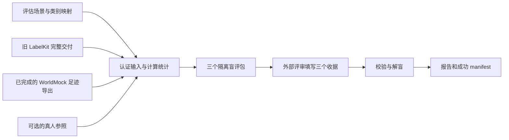

<a name="evaluation-自定义评估与盲评输入"></a>
# 自定义评估与盲评输入

评估配置决定“比较同一时间段内哪些活动、使用哪些公开参照、请评审判断哪些维度”。
从 [scenarios/evaluation.json](../../scenarios/evaluation.json) 复制完整文件修改。
它和[人物运行场景](scenarios.md#scenarios-生活场景)是两种不同输入，不要把它传给 `worldmock run`。
所有命令均在仓库根目录执行。

[返回配置手册](README.md#readme-用户配置手册)



<a name="evaluation-共享规则与可重建环境修订"></a>
## 共享规则与可重建环境修订

按[共享规则与可重建环境规格](../dev/SPEC-shared-rules-and-rebuildable-env.md)修订；验收结果独立记录。

报告只将非布尔整数秒且起点小于终点的区间计为有效结算；缺活动品类仍报告未归类或缺证。日期按运行时区切分，反思快照使用主观来源校验，不能当作畸形活动经历。

<a name="evaluation-先分清要编辑的文件"></a>
## 先分清要编辑的文件

| 文件或目录 | 谁填写 | 用途 |
|---|---|---|
| `scenarios/my-evaluation.json` | 用户 | 时间窗口、类别映射、参照来源、评审设计和旧交付身份 |
| `--human-reference` 指向目录的 `manifest.json` | 真人数据提供方 | 可选；声明规范化真人轨迹的文件、时间范围和身份 |
| 三份 `review-record-1` JSON | 评审组织者根据真实评审结果填写 | 绑定实际评审包、会话、原始回答和每项判断 |
| `metrics.json`、`mapping-report.json`、`official-reference.json` | 程序生成 | 统计与适配结果，不是用户配置 |
| `review-packets/`、`blind-review-pack.json`、`unblinding-key.json` | 程序生成 | 隔离评审材料与解盲信息，准备后不可编辑 |
| `prepare-receipt.json`、最终 `manifest.json` | 程序生成 | 冻结输入与产物身份，不要手工修改哈希或成功状态 |

目前没有通用 `adapter.toml` 或任意字段重命名配置。可配置的适配入口是
`category_mappings` 与 `official_domain_map`；输入文件结构仍须符合现有交付合同。

<a name="evaluation-从完整示例开始"></a>
## 从完整示例开始

下面命令会创建一个**完整的自定义评估配置**，保留现有基准交付身份与时间窗口，只修改评估名称及随机种子。
目标文件已经存在时会拒绝覆盖：

```bash
python - <<'PY'
import json
from pathlib import Path

source = Path("scenarios/evaluation.json")
target = Path("scenarios/my-evaluation.json")
config = json.loads(source.read_text(encoding="utf-8"))
config["scenario_id"] = "my-white-collar-evaluation"
config["bootstrap"]["seed"] = 20260921
config["review"]["seed"] = "my-review-2026-09-21"
with target.open("x", encoding="utf-8") as handle:
    json.dump(config, handle, ensure_ascii=False, indent=2)
    handle.write("\n")
PY
```

先确定双方真实覆盖的日期，再修改窗口、特殊日期和映射。使用另一套旧交付时，同时核对
`expected_labelkit` 的身份、行数与文件哈希；不能只把评估文件名改成自己的名称。

| 必填字段 | 单位与边界 | 与其他配置的关系 |
|---|---|---|
| `scenario_id`、`schema_version` | 非空字符串 | 名称可以自定义；通常保留当前 `schema_version` |
| `window.start`、`window.end` | 带时区偏移的 ISO 8601 时间，起点小于终点 | 在 `window.timezone` 下均须为午夜；包含起点，不包含终点 |
| `window.timezone` | 有效 IANA 时区名，例如 `Asia/Shanghai` | 决定自然日边界；须与共享人物和输入清单一致 |
| `bootstrap.seed` | 整数 | 统计重采样种子 |
| `bootstrap.repetitions` | 正整数，次 | 默认示例使用一万次；降低会影响区间稳定性 |
| `bootstrap.block_days` | 固定为 `7` 天 | 当前采用周块重采样，不能任意调短 |
| `review.seed` | 非空字符串 | 普通日抽样和左右顺序的种子 |
| `review.reviewer_count` | 固定为 `3` | 必须提交三个不同槽、不同会话的评审收据 |
| `review.dimensions` | 不重复的非空字符串数组 | 使用下表已有维度；新名称没有对应可判定性规则 |
| `shared_profile` | 固定 `person_count: 1`、`occupation_class: "white_collar"`，必填 `timezone` | 当前评估支持单人白领；不能通过此处配置其他群体 |
| `special_dates` | 日期字符串到日历类别名称的对象，可为空 | 日期必须在窗口内；其余日期自动区分工作日、周末 |
| `category_mappings` | 必须包含三个映射对象 | 把双方已有类别映射到相同含义 |
| `official_domain_map`、`official_reference` | 必填对象 | 活动类别映射的官方领域必须实际存在 |
| `expected_labelkit` | 必填对象 | 冻结旧候选交付身份，见后文 |

结束时间写成 `2026-03-30T00:00:00+08:00` 表示最后一个被评估的自然日是三月二十九日，
不是三月三十日。双方和可选真人参照必须使用完全一致的窗口，不会自动取交集或裁剪数据。

| 已支持的评审维度 | 判断什么 |
|---|---|
| `temporal_plausibility` | 活动时点与时长是否合理 |
| `causal_continuity` | 可观察对象的状态变化是否连续 |
| `persona_consistency` | 是否符合双方都已证实的粗画像 |
| `long_term_consequences` | 跨日状态变化是否连贯 |
| `routine_and_variation` | 多日规律及变化是否合理 |
| `missing_expected_activity` | 在完整日期与日历类型中是否缺少预期活动 |

保留示例的完整维度集合最便于比较。加载器只检查字符串结构，不会替你检查新维度的语义实现；
填写未实现名称会在生成盲评包时失败。评审一致性的 `alpha >= 0.80` 门槛也不是配置字段。

<a name="evaluation-修改类别映射和公开参照"></a>
## 修改类别映射和公开参照

以下是 `category_mappings` 的**局部示例**；编辑完整配置中的现有映射，保留其他类别：

```json
{
  "labelkit_sequence_class": {"food_order": "purchase", "navigation": "travel"},
  "labelkit_pattern": {"fitness_habit": "fitness", "social_habit": "social"},
  "worldmock_activity": {"purchase": "purchase", "travel": "travel", "watch": "entertainment"}
}
```

左侧键必须对应实际输入类别，右侧值表达双方一致的活动含义。
旧 LabelKit 的 `habit_no_intent` 序列使用 `labelkit_pattern`，其他序列使用 `labelkit_sequence_class`。
没有映射的类别会记为 `unknown`，不会根据名称猜测。WorldMock 活动的映射不会新增可执行活动。
`consume` 另有固定处理：按照真实请求的 `use_mode`，`eat` 归入 `eat`，`use` 归入 `product_use`；
仅修改 `worldmock_activity.consume` 不能覆盖这条语义。

官方参照把同一含义的活动映射到统计领域，例如已有配置中的：

```json
{
  "official_domain_map": {
    "sleep": ["personal_essential"],
    "eat": ["personal_essential"],
    "work": ["paid_work"],
    "travel": ["transportation"]
  }
}
```

这是**局部片段**。每个数组必须非空且不重复；所有名称都必须出现在
`official_reference.domains` 中。更新参照数值时同时保留真实的发布机构、调查名称、发布时间、
采集时间、粒度和原始来源地址。

每个领域必须填写 `label_zh`、`supported_duration_kinds`、`urban` 和 `working_age`。
后两项都包含非负 `participant_minutes`（参与者每天分钟数）与零到一之间的
`participation_rate`（参与率，例如 `0.521` 表示百分之五十二点一）。不要把参与率写成百分数整数。
`supported_duration_kinds` 表示允许比较的时长含义：`world_activity` 是世界活动时长，
`observed_digital_session` 是旧数字交互会话，`world_internet_session` 是世界互联网会话。
不能为了补齐图表就把数字交互时长当成全部现实生活时长。

<a name="evaluation-绑定真实候选输入"></a>
## 绑定真实候选输入

`--worldmock` 指向 `worldmock export` 生成的**已完成运行的足迹导出目录**，其中包含
`manifest.json`、活动、事件、检查点和素材索引。
评估要求 `experiment_completed: true`，检查点位于窗口终点，并验证实际导出内容。
[训练数据交付](delivery.md#delivery-自定义训练数据交付)产生的 `training.jsonl` 不能替代这里的足迹导出。

`--legacy` 指向旧 LabelKit 交付根目录。当前适配器固定读取以下文件族：

```text
legacy-root/
  out/white-collar-12-weeks.manifest.json
  repaired/white-collar-12-weeks.jsonl
  repaired/white-collar-12-weeks.stream.jsonl
  repaired/white-collar-12-weeks.repair-report.json
  repaired/white-collar-12-weeks.final-audit.json
```

原始 main、stream、report 文件由旧 manifest 的描述引用，也必须完整保留在该根目录内。
最终审计要求 `status: "pass"`、`mode: "full"`，且没有审计问题；修复报告必须绑定原始与修复后文件。
这不是任意 JSONL 导入接口。

`expected_labelkit` 必须且只包含以下字段：

| 字段 | 怎样填写 |
|---|---|
| `run_id`、`delivery_digest` | 从可信旧交付的成功 manifest 核对；digest 是六十四位小写 SHA-256 |
| `main_rows`、`stream_rows` | 修复后文件的正整数行数 |
| `raw_main_sha256`、`raw_stream_sha256` | 原始 main、stream 的实际 SHA-256 |
| `repaired_main_sha256`、`repaired_stream_sha256` | 修复后文件的实际 SHA-256 |
| `repair_report_sha256`、`final_audit_sha256` | 对应报告完整文件的实际 SHA-256 |

只有更换了已经认证的基准交付才更新这些值。改哈希不能替代修复链和完整审计。

<a name="evaluation-可选真人参照"></a>
## 可选真人参照

`--human-reference` 接受规范化的真实事件与活动目录；当前没有把手机日志或 CSV 自动转成该格式的命令。
它复用 WorldMock 的事件和活动结构，只是不要求世界运行的检查点与完成事件。
字段结构见[足迹数据合同](../CONTRACTS.md#contracts-worldmock-接口合同)；缺失的真实经历不能通过填造事件补齐。

参照目录必须有 `manifest.json` 和两个 JSONL 文件。清单的必需内容如下，
其中哈希由文件计算，不能照抄占位值：

| 清单字段 | 约束 |
|---|---|
| `schema_version`、`committed` | 分别为 `1`、`true` |
| `run_id`、`source_run_ids` | 非空身份；来源数组不重复且包含当前 `run_id`；事件只能引用声明的来源 |
| `window`、`daily_coverage` | 窗口与评估配置完全相同；按顺序列出窗口内所有本地自然日 |
| `artifacts.events`、`artifacts.activities` | 只声明这两个工件；每项含相对 `path`、实际 `sha256`、`rows` |

事件的 `occurred_at`、活动起止时间和区间时间使用 **UTC 整数秒**，不是毫秒；
`elapsed_seconds` 使用秒，并须等于实际活动区间的时长和。
事件 `event_seq` 从一开始连续，事件身份不重复；活动与来源事件的引用必须能互相核对。
所有时间都须符合评估窗口，不能通过清单声明掩盖越界或缺失。

已由数据提供方规范化好的目录，可以先离线核验：

```bash
python - <<'PY'
from pathlib import Path
from worldmock.evaluation.adapters import adapt_human_reference
from worldmock.evaluation.scenario import load_scenario

scenario = load_scenario(Path("scenarios/my-evaluation.json"))
view = adapt_human_reference(Path("references/my-human"), scenario)
print({"valid": True, "events": len(view.events), "activities": len(view.activities)})
PY
```

<a name="evaluation-离线验证并准备评审"></a>
## 离线验证并准备评审

先运行配置验证；它不会读取密钥、请求模型或启动仿真：

```bash
python - <<'PY'
from pathlib import Path
from worldmock.evaluation.scenario import load_scenario

scenario = load_scenario(Path("scenarios/my-evaluation.json"))
print({"valid": True, "scenario_id": scenario.scenario_id, "days": len(scenario.window.days)})
PY
```

准备命令会认证完整候选输入、计算统计并写盲评包。把输入路径换成实际目录，输出目录须尚不存在：

```bash
worldmock evaluate \
  --legacy deliveries/legacy-white-collar \
  --worldmock exports/my-world \
  --scenario scenarios/my-evaluation.json \
  --output evaluations/my-comparison
```

有匹配真人轨迹时增加 `--human-reference references/my-human`。
这条命令本身不调用评审模型；它生成 `review-packets/reviewer-01.json`、
`reviewer-02.json`、`reviewer-03.json` 和准备收据。
只有 `prepare_status: "awaiting_review"` 才能进入评审后发布；`not_comparable` 表示共同观察范围不足。

每位评审只读取分配给自己的包和统一评审指令。不要向评审提供 `unblinding-key.json` 或其他槽的材料。
包中的 `judgeability` 已声明可判断性：`judgeable: false` 的维度必须填写 `unjudgeable`。

<a name="evaluation-怎样填写评审收据"></a>
## 怎样填写评审收据

每个槽单独一个完整 JSON 文件，放在评估输出目录**之外**，例如 `reviews/my-comparison/`。
准备目录的文件清单已经冻结，往里面放评审回答也会使发布校验失败。

| 必填字段 | 写法 |
|---|---|
| `schema_version` | 固定为 `review-record-1` |
| `pack_id`、`reviewer_slot` | 从该评审实际读取的包原样复制 |
| `reviewer_kind` | `human` 或 `model` |
| `reviewer_session_id` | 真实评审会话的非空标识，三个槽不能复用同一个标识 |
| `model` | 真人评审填 `null`；模型评审填 `{"provider": "实际提供方", "name": "实际模型名"}` |
| `prompt_sha256` | 实际统一评审指令文本文件的六十四位小写 SHA-256 |
| `packet_sha256` | 实际评审包文件的六十四位小写 SHA-256 |
| `raw_response` | 保留真实原始回答的非空文本 |
| `ratings` | 覆盖该包全部 `item_id`，每项都包含全部评审维度 |

每个维度必须且只包含 `choice` 和 `rationale`；`choice` 只能为 `left`、`right`、`tie`、`unjudgeable`，
`rationale` 必须是非空依据。`left` 和 `right` 指各自包的左右侧，不能自行换成系统名称。
同模型的不同会话会在报告中披露，不能写成不同真人评审。

`ratings` 数组中的每个条目必须且只包含 `item_id` 与 `dimensions`。
下面是**单条 rating 的完整结构模板**，对应默认六个维度；它还不是可提交的评审结果。
把 `COPY_ITEM_ID_FROM_PACKET` 换成实际包内的 `item_id`，逐项依据证据填写选择与理由。
这里故意用 `null` 和空字符串留空，复制后不填写会被校验拒绝；不要把结构示例当作评审结论。
如果评估配置选择了已有维度的子集，`dimensions` 的键必须与实际包的维度集合完全一致。

```json
{
  "item_id": "COPY_ITEM_ID_FROM_PACKET",
  "dimensions": {
    "temporal_plausibility": {"choice": null, "rationale": ""},
    "causal_continuity": {"choice": null, "rationale": ""},
    "persona_consistency": {"choice": null, "rationale": ""},
    "long_term_consequences": {"choice": null, "rationale": ""},
    "routine_and_variation": {"choice": null, "rationale": ""},
    "missing_expected_activity": {"choice": null, "rationale": ""}
  }
}
```

为了避免手填包身份与哈希，下面的**完整封装脚本**把每位评审的真实回答包装成收据。
事先保存统一指令为 `reviews/my-comparison/prompt.txt`；每位评审的原始回答保存为
`reviewer-01.response.json` 等文件，正文结构为 `{"ratings": [...]}`，其中判断由评审填写。
示例用于三个真人评审；会话名称应替换成自己的真实会话标识：

```bash
python - <<'PY'
import hashlib
import json
from pathlib import Path

prepared = Path("evaluations/my-comparison")
reviews = Path("reviews/my-comparison")
prompt_hash = hashlib.sha256((reviews / "prompt.txt").read_bytes()).hexdigest()
sessions = {
    "reviewer-01": "my-review-session-a",
    "reviewer-02": "my-review-session-b",
    "reviewer-03": "my-review-session-c",
}
for slot, session in sessions.items():
    packet_bytes = (prepared / "review-packets" / f"{slot}.json").read_bytes()
    packet = json.loads(packet_bytes)
    response = (reviews / f"{slot}.response.json").read_text(encoding="utf-8")
    record = {
        "schema_version": "review-record-1", "pack_id": packet["pack_id"], "reviewer_slot": slot,
        "reviewer_kind": "human", "reviewer_session_id": session, "model": None,
        "prompt_sha256": prompt_hash, "packet_sha256": hashlib.sha256(packet_bytes).hexdigest(),
        "raw_response": response, "ratings": json.loads(response)["ratings"],
    }
    with (reviews / f"{slot}.json").open("x", encoding="utf-8") as handle:
        json.dump(record, handle, ensure_ascii=False, indent=2)
        handle.write("\n")
PY
```

只生成收据不会提交结果。可以在发布前离线校验三份收据；此步骤会校验并解盲，应由评审组织者在全部评审完成后执行：

```bash
python - <<'PY'
from pathlib import Path
from worldmock.evaluation.review import ingest_reviews
from worldmock.evaluation.scenario import load_scenario

scenario = load_scenario(Path("scenarios/my-evaluation.json"))
paths = sorted(Path("reviews/my-comparison").glob("reviewer-??.json"))
result = ingest_reviews(paths, Path("evaluations/my-comparison"), scenario)
print({"valid": True, "records": len(result["records"])})
PY
```

<a name="evaluation-评审后发布"></a>
## 评审后发布

完成所有真实评审后，仍使用同一输出目录，只传 `--output` 和 `--reviews`：

```bash
worldmock evaluate --output evaluations/my-comparison --reviews \
  reviews/my-comparison/reviewer-01.json \
  reviews/my-comparison/reviewer-02.json \
  reviews/my-comparison/reviewer-03.json
```

准备后不要改评估场景、统计文件或评审包；最终发布会重验哈希。若需要修改设计，重新准备新的评估目录。
成功会生成 `review-results.json`、`result.json`、图表、`report.md` 和 `committed: true` 的 `manifest.json`。

没有真人轨迹时，结果状态为 `comparative_plausibility_only`：报告比较合理性与评审偏好。
有匹配真人轨迹时可进入 `human_reference_comparison`；各维度方向、因果检查和评审一致性仍决定结论，
提供参照不保证某候选获胜。

| 常见错误 | 检查什么 |
|---|---|
| 窗口不匹配或时间越界 | 双方导出、真人参照、共享人物时区和评估窗口是否一致 |
| 缺少完成检查点 | `--worldmock` 是否为完整运行的足迹导出，而非中途导出或训练交付 |
| 未知维度、类别大量 `unknown` | 维度使用已实现名称；映射键是否对应输入中的实际类别 |
| 评审条目不全或槽重复 | 三个包分别评审，所有条目、所有维度都有判断，会话标识互异 |
| 评审材料不可判断却填了偏好 | 根据包中 `judgeability` 改为真实的 `unjudgeable` 判断 |
| 准备目录出现意外文件或哈希变化 | 收据放到外部目录；不要编辑已冻结的准备文件 |

评估依据和完整结果边界见[评估设计](../design/07-evaluation.md#evaluation-worldmock-产品设计说明书-行为评估)。
