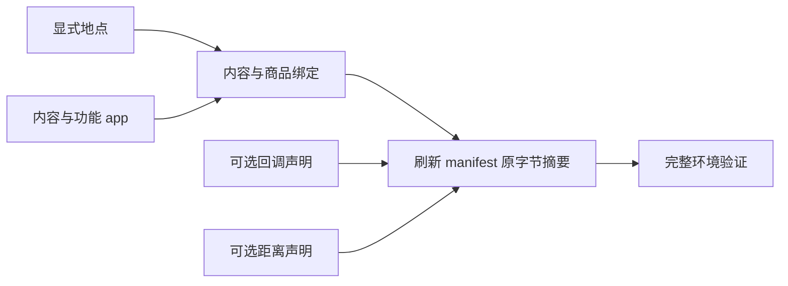

<a name="resources-设计环境数据集"></a>
# 设计环境数据集

环境根包含 catalog/、persona.toml 和 config.toml。catalog/ 必须有 manifest.json、app-catalog.jsonl、
content-catalog.jsonl、location.jsonl、merchant-catalog.jsonl 五个文件，另外可以按需放三个可选文件：
callbacks.jsonl 写回调声明，map.jsonl 写两地的距离，travel-method.jsonl 写步行以外的出行方式。
可选文件不放等于零行：没有回调就不放 callbacks.jsonl，不需要声明距离就不放 map.jsonl，
不放 travel-method.jsonl 时人物只能步行。其他名字的文件一律拒绝，文件名用连字符。
每行是一项完整 JSON 对象，使用 UTF-8 无 BOM 与 LF。清单的 format_version 写 5，rules_version 写 6。
字段、显示名、绑定与发布摘要合同见[资源引擎](../design/03-resource-engine.md)。

地点逐项声明，不使用 count 扩张或生成地址。给本人住处声明 is_home，为一个实际地点声明 accepts_parcels，
同名分店使用 branch_label。
需要营业限制时声明 weekly 与按 ISO 日期完整替换的 exceptions；省略 opens 表示全天营业。

允许睡觉的地点声明 sleepable 为 true，缺省不能睡。sleepable 与 is_home 互不推导；
人物自己的家必须标 sleepable，否则环境加载以 HOME_NOT_SLEEPABLE 失败。
家声明了 opens 时，关门时段内不能开始睡；想让人物随时能睡，就不要给家声明 opens。

```json
{"app_ids":[],"is_home":true,"kind":"home","location_id":"home","name":"家","sleepable":true}
{"app_ids":[],"kind":"office","location_id":"office","name":"公司","sleepable":true}
```

地图在加载时由全部地点、声明的距离和唯一运行种子在内存生成，不把生成的 map.json 放进发布环境。
想控制两地的距离，就在 map.jsonl 里为这一对地点写一行，例如让家到公司是 12,600 米：

```json
{"a": "home", "b": "office", "length_m": 12600}
```

- a、b 写 location_id，不写显示名，并且 a 按字符串比较小于 b；行按 (a, b) 升序，同一对地点只写一行。
- length_m 是不小于 1 的整数米数，往返共用；天气照旧放慢出行。
- 声明的两地直接相连，距离就是声明值；没有声明的边仍随机生成，长度在 200 到 2000 米之间。
- 声明一条远大于 2,000 米的距离后，地图实际分成两簇，只靠声明的那条边相连，没有声明的地点随机挂在其中一侧。
  凡是要在公司或家附近用到的地点（午餐店、咖啡店、便利店、驿站），都各声明一行到公司或到家的距离。
- 加载报 MAP_DISTANCE_CONTRADICTED 时，原因里写着哪一行的直达距离比哪条绕行路线更长；
  改其中一行，让直达的距离不超过绕行的总长。
- 任意两地要能用这个世界里最慢的出行方式在雪天一天内走到，否则加载报 MAP_ROUTE_TOO_LONG。
  只有步行，或定义的方式都不比步行慢时，上限是 62,208 米；定义了更慢的方式上限更小，例如每秒 0.5 米时是 25,920 米。

步行由引擎自带，身份是 walking，名称是「步行」，每秒 1.2 米，免费。其他出行方式写在 travel-method.jsonl，每行一种：

```json
{"exertion":"light","name":"公共交通","price_per_km_fen":0,"speed_meters_per_second":5,"start_price_fen":200,"travel_method_id":"bus"}
{"exertion":"light","name":"驾车","price_per_km_fen":200,"speed_meters_per_second":7,"start_price_fen":500,"travel_method_id":"driving"}
{"exertion":"light","name":"打车","price_per_km_fen":300,"speed_meters_per_second":7,"start_price_fen":1400,"travel_method_id":"taxi"}
```

- 六个字段都要写。行按 travel_method_id 升序，身份不能重复，也不能叫 walking。
- name 是人物看到并照写的名称，全程只用这一个：活动名、路上的位置说明和到达记录都显示它。
  名称不能叫「步行」，两种方式之间也不能重名，只差空白或大小写也算重名。
- speed_meters_per_second 是大于 0 的数，整数或小数都可以；start_price_fen 是起步价，price_per_km_fen 是每公里价格，
  都是不小于 0 的整数分，两个都写 0 就是免费。
- exertion 写 idle、light、moderate、heavy 之一，与内容的体力档位同一套；人物看到的是「轻松」（idle、light）
  或「费力」（moderate、heavy，以及步行）。
- 人物在每个目的地下看到全部出行方式，步行排第一，其余按身份的字母顺序；余额不够付车费的方式照样列出，标为此刻不可用。

app 区分内容平台和功能 app。功能 app 由引擎选择。内容平台里登记了内容的供人物打开，打开只看内容；只卖东西、没有内容的不能单独打开，只在下单和查询时出现。登记在商品的 app_ids 上、或登记在卖商品的地点的 app_ids 上的内容平台能接单，人物购买和查询时可以把它写进 prefer。app 行只写 app_id、name、role 和功能 app 的绑定，不写任何时长；写了已删除的 browse_duration_seconds 会加载失败。
功能 app 有两种绑定，至少写一种：actions 只能写 purchase，表示它是支付 app 的候选；
travel_method_ids 逐个写它能导航的出行方式身份（步行写 walking），表示它是这些方式的导航 app 候选。
某种出行方式没有任何 app 绑定时，用这种方式出行的那一趟没有导航记录。内容平台不能写这两个字段。

```json
{"app_id":"amap","name":"高德地图","role":"function","travel_method_ids":["bus","driving","taxi","walking"]}
```

回调规则订阅出行时，触发写成 key 为 travel 并带 travel_method_id，一条规则只能指定一种出行方式，没有「任意方式」的写法；
想让开车和打车都扣油，要写两条规则。key 为其他动作时不能带 travel_method_id。key 只能写 purchase、interact、sleep 或 travel，查询不能订阅。

```json
{"rule_id":"fuel-daily","trigger":{"class":"action","key":"travel","travel_method_id":"driving"},"effect":{"type":"state_delta","state":"fuel","delta":-1,"once_per":"local_day"}}
```

商品只声明零食、食品、饮料、商品四类价格与地点类型或内容 app 绑定。
内容用 app_ids 或 location_kinds 显式绑定，填写实际时长、体力档位、两项心理缓解档位和 pushable。
不要添加内容分类、manner、动作菜单、消息、聊天对象或商家账户。

用 location_kinds 绑定到地点的内容，要把名字当成人物读和写的名字来起：人物在地点做哪件事，是照这个名字点名的。
不属于系列的内容写 title，系列写 series.title；系列各集的 title 不能点名；每次点名从第一集做起，一集做完自动接下一集，人物中途结束时整件事算做完一轮。
同一个地点类型下这些名字不能重复，独立内容和系列合在一起比，只差空白或大小写也算重复；不同地点类型之间可以重名。
用 app_ids 绑定的内容标题不是人物可写的名字，人物只写 app 名。

人物打开内容 app 后，一条放完自动接下一条：系列接下一集；系列放完，接这个 app 里最近看过、还没看完的另一部系列；
一条独立内容放完，随机接一条没看过的独立内容。后两种只在 pushable 为 true、此刻满足前提的内容里挑，系列的下一集不看 pushable。
所以 pushable 管两件事：这条内容能不能被推送，能不能在别的内容之后被自动接着放。
打卡、电话、和某个人的聊天、邮件、天气这类内容的 pushable 一定写 false，否则它们会被接在同一个 app 的别的内容之后自动放：打完一通电话接着拨另一通，刷着朋友圈刷进一段私聊。
每条内容照自己登记的时长放，引擎不给一次使用定时长。一次使用在人物决定结束时结束，或者在没有可接的内容时停下；
人物只在得到决策机会时才会结束它，例如推送、外卖送到、提醒到点、身体感觉变了、上下班时刻，以及每隔一段时间的播报与重估。
所以一个 app 里没看过的可推送独立内容越多，一次刷得越久；都看过之后再打开，引擎按打开时的规则挑，会重放看过的内容。

接收包裹的地点也要点名才能做事；本人在那里没有已到站的包裹时，那里的事都做不了。

用 app_ids 绑定的内容可以多写一个 prerequisite，声明这条内容只有人在某类地点、或当地时间落在某些时段内才能开始。
打卡就这样写：钉钉里一条只在公司、只在上下班时段能开始的内容。人物仍只写 app 名，app 里做哪一条由引擎在此刻合格的内容里挑。

```json
{"app_ids":["dingtalk"],"content_id":"dingtalk-clock","title":"考勤打卡","duration_seconds":60,"exertion":"idle","pushable":false,"relaxation_relief":"none","social_relief":"none","summary":"打开考勤页，完成一次打卡。","summary_source":{"kind":"synthetic","url":null,"notice":"数据集作者编写"},"prerequisite":{"location_kinds":["office"],"opens":{"weekly":{"mon":[["08:00","10:00"],["17:00","20:00"]],"tue":[["08:00","10:00"],["17:00","20:00"]]}}}}
```

- location_kinds 写地点的 kind，按字符串升序、不重复，每项要与某个已登记地点的 kind 一字不差；不写或写空数组表示不限地点。
- opens 的写法与地点行的 opens 完全相同；不写表示不限时间。时段含头不含尾，weekly 没写的星期整天不可用。
- 两项至少写一项，两项都写时都要满足。没有前提就省略这个字段，写成 null 会被拒绝。
- 前提只卡开始：开始以后时段过了、人离开了都照常做完，暂停后恢复也不再看前提。
- 一个 app 的内容此刻都不满足前提时，这个 app 仍列出但不可用，原因里写着要去的地点名称和今天能用的时段；
  今天没有能用的时段时，写之后七天里下一次能用的那天和时段，例如 `next available Mon 10-19 08:00–10:00, 17:00–20:00`，七天里都没有也写明。

写前提时留意这几条：

- 前提只能写在 app 内容上；写在用 location_kinds 绑定到地点的内容上会以 CONTENT_PREREQUISITE_INVALID 拒绝。
- 内容行顶层的 location_kinds 把内容绑定到地点，人物要在那里点名才做；prerequisite 里的 location_kinds 只是 app 内容的开始条件，内容仍在 app 里。
- 想让某个 app 在某地某时只做一件事，就让那时只有它合格：这个 app 只登记这一条，或者给其他内容写上错开的 opens。
- 引擎不区分上班卡和下班卡；要在记录里分清，就登记两条内容，各写各的时段，content_id 不同。
- 同时卖商品的 app 至少留一条不带前提的内容，否则前提都不满足时它打不开；它卖的商品仍然可以查询，也可以按商品名购买。
- 带前提的可推送内容只在前提满足的整点才可能被推送；推送之后时段过了，打开 app 不会优先看到它。
- 带前提的系列开始后会一集接一集做完；不想让内容在时段外连着做，就不要把它写成系列。同一系列各集的前提必须完全相同。

用 location_kinds 绑定到地点的内容可以多写两个字段：consumes_state 让这件事收到某些商品之后才出现、做一次就用掉，
completion_effects 写这件事做完时的一次性效果。「买菜做饭」就这样写：

```json
{"state":"groceries","initial":0,"cap":1,"reset_on_goods":["meat-pack","veg-pack"]}
{"category":"goods","goods_id":"veg-pack","name":"蔬菜包","price_fen":2500,"store_kinds":["supermarket"]}
{"content_id":"cook","title":"做饭","location_kinds":["home"],"duration_seconds":3600,"exertion":"light","pushable":false,"relaxation_relief":"low","social_relief":"none","summary":"用买来的食材做一顿饭，吃完收拾。","summary_source":{"kind":"synthetic","url":null,"notice":"数据集作者编写"},"consumes_state":"groceries","completion_effects":{"food":"meal"}}
```

第一行写在 callbacks.jsonl，第二行写在 merchant-catalog.jsonl，第三行写在 content-catalog.jsonl。

- 状态的 cap 写 1：买一件还是十件、买一次还是三次，收货后都只开放一次，开始做饭就用掉，想再做要再买。
  initial 写 0 表示运行开始时家里没菜，写 1 表示有。
- 食材商品的类别写 goods。写成 snack 或 meal 会在收货时补能，人物就等于吃了两顿；goods 收货时只让放松需要减 0.10。
- 没开放时人物在家看不到「做饭」；照写也做不了，原因里列出收到哪些商品能开放它。开始之后它不再列出，直到下一次收到食材。
- completion_effects 只写档位名，不写数值，三个成员都可以省略，但至少写一个：
  food 写 snack 或 meal，做完补的能量与收到一件零食或食品相同；
  relaxation_relief、social_relief 写 low、medium 或 high，做完时放松或社交需要一次减少的量，等于内容行上同名档位缓解一小时。
  没有某项效果就省略它，不要写 none 或 null。
- 内容行原有的 exertion 和两项缓解照旧按实际做了多久结算；completion_effects 只在做完时结算一次，提前结束或运行截止都没有。
  系列每集做完时结算那一集写的效果。
- 两个字段只能写在地点内容上，互不要求：只写 completion_effects 就是随时能做、做完有效果的事，例如父母家的「吃饭」写
  {"food":"meal","social_relief":"high"}。不要让同一顿饭算两次：公司的「吃午饭」写了 food，人物点了外卖再去吃午饭就吃了两顿。
- 系列各集的 consumes_state 必须相同；开始这件事减一次，自动接下一集不再减。
- 状态的 cap 写 0 时这件事永远不会出现；状态被用掉时也能触发回调的阈值规则，例如食材用完时让买菜 app 推一条提醒。

写了 completion_effects.food 的地点内容做完时，人物得到与收到一件食品（meal）或零食（snack）相同的能量，不花钱，没写 consumes_state 时也不需要先买食材；
人物中途结束不算，暂停后回来做完才算。系列的每一集各写各的，例如「做晚饭」三集只有第 2 集《吃晚饭》写 food。
引擎不看标题：标题是「吃晚饭」而没写 food，人物做完不算吃过。想让吃饭花钱，就让人物买食品。
饭点时段之内，能量低于 1200 千卡时人物至少「有点想吃」；能量不低于 1200 千卡时饭点里也是「不饿」，吃过一顿把能量补到 1200 千卡以上，就不会因为还在饭点而觉得饿。买来的食品也是这样。

```json
{"content_id":"dinner-2-eat","title":"吃晚饭","series":{"title":"做晚饭","episode":2},"location_kinds":["home"],"duration_seconds":1500,"exertion":"idle","pushable":false,"relaxation_relief":"none","social_relief":"none","summary":"在家吃晚饭。","summary_source":{"kind":"synthetic","url":null,"notice":"数据集作者编写"},"completion_effects":{"food":"meal"}}
```



修改目录后使用仓库的发布身份工具刷新 manifest 的文件摘要与目录内容摘要，再执行完整验证。
放了新的可选文件或删了可选文件之后同样要刷新：清单的文件表只登记实际存在的文件，
不放与放一个空文件运行起来相同，目录摘要不同。
验证失败按返回的所属路径与英文原因修正，原因里带着行号、文件名或路线等详情；
不能删除未知字段错误或靠旧格式混读运行。
报 ENVIRONMENT_STALE_FILE 时删除或改正那个文件名；报 ENVIRONMENT_FILE_UNLISTED 时刷新清单；
报 RULES_VERSION_MISMATCH 时把清单的 format_version 改成 5、rules_version 改成 6，并按当前格式改完各文件；
从规则版本 5 升到 6 时，还要按上文把打卡、电话、聊天、邮件、天气这类内容的 pushable 改成 false。
操作命令见[运行手册](runtime.md)，作者说明放在环境包外。

<a name="resources-固定规则怎样落到手机时间线"></a>
## 固定规则怎样落到手机时间线

下面这些规则由引擎固定，数据集改不了。写目录和人设之前先看它们会让手机时间线变成什么样；规则的定义在所列的设计小节，以那里为准。

| 规则 | 对手机时间线的影响 | 定义在哪 |
| --- | --- | --- |
| 外卖的预计送达是购买开始的那一秒加送达用时：600 秒备货，再加店铺到收货地点的距离按每秒 5 米走完的时间，不受天气影响。购买拖到预计送达之后才付款的，付款那一秒送达 | 店离得远，外卖就晚：13.2 公里要 54 分钟，11:49 下单 12:43 才到。想让午饭在饭点前到，就让卖午饭的店离公司近，并在 map.jsonl 里声明这段距离 | [交换引擎](../design/02-exchange-engine.md)「收货与费用」；[模拟引擎](../design/04-simulation-engine.md)「购买、付款与收货」 |
| 「订单已发货」通知在付款之后、送达之前发出，时刻取付款到送达这段时间的十分之一处 | 它可能早于 600 秒备货结束，这是规则如此：付款后 22 分钟送达的一单，付款后 2 分 12 秒就显示已发货 | [模拟引擎](../design/04-simulation-engine.md)「购买、付款与收货」的通知表 |
| 人物购买时可以在 prefer 里写想用的 app。此刻营业、卖这件商品的店里有登记了这个 app 的，就在这些店里选一家、经它下单，可以因此换到更远的店；没有时照原规则选店，下单 app 按店铺和当地日期抽取。只在 app 里卖的快递商品，prefer 在商品登记的 app 之内就用它，否则按商品和当地日期抽取 | 人设里写「用美团外卖点午餐」时，要让卖午餐的店在 app_ids 里登记美团外卖，否则订单会落到这家店登记的别的 app 上。习惯里 app 名的写法见[编写 persona.toml](personas.md)「关系、习惯与口味」 | [模拟引擎](../design/04-simulation-engine.md)「购买、付款与收货」；[配置](../design/08-configuration.md)「唯一种子与随机键」 |
| 人停在卖这件商品的地点时一律到店购买，不看 prefer；这个地点已打烊时这次购买被拒，不会改成外卖 | 这时手机上没有下单 app，至多最后 10 到 20 秒是支付 app；抽到直付时一个 app 都没有 | [模拟引擎](../design/04-simulation-engine.md)「购买、付款与收货」 |
| 出发时没有别的 app 在用、也没有正在下的单，导航就从出发那一秒起在前台，不会晚于出发才打开；路上用别的 app 或下单时让出，那项活动停下后有一半机会回到前台。带着正在用的 app 或正在下的单出发时（与出发同一次回复里开始的也算），导航要等它停下才可能出现。到达那一秒导航关闭 | 「出门五分钟后才打开导航」这类行数据集安排不出来。出行方式没有绑定任何导航 app 时，这一趟没有导航记录 | [模拟引擎](../design/04-simulation-engine.md)「出行、内容与查询」 |
| 没有登记任何内容的内容平台不能单独打开，只在下单和查询时出现 | 这类 app 在手机上只有下单的那几分钟和查询的 5 到 10 分钟，没有「打开看看」的时段。人设里的写法见[编写 persona.toml](personas.md)「关系、习惯与口味」 | [资源引擎](../design/03-resource-engine.md)「app、内容与候选呈现」；[模拟引擎](../design/04-simulation-engine.md)「动作、名称与并行」 |
| 用内容 app 时放完一条自动接下一条，接另一部系列或另一条独立内容只在 pushable 为 true 的内容里挑；一次使用到人物结束它、或没有可接的内容才停 | 时间线上一次使用是一整段，里面一条接一条，每条照自己的时长；一个 app 里没看过的可推送内容越多，一段越长。打卡、电话、聊天、邮件、天气这类内容写成 pushable 为 true，就可能被接在同一个 app 的别的内容后面 | [模拟引擎](../design/04-simulation-engine.md)「出行、内容与查询」 |
| 用 app_ids 绑定的内容，title 要写成这个 app 里会出现的一条内容的标题。引擎不检查标题 | 时间线上这一行写成 app 名加书名号里的标题，例如「使用哔哩哔哩《散步装备准备》」。标题写成一个动作，读的人会以为人物在做这件事；推送的标题和简介同理 | [记录引擎](../design/05-recording-engine.md)「显示写法与检查工具」 |
| 食品和零食在收到的那一刻吃掉，饮料和商品在收到的那一刻用掉，没有库存 | 「买明天的食材」不能靠库存表达：食材写成食品或零食，一送到就被当成一顿吃掉。想让人物在家吃一顿不花钱的饭，用上文写了 completion_effects.food 的地点内容；想让做饭要先买食材，用上文的 consumes_state，食材的类别写 goods | [交换引擎](../design/02-exchange-engine.md)「收货与费用」 |
