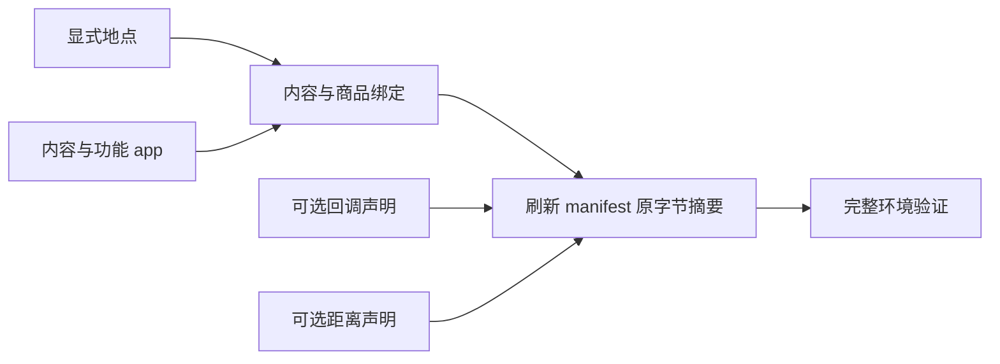

<a name="resources-设计环境数据集"></a>
# 设计环境数据集

环境根包含 catalog/、persona.toml 和 config.toml。catalog/ 必须有 manifest.json、app-catalog.jsonl、
content-catalog.jsonl、location.jsonl、merchant-catalog.jsonl 五个文件，另外可以按需放两个可选文件：
callbacks.jsonl 写回调声明，map.jsonl 写两地的距离。可选文件不放等于零行：没有回调就不放 callbacks.jsonl，
不需要声明距离就不放 map.jsonl。其他名字的文件一律拒绝，文件名用连字符。
每行是一项完整 JSON 对象，使用 UTF-8 无 BOM 与 LF。清单的 format_version 和 rules_version 都写 4。
字段、显示名、绑定与发布摘要合同见[资源引擎](../design/03-resource-engine.md)。

地点逐项声明，不使用 count 扩张或生成地址。给本人住处声明 is_home，为一个实际地点声明 accepts_parcels，
同名分店使用 branch_label。
需要营业限制时声明 weekly 与按 ISO 日期完整替换的 exceptions；省略 opens 表示全天营业。

地图在加载时由全部地点、声明的距离和唯一运行种子在内存生成，不把生成的 map.json 放进发布环境。
想控制两地的距离，就在 map.jsonl 里为这一对地点写一行，例如让家到公司是 12,600 米：

```json
{"a": "home", "b": "office", "length_m": 12600}
```

- a、b 写 location_id，不写显示名，并且 a 按字符串比较小于 b；行按 (a, b) 升序，同一对地点只写一行。
- length_m 是不小于 1 的整数米数，往返共用；天气照旧放慢出行。
- 声明的两地直接相连，距离就是声明值；没有声明的边仍随机生成，长度在 200 到 2000 米之间。
- 声明一条远大于 2,000 米的距离后，地图实际分成两簇，只靠声明的那条边相连，没有声明的地点随机挂在其中一侧。
  凡是要在公司或家附近用到的地点（午餐店、咖啡店、便利店、驿站），都各声明一行到公司或到家的距离。
- 加载报 MAP_DISTANCE_CONTRADICTED 时，原因里写着哪一行的直达距离比哪条绕行路线更长；
  改其中一行，让直达的距离不超过绕行的总长。
- 任意两地的最短距离不能超过 62,208 米（步行在雪天一天内能走到），否则加载报 MAP_ROUTE_TOO_LONG。

app 区分内容平台和功能 app。功能 app 绑定具体动作，由引擎选择；内容平台供人物 interact。
商品只声明零食、食品、饮料、商品四类价格与地点类型或内容 app 绑定。
内容用 app_ids 或 location_kinds 显式绑定，填写实际时长、体力档位、两项心理缓解档位和 pushable。
不要添加内容分类、manner、动作菜单、消息、聊天对象或商家账户。



修改目录后使用仓库的发布身份工具刷新 manifest 的文件摘要与目录内容摘要，再执行完整验证。
放了新的可选文件或删了可选文件之后同样要刷新：清单的文件表只登记实际存在的文件，
不放与放一个空文件运行起来相同，目录摘要不同。
验证失败按返回的所属路径与英文原因修正，原因里带着行号、文件名或路线等详情；
不能删除未知字段错误或靠旧格式混读运行。
报 ENVIRONMENT_STALE_FILE 时删除或改正那个文件名；报 ENVIRONMENT_FILE_UNLISTED 时刷新清单；
报 RULES_VERSION_MISMATCH 时把清单的两个版本号改成 4 并按当前格式改完各文件。
操作命令见[运行手册](runtime.md)，作者说明放在环境包外。
