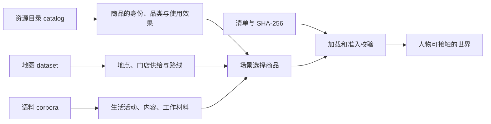
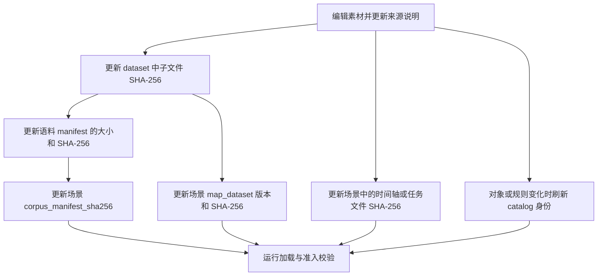

# 定义地点、门店供给与世界素材

> 更新日期：2026-10-03。工具交互已实现；当前目录 5.3、品类契约与规则绑定 3、场景结构 5、地图结构 3。
> 地图按场景种子分别冻结完整供给，商品价格范围和真实料理输入输出均参与加载与行为校验。
> 合同以[工具交互规格](../dev/SPEC-tool-interaction.md)为准，世界结构 9、场景结构 5 与查询筛选以[个人事务与工作安排规格](../dev/SPEC-errands-workday.md)为准；本页命令使用当前已发布格式。

要让人物去新的地点、买新的商品、参加新的活动或接触自己的内容，需要同时准备**素材定义、场景引用和文件清单**。
先从现有场景选择素材，确实需要改变素材本身时，再修改对应的目录或语料文件。
本页命令都在仓库根目录执行；场景基础写法见[场景配置](scenarios.md)。



## 先找到应该修改的文件

| 想改变什么 | 编辑位置 | 场景如何引用 |
| --- | --- | --- |
| 这次实验选哪些地点、商品和供给 | 场景的 `locations`、`products`、`supplies` | 只填写已有身份；供给允许覆盖 `initial_stock` |
| 地点名称、坐标、营业时间、活动环境 | 地图的 `locations.json` | `locations[].location_id` |
| 同一商品在某家门店的价格、库存、配送范围 | 对应种子的地图 `supplies.json` | `supplies[].supply_id` |
| 商品的份量、热量、使用方式 | `catalog/objects.jsonl` 和品类契约 | `products[].product_id`；实际取目录中的 `object_id` |
| 可参加的生活活动、地点要求、时间窗口 | `corpora/lifestyle/enrichment.json` 与生活活动生成器 | 运行时固定读取 `lifestyle/items.json` |
| 可观看或阅读的具体内容 | 内容元数据、SRT 时间轴和场景的 `contents` | `item_id`、`timeline_path`、`timeline_sha256` |
| 工作的实际材料和验收答案 | 语料中的输入、答案文件和场景的 `tasks` | `input_path`、`oracle_path` 及各自的 SHA-256 |
| 全局身体、品类或交换规则 | `catalog/` 中的规则与资源定义 | 见[规则配置](rules.md) |

### 哪些路径可以换

场景的 `corpus_root` 使用相对**场景文件所在目录**的路径，保证场景可以跨机器复制。
`map_dataset.path`、内容时间轴、工作材料和游戏路径均相对这个语料根目录解析。
地图内部的 `locations_file.path`、`supplies_file.path`、`routes_file.path` 也相对语料根目录，
并不是相对 `dataset.json`。

目录位置由场景路径决定：`scenarios/example.json` 使用其上两级目录下的 `catalog/`。
`catalog_version` 只钉定版本，不是目录路径。运行命令目前没有 `--catalog` 参数；
需要独立目录时，可以采用 `experiments/my-world/scenarios/` 与 `experiments/my-world/catalog/` 的并列布局。

**地图加载器支持 `map_dataset.path`，但完整世界素材校验仍固定读取 `zhangjiang-map/locations.json`。**
其他固定语料路径包括 `lifestyle/items.json`、`meals/items.json`、`scene-stock/home-pantry.json`、
`scenario-contacts/contacts.json`、`scenario-work/materials.json`，以及下文列出的内容元数据路径。
自定义语料根目录应保留这些布局；只改地图路径不能让所有校验器同时使用另一套文件名。

生活活动的名称与 MET 对应检查会使用场景语料根目录，但活动 `effects` 当前仍从**仓库内**
`corpora/lifestyle/items.json` 读取并缓存。只切换 `corpus_root`，不能保证活动效果也切换到了另一份语料。

### 输入与生成文件

| 文件 | 当前维护方式 | 修改时的注意点 |
| --- | --- | --- |
| `catalog/category-contract.json`、`exchange-rules.json`、`affordances.toml`、`rules/*.toml` | 人工维护的规则输入 | 修改后重新生成或刷新目录身份；见[规则配置](rules.md) |
| `catalog/resources.jsonl`、`objects.jsonl`、`manifest.json`、`overrides/tombstones.jsonl` | 正式基线由 `scripts/build_catalog.py` 生成 | 基线生成器会重写这些文件；独立自定义目录不要再用它覆盖 |
| `scripts/catalog-snapshot-legacy-scenario.json` | 目录生成器仍在读取的冻结输入 | 文件名中的 `legacy` 不代表已停止使用；它不是运行场景 |
| `corpora/lifestyle/enrichment.json` | 生活活动的人工补充字段 | `entries` 必须与生成器的活动身份一一对应 |
| `corpora/lifestyle/items.json` | 生活活动生成结果 | 重建后还要更新语料清单及目录中的活动 MET 表 |
| 地图 JSON 与路线响应 | 已发布的地图数据 | 修改后发布新的地图版本并更新逐层哈希 |
| `corpora/zhangjiang-map/category-assignment.json` | 已发布的冻结类别与逐店声明 | kind定义准入池；逐店类别和对象并集完整生成实际供给，不是运行策略开关 |
| `corpora/manifest.json` | 全部语料的文件身份与来源清单 | 修改现有条目后更新大小、哈希和来源；新增文件必须新增清单条目 |

## 先完成一个最小修改：减少一家门店的初始库存

下面是完整可运行命令。它复制现有场景，在新场景中把一条供给的初始库存设为 `12`，
再通过真实加载器校验。不修改地图、商品或目录，不调用模型，也不启动模拟。

```bash
uv run python - <<'PY'
import json
from pathlib import Path
from worldmock.life.scenario import load_scenario

source = Path("scenarios/white-collar-12-weeks.json")
target = Path("scenarios/my-resources.json")
document = json.loads(source.read_text(encoding="utf-8"))
document["scenario_id"] = "my-resources"
supply = next(item for item in document["supplies"]
              if item["supply_id"] == "supply-market-food-6923644266066")
supply["initial_stock"] = 12
with target.open("x", encoding="utf-8") as handle:
    handle.write(json.dumps(document, ensure_ascii=False, indent=2) + "\n")
scenario, _ = load_scenario(target)
assert next(item for item in scenario.supplies
            if item.supply_id == supply["supply_id"]).initial_stock == 12
print("Scenario resource override is valid")
PY
```

`open("x")` 要求目标不存在；已经创建过时，直接编辑该场景即可。
这个例子验证了文件加载与跨引用；正式运行前的完整校验见[验证修改](#验证修改)。

## 编写地点与营业时间

地图主文件声明身份、版本、坐标系、时区、边界、生成种子以及三个子文件的路径与哈希。
完整模板见[种子 20260105 地图](../../corpora/zhangjiang-map/20260105/dataset.json)、
[种子 20260106 地图](../../corpora/zhangjiang-map/20260106/dataset.json)和[共享地点](../../corpora/zhangjiang-map/locations.json)。
地图声明与地点、供给、路线文件均使用 `schema_version: 3`，声明必填 `random_seed/category_assignment_sha256`；
种子必须与场景一致，类别声明的字节哈希必须匹配，旧结构直接拒绝。

| 地点字段 | 必填与取值 | 含义和关联 |
| --- | --- | --- |
| `location_id`、`name` | 必填非空字符串；身份唯一 | 场景、路线、供给、人物住处和任务地点用这个身份关联；`name` 是人物看到并照抄的名称 |
| `branch_label` | 可选非空字符串，缺省 `null` | 分店标签：显示名为「名称（branch_label）」，提示、事件与导出都用显示名；所选地点的显示名必须互不相同，同名地点靠它区分 |
| `kind` | 必填，只能是 `home`、`office`、`merchant`、`restaurant`、`convenience_store`、`supermarket`、`wet_market`、`fitness`、`park` 之一 | 对应场景 `interaction_menus_by_location_kind` 的键，也是人物看到的场所类型（家、办公室、商户、餐馆、便利店、超市、菜市场、健身房、公园）；场景选中的地点用了其他值即加载拒绝；改类别要同步菜单 |
| `business_kind` | 必填字符串 | 地点业态说明，与活动环境不同 |
| `longitude`、`latitude` | 必填有限数值，WGS84 经度/纬度 | 还必须落在地图 `bounds` 内 |
| `location_kinds` | 必填非空列表，无重复 | 只允许 `home`、`office`、`outdoor`、`fitness`、`venue`；地点不能写 `anywhere` |
| `opening_calendars` | 必填列表，可为空 | 为空表示没有营业时间声明；不能理解为全天营业 |
| `required_qualifications` | 必填字符串列表，可为空 | 进入地点需要人物持有的资格 |
| `brand` | 必填，可为 `null` | 有可靠品牌身份时才填 `brand_id`、`name`、`source` |
| `source` | 必填来源对象 | 区分事实和实验假设，见下文 |
| `affordances` | 必填对象 | 保留现有住所、办公室等世界素材要求；任意新增键不会自动创造运行能力 |

显示名要写人物会说的店名或地名；同名分店用 `branch_label` 区分，例如「全家（东昌路店）」，不要把坐标或内部标识写进名称。
显示名（连同分店标签）带坐标（如「31.2, 121.5」）或标识形态（如「sim-01」「poi-node-1」）时，
新建运行与 `worldmock validate` 报输入警告 `LOCATION_NAME_SUSPICIOUS`，场景照常加载。

营业日历中 `weekly` 必须包含字符串键 `"0"` 至 `"6"`，依次对应周一至周日。
每日区间用当地零点起算的**分钟数**：`540` 是 09:00，`1320` 是 22:00。
一天可有多个不重叠区间；`[]` 表示明确休息。`exceptions` 用 `YYYY-MM-DD` 日期覆盖当天周计划。

以下是一个日历对象中的**局部片段**，不能独立替代完整日历：

```json
{
  "weekly": {
    "0": [{"opens": 540, "closes": 1320}],
    "1": [{"opens": 540, "closes": 1320}],
    "2": [{"opens": 540, "closes": 1320}],
    "3": [{"opens": 540, "closes": 1320}],
    "4": [{"opens": 540, "closes": 1320}],
    "5": [{"opens": 600, "closes": 1200}],
    "6": []
  },
  "exceptions": {"2026-01-01": []}
}
```

跨午夜营业可写 `{"opens": 1200, "closes": 1560}`，表示当晚 20:00 到次日 02:00。
单个区间必须正向且不超过一天，相邻两天的跨日区间也不能重叠。

### 来源与有效期

地点和供给的 `source` 都要求 `kind`、`url`、`retrieved_at`、`license`、`notice`、`fact_cutoff`、`applicability`。
`kind` 只接受 `fact` 或 `scenario`；人为设定的价格、库存、营业时间写 `scenario`。
来源取得时间必须带时区，且不晚于地图的 `prepared_at`；事实截止日期不能晚于取得日期。

营业日历和报价额外要求 `effective_from`、`effective_to`、`reviewed_on`、`still_valid_on` 和自己的 `source`。
`effective_to: null` 表示未声明截止；同一对象的有效期不能重叠。
地图发布日必须处于核对日与有效日之间。历史模拟日期和资料取得日期可以不同，但要在 `applicability` 中如实解释。

### 添加地点时还要补路线

每个场景选中的**有向地点对 × 地图出行方式**都必须有一条路线记录。
`walking` 对应 `foot` 路由配置，`driving` 对应 `car`；不能只写单向路线。

| 路线状态 | 必须提供 |
| --- | --- |
| `reachable` | 正距离（米）、正时长（秒）、非负车费（分），以及带几何和实际出行方式的冻结成功响应 |
| `unreachable` | 冻结的 `NoRoute` 响应；不能填写距离、时长或车费 |
| `unknown` | 非空 `reason`；不能声称已有响应，也不能填写可达指标 |

基础时长来自冻结响应；实际计划时长还乘[出行时长规则](rules.md#出行时长)。
路线车费必须与当前交换规则重新计算的金额一致。

当前地图准备命令是对**已通过加载校验的张江地图**重新取得路线，需联网：

```bash
uv run python scripts/prepare_map.py \
  --source-root corpora \
  --destination experiments/worldmock-map-release-20260105 \
  --random-seed 20260105
```

目标必须不存在。命令读取源目录中的 `zhangjiang-map/20260105/dataset.json` 和相邻的 `catalog/`，
按完整逐店声明重新生成该种子供给，并联网重新取得已声明范围的路线。
另一实验种子使用 `--random-seed 20260106` 和独立新目标目录，不能复用前一份报价。
命令不提供城市搜索或任意地点配置参数，也不补齐完整语料目录或更新场景。
新增地点前，先在源地图中补齐对应的显式路线状态；准备后纳入完整语料目录并更新下文身份引用。

## 编写门店供给与商品

**商品描述“它是什么、怎么使用”，供给描述“哪家门店以什么条件出售”。**
同一商品可以出现在多家门店；各门店的价格和库存由各自的 `supply_id` 区分。
商品对象不能内嵌实际报价、商家或供给库存。对象有效属性携带有来源的构建价格范围，
实际交易仍取所选门店的当前 Quote。

供给文件顶层是 `{"schema_version": 3, "supplies": [...]}`，模板见
[种子 20260105 供给](../../corpora/zhangjiang-map/20260105/supplies.json)和
[种子 20260106 供给](../../corpora/zhangjiang-map/20260106/supplies.json)。
供给保持独立报价、库存、卖方和履约定义。

### 完整类别供给与冻结价格

以下合同已由当前离线构建、地图加载及正式场景准入共同执行。
类别声明使用现有 `LocationConfig.kind` 和品类树 `category_id` 定义准入池：餐馆准入正餐，便利店准入食品，
超市和商户准入食品、日用品及原料，菜市场准入原料；住宅、办公室、健身场所和公园明确写空集合。
同一 `category-assignment.json` 恰含必填 `kinds/locations/source`，准入表 `kinds` 将地图中的现有 kind 映射到品类数组，
包括不售卖地点的空数组，漏配不能视为空集合；逐店恰含必填 `location_id/category_ids/object_ids/price_position_percent/source`。
顶层与逐店来源均沿用完整 `DataSource` 的 `kind/url/retrieved_at/license/notice/fact_cutoff/applicability`，不另造来源字符串。
实际供给为逐店类别及全部后代对象与显式对象的并集，仍须全部在kind准入池内，重合只生成一次。
准入池不等于每店菜单，不能把所有30正餐复制给每家餐馆；包装食品店显式选择食品子类，不借food根包含餐馆正餐。
`ingredient` 独立于即食食品分支，已发布八种真实原料与蔬菜食材包；
漏配拒绝构建，不能把缺键当空集合，不能随机只抽几件，也不能让所有地点出售所有商品。
当前正餐无菜系属性，正式菜单子类或具体对象必须有来源，不从店名猜测；餐馆8正餐/每对菜单各差3项，
便利店40对象/6品类、超市80/8、商户40/6且含日用品、菜市场8真实原料/2原料子类是本次正式场景验收假设。
这不是行业事实；素材不足或未知拒绝发布，还须行为验证到店营业、有货、真实购买及制作食用，不随机补齐。

对象有效属性 `purchase_price_fen_min/purchase_price_fen_max` 通过品类继承或对象差异声明，
两端都必须存在，为同币种正整数分，最小值不大于最大值，两端相等合法，数值来源明确。
构建对 `[random_seed, location_id, object_id]` 使用
`json.dumps(..., ensure_ascii=False, separators=(',', ':'))` 后编码为 UTF-8，取 SHA-256 摘要的无符号大端整数 `h`，
逐店price_position_percent为有来源的整数5至95，固定 `jitter = h % 11 - 5`，
以 `min + ((max - min) * (price_position_percent + jitter) + 50) // 100` 生成一次报价，不为每商品独立抽整个范围。
本正式地图中的门店按同一地区比较，所有便利店定位至少高于地图内普通超市10个百分点，
同商品报价不得更低，整数舍入同价合法；不新增扰动配置或地区字段。
场景、地图和分类声明共同钉定种子与文件哈希；改变这些输入就发布新身份。
正式场景 `products/supplies` 显式选择必须包含选中售卖地点全部声明商品及生成供给，
加载和正式验收核对选择后的实际集合，库存覆盖仍用现有字段，缺项拒绝，不自动补齐旧稀疏列表。
运行观察、查询、购买和恢复不重新抽价，未来调价仍须在对象范围内，实际付款继续使用当前 Quote。

白领与多人场景既有种子不同，分别发布并引用对应的地图供给集合；地点和路线来源可以共享，
不能跨种子复用报价，也不为共用一份地图擅改实验种子。正式场景选择全部逐店实际供给，
单次提示仍分页，呈现上限不减少人物所在地点实际能取得的对象。


### 只读查询与有时长浏览

`query_world(name, way, category, from, available_only, offset)` 六键必填、无缺省，`name`、`way`、`category`、`from` 可空但至少一个非 null，
`available_only` 写 true 或 false，offset为非负整数。`from` 写购买来源（地点显示名，含「家」「住处」，或 App 称呼），只匹配门店供给；
`available_only` 为 true 时只留已确认此刻可执行的条目，报价或营业未知的也被滤掉，空页不等于都不能买。
category使用本轮callable_index已经展示的公开品类标签，非法时返回当轮全部合法标签。
结果为matches/total_count/next_offset，next_offset必填可空；每页沿用现有上限20，按偏移可遍历同一冻结权限下的全集。
筛选在排序与切页之前施加，`total_count` 是筛选后的总数；每项不再附候选，照抄 `name` 与所选动作的 `way` 即可提交。
查询不推进时间、不授予呈现凭据，也不恢复按商品需求搜索门店和路线的旧发现请求；现有有时长商品目录浏览保持真实揭示和留痕。
人物可通过现行只读工具调用查询；结果只含本轮冻结观察有权知道的对象。

只看某家店此刻能买的东西，局部示例如下（现成场景没有钉定手机配置，所以 `from` 写门店显示名而不是 App 称呼）：

```json
{"name": null, "way": "购买", "category": null, "from": "<门店显示名>", "available_only": true, "offset": 0}
```

### 当前供给字段与发布注意事项

| 供给字段 | 必填与约束 |
| --- | --- |
| `supply_id` | 全地图唯一；`location_id + product_id + seller_account_id` 的组合也必须唯一 |
| `location_id`、`product_id`、`seller_account_id` | 必须分别选入场景地点、商品和显式服务账户 |
| `quotes` | 必填报价列表；每条有唯一 `price_version`、正整数 `price_fen` 及完整有效期和来源 |
| `initial_stock` | 非负整数；场景同名字段可覆盖这次运行的初值 |
| `fulfillment_modes` | 非空列表，只允许 `pickup`、`delivery`，不能重复 |
| `delivery_destination_ids` | 支持配送时必须非空；不支持配送时必须为空；所有目的地都要选入场景；门店到每个目的地还要有一条 `reachable` 的驾车路线（门店就是目的地时不需要），缺了只报输入警告 `DELIVERY_ROUTE_UNAVAILABLE`，那个目的地实际送不到 |
| `delivery_delay_seconds` | 非负整数秒；是备货时长。人物看到的是人读送达时刻（例如「预计 11:16 送到」，不是当天时写「预计 1月6日 11:16 送到」），按整单最慢备货加出发时刻的驾车规划时长求得，与实际送达一致；`from` 写 App 称呼（购买渠道）或方式写「购买」下的单同样按这条规则送达，渠道没有自己的送达时长和服务范围；送不到时远程下单标为不可用，下单也被拒，原因分两句：送达地不在可配送目的地写「这里不在这家店的配送范围内」，配送路线缺失、不可达或未知写「这家店到这里没有能走的配送路线」，下一步只指向能送达、且从此地去得了的地点；送给别人时同样分两句，「这里」换成收货人那里（「<名>那里不在这家店的配送范围内」「这家店到<名>那里没有能走的配送路线」），下一步是「先送到自己这里，再当面给」，收货人此刻没有收货地点（联系人没填 `receive_location_id`、同世界人物在途中）时写「暂时送不到<名>那里」 |
| `required_qualifications`、`source` | 显式资格列表和来源对象 |

人物看到的门店商品名是完整标签「<门店显示名>出售的<商品名>」，浏览结果也逐条列这个标签。
离开浏览地点后这些商品不再作为目标列出，人物仍可照记下的标签按名下单，受理照常核对到店或配送条件。
现行请求按名下单也可以只写商品名：items每项为{target,way,from,to}，way写「购买」，to=null为本人、他人写实名，
请求级prefer必须写“最快拿到”或“到手价最低”，null不默认最快，旧英文值和“自己”字符串拒绝；
`from` 留 `null`，系统就在全部门店里找能服务的：人在出售它的店里、东西在那里交得到收货人手上（收货人是自己，或此刻也在那家店里）
就到店，否则在能送到收货地的门店里远程下单。`from` 是可选约束：
地点显示名（含「家」「住处」）限定这一处，App 称呼限定该 App 的成员门店（见[生活场景](scenarios.md#看懂场景的组成)），其他写法以 `SOURCE_NOT_FOUND` 拒绝。
几家都能服务不算重名，按prefer选定一家：“最快拿到”到店就是人所在的这家、远程下单取预计送达最早的，“到手价最低”取到手价最低的，
并列先比到手价、再比门店标识；所选门店写进受理结果的 `details.notes`。选定只看能否服务，营业、库存、报价与余额在结算时照常检查；
哪家都服务不了时拒绝并写明该去哪家店（只写能到店买的店，只能远程下单的店去了也买不到）或哪家送不到，送给别人时下一步是先送到自己
这里再当面给，不替人物换商品。

`query_world` 的 `from` 用同样的写法、同一套解析，但写错时是查询参数错误（`ARGUMENTS_INVALID`，附至多三条换了 `from` 的完整查询请求），
不是 `SOURCE_NOT_FOUND`；`from` 留 null 而把 App 称呼写进 `name`、又没有同名对象时，同样是查询参数错误，候选是把它移到 `from` 的完整请求；
解析成功但该来源没有权限内供给时返回合法空页。

已有报价的局部修改示例：

```json
{
  "price_version": "milk-experiment-price",
  "price_fen": 700
}
```

把这两个字段合并进目标供给的完整报价，同时更新该报价的假设来源。
`700` 表示 7.00 元；必须处于该商品的有效价格范围内，并确认有效期覆盖本次模拟。
运行中的定时调价和补货用场景 `price_changes`、`product_releases`，详见[场景配置](scenarios.md)。

三个正式场景显式选择 168 件可购买商品与每个种子的全部 431 条供给。三家餐馆的菜单均为十种正餐，
是有来源的场景菜单分配，不能当作真实门店调查结果：

| 餐馆地点 | 完整正餐集合 | 履约 |
| --- | --- | --- |
| `poi-3538660453` | `meal-0001` 至 `meal-0010` | 本店自提 |
| `poi-3538682404` | `meal-0011` 至 `meal-0020` | 本店自提 |
| `poi-3538682408` | `meal-0021` 至 `meal-0030` | 本店自提 |

完整声明与来源保存在[类别与逐店声明](../../corpora/zhangjiang-map/category-assignment.json)，
库存、履约和价格派生假设见[供给假设](../../corpora/zhangjiang-map/supply-assumptions.json)。
逐店完整集合必须通过丰富度和菜单差异门禁；不售卖地点保持无供给，售罄或闭店不自动补货。

### 新增商品对象

优先选已有品类，让使用方式、单位和规则继承下来。以下是**一条完整原始对象**；
展示时换行，写入 `objects.jsonl` 时需压成一行。它是明确的实验食品假设，不能改标成真实营养事实。

```json
{
  "object_id": "custom-yogurt",
  "name": "实验酸奶",
  "category_id": "food-dairy",
  "values": {
    "absolute": {
      "energy_kcal_per_serving": 120,
      "energy_density_kcal_per_100": 60,
      "serving_unit": "200g"
    },
    "relative": {},
    "proportional": {}
  },
  "provenance": [{
    "source_id": "custom-yogurt-assumption",
    "type": "scenario",
    "producer": "human",
    "source": "Experiment serving and energy assumptions",
    "paths": ["/values"]
  }],
  "version": 1
}
```

原始对象必填 `object_id`、`name`、`category_id`、`provenance`、正整数 `version`；
`values` 可省略以完全继承。三个属性表的含义见[品类规则](rules.md#品类契约)。
对象不能写编译后的 `edges` 或公式。每个数值必须恰好被一份来源记录覆盖；
来源路径用 JSON Pointer，例如 `/values/absolute/energy_kcal_per_serving`。

新增对象后，构建按每店的 `category_ids` 后代对象与
`object_ids` 并集完整生成该店实际供给，并验证全部属于kind准入池，不把准入池全部复制给各地点。
正式场景显式选择对应全部商品和供给，不继续维护逐对象稀疏手填模式。
当前发布为目录 5.3、品类和规则绑定 3、场景 5（个人事务与工作安排规格阶段 3 起）、地图 3，世界状态为 9（该规格阶段 2 起）。
目录 5.0 是已验收冻结的完整供给阶段；真实料理与后续目录变化已发布新版本；
后续内容变更另发新版本，不同内容不能覆盖同版，最终认证记录实际版本和摘要。
如果只是初始持有且不可购买，可通过人物 `initial_inventory` 引用对象，无需假造门店供给。
食品的每份热量会显示给人物：按 5 进位取整到 10 千卡后写成「每份约 N 千卡」，不足 5 千卡写「几乎不含热量」；
所以份量要按一份实际吃掉的量声明，不要把按 100 克计的热量当成一份。
不足一份也可以吃：手边只剩零点几份时，份量取实际持有，进食时长按份量折算且不少于 60 秒，显示的份量、时长与热量同一口径。
正式基线的食品生成器包含冻结白名单和品类映射；向食品语料随意追加一行不会自动得到完整可购买商品。

### 真实制作后再食用

人物习惯写明自己做饭时，正式数据提供一份可真实购买的食材包、单输入单输出库存转换规则和
`recipe_output_bindings`，明确绑定一个已经发布的可食用正餐对象。输入与输出的 `inventory_unit` 均为 `item`，
库存资源仍为 `inventory/item`，不把营养规格的克或毫升当成库存单位。
制作完整结束才真实扣输入、在当前位置加入输出；之后食用才摄入热量。暂停、取消和提前结束不产生半件产物。
不开发多材料配方，不把无产出的「家常做饭」当成已做出晚饭；公开结果写明消耗、产物和份数，
没有物品变化时也明确返回相应英文说明。三个正式场景已绑定
`ingredient-vegetable-kit` → `meal-0030`，输出品类为唯一的 `prepared-meal-vegetable-stir-fry`。
输入食材、食材包与配方的真实来源见[食材语料](../../corpora/ingredients/items.json)；
正式行为夹具通过真实购买、制作和食用核对库存及热量，旧无产出料理活动已删除。

## 编写生活活动

活动目录固定读取 `lifestyle/items.json`，与资源目录 `activity_met` 中的 `lifestyle:<activity_id>` 必须一一对应。
只添加活动 JSON、遗漏 MET，或只加 MET、遗漏活动，都会拒绝加载。

| 活动字段 | 写法 |
| --- | --- |
| `activity_id`、`name_zh`、`category` | 身份和名称唯一；品类为 `sport`、`hobby`、`learning`、`household`、`social`、`wellness`、`pet`、`volunteer`、`outdoor` |
| `typical_duration_minutes` | 生成器要求 5–1440 分钟 |
| `description_zh`、`source` | 描述实际做什么，并写明活动、时长和 MET 的来源或假设 |
| `met_value` | 生成器要求 1–16；身体耗能使用的活动强度 |
| `location_kinds` | 非空闭集列表；活动允许额外使用 `anywhere` |
| `time_window` | 整数小时 `start_hour < end_hour`，范围 0–24；目前不能用一个区间表达跨午夜 |
| `needs_partner` | 布尔值 |
| `effects` | 恰好包含 `entertainment`、`social`、`health`，每项 0–1 |

当前 `location_kinds` 参与活动地点准入，也决定生活活动窗口列不列它：与人物所在地点环境不合适的活动不列出，
按名写它时以「这里不适合做这件事」拒绝。`time_window` 只参与排序（此刻落在窗口内的排得更靠前），`needs_partner` 只做了
数据形状校验，二者都没有接成运行时的时间或伙伴受理限制。`effects` 分别折算为娱乐缓解、社交缓解和健康相关情绪变化
（娱乐缓解不按人物口味调整），读取位置受上文的仓库固定路径限制；健康效果并不创建独立的“健康值”资源。

下面是 `enrichment.json` 的 `entries` 中一个**完整条目值**，可替换已有 `3d-printing` 条目的值：

```json
{
  "location_kinds": ["home", "venue"],
  "time_window": {"start_hour": 8, "end_hour": 23},
  "needs_partner": false,
  "effects": {"entertainment": 0.7, "social": 0.1, "health": 0.1}
}
```

补充文件只负责这四组字段；名称、描述、时长、MET 和活动清单仍由
[`scripts/build_lifestyle_corpus.py`](../../scripts/build_lifestyle_corpus.py) 内的来源映射生成。
当前生成器约束总量为 180–200 条，并依赖固定外部输入目录中的已核验
`hobbies.csv`、`exercises.jsonl`、`meditation-dataset.json`、`events.csv`。
脚本当前没有可用的 `--hf-dir` 参数，也不会自动下载这些输入。
这是现有构建工具的跨机器限制；本次供给构建使用仓库或场景基准的相对路径，不继承固定机器路径做法。

输入齐备后执行：

```bash
uv run python scripts/build_lifestyle_corpus.py
uv run python scripts/build_lifestyle_corpus.py --check
```

随后更新语料清单，重建资源目录并校验：

```bash
uv run python scripts/build_catalog.py
uv run python scripts/build_catalog.py --check
```

这些构建命令固定写仓库内的正式基线；它们不是任意自定义目录的通用导入器。

## 编写内容与工作材料

内容需要两层声明：语料文件提供元数据和时间轴，场景 `contents` 决定这次实验实际开放哪些条目。
只把文件放进 `corpora/` 不会让人物自动看到它。

| 素材 | 当前读取位置与格式 |
| --- | --- |
| 电影、剧集、网文元数据 | `movies/items.json`、`drama/items.json`、`novels/items.json`，顶层列表 |
| 新闻和段子 | `feed/items.json`、`jokes/items.json`；各自的 `feed-items.json` 还声明整条流的检索元数据 |
| 社交流 | `social/weibo/feed-items.json`、`social/zhihu/feed-items.json`、`social/movie_reviews/feed-items.json` |
| 游戏 | `games/library/items.json`，预生成文件由场景 `games` 引用 |
| 字幕体验 | `sintel/media-identity.json`，单个对象 |
| NASA 播客选段 | `podcasts/items.json`、官方页快照、音频选段与原始锚点身份文件；见下文 |
| 工作材料 | `scenario-work/materials.json` 的 `materials` 列表；任务另外引用实际输入文件和隐藏验收文件 |

内容元数据至少包含非空 `title`、非空列表 `genre`、非空 `language`、非负整数 `age_rating`。
检索还需要 `duration_seconds`；新闻、段子等阅读条目可用 `estimated_read_seconds`。
`genres` 这样的展示文本不能代替机器读取的 `genre` 列表。
`genre` 也是人物口味的匹配词表：人物卡片的口味题材（`content_genres`）与条目 `genre` 按字面精确匹配，
口味权重是两者相同的题材数除以条目的题材数；平台名（如「B站视频」）不是题材。
两边要用同一套题材词，否则 `worldmock validate` 报 `TASTE_GENRES_UNMATCHED` 或 `CONTENT_WEIGHTS_ALL_ZERO`。
当前世界素材准入要求剧集 `language: "zh"`，并执行目录清单中声明的年龄分级上限。

场景 `contents[]` 的完整条目形状如下；哈希必须从实际时间轴计算，不能照抄其他文件的值：

```json
{
  "item_id": "sintel-en-subtitles",
  "kind": "subtitle_experience",
  "duration_seconds": 630,
  "timeline_path": "sintel/sintel_en.srt",
  "timeline_sha256": "4ed7e1f1bc5ff69fe33606960e4c048ba6766237bf33b132fef76e1a92cb64b2",
  "entertainment_relief_per_hour": 0.3,
  "experience_label": "subtitle_experience"
}
```

`kind` 只接受 `feature_film`、`drama_series`、`podcast_episode`、`webnovel_excerpt`、`news_feed`、`joke_feed`、
`subtitle_experience`、`game_session`。时长为正整数秒，娱乐缓解率为每小时 0–1。
观看的实际缓解是缓解率 × 有效偏好 ÷ 接触次数，有效偏好为 f + (1 − f) × 口味权重，f 取场景 `body.entertainment_relief_preference_floor`
（缺省 0.5）：口味对不上的内容也按 f 缓解；玩游戏按目录的游戏缓解费率乘同一有效偏好。
时间轴使用 SRT：片段编号、`HH:MM:SS,mmm --> HH:MM:SS,mmm`、正文，片段间空行；必须非空且不重叠。
人物按实际接触进度看到正文，不会直接看到整份文件。
内容对象的方式为「接着看」或「从头再看」（播客为「接着听」或「从头再听」）：未看完的（含没看过的）从上次位置接着看、
时长取剩余；已看完或剩余不足 60 秒的从头再看、时长取全长。接触次数只在第一次看和从头再看时加一。
派生时长超过 86400 秒的条目（例如超过一天的信息流）按 86400 秒受理，受理结果写明计划时长，不再因过长被拒绝。

现有 NASA `podcast_episode` 使用 Houston We Have a Podcast — Space Habitat 的
00:01:52–00:14:58 英文访谈选段，选段媒体时长 786 秒。
[官方页快照](../../corpora/podcasts/nasa-space-habitat.source.html)、
[原始锚点与音频身份](../../corpora/podcasts/nasa-space-habitat.identity.json)、
[本地音频选段](../../corpora/podcasts/nasa-space-habitat.excerpt.mp3)和
[派生时间轴](../../corpora/podcasts/podcast-0001.srt)随语料清单绑定。
`python scripts/build_nasa_podcast.py --check` 可按官方段落锚点复核 SRT 与身份文件。
只在媒体位置完整越过下一官方锚点后揭示该段文字；该时间轴没有逐词精度。
来源使用条件见[语料通知](../../corpora/LICENSES.md)，不得暗示 NASA 认可本项目。

### 配置可玩的游戏

`games/library/items.json` 是游戏的元数据目录；可执行的 TextWorld 游戏文件由场景 `games[]` 另行指定。
元数据条目不会自动生成可玩的游戏。以下是 `games[]` 中的**完整现有条目**：

```json
{
  "game_id": "textworld-1201",
  "seed": 1201,
  "game_path": "textworld/game-1201.json",
  "game_sha256": "4e0fc25651a001168e3c20f1b618f7c168a4cfb17e86fce82f40dcb6688cef43",
  "walkthrough_sha256": "9fb16a3c81cbe9c8146f927e8354bd4c2430072e9bd371f789978bc3afe15f6a"
}
```

五个字段都必填：`game_id` 非空且在场景中唯一，`seed` 为正整数，`game_path` 相对语料根目录。
游戏文件必须是能够被 TextWorld 启动的 JSON，并包含 `metadata.walkthrough`。
更改场景 `seed` 不会重新生成游戏；需要先准备对应的可执行文件。
`game_sha256` 是完整游戏文件的字节哈希，`walkthrough_sha256` 是攻略值规范序列化后的哈希，两者不同。
游戏与内容同样按题材取口味权重：题材取内容元数据（含 `games/library/items.json`）中 `item_id` 等于该 `game_id` 的条目的 `genre`；
没有这种题材声明的游戏权重为 0，缓解按下限偏好 f。现有 `textworld-*` 游戏都没有题材声明。

计算两个哈希的完整命令：

```bash
uv run python - <<'PY'
import hashlib
import json
from pathlib import Path

content = Path("corpora/textworld/game-1201.json").read_bytes()
walkthrough = json.loads(content)["metadata"]["walkthrough"]
encoded = json.dumps(walkthrough, ensure_ascii=False, separators=(",", ":")).encode("utf-8")
print(json.dumps({"game_sha256": hashlib.sha256(content).hexdigest(),
                  "walkthrough_sha256": hashlib.sha256(encoded).hexdigest()}, indent=2))
PY
```

游戏文件还要加入语料清单。真正的启动校验见[游戏加载器](../../src/worldmock/life/game.py)；
仅 JSON 格式和哈希正确，不能代替 TextWorld 可启动性检查。

### 工作材料

工作材料要与任务中的 `input_path/input_sha256` 和 `oracle_path/oracle_sha256` 对应。
材料清单本身不会创建工作合同；还需在场景分配任务、地点、技能和受理人。
当前世界准入还要求中文、`type: "scenario"`、足量且互不重复的材料，并保留 AMI 元数据。

### 编写工作验收答案

工作输入是人物逐步接触的 UTF-8 正文。隐藏答案由一份 oracle JSON 和它引用的参考摘要文件组成，
不能把答案放进人物输入。可从[现有输入](../../corpora/scenario-work/inputs/work-0001.txt)、
[现有答案](../../corpora/scenario-work/references/work-0001.oracle.json)和
[现有参考摘要](../../corpora/scenario-work/references/work-0001.reference.json)复制。

下面是自定义 `scenario-work/references/custom-work.oracle.json` 的**完整示例**：

```json
{
  "type": "scenario",
  "material_id": "custom-work",
  "source_reference": "references/custom-work.reference.json",
  "expected": {
    "material_id": "custom-work",
    "decisions": ["首期仅开放关注关系内的图文发布。"],
    "action_items": ["产品经理更新需求说明中的发布范围。"]
  },
  "piece_count": 1
}
```

对应 `scenario-work/references/custom-work.reference.json` 的**完整示例**：

```json
{
  "type": "scenario",
  "material_id": "custom-work",
  "language": "zh",
  "summary_sentences": ["评审确定首期发布范围，产品经理负责同步需求说明。"]
}
```

`expected` 必须是对象；语义验收读取 `decisions`、`action_items` 两个列表，
并从参考文件加载非空字符串列表 `summary_sentences` 作为摘要。
`source_reference` 相对 oracle 路径的**第一个目录分量**解析：本例的基准是 `scenario-work/`，不是 `references/`。
计件合同必须提供非负整数 `piece_count`，实际付款按它计算；时薪和总包合同不用它确定金额。
输入、oracle 和参考文件都要进入语料清单，任务的 oracle 哈希只填写 oracle 文件本身的 SHA-256。
这些答案应准确对应输入正文；加载成功不等于模型语义验收一定通过。
当前工作交付仍固定为会议纪要结构 `MeetingMinutes`，包括摘要、决定和行动项；
换一个 `required_skill` 名称不会变成任意格式的文案、代码或其他交付任务。

### 正餐、家庭储备和联系人

这些文件还受目录 `category_requirements` 的世界素材要求约束。
它们与场景初值并存，修改素材清单不会自动改写人物的初始状态。

| 文件 | 写法与需要同步的内容 |
| --- | --- |
| [正餐](../../corpora/meals/items.json) | 顶层 `items`；每餐有 `meal_id`、名称、份量、每份热量、`energy_source`、`price_fen`、`meal_duration_minutes`、堂食或配送声明。热量来源需有数据库、URL、取得日期、每百克热量和换算说明，并有同名可消费目录对象 |
| [家庭储备](../../corpora/scene-stock/home-pantry.json) | `items[]` 的 `object_id` 必须是可消费目录对象，`quantity` 是份数；总量满足目录早餐储备要求。实际人物库存仍写 `agents[].initial_inventory` |
| [联系人素材](../../corpora/scenario-contacts/contacts.json) | `personas` 列表声明人物身份，`contacts[]` 写所属 `persona_id`、`contact_id`、`contact_type`、名称、渠道、映射和回复策略。同事映射已有人物、策略为 `persona`；老友和家人映射为 `null`、策略为 `model` |

联系人类型只支持 `colleague`、`old_friend`、`family`。真正用于运行的联系人仍需写入人物 `contacts`，
详见[人物画像](personas.md)。正餐语料中的价格是素材声明；实际交易取地图供给的报价，修改它不会自动更新门店。
从完整现有语料复制修改，可以保留当前要求的素材类别；不能只因这次场景未选择就删除固定准入所需文件。

## 修改后更新文件身份

哈希针对**实际文件字节**计算，缩进或换行变化同样会改变哈希。更新顺序如下：



`corpora/manifest.json` 的每条记录要求 `entry_id`、`path`、`sha256`、`size_bytes`、`media_type`、`purpose` 和 `source`。
身份与路径均不能重复；路径不能逃出语料目录，不能包含符号链接。
`source` 必填 `kind`、`license`、`selector`，可填写 `url`、`retrieved_at`、`fact_cutoff`。
新增或替换素材时，要同步真实来源和使用许可，不能只刷新哈希。

计算单个文件身份的完整命令：

```bash
uv run python - <<'PY'
import hashlib
import json
from pathlib import Path

path = Path("corpora/sintel/sintel_en.srt")
content = path.read_bytes()
print(json.dumps({"sha256": hashlib.sha256(content).hexdigest(),
                  "size_bytes": len(content)}, indent=2))
PY
```

目前没有“给任意语料目录自动补清单”的通用 CLI。
`uv run worldmock prepare-corpora --output experiments/worldmock-corpora` 会联网重新取得固定来源子集，
要求输出不存在；它不是扫描自定义文件并注册素材的命令。

## 验证修改

下面的完整离线命令针对前面创建的场景，检查实际加载、全部语料文件身份和世界素材要求：

```bash
uv run python - <<'PY'
from pathlib import Path
from worldmock.catalog import load_catalog
from worldmock.catalog.admission import validate_world_categories
from worldmock.corpora.manifest import load_manifest
from worldmock.life.scenario import load_scenario

path = Path("scenarios/my-resources.json").resolve()
scenario, _ = load_scenario(path)
root = (path.parent / scenario.corpus_root).resolve()
manifest = load_manifest(root, scenario.corpus_manifest_sha256)
catalog = load_catalog(path.parent.parent / "catalog")
result = validate_world_categories(catalog, root)
assert result.ok, [(item.code, item.detail) for item in result.violations]
print(f"Validated {len(manifest.entries)} corpus entries")
PY
```

正式运行前再执行完整项目校验：

```bash
uv run worldmock validate --scenario scenarios/my-resources.json
```

人物有 `background_story` 时，完整校验会调用模型编译画像并检查素材覆盖率，还会写出覆盖率报告。
它不属于纯离线检查。模型配置见[运行配置](runtime.md)。
完整校验还逐条打印运行输入警告 `Input warning <警告码> …`；警告本身不让校验失败，新建运行时冻结进运行清单。
下表中地点类别、显示名、对象名称与购买渠道的错误，在前面的离线加载时就会出现。

| 常见错误 | 应检查什么 |
| --- | --- |
| `Corpus entry identity mismatch` | 清单中的大小、哈希是否对应修改后的文件 |
| `Map file hash mismatch` | 地图子文件和场景地图引用是否按依赖顺序更新 |
| `Map locations file schema is invalid`（供给、路线文件同理），或 `Map dataset validation failed` 提到 `schema_version` | 地图声明与三个子文件均必须为 `3`，生成种子与场景一致，类别声明哈希匹配 |
| `Selected map route coverage is incomplete` | 新增地点后的每个有向地点对、每个方式是否都有状态 |
| `Selected supply references an unselected product` | 场景是否同时选择了供给、商品、地点和卖方账户 |
| `Selected locations use kinds that are not place types` | 所选地点的 `kind` 是否是九个场所类型之一 |
| `Selected locations share display names` | 同名地点是否各有不同的 `branch_label` |
| `Agent <编号> would see non-unique object labels` | 人物会同时看到的名称是否重复，例如两件所选商品同名、两条内容或游戏同标题 |
| `Purchase channels are not admissible: …`，或日志 `Phone simulation config failed verification; …` | 场景钉定了手机配置时：改过的地点显示名是否与某个 App 称呼相同（去掉空白、不分大小写比较），App 的卖家是否仍有有货的供给；见[生活场景](scenarios.md#校验自己的场景) |
| `Lifestyle catalog ids do not match activity_met lifestyle keys` | 活动生成结果与资源目录是否同步重建 |
| `CATALOG_CONTENT_IDENTITY_MISMATCH` | 规则或对象改变后是否刷新了目录清单 |
| `CATEGORY_*` 素材准入错误 | 固定路径、必填元数据、世界素材数量或可达性要求是否满足 |
| `DELIVERY_ROUTE_UNAVAILABLE` 警告 | 配送门店到每个声明目的地是否有 `reachable` 的驾车路线；补路线，或删去送不到的目的地 |
| `LOCATION_NAME_SUSPICIOUS` 警告 | 地点显示名（连同 `branch_label`）是否带坐标或标识形态；改成人物会说的名字 |
| `TASTE_GENRES_UNMATCHED`、`CONTENT_WEIGHTS_ALL_ZERO` 警告 | 内容 `genre` 是否与人物卡片的口味题材用同一套词 |

实现细节可查[地图模型](../../src/worldmock/life/map_models.py)、[地图加载器](../../src/worldmock/life/map_data.py)、
[语料清单模型](../../src/worldmock/corpora/manifest.py)、[世界素材准入](../../src/worldmock/catalog/admission.py)
和[地图与门店供给规格](../dev/SPEC-map-and-storefront.md)。

[返回配置手册](README.md) · [场景配置](scenarios.md) · [人物画像](personas.md) · [规则配置](rules.md)
