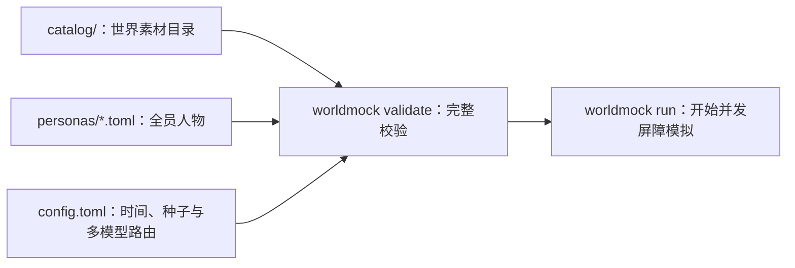
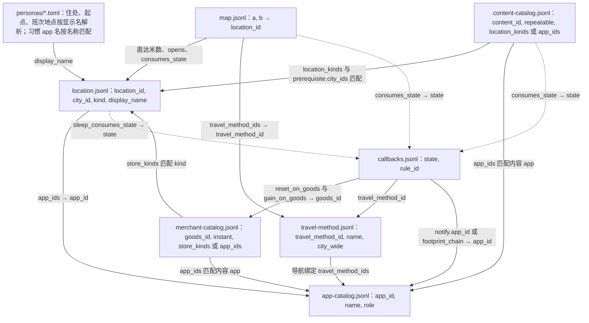
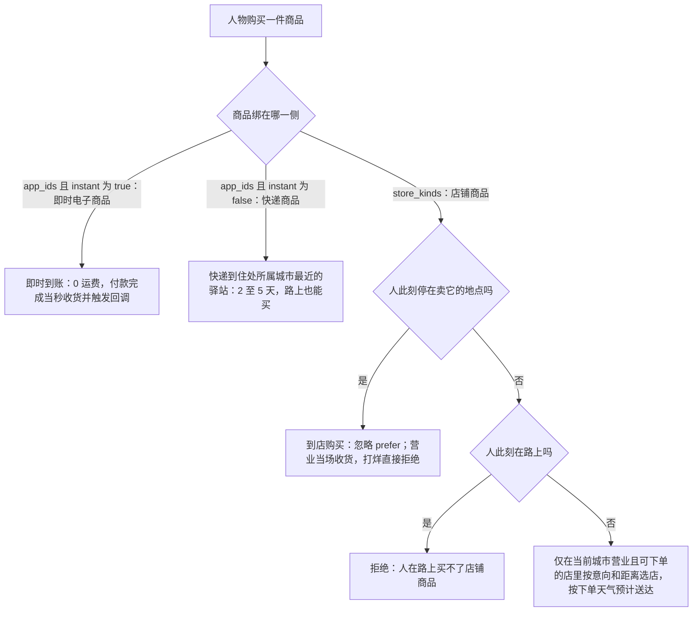
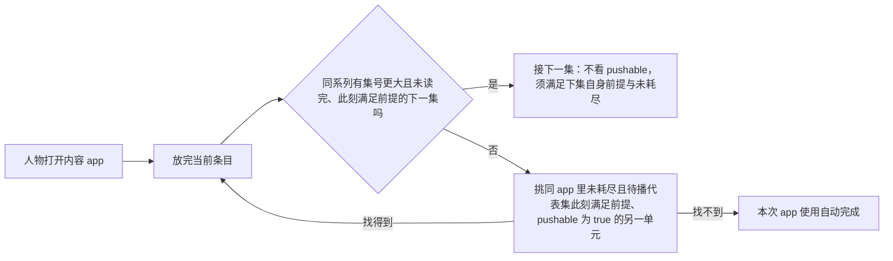
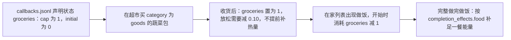

<a name="resources-设计环境数据集"></a>
# 设计环境数据集

一份 WorldMock 环境描述“一个物理与数字世界、一位或多位数字人与一次运行”。要让模拟跑起来，你需要准备一个封闭的环境根目录，里面只放三样东西：世界素材目录 `catalog/`、人物声明目录 `personas/`（存放一份或多份 `personas/*.toml`）和运行配置 `config.toml`。



环境根目录与 `catalog/` 都是严格闭集：不要在里面放根目录旧式 `persona.toml`、`README`、草稿笔记、场景文件、脚本、符号链接或手动生成的 `map.json`，`personas/` 下也只放 `*.toml` 人物文件，作者自己的说明文档放在环境包外面。一旦出现约定之外的文件或子目录，加载会直接以 `ENVIRONMENT_STALE_FILE` 拒绝；出现符号链接会以 `ENVIRONMENT_IDENTITY_MISMATCH` 拒绝。

## 目录文件清单与格式铁律

`catalog/` 里用四个必需文件搭起“地点、app、商品、内容”四张基础表，用三个可选文件按需补充“声明距离、出行方式、动态回调”，最后由 `manifest.json` 锁住真实字节身份。

| 文件 | 是否必需 | 在世界里管什么 | 省略时怎么表现 | 行排序键 |
| --- | --- | --- | --- | --- |
| `manifest.json` | 必需 | 记录版本与在场文件字节摘要 | 无法加载 | 不适用（单个 JSON 对象） |
| `location.jsonl` | 必需 | 全部实际地点、商铺评分、营业时段、住宿与驿站资格 | 无法加载 | `location_id` 升序 |
| `app-catalog.jsonl` | 必需 | 手机上的内容 app 与功能 app | 无法加载 | `app_id` 升序 |
| `merchant-catalog.jsonl` | 必需 | 商品类别、固定价格与售卖容器 | 无法加载 | `goods_id` 升序 |
| `content-catalog.jsonl` | 必需 | 地点活动与手机内容、时长与效果 | 无法加载 | `content_id` 升序 |
| `map.jsonl` | 可选 | 显式固定两地直达距离、跨城通行方式、发车时段与票证消耗 | 同城按种子随机生成街区边，不生成跨城边 | `(a, b)` 升序 |
| `travel-method.jsonl` | 可选 | 步行之外的交通方式、速度、计价与是否全城通用 | 人物只能使用自带的步行 | `travel_method_id` 升序 |
| `callbacks.jsonl` | 可选 | 可消耗状态声明与动态回调规则 | 没有状态，也没有回调 | 状态行在前按 `state` 升序，规则行在后按 `rule_id` 升序 |

可选文件“不放”等于零行：没有自定义距离或跨城连接就不放 `map.jsonl`，只用步行就不放 `travel-method.jsonl`，不需要状态和回调就不放 `callbacks.jsonl`。放一个零字节空文件虽然在运行效果上和“不放”完全一样，但 `manifest.json` 的文件表和目录摘要会不同。

| 格式铁律 | 具体要求 |
| --- | --- |
| 文件命名 | 一律用连字符，如 `travel-method.jsonl`、`app-catalog.jsonl`；下划线或 `.json` 后缀均拒收 |
| 编码与换行 | UTF-8 无 BOM，行尾只用 LF，禁止出现 CR |
| JSONL 结构 | 每行恰是一个完整 JSON 对象；禁止空行、纯空白行、跨行 JSON 或 `NaN`、`Infinity` |
| 主键与引用数组 | 行与行按主键升序无重复；`app_ids`、`city_ids`、`location_kinds`、`store_kinds`、`travel_method_ids`、`reset_on_goods`、`gain_on_goods` 等数组按 ASCII 字符串升序无重复 |
| 省略优于 `null` | 除了 `Location.branch_label`、`Content.series`、`SummarySource.url`、`SummarySource.notice` 四个明确允许 `null` 的字段外，不声明某项可选功能就直接省略该键（或按字段要求填布尔值或空数组）；写 `null` 会触发 `ENVIRONMENT_KIND_INVALID` |
| 规则与格式版本 | `manifest.json` 的 `format_version` 与 `rules_version` 均写 `7` |

字段完整定义与加载校验顺序见[资源引擎](../design/03-resource-engine.md)。

<a name="resources-对象之间怎样关联"></a>
## 对象之间怎样关联

写数据集时最容易混淆“机器绑定”和“人读名称”。WorldMock 把它们分成两层：

- **目录内部靠精确身份与地点类型对接**：文件之间跨表引用全靠主键身份（`location_id`、`app_id`、`goods_id`、`travel_method_id`、`state`）或逐字相等的地点类型 `kind`（比如 `"cafe"`、`"餐厅"`）。这里大小写和空格必须一字不差。
- **人物与外部配置靠显示名对话**：`personas/*.toml` 里的住处 `home_location`、起点 `initial_location` 和班次地点 `work_schedule.workplace` 写地点的完整显示名；模拟中人物调用工具填写目的地、出行方式、地点活动、商品名或 `prefer` 时，也只看面向人物的名称。引擎做名称匹配时会去掉全部空白并忽略英文大小写（即 `channel_key`），但不做近义词猜测。



为了保证人物喊出名字时不会找错对象，目录对名称唯一性做了严格把关：

| 对象范围 | 查重口径 | 越界后果 |
| --- | --- | --- |
| 同一 JSONL 内部 | `app.name`、`location.display_name`、`goods.name`、`travel_method.name` 各自文件内按去空白忽略大小写唯一 | 报 `ENVIRONMENT_ID_DUPLICATE` |
| 同名分店地点 | `location.jsonl` 中 `name` 相同的地点必须写不同的 `branch_label`，引擎会拼出 `名称（分店标签）` 作为 `display_name` | 分店显示名重复报 `ENVIRONMENT_ID_DUPLICATE` |
| app 与地点之间 | 任何 `app.name` 都不能与任何 `location.display_name` 相同 | 报 `APP_NAME_COLLIDES_LOCATION` |
| 出行方式与步行 | `travel_method_id` 不得为 `walking`，`name` 不得为 `步行`，且自定义方式之间不得重名 | 报 `ENVIRONMENT_ID_DUPLICATE` |
| 地点内容单元名 | 同一个 `location_kind` 下，独立内容的 `title` 与系列的 `series.title` 合在一起不得重名；不同 `location_kind` 之间允许重名 | 报 `ENVIRONMENT_ID_DUPLICATE` 并指出冲突的两行 |
| app 内容标题 | app 内容由人物点 app 名触发，人物不直接点播内容标题，因此不检查唯一性 | 不查重，但仍要起成自然的内容标题 |

<a name="resources-按工作流设计和编写目录"></a>
## 按工作流设计和编写目录

编写环境目录推荐按对象依赖顺序推进：先定物理空间，再配交通与手机桌面，接着铺设商品和地点或手机活动，最后用条件、状态和回调把日常习惯串联起来并封包校验。


### 规划地点与空间距离

#### `location.jsonl`：搭出世界里的去处

每一行声明一个真实存在的去处，引擎不会用数量字段替你自动扩张多家门店。

| 字段 | 必填 | 类型与约束 | 在世界里起什么作用 |
| --- | --- | --- | --- |
| `location_id` | 是 | 非空白字符串，文件内升序唯一 | 地图边与内部索引使用的地点身份 |
| `city_id` | 是 | 非空白字符串（单城环境同样必填，禁止写 `null`） | 所属城市身份；同城地点共享街区图、商业范围、睡眠引导与每日天气 |
| `name` | 是 | 非空白字符串，避免坐标或代码编号 | 人物看到和填写的地点名 |
| `branch_label` | 否 | 非空白字符串或 `null`（缺省 `null`） | 区分同名分店，拼成 `name（branch_label）` |
| `kind` | 是 | 非空白字符串 | 与商品 `store_kinds`、内容 `location_kinds` 及前提逐字匹配 |
| `rating` | 售货地点必填，其余省略 | 1 至 5 的数字，允许小数 | 人物能看到这家店的评分，拿到的每份商品按这家店的评分抽品质 |
| `app_ids` | 是 | 内容 app 的 `app_id` 升序数组（可写 `[]`） | 声明这家店入驻了哪些可接外卖的下单 app |
| `is_home` | 否 | 布尔（缺省 `false`） | 标记是否为自有住宿地点，整个目录至少有一处为 `true`（可跨多个城市各设自有住处） |
| `sleepable` | 否 | 布尔（缺省 `false`） | 标记停留在这里时能否开始睡觉 |
| `sleep_consumes_state` | 否 | 非空白字符串（须是 `callbacks.jsonl` 已登记状态，禁止写 `null`） | 仅允许声明在 `sleepable: true` 且 `is_home: false` 的商业住宿地点；首次入睡扣减 `1` 点状态并激活房晚有效期至退房日 `12:00` |
| `accepts_parcels` | 否 | 布尔（缺省 `false`） | 标记是否为收发快递的驿站；存在非即时线上商品时，每位人物住处所属城市须至少有一处驿站 |
| `opens` | 否 | 对象 `{weekly, exceptions}`；省略代表全天开放 | 限制营业或进入后可开始消费、睡觉的时段 |

```json
{"app_ids":["eleme","meituan"],"branch_label":"古镇店","city_id":"suzhou","kind":"cafe","location_id":"cafe","name":"三杯咖啡","rating":4.5,"opens":{"exceptions":{"2026-01-01":[]},"weekly":{"fri":[["08:00","20:00"]],"mon":[["08:00","20:00"]],"sat":[["09:00","21:00"]],"sun":[["09:00","21:00"]],"thu":[["08:00","20:00"]],"tue":[["08:00","20:00"]],"wed":[["08:00","20:00"]]}}}
{"app_ids":[],"city_id":"suzhou","is_home":true,"kind":"home","location_id":"home","name":"家","sleepable":true}
{"app_ids":[],"city_id":"taian","is_home":false,"kind":"hotel","location_id":"hotel-atour-taian","name":"泰安亚朵酒店","sleep_consumes_state":"stay_atour_taian","sleepable":true}
{"app_ids":[],"city_id":"suzhou","kind":"office","location_id":"office","name":"公司","sleepable":true}
{"accepts_parcels":true,"app_ids":[],"city_id":"suzhou","kind":"parcel_station","location_id":"parcel-station","name":"快递驿站"}
```

编写地点时注意几件事：

- **单城与多城都必填 `city_id`**：缺失、空白或写成 `null` 均报 `ENVIRONMENT_KIND_INVALID`。每个城市内部地点共享同城街区网络、同城天气与同城商业视野；外地酒店不要标 `is_home: true`，否则会变成免费自有住处。
- 只要有商品的 `store_kinds` 包含该地点的 `kind`，就给这家分店填写评分。只代收件的驿站省略评分，同时售货的驿站填写评分。
- **`is_home` 和 `sleepable` 互不推导**：每份 `personas/*.toml` 里 `home_location` 指代的地点不仅要标 `is_home: true`，还必须显式标 `sleepable: true`，否则直接报 `HOME_NOT_SLEEPABLE`。目录仍允许在多个城市分别声明 `is_home: true` 且 `sleepable: true` 的自有免费住处（例如学校宿舍与老家住宅）。
- **商业酒店与房晚退房日切**：`sleep_consumes_state` 只能写在 `sleepable: true` 且 `is_home: false` 的地点上，写成 `null` 或写在不可睡/自有住处上报 `ENVIRONMENT_KIND_INVALID`。入睡时若尚在 `lodging_stays` 有效入住期内（当前时刻早于退房纪元秒），不重复扣状态，同房晚的午休与夜宿共享有效期；过期或未入住时扣减 `1` 点状态（状态不足时按与受理一致的 `ACTIVITY_PRECONDITION_UNMET` 提示购买对应房晚商品），并按本地 `06:00` 日切算退房界——`00:00` 至 `05:59` 入睡设当日 `12:00:00` 退房，`06:00` 及以后入睡设次日 `12:00:00` 退房。睡着后时钟越过 `12:00` 不打断当前这一觉，醒后下一次新开睡眠才重新核销状态。在不可睡地点被拒时，引导会优先查找**当前城市**的在期酒店、自有住处或持券可住酒店，不再把外地人物指回所属住处。
- **人物自己的家通常省略 `opens`**：一旦给家声明了 `opens`，打烊时段内人物就不能开始睡觉；想让人物回家后随时能睡，就省略 `opens`（不要写成 `null`）。
- **营业时段使用半开区间**：`weekly` 的键只能是 `mon` 到 `sun`，缺席的星期整天休息；时段按升序、不重叠排列（如 `["08:00","10:00"]` 含 08:00 不含 10:00，`24:00` 只作当天结束时刻，跨午夜拆成相邻两日）。`exceptions` 按规范 `YYYY-MM-DD` 整日替换当天安排，写 `[]` 表示当天停业。
- **起自然的地点名**：如果 `name` 里带有经纬度（如 `31.2, 121.5`）或带数字的多段小写标识符（如 `poi-node-1`），运行清单会记 `LOCATION_NAME_SUSPICIOUS` 警告，因为人物在日志和决策里会直接照抄这个显示名。

#### `map.jsonl`：控住同城距离与跨城干线

WorldMock 不在环境包里保存 `map.json`；每次加载时，引擎按 `city_id` 分城建图：对每个至少有两个地点的城市，以确定性种子 `map:{city_id}` 生成同城随机连通树和 `200` 至 `2000` 米的同城额外边（不绕过任何声明边）；只有一个地点的城市保留零条内部边；**引擎永远不会在不同 `city_id` 之间生成随机连通边或额外边**。跨城连通必须由作者在 `map.jsonl` 里显式声明。

| 字段 | 必填 | 约束 | 含义 |
| --- | --- | --- | --- |
| `a` | 是 | 已登记的 `location_id`，按字符串比较严格小于 `b` | 无向边的较小端点 |
| `b` | 是 | 已登记的 `location_id` | 无向边的较大端点 |
| `length_m` | 是 | 大于等于 `1` 的严格整数 | 两地之间的直达米数，往返共用 |
| `travel_method_ids` | 跨城边必填，同城边可选 | `travel_method_id` 或 `"walking"` 的升序去重数组；跨城边（端点 `city_id` 不同）必填非空且不得包含 `"walking"`；禁止写 `null` | 限制此声明边允许使用的直达出行方式；省略代表普通同城自由街区边 |
| `consumes_state` | 否（仅限写了 `travel_method_ids` 的边） | 非空白字符串，须是 `callbacks.jsonl` 已登记状态；普通自由边携带或写 `null` 报 `ENVIRONMENT_KIND_INVALID` | 在这条声明边受理出发时核验不小于 `1` 并扣减 `1` 点的票证状态 |
| `opens` | 否（仅限写了 `travel_method_ids` 的边） | 对象 `{weekly, exceptions}`；普通自由边携带或写 `null` 报 `ENVIRONMENT_KIND_INVALID` | 限制允许在这条声明边受理出发的发车或登机检票时段 |

```json
{"a":"cafe","b":"office","length_m":450}
{"a":"home","b":"office","length_m":12600}
{"a":"home","b":"parcel-station","length_m":600}
{"a":"station-beijing-south","b":"station-taian","consumes_state":"ticket_bjs_taian","length_m":450000,"opens":{"weekly":{"mon":[["07:30","08:15"],["13:00","13:45"]],"sat":[["07:30","08:15"],["13:00","13:45"]],"sun":[["07:30","08:15"],["13:00","13:45"]]}},"travel_method_ids":["high_speed_rail"]}
```

设计地图与跨城连接有以下核心规律：

- **声明长距离通勤边会劈出两簇同城地点**：如果只写了 `home` 到 `office` 距离 `12600` 米，而周边商铺、餐馆、咖啡店、驿站都没声明距离，同城随机边（最多 `2000` 米）会把该城拉成靠这条长边相连的两簇，导致“公司旁边的咖啡店”随机挂到“家那一侧”。因此，凡是要放在家附近或公司附近的同城地点（午餐店、咖啡店、便利店、驿站），都请在 `map.jsonl` 里各自写一行连到 `home` 或 `office`。
- **直达距离不能比绕行总长更长，且不得抄近道绕过声明边**：同城自由声明边之间若经由其他同城自由声明边绕行的最短路严格短于它自己的 `length_m`，会报 `MAP_DISTANCE_CONTRADICTED`（等长不报错）。同时同城随机补边不会绕过任何声明边（包括带 `travel_method_ids` 的同城直达边）。带 `travel_method_ids` 的声明边在路由中只作两端点之间的单跳直达通道，不参与自由街区中途路径拼接。
- **双轨一日时限门禁（`MAP_ROUTE_TOO_LONG`）与全图连通（`MAP_DISCONNECTED`）**：
  - 同城街区时限：对每个至少有两个地点的城市内部自由图，取 `walking`（`1.2` 米/秒）与全部 `city_wide: true` 出行方式中最慢的速度乘雪天系数 `0.6`，城内最长最短路用时不得超过 `86400` 秒（只有步行时上限为 `62208` 米；若存在 `0.5` 米/秒且 `city_wide: true` 的方式则上限降为 `25920` 米）。
  - 跨城与受限干线时限：对每条显式声明了 `travel_method_ids` 的边，按该边允许方式中最慢的速度乘雪天系数 `0.6`，校验单边直达耗时不超过 `86400` 秒；因此京泰 `450` 公里高铁、京乌 `2500` 公里航线只要配置对应高速方式即可合法通过。
  - 全图仍须经跨城声明边连成一个整体连通图，存在孤立城市或孤立地点时报 `MAP_DISCONNECTED`。
  - 跨城干线出行时取起终两城当日天气系数的较小值计算耗时，且在到达目的枢纽之前禁止 `conclude_activity` 提前结束。

### 配置出行方式与手机 app

#### `travel-method.jsonl`：步行之外的交通选择

引擎内置了**自带的步行**（身份 `walking`，名称 `步行`，速度 `1.2` 米/秒，免费，代谢当量 `3.5` 按`费力`展示）。不要把步行写进 `travel-method.jsonl`；其他交通方式全部在这里声明：

| 字段 | 必填 | 约束 | 说明 |
| --- | --- | --- | --- |
| `travel_method_id` | 是 | 非空白字符串，文件内升序唯一，不得为 `walking` | app 行与回调引用的身份 |
| `name` | 是 | 非空白字符串，全方式间唯一且不得为 `步行` | 人物在工具提示、路上描述和到达记录里看到的名称 |
| `speed_meters_per_second` | 是 | 大于 `0` 的有限整数或小数 | 基础速度（米/秒），实际用时会受天气系数影响 |
| `start_price_fen` | 是 | 大于等于 `0` 的整数分 | 起步价，与每公里价均写 `0` 表示免费 |
| `price_per_km_fen` | 是 | 大于等于 `0` 的整数分 | 每公里费率，车费取起步价与按公里计价中的较大值 |
| `exertion` | 是 | `idle`、`light`、`moderate`、`heavy` 之一 | 体力档位；`idle`、`light` 显示为`轻松`，`moderate`、`heavy` 与步行显示为`费力` |
| `city_wide` | 否 | 严格布尔（缺省 `true`，写 `null` 或非布尔值报 `ENVIRONMENT_KIND_INVALID`） | 为 `true` 时开放给同城全部普通街区出行；为 `false`（如高铁、航班、长途大巴）时**仅限**用于 `map.jsonl` 显式列出它的声明边 |

```json
{"exertion":"light","name":"公共交通","price_per_km_fen":0,"speed_meters_per_second":5,"start_price_fen":200,"travel_method_id":"bus"}
{"exertion":"light","name":"驾车","price_per_km_fen":200,"speed_meters_per_second":7,"start_price_fen":500,"travel_method_id":"driving"}
{"city_wide":false,"exertion":"idle","name":"高铁","price_per_km_fen":0,"speed_meters_per_second":75,"start_price_fen":0,"travel_method_id":"high_speed_rail"}
{"exertion":"light","name":"打车","price_per_km_fen":300,"speed_meters_per_second":7,"start_price_fen":1400,"travel_method_id":"taxi"}
```

工具层只列出当前城市全部地点与从当前地点存在跨城声明边直连的异地枢纽：同城目的地下展示 `步行`（如有）与允许的同城方式（`city_wide: true` 及直连边允许的方式），跨城枢纽下只展示该跨城声明边 `travel_method_ids` 允许的方式。所有出行方式（含 `city_wide: false`）均沿用同一张天气系数表；余额不足、发车窗口外或缺少票证状态的声明边方式照样列出并标明此刻不可用。

#### `app-catalog.jsonl`：内容 app 与功能 app 分工明确

app 行只管身份、名称、角色和两项功能绑定，**没有任何时长字段**（写了已删除的 `browse_duration_seconds` 会按未知字段拒绝）。

| 角色（`role`） | 谁来选用 | 允许绑定的能力字段 | 生效条件与注意点 |
| --- | --- | --- | --- |
| `function`（功能 app） | 引擎后台自动抽取，人物不能打开也不能写进 `prefer` | `actions`（只能写 `["purchase"]` 作为支付 app 候选）与 `travel_method_ids`（绑定可导航的 `travel_method_id` 或 `"walking"`） | 两项绑定至少写一项非空，全空报 `APP_UNBOUND`；某出行方式没绑定任何导航 app 时，该趟出行不写导航记录 |
| `content`（内容 app） | 人物可感知；有内容时可打开，接单时可写进 `prefer` | 严禁出现 `actions` 和 `travel_method_ids`（写了 `[]` 也会报 `APP_ROLE_BINDING_INVALID`）；可选 `memory_category` | 必须至少拥有一条内容，或在商品 `app_ids`、营业门店 `app_ids` 里被引用；只接单没有内容的 app 是合法的**下单 app**，但不能单独打开 |

```json
{"actions":["purchase"],"app_id":"alipay","name":"支付宝","role":"function"}
{"app_id":"amap","name":"高德地图","role":"function","travel_method_ids":["bus","driving","taxi","walking"]}
{"app_id":"bilibili","name":"哔哩哔哩","role":"content"}
{"app_id":"dingtalk","name":"钉钉","role":"content"}
{"app_id":"meituan","name":"美团外卖","role":"content"}
{"app_id":"wechat","name":"微信","role":"content"}
```

### 铺设商品与收货路径

#### `merchant-catalog.jsonl`：商品分类与绑定

| 字段 | 必填 | 约束 | 含义 |
| --- | --- | --- | --- |
| `goods_id` | 是 | 非空白字符串，文件内升序唯一 | 商品身份，供回调 `reset_on_goods` 与 `gain_on_goods` 引用 |
| `name` | 是 | 非空白字符串，文件内唯一 | 人物购买或 `search_world` 搜索时涉及的商品名称 |
| `category` | 是 | `snack`、`meal`、`drink`、`goods` 之一 | 决定收货后提供热量还是放松效果（见[交换引擎](../design/02-exchange-engine.md)「收货与费用」） |
| `price_fen` | 是 | 严格正整数 | 全世界统一单价（分） |
| `store_kinds` / `app_ids` | 二选一 | 恰有一侧非空且升序去重；另一侧省略或为空数组 | `store_kinds` 绑定到具体店铺地点类型；`app_ids` 绑定为线上商品（快递或即时电子履约） |
| `instant` | 否 | 严格布尔（缺省 `false`，禁止写 `null`；仅允许 `app_ids` 非空且 `store_kinds` 为空的商品声明） | 为 `true` 时走即时电子履约（`0` 运费、付款完成当秒直接收货并触发回调，不走驿站），适用于车票、机票、房晚与电子券 |

```json
{"category":"meal","goods_id":"beef-noodles","name":"牛肉面","price_fen":2800,"store_kinds":["restaurant"]}
{"category":"drink","goods_id":"lemon-tea","name":"柠檬茶","price_fen":1200,"store_kinds":["cafe","convenience_store"]}
{"app_ids":["bilibili"],"category":"goods","goods_id":"online-notebook","name":"平台笔记本","price_fen":1200}
{"app_ids":["ctrip","meituan"],"category":"goods","goods_id":"room-atour-taian","instant":true,"name":"泰安亚朵酒店房晚","price_fen":38000}
{"app_ids":["ctrip","rail12306"],"category":"goods","goods_id":"ticket-bjs-taian","instant":true,"name":"北京南—泰安高铁票","price_fen":21500}
{"category":"goods","goods_id":"veg-pack","name":"蔬菜包","price_fen":2500,"store_kinds":["supermarket"]}
```

同一件商品在一次购买中的履行路径，由下面这张路由图唯一决定（详规见[模拟引擎](../design/04-simulation-engine.md)「购买、付款与收货」）：



| 履约路径 | 触发条件 | 收货时机与费用 | 常见设计陷阱 |
| --- | --- | --- | --- |
| 即时电子履约 | 商品写 `app_ids` 且 `instant: true` | `0` 运费；下单并付款完成当秒于同次事务直接收货，触发 `gain_on_goods` 或 `reset_on_goods`，只写 `ORDER_PLACED` 与 `payment_notification` | 店铺商品（`store_kinds` 非空）声明 `instant` 或写成 `null` 会直接报 `ENVIRONMENT_KIND_INVALID` |
| 到店购买 | 商品写 `store_kinds`，人停在对应门店 | 付款完成当秒收货，无运费 | 人在店门口却刚好打烊时不会降级成外卖，直接报 `LOCATION_CLOSED` |
| 外卖送达 | 商品写 `store_kinds`，人在别处且**当前城市**有门店营业并绑定了内容 app | 下单起算，备货时长固定，路程受天气影响。实际送达须已付款，每配送组运费 `500` 分 | 候选门店、缺货提示、`search_world` 搜索与工具层商品窗口只看当前城市；若人物习惯写了“用美团外卖点午餐”，要确保本城卖午餐的店把 `meituan` 放进 `app_ids` |
| 快递到驿站 | 商品写 `app_ids` 且 `instant: false` | `2` 至 `5` 天到达**每位人物住处所属城市**里离各自住处最近的 `accepts_parcels: true` 驿站；运费 `0` 或 `500` 分 | 只有目录存在非即时的 `app_ids` 商品时，才要求每位人物住处城市内至少有一个驿站；但凡声明出来的驿站，**其地点类型都必须有至少一条地点内容**，否则报 `PARCEL_STATION_REQUIRED` |

关于驿站取件的联动规则：引擎没有单独的“取快递动作”，人物必须亲自来到驿站、点名开始任意一条属于该驿站类型的地点内容时，才会把站内全部已到站包裹一并领走；如果本人没有已到站的包裹，在驿站开始任何内容都会被 `PARCEL_NOT_READY` 拒绝。

### 编写地点活动与手机内容

`content-catalog.jsonl` 统一承载两类东西：**地点内容**（人在某类地点做的事）和**app 内容**（人在手机 app 里看或用的条目）。它们共用基础字段，但在触发、进度和专属字段上完全不同。

| 基础字段 | 必填 | 约束 | 含义 |
| --- | --- | --- | --- |
| `content_id` | 是 | 非空白字符串，文件内升序唯一 | 内容唯一身份 |
| `title` | 是 | 非空白字符串 | 独立地点内容的可点名名称；app 内容则作为记录标题 |
| `duration_seconds` | 是 | 不小于 `60` 的严格整数 | 完整做完或放完这一条所需的实际秒数 |
| `exertion` | 是 | `idle`、`light`、`moderate`、`heavy` 之一 | 体力消耗档位 |
| `pushable` | 是 | 严格布尔 | 控制 app 内容能否被推送、以及能否接在同 app 别的内容后面自动播放 |
| `relaxation_relief` / `social_relief` | 是 | `none`、`low`、`medium`、`high` 之一 | 分别对应每小时减少 `0`、`0.10`、`0.30`、`0.50` 需要 |
| `summary` | 是 | 不超过 `200` 字符的文本 | 内容摘要，给人物和推送预览读 |
| `summary_source` | 是 | `{kind, url, notice}`；`kind` 为 `real` 时 `url` 必填非空 | 注明真实网页来源或作者合成来源 |
| `location_kinds` / `app_ids` | 二选一 | 恰有一侧非空，升序去重 | 分别绑定为地点内容或 app 内容 |
| `series` | 否 | `{title, episode}`（`episode` 为正整数）或 `null` | 组成多集系列；同一系列容器、`repeatable`、`consumes_state` 与 `memory_category` 必须一致（app 系列允许每集各自写 `prerequisite`） |
| `repeatable` | 否 | 严格布尔（缺省 `true`，写 `null` 报 `ENVIRONMENT_KIND_INVALID`） | 为 `false` 时完整读完或做完一轮后即耗尽下线、不再重播或再次列出；同系列各集取值须一致 |
| `memory_category` | 否 | `饮食`、`工作`、`生活`之一；不覆盖直接省略 | 手动覆盖记忆归类，禁止写 `null` |

| 对比维度 | 地点内容（写 `location_kinds`） | app 内容（写 `app_ids`） |
| --- | --- | --- |
| 人物怎么开始 | 停在地点时，按 `title`（系列按 `series.title`）精确点名 | 只需要点开 app 名，具体放哪一条由引擎按规则挑 |
| 系列与进度规则 | 点名总是从集号最小的集开始；用 `conclude_activity` 结束即算做完一轮，下次重头起；想留着进度要用暂停（需剩余不少于 `3` 分钟）；`repeatable: false` 做完一轮后即从地点清单隐藏 | 会记住每一条和每一集的播放进度，按全集求当前待播代表集 `target_episode` 并核验其前提；`repeatable: false` 的单元全集读完一轮后移出候选 |
| 放完后怎么接 | 只有同系列内未耗尽且满足推进约束的下一集；没有跨条目自动连播 | 放完一条按同集号接下一集（须未读完且满足该集前提），否则挑另一未耗尽且 `target_episode` 满足前提与 `pushable` 的单元 |
| 专属扩展字段 | 可写 `consumes_state` 与 `completion_effects` | 可写 `prerequisite`（支持 `city_ids`、`location_kinds`、`opens`） |

```json
{"app_ids":["bilibili"],"content_id":"bili-vlog","duration_seconds":900,"exertion":"idle","pushable":true,"relaxation_relief":"medium","social_relief":"none","summary":"周末城市散步与装备准备经验分享。","summary_source":{"kind":"synthetic","notice":"数据集作者编写","url":null},"title":"散步装备准备"}
{"content_id":"parcel-pickup","duration_seconds":180,"exertion":"idle","location_kinds":["parcel_station"],"pushable":false,"relaxation_relief":"none","social_relief":"none","summary":"报出取件码核对包裹并取走。","summary_source":{"kind":"synthetic","notice":"数据集作者编写","url":null},"title":"驿站取件"}
```

#### 手机自动连播与 `pushable` 的黄金法则

打开内容 app 后，引擎会一条接一条自动播放，期间不会让人物停下来重新点名，直到人物在决策点（如推送、外卖到、身体体感变化、定时重估等）主动结束使用，或者没有满足条件的下一条才停下：



因此，**`pushable` 绝不能随便全写 `true`**：

- 刷视频、看新闻、听播客、看图文动态这类消费型内容，写 `pushable: true`，让它既能整点推送也能连播。
- **考勤打卡、打电话、私人聊天、查收邮件、查天气这类功能性交互，必须写 `pushable: false`**——否则人物“看一条视频看完后自动拨通一通电话”，或“刷着微博自动滑进一段工作打卡”，时间线就会直接失真。

### 串联常见生活场景与动态回调

掌握上面的基础目录结构之后，日常世界里最关键的“打卡、做饭、发工资或扣油费、分类纠正”都可以通过跨文件组合写出来。

#### 场景：考勤打卡、入城触发与跨日聊天系列（`prerequisite` 与 `repeatable`）

给 app 内容加上 `prerequisite`，就能规定“人必须在某座城市、某类地点、或在某段时间”才能开始这条内容；加上 `repeatable: false`，就能防止一次性对话或任务在读完后反复循环重播：

```json
{"app_ids":["dingtalk"],"content_id":"dingtalk-clock","duration_seconds":60,"exertion":"idle","prerequisite":{"location_kinds":["office"],"opens":{"weekly":{"mon":[["08:00","10:00"],["17:00","20:00"]],"tue":[["08:00","10:00"],["17:00","20:00"]]}}},"pushable":false,"relaxation_relief":"none","social_relief":"none","summary":"打开考勤页，完成一次打卡。","summary_source":{"kind":"synthetic","notice":"数据集作者编写","url":null},"title":"考勤打卡"}
{"app_ids":["wechat"],"content_id":"wx-taishan-1","duration_seconds":180,"exertion":"idle","pushable":false,"relaxation_relief":"none","repeatable":false,"series":{"episode":1,"title":"约阿哲夜爬"},"social_relief":"medium","summary":"行前与阿哲确认次日高铁车次与山脚集合点。","summary_source":{"kind":"synthetic","notice":"作者编写","url":null},"title":"行前约定"}
{"app_ids":["wechat"],"content_id":"wx-taishan-2","duration_seconds":180,"exertion":"idle","prerequisite":{"city_ids":["taian"],"opens":{"exceptions":{"2025-04-26":[["08:00","24:00"]]},"weekly":{}}},"pushable":true,"relaxation_relief":"none","repeatable":false,"series":{"episode":2,"title":"约阿哲夜爬"},"social_relief":"medium","summary":"抵达泰安后阿哲发来实时天气与出站汇合位置。","summary_source":{"kind":"synthetic","notice":"作者编写","url":null},"title":"抵达泰安汇合"}
```

写内容前提与系列分集规则时请留意以下要点：

- **`city_ids`、`location_kinds` 与 `opens` 至少写一项**：`city_ids` 写已登记城市的 `city_id` 升序去重数组（写未知城市报 `CONTENT_BINDING_DANGLING`），`location_kinds` 写地点的 `kind`（升序去重），`opens` 与地点行写法一致；这三项皆省略或为空会报 `CONTENT_PREREQUISITE_INVALID`，没有前提请直接省略 `prerequisite`（写成 `null` 报 `ENVIRONMENT_KIND_INVALID`）。地点内容不能写 `prerequisite`。
- **只卡开始那一秒，与次序无关**：判定先看 `city_ids`，再看 `location_kinds`（`city_ids` 与 `location_kinds` 任一不满足均记为地点未满足，且拒绝分句筛选同时满足这两项条件的地点，停留城市已知时优先列当前城市匹配地点），最后看 `opens`。一旦成功打开，哪怕随后离开目标城市或跨出时段，正在放的这一条照常做完，暂停后恢复也不复核。
- **区分上班卡与下班卡**：引擎不解析标题含义；若想在记录里分开上班卡和下班卡，登记两条不同的 `content_id`，各写早间和晚间的 `opens`。
- **应用系列允许分集独立前提（全集定代表、按代表验前提）**：绑定到 `app_ids` 的同一系列各集可以各自写不同的 `prerequisite`（例如上面微信系列中《行前约定》无前提在出发前读完，《抵达泰安汇合》用 `city_ids: ["taian"]` 和 `opens` 锁到抵达泰安且次日才解锁），但同系列各集的容器、`repeatable` 与 `memory_category` 必须一致。当《行前约定》已读完而待播代表集《抵达泰安汇合》尚未满足前提时，整部系列安全挂起等待解锁，既不会跳过《抵达泰安汇合》，也不会回放已读的《行前约定》；且单集放完按集号接下一集时，同样会校验下一集此刻满足前提与 `repeatable` 约束。
- **一次性消费（`repeatable: false`）与读完状态**：`repeatable: false` 的内容或系列完整读完一轮后即耗尽下线；若一个 app 内的全部单元均已耗尽，工具层该 app 的 `state` 显示「无未读内容」，此时打开会以 `CONTENT_PREREQUISITE_UNMET` 拒绝（`All content in <app 名称> has already been finished.`）。
- **既卖东西又有内容的 app**：若未配可随时查看的常规内容，全部剩余未耗尽单元的待播代表集此刻都不满足前提时，该 app 无法打开（拒收理由会列明要求去的地点显示名，以及当天可用时段或未来七天里下一次可用的日期时段，如 `next available Mon 10-19 08:00–10:00, 17:00–20:00`）。它卖的商品仍能正常通过 `search_world` 搜索和下单。

#### 场景：买菜回家做饭与在家吃饭（回调状态加商品加地点内容）

想让“家里买菜才能做饭、做完算吃饱一顿”跑通，需要把 `callbacks.jsonl` 的可消耗状态、`merchant-catalog.jsonl` 的食材商品和 `content-catalog.jsonl` 的做饭活动扣成一条闭环：



这组闭环分布在三个文件里：

- 写在 `callbacks.jsonl` 的状态行（开局家里没菜，`initial` 写 `0`；开局已有菜写 `1`）：

```json
{"cap":1,"initial":0,"reset_on_goods":["meat-pack","veg-pack"],"state":"groceries"}
```

- 写在 `merchant-catalog.jsonl` 的食材商品行（类别必须写 `goods`）：

```json
{"category":"goods","goods_id":"veg-pack","name":"蔬菜包","price_fen":2500,"store_kinds":["supermarket"]}
```

- 写在 `content-catalog.jsonl` 的地点内容行（`consumes_state` 凭状态开放，`completion_effects` 定义做完后的一次性效果）：

```json
{"completion_effects":{"food":"meal"},"consumes_state":"groceries","content_id":"cook","duration_seconds":3600,"exertion":"light","location_kinds":["home"],"pushable":false,"relaxation_relief":"low","social_relief":"none","summary":"用买来的食材做一顿饭，吃完收拾。","summary_source":{"kind":"synthetic","notice":"数据集作者编写","url":null},"title":"做饭"}
```

如果把做饭拆成“备菜、吃晚饭、洗碗”多集系列，只需在吃饭那一集（例如 `episode` 为 `2` 的《吃晚饭》）写 `completion_effects`（全系列每一集的 `consumes_state` 必须相同，且只在刚点名开始时扣减一次）：

```json
{"completion_effects":{"food":"meal"},"content_id":"dinner-2-eat","duration_seconds":1500,"exertion":"idle","location_kinds":["home"],"pushable":false,"relaxation_relief":"none","series":{"episode":2,"title":"做晚饭"},"social_relief":"none","summary":"在家吃晚饭。","summary_source":{"kind":"synthetic","notice":"数据集作者编写","url":null},"title":"吃晚饭"}
```

设计做饭与饮食闭环的关键细节：

- **食材类别写 `goods`，绝不写 `meal` 或 `snack`**：食品和零食没有库存，收到那一秒就会直接进能量池；写成 `goods` 才会只在收货时减 `0.10` 放松需要并重置 `groceries` 到上限 `1`。
- **`cap: 1` 的语义**：无论一单买了多少包菜，收货后 `groceries` 最高也只到 `1`（即开放一轮做饭）；点名开始做饭就把 `groceries` 用掉变成 `0`，做饭从家里的可用活动清单隐身，想再做要重新买菜收货。状态用掉时，还能同时触发 `callbacks.jsonl` 的阈值提醒规则。
- **`completion_effects` 的档位与时机**：可选 `food`（`snack` 或 `meal`，热量同同名商品）、`relaxation_relief`（`low`、`medium`、`high`）、`social_relief`（`low`、`medium`、`high`，一次性额外减少等同同名档位一小时的缓解量）。**不用的成员一律省略，禁止写 `none` 或 `null`**。只有完整做完（含暂停后回来做完）才会结算一次，提前取消或运行截止截断不结算。引擎不读标题：标题叫“吃晚饭”但没写 `food`，做完不算吃过饭。
- **两个字段互不依赖**：只写 `completion_effects` 不写 `consumes_state`，就是随时能做、做完补能或减压的事（如在父母家“吃饭”写 `{"food":"meal","social_relief":"high"}`）。注意别把同一顿饭算两次：如果公司“吃午饭”是等外卖送到再吃，外卖收货时已经补了热量，这个地点内容就不要再写 `food`。
- **食材溯源与饭点饥饿线**：状态既被 `completion_effects.food` 凭着又带非空 `reset_on_goods` 时，系统会自动在结果与零点计划里写出“用的是1月5日收到的蔬菜包”或“用的是家里原有的食材”。另外，饭点时段内人物能量低于 `1200` 千卡时会觉得“有点想吃”，吃过一顿推到 `1200` 千卡及以上则饭点也不饿。

#### 场景：定期收支、出行耗材与低量推送提醒（`callbacks.jsonl`）

`callbacks.jsonl` 严格要求**所有状态行排在文件前半部分（按 `state` 升序），所有规则行排在后半部分（按 `rule_id` 升序）**，不能交叉混写。

状态行支持两种商品收货补给字段（均可写空数组，`gain_on_goods` 可省略且缺省为 `[]`，禁止写 `null`）：`reset_on_goods` 在收到匹配商品时直接将状态置为上限 `cap`；`gain_on_goods` 为商品身份升序去重数组，每收到一件匹配商品将状态按 `min(cap, before + 1)` 递增 `1`（写 `gain_on_receipt` 效果）。同一状态的 `gain_on_goods` 与 `reset_on_goods` 不得出现重叠商品（重叠报 `ENVIRONMENT_KIND_INVALID`，未知商品报 `ENVIRONMENT_REF_UNKNOWN`）。

```json
{"cap":20,"initial":20,"reset_on_goods":[],"state":"fuel"}
{"cap":4,"gain_on_goods":["ticket-bjs-taian"],"initial":0,"reset_on_goods":[],"state":"ticket_bjs_taian"}
{"effect":{"delta":-1,"once_per":"local_day","state":"fuel","type":"state_delta"},"notify":{"app_id":"wechat","channel":"app_push","text":"车辆余油偏低，记得找时间加油。","when":{"below":5,"state":"fuel"}},"rule_id":"fuel-daily","trigger":{"class":"action","key":"travel","travel_method_id":"driving"}}
{"effect":{"amount_fen":1500000,"direction":"income","type":"transfer"},"rule_id":"salary-monthly","trigger":{"class":"time","day":15,"key":"monthly","time":"10:00"}}
```

| 构成部分 | 合法JSON形状示例 | 编写要点 |
| --- | --- | --- |
| 动作触发 | `{"class":"action","key":"purchase"}` 或 `{"class":"action","key":"travel","travel_method_id":"driving"}` | 普通动作 `key` 可取 `purchase`、`interact`、`sleep`（不可带 `travel_method_id`，`search` 与旧 `query` 均不可订阅）；`travel` 必须指定单一 `travel_method_id`（含 `walking`），没有通配写法——想让驾车和打车都扣油就要写两条规则 |
| 时间触发 | `{"class":"time","key":"hourly"}` 或 `{"class":"time","day":15,"key":"monthly","time":"10:00"}` | 固定时刻 `key` 可取 `hourly`、`daily`、`run_start`、`run_stop`；月度触发需写 `day`（`1` 到 `31`）与 `time`（`HH:MM`） |
| 状态与事件触发 | `{"class":"state","key":"fuel","below":5}` 或 `{"class":"event","key":"delivery_arrival"}` | `below` 取 `1..cap`；`event` 键限预排与唤醒事件闭集，见[资源引擎](../design/03-resource-engine.md#声明式回调)；不触发级联 |
| 状态增量效果 | `{"type":"state_delta","state":"fuel","delta":-1}` | `delta` 为非零整数；按日限次可加 `"once_per":"local_day"`，不限次直接省略，禁止写 `null` |
| 转账与足迹效果 | `{"type":"transfer","direction":"income","amount_fen":1000}` 或 `{"type":"footprint_chain","steps":[...]}` | `direction` 取 `income` 或 `expense`，在人物账户与 `external:scenario` 间结算；足迹链补充无资金流动的 app 触达痕迹 |
| 提醒配对 `notify` | `{"when":{"state":"fuel","below":5},"channel":"app_push","app_id":"wechat","text":"..."}` 或 `{"visible":true}` | 状态提醒 `StateReminder` 只能配 `state_delta` 且必须指向内容 app；可见提示 `VisibleHint` 只能配 `footprint_chain` |

#### 场景：跨城出行票证、发车时刻与商业酒店入住

把分城地点、受限跨城边、即时电子商品和 `gain_on_goods` 组合起来，不需要任何新工具即可跑通“提前线上购票订房、按发车窗口检票乘车、凭房晚在酒店睡到退房次日中午”的完整行程：


- **票证与房晚均设为可累加**：`callbacks.jsonl` 里将车票和房晚状态的 `gain_on_goods` 指向对应 `instant: true` 商品（`cap` 设为大于 `1` 如 `4`），避免连续买两张票或两晚房被 `reset_on_goods` 吞成 `1`。
- **缺票与缺房提示自动派生**：跨城边 `consumes_state` 或酒店 `sleep_consumes_state` 状态不足 `1` 时，准入拒绝句会自动列出该状态 `reset_on_goods` 与 `gain_on_goods` 并集里按 `goods_id` 升序排列的商品名，引导人物先购买对应电子凭证。
- **开始扣减绑定实际动作**：地图声明边触发 `consume_on_start` 时 `CallbackCause` 绑定 `"travel"`，酒店入睡触发时绑定 `"sleep"`，边触发与酒店触发的 `content_id` 均为 `null`；若该状态上配了阈值提醒规则，扣减后跌破阈值照常触发。

#### 场景：修正记忆类别（`memory_category`）

人物的记忆默认分入`饮食`、`工作`、`生活`三类。平时**不需要**在目录里标它们——引擎会自动看商品类别、内容有没有 `completion_effects.food` 或凭食品状态、内容前提是否限定在工作场所，以及人设的工作时间表自动归类。

只有当自动推导不符合常识时（例如白领在研发中心茶水间“吃午饭”，因为午饭在外卖收货时已经补能，这个地点内容本身没写 `food`，按班次地点会被默认归入`工作`），才在内容行或 app 行显式加写 `"memory_category"` 覆盖：

```json
{"content_id":"office-eat-lunch","duration_seconds":900,"exertion":"idle","location_kinds":["研发中心"],"memory_category":"饮食","pushable":false,"relaxation_relief":"low","social_relief":"low","summary":"外卖送到后在工位旁的茶水间吃午饭，顺便和同事聊几句。","summary_source":{"kind":"synthetic","notice":"数据集作者编写","url":null},"title":"吃午饭"}
```

注意：`memory_category` 只接受`饮食`、`工作`、`生活`之一，不覆盖就直接省略（写 `null` 报 `ENVIRONMENT_KIND_INVALID`）；同一系列各集必须写相同的值或都不写（不同报 `CONTENT_SERIES_INVALID`）；它只影响记忆归类，不影响活动呈现、能否开始或结算数值。

<a name="resources-检查内容行的记忆类别"></a>
## 检查内容行的记忆类别

写完目录后，可以用仓库里的离线检查工具逐行核对每条内容和每个 app 最终归到哪个记忆类别，不需要连接模型服务：

```powershell
uv run python -m tools.analysis.memory_categories --package <包目录> [--agent <人物编号>] [--output <文件>]
```

- 命令会用与运行时完全相同的准入逻辑加载环境包（含 `personas/*.toml`）；可通过 `--agent` 指定要检视的人物（省略时默认首位人物并仍核验全员输入）；如果环境包加载失败，直接写错误日志并返回非零退出码。
- 不加 `--output` 时把 JSON 结果打印到标准输出；指定 `--output` 时要求目标文件尚不存在，不会覆盖已有文件。

| 输出字段 | 含义 |
| --- | --- |
| `workplace_kind` | 人设 `work_schedule.workplace` 对应的地点 `kind`；没有工作安排时为 `null` |
| `rows` | 逐行列出全部内容行（`row: "content"`）和 app 行（`row: "app"`），附名称、`location_kinds` 与 `app_ids` |
| `category` | 该行最终推导出的记忆类别（`饮食`、`工作`、`生活`） |
| `rule` | 命中的推导编号；JSON 输出为 `0` 表示目录行显式写了 `memory_category` 覆盖，其余非零编号的详细定义见[人物设计](../design/06-agent.md#agent-记忆的类别) |
| `reason` | 一句话说明为什么归入这一类，含班次地点在岗时段说明 |

修改 `memory_category` 后，记得先刷新清单摘要，再重新运行这条命令核对对应行的 `rule` 是否变成 `0`、`category` 是否与预期一致。

## 刷新清单摘要与校验排错

每次修改 `catalog/` 下的任何文件内容、增删可选文件之后，都不能跳过“刷新清单摘要”直接运行，否则文件长度或 SHA-256 对不上就会被拦下。


下面是 `manifest.json` 的结构示例（实际 `sha256` 与 `size_bytes` 均由工具按真实字节算出，不要手写）：

```json
{
  "catalog_content_sha256": "56a50acb07b53e88770282599f036d1a6f9d979138ae6e1de13f5d866db0bd68",
  "environment_id": "artificial-test",
  "environment_version": "4",
  "files": [
    {"path": "app-catalog.jsonl", "sha256": "991fb532723b932f498107e052f084e380e3b263230abbfe7e00d8680efbda7c", "size_bytes": 542},
    {"path": "content-catalog.jsonl", "sha256": "fc4167feee9dd697c1a320896b05a31d228838ad89d77069a5c690e78327502d", "size_bytes": 4996},
    {"path": "location.jsonl", "sha256": "1ef1eb47d1130f57c50fe6587cfa67fdc1b0141d936ec1a2a039e3eab2a372e7", "size_bytes": 765},
    {"path": "merchant-catalog.jsonl", "sha256": "da2bd690cfa439798b6afd7ead121c35645c581fd59e18e05cde7a7c067a91ec", "size_bytes": 851},
    {"path": "travel-method.jsonl", "sha256": "ef3ed0fd547b63c2a668f04a513dd8c4c734266384aca3063413e05e49ce397c", "size_bytes": 415}
  ],
  "format_version": 7,
  "rules_version": 7
}
```

在仓库根目录用下面的命令完成刷新与校验（CLI 运行细节见[运行手册](runtime.md)）：

```powershell
# 刷新清单：改完 catalog/*.jsonl 或增删可选文件后，重算文件表与目录摘要
python -c "from worldmock.resource_engine.catalog.identity import refresh_manifest_identity; refresh_manifest_identity('D:/datasets/my-world/catalog')"

# 离线校验：检查目录格式、绑定与声明距离（不需要模型服务，也不生成地图）
python -c "from worldmock.resource_engine.catalog.loader import validate_catalog_files; validate_catalog_files('D:/datasets/my-world/catalog')"

# 完整校验：检查 catalog + personas/*.toml + config.toml + 内存地图上限 + 引用模型档案元数据
$env:WORLDMOCK_API_KEY = 'your-key'
worldmock validate --environment D:/datasets/my-world
```

遇到报错或警告时，直接按下面这张表定位原因并修改：

| 报错或警告码 | 说明哪里出了问题 | 怎么改 |
| --- | --- | --- |
| `RULES_VERSION_MISMATCH` | 清单的 `rules_version` 不是 `7` | 把 `manifest.json` 的 `format_version` 和 `rules_version` 都改成 `7`，按当前格式修正目录并刷新清单 |
| `ENVIRONMENT_STALE_FILE` | 环境根目录（如残留旧式 `persona.toml`）、`personas/` 子目录或 `catalog/` 里出现了约定以外的文件、目录或链接 | 删除详情路径里指出的多余文件、`persona.toml` 或非 `.toml` 杂项 |
| `ENVIRONMENT_FILE_UNLISTED` | `manifest.json` 漏记了必需文件，或目录里多放了可选文件却没进清单 | 运行 `refresh_manifest_identity` 重新写入清单文件表 |
| `ENVIRONMENT_IDENTITY_MISMATCH` | 实际文件字节大小或 SHA-256 与清单不一致，或存在符号链接 | 确认没有链接后重新运行 `refresh_manifest_identity` |
| `ENVIRONMENT_LINE_INVALID` | 某个 JSONL 的某行不是恰一个 JSON 对象（如空行、非法 UTF-8、`NaN`） | 按详情给的文件名和行号去掉多余空行并修成合法单行 JSON |
| `ENVIRONMENT_KIND_INVALID` | 换行带 CR、未知字段（如 `browse_duration_seconds`）、数组或行未排序、可选字段误写 `null`、缺失或空白 `city_id`、`sleep_consumes_state` 用在不可睡或 `is_home: true` 地点、非布尔 `city_wide`/`instant`/`repeatable`、店铺商品写 `instant`、跨城边缺 `travel_method_ids` 或含 `walking`、自由边带 `consumes_state`/`opens`、`gain_on_goods` 与 `reset_on_goods` 重叠、非法的 `opens` 时段或无效枚举值 | 转成 LF 换行，补齐必填 `city_id`、按规则删改不合法字段或数组排序，去掉重叠商品，或直接省略可选字段 |
| `ENVIRONMENT_NUMBER_INVALID` | 数值类型不对或越界（如时长低于 `60` 秒、价格或长度不合法、状态初值大于上限） | 按详情里指出的字段调整为合法整数或正数 |
| `ENVIRONMENT_ID_DUPLICATE` | 身份、显示名、出行方式名、或同 `location_kind` 下地点内容单元名重复 | 按详情给的两行行号改掉重复的身份或名字（同名店补上不同的 `branch_label`） |
| `ENVIRONMENT_REF_UNKNOWN` | 引用了未登记的 `app_id`、`location_id`、`goods_id`（含 `gain_on_goods`）、`travel_method_id`（含边 `travel_method_ids`）、`state`（含 `sleep_consumes_state` 与边 `consumes_state`）或人设地点显示名 | 核对目标对象是否在对应文件登记并拼写完全一致 |
| `HOME_LOCATION_REQUIRED` / `HOME_NOT_SLEEPABLE` | 没有标记 `is_home: true` 的地点，或某位人物 `personas/*.toml` 的住处没标 `sleepable: true` | 给对应住处的地点同时加上 `"is_home": true` 与 `"sleepable": true` |
| `PARCEL_STATION_REQUIRED` | 存在非即时的 app 侧商品（`app_ids` 非空且 `instant: false`）但某位人物住处所属城市内没有驿站，或任一已声明 `accepts_parcels: true` 的驿站类型没有绑定任何地点内容 | 在每位人物 `home_location` 所属城市声明至少一个 `"accepts_parcels": true` 地点，并为所有已声明驿站的 `kind` 写至少一条地点内容 |
| `APP_ROLE_BINDING_INVALID` / `APP_UNBOUND` | 内容 app 写了 `actions` 或 `travel_method_ids`，地点、商品、内容引用了功能 app，或功能/内容 app 没有任何绑定来源 | 划清功能 app 与内容 app 的边界，删掉内容 app 上的功能字段，确保每个 app 至少有一条有效绑定 |
| `APP_NAME_COLLIDES_LOCATION` | 某个 app 的 `name` 与某个地点的显示名重名 | 修改 app 或地点的显示名使其区分开 |
| `GOODS_BINDING_MISSING` / `GOODS_BINDING_SIDE_EXCLUSIVE` / `GOODS_BINDING_DANGLING` | 商品容器缺失、同时绑定地点与 app，或 `store_kinds` 指向不存在的地点类型 | 只保留 `store_kinds` 或 `app_ids` 其中一侧非空，并确保类型有实际地点 |
| `CONTENT_CONTAINER_MISSING` / `CONTENT_CONTAINER_SIDE_EXCLUSIVE` / `CONTENT_BINDING_DANGLING` | 内容容器缺失、同时绑定地点与 app，或顶层 `location_kinds`、前提 `location_kinds` / `city_ids` 指向不存在的地点类型或未登记城市 | 只保留 `location_kinds` 或 `app_ids` 其中一侧非空，并核对地点 `kind` 与 `city_id` 拼写 |
| `CONTENT_PREREQUISITE_INVALID` / `CONTENT_SERIES_INVALID` / `CONTENT_SUMMARY_TOO_LONG` / `CONTENT_SOURCE_URL_MISSING` | 地点内容误写 `prerequisite` 或 `city_ids`/`location_kinds`/`opens` 全空、同系列各集容器/集号/`repeatable`/`consumes_state`/`memory_category` 不符合要求、摘要超 `200` 字或 `real` 来源缺 `url` | 删掉地点内容上的前提，对齐同系列容器/`repeatable`/`consumes_state`/`memory_category`（app 系列允许每集独立 `prerequisite`），缩短摘要或补齐 `url` |
| `CALLBACK_STATE_UNREGISTERED` / `CALLBACK_FOOTPRINT_EMPTY` / `CALLBACK_NOTIFY_MISMATCH` | 回调引用了未登记状态、足迹链步骤或 app 池为空，或 `notify` 与效果类型不配对 | 状态行放前部先声明，足迹池非空升序，并让 `StateReminder` 配 `state_delta`、`VisibleHint` 配 `footprint_chain` |
| `MAP_DISTANCE_CONTRADICTED` / `MAP_ROUTE_TOO_LONG` / `MAP_DISCONNECTED` | 某条直达边长于绕行总长、同城自由图或跨城受限边在雪天单程超过一天，或跨城声明边未将全部城市连成连通全图 | 缩短矛盾边长或调整绕行边、缩小同城过长距离、为跨城边配齐高速方式，并在 `map.jsonl` 补齐跨城连通边 |
| `CONTENT_EMPTY_WITH_MEDIA_TASTES`（警告） | 没有任何内容 app 绑定内容，但某份 `personas/*.toml` 写了媒体口味或带“看、刷、听”的习惯 | 警告不阻断运行；按需要为媒体 app 补内容，或精简对应人设媒体习惯 |
| `LOCATION_NAME_SUSPICIOUS`（警告） | 地点显示名包含经纬度或 `sim-01` 类标识符 | 警告不阻断运行；改成自然的真实地名以防人物对话生硬 |

<a name="resources-固定规则怎样落到手机时间线"></a>
## 固定规则怎样落到手机时间线

下面这些规则由引擎固定，数据集改不了。写目录和人设之前先看它们会让手机时间线变成什么样；规则的定义在所列的设计小节，以那里为准。

| 规则 | 对手机时间线的影响 | 定义在哪 |
| --- | --- | --- |
| 外卖报价计入天气总延长的一半，实际送达计入全部延长，最早在付款时送达 | 商铺到公司的路程为 4.2 公里时，晴天中午 12:00 下单预计 12:24 到。大雨时下单预计 12:27 到，按时付款则在 12:30 送达。可在 `map.jsonl` 中声明实际距离 | [交换引擎](../design/02-exchange-engine.md)「收货与费用」、[模拟引擎](../design/04-simulation-engine.md)「购买、付款与收货」 |
| 「订单已发货」通知在付款之后、送达之前发出，时刻取付款到送达这段时间的十分之一处 | 只针对外卖与快递；到店与即时电子商品（`instant: true`）没有发货与送达通知。付款后 `22` 分钟送达的一单，付款后 `2` 分 `12` 秒就显示已发货 | [模拟引擎](../design/04-simulation-engine.md)「购买、付款与收货」的通知表 |
| 人物购买时可以在 `prefer` 里写想用的 app。当前所在城市营业、卖这件商品的店里有登记了这个 app 的，就在这些店里选一家、经它下单，可以因此换到更远的同城店；没有时照原规则在当前城市选店，下单 app 按店铺和当地日期抽取。只在 app 里卖的线上商品（快递与即时电子商品），`prefer` 在商品登记的 app 之内就用它，否则按商品和当地日期抽取 | 人设里写「用美团外卖点午餐」时，要让本城卖午餐的店在 `app_ids` 里登记美团外卖，否则订单会落到这家店登记的别的 app 上；票务与酒店房晚标 `instant: true` 后在任意城市下单均可付款即收货。习惯里 app 名的写法见[编写 personas/*.toml](personas.md)「关系、习惯与口味」 | [模拟引擎](../design/04-simulation-engine.md)「购买、付款与收货」；[配置](../design/08-configuration.md)「唯一种子与随机键」 |
| 人停在卖这件商品的地点时一律到店购买，不看 `prefer`；这个地点已打烊时这次购买被拒，不会改成外卖 | 这时手机上没有下单 app，至多最后 `10` 到 `20` 秒是支付 app；抽到直付时一个 app 都没有 | [模拟引擎](../design/04-simulation-engine.md)「购买、付款与收货」 |
| 出发时没有别的 app 在用、也没有正在下的单，导航就从出发那一秒起在前台，不会晚于出发才打开；路上用别的 app 或下单时让出，那项活动停下后有一半机会回到前台。带着正在用的 app 或正在下的单出发时（与出发同一次回复里开始的也算），导航要等它停下才可能出现。到达那一秒导航关闭 | 「出门五分钟后才打开导航」这类行为数据集安排不出来。出行方式没有绑定任何导航 app 时，这一趟没有导航记录 | [模拟引擎](../design/04-simulation-engine.md)「出行、内容与搜索」 |
| 没有登记任何内容的内容 app 不能单独打开，只在下单和通过 `search_world` 搜索时出现 | 这类 app 在手机上只有下单的那几分钟和搜索的 `3` 到 `7` 分钟（`180` 至 `420` 秒），没有「打开看看」的时段。人设里的写法见[编写 personas/*.toml](personas.md)「关系、习惯与口味」 | [资源引擎](../design/03-resource-engine.md)「app、内容与候选呈现」；[模拟引擎](../design/04-simulation-engine.md)「动作、名称与并行」 |
| 用内容 app 时放完一条自动接下一条：接同系列下一集须未耗尽且满足该集前提；接另一部系列或独立内容只在未耗尽且待播代表集满足前提、`pushable` 为 `true` 的单元里挑；一次使用到人物结束它、或没有可接的内容才停 | 时间线上一次使用是一整段，里面一条接一条，每条照自己的时长；一个 app 里没看过的可推送内容越多，一段越长。打卡、电话、聊天、邮件、天气这类内容写成 `pushable` 为 `true`，就可能被接在同一个 app 的别的内容后面 | [模拟引擎](../design/04-simulation-engine.md)「出行、内容与搜索」 |
| 用 `app_ids` 绑定的内容，`title` 要写成这个 app 里会出现的一条内容的标题。引擎不检查标题 | 时间线上这一行写成 app 名加书名号里的标题，例如「使用哔哩哔哩《散步装备准备》」。标题写成一个动作，读的人会以为人物在做这件事；推送的标题和简介同理 | [记录引擎](../design/05-recording-engine.md)「显示写法与检查工具」 |
| 食品和零食在收到的那一刻吃掉，饮料和商品在收到的那一刻用掉，没有库存 | 「买明天的食材」不能靠库存表达：食材写成食品或零食，一送到就被当成一顿吃掉。想让人物在家吃一顿不花钱的饭，用上文写了 `completion_effects.food` 的地点内容；想让做饭要先买食材，用上文的 `consumes_state`，食材的类别写 `goods` | [交换引擎](../design/02-exchange-engine.md)「收货与费用」 |
