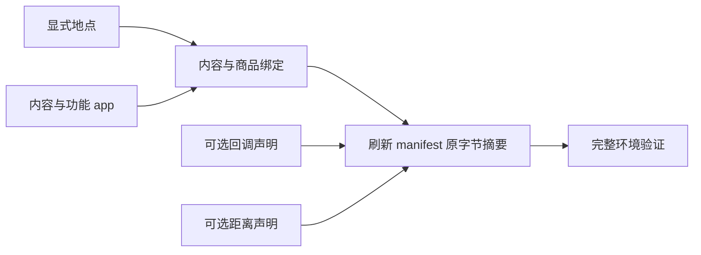

<a name="resources-设计环境数据集"></a>
# 设计环境数据集

环境根包含 catalog/、persona.toml 和 config.toml。catalog/ 必须有 manifest.json、app-catalog.jsonl、
content-catalog.jsonl、location.jsonl、merchant-catalog.jsonl 五个文件，另外可以按需放两个可选文件：
callbacks.jsonl 写回调声明，map.jsonl 写两地的距离。可选文件不放等于零行：没有回调就不放 callbacks.jsonl，
不需要声明距离就不放 map.jsonl。其他名字的文件一律拒绝，文件名用连字符。
每行是一项完整 JSON 对象，使用 UTF-8 无 BOM 与 LF。清单的 format_version 和 rules_version 都写 4。
字段、显示名、绑定与发布摘要合同见[资源引擎](../design/03-resource-engine.md)。

地点逐项声明，不使用 count 扩张或生成地址。给本人住处声明 is_home，为一个实际地点声明 accepts_parcels，
同名分店使用 branch_label。
需要营业限制时声明 weekly 与按 ISO 日期完整替换的 exceptions；省略 opens 表示全天营业。

允许睡觉的地点声明 sleepable 为 true，缺省不能睡。sleepable 与 is_home 互不推导；
人物自己的家必须标 sleepable，否则环境加载以 HOME_NOT_SLEEPABLE 失败。
家声明了 opens 时，关门时段内不能开始睡；想让人物随时能睡，就不要给家声明 opens。

```json
{"app_ids":[],"is_home":true,"kind":"home","location_id":"home","name":"家","sleepable":true}
{"app_ids":[],"kind":"office","location_id":"office","name":"公司","sleepable":true}
```

地图在加载时由全部地点、声明的距离和唯一运行种子在内存生成，不把生成的 map.json 放进发布环境。
想控制两地的距离，就在 map.jsonl 里为这一对地点写一行，例如让家到公司是 12,600 米：

```json
{"a": "home", "b": "office", "length_m": 12600}
```

- a、b 写 location_id，不写显示名，并且 a 按字符串比较小于 b；行按 (a, b) 升序，同一对地点只写一行。
- length_m 是不小于 1 的整数米数，往返共用；天气照旧放慢出行。
- 声明的两地直接相连，距离就是声明值；没有声明的边仍随机生成，长度在 200 到 2000 米之间。
- 声明一条远大于 2,000 米的距离后，地图实际分成两簇，只靠声明的那条边相连，没有声明的地点随机挂在其中一侧。
  凡是要在公司或家附近用到的地点（午餐店、咖啡店、便利店、驿站），都各声明一行到公司或到家的距离。
- 加载报 MAP_DISTANCE_CONTRADICTED 时，原因里写着哪一行的直达距离比哪条绕行路线更长；
  改其中一行，让直达的距离不超过绕行的总长。
- 任意两地的最短距离不能超过 62,208 米（步行在雪天一天内能走到），否则加载报 MAP_ROUTE_TOO_LONG。

app 区分内容平台和功能 app。功能 app 绑定具体动作，由引擎选择；内容平台供人物 interact。
商品只声明零食、食品、饮料、商品四类价格与地点类型或内容 app 绑定。
内容用 app_ids 或 location_kinds 显式绑定，填写实际时长、体力档位、两项心理缓解档位和 pushable。
不要添加内容分类、manner、动作菜单、消息、聊天对象或商家账户。

用 location_kinds 绑定到地点的内容，要把名字当成人物读和写的名字来起：人物在地点做哪件事，是照这个名字点名的。
不属于系列的内容写 title，系列写 series.title；系列各集的 title 不能点名，做到第几集由引擎接着排。
同一个地点类型下这些名字不能重复，独立内容和系列合在一起比，只差空白或大小写也算重复；不同地点类型之间可以重名。
用 app_ids 绑定的内容标题不是人物可写的名字，人物只写 app 名。
接收包裹的地点也要点名才能做事；本人在那里没有已到站的包裹时，那里的事都做不了。

用 app_ids 绑定的内容可以多写一个 prerequisite，声明这条内容只有人在某类地点、或当地时间落在某些时段内才能开始。
打卡就这样写：钉钉里一条只在公司、只在上下班时段能开始的内容。人物仍只写 app 名，app 里做哪一条由引擎在此刻合格的内容里挑。

```json
{"app_ids":["dingtalk"],"content_id":"dingtalk-clock","title":"考勤打卡","duration_seconds":60,"exertion":"idle","pushable":false,"relaxation_relief":"none","social_relief":"none","summary":"打开考勤页，完成一次打卡。","summary_source":{"kind":"synthetic","url":null,"notice":"数据集作者编写"},"prerequisite":{"location_kinds":["office"],"opens":{"weekly":{"mon":[["08:00","10:00"],["17:00","20:00"]],"tue":[["08:00","10:00"],["17:00","20:00"]]}}}}
```

- location_kinds 写地点的 kind，按字符串升序、不重复，每项要与某个已登记地点的 kind 一字不差；不写或写空数组表示不限地点。
- opens 的写法与地点行的 opens 完全相同；不写表示不限时间。时段含头不含尾，weekly 没写的星期整天不可用。
- 两项至少写一项，两项都写时都要满足。没有前提就省略这个字段，写成 null 会被拒绝。
- 前提只卡开始：开始以后时段过了、人离开了都照常做完，暂停后恢复也不再看前提。
- 一个 app 的内容此刻都不满足前提时，这个 app 仍列出但不可用，原因里写着要去的地点名称和今天能用的时段。

写前提时留意这几条：

- 前提只能写在 app 内容上；写在用 location_kinds 绑定到地点的内容上会以 CONTENT_PREREQUISITE_INVALID 拒绝。
- 内容行顶层的 location_kinds 把内容绑定到地点，人物要在那里点名才做；prerequisite 里的 location_kinds 只是 app 内容的开始条件，内容仍在 app 里。
- 想让某个 app 在某地某时只做一件事，就让那时只有它合格：这个 app 只登记这一条，或者给其他内容写上错开的 opens。
- 引擎不区分上班卡和下班卡；要在记录里分清，就登记两条内容，各写各的时段，content_id 不同。
- 同时卖商品的 app 至少留一条不带前提的内容，否则前提都不满足时它打不开，人物也看不到它的商品列表；按商品名购买不受影响。
- 带前提的可推送内容只在前提满足的整点才可能被推送；推送之后时段过了，打开 app 不会优先看到它。
- 带前提的系列开始后会一集接一集做完；不想让内容在时段外连着做，就不要把它写成系列。同一系列各集的前提必须完全相同。



修改目录后使用仓库的发布身份工具刷新 manifest 的文件摘要与目录内容摘要，再执行完整验证。
放了新的可选文件或删了可选文件之后同样要刷新：清单的文件表只登记实际存在的文件，
不放与放一个空文件运行起来相同，目录摘要不同。
验证失败按返回的所属路径与英文原因修正，原因里带着行号、文件名或路线等详情；
不能删除未知字段错误或靠旧格式混读运行。
报 ENVIRONMENT_STALE_FILE 时删除或改正那个文件名；报 ENVIRONMENT_FILE_UNLISTED 时刷新清单；
报 RULES_VERSION_MISMATCH 时把清单的两个版本号改成 4 并按当前格式改完各文件。
操作命令见[运行手册](runtime.md)，作者说明放在环境包外。
