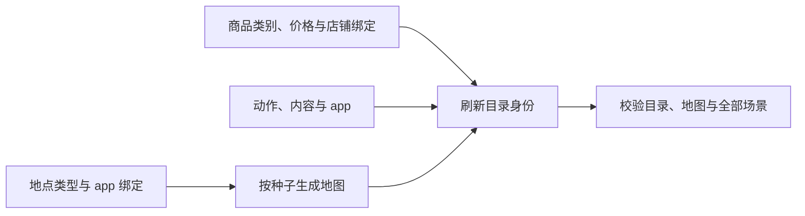

<a name="resources-定义地点门店供给与世界素材"></a>
# 定义地点、门店供给与世界素材

> 2026-10-07 按[动作与内容简化规格](../dev/SPEC-action-and-content-simplification.md#spec-acs-动作与内容简化开发规格)修订「固定规则、目录格式与加载边界、收货结算」（阶段 1、2）。

环境目录说明“这个世界有什么”，类别、效果与常数由 WorldMock 固定。环境维护 app、地点、商品、动作、内容及绑定，再按地点生成地图、刷新身份并检查整个环境。修改不改变已经运行的世界。



地点共有十个固定类型，包含 `gas_station` 与 `parcel_station`。只有店铺允许绑定购物 app，驿站不绑定 app、不卖商品；加油站只卖新增 `fuel`，原四种店铺的五类商品供给保持固定。完整类型与供给表见[环境目录文件](../CONTRACTS.md#contracts-环境目录文件)。

<a name="resources-共享规则与可重建环境修订"></a>
## 共享规则与可重建环境修订

按[共享规则与可重建环境规格](../dev/SPEC-shared-rules-and-rebuildable-env.md)修订；验收结果独立记录。

语料和资源引用必须是只用 / 分隔的根内相对路径，不能含 ..、反斜杠或任一平台不能原样保存的名字（以点或空格结尾、Windows 设备名如 NUL、Windows 禁用字符 <>:"|?* 与控制字符、孤立代理码点、一级超过 255 字节），不能使用符号链接或目录联接；文件须为普通文件并符合声明的大小与摘要。修改内容后按现行身份发布流程重新生成声明，不能沿用旧摘要。


<a name="resources-先找到应该修改的文件"></a>
## 先找到应该修改的文件

| 文件 | 内容 |
| --- | --- |
| `manifest.json` | `format_version: 2`、环境标识与版本、`rules_version: 2`、六个文件的路径/哈希/字节数、`catalog_content_sha256` |
| `apps.json` | `app_id`、真实 `name`、`purposes`、`payment_app_ids`；用途与绑定列表去重并排序 |
| `locations.json` | `location_id`、`name`、可选 `branch_label`、`kind`、`app_ids`、必填可空 `shipping_seconds`；非店铺与加油站运输时长必须为 null，驿站不绑定 app |
| `goods.json` | `goods_id`、`name`、六个固定类别之一、正整数 `price_fen`、`store_ids` 列表或 `"all"`；燃油只绑定加油站 |
| `actions.json` | `action_id`、`name`、`description`、五个固定类别之一、`app_ids`、必填可空 `manner` 与 `communication_mode`；绑定 app 的社交明示 text 或 voice，其他为 null |
| `contents.json` | `content_id`、`action_id`、`title`、摘要与来源、`duration_seconds`、`app_ids`、可选 `series` |
| `map.json` | 地图结构 1、种子、生成器规则版本 1、节点与规范无向边 |

环境不附带语料、工作主题文件、规则副本、库存或营业日历。名称与摘要由数据仓维护，数值按唯一合同填写商品价格、内容时长、集数与店铺完整运输时长。

<a name="resources-哪些路径可以换"></a>
### 哪些路径可以换

复制完整环境到自己的相对目录，如 `experiments/my-world/`；其中只有并列的 `catalog/`、`scenarios/`。命令显式传这个根或场景路径；引擎不搜索数据仓或在线素材。正式环境路径由 WorldMock-Dataset 发布决定，完整回归通过 `--environment-root experiments/my-world` 明确选择。


<a name="resources-输入与生成文件"></a>
### 输入与生成文件

清单加六个目录文件，格式与字段见[环境目录文件](../CONTRACTS.md#contracts-环境目录文件)。`map.json` 由地点清单与整数种子生成；清单只绑定六个文件的规范发布字节，没有规则副本。

```bash
worldmock environment generate-map --locations experiments/my-world/catalog/locations.json --seed 7 --output experiments/my-world/catalog/map.json
```

内容必须绑定恰好一个动作；动作可以不绑定 app。动作的 `app_ids` 非空时，`manner` 必须是一种固定使用方式，
每条内容的 `app_ids` 是该动作 app 集合的非空子集；动作没有 app 时，`manner` 为 null、内容 app 集合为空。
每个动作及每个动作与 app 的组合至少有一条内容。空集合从不表示全部 app。
内容 `duration_seconds` 是正整数且不小于 60 秒；动作不登记时长、时间窗、场所或效果。
内容不声明分类；环境维护动作名称、说明及其内容。
系列以 `(action_id, series.title)` 识别，各集具有相同动作与 app 集合，集数为唯一的正整数。

商品绑定店铺，店铺绑定购物 app。`GOODS_CATEGORY_STORE_KINDS` 固定类型可供给的类别，
`"all"` 展开到全部可供给该类别的店铺；显式绑定列表去重排序，同类型店铺同菜单。
购物用途存在当且仅当至少一家店铺绑定该 app；支付绑定非空当且仅当有购物用途，
绑定目标具有支付用途，允许绑定自己。导航与支付 app 可以没有内容；app 必须有用途或动作绑定。


<a name="resources-先完成一个最小修改减少一家门店的初始库存"></a>
## 先完成一个最小修改：减少一家门店的初始库存


<a name="resources-编写地点与营业时间"></a>
## 编写地点

在 `catalog/locations.json` 编写地点。每行恰有五个字段，场景只选择 `location_id`，不复制定义。

| 地点字段 | 必填与取值 | 含义 |
| --- | --- | --- |
| `location_id` | 非空字符串，唯一 | 目录、图、场景、人物住处与工作地点的关联身份 |
| `name` | 非空字符串 | 人物看到并照抄的名称 |
| `branch_label` | 字符串或 `null`，显式必填 | 分店标签；有标签时显示为「名称（标签）」 |
| `kind` | `home`、`office`、`park`、`fitness`、`restaurant`、`cafe`、`convenience_store`、`supermarket` | 八个固定类型，决定菜单分类并派生活动环境 |
| `app_ids` | 排序且无重复的 app 身份列表，可为空 | 仅食品店铺类型可绑定 app；空列表只允许到店 |

显示名写人物会说的地名或店名，同名分店用 `branch_label` 区分；显示名须唯一，不能与「应用：<name>」标签冲突。没有经纬度、营业日历、资格或自定义活动环境字段。
地点修改后，用 `worldmock environment generate-map --locations catalog/locations.json --seed INT --output catalog/map.json` 生成全目录图，再由 Dataset 刷新清单并发布新环境版本。`--check` 逐字节核对现有文件，不写输出；运行只读发布图。

<a name="resources-来源与有效期"></a>
### 名称真实、数值合成

地点、店铺和 app 名称保持真实名称语义，具体对象、绑定与来源由 Dataset 发布。距离、速度、食品营养、费用和配送时间属于明确的合成模拟数值，不能冒充真实路网或实时门店数据。
WorldMock 生成随机连通加权图并提供固定规则，Dataset 保存图种子、生成规则版本和规范字节；目录与规则身份进入运行清单。图不含道路许可、路由响应、坐标或资料有效期。
内容摘要按目录自己的来源合同维护，语料文件继续经清单验证；不把名称真实性推成数值真实性。


<a name="resources-添加地点时还要补路线"></a>
### 添加地点时还要补路线


<a name="resources-编写门店供给与商品"></a>
## 编写门店供给与商品


<a name="resources-完整类别供给与冻结价格"></a>
### 完整类别供给与冻结价格


<a name="resources-只读查询与有时长浏览"></a>
### 只读查询

`query_world(name, way, category, app, available_only, offset)` 六键必填；前四键可空但至少一个非空，`available_only` 为严格布尔，`offset` 为严格非负整数。
`app` 写登记应用名，筛出通过它可买的商品和可做的动作；`category` 使用本轮公开类别标签。`available_only=true` 只留所选方式与 app 的真实可执行组合。

结果恰为 `matches`、`total_count`、`next_offset`。先取交集再稳定分页，沿 `next_offset` 可遍历同一冻结观察的完整匹配集合；末页为 null。查询不推进时间，不消费内容，也不改变推送、世界或曝光记录。

查询某购物 app 此刻可买的商品：

```json
{"name": null, "way": "购买", "category": null, "app": "<登记购物应用名>", "available_only": true, "offset": 0}
```

实际购买仍逐项声明 `target`、`way`、`app`、`to`、`pay_app`；动作则写动作名和它实际支持的 app。


<a name="resources-当前供给字段与发布注意事项"></a>
### 当前供给字段与发布注意事项


<a name="resources-新增商品对象"></a>
### 新增商品对象


<a name="resources-真实制作后再食用"></a>
### 真实制作后再食用


<a name="resources-编写生活活动"></a>
## 编写动作

动作写在 `catalog/actions.json`，名称与说明由环境维护。

| 字段 | 写法 |
| --- | --- |
| `action_id` | 非空且唯一的身份 |
| `name`、`description` | 非空名称与说明 |
| `category` | `entertainment`、`work_study`、`social`、`exercise`、`daily_care` 之一 |
| `app_ids` | 排序且无重复的已登记 app 集合，可为空 |
| `manner` | 必填；无 app 时为 null，有 app 时取 `phone_continuous`、`other_device`、`offline_assisted` |
| `communication_mode` | 必填；绑定 app 的社交动作写 `text` 或 `voice`，无 app 社交与其他类别写 null；不从名称猜测 |

动作不写时长、效果、代谢当量、场所与时间窗；内容提供时长，WorldMock 按类别固定规则。每个动作以及每个动作与 app 的组合至少有一条内容。


<a name="resources-编写内容与工作材料"></a>
## 编写 app 目录与内容

app 写在 `catalog/apps.json`，内容写在 `catalog/contents.json`。

| 对象 | 字段与约束 |
| --- | --- |
| app | 唯一 `app_id`、真实 `name`、排序去重 `purposes` 与 `payment_app_ids`；用途只能为导航、购物、支付 |
| 内容 | 唯一 `content_id`、一个 `action_id`、非空 `title`、`summary`、`summary_source`、`duration_seconds`、排序去重 `app_ids`、可选 `series` |
| 摘要 | 最多 200 个 Unicode 字符；真实摘要写来源 URL，合成摘要明确写 notice |
| 时长 | 内容的声明时长就是做它的时间；正整数且不小于 60 秒 |
| 剧集 | 每集一条内容，`series.title` 与动作共同标识系列，`episode` 为唯一正整数 |

内容不登记分类。导航与支付 app 无需内容，购物 app 须被店铺绑定并声明支付目标，目标有支付用途；绑定允许指向自己。每个 app 必须有用途或动作绑定。

内容必须绑定恰好一个动作；动作可以不绑定 app。动作的 `app_ids` 非空时，`manner` 必须是一种固定使用方式，
每条内容的 `app_ids` 是该动作 app 集合的非空子集；动作没有 app 时，`manner` 为 null、内容 app 集合为空。
每个动作及每个动作与 app 的组合至少有一条内容。空集合从不表示全部 app。
内容 `duration_seconds` 是正整数且不小于 60 秒；动作不登记时长、时间窗、场所或效果。
内容不声明分类；环境维护动作名称、说明及其内容。
系列以 `(action_id, series.title)` 识别，各集具有相同动作与 app 集合，集数为唯一的正整数。

商品绑定店铺，店铺绑定购物 app。`GOODS_CATEGORY_STORE_KINDS` 固定类型可供给的类别，
`"all"` 展开到全部可供给该类别的店铺；显式绑定列表去重排序，同类型店铺同菜单。
购物用途存在当且仅当至少一家店铺绑定该 app；支付绑定非空当且仅当有购物用途，
绑定目标具有支付用途，允许绑定自己。导航与支付 app 可以没有内容；app 必须有用途或动作绑定。

人物以 `work_content_ids` 分配 `work_study` 类别的目录内容，引用必须已登记且不得重复。
分配内容的动作不得是 `offline_assisted`；同一工作内容只能分配给一个人物。
有分配内容的人物必须声明 `work_schedule`（`WORK_SCHEDULE_REQUIRED`）；
声明排班的人物至少分配一条内容（`WORK_CONTENT_REQUIRED`）。
分配内容的 `duration_seconds` 之和不得少于运行起止区间内的排班秒数（`WORK_CONTENT_INSUFFICIENT`）；
引用不存在、不是工作与学习类别、重复分配或方式不合要求，以 `WORK_CONTENT_UNKNOWN` 拒绝。
工作地点取 `work_schedule.workplace_location_id`，分配的工作内容只能在该地点进行；从运行开始可做，班次不改变内容可见性。

<a name="resources-正餐家庭储备和联系人"></a>
### 商品与收货

商品有六个固定类别，数值规则由 WorldMock 维护：

| 类别 | 收货效果 |
| --- | --- |
| meal | 每份提供 600 千卡，按收货当秒食品利用率与能量上限结算 |
| snack | 每份提供 200 千卡，按相同食品规则结算 |
| drink | 每份提供 100 千卡，按相同食品规则结算 |
| leisure | 每行降低娱乐需要 0.10，下限为 0 |
| daily | 每行施加 +0.05 情绪脉冲 |
| fuel | 本人有车且在加油站为自己现场购买，当秒恰增加七个驾驶可用日，无身体效果或库存 |

没有家庭储备或初始持有。现场购买付款当秒收货，直送在配送到期收货；完整运输时长严格大于 86400 秒时送往实际模拟收货人家庭最近且场景选中的驿站，恰为 86400 秒仍直送。到站只进入 `ready_for_pickup`，本人到站执行零秒领取，才由唯一函数每单结算一次效果与 `goods_received`。给别人买时显式写收货人；联系人使用有效的 `receive_location_id` 直送，收货只记订单终态与 `received_at`，不创建身体或本人收货事件。联系人不能替代长途链所需的模拟收货人家庭地址。详见[请求字段与结算检查](../CONTRACTS.md#contracts-request-settlement)。


<a name="resources-修改后更新文件身份"></a>
## 修改后更新文件身份

先决定新的 `environment_version`，更新各场景的 `environment` 钉。修改任何目录文件后重算六个文件的摘要与字节数：

```bash
python -c 'from pathlib import Path; from worldmock.catalog.identity import refresh_manifest_identity; refresh_manifest_identity(Path("experiments/my-world/catalog"))'
```

该入口安全读取必需文件，经原子写入更新清单。环境里没有规则副本；规则字节由运行的代码身份绑定。旧运行与历史冻结输入不改写。


<a name="resources-验证修改"></a>
## 验证修改

```bash
worldmock environment generate-map --locations experiments/my-world/catalog/locations.json --seed 7 --output experiments/my-world/catalog/map.json --check
worldmock validate --environment experiments/my-world
```

第一条只比较已有地图；第二条执行唯一登记校验、重生成比对并真实加载 `scenarios/` 下全部 JSON。每个失败带稳定码与英文原因，任一失败退出非零。成功结果为 `{valid, environment_id, environment_version, scenarios}`。登记码完整定义见[环境目录文件](../CONTRACTS.md#contracts-环境目录文件)。目录有效不等于完整引擎行为验证完成。
