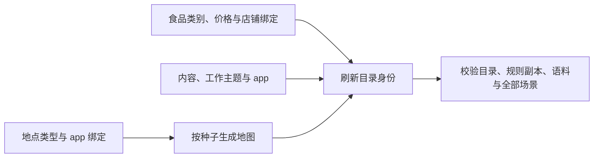

<a name="resources-定义地点门店供给与世界素材"></a>
# 定义地点、门店供给与世界素材

> 2026-10-07：按[资源与规则引擎简化规格](../dev/SPEC-resource-and-rule-simplification.md#spec-rrs-资源与规则引擎简化开发规格)修订「先完成一个最小修改：减少一家门店的初始库存、编写门店供给与商品、完整类别供给与冻结价格、当前供给字段与发布注意事项、新增商品对象、真实制作后再食用、定义地点、门店供给与世界素材、先找到应该修改的文件、哪些路径可以换、输入与生成文件、修改后更新文件身份、验证修改」（阶段 1）；「编写地点」、「名称真实、数值合成」（阶段 2）；「正餐、家庭储备和联系人」（阶段 3）；「只读查询、app 目录与内容、生活活动示例」（阶段 4）。

环境目录说明“这个世界有什么”，规则由 WorldMock 包提供。编辑店铺类型、食品、app 绑定与内容，再按地点生成地图、刷新身份并检查整个环境。运行只读已发布快照；修改不改变已经运行的世界。



地点类型固定为 `home/office/park/fitness/restaurant/cafe/convenience_store/supermarket`。只有后四种食品店铺可以绑定 app；空 `app_ids` 表示只到店。食品类别为 `snack/drink/meal`，热量与食用时长从引擎常数取得。

<a name="resources-共享规则与可重建环境修订"></a>
## 共享规则与可重建环境修订

按[共享规则与可重建环境规格](../dev/SPEC-shared-rules-and-rebuildable-env.md)修订；验收结果独立记录。

语料和资源引用必须是只用 / 分隔的根内相对路径，不能含 ..、反斜杠或任一平台不能原样保存的名字（以点或空格结尾、Windows 设备名如 NUL、Windows 禁用字符 <>:"|?* 与控制字符、孤立代理码点、一级超过 255 字节），不能使用符号链接或目录联接；文件须为普通文件并符合声明的大小与摘要。修改内容后按现行身份发布流程重新生成声明，不能沿用旧摘要。

<a name="resources-先找到应该修改的文件"></a>
## 先找到应该修改的文件

| 想修改的事实 | 文件 |
| --- | --- |
| app 的真实名称 | `catalog/apps.json` |
| 地点名、分店、类型、支持的 app | `catalog/locations.json` |
| 食品名、类别、统一价格与店铺绑定 | `catalog/foods.json` |
| 内容标题、摘要、来源、时长与 app 绑定 | `catalog/contents.json` |
| 工作主题与目标小时 | `catalog/work_topics.json` |
| 地点之间的发布图 | `catalog/map.json`，用生成命令更新 |
| 文件摘要和环境版本 | `catalog/manifest.json` |

目录不得附带品类树、资源定义、交换规则、报价、库存、营业日历、来源指针、字幕、游戏或工作材料。生活活动条目与联系人、邮件仍在 `corpora/`。

<a name="resources-哪些路径可以换"></a>
### 哪些路径可以换

复制完整环境到自己的相对目录，如 `experiments/my-world/`；其中 `catalog/`、`corpora/`、`scenarios/` 并列。命令显式传这个根或场景路径；引擎不搜索数据仓或在线素材。
三份 TOML 只从已安装的 `worldmock.data` 包资源复制，不能作为环境规则调参入口。正式环境由数据仓发布，完整回归通过 `--environment-root experiments/my-world` 明确选择。

<a name="resources-输入与生成文件"></a>
### 输入与生成文件

`apps.json`、`locations.json`、`foods.json`、`contents.json`、`work_topics.json` 是严格 JSON 声明；`map.json` 由地点清单与整数种子生成；`manifest.json` 绑定六个目录 JSON 和三份包 TOML 的原始字节。

```bash
worldmock environment generate-map   --locations experiments/my-world/catalog/locations.json --seed 7   --output experiments/my-world/catalog/map.json
```

食品 `store_ids` 取排序的店铺身份列表或 `"all"`；`"all"` 只包含食品店铺。相同店铺类型必须有相同菜单；只绑定同类一家会被 `FOOD_BINDING_KIND_INCONSISTENT` 拒绝。价格写食品 `price_fen`，同一食品全店同价，店铺全天服务。
内容 `app_ids` 至少一个，摘要最多 200 个 Unicode 字符；真实摘要填写来源 URL，合成摘要写明 notice。未知字段、未知绑定和未列文件均拒绝发布。

<a name="resources-先完成一个最小修改减少一家门店的初始库存"></a>
## 先完成一个最小修改：减少一家门店的初始库存


<a name="resources-编写地点与营业时间"></a>
## 编写地点

在 `catalog/locations.json` 编写地点。每行恰有五个字段，场景只选择 `location_id`，不复制定义。

| 地点字段 | 必填与取值 | 含义 |
| --- | --- | --- |
| `location_id` | 非空字符串，唯一 | 目录、图、场景、人物住处与工作地点的关联身份 |
| `name` | 非空字符串 | 人物看到并照抄的名称 |
| `branch_label` | 字符串或 `null`，显式必填 | 分店标签；有标签时显示为「名称（标签）」 |
| `kind` | `home`、`office`、`park`、`fitness`、`restaurant`、`cafe`、`convenience_store`、`supermarket` | 八个固定类型，决定菜单分类并派生活动环境 |
| `app_ids` | 排序且无重复的 app 身份列表，可为空 | 仅食品店铺类型可绑定 app；空列表只允许到店 |

显示名写人物会说的地名或店名，同名分店用 `branch_label` 区分；显示名须唯一，不能与「应用：<name>」标签冲突。没有经纬度、营业日历、资格或自定义活动环境字段。
地点修改后，用 `worldmock environment generate-map --locations catalog/locations.json --seed INT --output catalog/map.json` 生成全目录图，再由 Dataset 刷新清单并发布新环境版本。`--check` 逐字节核对现有文件，不写输出；运行只读发布图。

<a name="resources-来源与有效期"></a>
### 名称真实、数值合成

地点、店铺和 app 名称保持真实名称语义，具体对象、绑定与来源由 Dataset 发布。距离、速度、食品营养、费用和配送时间属于明确的合成模拟数值，不能冒充真实路网或实时门店数据。
WorldMock 生成随机连通加权图并提供固定规则，Dataset 保存图种子、生成规则版本和规范字节；目录与规则身份进入运行清单。图不含道路许可、路由响应、坐标或资料有效期。
内容摘要按目录自己的来源合同维护，语料文件继续经清单验证；不把名称真实性推成数值真实性。

<a name="resources-添加地点时还要补路线"></a>
### 添加地点时还要补路线


<a name="resources-编写门店供给与商品"></a>
## 编写门店供给与商品


<a name="resources-完整类别供给与冻结价格"></a>
### 完整类别供给与冻结价格


<a name="resources-只读查询与有时长浏览"></a>
### 只读查询

`query_world(name, way, category, from, available_only, offset)` 六键必填、无缺省，`name`、`way`、`category`、`from` 可空但至少一个非 null，
`available_only` 写 true 或 false，offset为非负整数。`from` 写购买来源（地点显示名，含「家」「住处」，或 App 称呼），只匹配门店供给；
`available_only` 为 true 时只留已确认此刻可执行的条目，报价或营业未知的也被滤掉，空页不等于都不能买。
category使用本轮callable_index已经展示的公开品类标签，非法时返回当轮全部合法标签。
结果为matches/total_count/next_offset，next_offset必填可空；每页沿用现有上限20，按偏移可遍历同一冻结权限下的全集。
筛选在排序与切页之前施加，`total_count` 是筛选后的总数；每项不再附候选，照抄 `name` 与所选动作的 `way` 即可提交。
查询不推进时间、不授予内容消费或推送状态，也不恢复耗时浏览活动；商品只从固定菜单查询，app 与内容不进入查询索引。
人物可通过现行只读工具调用查询；结果只含本轮冻结观察有权知道的对象。

只看某家店此刻能买的东西，局部示例如下（现成场景没有钉定手机配置，所以 `from` 写门店显示名而不是 App 称呼）：

```json
{"name": null, "way": "购买", "category": null, "from": "<门店显示名>", "available_only": true, "offset": 0}
```

<a name="resources-当前供给字段与发布注意事项"></a>
### 当前供给字段与发布注意事项


<a name="resources-新增商品对象"></a>
### 新增商品对象


<a name="resources-真实制作后再食用"></a>
### 真实制作后再食用


<a name="resources-编写生活活动"></a>
## 编写生活活动

活动目录固定读取 `lifestyle/items.json`，与资源目录 `activity_met` 中的 `lifestyle:<activity_id>` 必须一一对应。
只添加活动 JSON、遗漏 MET，或只加 MET、遗漏活动，都会拒绝加载。

| 活动字段 | 写法 |
| --- | --- |
| `activity_id`、`name_zh`、`category` | 身份和名称唯一；品类为 `sport`、`hobby`、`learning`、`household`、`social`、`wellness`、`pet`、`volunteer`、`outdoor` |
| `typical_duration_minutes` | 生成器要求 5–1440 分钟 |
| `description_zh`、`source` | 描述实际做什么，并写明活动、时长和 MET 的来源或假设 |
| `met_value` | 生成器要求 1–16；身体耗能使用的活动强度 |
| `location_kinds` | 非空闭集列表；活动允许额外使用 `anywhere` |
| `time_window` | 整数小时 `start_hour < end_hour`，范围 0–24；目前不能用一个区间表达跨午夜 |
| `needs_partner` | 布尔值 |
| `effects` | 必填不可变映射，键恰好为 `entertainment`、`social`、`health`；每项有限数值 0–1，不能缺项或填布尔值 |

当前 `location_kinds` 参与活动地点准入，也决定生活活动窗口列不列它：与人物所在地点环境不合适的活动不列出，
按名写它时以「这里不适合做这件事」拒绝。`time_window` 只参与排序（此刻落在窗口内的排得更靠前），`needs_partner` 只做了
数据形状校验，二者都没有接成运行时的时间或伙伴受理限制。`effects` 分别折算为娱乐缓解、社交缓解和健康相关情绪变化
（娱乐缓解不按人物口味调整），从本次环境条目读入并在活动开始时冻结；健康效果并不创建独立的“健康值”资源。
生活活动只描述真实进行的事情；不要用「刷手机」或「随便看看」代替 app 使用。数字内容写入 app 与内容目录，由人物选择 app 后再抽取。

下面是 `enrichment.json` 的 `entries` 中一个**完整条目值**，可替换已有 `3d-printing` 条目的值：

```json
{
  "location_kinds": ["home", "venue"],
  "time_window": {"start_hour": 8, "end_hour": 23},
  "needs_partner": false,
  "effects": {"entertainment": 0.7, "social": 0.1, "health": 0.1}
}
```

补充文件负责地点环境、时间窗口、伙伴声明和效果；来源、名称、时长、MET 及正式活动全集由 Dataset 的
活动制作工具维护。按数据仓说明生成 `lifestyle/items.json`，更新语料清单，随后发布含对应 MET 的资源目录。
正式来源、数量和可复现重建的验收在 Dataset 执行；引擎用人工最小环境验证加载、候选、结算与恢复行为。

<a name="resources-编写内容与工作材料"></a>
## 编写 app 目录与内容

app 写在 `catalog/apps.json`，内容写在 `catalog/contents.json`。人物选择 app，环境只在该 app 的绑定内容中抽取；
内容不直接作为工具目标，也不进入候选、轮转或只读查询索引。

每个 app 提供稳定 `app_id` 与人物可见的真实名称。每条内容至少包含稳定身份、非空 `title`、`kind`、非空
`summary`、`summary_source`、正整数 `duration_seconds` 与非空 `app_ids`：

| 字段 | 写法 |
| --- | --- |
| `kind` | 只取 `article`、`image_text`、`short_video`、`long_video`、`live` |
| `summary` | 人物实际看到的完整摘要，最多 200 个 Unicode 字符 |
| `summary_source` | 真实摘要写来源 URL；合成摘要明确写 `kind=synthetic` 与 notice |
| `app_ids` | 排序、无重复、至少一个；每项引用已登记 app |
| `duration_seconds` | 内容的声明时长；它不改变 app 使用固定 1800 秒的活动计划 |

目录没有字幕时间轴、分段、媒体资产、题材 facet、年龄分级、口味权重、评估引用或游戏文件。真实作品和 app 名称可以保留，
摘要来源与合成声明必须可追溯；时长与缓解率属于模拟规则，不能冒充外部平台事实。

发布校验逐条检查 app 引用与反向绑定。没有绑定内容的 app 仍会在人物工具层列出，但打开动作不可用并返回
`APP_CONTENT_EMPTY`；不能从别的 app 借内容。修改后刷新 `catalog/manifest.json`，再用 `worldmock validate`
验证全部场景。工作材料仍由下一节维护，阶段 4 不把它们当成 app 内容。


<a name="resources-工作材料"></a>
### 工作材料

工作材料要与任务中的 `input_path/input_sha256` 和 `oracle_path/oracle_sha256` 对应。
材料清单本身不会创建工作合同；还需在场景分配任务、地点、技能和受理人。
当前世界准入还要求中文、`type: "scenario"`、足量且互不重复的材料，并保留 AMI 元数据。

<a name="resources-编写工作验收答案"></a>
### 编写工作验收答案

工作输入是人物逐步接触的 UTF-8 正文。隐藏答案由一份 oracle JSON 和它引用的参考摘要文件组成，
不能把答案放进人物输入。可从现有输入（`../WorldMock-Dataset/environment/zhangjiang-baseline/corpora/scenario-work/inputs/work-0001.txt`）、
现有答案（`../WorldMock-Dataset/environment/zhangjiang-baseline/corpora/scenario-work/references/work-0001.oracle.json`）和
现有参考摘要（`../WorldMock-Dataset/environment/zhangjiang-baseline/corpora/scenario-work/references/work-0001.reference.json`）复制。

下面是自定义 `scenario-work/references/custom-work.oracle.json` 的**完整示例**：

```json
{
  "type": "scenario",
  "material_id": "custom-work",
  "source_reference": "references/custom-work.reference.json",
  "expected": {
    "material_id": "custom-work",
    "decisions": ["首期仅开放关注关系内的图文发布。"],
    "action_items": ["产品经理更新需求说明中的发布范围。"]
  },
  "piece_count": 1
}
```

对应 `scenario-work/references/custom-work.reference.json` 的**完整示例**：

```json
{
  "type": "scenario",
  "material_id": "custom-work",
  "language": "zh",
  "summary_sentences": ["评审确定首期发布范围，产品经理负责同步需求说明。"]
}
```

`expected` 必须是对象；语义验收读取 `decisions`、`action_items` 两个列表，
并从参考文件加载非空字符串列表 `summary_sentences` 作为摘要。
`source_reference` 相对 oracle 路径的**第一个目录分量**解析：本例的基准是 `scenario-work/`，不是 `references/`。
计件合同必须提供非负整数 `piece_count`，实际付款按它计算；时薪和总包合同不用它确定金额。
输入、oracle 和参考文件都要进入语料清单，任务的 oracle 哈希只填写 oracle 文件本身的 SHA-256。
这些答案应准确对应输入正文；加载成功不等于模型语义验收一定通过。
当前工作交付仍固定为会议纪要结构 `MeetingMinutes`，包括摘要、决定和行动项；
换一个 `required_skill` 名称不会变成任意格式的文案、代码或其他交付任务。

<a name="resources-正餐家庭储备和联系人"></a>
### 正餐、家庭储备和联系人

食品与人物初值分别维护。食品在 `catalog/foods.json` 定义名称、类别、固定每份价格与店铺绑定；热量和完整食用秒数取包内类别常数，不在素材另写逐食品营养或报价。

| 数据 | 写法与同步内容 |
| --- | --- |
| 食品菜单 | 同类型食品店铺全有或全无；`store_ids="all"` 不展开到住宅；每份 `price_fen` 全店相同 |
| 人物储备 | `agents[].initial_inventory` 按地点、`food_id` 和正数份数声明；目录变化不自动改写持有 |
| 联系人 | 运行联系人仍写入人物 `contacts`；同世界自主人物应在 `agents` 中声明，联系人不会启动额外人物 |

联系人关系、渠道与回复策略见[人物画像](personas.md#personas-人物画像)。本人只能在食品持有地点食用或给予，购买、送达和进食分别留证；目录名称真实与价格合成分别说明。

<a name="resources-修改后更新文件身份"></a>
## 修改后更新文件身份

先决定新的 `environment_version`，并更新各场景的 `environment` 钉。修改任何目录文件后都要用现有身份发布入口重算文件表和内容摘要：

```bash
python -c 'from pathlib import Path; from worldmock.catalog.identity import refresh_manifest_identity; refresh_manifest_identity(Path("experiments/my-world/catalog"))'
```

该入口安全读取必需文件，经原子写入更新清单。三份 TOML 副本必须仍与包资源逐字节一致；重算摘要不能让一份擅改的规则副本合法。旧运行与历史冻结输入不改写。

<a name="resources-验证修改"></a>
## 验证修改

```bash
worldmock environment generate-map   --locations experiments/my-world/catalog/locations.json --seed 7   --output experiments/my-world/catalog/map.json --check
worldmock validate --environment experiments/my-world
```

第一条只比较已有地图，不写文件；第二条执行唯一登记校验器、重生成比对、语料清单和三份包 TOML 检查，并真实加载 `scenarios/` 下全部 JSON。每个失败带稳定码和英文原因，任一失败退出非零。登记码完整定义见[环境目录文件](../CONTRACTS.md#contracts-环境目录文件)。通过环境检查后再执行项目校验和完整引擎行为门禁；目录有效不等于行为验证完成。
