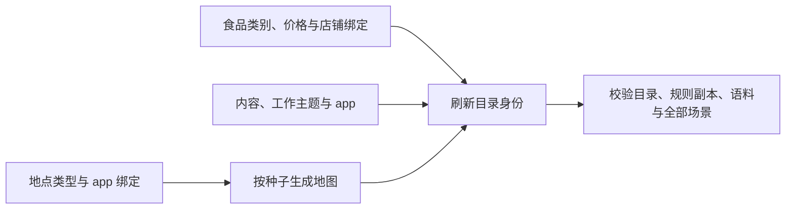

<a name="resources-定义地点门店供给与世界素材"></a>
# 定义地点、门店供给与世界素材

> 2026-10-07：按[资源与规则引擎简化规格](../dev/SPEC-resource-and-rule-simplification.md#spec-rrs-资源与规则引擎简化开发规格)修订「先完成一个最小修改：减少一家门店的初始库存、编写门店供给与商品、完整类别供给与冻结价格、当前供给字段与发布注意事项、新增商品对象、真实制作后再食用、定义地点、门店供给与世界素材、先找到应该修改的文件、哪些路径可以换、输入与生成文件、修改后更新文件身份、验证修改」（阶段 1）。

环境目录说明“这个世界有什么”，规则由 WorldMock 包提供。编辑店铺类型、食品、app 绑定与内容，再按地点生成地图、刷新身份并检查整个环境。运行只读已发布快照；修改不改变已经运行的世界。



地点类型固定为 `home/office/park/fitness/restaurant/cafe/convenience_store/supermarket`。只有后四种食品店铺可以绑定 app；空 `app_ids` 表示只到店。食品类别为 `snack/drink/meal`，热量与食用时长从引擎常数取得。

<a name="resources-共享规则与可重建环境修订"></a>
## 共享规则与可重建环境修订

按[共享规则与可重建环境规格](../dev/SPEC-shared-rules-and-rebuildable-env.md)修订；验收结果独立记录。

语料和资源引用必须是只用 / 分隔的根内相对路径，不能含 ..、反斜杠或任一平台不能原样保存的名字（以点或空格结尾、Windows 设备名如 NUL、Windows 禁用字符 <>:"|?* 与控制字符、孤立代理码点、一级超过 255 字节），不能使用符号链接或目录联接；文件须为普通文件并符合声明的大小与摘要。修改内容后按现行身份发布流程重新生成声明，不能沿用旧摘要。

<a name="resources-先找到应该修改的文件"></a>
## 先找到应该修改的文件

| 想修改的事实 | 文件 |
| --- | --- |
| app 的真实名称 | `catalog/apps.json` |
| 地点名、分店、类型、支持的 app | `catalog/locations.json` |
| 食品名、类别、统一价格与店铺绑定 | `catalog/foods.json` |
| 内容标题、摘要、来源、时长与 app 绑定 | `catalog/contents.json` |
| 工作主题与目标小时 | `catalog/work_topics.json` |
| 地点之间的发布图 | `catalog/map.json`，用生成命令更新 |
| 文件摘要和环境版本 | `catalog/manifest.json` |

目录不得附带品类树、资源定义、交换规则、报价、库存、营业日历、来源指针、字幕、游戏或工作材料。生活活动条目与联系人、邮件仍在 `corpora/`。

<a name="resources-哪些路径可以换"></a>
### 哪些路径可以换

复制完整环境到自己的相对目录，如 `experiments/my-world/`；其中 `catalog/`、`corpora/`、`scenarios/` 并列。命令显式传这个根或场景路径；引擎不搜索数据仓或在线素材。
三份 TOML 只从已安装的 `worldmock.data` 包资源复制，不能作为环境规则调参入口。正式环境由数据仓发布，完整回归通过 `--environment-root experiments/my-world` 明确选择。

<a name="resources-输入与生成文件"></a>
### 输入与生成文件

`apps.json`、`locations.json`、`foods.json`、`contents.json`、`work_topics.json` 是严格 JSON 声明；`map.json` 由地点清单与整数种子生成；`manifest.json` 绑定六个目录 JSON 和三份包 TOML 的原始字节。

```bash
worldmock environment generate-map   --locations experiments/my-world/catalog/locations.json --seed 7   --output experiments/my-world/catalog/map.json
```

食品 `store_ids` 取排序的店铺身份列表或 `"all"`；`"all"` 只包含食品店铺。相同店铺类型必须有相同菜单；只绑定同类一家会被 `FOOD_BINDING_KIND_INCONSISTENT` 拒绝。价格写食品 `price_fen`，同一食品全店同价，店铺全天服务。
内容 `app_ids` 至少一个，摘要最多 200 个 Unicode 字符；真实摘要填写来源 URL，合成摘要写明 notice。未知字段、未知绑定和未列文件均拒绝发布。

<a name="resources-先完成一个最小修改减少一家门店的初始库存"></a>
## 先完成一个最小修改：减少一家门店的初始库存


<a name="resources-编写地点与营业时间"></a>
## 编写地点与营业时间

地图主文件声明身份、版本、坐标系、时区、边界、生成种子以及三个子文件的路径与哈希。
完整模板见种子 20260105 地图（`../WorldMock-Dataset/environment/zhangjiang-baseline/corpora/zhangjiang-map/20260105/dataset.json`）、
种子 20260106 地图（`../WorldMock-Dataset/environment/zhangjiang-baseline/corpora/zhangjiang-map/20260106/dataset.json`）和共享地点（`../WorldMock-Dataset/environment/zhangjiang-baseline/corpora/zhangjiang-map/locations.json`）。
地图声明与地点、供给、路线文件均使用 `schema_version: 3`，声明必填 `random_seed/category_assignment_sha256`；
种子必须与场景一致，类别声明的字节哈希必须匹配，旧结构直接拒绝。

| 地点字段 | 必填与取值 | 含义和关联 |
| --- | --- | --- |
| `location_id`、`name` | 必填非空字符串；身份唯一 | 场景、路线、供给、人物住处和任务地点用这个身份关联；`name` 是人物看到并照抄的名称 |
| `branch_label` | 可选非空字符串，缺省 `null` | 分店标签：显示名为「名称（branch_label）」，提示、事件与导出都用显示名；所选地点的显示名必须互不相同，同名地点靠它区分 |
| `kind` | 必填，只能是 `home`、`office`、`merchant`、`restaurant`、`convenience_store`、`supermarket`、`wet_market`、`fitness`、`park` 之一 | 对应场景 `interaction_menus_by_location_kind` 的键，也是人物看到的场所类型（家、办公室、商户、餐馆、便利店、超市、菜市场、健身房、公园）；场景选中的地点用了其他值即加载拒绝；改类别要同步菜单 |
| `business_kind` | 必填字符串 | 地点业态说明，与活动环境不同 |
| `longitude`、`latitude` | 必填有限数值，WGS84 经度/纬度 | 还必须落在地图 `bounds` 内 |
| `location_kinds` | 必填非空列表，无重复 | 只允许 `home`、`office`、`outdoor`、`fitness`、`venue`；地点不能写 `anywhere` |
| `opening_calendars` | 必填列表，可为空 | 为空表示没有营业时间声明；不能理解为全天营业 |
| `required_qualifications` | 必填字符串列表，可为空 | 进入地点需要人物持有的资格 |
| `brand` | 必填，可为 `null` | 有可靠品牌身份时才填 `brand_id`、`name`、`source` |
| `source` | 必填来源对象 | 区分事实和实验假设，见下文 |
| `affordances` | 必填对象 | 保留现有住所、办公室等世界素材要求；任意新增键不会自动创造运行能力 |

显示名要写人物会说的店名或地名；同名分店用 `branch_label` 区分，例如「全家（东昌路店）」，不要把坐标或内部标识写进名称。
显示名（连同分店标签）带坐标（如「31.2, 121.5」）或标识形态（如「sim-01」「poi-node-1」）时，
新建运行与 `worldmock validate` 报输入警告 `LOCATION_NAME_SUSPICIOUS`，场景照常加载。

营业日历中 `weekly` 必须包含字符串键 `"0"` 至 `"6"`，依次对应周一至周日。
每日区间用当地零点起算的**分钟数**：`540` 是 09:00，`1320` 是 22:00。
一天可有多个不重叠区间；`[]` 表示明确休息。`exceptions` 用 `YYYY-MM-DD` 日期覆盖当天周计划。

以下是一个日历对象中的**局部片段**，不能独立替代完整日历：

```json
{
  "weekly": {
    "0": [{"opens": 540, "closes": 1320}],
    "1": [{"opens": 540, "closes": 1320}],
    "2": [{"opens": 540, "closes": 1320}],
    "3": [{"opens": 540, "closes": 1320}],
    "4": [{"opens": 540, "closes": 1320}],
    "5": [{"opens": 600, "closes": 1200}],
    "6": []
  },
  "exceptions": {"2026-01-01": []}
}
```

跨午夜营业可写 `{"opens": 1200, "closes": 1560}`，表示当晚 20:00 到次日 02:00。
单个区间必须正向且不超过一天，相邻两天的跨日区间也不能重叠。

<a name="resources-来源与有效期"></a>
### 来源与有效期

地点和供给的 `source` 都要求 `kind`、`url`、`retrieved_at`、`license`、`notice`、`fact_cutoff`、`applicability`。
`kind` 只接受 `fact` 或 `scenario`；人为设定的价格、库存、营业时间写 `scenario`。
来源取得时间必须带时区，且不晚于地图的 `prepared_at`；事实截止日期不能晚于取得日期。

营业日历和报价额外要求 `effective_from`、`effective_to`、`reviewed_on`、`still_valid_on` 和自己的 `source`。
`effective_to: null` 表示未声明截止；同一对象的有效期不能重叠。
地图发布日必须处于核对日与有效日之间。历史模拟日期和资料取得日期可以不同，但要在 `applicability` 中如实解释。

<a name="resources-添加地点时还要补路线"></a>
### 添加地点时还要补路线

每个场景选中的**有向地点对 × 地图出行方式**都必须有一条路线记录。
`walking` 对应 `foot` 路由配置，`driving` 对应 `car`；不能只写单向路线。

| 路线状态 | 必须提供 |
| --- | --- |
| `reachable` | 正距离（米）、正时长（秒）、非负车费（分），以及带几何和实际出行方式的冻结成功响应 |
| `unreachable` | 冻结的 `NoRoute` 响应；不能填写距离、时长或车费 |
| `unknown` | 非空 `reason`；不能声称已有响应，也不能填写可达指标 |

基础时长来自冻结响应；实际计划时长还乘[出行时长规则](rules.md#rules-出行时长)。
路线车费必须与当前交换规则重新计算的金额一致。

地图采集和路线重新取得由 Dataset 的制作工具执行。新版本须按环境种子发布完整逐店供给、
冻结路线响应和逐层文件身份，并同步场景选择；WorldMock 只加载已发布快照。
新增地点前先补齐该地点涉及的显式路线状态，再按数据仓说明发布，不能由运行时在线补路线。

<a name="resources-编写门店供给与商品"></a>
## 编写门店供给与商品


<a name="resources-完整类别供给与冻结价格"></a>
### 完整类别供给与冻结价格


<a name="resources-只读查询与有时长浏览"></a>
### 只读查询与有时长浏览

`query_world(name, way, category, from, available_only, offset)` 六键必填、无缺省，`name`、`way`、`category`、`from` 可空但至少一个非 null，
`available_only` 写 true 或 false，offset为非负整数。`from` 写购买来源（地点显示名，含「家」「住处」，或 App 称呼），只匹配门店供给；
`available_only` 为 true 时只留已确认此刻可执行的条目，报价或营业未知的也被滤掉，空页不等于都不能买。
category使用本轮callable_index已经展示的公开品类标签，非法时返回当轮全部合法标签。
结果为matches/total_count/next_offset，next_offset必填可空；每页沿用现有上限20，按偏移可遍历同一冻结权限下的全集。
筛选在排序与切页之前施加，`total_count` 是筛选后的总数；每项不再附候选，照抄 `name` 与所选动作的 `way` 即可提交。
查询不推进时间、不授予呈现凭据，也不恢复按商品需求搜索门店和路线的旧发现请求；现有有时长商品目录浏览保持真实揭示和留痕。
人物可通过现行只读工具调用查询；结果只含本轮冻结观察有权知道的对象。

只看某家店此刻能买的东西，局部示例如下（现成场景没有钉定手机配置，所以 `from` 写门店显示名而不是 App 称呼）：

```json
{"name": null, "way": "购买", "category": null, "from": "<门店显示名>", "available_only": true, "offset": 0}
```

<a name="resources-当前供给字段与发布注意事项"></a>
### 当前供给字段与发布注意事项


<a name="resources-新增商品对象"></a>
### 新增商品对象


<a name="resources-真实制作后再食用"></a>
### 真实制作后再食用


<a name="resources-编写生活活动"></a>
## 编写生活活动

活动目录固定读取 `lifestyle/items.json`，与资源目录 `activity_met` 中的 `lifestyle:<activity_id>` 必须一一对应。
只添加活动 JSON、遗漏 MET，或只加 MET、遗漏活动，都会拒绝加载。

| 活动字段 | 写法 |
| --- | --- |
| `activity_id`、`name_zh`、`category` | 身份和名称唯一；品类为 `sport`、`hobby`、`learning`、`household`、`social`、`wellness`、`pet`、`volunteer`、`outdoor` |
| `typical_duration_minutes` | 生成器要求 5–1440 分钟 |
| `description_zh`、`source` | 描述实际做什么，并写明活动、时长和 MET 的来源或假设 |
| `met_value` | 生成器要求 1–16；身体耗能使用的活动强度 |
| `location_kinds` | 非空闭集列表；活动允许额外使用 `anywhere` |
| `time_window` | 整数小时 `start_hour < end_hour`，范围 0–24；目前不能用一个区间表达跨午夜 |
| `needs_partner` | 布尔值 |
| `effects` | 必填不可变映射，键恰好为 `entertainment`、`social`、`health`；每项有限数值 0–1，不能缺项或填布尔值 |

当前 `location_kinds` 参与活动地点准入，也决定生活活动窗口列不列它：与人物所在地点环境不合适的活动不列出，
按名写它时以「这里不适合做这件事」拒绝。`time_window` 只参与排序（此刻落在窗口内的排得更靠前），`needs_partner` 只做了
数据形状校验，二者都没有接成运行时的时间或伙伴受理限制。`effects` 分别折算为娱乐缓解、社交缓解和健康相关情绪变化
（娱乐缓解不按人物口味调整），从本次环境条目读入并在活动开始时冻结；健康效果并不创建独立的“健康值”资源。

下面是 `enrichment.json` 的 `entries` 中一个**完整条目值**，可替换已有 `3d-printing` 条目的值：

```json
{
  "location_kinds": ["home", "venue"],
  "time_window": {"start_hour": 8, "end_hour": 23},
  "needs_partner": false,
  "effects": {"entertainment": 0.7, "social": 0.1, "health": 0.1}
}
```

补充文件负责地点环境、时间窗口、伙伴声明和效果；来源、名称、时长、MET 及正式活动全集由 Dataset 的
活动制作工具维护。按数据仓说明生成 `lifestyle/items.json`，更新语料清单，随后发布含对应 MET 的资源目录。
正式来源、数量和可复现重建的验收在 Dataset 执行；引擎用人工最小环境验证加载、候选、结算与恢复行为。

<a name="resources-编写内容与工作材料"></a>
## 编写内容与工作材料

内容需要两层声明：语料文件提供元数据和时间轴，场景 `contents` 决定这次实验实际开放哪些条目。
只把文件放进 `corpora/` 不会让人物自动看到它。

| 素材 | 当前读取位置与格式 |
| --- | --- |
| 电影、剧集、网文元数据 | `movies/items.json`、`drama/items.json`、`novels/items.json`，顶层列表 |
| 新闻和段子 | `feed/items.json`、`jokes/items.json`；各自的 `feed-items.json` 还声明整条流的检索元数据 |
| 社交流 | `social/weibo/feed-items.json`、`social/zhihu/feed-items.json`、`social/movie_reviews/feed-items.json` |
| 游戏 | `games/library/items.json`，预生成文件由场景 `games` 引用 |
| 字幕体验 | `sintel/media-identity.json`，单个对象 |
| NASA 播客选段 | `podcasts/items.json`、官方页快照、音频选段与原始锚点身份文件；见下文 |
| 工作材料 | `scenario-work/materials.json` 的 `materials` 列表；任务另外引用实际输入文件和隐藏验收文件 |

内容元数据至少包含非空 `title`、非空列表 `genre`、非空 `language`、非负整数 `age_rating`。
检索还需要 `duration_seconds`；新闻、段子等阅读条目可用 `estimated_read_seconds`。
`genres` 这样的展示文本不能代替机器读取的 `genre` 列表。
`genre` 也是人物口味的匹配词表：人物卡片的口味题材（`content_genres`）与条目 `genre` 按字面精确匹配，
口味权重是两者相同的题材数除以条目的题材数；平台名（如「B站视频」）不是题材。
两边要用同一套题材词，否则 `worldmock validate` 报 `TASTE_GENRES_UNMATCHED` 或 `CONTENT_WEIGHTS_ALL_ZERO`。
当前世界素材准入要求剧集 `language: "zh"`，并执行目录清单中声明的年龄分级上限。

场景 `contents[]` 的完整条目形状如下；哈希必须从实际时间轴计算，不能照抄其他文件的值：

```json
{
  "item_id": "sintel-en-subtitles",
  "title": "Sintel 字幕体验",
  "kind": "subtitle_experience",
  "duration_seconds": 630,
  "timeline_path": "sintel/sintel_en.srt",
  "timeline_sha256": "4ed7e1f1bc5ff69fe33606960e4c048ba6766237bf33b132fef76e1a92cb64b2",
  "entertainment_relief_per_hour": 0.3,
  "experience_label": "subtitle_experience"
}
```

每条内容必填非空 `title`；引擎直接将它用于呈现、名称解析和活动标题，不读取来源专属标题映射。
场景结构必须为 `6`，旧结构与缺标题条目直接拒绝。

`kind` 只接受 `feature_film`、`drama_series`、`podcast_episode`、`webnovel_excerpt`、`news_feed`、`joke_feed`、
`subtitle_experience`、`game_session`。时长为正整数秒，娱乐缓解率为每小时 0–1。
观看的实际缓解是缓解率 × 有效偏好 ÷ 接触次数，有效偏好为 f + (1 − f) × 口味权重，f 取场景 `body.entertainment_relief_preference_floor`
（缺省 0.5）：口味对不上的内容也按 f 缓解；玩游戏按目录的游戏缓解费率乘同一有效偏好。
时间轴使用 SRT：片段编号、`HH:MM:SS,mmm --> HH:MM:SS,mmm`、正文，片段间空行；必须非空且不重叠。
人物按实际接触进度看到正文，不会直接看到整份文件。
内容对象的方式为「接着看」或「从头再看」（播客为「接着听」或「从头再听」）：未看完的（含没看过的）从上次位置接着看、
时长取剩余；已看完或剩余不足 60 秒的从头再看、时长取全长。接触次数只在第一次看和从头再看时加一。
派生时长超过 86400 秒的条目（例如超过一天的信息流）按 86400 秒受理，受理结果写明计划时长，不再因过长被拒绝。

现有 NASA `podcast_episode` 使用 Houston We Have a Podcast — Space Habitat 的
00:01:52–00:14:58 英文访谈选段，选段媒体时长 786 秒。
官方页快照（`../WorldMock-Dataset/environment/zhangjiang-baseline/corpora/podcasts/nasa-space-habitat.source.html`）、
原始锚点与音频身份（`../WorldMock-Dataset/environment/zhangjiang-baseline/corpora/podcasts/nasa-space-habitat.identity.json`）、
本地音频选段（`../WorldMock-Dataset/environment/zhangjiang-baseline/corpora/podcasts/nasa-space-habitat.excerpt.mp3`）和
派生时间轴（`../WorldMock-Dataset/environment/zhangjiang-baseline/corpora/podcasts/podcast-0001.srt`）随语料清单绑定。
按 Dataset 的播客制作与复核说明检查官方段落锚点、SRT 和身份文件；WorldMock 不提供该来源制作器。
只在媒体位置完整越过下一官方锚点后揭示该段文字；该时间轴没有逐词精度。
来源使用条件见语料通知（`../WorldMock-Dataset/environment/zhangjiang-baseline/corpora/LICENSES.md`），不得暗示 NASA 认可本项目。

<a name="resources-配置可玩的游戏"></a>
### 配置可玩的游戏

`games/library/items.json` 是游戏的元数据目录；可执行的 TextWorld 游戏文件由场景 `games[]` 另行指定。
元数据条目不会自动生成可玩的游戏。以下是 `games[]` 中的**完整现有条目**：

```json
{
  "game_id": "textworld-1201",
  "seed": 1201,
  "game_path": "textworld/game-1201.json",
  "game_sha256": "4e0fc25651a001168e3c20f1b618f7c168a4cfb17e86fce82f40dcb6688cef43",
  "walkthrough_sha256": "9fb16a3c81cbe9c8146f927e8354bd4c2430072e9bd371f789978bc3afe15f6a"
}
```

五个字段都必填：`game_id` 非空且在场景中唯一，`seed` 为正整数，`game_path` 相对语料根目录。
游戏文件必须是能够被 TextWorld 启动的 JSON，并包含 `metadata.walkthrough`。
更改场景 `seed` 不会重新生成游戏；需要先准备对应的可执行文件。
`game_sha256` 是完整游戏文件的字节哈希，`walkthrough_sha256` 是攻略值规范序列化后的哈希，两者不同。
游戏与内容同样按题材取口味权重：题材取内容元数据（含 `games/library/items.json`）中 `item_id` 等于该 `game_id` 的条目的 `genre`；
没有这种题材声明的游戏权重为 0，缓解按下限偏好 f。现有 `textworld-*` 游戏都没有题材声明。

计算两个哈希的完整命令：

```bash
python - <<'PY'
import hashlib
import json
from pathlib import Path

content = Path("../WorldMock-Dataset/environment/zhangjiang-baseline/corpora/textworld/game-1201.json").read_bytes()
walkthrough = json.loads(content)["metadata"]["walkthrough"]
encoded = json.dumps(walkthrough, ensure_ascii=False, separators=(",", ":")).encode("utf-8")
print(json.dumps({"game_sha256": hashlib.sha256(content).hexdigest(),
                  "walkthrough_sha256": hashlib.sha256(encoded).hexdigest()}, indent=2))
PY
```

游戏文件还要加入语料清单。真正的启动校验见[游戏加载器](../../src/worldmock/life/game.py)；
仅 JSON 格式和哈希正确，不能代替 TextWorld 可启动性检查。

<a name="resources-工作材料"></a>
### 工作材料

工作材料要与任务中的 `input_path/input_sha256` 和 `oracle_path/oracle_sha256` 对应。
材料清单本身不会创建工作合同；还需在场景分配任务、地点、技能和受理人。
当前世界准入还要求中文、`type: "scenario"`、足量且互不重复的材料，并保留 AMI 元数据。

<a name="resources-编写工作验收答案"></a>
### 编写工作验收答案

工作输入是人物逐步接触的 UTF-8 正文。隐藏答案由一份 oracle JSON 和它引用的参考摘要文件组成，
不能把答案放进人物输入。可从现有输入（`../WorldMock-Dataset/environment/zhangjiang-baseline/corpora/scenario-work/inputs/work-0001.txt`）、
现有答案（`../WorldMock-Dataset/environment/zhangjiang-baseline/corpora/scenario-work/references/work-0001.oracle.json`）和
现有参考摘要（`../WorldMock-Dataset/environment/zhangjiang-baseline/corpora/scenario-work/references/work-0001.reference.json`）复制。

下面是自定义 `scenario-work/references/custom-work.oracle.json` 的**完整示例**：

```json
{
  "type": "scenario",
  "material_id": "custom-work",
  "source_reference": "references/custom-work.reference.json",
  "expected": {
    "material_id": "custom-work",
    "decisions": ["首期仅开放关注关系内的图文发布。"],
    "action_items": ["产品经理更新需求说明中的发布范围。"]
  },
  "piece_count": 1
}
```

对应 `scenario-work/references/custom-work.reference.json` 的**完整示例**：

```json
{
  "type": "scenario",
  "material_id": "custom-work",
  "language": "zh",
  "summary_sentences": ["评审确定首期发布范围，产品经理负责同步需求说明。"]
}
```

`expected` 必须是对象；语义验收读取 `decisions`、`action_items` 两个列表，
并从参考文件加载非空字符串列表 `summary_sentences` 作为摘要。
`source_reference` 相对 oracle 路径的**第一个目录分量**解析：本例的基准是 `scenario-work/`，不是 `references/`。
计件合同必须提供非负整数 `piece_count`，实际付款按它计算；时薪和总包合同不用它确定金额。
输入、oracle 和参考文件都要进入语料清单，任务的 oracle 哈希只填写 oracle 文件本身的 SHA-256。
这些答案应准确对应输入正文；加载成功不等于模型语义验收一定通过。
当前工作交付仍固定为会议纪要结构 `MeetingMinutes`，包括摘要、决定和行动项；
换一个 `required_skill` 名称不会变成任意格式的文案、代码或其他交付任务。

<a name="resources-正餐家庭储备和联系人"></a>
### 正餐、家庭储备和联系人

这些文件还受目录 `category_requirements` 的世界素材要求约束。
它们与场景初值并存，修改素材清单不会自动改写人物的初始状态。

| 文件 | 写法与需要同步的内容 |
| --- | --- |
| 正餐（`../WorldMock-Dataset/environment/zhangjiang-baseline/corpora/meals/items.json`） | 顶层 `items`；每餐有 `meal_id`、名称、份量、每份热量、`energy_source`、`price_fen`、`meal_duration_minutes`、堂食或配送声明。热量来源需有数据库、URL、取得日期、每百克热量和换算说明，并有同名可消费目录对象 |
| 家庭储备（`../WorldMock-Dataset/environment/zhangjiang-baseline/corpora/scene-stock/home-pantry.json`） | `items[]` 的 `object_id` 必须是可消费目录对象，`quantity` 是份数；总量满足目录早餐储备要求。实际人物库存仍写 `agents[].initial_inventory` |
| 联系人素材（`../WorldMock-Dataset/environment/zhangjiang-baseline/corpora/scenario-contacts/contacts.json`） | `personas` 列表声明人物身份，`contacts[]` 写所属 `persona_id`、`contact_id`、`contact_type`、名称、渠道、映射和回复策略。同事映射已有人物、策略为 `persona`；老友和家人映射为 `null`、策略为 `model` |

联系人类型只支持 `colleague`、`old_friend`、`family`。真正用于运行的联系人仍需写入人物 `contacts`，
详见[人物画像](personas.md#personas-人物画像)。正餐语料中的价格是素材声明；实际交易取地图供给的报价，修改它不会自动更新门店。
从完整现有语料复制修改，可以保留当前要求的素材类别；不能只因这次场景未选择就删除固定准入所需文件。

<a name="resources-修改后更新文件身份"></a>
## 修改后更新文件身份

先决定新的 `environment_version`，并更新各场景的 `environment` 钉。修改任何目录文件后都要用现有身份发布入口重算文件表和内容摘要：

```bash
python -c 'from pathlib import Path; from worldmock.catalog.identity import refresh_manifest_identity; refresh_manifest_identity(Path("experiments/my-world/catalog"))'
```

该入口安全读取必需文件，经原子写入更新清单。三份 TOML 副本必须仍与包资源逐字节一致；重算摘要不能让一份擅改的规则副本合法。旧运行与历史冻结输入不改写。

<a name="resources-验证修改"></a>
## 验证修改

```bash
worldmock environment generate-map   --locations experiments/my-world/catalog/locations.json --seed 7   --output experiments/my-world/catalog/map.json --check
worldmock validate --environment experiments/my-world
```

第一条只比较已有地图，不写文件；第二条执行唯一登记校验器、重生成比对、语料清单和三份包 TOML 检查，并真实加载 `scenarios/` 下全部 JSON。每个失败带稳定码和英文原因，任一失败退出非零。登记码完整定义见[环境目录文件](../CONTRACTS.md#contracts-环境目录文件)。通过环境检查后再执行项目校验和完整引擎行为门禁；目录有效不等于行为验证完成。
