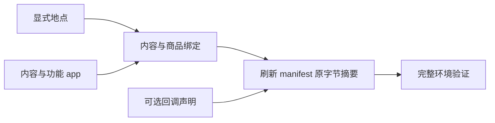

<a name="resources-设计环境数据集"></a>
# 设计环境数据集

环境根包含 catalog/、persona.toml 和 config.toml。catalog/ 只有 manifest.json、app-catalog.jsonl、
callbacks.jsonl、content-catalog.jsonl、location.jsonl、merchant-catalog.jsonl。
每行是一项完整 JSON 对象，使用 UTF-8 无 BOM 与 LF；空 callbacks.jsonl 表示没有回调。
字段、显示名、绑定与发布摘要合同见[资源引擎](../design/03-resource-engine.md)。

地点逐项声明，不使用 count 扩张或生成地址。给本人住处声明 is_home，为一个实际地点声明 accepts_parcels，
同名分店使用 branch_label。地图从唯一运行种子和全部地点在内存生成，不把 map.json 放进发布环境。
需要营业限制时声明 weekly 与按 ISO 日期完整替换的 exceptions；省略 opens 表示全天营业。

允许睡觉的地点声明 sleepable 为 true，缺省不能睡。sleepable 与 is_home 互不推导；
人物自己的家必须标 sleepable，否则环境加载以 HOME_NOT_SLEEPABLE 失败。
家声明了 opens 时，关门时段内不能开始睡；想让人物随时能睡，就不要给家声明 opens。

```json
{"app_ids":[],"is_home":true,"kind":"home","location_id":"home","name":"家","sleepable":true}
{"app_ids":[],"kind":"office","location_id":"office","name":"公司","sleepable":true}
```

app 区分内容平台和功能 app。功能 app 绑定具体动作，由引擎选择；内容平台供人物 interact。
商品只声明零食、食品、饮料、商品四类价格与地点类型或内容 app 绑定。
内容用 app_ids 或 location_kinds 显式绑定，填写实际时长、体力档位、两项心理缓解档位和 pushable。
不要添加内容分类、manner、动作菜单、消息、聊天对象或商家账户。

用 location_kinds 绑定到地点的内容，要把名字当成人物读和写的名字来起：人物在地点做哪件事，是照这个名字点名的。
不属于系列的内容写 title，系列写 series.title；系列各集的 title 不能点名，做到第几集由引擎接着排。
同一个地点类型下这些名字不能重复，独立内容和系列合在一起比，只差空白或大小写也算重复；不同地点类型之间可以重名。
用 app_ids 绑定的内容标题不是人物可写的名字，人物只写 app 名。
接收包裹的地点也要点名才能做事；本人在那里没有已到站的包裹时，那里的事都做不了。



修改目录后使用仓库的发布身份工具刷新 manifest 的文件摘要与目录内容摘要，再执行完整验证。
验证失败按返回的所属路径与英文原因修正，不能删除未知字段错误或靠旧格式混读运行。
操作命令见[运行手册](runtime.md)，作者说明放在环境包外。
