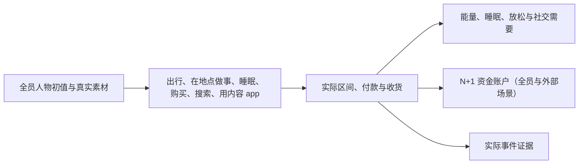

# 理解固定世界规则

环境数据集声明对象、绑定、出行方式与回调，WorldMock 固定身体、资金及生命周期规则。
数值规则唯一维护在[交换引擎](../design/02-exchange-engine.md)，执行边界在[模拟引擎](../design/04-simulation-engine.md)。

人物选择动作和对象，购买和搜索（`search_world`）时还可以写想用哪个 app；引擎派生履约、地图路线、功能 app 与实际费用，人物写的 app 用不上时由引擎另选。
出行方式里只有步行是引擎自带的（每秒 1.2 米、免费、费力），其余方式的速度、价格和体力档位由数据集定义。
数据集改不了的出行规则有三条：步行的数值；天气对全部出行方式的速度系数（晴和多云 1.0、小雨 0.85、大雨 0.7、雪 0.6）；
车费取起步价与按公里计价的较大值，按公里计价向上取整到分。
人物出行时要写目的地和出行方式的名称两样；不写方式、写了不存在的方式或写得有歧义，这次出行不会开始，
引擎不会替他按步行走，也不会替他换成相近的方式。
同一时刻最多做两件事，各占一个专属槽位：出行、睡眠和在地点做事占**主槽位**，购买、搜索（`search_world`）和用内容 app 占**副槽位**。
在地点做事时可以同时购买、搜索或用内容 app；出行、睡眠、在地点做事同一时刻只能有一件，睡眠还要求副槽位空着。
在地点做哪件事由人物按名称点名；用内容 app 时看到什么由引擎选择，放完一条自动接下一条，直到人物结束它或没有可接的内容。
系列照集号接下一集；接另一部系列或另一条独立内容只在数据集标了 `pushable` 的内容里挑，见[设计环境数据集](resources.md)。
打开内容 app 只是看内容，不显示商品，也不会下单；没有内容的购物 app 不能单独打开。
在地点做事和用内容 app 可以暂停，出行、睡眠、购买和搜索不能。用内容 app 随时都能暂停。
在地点做的事快做完时不行：离这件事结束不足 3 分钟（系列按正在做的这一集算）时只能直接结束，或者让它接着做；
恰好还剩 3 分钟可以暂停。整段不到 3 分钟的事因此从头到尾都不能暂停。
在地点做的事用 `conclude_activity` 结束就算做完一轮，下次点名从头做起，系列从第一集做起；想留着进度回头接着做，要用暂停。
内容 app 里没看完的内容结束后仍留着进度。

不知道买什么、在哪买或想去哪里时，人物可以调用原生工具 `search_world(query, prefer)` 发起实时搜索：`query` 写想找的商品描述或地点诉求，`prefer` 写意向使用的下单 app 或 `null`。
搜索占**副槽位**，时长从 `180` 到 `420` 秒（`3` 到 `7` 分钟）确定性抽取，不能暂停；受理后会无栈挂起当前唤醒并推进时钟。
到期时系统运行与人设、记忆、余额完全隔离的 `LLM Search Session` 子会话（按模型路由读取 `search` 阶段绑定档），通过只读工具检索当前城市并经过 `Fact Guard` 二次白名单与实时世界报价核验（至多返回 20 项商品实时报价 `goods_rows` 与 10 个同城地点行 `place_rows`），完结当秒立即释放副槽位并恢复原唤醒上下文让人物直接下单或出行；到期前用 `conclude_activity` 提前取消则立刻清空挂起状态且不调用搜索子模型。
人在路上不能发起搜索，未结束或挂起中的搜索也要先取消才能出发。

睡多久由人物自己写，10 到 720 分钟，只写数字。人物睡在当前所在的地点，这个地点须标了 `sleepable`；
声明了营业时段的地点关门时不能开始睡。
睡眠只由自己的计划结束唤醒，提醒、推送、货品到达和班次起止都不会叫醒人物；睡着时到点的提醒醒后当天补给。
人物可能睡过头：从这一觉开始的那一刻往回数 24 小时，此前合计睡不足 4 小时，就有一半机会再睡 20 到 60 分钟；
刚开始的这一觉不算在内，写多长都不影响。多睡的那段同样补觉，不受 12 小时限制，一觉最长 13 小时。
运行开始之前的时间按人设假定人物刚睡满一整觉、在平时起床的时刻醒来。
人物事先不知道会不会睡过头，醒来后看到「比打算的多睡了 N 分钟」。
以每晚 00:10 睡到 08:00 的人物为例：照常的一夜和 13:00 的办公室午睡都按时醒；照常睡过一夜后熬到 01:00 只睡 180 分钟，
往回数 24 小时还有 7 小时，04:00 按时醒；可能睡过头的是这个短夜之后的下一觉，不管是当天的午睡还是当晚写满 470 分钟的一夜，
因为往回数只有那 3 小时。通宵到 08:00 再睡、前一晚只睡 3 小时后中午小睡 30 分钟，也都可能睡过头。
`personas/*.toml` 的 `sleep_need_hours` 不决定睡多久，只用来算欠的觉：醒着每小时欠一点，睡一小时补一小时。
每晚写的睡眠比 `sleep_need_hours` 短时，欠的觉逐日累加，睡前提示里补满要的时间一天比一天长，食品利用率跟着下降。
想让人物每天把觉补完，就把 `sleep_need_hours` 写成实际的夜间睡眠时长。

一次购买可以写任意多份商品，同一个名称写两次就是两份，全部商品共用一个购买过程。
购买时人物还要写 `prefer`：想用来下单的 app，没有想法写 `null`。人在卖这件商品的地点时直接到店买，不看 `prefer`；
否则经 app 下单，写的 app 接得了这一单就用它，接不了由引擎另选，不退回。一次买几件时每件各自判断，可能分成几张订单。
实际用了哪个 app、还是到店买的，写在购买结果里。
这些规则怎样影响手机时间线，见[设计环境数据集](resources.md#resources-固定规则怎样落到手机时间线)。

商品按下单的内容 app 分成订单，每张订单只用一种付款方式：跳到支付 app，或者在下单的内容 app 里直付。
付款占 10 至 20 秒，直付也占这段时间；只有到店当场买又抽到直付时没有 app 可开，不占时间。
一次购买抽 60 至 300 秒并把付款包在里面，实际耗时取它和各张订单付款合计中较大的一个，四张以上订单时购买可能被付款撑长。
配送和运费仍按店铺算：同一家店在一次购买里只用一个下单 app、只收一份运费，同一个内容 app 上点了两家店是两趟配送、两份运费。
购买完成才整次付款，取消和截断不付款；实际收货才产生食品或放松效果。
除了收到买来的食品或零食，在地点做完一件数据集在 `completion_effects` 里写了 `food` 的事也算吃了：
写 `meal` 的供一餐，数额与一件食品相同，写 `snack` 的供一份零食，数额与一件零食相同，都不花钱；中途结束不算，暂停后回来做完才算。
基础代谢按人物体重计算：什么都不做每小时消耗 `mass_kg` 千卡，睡眠不打折；能量池上限和饥饿阈值对所有体重相同。
估算一天要吃几顿见[编写 personas/*.toml](personas.md)。

没有旧等待、闹钟、消息、邮件、聊天接受机制、燃油、情绪脉冲或自然语言目标自动奖励。
修改数据集不能覆盖固定世界参数；改变系统规则需要同时修改所属模块、生产实现与当前行为测试。
