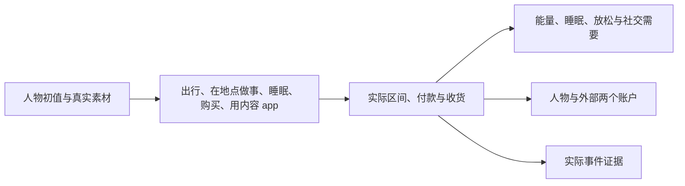

# 理解固定世界规则

环境数据集声明对象、绑定与回调，WorldMock 固定身体、交通、资金及生命周期规则。
数值规则唯一维护在[交换引擎](../design/02-exchange-engine.md)，执行边界在[模拟引擎](../design/04-simulation-engine.md)。

人物选择动作和对象；引擎派生履约、地图路线、功能 app 与实际费用。
同一时刻最多做两件事，各占一个槽位：出行、睡眠和在地点做事占槽位 1，购买和用内容 app 占槽位 2。
在地点做事时可以同时购买或用内容 app；出行、睡眠、在地点做事三者同一时刻只能有一件，睡眠还要求槽位 2 空着。
在地点做哪件事由人物按名称点名；用内容 app 时看到什么由引擎选择。

睡多久由人物自己写，10 到 720 分钟，只写数字。人物睡在当前所在的地点，这个地点须标了 sleepable；
声明了营业时段的地点关门时不能开始睡。
睡眠只由自己的计划结束唤醒，提醒与货品到达不会叫醒人物。

一次购买可以写任意多份商品，同一个名称写两次就是两份，全部商品共用一个购买过程。
购买完成才整次付款，取消和截断不付款；实际收货才产生食品或放松效果。
纯目录浏览只记录平台使用，不产生内容消费与心理缓解。

没有旧等待、闹钟、消息、邮件、聊天接受机制、燃油、情绪脉冲或自然语言目标自动奖励。
修改数据集不能覆盖固定世界参数；改变系统规则需要同时修改所属模块、生产实现与当前行为测试。
