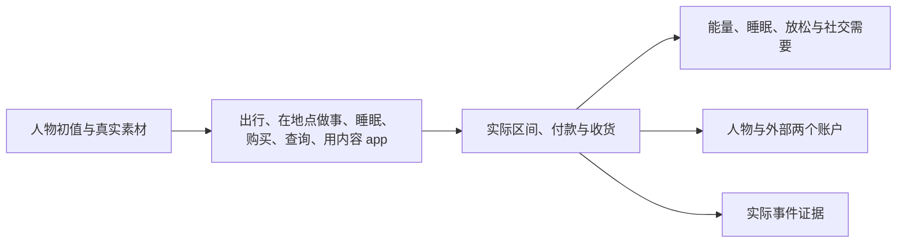

# 理解固定世界规则

环境数据集声明对象、绑定、出行方式与回调，WorldMock 固定身体、资金及生命周期规则。
数值规则唯一维护在[交换引擎](../design/02-exchange-engine.md)，执行边界在[模拟引擎](../design/04-simulation-engine.md)。

人物选择动作和对象，购买和查询时还可以写想用哪个 app；引擎派生履约、地图路线、功能 app 与实际费用，人物写的 app 用不上时由引擎另选。
出行方式里只有步行是引擎自带的（每秒 1.2 米、免费、费力），其余方式的速度、价格和体力档位由数据集定义。
数据集改不了的出行规则有三条：步行的数值；天气对全部出行方式的速度系数（晴和多云 1.0、小雨 0.85、大雨 0.7、雪 0.6）；
车费取起步价与按公里计价的较大值，按公里计价向上取整到分。
人物出行时要写目的地和出行方式的名称两样；不写方式、写了不存在的方式或写得有歧义，这次出行不会开始，
引擎不会替他按步行走，也不会替他换成相近的方式。
同一时刻最多做两件事，各占一个槽位：出行、睡眠和在地点做事占槽位 1，购买、查询和用内容 app 占槽位 2。
在地点做事时可以同时购买、查询或用内容 app；出行、睡眠、在地点做事三者同一时刻只能有一件，睡眠还要求槽位 2 空着。
在地点做哪件事由人物按名称点名；用内容 app 时看到什么由引擎选择。
打开内容 app 只是看内容，不显示商品，也不会下单；没有内容的购物 app 不能单独打开。
在地点做事和用内容 app 可以暂停，出行、睡眠、购买和查询不能；快做完的也不行：离结束不足 3 分钟的活动只能直接结束，或者等它做完；
恰好还剩 3 分钟可以暂停。整段不到 3 分钟的内容（例如一条 60 秒的打卡）因此从头到尾都不能暂停。
在地点做的事用 conclude_activity 结束就算做完一轮，下次点名从头做起，系列从第一集做起；想留着进度回头接着做，要用暂停。
内容 app 里没看完的内容结束后仍留着进度。

不知道买什么、在哪买时人物可以查询：写商品名或类别名（零食、食品、饮料、商品），还可以写想在哪个 app 里查。
查询占槽位 2，要 5 到 10 分钟，不能暂停。答案在查询做完时给出，每件商品每家营业的店一行，一次最多 20 件。
查询做完自己结束，不用收尾，人物当次就能接着下单。人在路上不能查询，查询也不能和出发一起开始，没做完的查询要先结束才能出发。

睡多久由人物自己写，10 到 720 分钟，只写数字。人物睡在当前所在的地点，这个地点须标了 sleepable；
声明了营业时段的地点关门时不能开始睡。
睡眠只由自己的计划结束唤醒，提醒、推送、货品到达和班次起止都不会叫醒人物；睡着时到点的提醒醒后当天补给。
人物可能睡过头：从这一觉开始的那一刻往回数 24 小时，此前合计睡不足 4 小时，就有一半机会再睡 20 到 60 分钟；
刚开始的这一觉不算在内，写多长都不影响。多睡的那段同样补觉，不受 12 小时限制，一觉最长 13 小时。
运行开始之前的时间按人设假定人物刚睡满一整觉、在平时起床的时刻醒来。
人物事先不知道会不会睡过头，醒来后看到「比打算的多睡了 N 分钟」。
以每晚 00:10 睡到 08:00 的人物为例：照常的一夜和 13:00 的办公室午睡都按时醒；照常睡过一夜后熬到 01:00 只睡 180 分钟，
往回数 24 小时还有 7 小时，04:00 按时醒；可能睡过头的是这个短夜之后的下一觉，不管是当天的午睡还是当晚写满 470 分钟的一夜，
因为往回数只有那 3 小时。通宵到 08:00 再睡、前一晚只睡 3 小时后中午小睡 30 分钟，也都可能睡过头。
人物每天第一次睡醒时先回顾前一天、写下一到五条感想，然后才做当天的第一个决定；午睡醒来不再回顾。
persona.toml 的 sleep_need_hours 不决定睡多久，只用来算欠的觉：醒着每小时欠一点，睡一小时补一小时。
每晚写的睡眠比 sleep_need_hours 短时，欠的觉逐日累加，睡前提示里补满要的时间一天比一天长，食品利用率跟着下降。
想让人物每天把觉补完，就把 sleep_need_hours 写成实际的夜间睡眠时长。

一次购买可以写任意多份商品，同一个名称写两次就是两份，全部商品共用一个购买过程。
购买时人物还要写 prefer：想用来下单的 app，没有想法写 null。人在卖这件商品的地点时直接到店买，不看 prefer；
否则经 app 下单，写的 app 接得了这一单就用它，接不了由引擎另选，不退回。一次买几件时每件各自判断，可能分成几张订单。
实际用了哪个 app、还是到店买的，写在购买结果里。
这些规则怎样影响手机时间线，见[设计环境数据集](resources.md#resources-固定规则怎样落到手机时间线)。

商品按下单的内容 app 分成订单，每张订单只用一种付款方式：跳到支付 app，或者在下单的内容 app 里直付。
付款占 10 至 20 秒，直付也占这段时间；只有到店当场买又抽到直付时没有 app 可开，不占时间。
一次购买抽 60 至 300 秒并把付款包在里面，实际耗时取它和各张订单付款合计中较大的一个，四张以上订单时购买可能被付款撑长。
配送和运费仍按店铺算：同一家店在一次购买里只用一个下单 app、只收一份运费，同一个内容 app 上点了两家店是两趟配送、两份运费。
购买完成才整次付款，取消和截断不付款；实际收货才产生食品或放松效果。
除了收到买来的食品或零食，在地点做完一件数据集在 completion_effects 里写了 food 的事也算吃了：
写 meal 的供一餐，数额与一件食品相同，写 snack 的供一份零食，数额与一件零食相同，都不花钱；中途结束不算，暂停后回来做完才算。
基础代谢按人物体重计算：什么都不做每小时消耗 `mass_kg` 千卡，睡眠不打折；能量池上限和饥饿阈值对所有体重相同。
估算一天要吃几顿见[编写 persona.toml](personas.md)。

没有旧等待、闹钟、消息、邮件、聊天接受机制、燃油、情绪脉冲或自然语言目标自动奖励。
修改数据集不能覆盖固定世界参数；改变系统规则需要同时修改所属模块、生产实现与当前行为测试。
