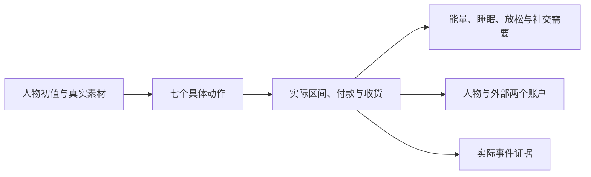

# 理解固定世界规则

环境数据集声明对象、绑定与回调，WorldMock 固定身体、交通、资金及生命周期规则。
数值规则唯一维护在[交换引擎](../design/02-exchange-engine.md)，执行边界在[模拟引擎](../design/04-simulation-engine.md)。

人物选择动作和对象；引擎派生履约、地图路线、功能 app 与实际费用。
睡眠只由自己的计划结束唤醒，提醒与货品到达不会叫醒人物。
购买完成才整次付款，取消和截断不付款；实际收货才产生食品或放松效果。
纯目录浏览只记录平台使用，不产生内容消费与心理缓解。
基础代谢按人物体重计算：什么都不做每小时消耗 `mass_kg` 千卡，睡眠不打折；能量池上限和饥饿阈值对所有体重相同。
估算一天要吃几顿见[编写 persona.toml](personas.md)。

没有旧等待、闹钟、消息、邮件、聊天接受机制、燃油、情绪脉冲或自然语言目标自动奖励。
修改数据集不能覆盖固定世界参数；改变系统规则需要同时修改所属模块、生产实现与当前行为测试。
