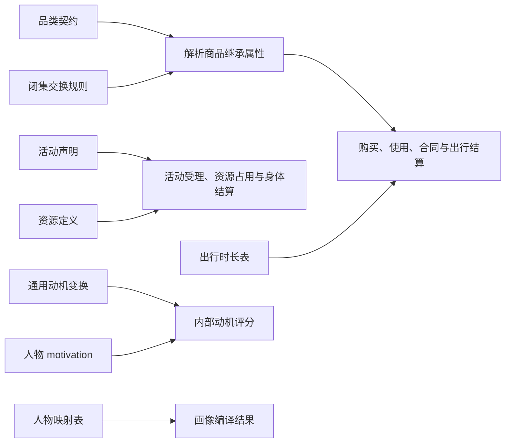

# 调整世界规则与人物动机参数

要改变人物的初始状态，先改[场景](scenarios.md)；要改变“商品怎样起效、行为怎样耗能、出行怎样计时”，
再修改这里的规则。规则在加载时冻结，修改文件不会改变已经运行的世界。
本页命令都在仓库根目录执行。



## 配置入口与生效范围

| 文件或字段 | 可调整内容 | 实际加载方式 |
| --- | --- | --- |
| `catalog/category-contract.json` | 品类继承、槽位约束、共享值、品类配对 | 随场景所用目录加载，版本与规则绑定 |
| `catalog/exchange-rules.json` | 已实现算子的字段与系数所引用的规则 | 随目录加载；不支持表达式或自定义算子代码 |
| `catalog/affordances.toml` | 已实现活动的身体结算、占用资源、候选生成和发现声明 | 场景装配会读目录副本，但实际结算、内部动机等仍有多处固定读取仓库默认文件；见[活动声明](#活动声明) |
| `catalog/rules/travel-time.toml` | 驾车各小时的时长倍数 | 先被目录读取为不可变字节，再由运行场景解析 |
| `catalog/rules/motivation.toml` | 跨人物的评分变换、归一化与习惯参数 | 从本次目录的 `rules/` 加载 |
| `agents[].motivation` | 单个人物的内部评分参数 | 从场景加载，当前结构版本为 `1` |
| `catalog/rules/persona-mapping.toml` | 画像编译中的大五映射和缺省时间锚点 | 优先 `WORLDMOCK_PERSONA_MAPPING`，否则仓库文件位置，再检查当前工作目录 |
| `catalog/rules/off-foods.mapping.toml` | 已冻结食品来源的映射说明 | 纳入目录内容身份；当前没有执行该 TOML 的导入器 |
| `catalog/resources.jsonl` 与合同品类属性 | 身体耗能、睡眠债、娱乐需要、效率曲线 | 目录生成结果；具体来源见[身体规则](#身体规则) |

场景默认目录位置是“场景文件上两级目录下的 `catalog/`”。`catalog_version` 仅检查版本，不能选择路径。
目录清单会绑定规则文件的原始字节；改注释也需要刷新身份。
新建一个 TOML 文件、添加一个算子名或活动类型，不会自动新增引擎能力。

## 品类契约

先考虑把商品挂在已有品类下。只有现有品类确实无法表达共同属性或配对时，才新增品类。
完整文件从[当前品类契约](../../catalog/category-contract.json)复制；不要从一个局部片段覆盖整个文件。

| 字段 | 必填与约束 | 用户应如何使用 |
| --- | --- | --- |
| `format_version` | 必填，当前为 `1` | 格式协议版本，不用来表示实验修订 |
| `contract_version` | 必填正整数 | 发布新的品类契约时递增；交换规则必须绑定同一版本 |
| `categories` | 必填非空列表 | 每个节点有唯一 `category_id`、`name`，可指定一个 `parent_id` |
| `kind` | 根节点要建立可解析的类型 | 只支持 `entity`、`person`、`product`、`service`、`contract`；子类不能改变祖先类型 |
| `slots` | 属性槽定义 | 每槽有 `schema`、可选 `required` 和 `unit`；继承后的约束共同生效 |
| `values` | 可省略以继承 | `absolute` 直接赋值，`relative` 加数值，`proportional` 乘数值；同一层同一槽只能选一种 |
| `pairings` | 有向动作配对列表 | 明确人物品类对目标品类执行某个动作的规则或无效果证据 |
| `sources`、`review` | 必填 | 记录数值来源和实际审核证据；不要填写未发生的审核 |

以下是一个 `categories[]` 中的**完整节点**，演示当前乳品类别如何进一步限制食品热量密度：

```json
{
  "category_id": "food-dairy",
  "name": "Dairy",
  "parent_id": "food",
  "kind": "product",
  "slots": {
    "energy_density_kcal_per_100": {
      "schema": {"type": "number", "minimum": 30, "maximum": 120},
      "required": true,
      "unit": "kcal/100g-or-100ml"
    }
  },
  "values": {"absolute": {}, "relative": {}, "proportional": {}}
}
```

它已存在于正式契约，不要再追加同名节点。修改约束会影响所有后代商品，
不能只检查某一个新商品是否能解析。数值限制同样需要在顶层 `sources` 中有准确覆盖。

配对动作是闭集：`purchase`、`consume:eat`、`consume:use`、`work:settle`、`travel:walking`、`travel:driving`。
下面是一条完整配对：

```json
{
  "actor_category_id": "person",
  "target_category_id": "food",
  "action": "consume:eat",
  "state": "defined",
  "rule_id": "consume-food",
  "coefficient": 1
}
```

| 配对状态 | 应当表达什么 | 字段要求 |
| --- | --- | --- |
| `defined` | 已定义效果 | 必须有已有 `rule_id` 和显式非负有限 `coefficient`，包括有意设为零的情况 |
| `no_effect` | 经审核确认没有效果 | 不得有规则或系数，必须有 `review` |
| `undefined` | 尚未定义 | 不得有规则或系数；不能把它当作自动无效果 |

`review` 要求 `reviewer`、`reviewer_type`、`evidence`、`reason`、`authorization`；
审核者类型只接受 `human` 或 `delegated_agent`。
来源记录要求 `source_id`、`type`、`producer`、`source`、`paths`，可附 `artifact`、`method`、`note`。
`type` 为 `fact`、`anchored`、`assumption`、`scenario`；`producer` 为 `human`、`data_source`、`model`。
数值使用绝对 JSON Pointer 标明来源范围，必须恰好覆盖一次。模型产出不能直接标成 `fact`。

## 交换规则

[`exchange-rules.json`](../../catalog/exchange-rules.json) 顶层要求
`format_version: 1`、`contract_version`、`rules`、`sources`、`review`。
每条规则共有 `rule_id`、`category_id`、`action`、`resource_id`、`unit`、`conservation`、`operator`。
规则的目标品类和动作必须与引用它的配对一致。

| 已实现算子 | 额外字段 | 应用与单位 |
| --- | --- | --- |
| `purchase_transfer` | `from_role`、`to_role` | 买方到商家转账；货币资源为 `money_fen`、单位 `fen`、封闭守恒 |
| `food_energy_source` | `energy_slot`、`duration_slot` | 从商品槽取每份热量与使用时长；`energy_kcal`、`kcal`、开放资源 |
| `durable_use` | 可选 `effect_slot` | 使用耐用品；库存资源单位 `item` |
| `travel_fare` | `minimum_fen`、`fen_per_meter` | 最低车费（非负整数分）、每米费率（非负有限数值） |
| `work_hourly` | `rate_slot`、`maximum_duration_slot` | 按小时费率和实际工作秒数结算，上限由合同绑定 |
| `work_piece` | `rate_slot` | 按验收件数结算 |
| `work_package` | `amount_slot` | 验收通过后支付总包金额 |
| `inventory_transform` | `input_category_id`、`output_category_id`、正数 `input_quantity/output_quantity`、`inventory_unit` | 库存转换；封闭资源要求输入输出数量相同；场景需显式输出对象绑定 |

以下是**一条完整现有购买规则**：

```json
{
  "rule_id": "purchase-product",
  "category_id": "product",
  "action": "purchase",
  "resource_id": "money_fen",
  "unit": "fen",
  "conservation": "closed",
  "operator": "purchase_transfer",
  "from_role": "buyer",
  "to_role": "merchant"
}
```

实际购买价格取[门店供给](resources.md#编写门店供给与商品)，再乘购买数量与品类配对系数，最终向上取整为分。
调整某家店的价格应改供给；调整同一类商品的统一交换系数才改配对。
规则只接受这些算子，不能写 `expression`、Python 表达式或嵌套公式。

### 检查与发布品类修改

现有目录可直接离线检查：

```bash
uv run worldmock category check --catalog catalog
```

查询某组配对时，先保存以下**完整文件**为 `/tmp/worldmock-pairings.json`：

```json
[
  {"actor_category_id": "person", "target_category_id": "food-dairy", "action": "consume:eat"}
]
```

```bash
uv run worldmock category check --catalog catalog --queries /tmp/worldmock-pairings.json
```

检查报告可以包含 `undefined`；它本身不代表场景准入已通过。
更改品类归属时，现有 `category refine` 可比较候选目录，`category publish` 在新目录中校验后原子发布：

```bash
uv run worldmock category refine \
  --catalog catalog --candidate /tmp/worldmock-candidate \
  --parent-category food

uv run worldmock category publish \
  --catalog catalog --candidate /tmp/worldmock-candidate \
  --output /tmp/worldmock-published \
  --assignments /tmp/worldmock-assignments.json \
  --scenario scenarios/my-life.json
```

这些命令需要先准备完整候选目录和场景，不是空目录初始化命令。
`assignments` 是明确确认的 `{"对象身份": "目标品类身份"}` 映射，无归属变化时为 `{}`。
候选的契约版本和目录版本都必须递增，规则版本同步；所有目标场景应钉定候选目录版本。
同一对象改挂品类要追加下一对象版本，不能跳过确认。可重复 `--scenario` 检查多个场景；输出目录必须不存在。
发布不会改写原目录，也不会自动让运行命令找到 `/tmp/worldmock-published`，还需按场景目录布局放置。

## 活动声明

[`affordances.toml`](../../catalog/affordances.toml) 有两层：`kinds` 声明引擎活动，`families` 将活动分组用于内部动机评分。
此处是已有能力的配置，不是插件接口。`ActivityKind`、工具协议、生成器原型、支持资源和出行方式仍受代码闭集约束。

**独立 `catalog/` 副本中的活动声明目前不能完整切换运行行为。** 场景装配会读取并校验该副本，
但反馈类型、资源锁、娱乐缓解通道、MET 模板、能量豁免（只供内部动机评分，不参与受理与结算），以及内部动机家族和候选参数，
仍有消费者在导入时从仓库默认 `catalog/affordances.toml` 读取并缓存。
例如只修改副本的 `resource_claims` 或 `candidate.max_tasks`，不能保证实际执行采用副本值。
下表介绍声明格式；涉及这些运行参数时，当前有效入口仍是仓库默认文件，并需要启动新进程重新加载。

| 常调字段 | 合法写法与影响 |
| --- | --- |
| `kinds.<活动>.met_key` | 资源目录 MET 键；出行允许尾部 `{mode}`，生活活动允许尾部 `{item_id}` |
| `sleep_channel` | 解析值为 `recovery` 或 `awake`；当前身体结算仍按实际 `sleep` 活动分支执行，不靠改该字段切换睡眠行为 |
| `relief.channel` | `none`、`intrinsic`、`preference_rate`、`content_rate`；需与娱乐缓解费率表匹配 |
| `resource_claims` | 占用名 `idle`、`travel`、`eyes`、`ears`、`hands`、`voice`、`work`（[时间与能量规格](../dev/SPEC-time-and-energy.md)第五章「并行准入」占用表）；`conditional` 子句按 `mode:<出行方式>` 或 `content_kind:<内容品类>` 追加占用；同一人物进行中活动的占用相交即 `RESOURCE_CONFLICT` |
| `feedback_boundary`、`game_boundary` | 普通活动反馈与游戏反馈，不能同时开启 |
| `tool.surface` | `basic`、`targeted`、`travel`、`commerce`、`game`、`none` |
| `target_discovery` | `none`、`browse_result` 或带 `field/id_key` 的 `catalog_field` 声明 |
| `families.<家族>.candidate` | 已登记生成器及其允许参数；未知生成器或参数会拒绝 |
| `attention`、`content_kinds` | 采样限额、需要的注意力键、标题元数据位置；与人物 `attention_prior` 一致 |
| `habit_members` | 工具和活动类型的习惯归组；归并键是内部标准动作名（如 `travel_to`、`watch`），不是模型看到的五个动词；精确匹配优先于前缀和通配匹配 |

例如以下是现有 `families.work` 中的**局部替换行**：

```toml
candidate = { generator = "task_slot", max_tasks = 2 }
```

它控制内部动机评分为工作候选枚举多少任务，不改变模型提示中的候选呈现上限。
用户可见候选数量由场景 `candidate_presentation_limit` 等参数控制，见[场景配置](scenarios.md)。

修改活动声明后，需要检查资源目录中 MET/娱乐缓解键、语料路径、人物注意力键和工具菜单是否一致。
单纯给 TOML 加一个新类型，并不能实现新的动作执行器。

## 出行时长

`travel-time.toml` 顶层必须恰好有 `version: 1`、`factors`、`provenance`。
`factors` 必须完整保留 `walking` 与 `driving_00` 至 `driving_23`；所有值是 1–5 的有限数值，`walking` 固定为 `1.0`。

以下是 `[factors]` 中的**局部片段**，表示上午八点出发的驾车时长为基础路线时长的 1.85 倍：

```toml
driving_08 = 1.85
```

按场景时区取**出发小时**，计划秒数向上取整。这张表当前对所有日期使用同一小时表，
文件名或来源中的“工作日”不代表已有周末分支。改表不会改车费，车费属于交换规则。

`provenance.factors` 必须有 `type`、`producer`、`source`、`artifact`、`method`、`paths`，
且 `paths` 恰好为 `["/factors"]`。如果修改了系数，来源说明也要对应新的依据。
当前交通锚点和生成方法见[交通快照说明](../../catalog/snapshots/traffic/README.md)。

```bash
uv run python scripts/calibrate_traffic.py --check
```

该命令检查现有锚点的可复现输出；自定义实验表若有意偏离锚点，不能再声称它是原校准产物。

## 动机评分

当前动机评分写入观察事件的 `motivation_internal`，供评估和研究使用；候选名次、概率和分数不会直接展示给模型。
因此调这里的权重，不等于给人物下达动作指令。

### 跨人物的通用参数

[`motivation.toml`](../../catalog/rules/motivation.toml) 必须保留以下五组运行字段：

| 分组与字段 | 约束与单位 | 作用 |
| --- | --- | --- |
| `prospect.loss_exponent` | 大于 0、小于 1 | 损失段的价值曲线形状 |
| `homeostatic.satiation_exponent` | 大于 0、小于 1 | 收益段的边际递减形状 |
| `normalization.money_fen` | 正数，分 | 金钱归一尺度 |
| `normalization.energy_kcal` | 正数，千卡 | 能量归一尺度 |
| `normalization.sleep_debt_hours` | 正数，小时 | 睡眠债归一尺度 |
| `normalization.entertainment_need`、`goal_progress` | 正数 | 娱乐需要与目标进度归一尺度 |
| `cost.time_value_fen_per_hour` | 正数，分/小时 | 时间机会成本 |
| `habit.weight` | 0–1 | 习惯项权重 |
| `habit.discount` | 大于等于 0、小于 1 | 对更早事件的折扣 |

例如在原文件中替换整个 `[habit]` 段，其他段保持完整：

```toml
[habit]
weight = 0.2
discount = 0.9
```

这表示降低习惯频次对内部评分的影响。`version` 和 `provenance` 是现有文件的声明字段，
修改参数应同步说明；当前读取器主要验证运行字段，不把任意 provenance 文本当作已核验研究证据。
文件缺席时该评分仪表不启用；文件存在但结构或数值错误会阻止场景装配。

### 单个人物的参数

`agents[].motivation` 是场景中的可选对象，当前 `schema_version` 为 `1`。
它与 `profile compile` 输出的 `CompiledPersona` 版本 `2` 是不同模型，不能整块互换。

| 字段 | 必填与取值 |
| --- | --- |
| `big_five` | 必填，恰好五项：`openness`、`conscientiousness`、`extraversion`、`agreeableness`、`neuroticism`；整数 1–10 |
| `weights` | 必填，恰好 `money_fen`、`energy_kcal`、`sleep_debt_hours`、`entertainment_need`、`goal_task`；有限非负数，总和为 1 |
| `tau` | 必填正数；内部候选概率的温度 |
| `beta_present_bias` | 必填，大于 0、小于等于 1 |
| `loss_aversion` | 必填非空映射；键为前四种资源的子集，值至少为 1 |
| `comfort` | 必填，恰好 `balance_fen` 与 `energy_kcal`；有限非负数，分别是分和千卡 |
| `aspiration` | 必填，恰好 `daily_effective_work_seconds`；非负整数秒 |
| `emotion_sensitivity` | 必填，0–1 |
| `attention_prior` | 每项 0–1；键必须与注册表 `attention_required` 集合完全一致，不要求总和为 1 |
| `source` | 可省略或为 `null`；有真实来源才填 `persona_text_sha256`、`model`、`prompt_version`、`consensus` |

以下是可直接放入 `agents[].motivation` 的**完整对象**，它省略可选 `source`，不声称经过模型共识提取：

```json
{
  "schema_version": 1,
  "big_five": {
    "openness": 5, "conscientiousness": 6, "extraversion": 6,
    "agreeableness": 4, "neuroticism": 3
  },
  "weights": {
    "money_fen": 0.22, "energy_kcal": 0.15, "sleep_debt_hours": 0.14,
    "entertainment_need": 0.24, "goal_task": 0.25
  },
  "tau": 0.5,
  "beta_present_bias": 0.65,
  "loss_aversion": {"money_fen": 1.75, "energy_kcal": 1.25},
  "comfort": {"balance_fen": 16000, "energy_kcal": 900},
  "aspiration": {"daily_effective_work_seconds": 21000},
  "emotion_sensitivity": 0.4,
  "attention_prior": {
    "feature_film": 0.1, "news_feed": 0.09, "joke_feed": 0.11,
    "webnovel_excerpt": 0.1, "drama_series": 0.1,
    "sport": 0.08, "hobby": 0.07, "outdoor": 0.06, "wellness": 0.05,
    "household": 0.04, "learning": 0.06, "pet": 0.04,
    "social": 0.06, "volunteer": 0.04
  }
}
```

## 人物映射表

[`persona-mapping.toml`](../../catalog/rules/persona-mapping.toml) 当前要求 `version = 2`，
有 `big_five_center`、`world_dynamics`、`defaults` 三组。画像编译中的大五刻度是 **1–7**，
与上文场景 `motivation.big_five` 的 1–10 校验范围不同。

`big_five_center.center/span` 把量表分数归一化；每个 `world_dynamics` 段使用
`intercept + slope_<特质> × 归一分数`，然后按 `min/max` 限制范围并吸附到 `step` 格点。
必须完整保留以下八个段，斜率名称只能引用已有大五特质。

| 映射结果 | 编译模型允许范围 |
| --- | --- |
| `mood_pulse_amplitude` | 0–1 |
| `mood_halflife_minutes` | 10–180 分钟 |
| `social_need_growth_per_hour` | 大于 0、小于等于 0.5，每小时 |
| `conversation_relief_per_hour` | 0–1，每小时 |
| `diversity_weight`、`invitation_acceptance`、`reply_tendency`、`present_preference` | 0–1 |

以下是原文件 `[defaults]` 和子表的**完整替换片段**，用于故事未明确提及时的编译缺省：

```toml
[defaults]
sleep_need_hours = 7.5
chronotype_midsleep = "04:00"

[defaults.time_anchors]
wake = "07:00-07:30"
leave_home = "08:00-08:30"
lunch = "12:00-13:00"
dinner = "18:30-19:30"
bedtime = "23:00-24:00"
```

独立文件可通过 `WORLDMOCK_PERSONA_MAPPING=/绝对路径/persona-mapping.toml` 选择；
这不是场景字段，也不会自动跟随另一个自定义 `catalog/` 目录。
当前运行时主要从编译结果接入人物卡片和口味权重，**尚未把整份 `world_dynamics` 自动应用到世界状态**。
改变映射表可以改变编译输出，不能据此声称运行中的情绪、社交和邀约参数都已相应改变。
需要明确人物睡眠与作息时，仍在场景人物字段中填写，详见[人物画像](personas.md)。

## 食品来源映射说明

`off-foods.mapping.toml` 当前是对已冻结 Open Food Facts 白名单结果的来源说明。
目录身份会计入它，构建脚本会检查它存在，但并不执行文件里的字段映射或表达式。
因此修改它不会自动抓取食品、增加商品、换算热量或更新份量。

实际正式目录由 `scripts/build_catalog.py` 读取冻结食品语料、白名单和品类映射生成。
食品定制入口及商品原始模型见[资源与素材](resources.md#新增商品对象)。
文件里保留的旧映射措辞不代表当前支持对象 `edges`、动态公式或缺失营养数据时的自动推断。

## 身体规则

当前没有独立的 `body-rules.toml` 或统一“身体配置文件”。它们分布在以下已实际加载的位置：

| 想改变的身体因素 | 权威位置 | 单位或约束 |
| --- | --- | --- |
| 体重、初始能量、初始睡眠债 | 场景 `body` | 千克、千卡、小时；见场景手册的初值限制 |
| 最大能量、饥饿与紧急阈值 | `resources.jsonl` 的 `energy_kcal.bounds/alert_rules` | 千卡；100 < 紧急阈值 < 饥饿阈值 ≤ 上限（100 为代码常量 `APPETITE_STARVING_KCAL`，不满足时加载拒绝）；紧急阈值同时是饥饿「至少饿得难受」的下限，能量低于 100 千卡时显示「饿得发慌」 |
| 基础代谢、活动 MET | 能量资源的 `drain_rules` | 千卡/小时、活动强度；参与实际耗能；出行方式的 MET（`travel:<方式>`）决定路线标签：MET < 2 为「轻松」，2 ≤ MET < 3 为「一般」，≥ 3 为「费力」 |
| 睡眠需要与昼夜节律 | 人物 `sleep_need_hours`、`chronotype_midsleep` | 当前两过程睡眠算法消费这些人物参数；起点困意由这两项按惯常起床时刻反推，见[人物画像](personas.md#在场景中填写人物) |
| 目录中的睡眠变化率 | `sleep_debt_hours.drain_rules` | 仍要求正数并装配，但 `awake_sleep_debt_per_hour`、`sleep_recovery_per_hour` 不能覆盖当前睡眠算法 |
| 目录中的 `food_efficiency_curve` | 能量资源的 `drain_rules` | 仍要求合法曲线并装配，但实际食品利用率由睡眠模型计算，不读取这张目录曲线 |
| 娱乐需要增长、活动缓解率 | `entertainment_need.drain_rules` | 0–1 的每小时变化率；缓解键与活动声明匹配 |
| 工作效率因子、笔记倍率 | 合同品类解析后的属性 | 所有合同模板需一致；曲线必须能合法插值 |

正式基线生成器从 `scripts/catalog-snapshot-legacy-scenario.json` 的 `body` 读取基础身体参数，
合并 `lifestyle/items.json` 的 MET，再写入资源目录。
工作效率则由合同品类属性解析。把运行期 `BodyConfig` 的完整字段直接塞进场景 `body` 会因未知字段被拒绝。

当前[睡眠模型](../../src/worldmock/life/sleep.py)冻结了两过程时间常数、睡眠不足账的增长与恢复算法、
食品利用率曲线和困意分级；这些没有文件配置入口。实际睡眠不足账名为 `sleep_deficit_hours`，
场景输入和目录部分字段仍使用 `sleep_debt_hours` 字样，不表示存在两份可以分别调节的睡眠状态。
工作效率曲线的睡眠输入最终读取这份睡眠不足账；食品利用率则直接调用睡眠模型。

## 在独立目录中调参并验证

下面是完整离线示例：复制规则目录和现有场景，降低习惯项权重，提升目录次版本，刷新真实目录身份，
然后经真实场景装配读取。它不改正式目录、不调用模型、不启动模拟。

```bash
uv run python - <<'PY'
import json
import shutil
from pathlib import Path
from worldmock.categories.identity import refresh_manifest_identity
from worldmock.life.semantics import load_runtime_scenario

root = Path("experiments/rules-demo")
root.mkdir(parents=True, exist_ok=False)
shutil.copytree("catalog", root / "catalog")
(root / "scenarios").mkdir()
rules = root / "catalog/rules/motivation.toml"
text = rules.read_text(encoding="utf-8")
assert "weight = 0.3" in text
rules.write_text(text.replace("weight = 0.3", "weight = 0.2", 1), encoding="utf-8")
manifest_path = root / "catalog/manifest.json"
manifest = json.loads(manifest_path.read_text(encoding="utf-8"))
manifest["version_minor"] += 1
manifest_path.write_text(json.dumps(manifest, ensure_ascii=False, indent=2) + "\n", encoding="utf-8")
refresh_manifest_identity(root / "catalog")
scenario = json.loads(Path("scenarios/white-collar-12-weeks.json").read_text(encoding="utf-8"))
scenario["scenario_id"] = "rules-demo"
scenario["corpus_root"] = "../../../corpora"
scenario["catalog_version"] = {"major": manifest["version_major"], "minor": manifest["version_minor"]}
scenario_path = root / "scenarios/scenario.json"
scenario_path.write_text(json.dumps(scenario, ensure_ascii=False, indent=2) + "\n", encoding="utf-8")
semantics, _ = load_runtime_scenario(scenario_path)
assert semantics.motivation_transforms.habit_weight == 0.2
print("Custom motivation rules are valid")
PY
```

目标实验目录必须不存在。示例沿用假设性质的习惯来源声明；用于正式实验时，补充本次取值理由。
这是在既有模型内调参数，不是 `category publish` 的品类结构发布流程。
`refresh_manifest_identity` 只重新计算身份，不证明规则正确；因此示例在最后执行了实际场景装配。

对于正式基线，由生成器刷新资源、对象和目录清单：

```bash
uv run python scripts/build_catalog.py
uv run python scripts/build_catalog.py --check
```

不要把这个固定基线生成器用于上面的独立目录。只读检查某份自定义目录：

```bash
uv run worldmock category check --catalog experiments/rules-demo/catalog
```

正式运行前继续执行[资源文件校验](resources.md#验证修改)和完整项目校验；
`worldmock validate` 在有背景故事时会调用模型，详见[运行配置](runtime.md)。

| 常见错误 | 原因与处理 |
| --- | --- |
| `CATALOG_CONTENT_IDENTITY_MISMATCH` | 修改了目录文件但未刷新 `manifest.json` |
| `EXCHANGE_CONTRACT_VERSION_MISMATCH` | 品类和交换规则绑定了不同契约版本 |
| `PAIRING_RULE_MISMATCH` | 配对与所指规则的动作或目标品类不一致 |
| `motivation weights must sum to one` | 人物五项资源权重未归一 |
| `motivation attention_prior keys must equal...` | 人物注意力键与注册表不完整对应 |
| `Travel time profile must declare the closed branch set` | 少了小时、增加了未支持方式或写了表达式 |
| 解析成功但实验行为没变化 | 检查实际加载目录、参数消费者和当前生效范围；内部评分或未接入的编译字段不保证改变决策 |

字段的最终依据是[品类模型](../../src/worldmock/categories/models.py)、[交换规则模型](../../src/worldmock/categories/rules.py)、
[活动声明加载器](../../src/worldmock/catalog/affordances.py)、[场景语义装配](../../src/worldmock/life/semantics.py)
和[画像映射器](../../src/worldmock/profile/mapper.py)。

[返回配置手册](README.md) · [场景配置](scenarios.md) · [人物画像](personas.md) · [资源与素材](resources.md)
