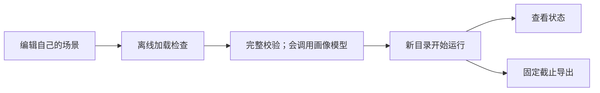

# 运行配置

准备模型凭据、选择场景和新输出目录后，就能启动自己的生活模拟。
本页也说明恢复已有运行和编写反事实干预文件的方法。

[返回手册](README.md) · [生活场景](scenarios.md) · [数据生成](delivery.md)

## 准备环境

在仓库根目录执行，使用 Python 3.12 和项目锁定的依赖：

```bash
uv sync --frozen
uv sync --project vendor/labelkit --frozen
```

WorldMock 与 LabelKit 使用各自环境；LabelKit 的命令入口在 Linux 为
`vendor/labelkit/.venv/bin/labelkit`，在 Windows 为 `vendor/labelkit/.venv/Scripts/labelkit.exe`。
完整 `worldmock validate` 也会检查这个入口，不能只安装 WorldMock 的环境。
Windows 还需要安装[微软官方 Visual C++ v14 x64 运行库](https://learn.microsoft.com/en-us/cpp/windows/latest-supported-vc-redist?view=msvc-170)；
Ray 的子进程需要它加载原生模块。`worldmock validate` 会在独立进程中检查 Ray 导入，
避免到模拟启动时才发现缺少运行库。
准备依赖可能联网，但安装本身不启动模拟。

## 填写模型凭据

生活模拟读取固定文件 `~/.config/worldmock/deepseek.env`。文件只能包含 `DEEPSEEK_NODE_KEYS` 一个键。
下面是完整格式示例，其中的占位值必须换成实际可用密钥：

```dotenv
DEEPSEEK_NODE_KEYS=replace-with-your-key
```

填写至少一把实际可用的密钥，多把密钥用逗号分隔。模拟启动时逐段去掉首尾空格，
按出现顺序去重，再交给 LiteLLM Router 分摊请求；空值和空段均被拒绝。
`MODEL`、`BASE_URL` 等额外键不属于这个文件的格式。文件必须存在且不能是符号链接。

用编辑器填写凭据，避免把真实密钥放进命令历史或项目文件。创建目录及设置权限的命令为：

```bash
mkdir -p ~/.config/worldmock
chmod 700 ~/.config/worldmock
# 用编辑器保存 deepseek.env 后执行
chmod 600 ~/.config/worldmock/deepseek.env
```

`0600` 是推荐文件权限；当前运行加载器校验文件、符号链接、键和值，没有实现权限位的强制检查。
本页不要求打印凭据来验证配置。

## 哪些模型参数可配置

当前生活模拟固定使用 DeepSeek 官方 OpenAI 格式端点 `https://api.deepseek.com` 和模型
`deepseek-flash`。DeepSeek 的 Anthropic 格式端点使用同一平台密钥，但 WorldMock 的
AgentSociety2 调度器发送 OpenAI 格式请求，因此必须连接 OpenAI 格式端点。
启动器会设置仿真和代码角色的模型、端点及请求参数，没有场景级 `model` 或 `base_url` 覆盖字段。
自行设置 AS2 的同名环境变量会在 WorldMock 启动时被覆盖。
需要更换模型属于运行合同与代码变更，不能靠向场景 JSON 增加字段实现。

| 使用入口 | 凭据来源 |
| --- | --- |
| `run`、`resume`、`replay` | 固定私密文件中的 `DEEPSEEK_NODE_KEYS`，不以同名环境变量替代文件 |
| `profile compile`、`profile check`、画像覆盖率校验 | 优先环境变量 `DEEPSEEK_NODE_KEYS`，其次私密文件，取池中第一把密钥 |
| LabelKit 数据生成 | 使用其项目配置和凭据引用，见[数据生成](delivery.md) |

画像抽取通过独立客户端请求 `https://api.deepseek.com/chat/completions`，默认模型同为
`deepseek-flash`，只使用密钥池第一把；直接调用抽取接口时可显式传入密钥。
画像编译可用不等于模拟启动凭据已经齐备，两者的读取顺序与完整文件校验不同。
当前读取与请求身份依据为[运行启动器](../../src/worldmock/runtime.py)、
[画像抽取器](../../src/worldmock/profile/extractor.py)和[模型凭据合同](../CONTRACTS.md#人物决策提示与生成参数)。

## 从校验到新建运行



离线检查见[入门流程](README.md#创建自己的第一个场景)。实际命令如下：

```bash
uv run worldmock validate \
  --scenario scenarios/my-persona-day.json \
  --coverage-out /tmp/my-persona-day-coverage.json
uv run worldmock run \
  --scenario scenarios/my-persona-day.json \
  --output runs/my-persona-day
uv run worldmock status --run-dir runs/my-persona-day
```

`run` 会调用模型并持续模拟到场景结束；已存在的输出目录不能被覆盖。
`status` 只读已确认状态，不推进时间。查看状态可在另一个终端进行。
配置和依赖在运行开始时绑定，不能通过编辑文件让正在运行的人物采用新设定。

结束后导出到新目录：

```bash
uv run worldmock export \
  --run-dir runs/my-persona-day \
  --output runs/my-persona-day/exports/final
```

`--cutoff` 可指定事件序号截止点；不指定时使用当前导出逻辑的默认截止点。
导出文件、检查点、运行身份及状态文件由程序管理；用户输入文件不应放进这些生成物里。
产物格式见[记录引擎](../design/05-recording-engine.md)。

## 从检查点恢复

恢复会把父运行中的共同检查点复制到新运行目录，然后继续模拟。
先从父运行已有记录中取得真实检查点标识，再替换命令里的 `CHECKPOINT_ID`：

```bash
uv run worldmock resume \
  --scenario scenarios/my-persona-day.json \
  --parent runs/my-persona-day \
  --checkpoint CHECKPOINT_ID \
  --output runs/my-persona-day-resumed
```

恢复必须匹配父运行的场景、代码、模型及资源身份；仅修改 JSON 空白也会改变场景字节哈希。
新画像、不同时间窗或菜单应通过新建运行使用。恢复时人物记忆与卡片来自检查点，不重新编译。
没有检查点或标识不属于该父运行时，不能用猜测的名字代替。

## 编写反事实干预文件

反事实运行用于比较“同一个检查点下，如果这个人的余额不同，会发生什么”。
当前 `kind` 只支持 `set_balance_fen`，不能用这个入口修改人格、地点或模型。

下面是完整文件结构示例，保存到自己的 JSON 文件中；`source_event_ids` 必须替换成父检查点内真实可见的事件标识：

```json
{
  "kind": "set_balance_fen",
  "agent_id": 1,
  "balance_fen": 300000,
  "hypothesis": "可用余额降低后，人物是否改变消费选择？",
  "source_event_ids": ["replace-with-visible-parent-event-id"]
}
```

`agent_id` 为场景中存在的人物，`balance_fen` 为非负整数分；假设不能为空白，
来源事件数组至少一项且不能重复。干预在新分支首次决策前应用一次，后续行动仍由人物选择。

先校验文件形状，不会调用模型，也不能证明来源事件确实有效：

```bash
uv run python - <<'PY'
from pathlib import Path
from worldmock.life.models import CounterfactualIntervention

item = CounterfactualIntervention.model_validate_json(Path("/tmp/my-intervention.json").read_text())
print(item.kind, item.agent_id)
PY
```

然后以真实检查点启动新分支：

```bash
uv run worldmock replay \
  --scenario scenarios/my-persona-day.json \
  --parent runs/my-persona-day \
  --checkpoint CHECKPOINT_ID \
  --intervention /tmp/my-intervention.json \
  --output runs/my-persona-day-lower-balance
```

程序会在恢复和应用干预时检查来源身份与可见性。不能用生成一段假想文本代替实际分支运行。

## 常见错误

| 错误或现象 | 检查什么 |
| --- | --- |
| `DeepSeek credential file is missing or unsafe` | 文件路径、是否为普通文件、是否为符号链接 |
| `DeepSeek credential file has an invalid schema` | 是否只有 `DEEPSEEK_NODE_KEYS`，值或逗号分隔的密钥段是否为空 |
| `The isolated LabelKit CLI environment is not installed` | 是否安装了 LabelKit 的独立环境 |
| 只设置环境变量，模拟仍报凭据缺失 | 模拟启动器读取私密文件；画像抽取的读取顺序不同 |
| 输出目录已经存在 | 改用新的运行或导出目录，保留原记录 |
| 改了场景或代码后恢复被拒绝 | 使用匹配身份的原始配置恢复，或为新条件新建运行 |

命令参数以[命令入口](../../src/worldmock/cli.py)为准；更多数据生成与评估步骤见对应手册页。
