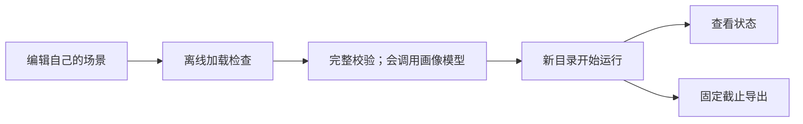

# 运行配置

准备模型凭据、选择场景和新输出目录后，就能启动自己的生活模拟。
本页也说明恢复已有运行和编写反事实干预文件的方法。

[返回手册](README.md) · [生活场景](scenarios.md) · [数据生成](delivery.md)

## 准备环境

在仓库根目录执行，使用 Python 3.12 和项目锁定的依赖：

```bash
git submodule update --init vendor/agentsociety2 vendor/labelkit
uv sync --frozen
uv sync --project vendor/labelkit --frozen
```

AS2 必须是子模块指针锁定的提交 `8768e14`，并按 `uv sync --frozen` 的缺省方式从 `vendor/agentsociety2`
可编辑安装。启动时核对实际导入的 AS2 包：包目录为空、无法导入或源码摘要与锁定值不符时，`run`、`resume`、
`replay` 与 `validate` 都拒绝启动，不能用别处安装的其他 AS2 版本代替。wheel 安装或 `--no-editable` 安装同样
被拒绝：构建 wheel 时 AS2 的 `.gitignore` 会剔除 `agentsociety2/custom/*/examples/` 下 6 个受跟踪文件，摘要因此不符。

WorldMock 与 LabelKit 使用各自环境；LabelKit 的命令入口在 Linux 为
`vendor/labelkit/.venv/bin/labelkit`，在 Windows 为 `vendor/labelkit/.venv/Scripts/labelkit.exe`。
完整 `worldmock validate` 也会检查这个入口，不能只安装 WorldMock 的环境。
Windows 还需要安装[微软官方 Visual C++ v14 x64 运行库](https://learn.microsoft.com/en-us/cpp/windows/latest-supported-vc-redist?view=msvc-170)；
Ray 的子进程需要它加载原生模块。`worldmock validate` 会在独立进程中检查 Ray 导入，
避免到模拟启动时才发现缺少运行库。
准备依赖可能联网，但安装本身不启动模拟。

## 填写模型凭据

生活模拟读取固定文件 `~/.config/worldmock/deepseek.env`。文件只能包含 `DEEPSEEK_NODE_KEYS` 一个键。
下面是完整格式示例，其中的占位值必须换成实际可用密钥：

```dotenv
DEEPSEEK_NODE_KEYS=replace-with-your-key
```

填写至少一把实际可用的密钥，多把密钥用逗号分隔。模拟启动时逐段去掉首尾空格，
按出现顺序去重，再交给 LiteLLM Router 分摊请求；空值和空段均被拒绝。
`MODEL`、`BASE_URL` 等额外键不属于这个文件的格式。文件必须存在且不能是符号链接。

用编辑器填写凭据，避免把真实密钥放进命令历史或项目文件。创建目录及设置权限的命令为：

```bash
mkdir -p ~/.config/worldmock
chmod 700 ~/.config/worldmock
# 用编辑器保存 deepseek.env 后执行
chmod 600 ~/.config/worldmock/deepseek.env
```

`0600` 是推荐文件权限；当前运行加载器校验文件、符号链接、键和值，没有实现权限位的强制检查。
本页不要求打印凭据来验证配置。

## 哪些模型参数可配置

当前生活模拟固定使用 DeepSeek 官方 OpenAI 格式的 strict 端点 `https://api.deepseek.com/beta` 和模型
`deepseek-flash`。每个工具函数都声明 `strict: true`：探针实测主站 `https://api.deepseek.com` 不执行这个声明，
`/beta` 在请求时校验函数 Schema、不合规即返回 400，但不保证模型给出的取值都受约束，宿主本地的严格校验仍是最终判定。
`validate` 核对的模型身份含这个端点，不是 `/beta` 即拒绝；清单冻结在主站的旧运行不能恢复或重放。
DeepSeek 的 Anthropic 格式端点使用同一平台密钥，但 WorldMock 的
AgentSociety2 调度器发送 OpenAI 格式请求，因此必须连接 OpenAI 格式端点。
启动器会设置仿真和代码角色的模型、端点及请求参数，没有场景级 `model` 或 `base_url` 覆盖字段。
自行设置 AS2 的同名环境变量会在 WorldMock 启动时被覆盖。
需要更换模型属于运行合同与代码变更，不能靠向场景 JSON 增加字段实现。

人物决策的请求开启思考，输出上限 `max_tokens` 为 8000，思考也计入这个上限。思考用完上限、
还没调用工具的回合（`finish_reason=length`）被丢弃，只留在模型证据里；紧接着以关闭思考、`tool_choice=required`、
上限不变的请求重试一次，重试再被截断时不再重试，其后照常按本次决策的回合预算继续。上限与这一处理都不可配置；
导出的 `quality.json` 在 `truncations` 一节按用途统计截断的回复次数、浪费的输出 token 与其中的思考 token。

| 使用入口 | 凭据来源 |
| --- | --- |
| `run`、`resume`、`replay` | 固定私密文件中的 `DEEPSEEK_NODE_KEYS`，不以同名环境变量替代文件 |
| `profile compile`、`profile check`、画像覆盖率校验 | 优先环境变量 `DEEPSEEK_NODE_KEYS`，其次私密文件，取池中第一把密钥 |
| LabelKit 数据生成 | 使用其项目配置和凭据引用，见[数据生成](delivery.md) |

画像抽取通过独立客户端请求 `https://api.deepseek.com/beta/chat/completions`，默认模型同为
`deepseek-flash`，只使用密钥池第一把；直接调用抽取接口时可显式传入密钥。
画像编译可用不等于模拟启动凭据已经齐备，两者的读取顺序与完整文件校验不同。
当前读取与请求身份依据为[运行启动器](../../src/worldmock/runtime.py)、
[画像抽取器](../../src/worldmock/profile/extractor.py)和[模型凭据合同](../CONTRACTS.md#模型身份)。

## 从校验到新建运行



离线检查见[入门流程](README.md#创建自己的第一个场景)。实际命令如下：

```bash
uv run worldmock validate \
  --scenario scenarios/my-persona-day.json \
  --coverage-out /tmp/my-persona-day-coverage.json
uv run worldmock run \
  --scenario scenarios/my-persona-day.json \
  --output runs/my-persona-day
uv run worldmock status --run-dir runs/my-persona-day
```

`validate` 通过时在标准输出打印一个 JSON 对象，含 `valid`、`scenario_id`、`model_identity`、`persona_coverage` 与
`input_warnings` 等键。`input_warnings` 是运行输入警告清单，每条为 `{code, agent_id, message, details}`，
场景级警告（配送路线不可达、地点显示名可疑）的 `agent_id` 为 `null`；同一组警告也逐条写到标准错误流，
格式为 `Input warning <警告码> (agent <人物编号>): <说明>`。警告不让校验失败，但人物卡片的可执行覆盖率低于 80% 时
`validate` 仍然失败、标准输出为空，失败前照样写出警告；与人物有关的警告码和改法见[人物画像](personas.md#常见错误)。

`run` 会调用模型并持续模拟到场景结束；已存在的输出目录不能被覆盖。`run` 另接受 `--same-second-continuation on|off`（缺省 `on`）：
关闭时同一秒的相邻决策不续接思考，每次决策都从新快照构造请求，只用于对比运行；开关冻结进运行清单，`resume` 与 `replay`
继承父运行的值、不接受该参数。除人物决策外，零点计划也调用模型：
运行开始时和每个场景本地零点，为每个人物生成当日计划（同一人物同一天只生成一次），它的请求与人物决策分开记录。
`run` 创建运行时按同一规则重新计算运行输入警告（画像会重新编译），冻结进运行目录 `manifest.json` 的 `input_warnings`，
每条另写一条 `logs/ops-YYYYMMDD.jsonl` 的 `warn` 记录，导出的 `quality.json` 在 `input_warnings` 一节按警告码计数；
警告不会让 `run` 失败，覆盖率不足时也只记 `COVERAGE_BELOW_THRESHOLD`。`resume` 与 `replay` 不重算，沿用父运行清单里的警告。
`status` 只读已确认状态，不推进时间。查看状态可在另一个终端进行。
配置和依赖在运行开始时绑定，不能通过编辑文件让正在运行的人物采用新设定。

结束后导出到新目录：

```bash
uv run worldmock export \
  --run-dir runs/my-persona-day \
  --output runs/my-persona-day/exports/final
```

`--cutoff` 可指定事件序号截止点；不指定时使用当前导出逻辑的默认截止点。
导出文件、检查点、运行身份及状态文件由程序管理；用户输入文件不应放进这些生成物里。
产物格式见[记录引擎](../design/05-recording-engine.md)。

## 从检查点恢复

恢复会把父运行中的共同检查点复制到新运行目录，然后继续模拟。
先从父运行已有记录中取得真实检查点标识，再替换命令里的 `CHECKPOINT_ID`：

```bash
uv run worldmock resume \
  --scenario scenarios/my-persona-day.json \
  --parent runs/my-persona-day \
  --checkpoint CHECKPOINT_ID \
  --output runs/my-persona-day-resumed
```

恢复必须匹配父运行的场景、代码（代码身份含实际导入的 AS2）、模型及资源身份；仅修改 JSON 空白也会改变场景字节哈希。
新画像、不同时间窗或菜单应通过新建运行使用。恢复时人物记忆与卡片来自检查点，不重新编译。
人物提示中的记忆层与人设层的看法、偏好由已提交事件与世界状态派生，不新增持久状态；从检查点恢复后派生结果与原运行相同。
当日计划、提醒（含是否已触发）与已生成计划的日期 `plan_submitted_dates` 同样来自检查点：当天已生成计划的人物不重新生成，
已触发的提醒不再触发；检查点里当天还没有计划的人物，恢复后在首次决策之前由零点计划补上，这一步会调用模型。
反事实分支按同一规则在应用干预之后补上。
没有检查点或标识不属于该父运行时，不能用猜测的名字代替。

## 编写反事实干预文件

反事实运行用于比较“同一个检查点下，如果这个人的余额不同，会发生什么”。
当前 `kind` 只支持 `set_balance_fen`，不能用这个入口修改人格、地点或模型。

下面是完整文件结构示例，保存到自己的 JSON 文件中；`source_event_ids` 必须替换成父检查点内真实可见的事件标识：

```json
{
  "kind": "set_balance_fen",
  "agent_id": 1,
  "balance_fen": 300000,
  "hypothesis": "可用余额降低后，人物是否改变消费选择？",
  "source_event_ids": ["replace-with-visible-parent-event-id"]
}
```

`agent_id` 为场景中存在的人物，`balance_fen` 为非负整数分；假设不能为空白，
来源事件数组至少一项且不能重复。干预在新分支首次决策前应用一次，后续行动仍由人物选择。

先校验文件形状，不会调用模型，也不能证明来源事件确实有效：

```bash
uv run python - <<'PY'
from pathlib import Path
from worldmock.life.models import CounterfactualIntervention

item = CounterfactualIntervention.model_validate_json(Path("/tmp/my-intervention.json").read_text())
print(item.kind, item.agent_id)
PY
```

然后以真实检查点启动新分支：

```bash
uv run worldmock replay \
  --scenario scenarios/my-persona-day.json \
  --parent runs/my-persona-day \
  --checkpoint CHECKPOINT_ID \
  --intervention /tmp/my-intervention.json \
  --output runs/my-persona-day-lower-balance
```

程序会在恢复和应用干预时检查来源身份与可见性。不能用生成一段假想文本代替实际分支运行。

## 常见错误

| 错误或现象 | 检查什么 |
| --- | --- |
| `DeepSeek credential file is missing or unsafe` | 文件路径、是否为普通文件、是否为符号链接 |
| `DeepSeek credential file has an invalid schema` | 是否只有 `DEEPSEEK_NODE_KEYS`，值或逗号分隔的密钥段是否为空 |
| `The isolated LabelKit CLI environment is not installed` | 是否安装了 LabelKit 的独立环境 |
| `AS2 runtime identity differs from the locked source` | 是否按「准备环境」把 `vendor/agentsociety2` 初始化到锁定提交，并用 `uv sync --frozen` 从子模块可编辑安装（wheel 或 `--no-editable` 安装会被拒绝）；实际导入的 AS2 包是否为空、无法导入或被改动 |
| 只设置环境变量，模拟仍报凭据缺失 | 模拟启动器读取私密文件；画像抽取的读取顺序不同 |
| 输出目录已经存在 | 改用新的运行或导出目录，保留原记录 |
| 改了场景或代码后恢复被拒绝 | 使用匹配身份的原始配置恢复，或为新条件新建运行；升级代码后旧检查点不能恢复 |
| `Stage model identity is inconsistent: base_url='https://api.deepseek.com' must be the DeepSeek strict endpoint 'https://api.deepseek.com/beta'` | 父运行在端点改为 `/beta` 之前创建，清单冻结着主站，不能恢复或重放；改为新建运行 |
| `Model identity stage decision_statement is retired` | 运行清单仍含旧的决策自述阶段键，由旧版本代码创建；这样的运行不能打开、恢复或重放，改为新建运行 |

命令参数以[命令入口](../../src/worldmock/cli.py)为准；更多数据生成与评估步骤见对应手册页。
