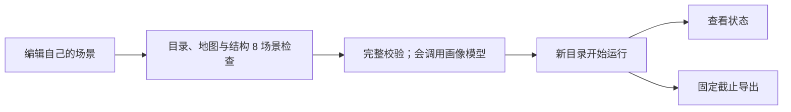

<a name="runtime-运行配置"></a>
# 运行配置

> 按[动作与内容简化规格](../dev/SPEC-action-and-content-simplification.md#spec-acs-动作与内容简化开发规格)修订「固定规则、目录格式与加载边界」（阶段 1）。

> 按[资源与规则引擎简化规格](../dev/SPEC-resource-and-rule-simplification.md#spec-rrs-资源与规则引擎简化开发规格)修订「准备环境、工具交互的运行检查及发布身份」（阶段 8）；此前阶段的修订并入同一现行合同。

> 2026-10-01：[工具交互规格](../dev/SPEC-life-runtime.md#tool-interaction-工具请求)已冻结并已实现；本手册描述当前程序实际读取的配置。
> 2026-10-03：按[个人事务与工作安排规格](../dev/SPEC-as2-integration.md#errands-workday-运行修复入库)同步就寝反思的严格工具与校验重试（阶段 1）、个人事务与检查点恢复（阶段 2）、查询六键（阶段 4）。

准备模型凭据、选择场景和新输出目录后，就能启动自己的生活模拟。
本页也说明恢复已有运行和编写反事实干预文件的方法。
命令均在 WorldMock 根目录执行。正式环境根显式使用
`../WorldMock-Dataset/environment/shanghai-simplified/`；个人实验先按[手册入口](README.md#readme-创建自己的第一个场景)
创建完整的 `experiments/my-world/` 副本，保留目录与语料相对引用。
数据采集与制作按数据仓说明执行，WorldMock 安装与导入不要求源码仓中有正式环境数据。

[返回手册](README.md#readme-用户配置手册) · [生活场景](scenarios.md#scenarios-生活场景)

<a name="runtime-准备环境"></a>
## 准备环境

使用 `.python-version` 固定的 CPython 3.12.13；平台能力须有安装、运行与恢复回执。
当前人工环境在 macOS 验收，Windows 与其他未执行平台不能推定通过，见[实施状态](../dev/implementation-status.md#implementation-status-资源与规则引擎简化开发状态)。

在仓库根目录执行，使用 Python 3.12 和项目锁定的依赖：

```bash
python scripts/bootstrap.py --profile release
```

引导使用 Python 3.12、Git 与哈希依赖锁，不需要 SSH 密钥或预先安装 uv；Windows 可用 `py -3.12`，
其它系统可用 `python3.12`。默认 `release` 要求 Node SQLite 与中文图表字体齐全；
`dev` 记录缺失，只有 Node 的对应消费者会明确跳过，字体消费者仍执行实际检查，
缺失任何组件都不能取得完整通过。`--use-uv` 只在显式指定时使用 uv，缺少 uv 即失败。
`--wheelhouse` 指定离线依赖及固定源码制品目录，禁止联网补缺；制品或哈希不符即失败。
环境收据写入 `.work/environment-receipt.json`，记录 Python、锁、源码摘要、缺失部件与实际能力，路径均相对项目。

查看器回归使用 Node [内置 SQLite](https://nodejs.org/api/sqlite.html)。按
[Node 官方安装方法](https://nodejs.org/en/download)准备维护中的 Node 24 LTS；CI 使用现有 `actions/setup-node`。
引导实际执行内存数据库绑定写入、`json_extract` 与 `json_each` 查询，版本只作身份信息；
同时通过根虚拟环境 Python 子进程调用生产中文字体选择器，不在引导内复制字体路径或安装系统软件。
收据的 `node_sqlite_available` 和 `chinese_chart_font_available` 记录真实探针结果。

Debian/Ubuntu 先由系统包管理器准备维护中的
[fonts-noto-cjk](https://packages.debian.org/trixie/fonts-noto-cjk) 与
[libatomic1](https://packages.debian.org/trixie/libatomic1)，再使用同一引导入口：

```bash
sudo apt-get update
sudo apt-get install --yes --no-install-recommends fonts-noto-cjk libatomic1
python scripts/bootstrap.py --profile release
```

macOS 与 Windows 也由生产字体选择器核对本机已安装的中文字体；缺失时引导明确记录并拒绝 release 通过。
完整验收仍要求真实查看器与中文评估图表节点全部执行通过，能力收据不替代平台完整门禁。

依赖安装与仿真环境分开准备。重制发布环境使用清单与六个目录文件、结构 8 场景；先运行 `worldmock validate --environment experiments/published-environment` 检查实际输入，不从安装位置寻找正式世界。

<a name="runtime-使用已安装的环境"></a>
### 使用已安装的环境

引导建立 `.venv` 后，在当前终端激活它；后续手册和设计文档的 `python`、`worldmock` 命令均使用该环境。

| 终端 | 激活命令 |
| --- | --- |
| POSIX shell | `source .venv/bin/activate` |
| Windows PowerShell | `.venv\Scripts\Activate.ps1` |
| Windows cmd | `.venv\Scripts\activate.bat` |

AS2 唯一来源是 `patches/agentsociety2/SERIES` 登记的上游源码与有序补丁，从生成目录
`vendor/agentsociety2/packages/agentsociety2` 可编辑安装。启动时核对实际导入的 AS2 包：
包目录为空、无法导入或源码摘要与锁定值不符时，`run`、`resume`、
`replay` 与 `validate` 都拒绝启动，不能用别处安装的其他 AS2 版本代替。wheel 安装或 `--no-editable` 安装同样
被拒绝：构建 wheel 时 AS2 的 `.gitignore` 会剔除 `agentsociety2/custom/*/examples/` 下 6 个受跟踪文件，摘要因此不符。

Windows 还需要安装[微软官方 Visual C++ v14 x64 运行库](https://learn.microsoft.com/en-us/cpp/windows/latest-supported-vc-redist?view=msvc-170)；
Ray 的子进程需要它加载原生模块。`worldmock validate` 会在独立进程中检查 Ray 导入，
避免到模拟启动时才发现缺少运行库。
准备依赖可能联网，但安装本身不启动模拟。

新机器重建检查运行 `python scripts/fresh_check.py`，克隆指定提交且禁止 SSH、不使用 pip 缓存，
执行相同引导、源码身份核对与固定快速检查；Windows 和 POSIX 各须真实重建与运行回执，不能沿用其他平台结果。
任何跳过、xfail 或缺失必需证据都不能报完整通过。
测试统一由 `python scripts/run_tests.py --tier fast|standard|full --workers 4` 执行，集合按[分层与测试层次规格](../dev/SPEC-layering-and-test-tiers.md#layering-tiers)定义。
引擎最小端到端固定使用人工夹具 `tests/fixtures/environment/`；正式来源、数量与重建验收在 Dataset 执行。
先核验正式目录，再显式选择同一根运行完整行为回归，不能沿用旧环境的测试收据：

```bash
worldmock validate --environment ../WorldMock-Dataset/environment/shanghai-simplified
```

```bash
python scripts/run_tests.py --tier full --workers 4 \
  --environment-root ../WorldMock-Dataset/environment/shanghai-simplified
```
完整发布环境的覆盖率门禁使用相同显式路径，并绑定外部环境的实际字节摘要：

```bash
python scripts/coverage_gate.py --shards 4 \
  --environment-root ../WorldMock-Dataset/environment/shanghai-simplified
```

不要求 uv；`--shards` 映射同一 full runner 的 worker 数。
`--from-json` 只接受同一运行身份下的完整收集、worker 选择和完成回执及其覆盖摘要；
全量节点三阶段必须完整且全部 passed，重复、跳过、旧绿色证据或输入字节变化均不能通过。

激活后可直接运行 `worldmock environment generate-map --locations experiments/my-world/catalog/locations.json --seed 7 --output experiments/my-world/catalog/map.json [--check]` 与 `worldmock validate --environment experiments/my-world`。这两个纯环境命令不急切加载完整 AS2/LifeEngine 链。

<a name="runtime-填写模型凭据"></a>
## 填写模型凭据

生活模拟读取固定文件 `~/.config/worldmock/deepseek.env`。文件只能包含 `DEEPSEEK_NODE_KEYS` 一个键。
下面是完整格式示例，其中的占位值必须换成实际可用密钥：

```dotenv
DEEPSEEK_NODE_KEYS=replace-with-your-key
```

填写至少一把实际可用的密钥，多把密钥用逗号分隔。模拟启动时逐段去掉首尾空格，
按出现顺序去重，再交给 LiteLLM Router 分摊请求；空值和空段均被拒绝。
`MODEL`、`BASE_URL` 等额外键不属于这个文件的格式。文件必须存在且不能是符号链接。

用编辑器填写凭据，避免把真实密钥放进命令历史或项目文件。创建目录及设置权限的命令为：

```bash
mkdir -p ~/.config/worldmock
chmod 700 ~/.config/worldmock
# 用编辑器保存 deepseek.env 后执行
chmod 600 ~/.config/worldmock/deepseek.env
```

`0600` 是推荐文件权限；当前运行加载器校验文件、符号链接、键和值，没有实现权限位的强制检查。
本页不要求打印凭据来验证配置。

<a name="runtime-哪些模型参数可配置"></a>
## 哪些模型参数可配置

当前生活模拟固定使用 DeepSeek 官方 OpenAI 格式的 strict 端点 `https://api.deepseek.com/beta` 和模型
`deepseek-flash`。每个工具函数都声明 `strict: true`：探针实测主站 `https://api.deepseek.com` 不执行这个声明，
`/beta` 在请求时校验函数 Schema、不合规即返回 400，但不保证模型给出的取值都受约束，宿主本地的严格校验仍是最终判定。
`validate` 核对的模型身份含这个端点，不是 `/beta` 即拒绝；清单冻结在主站的旧运行不能恢复或重放。
DeepSeek 的 Anthropic 格式端点使用同一平台密钥，但 WorldMock 的
AgentSociety2 调度器发送 OpenAI 格式请求，因此必须连接 OpenAI 格式端点。
启动器会设置仿真和代码角色的模型、端点及请求参数，没有场景级 `model` 或 `base_url` 覆盖字段。
自行设置 AS2 的同名环境变量会在 WorldMock 启动时被覆盖。
需要更换模型属于运行合同与代码变更，不能靠向场景 JSON 增加字段实现。

人物决策的请求开启思考，输出上限 `max_tokens` 为 8000，思考也计入这个上限。思考用完上限、
还没调用工具的回合（`finish_reason=length`）被丢弃，只留在模型证据里；紧接着以关闭思考、`tool_choice=required`、
上限不变的请求重试一次，重试再被截断时不再重试，其后照常按本次决策的回合预算继续。上限与这一处理都不可配置；
导出的 `quality.json` 在 `truncations` 一节按用途统计截断的回复次数、浪费的输出 token 与其中的思考 token。

人物睡醒那一轮的就寝反思另发一次模型请求：关闭思考，只带一个 strict 工具 `submit_reflection`、`tool_choice=required`，
要求一至五条洞见、每条引用本次给出的记忆；没有可反思的主观记忆时不调用模型。输出不合合同（自由文本、其他工具、
多次调用、条数越界、引用为空、条内重复或不在本次给出的记忆之内、正文超过一千字符或含八位以上十六进制串）时附回英文校验错误重新请求，首次之外至多三次；
耗尽即运行故障，本轮中止，不写入任何洞见。这一处理不可配置，它的请求不带 `purpose`，在 `quality.json` 里计入 `decision` 用量。

| 使用入口 | 凭据来源 |
| --- | --- |
| `run`、`resume`、`replay` | 固定私密文件中的 `DEEPSEEK_NODE_KEYS`，不以同名环境变量替代文件 |
| `profile compile`、`profile check`、画像覆盖率校验 | 优先环境变量 `DEEPSEEK_NODE_KEYS`，其次私密文件，取池中第一把密钥 |

画像抽取通过独立客户端请求 `https://api.deepseek.com/beta/chat/completions`，默认模型同为
`deepseek-flash`，只使用密钥池第一把；直接调用抽取接口时可显式传入密钥。
画像编译可用不等于模拟启动凭据已经齐备，两者的读取顺序与完整文件校验不同。
当前读取与请求身份依据为[运行启动器](../../src/worldmock/runtime.py)、
[画像抽取器](../../src/worldmock/profile/extractor.py)和[模型凭据合同](../CONTRACTS.md#contracts-model-identity)。

<a name="runtime-从校验到新建运行"></a>
## 从校验到新建运行



离线检查见[入门流程](README.md#readme-创建自己的第一个场景)。实际命令如下：

```bash
worldmock validate --environment experiments/my-world
worldmock validate \
  --scenario experiments/my-world/scenarios/my-persona-day.json \
  --coverage-out .work/my-persona-day-coverage.json
worldmock run \
  --scenario experiments/my-world/scenarios/my-persona-day.json \
  --output runs/my-persona-day
worldmock status --run-dir runs/my-persona-day
```

`validate` 通过时在标准输出打印一个 JSON 对象，含 `valid`、`scenario_id`、`model_identity`、`persona_coverage` 与
`input_warnings` 等键。`input_warnings` 是运行输入警告清单，每条为 `{code, agent_id, message, details}`，
场景级警告（配送路线不可达、地点显示名可疑）的 `agent_id` 为 `null`；同一组警告也逐条写到标准错误流，
格式为 `Input warning <警告码> (agent <人物编号>): <说明>`。警告不让校验失败，但人物卡片的可执行覆盖率低于 80% 时
`validate` 仍然失败、标准输出为空，失败前照样写出警告；与人物有关的警告码和改法见[人物画像](personas.md#personas-常见错误)。

`run` 会调用模型并持续模拟到场景结束；已存在的输出目录不能被覆盖。`run` 另接受 `--same-second-continuation on|off`（缺省 `on`）：
关闭时同一秒的相邻决策不续接思考，每次决策都从新快照构造请求，只用于对比运行；开关冻结进运行清单，`resume` 与 `replay`
继承父运行的值、不接受该参数。除人物决策外，零点计划也调用模型：
运行开始时和每个场景本地零点，为每个人物生成当日计划（同一人物同一天只生成一次），它的请求与人物决策分开记录。
`run` 创建运行时按同一规则重新计算运行输入警告（画像会重新编译），冻结进运行目录 `manifest.json` 的 `input_warnings`，
每条另写一条 `logs/ops-YYYYMMDD.jsonl` 的 `warn` 记录，导出的 `quality.json` 在 `input_warnings` 一节按警告码计数；
警告不会让 `run` 失败，覆盖率不足时也只记 `COVERAGE_BELOW_THRESHOLD`。`resume` 与 `replay` 不重算，沿用父运行清单里的警告。
`status` 只读已确认状态，不推进时间。查看状态可在另一个终端进行。
配置和依赖在运行开始时绑定，不能通过编辑文件让正在运行的人物采用新设定。

结束后导出到新目录：

```bash
worldmock export \
  --run-dir runs/my-persona-day \
  --output runs/my-persona-day/exports/final
```

`--cutoff` 可指定事件序号截止点；不指定时使用当前导出逻辑的默认截止点。
导出文件、检查点、运行身份及状态文件由程序管理；用户输入文件不应放进这些生成物里。
产物格式见[记录引擎](../design/05-recording-engine.md#recording-engine-worldmock-产品设计说明书-记录引擎)。

环境命令返回每个失败的码和英文原因，任何失败非零退出；项目校验仍执行原有完整检查。新格式最小引擎运行在阶段 5 完成，此处流程不以目录检查通过替代真实运行验收。


<a name="runtime-从检查点恢复"></a>
## 从检查点恢复

恢复会把父运行中的共同检查点复制到新运行目录，然后继续模拟。
先从父运行已有记录中取得真实检查点标识，再替换命令里的 `CHECKPOINT_ID`：

```bash
worldmock resume \
  --scenario experiments/my-world/scenarios/my-persona-day.json \
  --parent runs/my-persona-day \
  --checkpoint CHECKPOINT_ID \
  --output runs/my-persona-day-resumed
```

恢复必须匹配父运行的场景、代码（代码身份含实际导入的 AS2）、模型及资源身份；仅修改 JSON 空白也会改变场景字节哈希。
新画像、不同时间窗或菜单应通过新建运行使用。恢复时人物记忆与卡片来自检查点，不重新编译。
人物提示中的记忆层与人设层的看法、偏好由已提交事件与世界状态派生，不新增持久状态；从检查点恢复后派生结果与原运行相同。
当日计划、提醒（含是否已触发）与已生成计划的日期 `plan_submitted_dates` 同样来自检查点：当天已生成计划的人物不重新生成，
已触发的提醒不再触发；检查点里当天还没有计划的人物，恢复后在首次决策之前由零点计划补上，这一步会调用模型。
反事实分支按同一规则在应用干预之后补上。
未完成的个人事务（含已累计量与是否已提醒）也来自检查点，恢复后待办层与原运行逐字节相同，不重复记下、不重复完成、不重复提醒；
世界结构须为 11、运行清单须为 4；旧结构号直接拒绝，没有迁移。
没有检查点或标识不属于该父运行时，不能用猜测的名字代替。

恢复还核对 `environment_identity` 五字段：environment_id、environment_version、rules_version、catalog_content_sha256、map_sha256。不符报 `Runtime environment identity mismatch`。订单及其实际收货时刻、全局内容进度、当前活动内容、会话推送、驾驶可用天数与闹钟随检查点保存；没有食品持有状态。长途订单到站只恢复为待领取，不能因恢复而提前收货或重复施加效果。完整持久事实见[持久化当下事实](../CONTRACTS.md#contracts-持久化当下事实)，恢复边界见[共同检查点与恢复](../CONTRACTS.md#contracts-共同检查点与恢复)。


<a name="runtime-编写反事实干预文件"></a>
## 编写反事实干预文件

反事实运行用于比较“同一个检查点下，如果这个人的余额不同，会发生什么”。
当前 `kind` 只支持 `set_balance_fen`，不能用这个入口修改人格、地点或模型。

下面是完整文件结构示例，保存到自己的 JSON 文件中；`source_event_ids` 必须替换成父检查点内真实可见的事件标识：

```json
{
  "kind": "set_balance_fen",
  "agent_id": 1,
  "balance_fen": 300000,
  "hypothesis": "可用余额降低后，人物是否改变消费选择？",
  "source_event_ids": ["replace-with-visible-parent-event-id"]
}
```

`agent_id` 为场景中存在的人物，`balance_fen` 为非负整数分；假设不能为空白，
来源事件数组至少一项且不能重复。干预在新分支首次决策前应用一次，后续行动仍由人物选择。

先校验文件形状，不会调用模型，也不能证明来源事件确实有效：

```bash
python - <<'PY'
from pathlib import Path
from worldmock.life.models import CounterfactualIntervention

item = CounterfactualIntervention.model_validate_json(Path(".work/my-intervention.json").read_text(encoding="utf-8"))
print(item.kind, item.agent_id)
PY
```

然后以真实检查点启动新分支：

```bash
worldmock replay \
  --scenario experiments/my-world/scenarios/single-person.json \
  --parent runs/my-persona-day \
  --checkpoint CHECKPOINT_ID \
  --intervention .work/my-intervention.json \
  --output runs/my-persona-day-lower-balance
```

程序会在恢复和应用干预时检查来源身份与可见性。不能用生成一段假想文本代替实际分支运行。

<a name="runtime-常见错误"></a>
## 常见错误

| 错误或现象 | 检查什么 |
| --- | --- |
| `DeepSeek credential file is missing or unsafe` | 文件路径、是否为普通文件、是否为符号链接 |
| `DeepSeek credential file has an invalid schema` | 是否只有 `DEEPSEEK_NODE_KEYS`，值或逗号分隔的密钥段是否为空 |
| `AS2 runtime identity differs from the locked source` | 是否按「准备环境」运行 `python scripts/bootstrap.py --profile release`，核对 SERIES 源码摘要并从生成源码可编辑安装（wheel 或 `--no-editable` 安装会被拒绝）；实际导入的 AS2 包是否为空、无法导入或被改动 |
| 只设置环境变量，模拟仍报凭据缺失 | 模拟启动器读取私密文件；画像抽取的读取顺序不同 |
| 输出目录已经存在 | 改用新的运行或导出目录，保留原记录 |
| 改了场景或代码后恢复被拒绝 | 使用匹配身份的原始配置恢复，或为新条件新建运行；升级代码后旧检查点不能恢复 |
| `Stage model identity is inconsistent: base_url='https://api.deepseek.com' must be the DeepSeek strict endpoint 'https://api.deepseek.com/beta'` | 父运行在端点改为 `/beta` 之前创建，清单冻结着主站，不能恢复或重放；改为新建运行 |
| `Model identity stage decision_statement is retired` | 运行清单仍含旧的决策自述阶段键，由旧版本代码创建；这样的运行不能打开、恢复或重放，改为新建运行 |

命令参数以[命令入口](../../src/worldmock/cli.py)为准；更多数据生成与评估步骤见对应手册页。

| 新环境错误 | 检查什么 |
| --- | --- |
| `Runtime environment identity mismatch` | 使用匹配父运行的环境与规则字节；新条件新建运行 |
| `RULES_VERSION_MISMATCH` | 用当前引擎规则版本重新发布环境 |
| `ENVIRONMENT_IDENTITY_MISMATCH` | 核对实际文件、清单与环境版本，不能只改声明摘要 |
| `MAP_NOT_REGENERATED` | 生成器、种子、地点清单和已发布图逐字节一致 |

全部登记码见[环境目录文件](../CONTRACTS.md#contracts-环境目录文件)。

<a name="runtime-工具交互的运行检查"></a>
## 工具交互的运行检查

原生工具包含七个世界请求（`start_activity`、`report_status`、`pause_activity`、`conclude_activity`、`revise_day_plan`、`send_message`、`set_alarm`）、两个世界查询（`recall_task_summary`、`query_world`）及三个记忆查询，共十二项；稳定公共请求面为九项。暂停活动通过 `report_status` 恢复。世界 11、场景 8、运行清单 4，运行阶段只含 `action`；工具定义见[人物工具与管理接口](../CONTRACTS.md#contracts-person-tools)。

`start_activity` 只含 `items` 与 `answering`；每项五键 `{target, way, app, to, pay_app}` 全写，不用的字段写 null。人物逐字写动作名称并明确选择可用 app；环境从合格内容中选择，按真实剩余时长推进，不接受点名内容或自述工时。购买明确购物与支付 app，现场购买的 `app` 为 null；远程购买在绑定门店中选择预计送达最早者，不代选 app 或支付 app。完整方式、字段与候选见[人物工具与管理接口](../CONTRACTS.md#contracts-person-tools)。

`report_status`、`pause_activity`、`conclude_activity` 必填请求级 `errands`（可为空；每条七键全写，不用的写 null，`change` 为“新增”“更新”“取消”）。个人事务没有独立工具，完成只按本人实际商品收货证据确认；付款、配送到站或自述不能替代收货。参数错误保留英文完整校验路径、写入值、允许值、格式和原因，具体字段见[个人事务](../CONTRACTS.md#contracts-个人事务)。

`query_world` 必填 `name/way/category/app/available_only/offset` 六键，前四项至少一项非 null；`app` 只接受真实 app 显示名。按完整目录取交集，再按该命中方式与 app 的真实可用性筛选，最后分页；合法无匹配为正常空页，未知 app 是参数错误。返回 `matches/total_count/next_offset`。查询及回看即时只读，不推进世界时间或同刻轮数、不抽取内容或改变内容进度，仍受十六模型回合预算。

```bash
worldmock validate --environment experiments/my-world
worldmock run --scenario experiments/my-world/scenarios/single-person.json --output runs/my-persona-day
worldmock export --run-dir runs/my-persona-day --output runs/my-persona-day/exports/final
```

目录、包内规则、图和运行身份必须一致；地图种子属于 `map.json`，不与场景种子绑定。已发布字节不原版覆盖，旧检查点直接拒绝，不迁移；恢复和假设分支新目录。导出 4 的五类工件、质量 6 按[现行合同](../CONTRACTS.md#contracts-worldmock-接口合同)核对；正式回归阻断与各平台实际回执见[实施状态](../dev/implementation-status.md#implementation-status-资源与规则引擎简化开发状态)。


<a name="runtime-版本表"></a>
## 版本表

| 版本 | 日期 | 变更 |
| --- | --- | --- |
| `2026-10-06-rrs-docs` | 2026-10-07 | 固定 Python、十一项原生工具、当前主题与 app 请求、环境身份和运行检查 |
| `2026-10-07-acs-rules` | 2026-10-07 | 固定规则版本 2；目录格式 2、场景结构 8、世界结构 11、运行清单 4；环境仅发布目录与场景，规则只从包读取。 |
