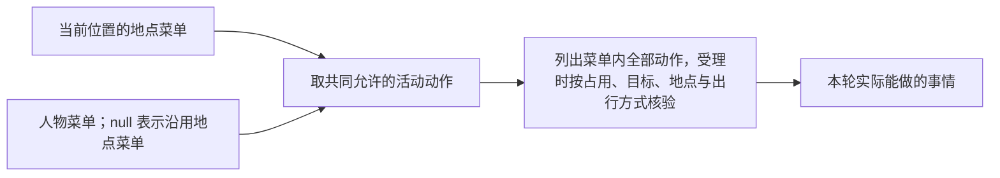

<a name="scenarios-生活场景"></a>
# 生活场景

> 2026-10-07：按[资源与规则引擎简化规格](../dev/SPEC-resource-and-rule-simplification.md#spec-rrs-资源与规则引擎简化开发规格)修订「看懂场景的组成、修改日期与模拟节奏、限制人物可以做什么、配置日历和预排事件、校验自己的场景、选择起点与文件位置」（阶段 1）；「修改人物、身体与账户」（阶段 3）。

> 2026-10-01：[工具交互规格](../dev/SPEC-life-runtime.md#tool-interaction-工具请求)已冻结并已实现；本手册描述当前程序实际读取的配置。
> 2026-10-03：按[个人事务与工作安排规格](../dev/SPEC-as2-integration.md#errands-workday-运行修复入库)同步个人事务与提醒（阶段 2）。
> 2026-10-03：按[个人事务与工作安排规格](../dev/SPEC-as2-integration.md#errands-workday-运行修复入库)同步场景结构 5 的工作安排（阶段 3）。
> 2026-10-05：按[让「等待」成为例外规格](../dev/SPEC-idle-fillers.md#spec-idle-fillers-让等待成为例外开发规格)同步班次与休息时段起止的决策机会（阶段 1）。
> 2026-10-06：按[同时做两件事规格](../dev/SPEC-parallel-activities.md#spec-parallel-activities-同时做两件事开发规格)同步暂停的活动不占名额与同刻上限后的受限轮（阶段 1）；「工作通知与目标发布」补仍带旧占用声明副本的环境在装配时被拒绝（阶段 2）。

生活场景决定模拟谁、从什么时候到什么时候、有哪些生活机会，以及世界开始时的状态。
从[手册首页](README.md#readme-创建自己的第一个场景)复制现有场景开始，按本页调整自己的条件。
人物具体怎么过一天仍由人物决定；场景提供环境和机会，也可以声明人物定下的工作安排——它是每轮告诉人物的事实，环境不因此拒绝任何行动。

[返回手册](README.md#readme-用户配置手册) · [人物画像](personas.md#personas-人物画像) · [世界素材](resources.md#resources-定义地点门店供给与世界素材)

<a name="scenarios-选择起点与文件位置"></a>
## 选择起点与文件位置

| 现成场景 | 适合用来修改什么 |
| --- | --- |
| `single-person.json` | 单人物、工作合同、工资和生活支出；首页示例由它裁出一天 |
| `multi-person.json` | 多人物与按人分配工作 |
| `multi-person-half-day.json` | 短时段、多人、没有工作任务的生活观察 |

人工入口位于 `tests/fixtures/environment/scenarios/`；正式环境路径由 Dataset 重制发布决定。
本页命令在 WorldMock 根目录执行，自定义场景放在完整环境的 `experiments/my-world/scenarios/` 下。解析器用场景的上两级目录定位 `catalog/`，
场景中的 `corpus_root` 则相对场景所在目录解析。不要把场景移动到 `scenarios/custom/` 等更深目录而不调整整个项目布局。
`schema_version` 当前为 `7`：每个人物须显式写 `work_schedule`（对象或 `null`），
内容标题与摘要直接从目录 `contents.json` 提供；多余字段和旧结构的输入都严格拒绝。标题由引擎直接呈现，
不再按来源元数据另找名称；生活活动的三项效果由所选语料根提供，见[生活活动](resources.md#resources-编写生活活动)。

<a name="scenarios-看懂场景的组成"></a>
## 看懂场景的组成


| 字段组 | 场景结构 7 |
| --- | --- |
| 身份和时间 | `schema_version: 7`、scenario_id、timezone、start_at、end_at、random_seed |
| 环境与语料 | `environment{environment_id, environment_version}`、corpus_root、corpus_manifest_sha256 |
| 人物 | 画像、节律、工作安排、联系人、interaction_menu、work_topic_ids、initial_inventory |
| 身体初值 | mass_kg、initial_energy_kcal、initial_sleep_debt_hours、initial_entertainment_need |
| 世界选择 | `locations[]{location_id}`；对象与图来自目录，不能复制到场景 |
| 账户与事件 | accounts、messages、calendar、bills、payrolls；人物账户由 initial_balance_fen 建立 |
| 交互菜单 | 显式八个 LocationKind 的菜单，人物菜单必填可为 null |

有工作主题的人物必须声明 work_schedule，已选食品店铺必须有 `merchant:<location_id>` 账户。初始食品持有按地点和食品身份给份数。删除旧 catalog_version、map_dataset、products、supplies、tasks、contents、games、调价、补货、配方和手机配置字段；旧结构直接拒绝。

<a name="scenarios-修改日期与模拟节奏"></a>
## 修改日期与模拟节奏

下面是替换顶层同名字段的局部片段：

```json
{
  "scenario_id": "my-persona-day",
  "timezone": "Asia/Shanghai",
  "start_at": "2026-01-05T00:00:00+08:00",
  "end_at": "2026-01-06T00:00:00+08:00",
  "random_seed": 20260105,
  "activity_feedback_seconds": 900,
  "reconsideration_interval_seconds": 5400,
  "idle_reconsideration_interval_seconds": 10800,
  "max_same_moment_decisions": 3,
  "candidate_presentation_limit": 20,
  "candidate_pool_limit": 1000,
  "rotation_quota_ratio": 0.15,
  "rotation_stale_seconds": 604800
}
```

起止时刻必须带时区偏移，并与 `timezone` 在该日期的实际偏移一致。结束晚于开始，运行窗口左闭右开。
缩短场景时，工作安排、消息、工资账单和预排事件也需要一起调整；首页脚本展示了完整做法。
扩大或移动时间窗时，同步检查工作安排、日历与工资账单；环境图和食品价格不带营业或报价有效期。

| 参数 | 单位与约束 | 如何理解 |
| --- | --- | --- |
| `activity_feedback_seconds` | 秒，60–86400 | 结算间隔，也是等待、浏览、交谈的计划时长；不是保证每隔这些秒都会重新决策 |
| `reconsideration_interval_seconds` | 秒，默认 5400，范围 1–86400 | 清醒且有在手承诺时的常规重估间隔（进行中的等待不算在手承诺）；其他更早事件仍能触发决策 |
| `idle_reconsideration_interval_seconds` | 秒，默认 10800，范围 1–86400，不能短于常规间隔 | 人物只在等待、且没有其他在手承诺时的空闲重估间隔；调大常规间隔时也要检查此值 |
| `max_same_moment_decisions` | 正整数，缺省 3 | 同一秒内的决策轮数上限；达到上限后另有至多三轮受限轮：有刚结束的活动时只开放收尾，否则只开放开始或恢复（等待始终可选；暂停的活动不占名额，只有暂停的活动时也一样），其余动作在工具层标为不可用并写明原因；开始或恢复被拒后留在原阶段；受限轮用完仍没有进行中活动或仍有待收尾活动时，环境不替人物造活动，写一条预算耗尽事件，`activity_feedback_seconds` 之后再给决策；不标失败 |
| `progress_report_interval_seconds` | 秒，缺省 1800 | 进行中活动的播报间隔 |
| `candidate_presentation_limit` | 默认 20，范围 1–1000 | 单次候选呈现上限 |
| `candidate_pool_limit` | 默认 1000，范围 1–100000 | 候选池上限 |
| `rotation_quota_ratio` | 默认 0.15，严格在 0 与 1 之间 | 为轮换呈现预留的比例；呈现上限乘比例向下取整必须至少为 1 |
| `rotation_stale_seconds` | 必填，范围 1–31536000 秒 | 多久未出现的对象进入长期未呈现判定 |

呈现窗口只决定人物本轮看到哪些对象，不是资格上限：没有列出的生活活动、内容和商品，人物写出名称也能调用，受理照常核验。
窗口内先按口味权重乘注意力排序，再按相关度：生活活动的时间窗覆盖此刻 +2，对应当日计划里尚未推进的目标 +2，
条目名或品类出现在人物卡片的习惯里 +1；仍同分时按含日期的哈希决胜，所以顺序随日期变化，也不是名称的字母序。
生活活动窗口只列当前地点环境合适的活动；环境不合适的不列出，按名写它时以「这里不适合做这件事」拒绝。
每轮工具层还附一份只列名称的可调用索引 `callable_index`：此地此刻可做的生活活动全部列名，内容与此刻从这里能得到的商品按品类给个数和
至多 3 个示例名；它不是候选，不带动作，不受 `candidate_presentation_limit` 限制，有效菜单不允许的部分为空。

不要把反馈间隔当作“人物每十五分钟行动一次”。决策本身不耗时：没有进行中活动的人物在同一秒接着决策，
只有人人都有事在做时，时间才根据活动完成、消息、任务、身体变化和其他事件推进。
在手承诺包括尚未推进的当日目标、可见的未完成工作任务、暂停的活动与进行中的活动（等待除外）。未完成的个人事务不算在手承诺，不改变两个重估间隔。
当日目标由零点计划生成：运行开始时和每个场景本地零点（运行恰在零点结束时除外），系统为每个人物调用模型生成当天的
有序目标，同一人物同一天只生成一次；人物醒着时可以修订。目标不填写时间段，每条带模型写的大致时刻 `around_time`
（场景本地 `HH:MM`，可为空）：写了时，只有进行时段与它前后 90 分钟有交集的同类活动才算推进这条目标。
会在某一刻提醒人物的有两种：当日目标的 `remind_time` 与个人事务的 `remind_time`（都是场景本地 `HH:MM`，可为空），每次设定只触发一次。
只有当日目标的提醒能叫醒睡着的人；个人事务的提醒在睡眠中不交付也不消耗，人物醒来的那一刻一并交付。
声明了工作安排的人物在班次与休息时段的起止也会得到决策机会，但起止不是提醒：它们只给醒着的人物一次决策机会，不叫醒睡着的人，睡过的也不补（见下文「声明工作安排」）。
睡眠中除了当日目标的提醒，只有睡够等专用唤醒条件才会结束睡眠。
规则见[当日目标规格](../dev/SPEC-day-plan-goals.md#spec-day-plan-goals-当日目标特性开发规格)与[时间与能量规格](../dev/SPEC-life-runtime.md#time-and-energy-决策不耗时时间只在做事时流动)第四章。

个人事务由人物在运行中自己记下（播报、暂停或收尾时写在请求的 `errands` 里），场景不能预置。
它只表达能由结算确认的事：取得或吃掉某件具体商品若干份（1 至 9）；环境按真实结算确认办成，人物只能取消并写原因，没有截止与过期。
「取得」不看地点：到店买下的东西留在门店，事务照样办成，要在家里用的东西应远程下单送到家。
事务的提醒钟点不晚于写下它的时刻（新增或更新被受理时）时，指下一天的这个钟点。每人未完成事务至多 8 条，一次请求至多 4 条变更，
名称至多 30 字符，备注与取消原因各至多 120 字符；事务跨零点保留并一直显示在待办层，零点计划与修订计划都不删它。
这些上限是实验假设，见[实验设置](../EXPERIMENT.md#experiment-实验假设声明)；规则见[个人事务与工作安排规格](../dev/SPEC-as2-integration.md#errands-workday-运行修复入库)第二章。

<a name="scenarios-修改人物身体与账户"></a>
## 修改人物、身体与账户

人物字段及联系人详见[人物画像](personas.md#personas-人物画像)。增加人物时，为它分配唯一正整数 `agent_id`，
同步修改属于它的任务受理人、邮件收件人、工资和账单引用。

身体初值是顶层 `body` 对象，当前所有人物共享这份初值配置；睡眠需要和时型可以逐人物声明。
下面是完整 `body` 对象的局部配置：

```json
{
  "body": {
    "mass_kg": 65,
    "initial_energy_kcal": 1600,
    "initial_sleep_debt_hours": 0,
    "initial_entertainment_need": 0
  }
}
```

体重为大于 0 且不超过 300 的千克数；能量为非负千卡，且不超过 BODY_CONSTANTS 的能量上界；
睡眠不足初值为非负小时数。`initial_entertainment_need` 接受 0–1，
但当前运行初始化仍固定为 0，非零设置尚未生效。不要用它构造不同娱乐需要的实验。
饥饿与困意由身体和时刻计算，没有可直接设置的“饥饿值”或“疲劳值”。
起点困意也不另设：系统按人物作息反推起点的睡眠压力（假定自最近一次惯常起床时刻起一直清醒），
公式与起点落在惯常睡眠时段时的效果见[人物画像](personas.md#personas-在场景中填写人物)。
能量不阻止任何活动，结算最低为 0；低能量只让人更饿、做事更慢。饥饿显示有两档低能量规则：
能量低于固定紧急阈值（400 千卡）时至少「饿得难受」，
低于代码常量 100 千卡（`APPETITE_STARVING_KCAL`）时为「饿得发慌」；两档都不受时刻与餐时窗口影响。

人物账户由 `agent_id` 自动形成，例如 `agent:1`；余额来自 `initial_balance_fen`。
不要在 `accounts` 中再声明人物账户。下面是一个服务账户的完整条目：

```json
{
  "account_id": "employer:zhangjiang",
  "money_fen": 10000000,
  "role": "employer"
}
```

金额为整数分，账户角色按场景严格模型校验。
保留模板所需雇主、交通和商家账户；账户删改后，订单、任务和事件里的引用也必须一致。

食品账户结算使用固定价格与商家账户，人物持有不是账户库存字段；没有娱乐缓解下限可供覆盖。食品利用效率由 BODY_CONSTANTS 唯一维护。

<a name="scenarios-限制人物可以做什么"></a>
## 限制人物可以做什么

地点菜单在 `interaction_menus_by_location_kind` 中填写；键恰好覆盖八个内置 `LocationKind`，
不允许缺项、多项或通配键。每个人物必须显式写 `interaction_menu`，不额外限制时写 `null`。



例如从菜单的 `allowed_actions` 中移除 `watch`，人物在该地点就不能发起观看活动；
工作等其他动作仍按各自的菜单准入判断。场景配置使用稳定的内部英文动作名；模型在本轮交互对象中看到的是
五个动词（`travel`、`interact`、`obtain`、`consume`、`sleep`）与方式（如「interact：接着看」），经本轮私有绑定映射回内部动作。
取得商品的「到店」「远程下单」与不列出的「购买」（由系统定到店或远程下单）都映射为 `purchase`，按名写的商品也计为它；
移除 `purchase`，人物在该地点既不能到店买，也不能远程下单。

下面是完整的最小菜单对象，可作为一个地点类或一个人物的 `interaction_menu` 值。
它只保留等待、睡眠；不适合作为需要正常工作和购物的日常场景菜单。

```json
{
  "allowed_actions": ["wait", "sleep"]
}
```

`wait` 和 `sleep` 是每份菜单必须保留的自身动作。数组必须非空、无重复，名称只能来自动作闭集。
菜单只剪裁 `start_activity` 的可选动作；动作不因人物状态隐藏，条件未满足的照常列出并带说明，只有阶段与
同刻上限的受限轮照常收窄；其他工具由工具层按当前阶段与活动状态开放。
名称写错或找不到而被拒（名称类拒绝，例如 `SUPPLY_NOT_FOUND`、`TASK_NOT_FOUND`）时，每人每秒的前两次不计同刻轮数、
不影响情绪，也就不会用掉受限轮；第三次起与其他拒绝一样计轮。
目标工具接口一次最多选择两个交互对象，items每项填写target/way/from/to，方式推导的内部动作须在有效菜单中；
每人两个名额，进行中与刚结束待收尾的活动各占一个，暂停的活动不占；结束或暂停活动后让出名额，恢复暂停的活动要有空名额；
引擎按注册表占用与准入事实（目标在场与实际地点、出行方式、物品状态）整体核验，能量不参与。
菜单控制动作权限；画像偏好只影响选择和排序。

场景结构 7 的菜单先使用当前动作闭集；app 活动在阶段 4 切换时同时更新菜单为新 `START_ACTIVITY_ACTIONS`。地点活动环境由固定类型派生，生活活动条目仍声明自己的 location_kinds，不通过菜单替代地点资格。

<a name="scenarios-声明工作安排"></a>
## 声明工作安排

每个人物条目必须显式写 `work_schedule`：没有固定班次写 `null`，这个人物就没有任何在岗语义。
有固定班次时写一个对象。下面是 `agents[]` 条目里 `work_schedule` 一项的局部片段，示意形状：

```json
{
  "work_schedule": {
    "workplace_location_id": "office",
    "weekly": {
      "0": {"starts": 540, "ends": 1080, "breaks": [[720, 810]]},
      "1": {"starts": 540, "ends": 1080, "breaks": [[720, 810]]},
      "2": {"starts": 540, "ends": 1080, "breaks": [[720, 810]]},
      "3": {"starts": 540, "ends": 1080, "breaks": [[720, 810]]},
      "4": {"starts": 540, "ends": 1080, "breaks": [[720, 810]]},
      "5": null,
      "6": null
    },
    "exceptions": {"2026-02-14": {"starts": 540, "ends": 1080, "breaks": []}, "2026-02-17": null}
  }
}
```

`office` 换成场景实际选中的办公地点标识。示例只示意形状，原样放进白领十二周场景会被加载检查拒绝：
完整声明还要按下面的规则覆盖场景日历里落在时间窗内的全部特殊日（该场景还有补班日、春节其余工作日与病假、事假日）。

- 对象的三个键 `workplace_location_id`、`weekly`、`exceptions` 都必填，没有例外写 `{}`；班次的三个键 `starts`、`ends`、`breaks`
  也都必填，没有休息时段写 `[]`；多写的键被拒。
- `weekly` 七天全写，键 `"0"` 至 `"6"` 对应周一至周日，值为班次或 `null`（当日不当班）；`exceptions` 用规范的 `YYYY-MM-DD`
  覆盖当天，值同样是班次或 `null`，优先于 `weekly`。系统不从星期或任务分布推断班次。
- 时刻是当地零点起的分钟（`540` 是 09:00，`1440` 是 24:00），班次同日且 `starts < ends`；`breaks` 落在班次内、升序、互不重叠；
  区间一律半开。不写时区，用场景的 `timezone`。
- 加载时核对：工作地点是所选地点；落在场景时间窗内的日历日期里，补班日必须有班次，春节、病假、事假日必须不当班，
  加班机会日与聚餐日不要求班次；时间窗外的日期不核对，写了例外也不拒绝。日历是场景级的，病假、事假日对所有声明了班次的人物同时生效。
- 班次形状错误报 `Scenario validation failed`（明细在异常链）；地点与日历核对的错误是 `Work schedules are not admissible: …`，
  逐条写明人物、日期与字段。
- 工作安排字段首版的三份场景都写 `null`；当前外部环境以实际人物声明为准。

**效果。** 声明了工作安排的人物每轮在环境层看到 `duty`：当班日写「工作日」、班次钟点、工作地点名、休息时段与状态
（「未到上班时间」「当班中」「休息时段」「已下班」之一，只由时钟与班次决定，不看人物在不在场）；不当班的日子写「休息日」；
没有工作安排的人物为 `null`。零点计划的输入另有计划日期当天的上班安排（不含状态），零点计划不把目标安排在上班时间离开上班地点。
它是事实呈现，不是受理条件：出行照常列出、照常受理，零点计划、修订计划和交了手上的工作都不改变它；
班内离岗由行为评估的工作负荷与作息偏离指标报告（`scripts/inspect_run.py <运行目录> workday --scenario <场景文件>`）。
班次开始、班次结束与每个休息时段的开始、结束这几个时刻，人物只要醒着就在那一秒得到一次决策机会：正在做的事照常继续，不会被结束；
睡着的人不会被叫醒，睡过的也不补。给人物声明班次因此会让他每个当班日多出几次决策机会。
工作安排不改变任务的开放、开工、提交与迟交判定：班前到岗可以开工，班后可以继续做未到截止的任务。

<a name="scenarios-配置工作任务和消息"></a>
## 配置工作任务和消息

任务不写开放时间：开放时刻由关联通知或预约派生，见[工作通知与目标发布](scenarios.md#scenarios-工作通知与目标发布)。

工作条目定义一个人物可以选择完成的合同。最稳妥的做法是复制模板中的 `tasks` 条目，
保留已有输入和验收材料，先修改分配、通知或预约、截止时间与报酬。

| 任务字段 | 填写规则 |
| --- | --- |
| `task_id`、`assignee_agent_id` | 任务标识唯一；受理人写 `agent:1` 或 `1`，必须存在于人物数组 |
| `contract_kind` | `hourly`、`piece` 或 `package`，各自结算规则来自目录 |
| `appointment`、`due_at` | `appointment` 必填：普通工作写 `null`，真实预约写 `{starts_at, reason}`；`due_at` 带时区，晚于派生的开放时刻（最早本人关联通知的 `sent_at` 或预约 `starts_at`）、晚于场景开始且不晚于场景结束；开工与恢复都不越过截止，距截止不足 60 秒的恢复被拒绝；未付款的逾期任务保留到截止当日结束，逾期提交以 `WORK_SUBMISSION_LATE` 业务拒绝 |
| `maximum_duration_seconds` | 正整数秒，任务允许的最大执行时长 |
| `pay_fen` | 正整数分，具体付款语义由合同类型与交换规则决定 |
| `employer_account_id`、`required_location_id` | 已声明的雇主账户和地点 |
| `required_skill`、`minimum_skill` | 场景人物已声明的技能名称与 0–1 门槛 |
| `required_effective_seconds` | 正数秒，要求的有效工作量 |
| `input_path`、`input_sha256` | 相对语料根目录的工作材料路径及其真实 SHA-256 |
| `oracle_path`、`oracle_sha256` | 验收材料路径及其真实 SHA-256；材料格式见[世界素材](resources.md#resources-定义地点门店供给与世界素材) |

不要只添加一个任务标题就期待它能执行。新材料需要满足当前工作提供器和验收器的格式。
现有技能名可以在对应人物的 `skill_levels` 中调整数值；新建技能名不会自动创造新的工作算法。

以下是一个完整消息条目，沿用白领场景当天任务：

```json
{
  "message_id": "my-work-reminder",
  "thread_id": "my-work-thread",
  "recipient_agent_id": 1,
  "sent_at": "2026-01-05T08:00:00+08:00",
  "subject": "产品评审准备",
  "body": "今天可以开始处理会议材料，请在任务截止前提交。",
  "related_task_id": "task-2026-01-05",
  "attachment_sha256": null
}
```

`sent_at` 必须早于场景结束且偏移匹配时区，可以早于场景开始；这样的消息在开始时已可见。
无关联任务时 `related_task_id` 可写 `null`，无附件时 `attachment_sha256` 可写 `null`。
任务被删除后，不要留下指向它的消息。
场景消息按邮件呈现：到达时人物只看到主题，正文通过阅读取得；人物之间与联系人发来的直接消息则以全文呈现给人物。

场景联系人可以填可空的 `receive_location_id`（地点标识）：直接配送给联系人或当面交给联系人的实物，以它为收货地点；
为空时联系人不能收实物。联系人的其余字段见[人物画像](personas.md#personas-人物画像)。

<a name="scenarios-配置日历和预排事件"></a>
## 配置日历和预排事件

`calendar` 必须包含下面这些键：

| 字段 | 形状 |
| --- | --- |
| `spring_festival_dates`、`makeup_work_dates`、`overtime_opportunity_dates` | 日期数组，规范 `YYYY-MM-DD`，每个数组内部不重复，可为空 |
| `sick_leave_date`、`personal_leave_date`、`social_dinner_date` | 各一个规范日期字符串，不能用 `null` 或空字符串替代 |

日历日期定义情境和机会，不给人物写行动脚本。声明了 `work_schedule` 的人物另与日历交叉核对，只核对落在场景时间窗内的日历日期：补班日必须有班次，春节、病假、事假日必须不当班，加班机会日不要求班次。短场景可保留模板中落在窗口外的日期。

账单与工资属于明确预排的世界事件，`due_at` 必须严格晚于场景开始、严格早于场景结束。
下面是向既有场景增加一次工资和账单的局部片段；示例沿用模板账户：

```json
{
  "payrolls": [
    {
      "payroll_id": "my-salary",
      "employer_account_id": "employer:test",
      "agent_id": 1,
      "amount_fen": 500000,
      "due_at": "2026-01-05T09:00:00+08:00"
    }
  ],
  "bills": [
    {
      "bill_id": "my-rent",
      "account_id": "agent:1",
      "payee_account_id": "external:scenario",
      "amount_fen": 450000,
      "due_at": "2026-01-05T10:00:00+08:00"
    }
  ]
}
```

事件标识各自唯一，金额为正整数分；账单付款与收款账户不能相同，所需账户必须存在。

场景结构 7 不接受调价或补货字段；食品价格由环境统一发布，店铺全天服务。

<a name="scenarios-校验自己的场景"></a>
## 校验自己的场景

先检查整个环境，再做项目依赖与人物覆盖校验：

```bash
worldmock validate --environment experiments/my-world
worldmock validate --scenario experiments/my-world/scenarios/single-person.json
```

环境命令不启动人物或完整引擎，真实加载全部场景并检查目录、图字节、语料与包资源副本；项目命令保留 AS2、LabelKit、依赖、阶段身份和 0.8 覆盖率检查。

| 登记失败 | 应修正的事实 |
| --- | --- |
| ENVIRONMENT_PIN_MISMATCH | 场景环境标识和版本与清单一致 |
| ENVIRONMENT_REF_UNKNOWN / WORK_TOPIC_UNKNOWN | 引用真实登记对象或主题 |
| FOOD_BINDING_KIND_INCONSISTENT | 同类店铺完全相同菜单 |
| MERCHANT_ACCOUNT_MISSING | 给每个已选食品店铺声明 merchant 账户 |
| WORK_SCHEDULE_REQUIRED | 有工作主题的人物声明工作安排 |
| MAP_NOT_REGENERATED | 用实际地点清单和种子重新生成并发布图 |

完整码与英文原因见[环境目录文件](../CONTRACTS.md#contracts-环境目录文件)。严格场景结构 7 拒绝旧字段，不通过补齐或 warning 放行。

<a name="scenarios-工作通知与目标发布"></a>
## 工作通知与目标发布

输入每项工作必填appointment=null（普通）或{starts_at,reason}（真实预约），删除available_at/availability_kind/appointment_reason；
运行时RuntimeWorkTask.available_at由普通任务最早本人关联通知sent_at或预约starts_at派生，不重复配置；
每项任务至少一封related_task_id通知发给受派人物，邮件到达即已知且普通工作开放。
预约starts_at带时区、reason非空说明真实预约依据；提前收件可见，约定时刻才开放。
地点和截止仍约束开工，任务标题带“会议分析”不代表本人参加预约会议。
启动前已收到的邮件与工作合同允许初始化，due_at必须晚于运行起点；不保留无通知旧行为。
正式products/supplies列表包含选中门店全部声明商品和生成供给，不沿用旧稀疏选择。
保持现有场景random_seed，按对应种子分别冻结供给发布；地图3、场景4、目录5.0分别在首次受影响阶段发布，后续目录内容变更另发版本，world8沿用。
其后个人事务与工作安排规格把世界结构升为 9、场景结构升为 5，当时目录仍为 5.3。
共享规则与可重建环境规格曾发布目录 5.4。当前按[环境数据归属规格](../dev/SPEC-environment-data-ownership.md)
使用场景结构 6，正式目录和地图的具体版本及内容摘要由 Dataset 环境清单绑定，不沿用历史版本推断当前字节。
[同时做两件事规格](../dev/SPEC-parallel-activities.md#spec-parallel-activities-占用声明)把引擎包的活动占用声明换为新占用名后，环境目录里仍是旧占用声明副本的场景在装配时被拒绝，要改用 Dataset 按新占用名重新发布的环境；场景字段不变。
