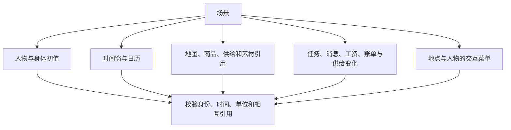
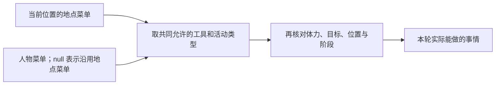

# 生活场景

生活场景决定模拟谁、从什么时候到什么时候、有哪些生活机会，以及世界开始时的状态。
从[手册首页](README.md#创建自己的第一个场景)复制现有场景开始，按本页调整自己的条件。
人物具体怎么过一天仍由人物决定，场景用于提供环境和机会。

[返回手册](README.md) · [人物画像](personas.md) · [世界素材](resources.md)

## 选择起点与文件位置

| 现成场景 | 适合用来修改什么 |
| --- | --- |
| [白领十二周](../../scenarios/white-collar-12-weeks.json) | 单人物、工作合同、工资和生活支出；首页示例由它裁出一天 |
| [多人场景](../../scenarios/multi-person.json) | 多人物与按人分配工作 |
| [多人半天](../../scenarios/multi-person-half-day.json) | 短时段、多人、没有工作任务的生活观察 |

新场景放在仓库的 `scenarios/` 下。解析器用场景的上两级目录定位 `catalog/`，
场景中的 `corpus_root` 则相对场景所在目录解析。不要把场景移动到 `scenarios/custom/` 等更深目录而不调整整个项目布局。
`schema_version` 当前固定为 `3`；多余字段会被拒绝。

## 看懂场景的组成



以下字段均为顶层配置。表中“必填数组”即使没有条目也应保留 `[]`，不能直接删掉字段。

| 字段组 | 必填情况与用途 |
| --- | --- |
| `schema_version`、`scenario_id`、`timezone`、`start_at`、`end_at`、`random_seed` | 必填；格式版本、场景身份、时间与随机种子 |
| `activity_feedback_seconds`、`max_consecutive_rejections`、`rotation_stale_seconds` | 必填；反馈间隔、连续拒绝上限与长期未呈现阈值 |
| `corpus_root`、`corpus_manifest_sha256`、`catalog_version`、`map_dataset` | 必填；语料、目录版本和地图身份 |
| `accounts` | 必填非空数组；商家、雇主、出行服务和外部账户 |
| `body`、`agents`、`interaction_menus_by_location_kind` | 必填；身体初值、人物和每个地点类的菜单 |
| `locations`、`products`、`supplies` | 必填数组；选中的地点、商品与门店供给 |
| `tasks`、`messages`、`contents`、`games` | 必填数组；工作、通知与可接触素材 |
| `calendar` | 必填；特殊日期与生活情境 |
| `bills`、`payrolls`、`price_changes`、`product_releases` | 可省略，默认空数组；显式预排事件 |
| `recipe_output_bindings` | 可省略，默认 `{}`；有库存配方时把输出品类绑定到输出对象 |

## 修改日期与模拟节奏

下面是替换顶层同名字段的局部片段：

```json
{
  "scenario_id": "my-persona-day",
  "timezone": "Asia/Shanghai",
  "start_at": "2026-01-05T00:00:00+08:00",
  "end_at": "2026-01-06T00:00:00+08:00",
  "random_seed": 20260105,
  "activity_feedback_seconds": 900,
  "reconsideration_interval_seconds": 5400,
  "idle_reconsideration_interval_seconds": 10800,
  "max_consecutive_rejections": 10,
  "candidate_presentation_limit": 20,
  "candidate_pool_limit": 1000,
  "rotation_quota_ratio": 0.15,
  "rotation_stale_seconds": 604800,
  "retrieval_index_threshold": 1000
}
```

起止时刻必须带时区偏移，并与 `timezone` 在该日期的实际偏移一致。结束晚于开始，运行窗口左闭右开。
缩短场景时，任务、消息和预排事件也需要一起调整；首页脚本展示了完整做法。
扩大或移动时间窗时，还要检查地图、路线与报价的有效期，不能只换日期数字。

| 参数 | 单位与约束 | 如何理解 |
| --- | --- | --- |
| `activity_feedback_seconds` | 秒，正整数且不超过 86400 | 活动反馈参数，不是保证每隔这些秒都会重新决策 |
| `reconsideration_interval_seconds` | 秒，默认 5400，范围 1–86400 | 清醒且有在手承诺时的常规重估间隔；其他更早事件仍能触发决策 |
| `idle_reconsideration_interval_seconds` | 秒，默认 10800，范围 1–86400，不能短于常规间隔 | 没有在手承诺时的空闲重估间隔；调大常规间隔时也要检查此值 |
| `max_consecutive_rejections` | 正整数 | 连续行动拒绝达到上限时，将人物标记为决策失败 |
| `candidate_presentation_limit` | 默认 20，范围 1–1000 | 单次候选呈现上限 |
| `candidate_pool_limit` | 默认 1000，范围 1–100000 | 候选池上限 |
| `rotation_quota_ratio` | 默认 0.15，严格在 0 与 1 之间 | 为轮换呈现预留的比例；呈现上限乘比例向下取整必须至少为 1 |
| `rotation_stale_seconds` | 必填，范围 1–31536000 秒 | 多久未出现的对象进入长期未呈现判定 |
| `retrieval_index_threshold` | 默认 1000，范围 1–100000 | 切换检索索引策略的规模阈值 |

不要把反馈间隔当作“人物每十五分钟行动一次”。时间根据活动完成、消息、任务、身体变化和其他事件推进。
在手承诺包括尚未推进的当日目标、可见的未完成工作任务、当前或暂停的未完成活动；
睡眠继续遵守专用唤醒条件。人物只提交有序目标，不填写时间段，规则见[当日目标规格](../dev/SPEC-day-plan-goals.md)。

## 修改人物、身体与账户

人物字段及联系人详见[人物画像](personas.md)。增加人物时，为它分配唯一正整数 `agent_id`，
同步修改属于它的任务受理人、邮件收件人、工资和账单引用。

身体初值是顶层 `body` 对象，当前所有人物共享这份初值配置；睡眠需要和时型可以逐人物声明。
下面是完整 `body` 对象的局部配置：

```json
{
  "body": {
    "mass_kg": 65,
    "initial_energy_kcal": 1600,
    "initial_sleep_debt_hours": 0,
    "initial_entertainment_need": 0
  }
}
```

体重为大于 0 且不超过 300 的千克数；能量为非负千卡，且不超过目录能量上界；
睡眠不足初值为非负小时数。`initial_entertainment_need` 接受 0–1，
但当前运行初始化仍固定为 0，非零设置尚未生效。不要用它构造不同娱乐需要的实验。
饥饿与困意由身体和时刻计算，没有可直接设置的“饥饿值”或“疲劳值”。

人物账户由 `agent_id` 自动形成，例如 `agent:1`；余额来自 `initial_balance_fen`。
不要在 `accounts` 中再声明人物账户。下面是一个服务账户的完整条目：

```json
{
  "account_id": "employer:zhangjiang",
  "money_fen": 10000000,
  "role": "employer"
}
```

金额为整数分，`role` 必须满足所引用目录规则的账户角色要求。
保留模板所需雇主、交通和商家账户；账户删改后，供给、任务和事件里的引用也必须一致。

## 限制人物可以做什么

地点菜单在 `interaction_menus_by_location_kind` 中填写；键恰好覆盖已选地点的所有 `kind`，
不允许缺项、多项或通配键。每个人物必须显式写 `interaction_menu`，不额外限制时写 `null`。



例如在一份原有菜单中同时删除工具 `start_targeted_activity` 与活动类型 `watch`，
会禁止通过该工具开始新内容活动；是否保留其他由此工具承载的工作或生活活动，需要按自己的目标决定。
若只想限制看视频，可保留工具并仅移除 `watch`，让工作等活动仍能使用它。

下面是完整的最小菜单对象，可作为一个地点类或一个人物的 `interaction_menu` 值。
它只保留必要控制与等待、睡眠；不适合作为需要正常工作和购物的日常场景菜单。

```json
{
  "allowed_tools": [
    "start_basic_activity", "plan_day", "revise_day_plan",
    "set_activity_state", "continue_activity", "change_playback_speed", "game_action"
  ],
  "allowed_activity_kinds": ["wait", "sleep"]
}
```

这些工具和两种活动是必留保护项。数组必须非空、无重复，名称只能来自现有注册表。
`discover_places`、`purchase`、`send_message` 等是否允许，需要在菜单中显式保留。
菜单控制行动权限；画像偏好只影响选择和排序，两者独立配置。

## 配置工作任务和消息

工作条目定义一个人物可以选择完成的合同。最稳妥的做法是复制模板中的 `tasks` 条目，
保留已有输入和验收材料，先修改分配、开放时间、截止时间与报酬。

| 任务字段 | 填写规则 |
| --- | --- |
| `task_id`、`assignee_agent_id` | 任务标识唯一；受理人写 `agent:1` 或 `1`，必须存在于人物数组 |
| `contract_kind` | `hourly`、`piece` 或 `package`，各自结算规则来自目录 |
| `available_at`、`due_at` | 带时区；开始 ≤ 开放 < 截止 ≤ 结束 |
| `maximum_duration_seconds` | 正整数秒，任务允许的最大执行时长 |
| `pay_fen` | 正整数分，具体付款语义由合同类型与交换规则决定 |
| `employer_account_id`、`required_location_id` | 已声明的雇主账户和地点 |
| `required_skill`、`minimum_skill` | 场景人物已声明的技能名称与 0–1 门槛 |
| `required_effective_seconds` | 正数秒，要求的有效工作量 |
| `input_path`、`input_sha256` | 相对语料根目录的工作材料路径及其真实 SHA-256 |
| `oracle_path`、`oracle_sha256` | 验收材料路径及其真实 SHA-256；材料格式见[世界素材](resources.md) |

不要只添加一个任务标题就期待它能执行。新材料需要满足当前工作提供器和验收器的格式。
现有技能名可以在对应人物的 `skill_levels` 中调整数值；新建技能名不会自动创造新的工作算法。

以下是一个完整消息条目，沿用白领场景当天任务：

```json
{
  "message_id": "my-work-reminder",
  "thread_id": "my-work-thread",
  "recipient_agent_id": 1,
  "sent_at": "2026-01-05T08:00:00+08:00",
  "subject": "产品评审准备",
  "body": "今天可以开始处理会议材料，请在任务截止前提交。",
  "related_task_id": "task-2026-01-05",
  "attachment_sha256": null
}
```

`sent_at` 必须早于场景结束且偏移匹配时区，可以早于场景开始；这样的消息在开始时已可见。
无关联任务时 `related_task_id` 可写 `null`，无附件时 `attachment_sha256` 可写 `null`。
任务被删除后，不要留下指向它的消息。

## 配置日历和预排事件

`calendar` 必须包含下面这些键：

| 字段 | 形状 |
| --- | --- |
| `spring_festival_dates`、`makeup_work_dates`、`overtime_opportunity_dates` | 日期数组，规范 `YYYY-MM-DD`，每个数组内部不重复，可为空 |
| `sick_leave_date`、`personal_leave_date`、`social_dinner_date` | 各一个规范日期字符串，不能用 `null` 或空字符串替代 |

日历日期定义情境和机会，不给人物写行动脚本。短场景可保留模板中落在窗口外的日期。

账单、工资、调价和补货属于明确预排的世界事件，`due_at` 必须严格晚于场景开始、严格早于场景结束。
下面是向既有场景增加一次工资和账单的局部片段；示例沿用模板账户：

```json
{
  "payrolls": [
    {
      "payroll_id": "my-salary",
      "employer_account_id": "employer:zhangjiang",
      "agent_id": 1,
      "amount_fen": 500000,
      "due_at": "2026-01-05T09:00:00+08:00"
    }
  ],
  "bills": [
    {
      "bill_id": "my-rent",
      "account_id": "agent:1",
      "payee_account_id": "external:scenario",
      "amount_fen": 450000,
      "due_at": "2026-01-05T10:00:00+08:00"
    }
  ]
}
```

事件标识各自唯一，金额为正整数分；账单付款与收款账户不能相同，所需账户必须存在。
调价 `price_changes` 使用 `change_id`、`supply_id`、`price_version`、`amount_fen`、`due_at`、`source`；
`source.kind` 必须为 `scenario`。补货 `product_releases` 使用 `release_id`、`supply_id`、`stock`、`due_at`、`source`，
同样要求 `source.kind` 为 `scenario`；
`stock` 是设置后的非负整数库存，不是本次增加量。
两者都引用门店供给 `supply_id`，不是商品 `product_id`；来源结构和商品供给见[世界素材](resources.md)。

## 校验自己的场景

先按[入门流程](README.md#创建自己的第一个场景)调用 `load_scenario` 做离线检查，
再用 `worldmock validate` 核对依赖、语料与人物卡片覆盖率。完整校验会调用模型。

| 错误或现象 | 处理方法 |
| --- | --- |
| `Scenario validation failed` | 查看异常链中的具体字段；排除旧字段、类型错误与跨引用错误 |
| `Scenario corpus manifest identity is invalid` | 核对 `corpus_root` 与清单真实哈希；不要只改哈希掩盖素材损坏 |
| `work task is outside the scenario interval` | 同步调整任务开放和截止时间，或移除窗口外任务和有关消息 |
| `interaction menu location kinds must exactly match declared location kinds` | 根据已选地点的实际 `kind` 补齐或删除菜单键 |
| `candidate_presentation_limit and rotation_quota_ratio leave no rotation quota` | 调整二者，保证乘积向下取整至少为 1 |
| 修改配置后不能恢复旧运行 | 用新目录新建运行；恢复不是应用新配置的入口 |

字段的最终边界见[场景加载器](../../src/worldmock/life/scenario.py)、
[交互菜单合同](../CONTRACTS.md#交互菜单声明与有效菜单)和[运行配置](runtime.md)。
