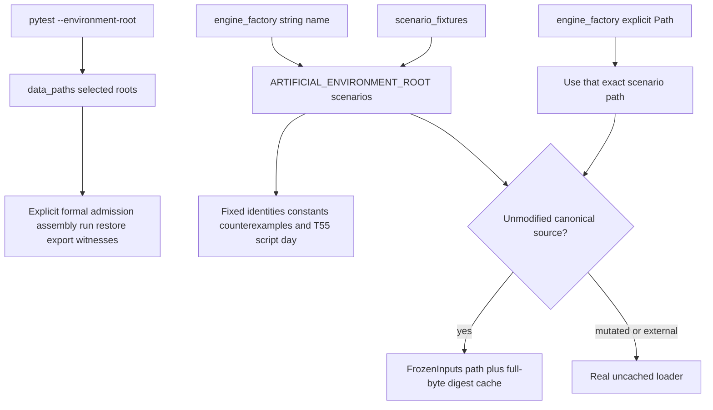

# Formal regression test input responsibilities

## Outcome and evidence boundary

This is a read-only repair design for the published Engine behavior at `c0265684bb2015f20353b3f3b55ab70123b9bd1c`.
It proposes test-input ownership only. It does not claim a green regression, change production behavior, change the frozen
specification, or reclassify the two old `unknown` nodes.

The frozen specification digest was rechecked as
`f61367ea90b6bdd188c8b4638f85e91b880f2cc5f482e14a4af5a3d7764a9784`. The authoritative old failure evidence is
`WorldMock-Dataset/execution/2026-10-07-resource-rule-acceptance/reviews/formal-regression-failures.json`, digest
`cc110c62e09a138aa72047026bd6a19a957dcbb9519b07c77fe2203321721da6`. It records 453 call failures and 13 setup
errors, for 466 distinct nodes in 89 files. The original classes remain 345 `artificial_fixture_selected_formal`, 119
`invalid_test_fixture`, and 2 `unknown`.

Every old failing node remains traceable without reinterpretation: join its exact `failures[].nodeid` in that JSON to the
same record's `cause_group` and `classification`. The companion JSON in this directory reproduces every cause group's exact
file/count map and reconciles the totals to 466. This design does not duplicate the parent-owned bootstrap investigation or
the separate controlled traces for the two old unknown nodes.

## Input ownership model



`--environment-root` must continue to call `select_environment` globally. The change is at each test's source
responsibility: fixed artificial behavior names the existing artificial root, while generic formal evidence passes the
selected scenario as an explicit `Path`.

## Smallest shared-foundation proposal

| File | Minimal behavior | Preserved invariant |
| --- | --- | --- |
| `tests/engine_fixture.py` | Change `create` to accept `scenario: str | Path`. Resolve a `str` under `ARTIFICIAL_ENVIRONMENT_ROOT / "scenarios"`; use a `Path` directly, without joining, searching, fallback, aliasing, or migration. | Existing `engine_factory("multi-person.json")` stays fixed artificial. Existing explicit paths continue to select their own environment. `_mutated_scenario` continues to copy the selected source catalog and refer to its corpus by a relative path. |
| `tests/engine_fixture.py` | Cache only when `mutate is None` and the resolved parent is either the canonical artificial scenarios directory or the current selected scenarios directory. | Default artificial and explicit selected-formal sources retain session reuse; mutated copies and arbitrary external paths retain real uncached loading. |
| `tests/life/scenario_fixtures.py` | Import `ARTIFICIAL_ENVIRONMENT_ROOT`; make `read_scenario` and `write_scenario` read/copy that one complete root. | No mixed artificial scenario/formal catalog. Existing relative corpus path, strict admission, T55 script actions, day length, seeds, and assertions remain unchanged. |
| `tests/frozen_inputs.py` | No cache-logic change. If touched, update only the stale artificial-only docstring to say canonical source scenarios. | Cache key remains `(resolved scenario path, input_digest)`. `input_digest` still covers scenario bytes plus complete catalog and corpus trees. Each use still deep-clones mutable semantics and session teardown still checks source and object digests. |
| `tests/data_paths.py` | No change. | The explicit formal selection remains globally observable through `ENVIRONMENT_ROOT`, `CATALOG_ROOT`, `CORPORA_ROOT`, and `SCENARIOS_ROOT`. |
| `conftest.py` | No change. | `pytest_configure` keeps selecting the provided formal root; `catalog_dir` stays explicitly artificial; the session cache still verifies at teardown. |

The cache test should compare resolved directories. A canonical-source predicate equivalent to the following is sufficient:

```text
mutate is None and scenario_path.resolve().parent in {
    (ARTIFICIAL_ENVIRONMENT_ROOT / "scenarios").resolve(),
    data_paths.SCENARIOS_ROOT.resolve(),
}
```

No second cache, source registry, configuration switch, environment discovery, or compatibility branch is needed.

The old traceback data contains `tests/engine_fixture.py` in 99 first-failure stacks: 68 message-window, 4 scheduled-event,
21 duplicate-food-name, 4 food-reference, and 2 work-topic-reference nodes. It contains
`tests/life/scenario_fixtures.py` in 24 scheduled-event stacks. These are exact stack counts, not a claim that only those
nodes depend on the shared fixtures; assertions reached after successful engine creation do not retain the fixture stack.

## Formal evidence that must remain selected

| Responsibility | Formal source after the shared change | Required local ownership |
| --- | --- | --- |
| Native admission | Keep `tests/test_validation.py::test_validate_environment_command_accepts_the_actual_artificial_environment` on dynamic `ENVIRONMENT_ROOT`. Do not rename the old node even though its historical name is misleading. | Only `published_environment` counterexample copies move to the artificial root. |
| Assembly and cache isolation | Pass `data_paths.SCENARIOS_ROOT / "single-person.json"` explicitly in the formal factory calls in `tests/life/test_frozen_inputs_runtime.py`. | Keep mutated scenarios uncached, direct create/open on real loaders, restore identity rejection, world isolation, and cache cardinality assertions. |
| Generic run and read query | Keep at least one read-query smoke on an explicit selected-formal `Path`, deriving the query from actual observed names rather than assuming remote supply. | The fixed supply/source-available matrix may use the factory's artificial default. Do not turn a valid empty formal match into a test expectation change. |
| Native lifecycle, restore, authenticated export | Add a selected-formal node in `tests/integration/test_external_environment_lifecycle.py` that passes the selected scenario `Path`, performs only generic accepted actions derived from scheduling state, checkpoints, closes/reopens, exports, and calls `validate_export`. | Keep all ten existing fixed-effect/artificial lifecycle nodes and their assertions. They remain artificial evidence and must not be relabeled formal. |

The new formal lifecycle node should not shorten the published formal window or inject artificial identities. This avoids
manufacturing a second derived-window fixture while proving the actual selected environment crosses create, action, storage,
restore, export, and export authentication boundaries.

## Local repairs beyond the shared foundation

| Owner | Required repair | Old evidence covered |
| --- | --- | --- |
| `tests/test_validation.py` | Copy `ARTIFICIAL_ENVIRONMENT_ROOT` in `published_environment`; keep the standalone acceptance node on selected `ENVIRONMENT_ROOT`. | 17 missing artificial rows, 2 no-change counterexamples, 1 wrong-reference counterexample. |
| `tests/life/test_load_checks.py` | Bind the module scenario, environment copy, and corpus reads to `ARTIFICIAL_ENVIRONMENT_ROOT`. | 2 no-change, 2 fixed constants, 4 location, and 7 work-assignment nodes in this file; `_changed_locations` also supplies the one travel-graph node. |
| `tests/life/test_rrs_food_body.py` | Load `body_config` and `foods` from the artificial scenario/catalog. | 5 direct food-reference nodes and the artificial pure-fixture prerequisites imported by the 52 dayrun-inventory and 10 meal-outcome nodes. Assertions and numeric constants stay unchanged. |
| `tests/footprints/test_validation.py` | Make only `test_build_coverage_targets_derives_from_catalog_and_corpora` use an explicit artificial scenario/catalog/corpus triple. | 1 fixed-artificial-constants node. Keep the module's generic validation paths selected formal. |
| `tests/integration/test_input_warnings.py` | Copy the artificial root in `profile_environment`. Keep generic selected-formal scenario helpers selected unless their own contract explicitly names the white-collar artificial world. | 1 location, 2 profile-target, and 2 profile-override nodes. Do not suppress `CARD_FIELD_OVERRIDDEN`. |
| `tests/integration/test_presentation_habits.py` | Give the fixed `quiet-rest` scenario an explicit artificial source. Do not inherit a selected-formal `_scenario` accidentally. | 1 missing-artificial-lifestyle node. |
| `tests/integration/test_strict_endpoint.py` | Change `_covered` from invalid media `电影` to an actually legal closed media label or a registered selected app name, while keeping a fully covered card. | 1 `invalid_covered_persona` node. Keep the 0.8 gate, compiler path, exception contracts, and endpoint assertions. |
| `tests/life/test_frozen_inputs_runtime.py` | Pass the selected formal scenario explicitly to every call whose test name or assertion says formal. | Preserves formal assembly evidence after string names become artificial. This file had no old failure and is a boundary regression owner. |
| `tests/life/test_world_query.py` | Retain one explicit selected-formal, name-derived read-query witness; leave fixed supply assumptions on artificial input. | Preserves the old passing formal `[name]` evidence without requiring formal remote supply. The two old formal failures remain mapped to `no_remote_supply_here`. |
| `tests/integration/test_external_environment_lifecycle.py` | Add the generic selected-formal lifecycle/restore/certified-export witness described above. | Closes the prior evidence gap: the existing ten passing nodes are explicitly artificial. |

The following direct fixed-input modules do not pass through either shared scenario helper. They also need an explicit
artificial root; changing the factory alone cannot repair them:

| Direct fixed-input owner | Old affected nodes | Source responsibility |
| --- | ---: | --- |
| `tests/life/test_activity_location_kinds.py` | 6 | `quiet-rest`, its corpus requirements, and the artificial map |
| `tests/life/test_body.py` | 2 | Fixed 70 kg body arithmetic |
| `tests/life/test_candidate_constants.py` | 4 | Fixed artificial rotation and candidate constants |
| `tests/life/test_lifestyle.py` | 4 | Artificial lifestyle corpus and declarations |
| `tests/life/test_scenario.py` | 6 | Three artificial scenarios and fixed work topic/body facts |
| `tests/life/test_semantics.py` | 2 | Artificial catalog, corpus, body, and assembled identities |
| `tests/scheduling/test_branch_coverage.py` | 2 | `noodle-1`, `beef-noodles`, `meituan`, and artificial accounts |

Changing the default factory also creates a second local obligation in previously passing tests: a run created or
checkpointed from artificial bytes cannot be reopened, resumed, or inspected with the selected formal scenario path. The
following call sites must use the artificial scenario path or retain the exact scenario path that created the run:

| Factory/source alignment owner | Coupled call sites |
| --- | --- |
| `tests/integration/test_errand_checkpoint.py` | `_SCENARIO` and the branch `LifeEngine.open` |
| `tests/integration/test_observation_agent_seam.py` | Both `LifeEngine.open` restore calls |
| `tests/integration/test_same_second_continuation.py` | `_branch` opening an `engine_factory` checkpoint; independent direct selected-formal entrypoint tests may retain `SCENARIO` |
| `tests/integration/test_read_query_runtime.py` | The reopened `LifeEngine` and `LifeEnv(open_existing=True)` built from `_staged_recall` |
| `tests/life/test_coverage_closure_scenario.py` | The two reopen checks for the factory-created food run; independent loader counterexamples may retain selected formal |
| `tests/life/test_day_plan.py` | The checkpoint restore in `test_minimal_engine_registration_progress_checkpoint_path` |
| `tests/life/test_energy_feasibility.py` | The overdrawn-activity restore |
| `tests/life/test_engine_branch_coverage.py` | The forged counterfactual branch open |
| `tests/life/test_engine_feedback.py` | The seeded multi-person checkpoint restore |
| `tests/life/test_restored_model_identity.py` | The fixed factory lifecycle path used by direct/open/environment variants |
| `tests/life/test_session_state.py` | Both version-corruption open checks |
| `tests/life/test_workload_report.py` | Scenario arguments paired with the factory-created run, especially the accepted multi-person report |

This alignment list is required to preserve original passing nodes. It does not move the separate generic formal witnesses
to artificial input. Using a stored source path is preferable where a file intentionally exercises both input classes; a
module-wide artificial constant is sufficient where every case is fixed behavior.

### Derived-window responsibility

All 69 old message-window nodes and all 28 old scheduled-event nodes retain their original
`invalid_test_fixture` classification. Under the chosen source model, their fixed behavior builders receive the artificial
one-day source through `engine_factory` or `scenario_fixtures`; the last message-window node,
`test_meal_and_decimal_price_order_sentences_come_from_real_settlements`, also uses `scenario_fixtures`. No production
interval or timezone check changes.

The existing window mutators are not valid generic formal transforms. In particular,
`tests/life/test_export_integration.py::_app_export_window` rewrites only the first message and first payroll, while
`tests/life/test_day_planning.py::_late_start` clears messages and filters payrolls but leaves bills. The viewer helper moves
the start and rewrites only its known message. Keep these on the artificial source. If any such test is deliberately retained
as selected-formal evidence, its local mutator must rebuild or filter **every** message, bill, and payroll into the new
interval and timezone before strict loading. Do not weaken the loader, edit only the first row, or change expected errors.
The proposed generic formal lifecycle witness avoids window mutation, so it needs no such transform.

## Exact old cause ownership

The companion JSON is the exact file/count ownership map. The group totals are:

| Cause group | Old class | Nodes | Repair responsibility |
| --- | --- | ---: | --- |
| `counterexample_no_change` | artificial fixture selected formal | 4 | Explicit artificial counterexample source |
| `counterexample_other_invalid_reference` | artificial fixture selected formal | 1 | Explicit artificial counterexample source |
| `derived_window_message` | invalid test fixture | 69 | Fixed-world source; complete collection transform if explicitly formal |
| `derived_window_scheduled_event` | invalid test fixture | 28 | Fixed-world source; complete collection/timezone transform if explicitly formal |
| `duplicate_habit_food_name` | invalid test fixture | 21 | Artificial engine-factory default; keep original habit data and duplicate-name admission rule |
| `fixed_artificial_constants` | artificial fixture selected formal | 34 | Artificial factory or explicit local artificial source |
| `intermediate_boundary_not_observed` | unknown | 1 | Parent-owned controlled trace; no threshold or assertion change |
| `invalid_covered_persona` | invalid test fixture | 1 | Local legal-media compiler stub |
| `missing_artificial_app` | artificial fixture selected formal | 1 | Artificial factory default |
| `missing_artificial_catalog_row` | artificial fixture selected formal | 17 | Artificial published counterexample copy |
| `missing_artificial_content` | artificial fixture selected formal | 2 | Artificial factory/local source |
| `missing_artificial_lifestyle` | artificial fixture selected formal | 11 | Artificial factory/local source |
| `missing_food_reference` | artificial fixture selected formal | 169 | Artificial factory and pure food fixture |
| `missing_location_reference` | artificial fixture selected formal | 51 | Artificial factory, scenario helper, and direct fixed module source |
| `missing_work_assignment` | artificial fixture selected formal | 34 | Artificial factory and direct fixed module source |
| `missing_work_topic_reference` | artificial fixture selected formal | 2 | Artificial scenario helper |
| `no_remote_supply_here` | artificial fixture selected formal | 12 | Fixed supply behavior on artificial; separate name-derived formal query witness |
| `profile_extra_overrides` | artificial fixture selected formal | 2 | Artificial profile fixture; do not suppress real warnings |
| `profile_target_mismatch` | artificial fixture selected formal | 2 | Artificial profile fixture |
| `qualified_lifestyle_index` | artificial fixture selected formal | 1 | Artificial fixed-index behavior |
| `script_did_not_finish` | unknown | 1 | Parent-owned controlled trace; keep 60-round limit |
| `work_refusal_then_clock_guard` | artificial fixture selected formal | 2 | Artificial work prerequisite; keep clock guard |
| **Total** |  | **466** | Every node remains joined to its old evidence record |

The parent's controlled comparison has separately found that the checkpoint node reaches its required body boundary after
3061 seconds on formal and 1008 seconds on artificial, and that the unique-presence script depends on an intermediate app
decision opportunity present in the artificial world. Those results support fixed artificial prerequisites, but this artifact
keeps both old evidence classes as `unknown` because it did not reproduce or own those traces.

## Verification boundary and residual risk

Only source and existing evidence were read. No pytest command, production mutation, fixture mutation, formal-data mutation,
model call, or network call was run. The exact per-group file counts in the companion JSON were derived from the authoritative
466 `failures[]` records, then reconciled against its published classification totals.

Green status remains unproved until the parent integrates the shared and local repairs, checks that all original 5701 nodes
are still collected, and runs the required formal regression gates. The formal lifecycle witness is also still an
implementation decision owned by the parent. Any affected test that continues to import a dynamic selected root while
asserting an artificial identity remains an unsolved ownership bug; do not compensate by changing the formal 97 data bytes or
the expected behavior.
